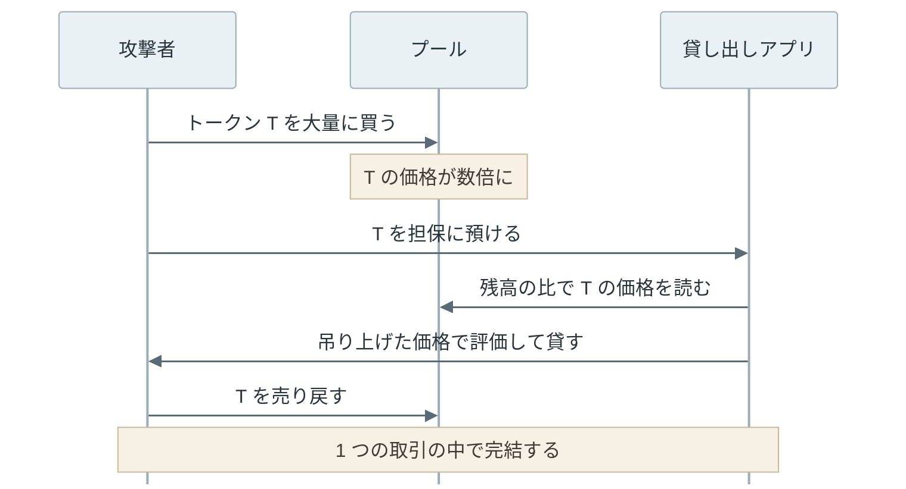

AMM（Automated Market Maker）は、2 種類のトークンを預けたプール（pool）と計算式だけで、トークンの交換を成立させる取引所の仕組みです。売り注文と買い注文を突き合わせる板（order book）は持たず、利用者はプールのコントラクトを相手に交換します。代表例の [Uniswap v2](https://app.uniswap.org/whitepaper.pdf) は、プールの 2 つの残高の積 `x × y` を交換の前後で減らさない定数積（constant product）の式を使います。

例えば、3,000,000 USDC と 1,000 ETH を持つプールでは、1 ETH が 3,000 USDC の比になっています。Alice がこのプールに 3,000 USDC を入れると、受け取れるのは 1 ETH ではなく 0.996 ETH です。後半の実験で計算した値で、差は手数料と、Alice の交換で ETH の残高が減って価格が上がる分です。



上記の図の 2 つの長方形は、面積（k）が同じです。USDC を入れて横に伸びた分だけ、ETH の残高が縦に縮みます。プールが決めているのは価格ではなく、この曲線の上のどこへ移るかです。

<br>

本記事では、Uniswap v2 のコントラクトとローカルの計算で、AMM が価格を決める仕組みと、その仕組みから生まれる損失・攻撃を説明します。扱う疑問は次の通りです。

- 取引所をチェーンの上に作る時、なぜ板を使わないのか。
- `x × y = k` から、受取量と価格はどう決まるのか。
- プールにトークンを預ける人は、何を得て何を失うのか。
- プールの価格を他のコントラクトが価格の情報源に使うと、何が起きるのか。

取引の並び順を使って利用者から価値を取る sandwich attack は [MEV](../mev/) で扱っています。本記事はその前提の計算を説明します。実験は Python の計算だけで行い、実際のネットワークや資産は使いません。

---

### 板をチェーンに置く費用

取引所と聞くと、売りと買いの注文を価格順に並べた板を思い浮かべるかもしれません。しかし、板をそのまま [スマートコントラクト](../smart-contract/) にすると、注文を出す・取り消す・価格を直す度に取引を送り、gas を払う必要があります。売りと買いの両方に注文を出し続ける側（マーケットメイカー）は、相場が動く度に注文を出し直すので、この負担が特に大きくなります。

2018 年の [Uniswap v1 の説明](https://hackmd.io/@477aQ9OrQTCbVR3fq1Qzxg/HJ9jLsfTz?type=view)は、板をチェーンの上に置く取引所と比べて交換の gas を大きく減らせたと述べています。使った式は、Vitalik Buterin が [ethresear.ch の投稿](https://ethresear.ch/t/improving-front-running-resistance-of-x-y-k-market-makers/1281)で x*y=k market maker として紹介したものです。注文を並べて管理する代わりに、残高を 2 つ持ち、交換の度に式で受取量を計算します。

---

### プールと x·y = k

Uniswap v2 のプールは、2 種類の [ERC-20](../erc-20/) トークンを持つ [`UniswapV2Pair`](https://github.com/Uniswap/v2-core/blob/6a9e7c97860676e0992f22a49665760444c1cdf5/contracts/UniswapV2Pair.sol) というコントラクトです。ETH は ERC-20 ではないため、ERC-20 に包んだ [WETH](https://ethereum.org/en/wrapped-eth/) として扱います。本記事では簡単のため ETH と書きます。

交換で入る量を `Δx`、出る量を `Δy` とすると、手数料を除けば `(x + Δx)(y − Δy) = x × y` を満たす `Δy` が受取量です。Uniswap v2 は入力の 0.3% を手数料としてプールに残すので、入力の 99.7% だけで計算します。受取量を計算する periphery（周辺のコントラクト群）の [`getAmountOut`](https://github.com/Uniswap/v2-periphery/blob/ed24991304291297c3b4a52818d02f46a17aa9a2/contracts/libraries/UniswapV2Library.sol#L43-L50) は、次の式です。

```text
Δy = (Δx × 997 × y) / (x × 1000 + Δx × 997)
```

一方で、プール自体は受取量を計算しません。[`swap`](https://github.com/Uniswap/v2-core/blob/6a9e7c97860676e0992f22a49665760444c1cdf5/contracts/UniswapV2Pair.sol#L159-L187) は、要求された量を先に送り出し、入ってきた量から手数料を引いた残高の積が元の `x × y` 以上かを確認します。価格について確かめるのは、この 1 点です。

```solidity
uint balance0Adjusted = balance0.mul(1000).sub(amount0In.mul(3));
uint balance1Adjusted = balance1.mul(1000).sub(amount1In.mul(3));
require(balance0Adjusted.mul(balance1Adjusted) >= uint(_reserve0).mul(_reserve1).mul(1000**2), 'UniswapV2: K');
```

<br>

プールが示す価格は、残高の比 `x / y` です。[ホワイトペーパー](https://app.uniswap.org/whitepaper.pdf)の 2.2 節もこの比を手数料を除いた限界価格として定義しています。冒頭のプールなら 3,000,000 / 1,000 = 3,000 USDC/ETH で、ETH が買われて `y` が減るほど高くなります。

以下は、実験に使うプールのコードです。全体は [lab/amm_sim.py](https://github.com/nao1215/debimate/blob/main/content/notes/blockchain-systems/amm/lab/amm_sim.py) で、本記事の 3 つのコードを順に並べると同じファイルになります。読みやすさのため浮動小数点数で計算しており、整数で切り捨てるコントラクトとは末尾の桁が異なります。

```python
"""Uniswap v2 style constant product pool (calculation only, no network access).

Python 3.10+ standard library only. Amounts are floats for readability; the
contract uses integers and rounds the output down.
Run: python3 amm_sim.py
"""
from math import sqrt

FEE = 0.003  # 0.3% of the input stays in the pool


class Pool:
    def __init__(self, usdc, eth):
        self.usdc = usdc  # reserve x
        self.eth = eth  # reserve y

    def price(self):
        """Spot price in USDC per ETH (x / y, fee excluded)."""
        return self.usdc / self.eth

    def k(self):
        return self.usdc * self.eth

    @staticmethod
    def amount_out(amount_in, reserve_in, reserve_out):
        """UniswapV2Library.getAmountOut: in*997*out / (rIn*1000 + in*997)."""
        in_with_fee = amount_in * (1 - FEE)
        return in_with_fee * reserve_out / (reserve_in + in_with_fee)

    def buy_eth(self, usdc_in):
        out = self.amount_out(usdc_in, self.usdc, self.eth)
        self.usdc += usdc_in
        self.eth -= out
        return out

    def sell_eth(self, eth_in):
        out = self.amount_out(eth_in, self.eth, self.usdc)
        self.eth += eth_in
        self.usdc -= out
        return out


# 1. Price impact: the larger the trade relative to the reserve, the worse the price.
print("== 1. price impact (pool 3,000,000 USDC / 1,000 ETH) ==")
for share in (0.001, 0.01, 0.05, 0.10, 0.30, 1.00):
    pool = Pool(3_000_000, 1_000)
    k_before = pool.k()
    usdc_in = pool.usdc * share
    eth_out = pool.buy_eth(usdc_in)
    avg = usdc_in / eth_out
    print(f"{usdc_in:>9,.0f} USDC -> {eth_out:8.3f} ETH  avg {avg:6,.0f} (+{(avg / 3000 - 1) * 100:6.2f}%)"
          f"  spot after {pool.price():6,.0f}  k +{(pool.k() / k_before - 1) * 100:.3f}%")
```

---

### 交換の大きさと価格インパクト

同じプールで買う量を 100 倍にすれば、受け取る ETH も 100 倍になると思うかもしれません。しかし、`x × y = k` の曲線では、残高に対して入れる量が大きいほど 1 ETH あたりの値段が上がります。前節のコードで、USDC の残高の 0.1% から 100% までを入れた結果は以下です（Python 3.14.4 での[出力](https://github.com/nao1215/debimate/blob/main/content/notes/blockchain-systems/amm/lab/amm_sim_output.txt)）。

```text
== 1. price impact (pool 3,000,000 USDC / 1,000 ETH) ==
    3,000 USDC ->    0.996 ETH  avg  3,012 (+  0.40%)  spot after  3,006  k +0.000%
   30,000 USDC ->    9.872 ETH  avg  3,039 (+  1.30%)  spot after  3,060  k +0.003%
  150,000 USDC ->   47.483 ETH  avg  3,159 (+  5.30%)  spot after  3,307  k +0.014%
  300,000 USDC ->   90.661 ETH  avg  3,309 (+ 10.30%)  spot after  3,629  k +0.027%
  900,000 USDC ->  230.236 ETH  avg  3,909 (+ 30.30%)  spot after  5,066  k +0.069%
3,000,000 USDC ->  499.249 ETH  avg  6,009 (+100.30%)  spot after 11,982  k +0.150%
```

`avg` は買った人が払った 1 ETH あたりの平均の値段で、`spot after` は交換の後のプールの価格です。3,000 USDC の 100 倍の 300,000 USDC を入れても、受け取れるのは 99.6 ETH ではなく 90.661 ETH です。USDC の残高の割合 `s` だけ入れると、平均の値段はおよそ `s` に手数料の 0.3% を足した分だけ上がり、残高の 10% なら +10.30% です。この上昇を価格インパクト（price impact）と呼びます。



上記の図のように、交換の後のプールの価格は平均の値段のおよそ 2 倍の速さで上がります。次に同じ向きに買う人は、この上がった価格から買い始めます。自分より前に大きな買いが入ると受取量が減るため、利用者は受取量の下限（Uniswap v2 の Router では `amountOutMin`）を付けて交換します。この下限が狙われる例は [MEV の sandwich attack](../mev/#sandwich-attack-の計算) で説明しています。

出力の右端の `k` は、交換の度にわずかに増えています。手数料の 0.3% が `x` に残るからです。この増えた分が、次節のプールに預けた人の収入になります。

---

### 流動性提供者の取り分

プールの残高は、誰かが預けたトークンです。その時点の残高の比で 2 種類のトークンを預ける人を流動性提供者（liquidity provider、LP）と呼びます。

LP が預けると、プールは持ち分を表す LP トークン（ERC-20）を発行します。[`mint`](https://github.com/Uniswap/v2-core/blob/6a9e7c97860676e0992f22a49665760444c1cdf5/contracts/UniswapV2Pair.sol#L110-L131) は、預けた量が残高の何割かに応じて発行量を決めます。引き出す時の [`burn`](https://github.com/Uniswap/v2-core/blob/6a9e7c97860676e0992f22a49665760444c1cdf5/contracts/UniswapV2Pair.sol#L134-L156) は、LP トークンの割合だけ、その時点の 2 つの残高を返します。

手数料は LP に配られるのではなく、プールの残高に足されます。LP トークンの数は変わらず、1 枚あたりで引き出せる量が増えます。ホワイトペーパーによると、Uniswap v2 には 0.3% のうち 0.05% を LP 以外へ回す protocol fee の切り替えがあり、論文の時点（2020 年 3 月）では無効でした。

<br>

注意点は、引き出す時に返るのが「預けた量」ではなく「その時点の残高の割合」であることです。残高の比は、外の市場の価格に合わせて変わります。プールが外の価格を知る方法から見ていきます。

---

### 裁定取引で揃う価格

AMM のプールが、外の取引所の価格を取りに行っていると思うかもしれません。しかし、プールは外の価格を知りません。外で ETH が 3,000 USDC から 3,030 USDC に上がっても、プールの価格は 3,000 のままです。

この差を埋めるのは、裁定取引（arbitrage）をする人です。プールで安く ETH を買って外で売れば、手数料を払っても利益が出ます。プールの価格が外の価格に近付くまで買われ、差が手数料より小さくなると止まります。ホワイトペーパーの 2.2 節も、この裁定によってプールの価格が市場の価格を追うと説明しています。

以下は、外の価格に合わせて裁定取引をした後に、プールを 1 人で持つ LP の価値と、預けずに持ち続けた場合（HODL）の価値を比べるコードです。利益が最大になる交換量は、受取量の式を微分して求めています。

```python
# 2. Arbitrage moves the pool to the outside price. The LP (owner of the whole
#    pool here) is compared with HODL (keeping the deposited tokens as they are).
def arbitrage(pool, market):
    """Trade toward the market price if it pays after the fee. Returns profit in USDC."""
    g = 1 - FEE
    x, y = pool.usdc, pool.eth
    if market * g > pool.price():  # ETH is cheap in the pool: buy ETH
        a = (sqrt(g * x * y * market) - x) / g  # input that maximizes the profit
        return pool.buy_eth(a) * market - a
    if market < pool.price() * g:  # ETH is expensive in the pool: sell ETH
        b = (sqrt(g * x * y / market) - y) / g
        return pool.sell_eth(b) - b * market
    return 0.0


def run(label, path):
    pool = Pool(3_000_000, 1_000)
    hold_usdc, hold_eth = pool.usdc, pool.eth
    arb = sum(arbitrage(pool, p) for p in path)
    p = path[-1]
    lp = pool.usdc + pool.eth * p
    hodl = hold_usdc + hold_eth * p
    r = p / 3000
    il = 2 * sqrt(r) / (1 + r) - 1  # impermanent loss without fees
    print(f"{label:<15} price {p:5,.0f}  pool ETH {pool.eth:7.1f}"
          f"  LP vs HODL {(lp / hodl - 1) * 100:+6.2f}% (no fee {il * 100:+6.2f}%)"
          f"  arb {arb:6,.0f}")


print()
print("== 2. arbitrage, LP vs HODL ==")
up = [3000 * 1.01 ** i for i in range(1, 71)]  # 1% per step, about 2x
run("up to 2x", up)
run("2x and back", up + up[-2::-1] + [3000])
run("chop +-2% x100", [3060, 3000] * 100)
run("down to 1/2", [3000 * 0.99 ** i for i in range(1, 70)])
```

外の価格の動きは 4 通りです。1% ずつ 2 倍まで上がる、2 倍まで上がって元に戻る、3,000 と 3,060 の間を 100 往復する、半分まで下がる、の順です。

```text
== 2. arbitrage, LP vs HODL ==
up to 2x        price 6,020  pool ETH   707.3  LP vs HODL  -5.72% (no fee  -5.77%)  arb  6,188
2x and back     price 3,000  pool ETH   999.5  LP vs HODL  +0.10% (no fee  +0.00%)  arb 12,298
chop +-2% x100  price 3,000  pool ETH  1000.6  LP vs HODL  +0.21% (no fee  +0.00%)  arb 28,910
down to 1/2     price 1,500  pool ETH  1413.1  LP vs HODL  -5.68% (no fee  -5.72%)  arb  4,363
```

1 行目では、外の価格が 2 倍になった後、プールの ETH は 1,000 から 707.3 に減っています。裁定取引をする人が、値上がりした ETH を外より安くプールから買っていったからです。LP の価値は、ETH を持ち続けた場合より 5.72% 少なくなりました。

---

### 持ち続けた場合との差

前節の差（手数料を除くと 5.77%）は、impermanent loss と呼ばれます。[Uniswap v2 のドキュメント](https://developers.uniswap.org/docs/protocols/v2/concepts/understanding-returns)は、預けた時からの価格の比を `r` として、手数料を除いた差を `2√r / (1 + r) − 1` と示しています。



上記の図のように、差は価格が上がっても下がっても生じ、2 倍と半分ではどちらも −5.7% です。実験の点が式より少しだけ上にあるのは、手数料の収入の分です。

<br>

名前の impermanent（一時的）は、価格が預けた時に戻れば差が消えることから来ています。前節の 2 行目では、2 倍から 3,000 に戻ると差は消え、手数料の分だけ +0.10% になりました。3 行目のように同じ範囲を往復する相場では、往復の度に手数料の分だけ LP の価値が増えます。

ただし、価格が離れたまま引き出せば、差は確定します。この差が全て裁定取引をした人に渡るわけではありません。前節の出力の右端にある `arb`（裁定取引の利益、USDC）は 2 倍の行で 6,188 USDC で、LP と HODL の差（約 51 万 USDC）よりずっと小さく、差の大半は価格の変動そのものによるものです。Milionis らの[論文](https://arxiv.org/abs/2208.06046)は、市場の価格変動による部分と、手数料の収入から裁定取引で失う分（LVR、loss-versus-rebalancing）を引いた部分に、LP の収益を分けて分析しています。

---

### プールの価格を価格の情報源に使う危険

プールの価格は裁定取引で市場の価格に揃うので、他のコントラクトがそのまま価格の情報源（[オラクル](../oracle/)）に使えると思うかもしれません。しかし、プールの価格は、交換した人が動かせる値です。

ホワイトペーパーの 2.2 節は、Uniswap v1 の価格はオラクルとして安全ではないと述べ、次の手順を挙げています。攻撃者はプールで大きく買って価格を吊り上げ、その価格で他のコントラクトにデリバティブを決済させ、最後に売り戻して価格を元に戻します。3 つを 1 つの取引にまとめれば、途中に他人の取引は入りません。



価格を吊り上げる資金は、同じ取引の中で借りて返せます。これを flash loan と呼びます。Uniswap v2 の [`swap`](https://github.com/Uniswap/v2-core/blob/6a9e7c97860676e0992f22a49665760444c1cdf5/contracts/UniswapV2Pair.sol#L170-L172) もトークンを先に送ってから送り先 `to` のコントラクトの `uniswapV2Call` を呼び、最後に `k` を確認するので、受け取ったトークンを同じ取引で使ってから返せます。ホワイトペーパーはこれを flash swap と呼んでいます。資金を持たない攻撃者でも、上記の図の手順を実行できます。

<br>

ホワイトペーパーが実例として挙げているのは、samczsun の [2019 年の報告](https://samczsun.com/taking-undercollateralized-loans-for-fun-and-for-profit/)です。貸し出しを行う [bZx](https://github.com/bZxNetwork) は担保の価格を [Kyber](https://kyber.network/) から読んでおり、REP の価格は Uniswap のプールと連携していました。報告では、過去のチェーンの状態を使い、プールの REP の 9 割を買うと 1 REP が約 0.05 ETH から約 6.05 ETH に上がることを示しています。報告は修正の後に公開され、資金は失われていません。

---

### TWAP と操作の費用

Uniswap v2 は、この問題に対して時間で重み付けした平均価格（TWAP、Time-Weighted Average Price）を作れるようにしました。[`_update`](https://github.com/Uniswap/v2-core/blob/6a9e7c97860676e0992f22a49665760444c1cdf5/contracts/UniswapV2Pair.sol#L73-L86) は、各ブロックで最初にプールが操作された時、前回の操作から経過した秒数と、その間の価格を掛けて `price0CumulativeLast` に足します。

```solidity
price0CumulativeLast += uint(UQ112x112.encode(_reserve1).uqdiv(_reserve0)) * timeElapsed;
```

足す価格は、そのブロックの交換の前の残高から計算します。そのため、1 つの取引の中で吊り上げて売り戻した価格は、累積値に入りません。累積値に入れるには、ブロックの最後まで価格を吊り上げたままにする必要があります。そうすると、その間に裁定取引をする人に価格を戻される可能性が高くなります。

TWAP を使う側は、時刻 `t1` と `t2` で累積値を読み、差を経過秒数で割ります。区間を長くするほど操作の費用は上がり、代わりに価格は古くなります（ホワイトペーパー 2.2 節）。Uniswap の[オラクルの例](https://github.com/Uniswap/v2-periphery/blob/ed24991304291297c3b4a52818d02f46a17aa9a2/contracts/examples/ExampleOracleSimple.sol)は、24 時間の区間を使っています。

<br>

以下は、攻撃者が最後の `held` ブロックの終わりに価格を 4 倍へ吊り上げ、次のブロックの先頭で裁定取引に戻されるとして、累積値から TWAP を計算するコードです。Ethereum の 1 ブロック（slot）を 12 秒としています。

```python
# 3. TWAP: the pair adds (price x seconds) to a cumulative value at the start of
#    each block. The attacker pushes the price to 4x at the end of the last
#    `held` blocks; arbitrage restores it at the start of the next block.
BLOCK = 12  # seconds per slot


def manipulate(held, target=4.0, blocks=150):
    pool = Pool(3_000_000, 1_000)
    market = pool.price()
    acc, cost = [0.0], 0.0
    for n in range(blocks):
        arbitrage(pool, market)  # first trade of block n
        if n >= blocks - held:  # attacker's trade at the end of block n
            usdc_in = pool.usdc * (sqrt(target) - 1) / (1 - FEE)
            cost += usdc_in - pool.buy_eth(usdc_in) * market
        acc.append(acc[-1] + pool.price() * BLOCK)  # this price holds for one block

    def twap(seconds):
        return (acc[-1] - acc[-1 - seconds // BLOCK]) / seconds

    print(f"held {held:>3} blocks  spot {pool.price():6,.0f}  TWAP 24s {twap(24):6,.0f}"
          f"  TWAP 30min {twap(1800):6,.0f}  attacker cost {cost / 1e6:6.1f}M USDC")


print()
print("== 3. pushing the price to 4x: spot vs TWAP (block 12 s) ==")
for held in (0, 1, 10, 150):
    manipulate(held)
```

`attacker cost` は、攻撃者が払った USDC と、受け取った ETH を市場の価格で換算した額の差です。出力は以下です。

```text
== 3. pushing the price to 4x: spot vs TWAP (block 12 s) ==
held   0 blocks  spot  3,000  TWAP 24s  3,000  TWAP 30min  3,000  attacker cost    0.0M USDC
held   1 blocks  spot 12,018  TWAP 24s  7,509  TWAP 30min  3,060  attacker cost    1.5M USDC
held  10 blocks  spot 12,036  TWAP 24s 12,036  TWAP 30min  3,602  attacker cost   15.2M USDC
held 150 blocks  spot 12,036  TWAP 24s 12,036  TWAP 30min 12,036  attacker cost  254.3M USDC
```



1 ブロックだけ吊り上げても、30 分の TWAP は 3,060 で 2% しか動きません。しかし、24 秒の TWAP は 7,509 まで動きます。30 分の TWAP を 4 倍にするには 150 ブロックの間吊り上げ続ける必要があり、費用は 2 億 5 千万 USDC を超えました。600 万 USDC 相当のプールに対して、費用はその 40 倍以上です。[Uniswap v2 のオラクルの説明](https://developers.uniswap.org/docs/protocols/v2/concepts/oracles)も、操作の費用はプールの残高と区間の長さにおおよそ比例すると述べています。

---

### TWAP の区間が短かった事故

TWAP を使っていても、区間が短ければ操作できます。2022 年 4 月 2 日の [Inverse Finance](https://www.inverse.finance/) の事故では、貸し出しアプリが [SushiSwap](https://github.com/sushiswap/v2-core)（Uniswap v2 のコードを元にした取引所）の INV/WETH プールの TWAP から、担保の INV の価格を読んでいました。[CertiK の分析](https://www.certik.com/blog/inverse-finance-02-april-2022)と [RedStone の分析](https://www.redstone.finance/blog/oracle-attacks-1-inverse-finance-15m-stolen/)によると、次の順序で起きました。

1. INV/WETH プールの残高は約 432 INV と 46 ETH だった。攻撃者は 300 ETH で 374 INV を買い、残高は 57.7 INV と 346 ETH になった。INV の価格は 50 倍以上になった。この取引は公開 [mempool](../mempool/) を通さずブロックを作る側へ直接送られ、ブロック 14506358 に入った。
2. 次のブロックでプールの価格は裁定取引で戻されたが、オラクルが返す値には吊り上げた価格が残っていた。攻撃者は大量の取引を送り、その間に自分の担保の預け入れと借り入れが実行されるようにした。
3. 攻撃者は買った INV（別の経路で買った分と合わせて 1,746 INV）を担保に、1,588 ETH、94 WBTC、3,999,669 DOLA、39 YFI を借りた。

価格を読んでいたのは、Inverse Finance の [`InvFeed`](https://github.com/InverseFinance/anchor/blob/4d219093d3bd1f61f176d04412ebd83460d6803b/contracts/InvFeed.sol#L33-L35) が呼ぶ Keep3r Network の [`Keep3rV2Oracle.current`](https://github.com/keep3r-network/keep3r.network/blob/a79922ce0c67890345b97350c109f25ca9185d0d/contracts/Keep3rV2OracleFactory.sol#L90-L111) です。この関数は、最後に記録した累積値から、ペアの累積値が最後に更新された時点までを平均します。記録は 30 分（`periodSize = 1800`）を超えて空いた時に足されるので、平均の区間は記録の直後ほど短くなります。`current` は区間の長さ `lastUpdatedAgo` も返しますが、`InvFeed` はこれを捨てていました。

CertiK は、攻撃の時点の区間が短く、吊り上げた価格がそのまま使われたと分析しています。[CoinDesk の報道](https://www.coindesk.com/tech/2022/04/02/defi-lender-inverse-finance-exploited-for-156-million/)によると、Inverse Finance は被害を 1,560 万ドルと発表しました。攻撃者は [Tornado Cash](https://github.com/tornadocash) から約 900 ETH を引き出して元手にしており、flash loan は使っていません。資金を借りずに 1 ブロックだけ価格を保てば足りるほど、プールが小さく、区間が短かった事故です。

---

### 利用時の注意

AMM で交換する側は、プールの残高に対して自分の交換量がどれだけ大きいかを見て、受取量の下限を付けます。LP は、価格が離れた時の impermanent loss を手数料の収入が上回るかを考えて預けます。

プールの価格を使うコントラクトは、`getReserves` の残高の比をそのまま使わず、十分に長い区間の TWAP か、[Oracle](../oracle/) で扱った価格フィードのように、チェーンの外の複数の市場から集めた価格を使います。TWAP を使う時は、区間の長さとプールの残高から、操作に必要な費用が守る資産の額を上回るかを確認します。

本記事は Uniswap v2 の式を扱いました。[Uniswap v3](https://app.uniswap.org/whitepaper-v3.pdf) は、LP が価格の範囲を選んで預ける concentrated liquidity を加えています。範囲の中では、仮想的な残高で同じ定数積の式を使います。
