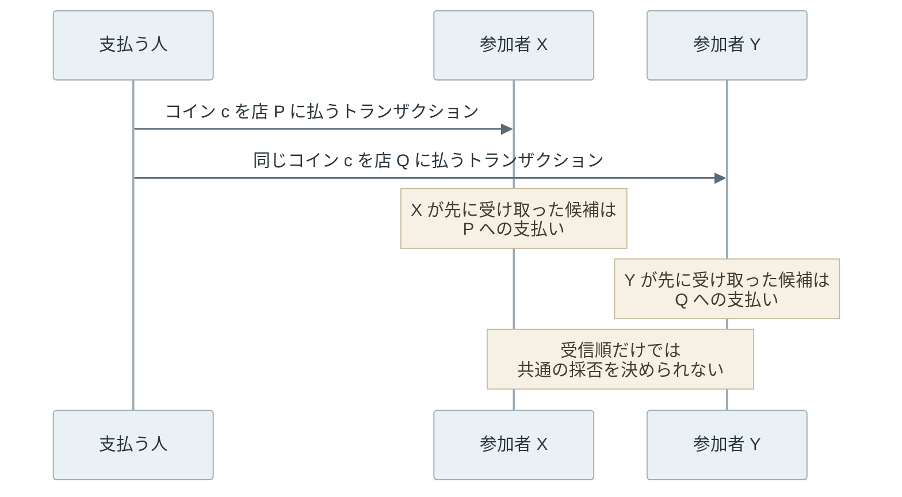
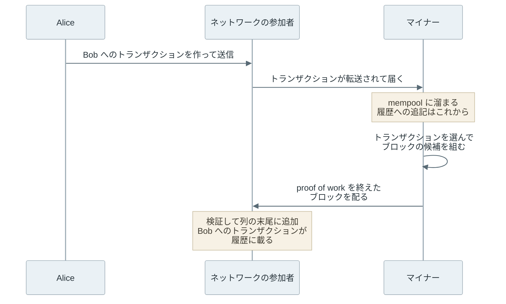
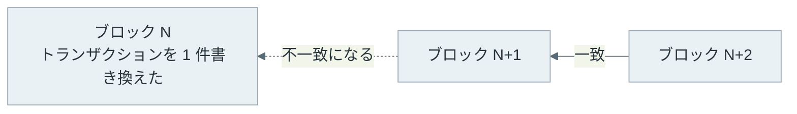

[Bitcoin](https://bitcoin.org/) のブロックは、複数のトランザクションをまとめたデータです。最初のブロックを除き、各ブロックは直前のブロックを参照しており、チェーン状に繋がっています。ブロックの列が[ブロックチェーン](../blockchain-basics/)で、Bitcoin の参加者はこの列を送金の履歴として共有します。

Bitcoin で代金を受け取る場合、送金の通知だけで商品を渡すと、そのトランザクションが履歴に残らない可能性があります。受け取りを確認するには、トランザクションがブロックに取り込まれたか、その後に何個のブロックが追加されたかを調べます。

以下の図では、各ブロックが 1 つ前のブロックを参照しています。



上記の図のとおり、各ブロックは小さいヘッダと大きい本体に分かれ、ヘッダの中の「直前」（直前のブロックのハッシュ）が 1 つ前のブロックを指します。ここでの[ハッシュ](/notes/blockchain-systems/hash-function/)は、データから計算する固定長の値です。暗号学的ハッシュでは、内容を変えた時に同じ値になる組を見つけることが極めて難しく、内容の照合に使えます。

ヘッダのもう 1 つの項目である root（ルートハッシュ）は、本体に並ぶトランザクション全体を代表する値です。ブロック N+1 のトランザクションを 1 件書き換えると、root が変わってブロック N+2 の「直前」と一致しなくなり、合わせるには後ろのブロックを全て作り直す必要があります。

<br>

本記事では、ブロックの構造と、送金がブロックに含まれるまでの流れを説明します。

- 履歴を共有するのに、なぜブロックという単位が必要なのか。
- トランザクションは、作られてからどのようにブロックに入るのか。
- ブロックのヘッダと本体には、何が収められているのか。
- 最初のブロックの時刻を 1 秒進めると、次のブロックとの繋がりはどうなるのか。

ブロックに必要な計算の証拠である [proof of work](../proof-of-work/)（プルーフ・オブ・ワーク）の詳細、[コインの残高の管理方式](../utxo/)、[トランザクションに付く署名の仕組み](../digital-signature/)は、本記事では扱いません。

---

### ブロックという単位が必要な理由

Bitcoin には、履歴を管理する中央のサーバーがありません。世界中の参加者がそれぞれ履歴の複製を持ち、どのトランザクションがどの順序で履歴に入ったのかについて、認識を一致させる必要があります。

例えば、同じコインを異なる相手に送る 2 つのトランザクションが作られた場合、有効な履歴に入れられるのはどちらか一方です。参加者ごとに異なるトランザクションを採用すると、コインの持ち主についての認識が食い違います。

以下は、順序が揃わないまま同じコインを使う 2 つの支払いが作られた場合の流れです。



受信した順に記録するだけでは、店 P と店 Q のどちらへの支払いを認めるかが揃いません。Bitcoin ではトランザクションをブロックにまとめ、ブロックの列を共有することで、トランザクションの順序と採否を揃えます。ブロックを作る参加者（マイナー）が、ブロックに入れるトランザクションとその並びを決めます。ただし、有効なトランザクションだけを入れるなど、他の参加者が検証する規則を満たす必要があります。

マイナーは、ヘッダのハッシュが決められた条件を満たすまで、ヘッダの nonce（自由に変えられる 4 バイトの値）などを変えてハッシュを計算し直します。条件を満たすハッシュが proof of work の証拠で、マイナーはそのハッシュを見つけるとブロックをネットワークに送信します。

ほぼ同時に別のマイナーがブロックを見つける場合もあり、最初に見つけたブロックが全参加者に採用されるとは限りません。条件の厳しさは、新しいブロックがおよそ 10 分に 1 個のペースで列の末尾に追加されるよう自動で調整されます。詳細は [Proof of Work](../proof-of-work/) のノートで扱います。

どのブロックの何番目に入ったかで、履歴全体でトランザクションが並ぶ順番が決まります。[ブロックへの取り込み](https://bitcoin.org/bitcoin.pdf)は、そのブロックが作られる前にトランザクションが存在したことの証拠になります。ただし、ヘッダの時刻はマイナーが規則の範囲内で申告する値であり、正確な受信時刻を保証するものではありません。時刻の代わりにハッシュの連鎖で経過と順序を示す [Solana](https://solana.com/) の方式は [Proof of History](../proof-of-history/) で説明しています。

---

### トランザクションが作られてからブロックに入るまで

トランザクション（transaction）は、コインの移動を記録するデータです。通常のトランザクションは、過去に自分が受け取ったトランザクションの出力を入力として参照し、新しい宛先と金額を出力として並べ、使う資格を示す署名を添えます。例外はブロックの先頭に置かれるコインベーストランザクションで、過去の出力を参照せず、ブロックを作った参加者が報酬を受け取ります。

作られたトランザクションは、参加者から参加者に転送されて Bitcoin のネットワーク全体に広まります。各参加者は、トランザクションの有効性や自分の受け入れ条件を確認し、受理したものを未確認トランザクションの置き場（[mempool](../mempool/)）に保存します。mempool は参加者ごとに異なり、そこにあるだけでは共有されたブロックの履歴に載ったことにはなりません。

マイナーは、mempool からトランザクションを選んで並べ、ブロックの候補を組み立ててから proof of work の計算を行います。マイナーは、ブロックに取り込んだトランザクションの手数料を受け取ります。そのため、混雑時はサイズあたりの手数料が高いトランザクションが優先されます。

proof of work を終えたブロックは、ネットワークに広まります。各参加者は proof of work とトランザクションの内容を検証し、自分が採用するチェーンを伸ばす有効なブロックを末尾に追加します。

例えば、Alice が Bob に支払うトランザクションは、次の流れで作られてから履歴に載ります。



Bob は、参加者が採用したブロックに自分宛てのトランザクションが含まれているかを確認できます。1 件の送金を段階ごとに追う説明は、[Bitcoin Transaction Lifecycle](../bitcoin-transaction-lifecycle/) にあります。

---

### ブロックヘッダとブロック本体

ブロックは、[80 バイトのヘッダ](https://developer.bitcoin.org/reference/block_chain.html)と、トランザクションの並びを収めた本体に分かれます。ブロック全体の大きさは block weight という尺度で測り、上限は 400 万です。block weight を定めた [BIP 141](https://github.com/bitcoin/bips/blob/master/bip-0141.mediawiki)（SegWit を導入した改善提案）では、トランザクションから切り分けた署名などのデータ（witness）の重みが、他のデータの 4 分の 1 です。

以下がヘッダの 6 項目です。

| 項目 | 大きさ | 何を表すか |
|---|---|---|
| バージョン | 4 バイト | ブロックの形式の世代（新規則への対応表明にも使う） |
| 直前のブロックのハッシュ | 32 バイト | 1 つ前のブロックのヘッダを 2 回 SHA-256 した値 |
| ルートハッシュ（Merkle root） | 32 バイト | 本体に並ぶトランザクション全体を代表する値 |
| 時刻 | 4 バイト | マイナーが申告するおおよその作成時刻 |
| bits | 4 バイト | proof of work のターゲット（target）の圧縮表現 |
| nonce | 4 バイト | 合格するハッシュを探すために変え続ける値 |

表の 3 行目のルートハッシュは、トランザクションの識別子である txid を並べ、隣り合うハッシュを連結して [SHA-256](/notes/security/sha-256/)（Secure Hash Algorithm 256、出力が 32 バイトのハッシュ関数）を 2 回適用する計算を繰り返し、1 つにまとめた値です。txid が 1 つでも変わるとルートハッシュも変わるので、ヘッダからトランザクションの変更を検出できます。

witness は txid に含まれません。そのハッシュは、コインベーストランザクション内の commitment（データを照合するためのハッシュ値）に記録されます。木の作り方と包含証明の仕組みは [Merkle Tree](../merkle-tree/) で、Bitcoin での計算規則と検証は [Bitcoin Merkle Tree](../bitcoin-merkle-tree/) で扱っています。

トランザクション本体を保存せず、ヘッダだけを使ってチェーンを追うこともできます。ヘッダは 1 ブロック 80 バイトなので、100 万ブロックでもヘッダ本体は約 80 MB です。ただし、ヘッダと包含証明だけでは、トランザクションがブロックに含まれることしか確認できません。署名の正しさやコインの二重使用などを検証するには、トランザクション本体を含むデータが必要です。

---

### 直前のハッシュによる連結

ヘッダを SHA-256 で 2 回ハッシュした値は、そのブロックの識別子（ブロックハッシュ）でもあり、次のブロックの「直前のブロックのハッシュ」に入ります。各ブロックが 1 つ前を指すことで、最初のブロックまで一本道で辿れる列ができます。

ブロック 0 とブロック 1 を使って、ヘッダのハッシュを計算します。入力は、Bitcoin Core の[ソースコード](https://github.com/bitcoin/bitcoin/blob/master/src/kernel/chainparams.cpp)に書かれた最初のブロック（ブロック 0）の各項目と、ブロックエクスプローラーの [Blockstream Explorer](https://blockstream.info/api/block/00000000839a8e6886ab5951d76f411475428afc90947ee320161bbf18eb6048/header) から取得したブロック 1 のヘッダです。

以下の [verify-headers.py](./verify-headers.py) は、ブロック 0 の各項目を 80 バイトのヘッダに並べ、ブロック 0 と 1 のヘッダに SHA-256 を 2 回適用します。ブロック 0 の時刻だけを 1 秒進めたヘッダも比べます。入力はコードに含めているので、ネットワークに接続せず実行できます。

```python
"""Reproduce the four header values without network access.
Run: python3 verify-headers.py
Genesis: https://github.com/bitcoin/bitcoin/blob/master/src/kernel/chainparams.cpp
Block 1: https://blockstream.info/api/block/00000000839a8e6886ab5951d76f411475428afc90947ee320161bbf18eb6048/header
"""

from hashlib import sha256
import struct, sys


def block_hash(header):
    assert len(header) == 80
    return sha256(sha256(header).digest()).digest()[::-1].hex()


# Genesis fields from Bitcoin Core src/kernel/chainparams.cpp.
merkle = bytes.fromhex("4a5e1e4baab89f3a32518a88c31bc87f618f76673e2cc77ab2127b7afdeda33b")[::-1]
genesis = (
    struct.pack("<I", 1)
    + bytes(32)
    + merkle
    + struct.pack("<III", 1231006505, 0x1D00FFFF, 2083236893)
)
block1 = bytes.fromhex(
    '010000006fe28c0ab6f1b372c1a6a246ae63f74f931e8365e15a089c68d6190000000000982051fd1e4ba744bbbe680e1fee14677ba1a3c3540bf7b1cdb606e857233e0e61bc6649ffff001d01e36299'
)
changed = genesis[:68] + struct.pack("<I", 1231006506) + genesis[72:]
actual = [block_hash(genesis), block1[4:36][::-1].hex(), block_hash(block1), block_hash(changed)]
expected = [
    "000000000019d6689c085ae165831e934ff763ae46a2a6c172b3f1b60a8ce26f",
    "000000000019d6689c085ae165831e934ff763ae46a2a6c172b3f1b60a8ce26f",
    "00000000839a8e6886ab5951d76f411475428afc90947ee320161bbf18eb6048",
    "775212d740bc3900e6c050f43c2cb2db9218b3981e5d11bb0abadf9d9f164b69",
]
assert actual == expected
labels = ["block0_hash", "block1_prev_hash", "block1_hash", "block0_time+1s_hash"]
print(sys.version)
for label, value in zip(labels, actual):
    print(f"{label:<20} {value}")
print('PASS: all 4 article values match')
```

以下が Python 3.14 での実行結果です。`block1_prev_hash` は、ブロック 1 のヘッダにある直前のブロックのハッシュです。

```text
3.14.4 (main, Aug 20 2026, 10:41:58) [GCC 15.2.0]
block0_hash          000000000019d6689c085ae165831e934ff763ae46a2a6c172b3f1b60a8ce26f
block1_prev_hash     000000000019d6689c085ae165831e934ff763ae46a2a6c172b3f1b60a8ce26f
block1_hash          00000000839a8e6886ab5951d76f411475428afc90947ee320161bbf18eb6048
block0_time+1s_hash  775212d740bc3900e6c050f43c2cb2db9218b3981e5d11bb0abadf9d9f164b69
PASS: all 4 article values match
```

ブロック 0 のハッシュと、ブロック 1 が参照するハッシュは一致しています。しかし、ブロック 0 の時刻を 1 秒進めるとハッシュは全く別の値となり、ブロック 1 の参照先と一致しなくなります。トランザクションの内容を変えた場合も、txid とルートハッシュが変わるので、ヘッダのハッシュが変わります。

変更前の 2 ブロックのハッシュは先頭に 0 が並び、proof of work の条件を満たしています。時刻を変更したブロックのハッシュは 7 から始まり、その条件を満たしません。

書き換えの影響が後ろに伝わる様子は以下の通りです。図の矢印は、ヘッダが持つ参照の向きです。



上記の図で N を書き換えると、N+1 以降のヘッダも参照先のハッシュを更新して作り直す必要があり、そのたびに proof of work をやり直します。後ろにブロックが積まれるほど、書き換えに必要な計算量が膨らみます。

さらに、書き換えている間も他のマイナーは元のチェーンにブロックを追加します。書き換えたチェーンが採用されるには、規則を満たした上で、元のチェーンよりも大きい累積作業量が必要です。

<br>

なお、チェーンの末尾は一時的に分岐することがあります。複数のマイナーがほぼ同時にブロックを作ると、参加者ごとに別の末尾を見ている状態になります。各参加者は、規則を満たす列のうち、累積の作業量が最も大きい列を採用します。この作業量は実際に試した回数ではなく、各ブロックのターゲットから計算する値です。同じ難易度なら長い列ほど大きくなります。

採用する列の切り替えを再編成（reorganization、reorg）と呼びます。外れたブロック内のトランザクションが新しい列にも含まれていれば、トランザクションは引き続き履歴に残ります。含まれていないトランザクションは未確認に戻り、有効性や受け入れ条件を満たせば、[mempool への再受理](https://github.com/bitcoin/bitcoin/blob/master/src/validation.cpp)が行われる場合があります。新しい列で同じコインが既に使われていれば、再受理できません。

---

### 利点

- ブロック 1 個ぶんのトランザクションの順序と採否をまとめて決められる
- 過去の書き換えが、直前のハッシュの不一致として後続の全ブロックに伝わる
- ヘッダ 80 バイトの列だけで、チェーンの繋がりと proof of work を検証できる
- 本体を持たない参加者も、ルートハッシュを使ってトランザクションがブロックに含まれているかを確認できる

---

### 欠点

- トランザクションを作ってからブロックに入るまで待ち時間があり、ブロックの間隔は平均でおよそ 10 分になる
- ブロックの大きさに上限があり、混雑時はサイズあたりの手数料が高いトランザクションから取り込まれやすい
- チェーンの末尾は巻き戻る可能性があり、直後の 1 ブロックだけでは確定と扱いにくい

トランザクションを含むブロック自身と、その後ろに積まれたブロックを合わせた数を[承認数（confirmations）](https://developer.bitcoin.org/glossary.html#term-Confirmations)として数えます。採用中のチェーンに初めて取り込まれた時が 1 確認、後ろに 1 個増えると 2 確認です。

| 採用中のチェーンでの状態 | 承認数 |
|---|---:|
| まだブロックに含まれない通常の未確認トランザクション | 0 |
| 高さ H のブロックに含まれ、先端も H | 1 |
| 同じブロックに含まれたまま、先端が H+2 | 3 |

トランザクションがチェーンに含まれている間は、`承認数 = 先端の高さ − トランザクションを含むブロックの高さ + 1` です。後ろにブロックが増えるほど、そのトランザクションを外すために置き換える必要があるブロックも増えます。ただし、承認数が一定値を超えれば巻き戻りが不可能になるわけではありません。待つ承認数とリスクの関係は [Finality](../finality/) で扱っています。
