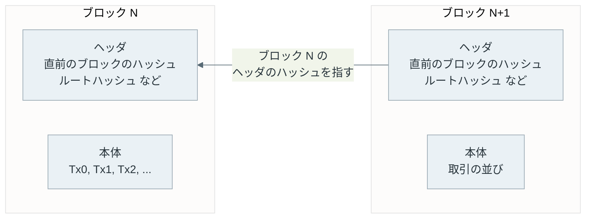
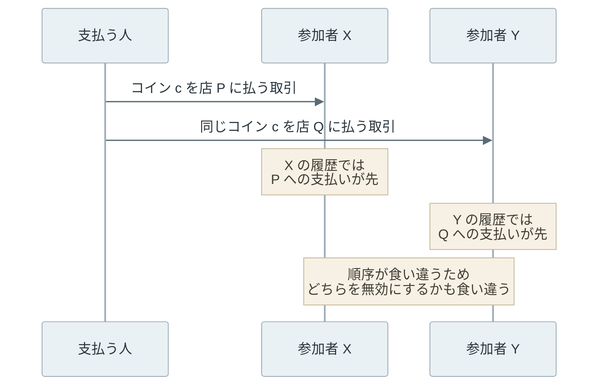
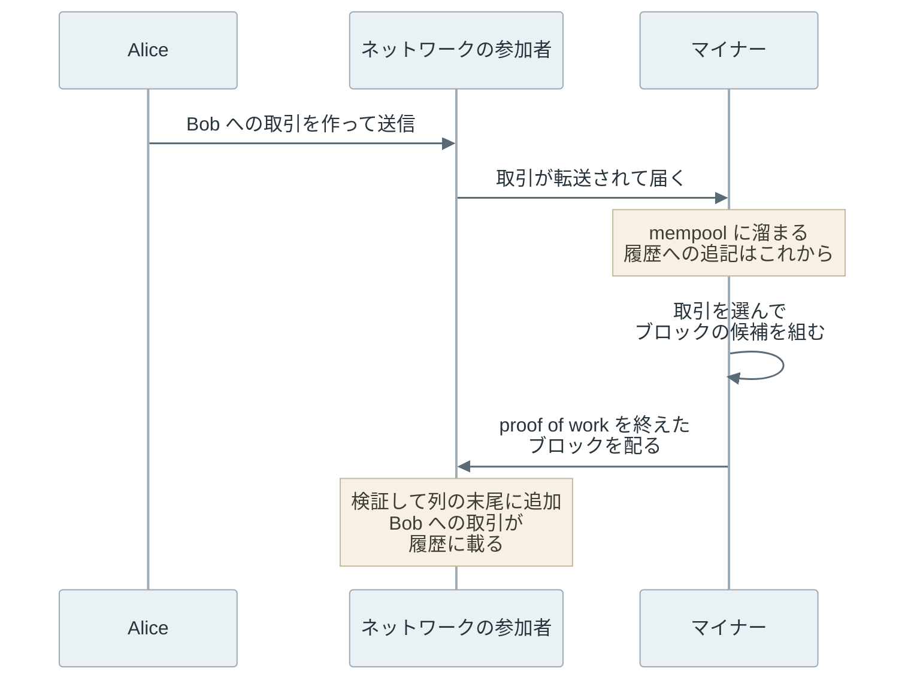
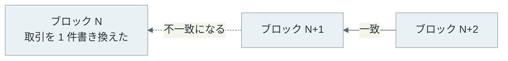

Bitcoin のブロックは、発生した取引をまとめて 1 つに束ね、直前のブロックへの参照でチェーン状に繋いだデータの単位です。ブロックの列がブロックチェーンで、Bitcoin の参加者はこの列を送金の履歴として共有します。

この構造を知りたくなる場面の代表は、送金が確定したと言える条件を知りたい時です。Bitcoin で代金を受け取る人は、どの時点で商品を渡して良いのかを判断する必要があります。この判断の基準は、取引が作られたことではなく、取引がブロックに取り込まれたかどうかと、その後ろに積まれたブロックの数です。

ブロック 2 つが繋がった様子を以下に示します。



上記の図のとおり、各ブロックはヘッダと本体に分かれ、ヘッダの中の「直前のブロックのハッシュ」が 1 つ前のブロックを指します。ここでのハッシュは、データから求める固定長の値で、データが少しでも変わると別の値になります。ヘッダのもう 1 つの項目であるルートハッシュは、本体の取引の並び全体を代表する値です。

本記事では、[Bitcoin Merkle Tree](../bitcoin-merkle-tree/) のノートを読むために必要な範囲として、ブロックの構造と、取引がブロックに取り込まれることの意味を説明します。単位が要る理由から始めて、次の順に進みます。

- 履歴を共有するのに、なぜブロックという単位が必要なのか。
- 取引は、作られてからどのようにブロックに入るのか。
- ブロックのヘッダと本体には、何が収められているのか。
- 最初のブロックの時刻を 1 秒ずらすと、次のブロックとの繋がりはどうなるのか。

誰がブロックを作る権利を得るのかを決める [proof of work](../proof-of-work/)（作業証明）の詳細、コインの残高の管理方式、取引に付く署名の仕組みは、本記事では扱いません。

---

### ブロックという単位が必要な理由

Bitcoin には、履歴を管理する中央のサーバーがありません。世界中の参加者がそれぞれ履歴の複製を持ち、どの取引がどの順序で履歴に入ったのかについて、共通の認識を作る必要があります。

共通の認識が必要な典型が、同じコインを使おうとする取引の競合です。同じコインを使う取引が複数作られても、同じ有効な履歴の中で両方を成立させることはできません。残せるのはどちらか一方だけです。どちらを残すかを全員で一致させるには、全参加者が取引の並びについて同じ認識を持つ必要があります。

以下は、順序が揃わないまま同じコインが 2 回使われた場合の流れです。



上記の図の状態を放置すると、参加者ごとに残高の計算が食い違います。ブロックは、取引の並びを全員で共有するための単位です。Bitcoin は複数の取引をブロックにまとめ、ブロックを順番に繋いだ列で履歴を表します。各ブロックの中の並びを決めるのは、そのブロックを作る権利を得た 1 人です。

その権利を得るのは、proof of work という計算作業を最初に終えた参加者です。proof of work は、ヘッダのハッシュが決められた条件を満たすまで、ヘッダの中の値（nonce）を変えてハッシュを計算し直す作業です。新しいブロックがおよそ 10 分に 1 個のペースで列の末尾に追加されるよう、条件の厳しさは自動で調整されます。詳細は [Proof of Work](../proof-of-work/) のノートで扱います。

ブロックの中の取引にも順序があります。どのブロックの何番目に入ったかで、履歴全体での取引の順番が決まります。ブロックに時刻を付けて繋ぐと、その時点より前に取引が存在したことも示せます。[Bitcoin の白書](https://bitcoin.org/bitcoin.pdf)が設計の出発点に置いた timestamp server も、この考え方です。

---

### 取引が作られてからブロックに入るまで

取引（transaction）は、コインの移動を記録するデータです。通常の取引は、過去に自分が受け取った取引の出力を入力として参照し、新しい宛先と金額を出力として並べ、使う資格を示す署名を添えます。例外はブロックの先頭に置かれるコインベース取引で、過去の出力を参照せず、ブロックを作った参加者が報酬を受け取ります。

作られた取引は、参加者から参加者に転送されて Bitcoin のネットワーク全体に広まります。各参加者は、受け取った取引をまだブロックに入っていない取引の置き場（[mempool](../mempool/)）に溜めます。この時点の取引は、共有された履歴のまだ履歴に載っていません。

ブロックを作る参加者（マイナー）は、mempool から取引を選んで並べ、ブロックの候補を組み立ててから proof of work の計算を行います。取引には手数料が付き、取り込んだマイナーの報酬になるため、混雑時はサイズあたりの手数料が高い取引が優先されます。

計算を終えたマイナーのブロックはネットワークに広まり、各参加者は proof of work と取引の内容を検証して、通ったブロックを自分の持つ列の末尾に追加します。取引がブロックに入るとは、マイナーに選ばれ、そのブロックが各参加者の列に追加されたことを指します。

例えば、Alice が Bob に支払う取引は、次の流れで作られてから履歴に載ります。



上記の図の最後まで進んで初めて、Bob は支払いがブロックに入ったと確認できます。1 件の送金を段階ごとに追う説明は、[Bitcoin Transaction Lifecycle](../bitcoin-transaction-lifecycle/) にあります。

---

### ブロックヘッダとブロック本体

ブロックは、80 バイトのヘッダと、取引の並びを収めた本体に分かれます。ブロック全体の大きさの上限は、署名などのデータを他のデータより軽く数える block weight という単位で 400 万 weight と決められています。実際のブロックは数 MB 規模、取引数にして数千件です。以下がヘッダの 6 項目です。

| 項目 | 大きさ | 何を表すか |
|---|---|---|
| バージョン | 4 バイト | ブロックの形式の世代（新規則への対応表明にも使う） |
| 直前のブロックのハッシュ | 32 バイト | 1 つ前のブロックのヘッダを 2 回 SHA-256 した値 |
| ルートハッシュ（Merkle root） | 32 バイト | 本体の取引の並び全体を代表する値 |
| 時刻 | 4 バイト | マイナーが申告するおおよその作成時刻 |
| bits | 4 バイト | proof of work の合格条件（target）の圧縮表現 |
| nonce | 4 バイト | 合格するハッシュを探すために変え続ける値 |

表の 3 行目のルートハッシュは、本体の取引を 2 つずつ、SHA-256（Secure Hash Algorithm 256、出力が 32 バイトのハッシュ関数）を 2 回ずつ適用しながら畳み込み、1 つにまとめた値です。取引が 1 件でも書き換われば別の値になります。木の作り方と包含証明の仕組みは [Merkle Tree](../merkle-tree/) で、Bitcoin での計算規則と検証は [Bitcoin Merkle Tree](../bitcoin-merkle-tree/) で扱っています。

ヘッダと本体を分ける利点は、履歴を確かめるのにどこまでのデータを持つかを選べる点にあります。ブロックチェーン全体は数百 GB になる一方、ヘッダは 1 ブロック 80 バイトなので、全ブロックぶん集めても数十 MB に収まります。携帯端末のようにブロック全体を持てない参加者は、ヘッダの列だけを持ち、取引の有効性の検証は他の参加者に任せます。

---

### 直前のハッシュによる連結

ヘッダの「直前のブロックのハッシュ」は、1 つ前のブロックのヘッダ全体を SHA-256 で 2 回ハッシュした 32 バイトで、ブロックの識別子でもあります。各ブロックが 1 つ前を指すことで、最初のブロックまで一本道で辿れる列ができます。

実際のブロックで確かめると、以下のようになります。Bitcoin Core の[ソースコード](https://github.com/bitcoin/bitcoin/blob/master/src/kernel/chainparams.cpp)に書かれた最初のブロック（ブロック 0）と、次のブロック 1 のヘッダを 80 バイトに並べ、Python 3.14 で SHA-256 を 2 回適用しました。最後の行は、ブロック 0 の時刻だけを 1 秒進めた値です。

```text
ブロック 0 のハッシュ         000000000019d6689c085ae165831e934ff763ae46a2a6c172b3f1b60a8ce26f
ブロック 1 の直前のハッシュ   000000000019d6689c085ae165831e934ff763ae46a2a6c172b3f1b60a8ce26f
ブロック 1 のハッシュ         00000000839a8e6886ab5951d76f411475428afc90947ee320161bbf18eb6048
ブロック 0 の時刻を 1 秒進めた値   775212d740bc3900e6c050f43c2cb2db9218b3981e5d11bb0abadf9d9f164b69
```

上記の 1 行目と 2 行目は一致しており、ブロック 1 はこの値でブロック 0 を指しています。時刻を 1 秒進めただけで 4 行目は全く別の値になり、ブロック 1 が持つ値と一致しなくなります。取引を 1 バイト書き換えた場合も、ルートハッシュを通じて同じことが起きます。1 行目と 3 行目の先頭に 0 が並ぶのは proof of work の条件を満たした結果で、4 行目にはそれもありません。

書き換えの影響が後ろに伝わる様子は以下の通りです。図の矢印は、ヘッダが持つ参照の向きです。



上記の図の繋がりを取り戻すには N+1 以降の全ヘッダの作り直しが必要で、ヘッダを 1 つ作り直すたびに proof of work もやり直しになります。後ろにブロックが積まれるほど、書き換えに必要な計算量が膨らみます。書き換えている間も他のマイナーは正しい列を伸ばすので、積まれた計算量で追い越さない限り、書き換えた列は採用されません。

<br>

なお、チェーンの末尾は一時的に分岐することがあります。複数のマイナーがほぼ同時にブロックを作ると、参加者ごとに別の末尾を見ている状態になります。各参加者は、積まれた計算量が最も大きい列（条件の厳しさが同じ期間なら、最も長い列）を正しい履歴として採用するため、どちらかの列が先に伸びた時点で分岐は解消します。

短い列に入っていた取引はブロックから外れ、mempool に戻って改めて取り込みを待ちます。そのため、取り込まれた直後の取引は「確定」ではなく「確定に向かう」途中にあります。

---

### 利点

- ブロック 1 個ぶんの取引の順序と採否をまとめて決められる
- 過去の書き換えが、直前のハッシュの不一致として後続の全ブロックに伝わる
- ヘッダ 80 バイトの列だけで、チェーンの繋がりと proof of work を検証できる
- 本体を持たない参加者も、ルートハッシュを使って取引がブロックに含まれているかを確かめられる

---

### 欠点

中央のサーバーを置かずに、ブロックを一定の間隔で 1 本の列に積んで履歴を揃える代わりに、利用者は次の制約を受けます。

- 取引を作ってからブロックに入るまで待ち時間があり、ブロックの間隔は平均でおよそ 10 分になる
- ブロックの大きさに上限があり、混雑時はサイズあたりの手数料が高い取引から取り込まれやすい
- チェーンの末尾は巻き戻る可能性があり、直後の 1 ブロックだけでは確定と扱いにくい

3 番目の巻き戻りへの実用上の対処は、取引の入ったブロックの後ろに積まれたブロックの数（confirmation、確認数）を数えることです。後ろに積まれたブロックが多いほど、取引を消すために作り直すブロックが増え、攻撃は成功しにくくなります。Bitcoin の白書も、受け取る側が後続のブロックを待つ前提で、この成功確率を計算しています。何個待てば十分かは金額とリスクの許容度で変わり、判断の材料は [Finality](../finality/) で扱っています。
