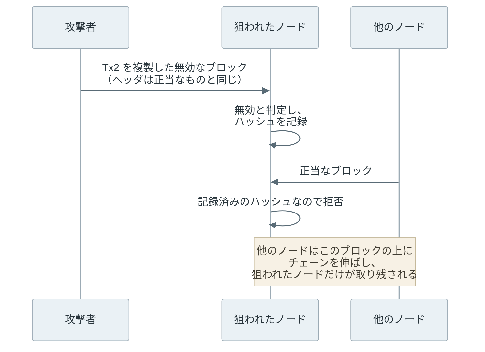

Bitcoin のブロックヘッダには、ブロック内の全取引を Merkle Tree で 1 つにまとめたルートハッシュが入っています。この木の作り方には、Bitcoin 独自の 2 つの規則があります。規則 1 は、段のノード数が奇数なら最後のノードを複製することです。規則 2 は、葉（取引）と内部ノードを同じ計算でハッシュすることです。どちらの規則についても、それに起因する脆弱性が過去に報告されました。

ブロックと取引を自力で検証する参加者をフルノード、ブロックヘッダだけを持つ参加者を軽量クライアントと呼びます。軽量クライアントは、取引のハッシュからルートハッシュを計算し直すのに要る少数のハッシュ（包含証明）を受け取り、取引がブロックに入っていることを確かめます。



上記の図の左は、取引 3 件のブロックが、Tx2 を 2 回並べた 4 件のブロックと同じルートハッシュになる例です。2012 年に報告された脆弱性では、この一致を使って、正当なブロックをノードに拒ませることができました。

図の右は、ちょうど 64 バイトの取引を内部ノードに見せかけ、その下に偽の取引をぶら下げる例です。ブロック全体を持たない参加者に、ブロックに入っていない取引が入っているように見せかけられます。この弱点は 2018 年に公表されました。

<br>

本記事では、2 つの規則がそれぞれ何を許してしまうのか、攻撃がどう成り立つのか、どう防いでいるのかの順に説明します。木の作り方と包含証明の読み方は [Bitcoin Merkle Tree](../bitcoin-merkle-tree/) を前提にします。

脆弱性は、CVE（[Common Vulnerabilities and Exposures](https://www.cve.org/)、公表された脆弱性に振られる共通の識別番号）で呼びます。2 件の識別番号と概要は、Bitcoin Wiki の[脆弱性の一覧](https://en.bitcoin.it/wiki/Common_Vulnerabilities_and_Exposures)に載っています。葉と内部ノードを接頭辞で分けるといった、木の設計としての一般的な対策は [Merkle Tree Design](../merkle-tree-design/) で扱っており、本記事は Bitcoin で実際に起きた 2 件に絞ります。

---

### 複製で同じルートになる並び

Bitcoin は、段のノード数が奇数になると、最後のノードを複製してから隣同士を組にします。取引 3 件のブロックなら、Tx2 のハッシュを 2 つ並べて組を作ります。この計算は、Tx2 を実際に 2 回並べた 4 件のブロックと同じになります。



左の点線は計算の上だけの複製で、右の 2 つ目の Tx2 はブロックに実際に入っている取引です。左右の木は同じ形なので、ルートハッシュも、それを含むブロックヘッダも同じになります。SHA-256 の[衝突](../hash-function/)ではなく、木の作り方に由来する一致です。

一方、右のブロックは無効です。同じ取引を 2 回含むと、同じコインを 2 回使うことになるからです。つまり、ヘッダが同じで、中身が正当なブロックと無効なブロックの 2 通りが存在します。図の右下の「組の 2 つが同じ → 棄却」は、現在の Bitcoin Core（代表的なノードのソフトウェア）が入れている検出で、後の節で説明します。

<br>

同じ一致は、どこかの段のノード数が奇数になる木なら作れます。葉の段だけでなく、上の段で複製が起きる場合も同様で、その時は末尾の数件の取引をまとめて繰り返した並びが同じルートになります。Bitcoin の代表的なノードのソフトウェアである [Bitcoin Core](https://bitcoincore.org/) の[実装](https://github.com/bitcoin/bitcoin/blob/master/src/consensus/merkle.cpp)のコメントにも、取引 6 件で末尾の 2 件を繰り返す例が載っています。

---

### 正当なブロックを拒ませる攻撃（CVE-2012-2459）

2012 年 5 月に公表された CVE-2012-2459 では、取引を複製した無効なブロックを送るだけで、同じヘッダを持つ正当なブロックをノードに拒ませることができました。当時のノードのソフトウェア（bitcoind・Bitcoin-Qt。現在の Bitcoin Core）は、無効と判定したブロックをハッシュで記録し、同じハッシュのブロックを以後受け取りませんでした。ブロックのハッシュはヘッダから計算するので、ヘッダが同じなら同じハッシュです。

攻撃は次の順に進みます。

1. 攻撃者は、マイナー（ブロックを作る参加者）が作った正当なブロックを受け取り、取引の並びの末尾を複製した無効なブロックを作る（どこかの段が奇数になるブロックなら作れる）。ヘッダはそのままなので、ブロックのハッシュも同じになる。
2. 攻撃者は、無効なブロックを正当なブロックより先に、狙ったノードへ送る。
3. ノードは、取引を検証して無効と判定し、そのハッシュを無効として記録する。
4. 後から正当なブロックが届いても、記録済みのハッシュなので受け取らない。



上記の図の最後のとおり、狙われたノードは、他のノードが伸ばしていくチェーンから外れます。Bitcoin Wiki の一覧は、この影響をネットワークの分断（netsplit）に分類しています。

取り残されたノードの利用者には、他のノードとは違うチェーンが見えます。その上で受け取った支払いは、他のノードのチェーンには無いので、後から無かったことになり得ます。一覧は、後ろにブロックが何個か積まれた取引でも、同じコインを別の相手にも使う二重支払いに使えると記しています。

<br>

#### 対策：複製を検出し、ヘッダは記録しない

一覧によると、無効なブロックのハッシュを記録する動作は 0.6.1 より前のバージョンにあり、0.6.1 で修正されました（古い系列にも修正したバージョンが出ています）。

現在の Bitcoin Core は、ルートハッシュを計算する時に、各段で組にする 2 つのハッシュが同じになる箇所を探します。以下は、[merkle.cpp](https://github.com/bitcoin/bitcoin/blob/master/src/consensus/merkle.cpp) の該当部分の抜粋です（MIT ライセンス、Copyright The Bitcoin Core developers）。

```cpp
while (hashes.size() > 1) {
    if (mutated) {
        for (size_t pos = 0; pos + 1 < hashes.size(); pos += 2) {
            if (hashes[pos] == hashes[pos + 1]) mutation = true;
        }
    }
    if (hashes.size() & 1) {
        hashes.push_back(hashes.back());
    }
    SHA256D64(hashes[0].begin(), hashes[0].begin(), hashes.size() / 2);
    hashes.resize(hashes.size() / 2);
}
```

`hashes` はその段のハッシュの並びです。`mutated` は、呼び出し側が検出の結果を受け取りたい時に渡す出力先で、渡された時だけ比較します。`mutation` は、比較で見つかったかどうかを覚えておく変数で、最後に `mutated` へ書き出されます。

組にする 2 つが同じなら `mutation` を立て、段のハッシュの数が奇数なら最後を複製し（`push_back`）、組ごとに二重 SHA-256 を計算して 1 つ上の段にします。先に組を比べるので、ブロックに実際に同じハッシュが並んでいれば検出でき、計算上の複製は比較の対象になりません。

検出したブロックは、[validation.cpp](https://github.com/bitcoin/bitcoin/blob/master/src/validation.cpp) で `BLOCK_MUTATED`（届いたデータが作り替えられている）という理由で棄却されます。この理由の時は、ブロックのハッシュを無効として記録しません。ヘッダ自体は正しい可能性があるからです。そのため、同じヘッダで後から届く正当なブロックは受け入れられます。

---

### 64 バイトの取引を内部ノードに見せかける攻撃（CVE-2017-12842）

2 つ目の規則は、葉と内部ノードの計算です。葉の txid（取引の識別子）は、取引から署名などの witness データを除いたバイト列に、SHA-256 を 2 回適用した値です。内部ノードは、左右の子の 32 バイトを連結した 64 バイトに、同じく SHA-256 を 2 回適用した値です。入力の形にも計算の手順にも、葉と内部ノードの区別がありません。

そのため、witness を除いた大きさがちょうど 64 バイトの取引は、葉としても内部ノードとしても読めます。



上記の図の右で、T の右 32 バイトが偽の取引の txid と一致していれば、偽の取引は T の右の子に見えます。このとき偽の取引から T を経てルートまで計算が繋がり、偽の取引の包含証明が成り立ちます。

この弱点は、Sergio Demian Lerner が 2018 年 6 月に[ブログ記事](https://bitslog.com/2018/06/09/leaf-node-weakness-in-bitcoin-merkle-tree-design/)で詳しく説明し、CVE-2017-12842 として一覧に載りました（識別番号の年と公表の年は一致しないことがあります）。

<br>

#### 攻撃の手順

Lerner の記事に沿うと、攻撃は次の順に進みます。

1. 攻撃者は、偽の取引（被害者への支払いに見える取引）を作る。
2. 偽の取引の中身を変えながら txid を計算し直し、その txid を右 32 バイトに置いた 64 バイトが取引 T として成り立つまで、総当たりで繰り返す。
3. マイナーでもある攻撃者が、T を自分の作るブロックに入れる（64 バイトの取引は、通常のノードが中継しないため）。T はブロックに入った本物の取引なので、ヘッダの木の葉の 1 つになる。
4. 被害者の軽量クライアントに、T を内部ノードと見立て、その右の子を偽の取引とした、本来より 1 段深い包含証明を渡す。
5. クライアントは証明をたどってヘッダのルートハッシュに辿り着き、偽の取引がブロックに入っていると判断する。



上記の図のとおり、偽の証明は正しい証明の下に 1 段を足しただけで、T から上の経路は同じです。フルノードは取引を全て持っているので、この手順では騙されません。騙されるのは、包含証明だけで判断する軽量クライアントです。包含証明はブロックの中身から誰でも作れるデータで、軽量クライアントは問い合わせたノードや、証明を提出してきた利用者から受け取ります。攻撃者はその立場から偽の証明を渡します。

<br>

クライアントが 4 の証明を見破れないのは、木の深さを知る手段が証明の中にしかないからです。木の深さは取引の総数で決まりますが、総数はヘッダに入っていません。[BIP 37](https://github.com/bitcoin/bips/blob/master/bip-0037.mediawiki)（Bitcoin の仕様変更の提案文書である BIP の 37 番）が定める証明の形式では、総数は証明を渡す相手が送る値です。Bitcoin Wiki の一覧が、この弱点を「No commitment to block merkle tree depth」（ブロックの木の深さがどこにも約束されていない）と要約しているのは、このためです。

<br>

#### 総当たりの規模

2 の総当たりは重い作業ですが、32 バイト全体（2^256 通り）を合わせる必要はありません。T の右 32 バイトには、使う出力の番号・金額・ロック時刻など T の欄が入り、多くのビットはどの値でも取引として通ります。合わせる必要があるのは、取引として正しい値にするための一部のビットだけです。

攻撃者は偽の取引の中身を少しずつ変えて txid を作り直し、その txid が T の欄として通る値になるまで繰り返します。右 32 バイトの先頭の数バイトは T が使う出力の txid の末尾にも当たるため、記事ではその txid を持つ取引も別の総当たり（約 2^40 回）で用意します。

Lerner は、この段階で約 2^72 回のハッシュ計算が要ると見積もっています。弱点を見つけた 2017 年の価格で、採掘機 1000 台・約 130 万ドルで 4 日ほどの規模です。狙われやすいのは、人が確認せずに包含証明だけで資産を動かすシステムです。記事は、別のチェーンと資産をやり取りするサイドチェーンの[ブリッジ](../cross-chain-bridge/#軽量クライアント)を例に挙げています。

<br>

#### 対策

対策は、誰が行うかで 3 つに分かれます。

| 誰が | 対策 | 効く範囲 |
|---|---|---|
| Bitcoin Core | 64 バイトの取引を中継せず、ブロックの候補にも入れない | 既定の動作のノードを経由する取引 |
| 軽量クライアント | 木の深さを別の証明で確かめる | その対策を入れたクライアント |
| ネットワーク全体 | 64 バイトの取引を無効にする（BIP 54） | 全てのブロック |

1 行目は、Bitcoin Core 0.16.1 以降の動作です。中継の方針はノードのソフトウェアの方針（policy）で、ネットワーク全体の合意の規則ではありません。マイナーが自分のブロックに直接入れれば、64 バイトの取引は今も有効です。

2 行目は、ブロックの先頭にあるコインベース取引（ブロック作成者が報酬を受け取る取引）の包含証明も一緒に要求する方法です。コインベース取引は必ず左端の葉なので、その証明の長さから木の深さが分かります。証明の途中の内部ノードが取引として読めたら拒否する方法もあります。

3 行目の [BIP 54](https://github.com/bitcoin/bips/blob/master/bip-0054.md)（Consensus Cleanup）は、witness を除いた大きさがちょうど 64 バイトの取引を無効にする規則の提案です。2026-11 時点の文書は、この規則を有効にする時期を定めていません。

64 バイトの取引は、取引の固定の欄だけで 60 バイトを使うため、[スクリプト](../bitcoin-script/)（コインを使う条件を書く欄）に残るのは 4 バイトほどです。署名を確かめる処理を書く余地が無く、BIP 54 によれば、誰でも使える出力か、使えなくなる出力しか作れません。2016 年以降は使われていません。無効にすれば、軽量クライアントが回避策を知らなくても済むようになる、というのが提案の立場です。

---

### 2 件に共通すること

2 件とも、ルートハッシュが同じなら木も同じ、という思い込みを突いています。1 件目では取引の並びが、2 件目では木の深さが、ルートハッシュだけでは 1 つに決まりませんでした。

ルートハッシュが何を保証するかは、木の構築規則で決まります。

奇数の葉を複製しない規則なら 1 件目が、葉と内部ノードの入力に別の接頭辞を付ける規則なら 2 件目が生じません。証明書の発行記録を公開する Certificate Transparency の仕様 [RFC 9162](https://www.rfc-editor.org/rfc/rfc9162.html#section-2.1) は、この 2 つを両方使っています。Bitcoin は木の規則そのものは変えておらず、検出と取引の制限で塞いでいます。規則の比較は [Merkle Tree Design](../merkle-tree-design/) で扱っています。
