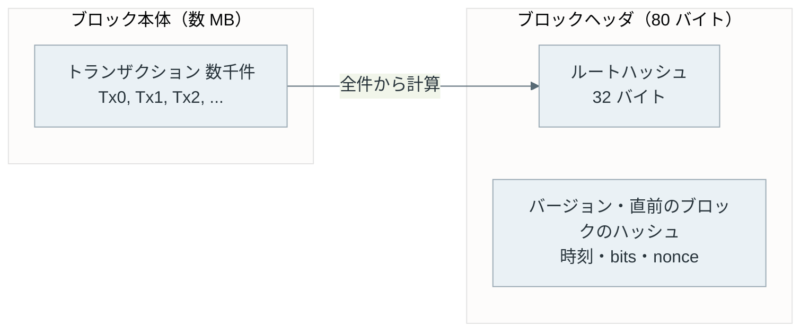
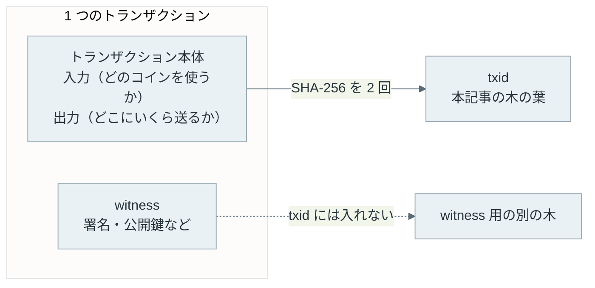
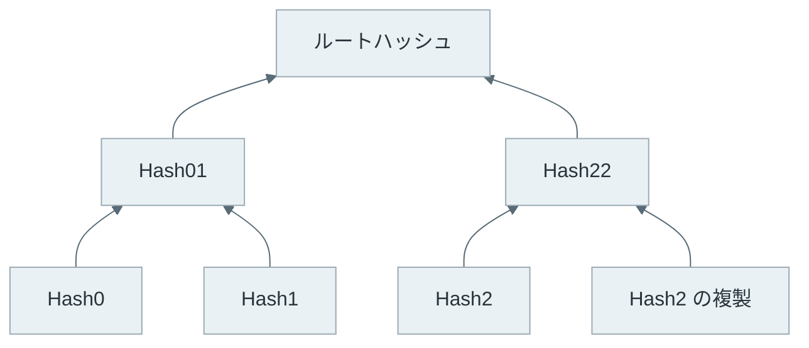
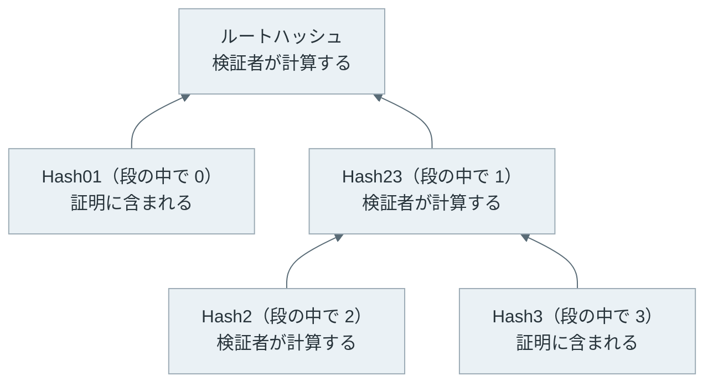
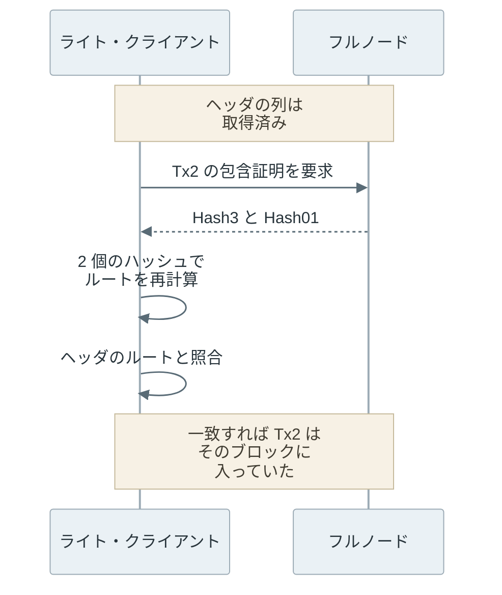
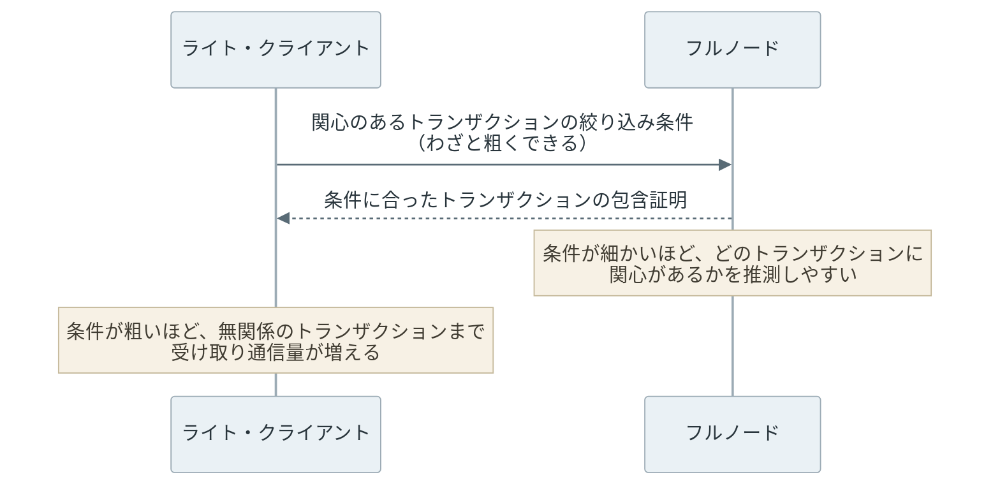

Bitcoin は、ブロックに入ったトランザクション（transaction、以下の図では Tx と略します）の並びを Merkle Tree で 1 つのルートハッシュに畳み込み、80 バイトのブロックヘッダに収めています。[Bitcoin のホワイトペーパー](https://bitcoin.org/bitcoin.pdf)も、トランザクションを Merkle Tree でハッシュ化し、ブロックのハッシュに入れるのはルートだけとしています。

Bitcoin で支払いを受け取る場合を考えます。送金のトランザクションは、作られて[ネットワークに流れた](../bitcoin-transaction-lifecycle/)だけでは、まだどのブロックにも入っていません。どこかのブロックに取り込まれて初めて、共有された履歴に載ります。そのため、代金を受け取る側は、自分宛のトランザクションがブロックに入ったことを確認してから商品を渡します。

厳密には、トランザクションを含むブロック自身と後続のブロックを合わせた承認数（[Bitcoin Block](../bitcoin-block/) で説明）まで見て判断します。ここで扱うのは、その前段の「入ったこと」の確認です。

以下は、代金を受け取る側の携帯端末と、ブロック全体を持つ参加者が持つデータです。



端末がブロック全体を持つ参加者に尋ね、「入っている」という返事を受け取っても、そのままでは証拠になりません。返事の裏を取ろうにも、ブロックチェーン全体は数百 GB（2026 年時点）あり、携帯端末の[ウォレット](../wallet/)には収まりません。上記の図のように、ヘッダにあるルートハッシュと、そのトランザクションのハッシュからルートハッシュを計算するために必要な、少数のハッシュ（包含証明、図の黄土色）を使うと、この返事を手元で検算できます。

<br>

本記事では、Bitcoin が何を葉にして木を組み立てているのか、その木でトランザクションの包含をどう検証するのかを説明します。素朴な方法との比較から入り、次の 5 つを確認します。

- 全件を連結してハッシュする方法と比べて、何が違うのか。
- 何を葉にして、木を組み立てるのか。
- 段のノード数が奇数の時は、どうするのか。
- 包含証明はどのような形で渡り、実際のブロックではどう検証されるのか。
- ブロックヘッダだけを持つ参加者は、何を確認できるのか。

前提は 2 つあります。木の作り方と包含証明の仕組みは [Merkle Tree](../merkle-tree/) で、ブロック・ブロックヘッダ・トランザクションの関係は [Bitcoin Block](../bitcoin-block/) で説明しています。木の作り方に由来する 2 つの弱点（トランザクションの複製と 64 バイトのトランザクション）は、[Bitcoin Merkle Tree の弱点](../bitcoin-merkle-tree-attacks/) で扱います。

---

### 全件を渡す検証との違い

トランザクションの並びを 1 つの値で代表するだけなら、全件を順に連結してハッシュを 1 回計算すれば足ります。この方法では、あるトランザクションの包含を確認するたびに、数千件・数 MB のブロック全体を受け取って計算し直す必要があります。Merkle Tree の包含証明なら、受け取るのは件数の対数、数千件でもハッシュ十数個です（[Merkle Tree](../merkle-tree/) の「葉の件数と証明のサイズ」）。

以下は、ヘッダとブロック本体の大きさの関係です。



上記の図のとおり、ヘッダ側の 32 バイトが本体の数千件を代表します。

---

### 葉になる txid

葉は、各トランザクションの txid です。txid は、トランザクションから witness データ（そのコインを使う資格を示す署名や公開鍵など。Bitcoin のコインは前のトランザクションが作った出力で、[UTXO](../utxo/) で説明）を除いた形式に、[SHA-256](/notes/security/sha-256/)（Secure Hash Algorithm 256、出力が 32 バイトのハッシュ関数）を 2 回適用した値です。



上記の図のとおり、txid の計算に witness は入りません。

葉が並んだら、隣同士を左から順に組にして連結し、その組に SHA-256 を 2 回適用した値を 1 段上のノードにします。1 つになるまで繰り返した結果が、ブロックヘッダに入るルートハッシュです。

トランザクションを並べる順序を決めるのはブロックを作った参加者（マイナー）で、順序が変われば別のルートハッシュになります。

<br>

witness データは、2017 年の Segregated Witness（分離された witness、SegWit）という仕様変更で、トランザクション本体から分離した領域に置かれるようになりました。それまでは、署名も txid の計算に含まれていました（SegWit を使わない従来形式のトランザクションでは、今も含まれます）。

txid から witness を外したのは、第三者がトランザクションの中身を変えないまま、[署名](../digital-signature/)の値だけを検証に通る別の値へ書き換えられるためです（理由は Digital Signature で説明）。

署名を txid の計算に含めると、同じ内容のトランザクションでも識別子が送金の途中で変わってしまいます。後続のトランザクションは使うコインを前のトランザクションが持つ txid で指すため、まだブロックに入っていない後続のトランザクションが使えなくなります。この問題は transaction malleability（トランザクション展性）と呼ばれ、witness を txid の外に出したことが解決策の 1 つでした。witness は[別の木](https://github.com/bitcoin/bips/blob/master/bip-0141.mediawiki)でブロックに結び付けられており（[Bitcoin Block](../bitcoin-block/) で説明）、本記事では扱いません。

---

### 奇数の葉の複製

Bitcoin は、段の中のノード数が奇数になると最後のノードを複製してから組を作ります。代表的なノードのソフトウェアである [Bitcoin Core](https://bitcoincore.org/) の[実装](https://github.com/bitcoin/bitcoin/blob/master/src/consensus/merkle.cpp)のコメントは、この複製を「which is unusual in Merkle trees」（Merkle Tree では異例）と断っています。

例えば、トランザクション 3 件のブロックでは、次のように複製します。



上記の図の Hash0〜Hash2 は Tx0〜Tx2 の txid で、Hash22 は Hash2 を 2 つ連結した組のハッシュです。この木は、4 件目のトランザクションとして Tx2 をもう一度並べた場合と同じ形になります。

この規則には副作用があります。3 件の並びと、Tx2 を実際に 2 回並べた 4 件の並びが、同じルートハッシュになります。SHA-256 の[衝突](../hash-function/)ではなく、木の構築規則に由来する一致です。Bitcoin Core はこの一致を検出して棄却しています。放置した場合に成り立つ攻撃と検出の方法は、[Bitcoin Merkle Tree の弱点](../bitcoin-merkle-tree-attacks/) で説明します。

複製しない規則（Certificate Transparency の仕様 [RFC 9162](https://www.rfc-editor.org/rfc/rfc9162.html#section-2.1)）を使う仕組みもあり、奇数の扱いを含む構築規則の違いは [Merkle Tree Design](../merkle-tree-design/) で扱います。

---

### 包含証明の形式と検証

以下は、トランザクション 4 件のブロックで Tx2 の包含を示す時に渡る値です。以下では、包含を確認する側（冒頭の携帯端末）を検証者と呼びます。各ハッシュに添えた番号は、その段の中で左から 0 始まりで数えた位置です。木と証明の読み方は [Merkle Tree](../merkle-tree/) の包含証明と同じです。



上記の図で証明として渡るのは Hash3 と Hash01 の 2 個で、検証者は Tx2 から Hash2 を求め、ルートまで再計算して手元のルートハッシュと照合します。

左右の知り方は証明の形式によって異なり、Bitcoin では各段での番号から判断します。0 から数えると Hash2 は番号 2 で、偶数なので相手は右の Hash3 です。1 つ上の段で Hash23 は番号 1 になり、奇数なので相手は左の Hash01 です。

トランザクション 4 件の実際のブロック（[ブロック 100000](https://mempool.space/block/000000000003ba27aa200b1cecaad478d2b00432346c3f1f3986da1afd33e506)）で、この情報を受け取って検証する関数を動かすプログラムが以下です。チェーンの中身を表示する Web サービス（ブロックエクスプローラ）に表示される 4 つの txid とルートハッシュを使い、図と同じ形で Tx2 の包含を確認します。

ハッシュは内部のバイト順で渡す必要があります。ブロックエクスプローラの txid は慣習で逆順の 16 進表記になっているため、`fromHex` で反転してから渡します。

```go
package main

import (
	"crypto/sha256"
	"encoding/hex"
	"fmt"
	"slices"
)

// verifyMerkleProof は、葉のハッシュと包含証明からルートハッシュを再計算し、
// 期待するルートハッシュと一致するかを返します。
// path は葉に近い段から並べ、siblingIsRight[i] は path[i] が右側にあったことを表します。
func verifyMerkleProof(leaf [32]byte, path [][32]byte, siblingIsRight []bool, root [32]byte) bool {
	if len(path) != len(siblingIsRight) {
		return false
	}

	h := leaf
	for i, sibling := range path {
		if siblingIsRight[i] {
			h = doubleSHA256(h[:], sibling[:])
		} else {
			h = doubleSHA256(sibling[:], h[:])
		}
	}
	return h == root
}

// doubleSHA256 は、2 つのハッシュを連結して SHA-256 を 2 回適用します。
func doubleSHA256(left, right []byte) [32]byte {
	buf := make([]byte, 0, len(left)+len(right))
	buf = append(buf, left...)
	buf = append(buf, right...)

	first := sha256.Sum256(buf)
	return sha256.Sum256(first[:])
}

// fromHex は 16 進表記を 32 バイトに変換します。reverse が true なら
// ブロックエクスプローラの表記（逆順）を内部のバイト順に戻します。
func fromHex(s string, reverse bool) [32]byte {
	b, err := hex.DecodeString(s)
	if err != nil || len(b) != 32 {
		panic("bad hash: " + s)
	}
	if reverse {
		slices.Reverse(b)
	}
	return [32]byte(b)
}

func main() {
	// ブロック 100000 の txid とルートハッシュ（ブロックエクスプローラの表記）
	txids := []string{
		"8c14f0db3df150123e6f3dbbf30f8b955a8249b62ac1d1ff16284aefa3d06d87",
		"fff2525b8931402dd09222c50775608f75787bd2b87e56995a7bdd30f79702c4",
		"6359f0868171b1d194cbee1af2f16ea598ae8fad666d9b012c8ed2b79a236ec4",
		"e9a66845e05d5abc0ad04ec80f774a7e585c6e8db975962d069a522137b80c1d",
	}
	root := "f3e94742aca4b5ef85488dc37c06c3282295ffec960994b2c0d5ac2a25a95766"

	for _, reverse := range []bool{true, false} {
		tx0, tx1 := fromHex(txids[0], reverse), fromHex(txids[1], reverse)
		// Hash01 は本来フルノードが証明として渡す値で、ここでは手元で用意する
		hash01 := doubleSHA256(tx0[:], tx1[:])
		path := [][32]byte{fromHex(txids[3], reverse), hash01}
		ok := verifyMerkleProof(fromHex(txids[2], reverse), path, []bool{true, false}, fromHex(root, reverse))
		if reverse {
			fmt.Println("内部のバイト順に戻した場合:", ok)
		} else {
			fmt.Println("表記のまま渡した場合:", ok)
		}
	}
}
```

Go 1.26 で実行した結果が以下です。

```text
内部のバイト順に戻した場合: true
表記のまま渡した場合: false
```

1 行目のとおり、渡したハッシュ 2 個でヘッダのルートハッシュに辿り着きました。2 行目は、同じ計算を表記のまま行った場合です。手順が正しくても、バイト順を取り違えると検証は通りません。

`verifyMerkleProof` で繰り返す回数は `path` の長さです。奇数のノードを複製する Bitcoin の作り方では、葉の件数を 2 の冪に切り上げた木と同じ深さになるため、葉が n 件なら段数は `ceil(log2 n)` です。

例えば、トランザクションが 3000 件のブロックなら段数は 12 で、32 バイトのハッシュを 12 個、合わせて 384 バイトです。そのブロック本体が 1 MB だとすると、384 バイトは 1/2000 以下に収まります。

<br>

`verifyMerkleProof` は、左右のハッシュを連結する、SHA-256 を 2 回適用する、ルートまで再計算する、の 3 つだけを抜き出したもので、Bitcoin が実際に送る証明の形式ではありません。

実際の形式は、Bitcoin の仕様変更の提案文書である BIP（Bitcoin Improvement Proposal）の [37 番](https://github.com/bitcoin/bips/blob/master/bip-0037.mediawiki)（以下 BIP 37）が定めています。ハッシュの列と一緒にトランザクションの総数も送り、受け取った側は総数から木の形を復元します。

---

### SPV - ヘッダだけによるトランザクションの確認

ブロックとトランザクションを自力で完全に検証する参加者をフルノード、ブロックヘッダだけを保持してトランザクションが有効かどうかの検証をフルノードに任せる参加者をライト・クライアントと呼びます。冒頭の携帯端末はライト・クライアントです。ライト・クライアントが持っているのは、ブロックヘッダの列だけです。ヘッダはルートハッシュを含むため、包含証明を受け取れば、そのトランザクションがヘッダの指すブロックに入っていたことを自力で確認できます。Bitcoin のホワイトペーパーはこの手順を Simplified Payment Verification（簡易支払い検証）と呼んでおり、一般には SPV と略されます。

ライト・クライアントとフルノードのやり取りは以下の通りです。



上記の図の最後で一致した時に確認できたのは、Tx2 がそのブロックに入っていたことだけです。Tx2 が有効なトランザクションであることまでは確認していません。署名が正しいか、使おうとしているコインが既に使われていないかについては、そのブロックを受け入れたノードの判断と、後ろにブロックが積み上がった事実だけが間接的な裏付けになります。

<br>

包含の確認そのものにも、木の作り方に由来する弱点があり、特定のトランザクションを使うと包含証明を偽れる場合があります。手順と対策は [Bitcoin Merkle Tree の弱点](../bitcoin-merkle-tree-attacks/) で説明します。

<br>

注意点として、包含証明だけでは、そのルートハッシュを含むブロックヘッダが正しいチェーンに属することまでは証明できません。

ヘッダの列のどれを正しいチェーンとして採用するかは、各ヘッダが満たす [proof of work](../proof-of-work/)（計算作業）の量と、どの列を選ぶかの規則で決まります。ホワイトペーパーも、この検証が信頼できるのは、正直な（規則どおりに動く）ノードの計算能力が攻撃者を上回っている間だけだとしています。Merkle Tree の外側にある話なので、本記事では扱いません。

---

### 利点

- ブロック全体を持たない参加者が、トランザクション 1 件の包含を自力で検証できる
- 証明のサイズが件数の対数で、数千件のブロックでも数百バイトに収まる
- witness を別の木に分けたことで、SegWit のトランザクションでは、txid は署名の作り替えの影響を受けない

---

### 欠点

Bitcoin の Merkle Tree は、証明を小さく保つ代わりに、渡す情報をブロックへの包含に絞っています。その分、次の制約が残ります。

- 素朴に証明を要求すると、どのトランザクションに関心があるかが相手のノードに伝わる
- SPV が確認するのはブロックへの包含だけで、トランザクションの有効性までは確認しない
- 複製規則の副作用として、トランザクションを別の順に並べても同じルートハッシュになる場合がある（検出して棄却する）
- 葉と内部ノードを区別しないため、64 バイトのトランザクションを使って包含証明を偽れる余地がある

後ろの 2 つは [Bitcoin Merkle Tree の弱点](../bitcoin-merkle-tree-attacks/) で扱っています。

どのトランザクションに関心があるかが伝わる問題に対して、BIP 37 は、誤検出を許す集合の判定である Bloom filter を使い、関係の無いトランザクションもいくらか混ぜて受け取る仕組みを定めました。同じ文書によれば、絞り込みの精度を上げると自分のウォレットに関係するトランザクションだけが届く一方で、相手のノードにトランザクションと IP アドレスを結び付けられる場合があります。通信量と匿名性のどちらを取るかの選択になります。



なお Bitcoin Core は、サービス拒否攻撃の経路を断つ目的で、[0.19.0.1](https://github.com/bitcoin/bitcoin/blob/master/doc/release-notes/release-notes-0.19.0.1.md) からこの絞り込みを既定で受け付けていません。代わりに、ブロックごとの要約を配り、ライト・クライアントが手元で照合する仕組み（形式は [BIP 158](https://github.com/bitcoin/bips/blob/master/bip-0158.mediawiki)、取得の手順は [BIP 157](https://github.com/bitcoin/bips/blob/master/bip-0157.mediawiki)）があり、関心のあるトランザクションを相手に伝えずに済みます。
