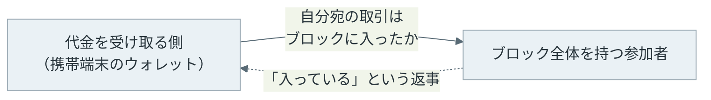
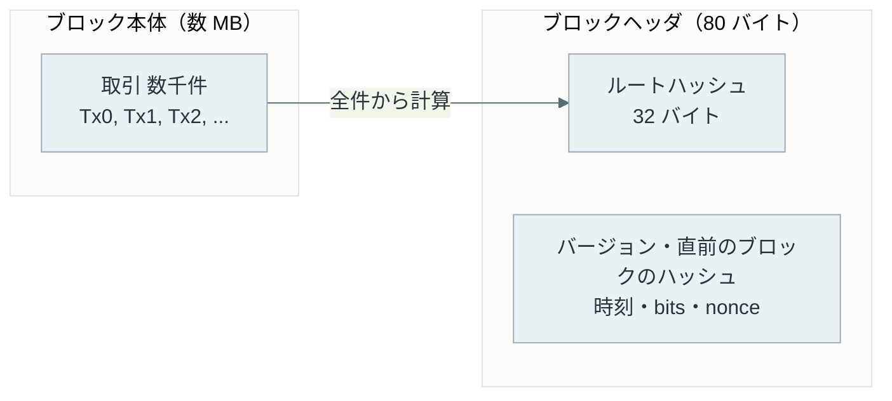
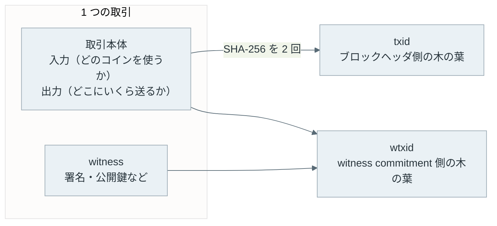
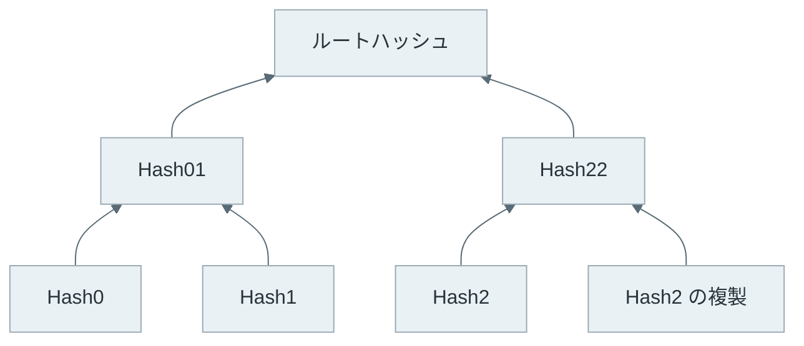
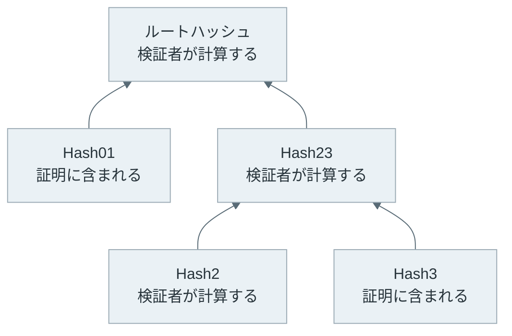
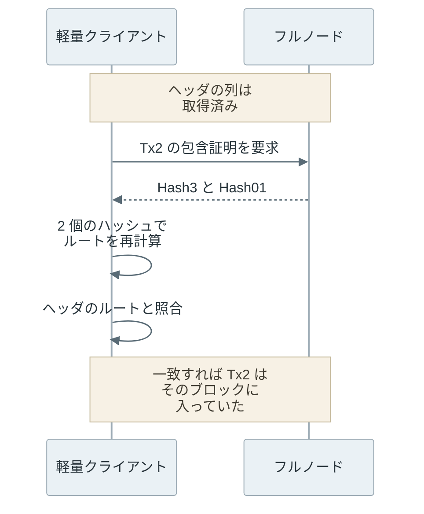
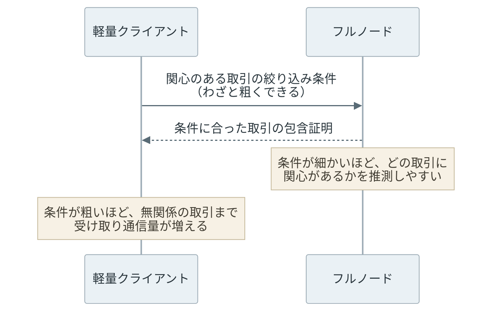

Bitcoin は、ブロックに入った取引（transaction、以下の図では Tx と略します）の並びを Merkle Tree で 1 つのルートハッシュに畳み込み、80 バイトのブロックヘッダに収めています。[Bitcoin の白書](https://bitcoin.org/bitcoin.pdf)も、取引を Merkle Tree でハッシュ化し、ブロックのハッシュに入れるのはルートだけとしています。

この仕組みが必要になる場面の代表は、支払いの受け取りです。送金の取引は、作られてネットワークに流れただけでは、まだどのブロックにも入っていません。どこかのブロックに取り込まれて初めて、共有された履歴に載ります。そのため、代金を受け取る側は、自分宛の取引がブロックに入ったことを見届けてから商品を渡したいはずです。厳密には、その後ろに積まれたブロックの数（[Bitcoin Block](../bitcoin-block/) で説明した確認数）まで見て判断します。ここで扱うのは、その前段の「入ったこと」の確認です。

受け取る側が置かれる状況を以下に示します。



上記の図の「入っている」という返事は、そのままでは証拠になりません。返事の裏を取ろうにも、ブロックチェーン全体は数百 GB あり、携帯端末のウォレットには収まりません。ルートハッシュと、その取引から根までを再計算するのに要る少数のハッシュ（包含証明）を使うと、この返事を手元で検算できます。

本記事では、Bitcoin が何を葉にして木を組み立てているのか、その木で取引の包含をどう検証するのかを説明します。素朴な方法との比較から入り、次の 5 つを確かめます。

- 全件を連結してハッシュする方法と比べて、何が違うのか。
- 何を葉にして、木を組み立てるのか。
- 段のノード数が奇数の時は、どうするのか。
- 包含証明はどのような形で渡り、実際のブロックではどう検証されるのか。
- ブロックヘッダだけを持つ参加者は、何を確かめられるのか。

前提は 2 つあります。木の作り方と包含証明の仕組みは [Merkle Tree](../merkle-tree/) で、ブロック・ブロックヘッダ・取引の関係は [Bitcoin Block](../bitcoin-block/) で説明しています。

---

### 全件を渡す検証との違い

取引の並びを 1 つの値で代表するだけなら、全件を順に連結してハッシュを 1 回計算すれば足ります。この方法では、ある取引の包含を確かめるたびに、数千件・数 MB のブロック全体を受け取って計算し直す必要があります。Merkle Tree の包含証明なら、受け取るのは件数の対数、数千件でもハッシュ十数個です（[Merkle Tree](../merkle-tree/) の「葉の件数と証明のサイズ」）。

以下は、ヘッダとブロック本体の大きさの関係です。



上記の図のとおり、ヘッダ側の 32 バイトが本体の数千件を代表します。ブロックと取引を自力で完全に検証する参加者をフルノード、ブロックヘッダだけを保持して取引の有効性の検証をフルノードに任せる参加者を軽量クライアントと呼びます。

---

### 葉になる txid

葉は、各取引の txid です。txid は、取引から witness データ（そのコインを使う資格を示す署名や公開鍵など）を除いた形式に、SHA-256（Secure Hash Algorithm 256、出力が 32 バイトのハッシュ関数）を 2 回適用した値です。葉が並んだら、隣同士を左から順に組にして連結し、その組に SHA-256 を 2 回適用した値を 1 段上のノードにします。1 つになるまで繰り返した結果が、ブロックヘッダに入るルートハッシュです。

取引を並べる順序を決めるのはブロックを作った参加者（マイナー）で、順序が変われば別のルートハッシュになります。

witness データは、2017 年の Segregated Witness（分離された witness、SegWit）という仕様変更で、取引本体から分離した領域に置かれるようになりました。

署名は、取引の中身を変えないまま第三者が値だけを作り替えられます。署名を txid の計算に含めると、同じ内容の取引の識別子が送金の途中で変わってしまいます。後続の取引は使うコインを前の取引の txid で指すため、txid が変わると、まだブロックに入っていない後続の取引が使えなくなります。この問題は transaction malleability（取引展性）と呼ばれ、witness を txid の外に出したことが解決策の 1 つでした。

取引と 2 つの識別子の関係は以下の通りです。



上記の図のとおり、ブロックヘッダ側の木に witness は入りません。仕様変更の提案文書である BIP（Bitcoin Improvement Proposal）の [141 番](https://github.com/bitcoin/bips/blob/master/bip-0141.mediawiki)は、witness まで含めた識別子である wtxid で別の木を作り、そのルートをコインベース取引（ブロックの先頭に置かれる、ブロック作成者が報酬を受け取る取引）の出力に埋め込む witness commitment を定めています。witness が改竄されていないことは、wtxid の木で保証します。

---

### 奇数の葉の複製

木の組み立て方は Merkle Tree で 1 通りに決まっておらず、Bitcoin の作り方は数ある流儀の 1 つです。Bitcoin は、段の中のノード数が奇数になると最後のノードを複製してから組を作ります。[Bitcoin Core の実装](https://github.com/bitcoin/bitcoin/blob/master/src/consensus/merkle.cpp)のコメントは、この複製を「which is unusual in Merkle trees」（Merkle Tree では異例）と断っています。

例えば、取引 3 件のブロックでは、次のように複製します。



上記の図の Hash22 は、Hash2 を 2 つ連結した組のハッシュです。この木は、4 件目の取引として Tx2 をもう一度並べた場合と同じ形になります。

複製規則の副作用として、異なる取引の並びが同じルートハッシュになる場合があります。SHA-256 の衝突ではなく、木の構築規則に由来する一致です。

この一致を放置すると、[CVE-2012-2459](https://en.bitcoin.it/wiki/Common_Vulnerabilities_and_Exposures#CVE-2012-2459) の攻撃が成り立ちます。ノードは無効と判定したブロックをハッシュで覚え、同じハッシュのブロックを以後受け取りません。攻撃者が取引を複製した無効なブロックを先に送ると、同じヘッダを持つ正当なブロックまで拒まれます。そのため Bitcoin Core は、段の末尾で同じハッシュ 2 つを組にする箇所を検出し、そのブロックを棄却しています。

複製しない流儀もあります。Certificate Transparency の RFC 9162 は、葉の件数から木の形を決める分割規則を使っており、奇数の扱いを含む構築規則の違いは [Merkle Tree Design](../merkle-tree-design/) で扱います。

---

### 包含証明の形式と検証

以下は、取引 4 件のブロックで Tx2 の包含を示す時に渡る値です。木と証明の読み方は [Merkle Tree](../merkle-tree/) の包含証明と同じです。



上記の図で証明として渡るのは Hash3 と Hash01 の 2 個で、検証者は Tx2 から Hash2 を求め、根まで再計算して手元のルートハッシュと照合します。左右の知り方は証明の形式によって異なり、Bitcoin では各段での番号から判断します。0 から数えると Hash2 は番号 2 で、偶数なので相手は右の Hash3 です。1 つ上の段で Hash23 は番号 1 になり、奇数なので相手は左の Hash01 です。

この情報を受け取って検証する関数は以下の通りです。ハッシュは内部のバイト順のまま渡します。txid をチェーンの中身を表示する Web サービス（ブロックエクスプローラ）からコピーすると、慣習で逆順の 16 進表記になっており、そのままでは一致しません。

```go
// verifyMerkleProof は、葉のハッシュと包含証明からルートハッシュを再計算し、
// 期待するルートハッシュと一致するかを返します。
// path は葉に近い段から並べ、siblingIsRight[i] は path[i] が右側にあった事を表します。
func verifyMerkleProof(leaf [32]byte, path [][32]byte, siblingIsRight []bool, root [32]byte) bool {
	if len(path) != len(siblingIsRight) {
		return false
	}

	h := leaf
	for i, sibling := range path {
		if siblingIsRight[i] {
			h = doubleSHA256(h[:], sibling[:])
		} else {
			h = doubleSHA256(sibling[:], h[:])
		}
	}
	return h == root
}

// doubleSHA256 は、2 つのハッシュを連結して SHA-256 を 2 回適用します。
func doubleSHA256(left, right []byte) [32]byte {
	buf := make([]byte, 0, len(left)+len(right))
	buf = append(buf, left...)
	buf = append(buf, right...)

	first := sha256.Sum256(buf)
	return sha256.Sum256(first[:])
}
```

取引 4 件の実際のブロック（[ブロック 100000](https://mempool.space/block/000000000003ba27aa200b1cecaad478d2b00432346c3f1f3986da1afd33e506)）で上記の関数を動かした結果が以下です。ブロックエクスプローラに表示される 4 つの txid とルートハッシュを使い、図と同じ形で Tx2 の包含を確かめました（Go 1.26）。Hash3 は Tx3 の txid で、Hash01 は Tx0 と Tx1 から計算しています。

```text
内部のバイト順に戻した場合: true
表記のまま渡した場合: false
```

1 行目のとおり、渡したハッシュ 2 個でヘッダのルートハッシュに辿り着きました。2 行目は、表記を逆順に戻さずに渡した場合です。手順が正しくても、バイト順を取り違えると検証は通りません。

上記のコードで繰り返す回数は `path` の長さです。奇数のノードを複製する Bitcoin の作り方では、葉の件数を 2 の冪に切り上げた木と同じ深さになるため、葉が n 件なら段数は `ceil(log2 n)` です。例えば、取引が 3000 件のブロックなら段数は 12 で、32 バイトのハッシュを 12 個、合わせて 384 バイトです。そのブロック本体が 1 MB だとすると、384 バイトは 1/2000 以下に収まります。

上記のコードは、左右のハッシュを連結する、SHA-256 を 2 回適用する、根まで再計算する、の 3 つだけを抜き出したもので、Bitcoin が実際に送る証明の形式ではありません。

[BIP 37](https://github.com/bitcoin/bips/blob/master/bip-0037.mediawiki) が定める `merkleblock` メッセージは、partial Merkle tree と呼ばれる形式で、`total_transactions`・`hashes`・`flags` の 3 つを送ります。受け取った側は取引の総数から木の形を復元し、どの節点で下に降りるかを表す `flags` のビットを深さ優先で読みながら `hashes` を消費して、根まで計算します。

---

### SPV - ヘッダだけによる取引の確認

軽量クライアントが持っているのは、ブロックヘッダの列だけです。ヘッダはルートハッシュを含むため、包含証明を受け取れば、その取引がヘッダの指すブロックに入っていたことを自力で確かめられます。Bitcoin の白書はこの手順を Simplified Payment Verification（簡易支払い検証）と呼んでおり、一般には SPV と略されます。

この照合にフルノードへの信用は必要ありません。入っていない取引が入っていると見せかけるには、既に決まっているルートハッシュに、実際とは異なる取引と証明から辿り着く必要があります。ハッシュ関数が、同じ出力になる別の入力を現実的な時間で見つけられない性質（衝突困難性）を持つ限り、そのような入力は作れません。複製規則による一致は別の話で、前述の通り棄却されます。

軽量クライアントとフルノードのやり取りは以下の通りです。



上記の図の最後で一致した時に確かめられたのは、Tx2 がそのブロックに入っていたことだけです。Tx2 が有効な取引であることまでは確かめていません。署名が正しいか、使おうとしている残高が既に使われていないかについては、そのブロックを受け入れたノードの判断と、後ろにブロックが積み上がった事実だけが間接的な裏付けになります。

<br>

注意点として、包含証明だけでは、そのルートハッシュを含むブロックヘッダが正しいチェーンに属することまでは証明できません。ヘッダの列のどれを正しいチェーンとして採用するかは、各ヘッダが満たす [proof of work](../proof-of-work/)（計算作業）の量と、どの列を選ぶかの規則で決まります。白書も、この検証が信頼できるのは、正直な（規則どおりに動く）ノードの計算能力が攻撃者を上回っている間だけだとしています。Merkle Tree の外側にある話なので、本記事では扱いません。

---

### 利点

- ブロック全体を持たない参加者が、取引 1 件の包含を自力で検証できる
- 証明のサイズが件数の対数で、数千件のブロックでも数百バイトに収まる
- witness を別の木に分けたことで、txid の木は署名の作り替えの影響を受けない
- 使い終わった取引の枝をハッシュ 1 つに置き換える圧縮に道を残している

4 番目について、Bitcoin の白書は、使い終わった取引を木から外し、代わりにその枝をまとめたハッシュを残すことで古いブロックを圧縮する案を挙げています。なお Bitcoin Core の枝刈りはブロックファイルごと消す別の方式で、白書のこの案は実装されていません。

---

### 欠点

Bitcoin の Merkle Tree は、証明を小さく保つ代わりに、渡す情報をブロックへの包含に絞っています。その分、次の制約が残ります。

- 素朴に証明を要求すると、どの取引に関心があるかが相手のノードに伝わる
- SPV が確かめるのはブロックへの包含だけで、取引の有効性までは確かめない
- 複製規則の副作用として、同じルートハッシュになる別の取引の並びが存在する（検出して棄却する）

どの取引に関心があるかが伝わる問題に対して、BIP 37 は、関係の無い取引もいくらか混ぜて受け取る仕組みを定めました。同じ文書の説明では、絞り込みの精度を上げれば自分のウォレットに関係する取引だけが届く一方で、相手のノードは取引と IP アドレスを結び付けられます。通信量と匿名性のどちらを取るかの選択になります。以下がこの駆け引きです。



なお [Bitcoin Core 0.19.0.1](https://github.com/bitcoin/bitcoin/blob/master/doc/release-notes/release-notes-0.19.0.1.md) は、サービス拒否攻撃の経路を断つ目的で、この絞り込みを受け付ける設定を既定で無効にしました。現在は、ブロックごとに作った要約をクライアントが取得し、手元で照合する compact block filters（形式は [BIP 158](https://github.com/bitcoin/bips/blob/master/bip-0158.mediawiki)、取得の手順は [BIP 157](https://github.com/bitcoin/bips/blob/master/bip-0157.mediawiki)）に寄っています。
