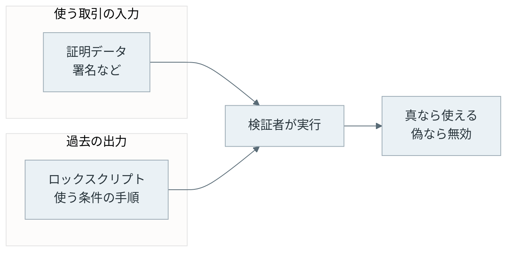
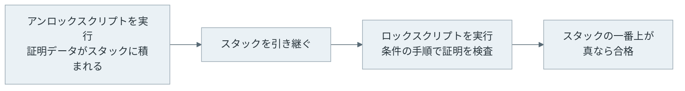
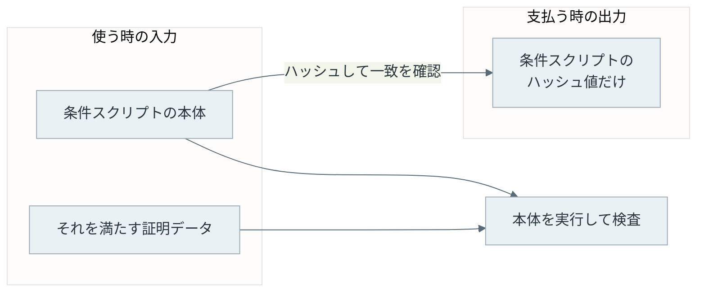

Bitcoin Script は、取引の出力に「使う条件」を書くための小さなプログラミング言語です。[UTXO](../utxo/) のノートでは「出力には金額と使う条件が書かれる」とだけ述べ、条件式の書き方は扱いませんでした。その中身がこの言語です。

条件と証明の組の代表は、[Digital Signature](../digital-signature/) で見た「出力に公開鍵のハッシュ値が置かれ、使う側は公開鍵と署名を出す」という形です。この形が P2PKH（Pay to Public Key Hash）で、名前も「公開鍵のハッシュ値に払う」という意味です。Script は、この照合の手順を出力の中にデータとして埋め込みます。検証する参加者は、埋め込まれた手順を実行して、結果が真になるかどうかで資格の有無を判定します。

条件と証明が噛み合う様子を以下に示します。



上記の図のとおり、条件（ロックスクリプト）と証明データは別の取引に分かれて存在し、使う時に初めて組み合わされて実行されます。実行には、後に積んだ値を先に取り出す入れ物（スタック）を使います。実行が失敗せずに終わり、スタックの一番上に真（0 でない値）が残れば、その入力は条件を満たします（[Bitcoin Wiki の Script のページ](https://en.bitcoin.it/wiki/Script)）。

本記事では、代表的な条件である P2PKH を軸に、次の疑問に答えながら実行の仕組みを説明します。

- なぜ使う条件を取引の中のプログラムとして書くのか。
- 条件と証明データは、それぞれどこに置かれるのか。
- 2 つを 1 本に繋いで実行すると、何が壊れるのか。
- P2PKH は、スタックの上でどのように実行されるのか。
- Script には、なぜループが無いのか。
- 条件が長くなる時、P2SH は出力に何を置くのか。

命令（opcode）の全一覧や、手数料・サイズの上限の規則は本記事では扱いません。

---

### 条件をプログラムで書く理由

「公開鍵のハッシュ値と署名を照合する」という手順を検証プログラムに直接書き込んでも、支払いは成立します。その作りでは、条件が全ての出力で 1 種類に固定されます。複数人の署名を要求する、期限が来るまで使えなくする、といった別の条件が欲しくなるたびに、全参加者の検証プログラムを書き換える必要があります。

Script は、条件を検証プログラムそのものではなく、出力のデータとして持たせます。検証プログラムが持つのは「スクリプトを実行して結果を見る」という枠組みだけです。

例えば、次のような条件が同じ枠組みの上で表せます。

| 条件 | 何を要求するか |
| --- | --- |
| P2PK（Pay to Public Key） | 指定した公開鍵に対応する署名 |
| P2PKH（Pay to Public Key Hash） | ハッシュ値が一致する公開鍵と、その署名 |
| multisig | n 個の公開鍵のうち m 個ぶんの署名 |
| タイムロック付きの条件 | 指定した時刻やブロック高（最初のブロックから数えた番号）より後であること |

---

### ロックスクリプトとアンロックスクリプト

条件と証明データは、それぞれ決まった場所に置かれます。出力に置かれる条件をロックスクリプト（scriptPubKey）と呼びます。

証明データの置き場所は、[Bitcoin Merkle Tree](../bitcoin-merkle-tree/) で説明した witness を使うかどうかで変わります。witness を使う形式は検証手順も形式ごとに異なるため、以降は witness を使わない従来の形式を前提にします。従来の形式では、入力の scriptSig がアンロックスクリプトとして使われ、証明データを積む命令の並びになっています。

2 つは 1 本に繋いで実行すれば済みそうに見えます。初期の Bitcoin はそうしており、[CVE-2010-5141](https://en.bitcoin.it/wiki/Common_Vulnerabilities_and_Exposures#CVE-2010-5141) の穴がありました。先に走るアンロックスクリプトに実行をその場で終える命令（OP_RETURN）を置くと、ロックスクリプトの検査に届く前に結果を真にでき、他人の出力を使えました。2010 年 7 月に試験用のネットワーク（testnet）で実演され、本番のネットワークで悪用される前に直されています。

修正後の Bitcoin は、2 つを[別々に実行](https://mirror.b10c.me/lists/bitcoindev/CANEZrP3qgo-VC5YHTSLOH5rGdv5PP4e2V6qECQVfvMgJXFbx-g@mail.gmail.com/)し、ロックスクリプトの結果だけを見ます。以下は、現在の検証の実行順です。



上記の図のとおり、先にアンロックスクリプトを実行して証明データをスタックに積み、その状態を引き継いでロックスクリプトを実行します。多くの命令は、スタックに値を積んだり、スタックの上の値を取り出して処理したりします。

この分担では、ロックスクリプトを書き込むのは支払う側です。受け取る側への出力を持つ取引を組むのが、支払う側だからです。

条件の中身は、受け取る側が示すアドレスで決まります。[UTXO](../utxo/) で触れたとおり、アドレスは条件を組み立てるための情報を符号化した文字列で、P2PKH なら公開鍵のハッシュ値を運んでいます。支払う側はそれをロックスクリプトの形に組み立て、受け取った側は次に使う時、その条件を満たすアンロックスクリプトを用意します。

---

### スタックでの実行 - P2PKH の例

最も広く知られた条件である P2PKH の実行を命令単位で追います。ロックスクリプトとアンロックスクリプトは次の形です。`<>` で囲んだ部分はデータで、それ以外が命令です。

```text
ロックスクリプト:   OP_DUP OP_HASH160 <公開鍵のハッシュ値> OP_EQUALVERIFY OP_CHECKSIG
アンロックスクリプト: <署名> <公開鍵>
```

命令は 4 つだけです。OP_DUP はスタックの一番上を複製します。OP_HASH160 は一番上の値に SHA-256 と RIPEMD-160 を順に適用します（[Hash Function](../hash-function/) で触れた 20 バイトへの短縮です）。OP_EQUALVERIFY は上の 2 つを比べ、一致しなければ実行を失敗させます。OP_CHECKSIG は、今検証している取引の内容に対する署名かどうかを公開鍵で検証し、結果の真偽をスタックに残します。署名が取引の内容に結び付くため、同じ署名を別の取引に使い回すことはできません。

以下は、実行の各段階でのスタックの変化です。左が先に実行される命令で、スタックは左端が一番上です。

| 実行するもの | 実行後のスタック（左が一番上） |
| --- | --- |
| `<署名>` を積む | 署名 |
| `<公開鍵>` を積む | 公開鍵、署名 |
| OP_DUP | 公開鍵、公開鍵、署名 |
| OP_HASH160 | 計算したハッシュ値、公開鍵、署名 |
| `<公開鍵のハッシュ値>` を積む | 条件のハッシュ値、計算したハッシュ値、公開鍵、署名 |
| OP_EQUALVERIFY | 公開鍵、署名 |
| OP_CHECKSIG | 真（署名が正しい場合） |

表の OP_EQUALVERIFY までが「出力に書かれたハッシュ値と一致する公開鍵か」の確認で、最後の OP_CHECKSIG が「その公開鍵に対応する署名か」の確認です。[Digital Signature](../digital-signature/) の図で示した 2 段階の照合が、そのまま命令の並びになっています。

---

### ループの無い言語と実行の停止

Script にはループがありません。[Bitcoin Wiki](https://en.bitcoin.it/wiki/Script) は、Script を意図的に（intentionally）チューリング完全にしていない、ループの無い言語だと説明しています。命令は左から右に 1 度ずつ実行されるだけなので、実行される命令の数はスクリプトに書かれた数を超えず、どんなスクリプトも必ず停止します。

この性質は、全参加者が全取引を検証するという Bitcoin の構成に合っています。検証者は、見知らぬ相手が書いたスクリプトを無条件で実行する立場にあります。停止しないスクリプトや、実行コストが際限なく膨らむスクリプトを作れてしまうと、取引の検証そのものが攻撃の入り口になります。実際の検証コストは、命令数の上限や署名検証の回数の上限といった別の制限とあわせて、予測できる範囲に保たれています。

条件分岐（OP_IF）はあるので、「期限前なら 2 人の署名、期限後なら 1 人の署名」のような場合分けは書けます。書けないのは、繰り返しと、実行をまたいで残る状態（前の検証で書き換えて次の検証で読み出す値）です。この制限で何が書けなくなるかは、欠点の節で扱います。

---

### スクリプトのハッシュへの支払い - P2SH

条件が複雑になると、ロックスクリプトが長くなり、その分だけ出力のデータも膨らみます。支払う側が受け取る側の複雑な条件を全て知り、正しく出力に書き込む必要もあります。P2SH（Pay to Script Hash）は、条件の本体ではなく、条件のハッシュ値に払う形式です。

P2SH での支払いと使用の分担は以下の通りです。



上記の図のとおり、使う時には条件スクリプトの本体と証明の両方を出します。検証者は、本体のハッシュ値が出力の値と一致することを確かめてから、本体を実行します。データの総量は減りませんが、出力に置くのは短いハッシュ値だけになります。長い条件を知って持ち運ぶのも、その分の手数料を払うのも、使う時の受け取る側（条件を設計した本人）です。多くの公開鍵を並べる multisig のような長い条件は、この形式との組み合わせで使われます。

P2SH のアドレスは、公開鍵のハッシュ値ではなく条件スクリプトのハッシュ値を運んでいます。

---

### 利点

以下は、使う条件を検証プログラムではなく取引のデータとして持たせたことで得られる性質です。

- 署名 1 つから複数署名・時間条件まで、同じ実行の仕組みの上で表せる
- ループが無く実行が必ず停止し、命令数などの上限とあわせて検証コストを見積もれる
- 全参加者が共通の検証規則を使うため、ある取引を各自が独立に検証しても判定が一致する

---

### 欠点

Script は、見知らぬ相手のスクリプトを全参加者が実行するため、必ず停止することと検証コストを見積もれることを優先しました。その分、次の制約を受けます。

- 繰り返しと、実行をまたいで残る状態が無く、引き出した回数を数えるような条件や残高の管理をスクリプト単体では表せない
- 一度出力に置いた条件は変更できず、誤った条件は修正の手段が無い
- 常に真を返す条件も書けてしまい、その出力は誰でも使える

1 番目の制約を別の方向に振ったのが、[UTXO](../utxo/) の比較で触れた Ethereum です。Ethereum は実行をまたいで残る状態を持つプログラムを置けるようにした一方、実行量を計って上限を課し、代価を求める仕組みを別に用意する必要がありました。
