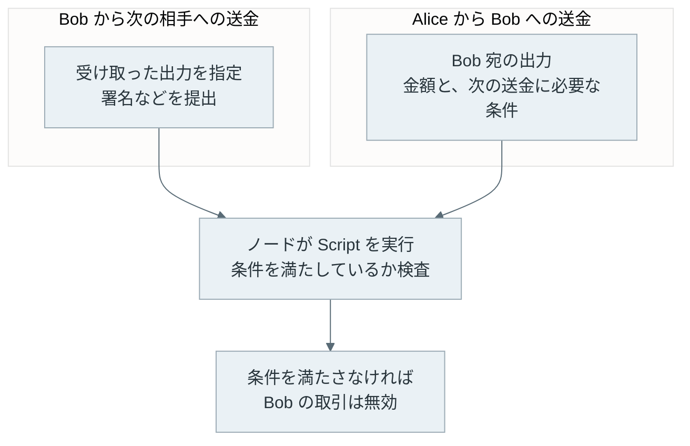
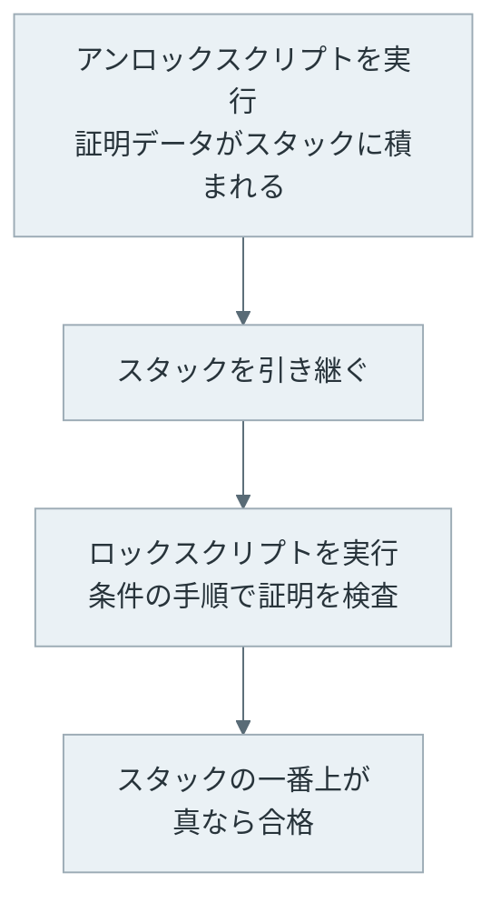
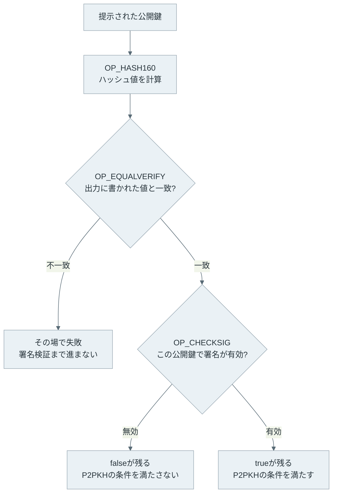
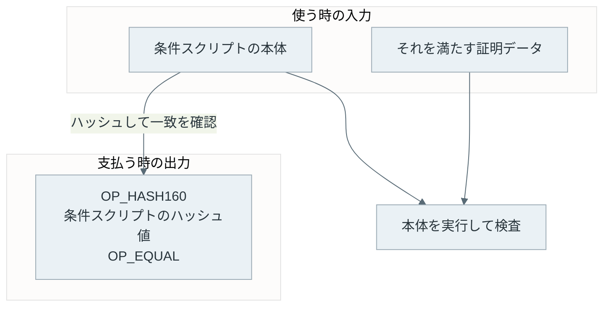

Bitcoin Script は、受け取ったビットコインを次に送金する時、どのような条件を満たす必要があるかを記述するプログラミング言語です。例えば「この公開鍵に対応する秘密鍵で署名できること」という条件を設けると、その秘密鍵を持たない人が勝手に送金することを防げます。

Alice から Bob に送金する場面を考えます。Alice の取引には、Bob に渡す金額と、Bob がそのビットコインを次に送金するための条件を記録します。取引の出力とは、この「金額と条件」のまとまりです。Bob は次の送金時に、この出力を指定し、条件を満たす署名などを提出します。

Bitcoin のノードは、出力に記録された条件と Bob が提出したデータを照合します。その照合手順を命令として書いたものが Script です。[Bitcoin の開発者向け資料](https://developer.bitcoin.org/devguide/transactions.html)でも、受け取り時の出力と、次の送金時に提出する署名を分けて説明しています。



条件を記録するのは Alice の取引で、その条件を満たすデータを提出するのは Bob の取引です。本記事で「出力を使う」と書く時は、新しい送金の元手として、過去に受け取った金額を指定することを指します。まだ使われていない出力は [UTXO（Unspent Transaction Output）](../utxo/) と呼ばれます。

<br>

本記事では、公開鍵と署名で送金を認める従来の形式、P2PKH（Pay to Public Key Hash）を例に、次の疑問に答えます。P2PKH は、出力に公開鍵のハッシュ値を記録し、次の送金時に公開鍵と署名を検査する形式です。

- なぜ送金の条件をプログラムで記述するのか。
- 受け取り時の条件と、次の送金時の署名は、どこに記録されるのか。
- Script の命令は、公開鍵と署名をどのように検査するのか。
- 検査を飛ばされたり、実行が終わらなくなったりすることを、どう防ぐのか。
- 条件が長い場合に使う P2SH は、出力に何を記録するのか。

命令（opcode）の全一覧や、手数料・サイズの上限の規則は本記事では扱いません。

---

### 条件をプログラムで書く理由

「公開鍵のハッシュ値を照合し、その公開鍵で署名を検証する」という手順を検証プログラムに直接書き込んでも、支払いは成立します。その作りでは、条件が全ての出力で 1 種類に固定されます。複数人の署名を要求する、期限が来るまで使えなくする、といった別の条件が欲しくなるたびに、全参加者の検証プログラムを書き換える必要があります。

Script は、条件を検証プログラムそのものではなく、出力のデータとして持たせます。検証プログラムが持つのは「スクリプトを実行して結果を見る」という枠組みだけです。

例えば、次のような条件が同じ枠組みの上で表せます。

| 条件 | 何を要求するか |
| --- | --- |
| P2PK（Pay to Public Key） | 指定した公開鍵に対応する署名 |
| P2PKH（Pay to Public Key Hash） | ハッシュ値が一致する公開鍵と、その署名 |
| multisig | n 個の公開鍵のうち m 個ぶんの署名 |
| タイムロック付きの条件 | 指定した時刻やブロック高（最初のブロックから数えた番号）より後であること |

---

### ロックスクリプトとアンロックスクリプト

条件と証明データは、それぞれ決まった場所に置かれます。出力に置かれる条件をロックスクリプト（scriptPubKey）と呼びます。

証明データの置き場所は、[Bitcoin Merkle Tree](../bitcoin-merkle-tree/) で説明した witness を使うかどうかで変わります。witness を使う形式は検証手順も形式ごとに異なるため、以降は witness を使わない従来の形式を前提にします。従来の形式では、入力の scriptSig がアンロックスクリプトとして使われ、証明データを積む命令の並びになっています。

Script の実行では、後に積んだ値を先に取り出す入れ物（スタック）に、公開鍵や署名などを置きます。検証者は、scriptSig と scriptPubKey を別々に実行し、スタックだけを引き継ぎます。以下は、P2PKH の検証順序です。



上記の図のとおり、先にアンロックスクリプトを実行して証明データをスタックに積み、その状態を引き継いでロックスクリプトを実行します。多くの命令は、スタックに値を積んだり、スタックの上の値を取り出して処理したりします。

実行が失敗せずに終わり、スタックの一番上に真と解釈される値が残れば、その入力はスクリプトの条件を満たします（[Bitcoin Core の VerifyScript](https://github.com/bitcoin/bitcoin/blob/v30.0/src/script/interpreter.cpp)）。取引全体の有効性には、指定した出力が未使用か、金額が正しいかなどの検査も必要です。

この分担では、ロックスクリプトを書き込むのは支払う側です。受け取る側への出力を持つ取引を組むのが、支払う側だからです。

条件の中身は、受け取る側が示すアドレスで決まります。[UTXO](../utxo/) で触れたとおり、アドレスは条件を組み立てるための情報を符号化した文字列で、P2PKH なら公開鍵のハッシュ値を運んでいます。支払う側はそれをロックスクリプトの形に組み立て、受け取った側は次に使う時、その条件を満たすアンロックスクリプトを用意します。

---

### P2PKH のスタックの変化

最も広く知られた条件である P2PKH の実行を命令単位で追います。ロックスクリプトとアンロックスクリプトは次の形です。`<>` で囲んだ部分はデータで、それ以外が命令です。

```text
ロックスクリプト:   OP_DUP OP_HASH160 <公開鍵のハッシュ値> OP_EQUALVERIFY OP_CHECKSIG
アンロックスクリプト: <署名> <公開鍵>
```

命令は 4 つだけです。OP_DUP はスタックの一番上を複製します。OP_HASH160 は一番上の値に [SHA-256](/notes/security/sha-256/) と RIPEMD-160 を順に適用します（[Hash Function](../hash-function/) で触れた 20 バイトへの短縮です）。OP_EQUALVERIFY は上の 2 つを比べ、一致しなければ実行を失敗させます。

OP_CHECKSIG は、今検証している取引の内容に対する署名かどうかを公開鍵で検証し、結果の真偽をスタックに残します。署名の対象に含めた内容を変えると、同じ署名では検証を通りません。対象に含める入力・出力の範囲は sighash type という指定で変わり、詳しくは [Digital Signature](../digital-signature/) で説明しています。

表では、署名を `sig`、公開鍵を `pub`、公開鍵から計算したハッシュ値を `h`、出力に書かれたハッシュ値を `H` と略します。スタックは左端が一番上です。例えば `pub / sig` なら、次に取り出す値は公開鍵になります。

| 実行するもの | 実行後のスタック |
| --- | --- |
| `<sig>` を積む | `sig` |
| `<pub>` を積む | `pub / sig` |
| OP_DUP | `pub / pub / sig` |
| OP_HASH160 | `h / pub / sig` |
| `<H>` を積む | `H / h / pub / sig` |
| OP_EQUALVERIFY | `pub / sig`（`H = h` の場合） |
| OP_CHECKSIG | `true`（署名が正しい場合） |

OP_DUP で公開鍵を複製するのは、ハッシュ値の照合で使う分と、その後の署名検証で使う分を残すためです。OP_HASH160 は一番上の公開鍵をハッシュ値に置き換えるので、複製しなければ署名検証に必要な公開鍵がなくなります。

公開鍵と署名のどちらを間違えたかで、失敗する箇所は異なります。以下は、データの形式が正しい場合に、2 段階の検査で何を確かめるかを示した図です。



例えば、Bob が自分の公開鍵と正しい署名を持ってきても、Alice 宛の出力に書かれたハッシュ値と一致しなければ、OP_EQUALVERIFY で止まります。Alice の公開鍵だけをコピーした場合は、この照合は通りますが、対応する有効な署名を作れなければ最後の検証を通りません。公開鍵を知ることと、その出力を使えることの違いがここにあります。

---

### 2 つのスクリプトを分ける理由

scriptSig と scriptPubKey を単純に連結すると、使う側が用意した命令が、支払う側の条件を飛ばしてしまう余地が生まれます。初期の Bitcoin では、こうした検査の回避が可能でした（[CVE-2010-5141](https://en.bitcoin.it/wiki/Common_Vulnerabilities_and_Exposures#CVE-2010-5141)）。

1. [初期の実装](https://github.com/bitcoin/bitcoin/blob/v0.3.0/script.cpp)は、使う側の scriptSig と、過去の出力の scriptPubKey を連結していました。
2. scriptSig に当時の OP_RETURN を置くと、条件の検査まで進まずに実行を終えられました。
3. 真と解釈される値を残しておけば、支払う側の条件を満たさずに出力を使えました。

現在の [Bitcoin Core の VerifyScript](https://github.com/bitcoin/bitcoin/blob/v30.0/src/script/interpreter.cpp) は、scriptSig の実行に成功した後、引き継いだスタックで scriptPubKey を別に実行します。現在の OP_RETURN は実行すると失敗する命令で、当時の動作とは異なります。命令の名前だけでなく、2 つの実行を分けて出力の条件を必ず検査する構造が重要です。

---

### ループの無い言語と実行の停止

Script にはループがありません。[Bitcoin Wiki](https://en.bitcoin.it/wiki/Script) は、Script を意図的に（intentionally）チューリング完全にしていない、ループの無い言語だと説明しています。命令は左から右に 1 度ずつ実行されるだけなので、実行される命令の数はスクリプトに書かれた数を超えず、どんなスクリプトも必ず停止します。

この性質は、全参加者が全取引を検証するという Bitcoin の構成に合っています。検証者は、見知らぬ相手が書いたスクリプトを無条件で実行する立場にあります。停止しないスクリプトや、実行コストが際限なく膨らむスクリプトを作れてしまうと、取引の検証そのものが攻撃の入り口になります。実際の検証コストは、命令数の上限や署名検証の回数の上限といった別の制限とあわせて、予測できる範囲に保たれています。

条件分岐（OP_IF）はあるので、「期限前なら 2 人の署名、期限後なら 1 人の署名」のような場合分けは書けます。書けないのは、繰り返しと、実行をまたいで残る状態（前の検証で書き換えて次の検証で読み出す値）です。この制限で何が書けなくなるかは、欠点の節で扱います。

---

### スクリプトのハッシュへの支払い - P2SH

条件が複雑になると、ロックスクリプトが長くなり、その分だけ出力のデータも膨らみます。支払う側が受け取る側の複雑な条件を全て知り、正しく出力に書き込む必要もあります。P2SH（Pay to Script Hash）は、条件の本体ではなく、条件のハッシュ値に払う形式です。

P2SH での支払いと使用の分担は以下の通りです。



上記の図のとおり、使う時には条件スクリプトの本体と証明の両方を出します。検証者は、本体のハッシュ値が出力の値と一致することを確かめてから、本体を実行します。[BIP-16](https://github.com/bitcoin/bips/blob/master/bip-0016.mediawiki) の出力は、ハッシュ値と、それを照合する短い命令列です。条件の本体は使う時に提示するため、条件そのものを消してデータを圧縮する仕組みではありません。長い条件を知って持ち運ぶのも、その分の手数料を払うのも、使う時の受け取る側（条件を設計した本人）です。多くの公開鍵を並べる multisig のような長い条件は、この形式との組み合わせで使われます。

P2SH のアドレスは、公開鍵のハッシュ値ではなく条件スクリプトのハッシュ値を運んでいます。

---

### 利点

以下は、使う条件を検証プログラムではなく取引のデータとして持たせたことで得られる性質です。

- 署名 1 つから複数署名・時間条件まで、同じ実行の仕組みの上で表せる
- ループが無く実行が必ず停止し、命令数などの上限とあわせて検証コストを見積もれる
- 全参加者が共通の検証規則を使うため、ある取引を各自が独立に検証しても判定が一致する

---

### 欠点

Script は、見知らぬ相手のスクリプトを全参加者が実行するため、必ず停止することと検証コストを見積もれることを優先しました。その分、次の制約を受けます。

- 繰り返しと、実行をまたいで残る状態が無く、引き出した回数を数えるような条件や残高の管理をスクリプト単体では表せない
- 一度出力に置いた条件は変更できず、誤った条件は修正の手段が無い
- 常に真を返す条件も書けてしまい、その出力は誰でも使える

1 番目の制約を別の方向に振ったのが、[UTXO](../utxo/) の比較で触れた Ethereum です。[Smart Contract](../smart-contract/) で扱う Ethereum は、実行をまたいで残る状態を持つプログラムを置けるようにした一方、実行量を計って上限を課し、代価を求める仕組みを別に用意する必要がありました。
