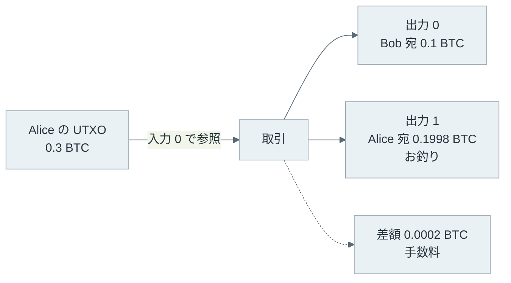
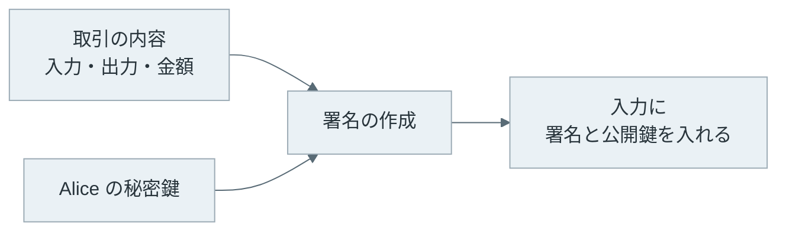
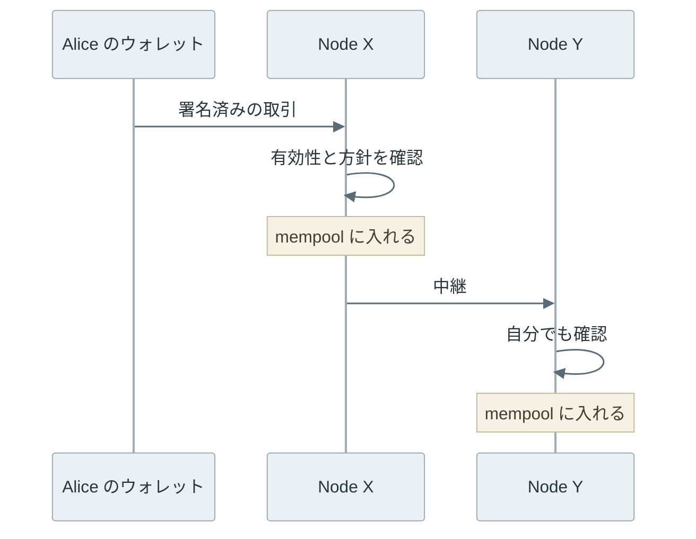
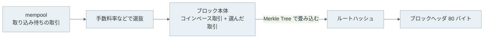
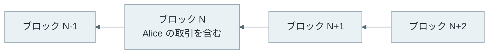

[Bitcoin](https://bitcoin.org/) の送金は、ウォレット（鍵を管理し、取引を組み立てるソフトウェア）が取引を作り、ネットワークに流し、マイナー（取引をまとめた単位であるブロックを作る参加者）がブロックに取り込むまでの段階を通ります。取引が共有された履歴に載るのは最後の段階で、送信した直後の取引は、ウォレットと各ノードの手元に置かれているだけです。

以下では、Alice が Bob に 0.1 BTC（BTC は Bitcoin の通貨単位）を送る 1 件の取引で、作成からブロックへの取り込みまでを順に追います。

ウォレットで送信を終えても、画面にはしばらく「未確認」と表示され、その後で確認済みに変わります。「未確認」は取引がまだどのブロックにも入っていない状態で、確認済みはブロックに入った後の状態です。その間に取引がどこを通り、誰が何を確かめているのかは、ウォレットの画面からは見えません。

以下は、同じ取引が送信から取り込みまでに置かれる場所です。ノードは Bitcoin のソフトウェアを動かしてネットワークに参加する計算機、[UTXO](../utxo/) は過去の取引で受け取り、まだ使っていないコインの単位、[mempool](../mempool/) はブロックに入る前の取引を溜める場所です。



上記の図の青く塗った四角が Alice の取引です。Alice のウォレットが行うのは、取引の組み立てから署名を経て、ネットワークに送信するまでです。以降は、受け取ったノードとマイナーの作業になります。mempool の中身はノードごとに異なり、図の下のノードにはまだ届いていません。

<br>

本記事では、各段階で何が起きるのかと、どの仕組みが登場するのかを説明します。節は取引が移る順に並べ、次の疑問に答えます。

- ウォレットは、どのように UTXO を選んで取引を組み立てるのか。
- 署名は、取引に何を証明として加えるのか。
- ノードは、受け取った取引の何を確かめて mempool に入れるのか。
- マイナーは、どのように取引を選んでブロックを作るのか。
- 他のノードは、配られたブロックの何を検証してチェーンに繋ぐのか。
- 取引に手数料の欄は無いのに、ノードはどこから手数料を知るのか。

[署名の計算手順](../digital-signature/)、[Bitcoin Script の命令](../bitcoin-script/)、[SHA-256（Secure Hash Algorithm 256、Bitcoin が使うハッシュ関数）の内部](../hash-function/)、[Merkle Tree の構築規則](../merkle-tree-design/)、[合格条件の計算](../proof-of-work/)といった詳細は、各ノートに譲ります。

---

### ウォレットによる UTXO の選択と取引の組み立て

Bitcoin に口座はなく、Alice の残高は、Alice の鍵で使える [UTXO](../utxo/)（Unspent Transaction Output、未使用の取引出力）を集めた合計です。ウォレットは、その中から支払いに足りる組み合わせを選びます。ここでは、0.3 BTC の UTXO を 1 つだけ持っている場合を例にします。

入力は選んだ UTXO を丸ごと消費するため、支払う額との差はお釣りとして自分宛の出力に戻します。以下が組み立てた取引の形です。



上記の図の手数料は、入力の合計から出力の合計を引いた差で、この取引を取り込んだマイナーの報酬になります。手数料として差額をいくら残すかは取引を作る人が決めます。出力とお釣りの扱いは [UTXO](../utxo/) で説明しています。

出力には、金額とあわせて「使う条件」が書かれます。Bob のアドレスは、この条件を組み立てるための情報を符号化した文字列で、ウォレットはアドレスから条件を作って出力に入れます。条件の書き方は [Bitcoin Script](../bitcoin-script/) で説明しています。

支払いたい額に足りる UTXO が 1 つも無い場合は、複数の UTXO を入力に並べて合算します。手数料はデータの大きさに対して払うため、入力が増えるほど、同じ早さで取り込まれるのに必要な手数料も増えます。

---

### 秘密鍵の署名による使う資格の証明

この時点の取引には、Alice の UTXO を使うと書いてあるだけで、それを使う資格を示す証明が入っていません。入力が参照する出力には条件が書かれており、代表的な P2PKH（Pay to Public Key Hash）では、出力に書かれたハッシュ値と一致する公開鍵と、その鍵で作った署名を出すことが条件になります。

Alice は取引の内容を対象に秘密鍵で署名を作り、公開鍵と一緒に入力に入れます。以下が署名の材料と行き先です。



上記の図の署名は取引の内容と結び付いているため、途中の誰かが宛先や金額を書き換えると検証が通らなくなります。取引のどの範囲を署名の対象に含めるかは sighash type という指定で選べ、最も広く使われる指定では全ての入力と出力が範囲に入ります。指定の種類と署名の計算は [Digital Signature](../digital-signature/) で説明しています。

---

### ネットワークへの送信、各ノードの検証と mempool への追加

ウォレットは、出来上がった取引を接続しているノードに送ります。受け取ったノードは、まず取引として有効かを自分で検証します。有効性は全ノード共通の規則です。有効で、かつ自分の方針（手数料率が一定より低い取引は受け入れない、といったノードごとの設定）も満たす取引だけを受け入れ、隣のノードに送ります。

各ノードは、これまでのブロックを検証した結果として、まだ使われていない出力の一覧（UTXO 集合）を持っています。有効性の主な確認項目は次の通りです。

- 参照先の出力がまだ使われていないか（UTXO 集合か、mempool にある未確認の取引の出力に残っているか）
- 入力に添えられた証明が、出力に書かれた条件を満たすか
- 出力の金額の合計が、入力の合計を超えていないか
- 使える時期の条件を満たすか（取引に付けたロックタイムや、ブロック報酬の出力は 100 ブロック後から使える規則）
- 取引の形式と大きさが規則に収まっているか

取引に手数料の欄は無く、ノードは参照先の出力の金額を手元から引き、入力と出力の合計の差を手数料とします。

受け入れられた取引は、まだブロックに入っていない取引の置き場（[mempool](../mempool/)）に入ります。取引が広まる様子は以下の通りです。



上記の図の Node X と Node Y は、それぞれ独立に確認しています。有効性の判定は共通の規則で決まる一方で、mempool に入れるかどうかと中継するかどうかには各ノードの方針が関わるため、あるノードが持っている取引を別のノードが持っていないことも起こります。方針の中身と、入った取引が消える場面は [Mempool](../mempool/) で説明しています。

同じ UTXO を使う取引が 2 件届いても、ノードは両方を mempool に入れるわけではありません。方針によっては、手数料の高い側が既存の取引を置き換えます。

各ノードが自分で確認するのは、他のノードの判定を信じなくて済むようにするためです。確認の材料は取引そのものと、手元の UTXO 集合・mempool・検証済みのブロックの高さと時刻で、Alice にも他のノードにも問い合わせる必要はありません。送信元が誰であっても、有効性の確認を通らない取引はそれ以上中継されません。

---

### マイナーによる取引の選択とブロック候補の組み立て

mempool の取引は、まだ履歴のどこにも載っていません。履歴に載せるのはブロックへの取り込みで、ブロックの候補を作る参加者がマイナー（miner）です。マイナーは mempool から取引を選んで並べ、ブロックの候補を組み立てます。

ブロックには取り込めるデータ量に上限があるため、混雑している時は、サイズあたりの手数料率が高い取引から取り込まれやすくなります。Alice の取引は、この選抜を通るまで mempool で待ちます。マイナーは、選んだ取引から次のようにブロック候補を作ります。



上記の図の先頭に置くコインベース取引は、過去の出力を参照せず、ブロックを作った参加者が報酬と手数料を受け取る取引です。ヘッダにはルートハッシュのほかに、バージョン、直前のブロックのハッシュ値、時刻、合格条件、nonce が入ります。

---

### proof of work による、条件を満たすヘッダの探索

候補が組み上がっても、そのままではブロックとして受け入れられません。ヘッダのハッシュ値が、決められた値（target）以下になっている必要があります。マイナーは、ヘッダの nonce などを変えながらハッシュを計算し直し、合格する値が出るまで試行を繰り返します。

ハッシュ値は入力が少し変わるだけで全く別の値になるため、条件を満たすヘッダを狙って作る方法は知られておらず、合格には平均して大量の試行が必要です。受け取ったノードは、同じ計算を 1 度やり直すだけで条件の成立を確かめられます。

この試行は、多数のマイナーがそれぞれ別の候補で同時に進めています。Alice の取引を選ばなかった候補が先に合格すれば、取引は次のブロックまで待ちます。

合格したマイナーは、ブロックをネットワークに配ります。ブロックが見つかる間隔が平均およそ 10 分になるよう、条件の厳しさは定期的に調整されます。target の表し方と調整の規則は [Proof of Work](../proof-of-work/)、ハッシュ関数の性質は [Hash Function](../hash-function/) で説明しています。

---

### 他のノードによるブロックの検証とチェーンへの接続

ブロックを受け取ったノードは、proof of work の成立、直前のブロックとの繋がり、中の取引 1 件ずつの有効性を検証します。[白書](https://bitcoin.org/bitcoin.pdf)も、ブロックを受け入れるのは中の全ての取引が有効で、かつ使用済みでない場合だけとしています。通ったブロックは自分の持つチェーンの末尾に追加され、消費された出力が UTXO 集合から消え、新しくできた出力が足されます。

Bob から見ると、自分宛の出力が UTXO 集合に加わります。ブロック全体を持たない携帯端末のウォレットは、ヘッダと少数のハッシュだけで自分宛の取引がブロックに入ったことを確かめられます。手順は [Bitcoin Merkle Tree](../bitcoin-merkle-tree/) で説明しています。

以下は、取り込まれた後にチェーンが伸びる様子です。



上記の図の状態で、Alice の取引の確認数は 3 です。取引を含むブロック自身を 1 個目として数え、後ろに 2 個積まれています。ウォレットが表示する確認数は、この数です。後ろに積まれるブロックが増えるほど、この取引を履歴から外すのに必要な計算量は大きくなります。

手数料と確認数の見え方は、外部と接続しない[ローカルのチェーン](../mainnet-and-testnet/)（[Bitcoin Core](https://github.com/bitcoin/bitcoin) 32.1 の regtest）で確かめられます。regtest は合格条件が緩く、ブロックをコマンド 1 つで作れます。

ブロックを 101 個作って最初のブロック報酬 50 BTC を使えるようにした Alice から、手数料率 10 sat/vB（1 vB あたり 10 satoshi。satoshi は 1 億分の 1 BTC）で Bob に 0.1 BTC を送り、ブロックを 1 個、さらに 2 個作った時の表示は以下の通りです。

```text
取引の項目:     ["hash","locktime","size","txid","version","vin","vout","vsize","weight"]
入力の金額:     50.00000000
出力の金額:     [0.10000000,49.89998590]
mempool の手数料: 0.00001410
確認数（送信直後）: 0
確認数（1 ブロック後）: 1
確認数（3 ブロック後）: 3
```

1 行目のとおり取引の項目に手数料は無く、4 行目はノードが入力の 50 BTC と出力の合計の差として求めた値です。同じ時に getmempoolentry で見た取引の大きさは 141 vB で、10 sat/vB を掛けた 1410 satoshi と一致します。確認数は、取引を含むブロックができた時点で 1 になり、後ろに 2 個積まれて 3 になりました。

出力の並びは実行ごとに変わり、もう一度実行するとお釣りが先頭に来ました。Bitcoin Core のウォレットが、お釣りを[無作為な位置に入れる](https://github.com/bitcoin/bitcoin/blob/v32.1/src/wallet/spend.cpp#L1262-L1263)からです。

チェーンの末尾は一時的に分岐することがあり、外れた列にだけ入っていた取引は、改めて検証を通れば mempool に戻ります。そのため、取り込まれた直後の取引は確定したとは言えず、確定に向かう途中にあります。何個待てば十分かは、金額とリスクの許容度で変わります。分岐の解消と確認数の扱いは [Bitcoin Block](../bitcoin-block/)、確定済みとして扱ってよい条件は [Finality](../finality/) で説明しています。

---

### 各段階と詳細を説明しているノート

ここまでの 6 段階と、各段階で主に働く仕組みを整理すると、以下の通りです。

| 段階 | 主に働く仕組み | 詳細 |
| --- | --- | --- |
| UTXO を選び、取引を組み立てる | UTXO、Bitcoin Script | [UTXO](../utxo/) / [Bitcoin Script](../bitcoin-script/) |
| 秘密鍵で署名する | デジタル署名 | [Digital Signature](../digital-signature/) |
| 各ノードが検証し、mempool に入れる | UTXO 集合、Bitcoin Script、ノードの方針 | [UTXO](../utxo/) / [Bitcoin Script](../bitcoin-script/) / [Mempool](../mempool/) |
| ブロックの候補を組む | Merkle Tree、ブロックヘッダ | [Merkle Tree](../merkle-tree/) / [Bitcoin Merkle Tree](../bitcoin-merkle-tree/) |
| proof of work で合格を探す | ハッシュ関数、target | [Proof of Work](../proof-of-work/) / [Hash Function](../hash-function/) |
| チェーンに追加され、確認数が積まれる | ブロックとチェーン | [Bitcoin Block](../bitcoin-block/) |

[Blockchain Basics](../blockchain-basics/) では、中央の管理者が居ない環境で決めなければならない事柄ごとに、どの仕組みが受け持つかを整理しています。次に読むノートは、詳細の列から選んでください。
