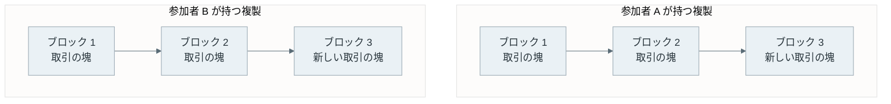
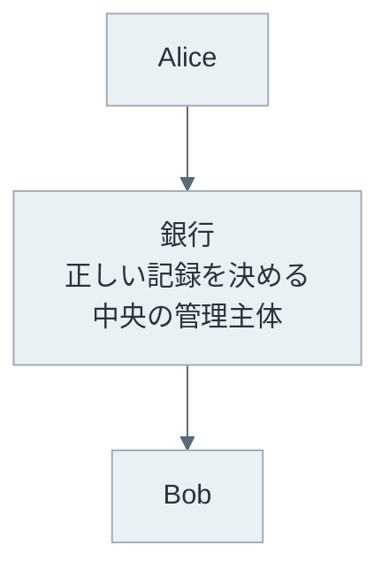
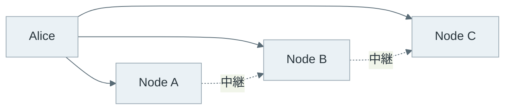

ブロックチェーンは、取引の履歴を参加者がそれぞれ複製して持ち、新しい取引をまとめた塊を順に繋いで追記していく仕組みです。Bitcoin は、この仕組みで送金の履歴を共有します。図にすると、以下のようになります。

上記の図の 1 つの箱がブロックで、矢印で繋がった列がチェーンです。

 

本記事では、署名や UTXO などの個別の仕組みを読む前の地図として、中央の管理主体が居ない環境で何を決める必要があるのかと、Bitcoin がそれぞれをどの仕組みで解決しているのかを説明します。銀行の場合から始めて、次の 5 つを見ていきます。

- 中央の管理主体がいる場合、その主体は何を決めているのか。
- 中央管理者がいないと、何を決める必要が出てくるのか。
- 一度入った記録を変えたい時には、何が必要になるのか。
- 取引の表し方と有効かどうかの判定には、どの仕組みを使うのか。
- 履歴をまとめ、書き換えを困難にするには、どの仕組みを使うのか。

仕組みの原理と内部構造は本記事では扱わず、問題と名前の対応だけを示します。

---

### 中央の管理主体がいる場合

銀行の送金では、口座の残高と入出金の履歴を銀行が管理します。内部で DB（Database、データベース）が複製・分散されていても、どの記録を正しいものとするかは銀行が決められます。利用者から見た経路を以下に示します。

上記の図の銀行が決めているのは 3 つです。送金を指示したのが口座の持ち主かどうか、同じ資金を使う指示が 2 つ来た時にどちらを通すか、どの記録を正しい履歴とするかです。

[Bitcoin の白書](https://bitcoin.org/bitcoin.pdf)は、金融機関を通さずに一方から他方に直接送る支払いを目的として挙げています。この目的を選ぶと、上記の 3 つを決める相手が居なくなります。

---

### 中央管理者がいない場合

Bitcoin のネットワークには、参加の登録も許可も必要ありません。ソフトウェアを動かせば誰でもノード（ネットワークに参加する計算機）になれ、各ノードが履歴の複製を持ちます。

取引が広まる様子は以下の通りです。

上記の図の Node A・Node B・Node C は対等で、どれか 1 台の判断が他を従わせるわけではありません。ノードの多数決で決めることもできません。誰でも参加でき、1 人が多数のノードを動かして票を水増しできるからです。

記録を書き換える権限を持つ者も居ません。2016 年、Ethereum（Bitcoin とは別のブロックチェーン）で The DAO という投資用のプログラムの穴を突かれ、資金を引き出されました。開発を支える Ethereum Foundation も、資金を戻すかどうかを 1 者では[決められない](https://blog.ethereum.org/2016/07/15/to-fork-or-not-to-fork)とし、ソフトウェアの既定の動作を投票の結果で決めるとしました。

規則を変えたソフトウェアのノードは、ブロック 1920000 で約 1200 万 ETH を[回収用の契約](https://blog.ethereum.org/2016/07/20/hard-fork-completed)に移しました。一方、ソフトウェアを替えなかった参加者は元の列を伸ばし続け、その列は [Ethereum Classic](https://blog.ethereum.org/2016/07/26/onward-from-the-hard-fork) として続いています。記録を変えるのに必要だったのは、権限ではなく、新しい規則を参加者それぞれが選ぶことでした。

 

決める必要があるのは、次の 7 つです。

- その資金を使う資格を示せるか
- 同じ資金が二重に使われていないか
- 取引をどんなデータとして表すか
- 支払いの条件をどう表すか
- 多数の取引をどうまとめるか
- どの履歴を採用するか
- データの変更や履歴の改変をどう検出し、どう困難にするか

Bitcoin は、これらに別々の仕組みで答えています。

---

### 取引を表し、有効かを判定する仕組み

取引の「出力」は、金額と使う条件の組です。UTXO（Unspent Transaction Output、未使用の取引出力）は、出力のうちまだ使われていないものです。支払いは、過去の出力を丸ごと消費して新しい出力を作る形で表し、差額はおつりとして自分宛ての出力にします。同じ出力を使う取引が 2 つあれば、参照の重複としてデータに表れます。どちらを履歴に残すかは、後述の proof of work と履歴の採用の規則が決めます（[UTXO](../utxo/)）。

デジタル署名は、秘密鍵を持つ人だけが作れて、対になる公開鍵を持つ誰もが検証できるデータです。支払う人は取引に署名を添え、各ノードは、その署名で、出力を使う条件が満たされているかを検証します。確かめられるのは資格の有無で、支払った人が誰であるかは分かりません（[Digital Signature](../digital-signature/)）。

Bitcoin Script は、出力に「使う条件」を書くための小さな言語です。代表的な条件は「この公開鍵に対応する署名を添えた者だけが使える」です。各ノードは、使う側が添えた署名などのデータを出力側の条件と一緒に実行し、成功すれば使ってよいと判定します。言語なので、複数の署名を求める条件も同じ仕組みで書けます（[Bitcoin Script](../bitcoin-script/)）。

---

### 履歴をまとめ、書き換えを困難にする仕組み

ハッシュ関数は、任意の長さのデータを固定長の短い値に変換する関数です。入力が 1 バイト変わるだけで出力が別の値になるため、データの変更が短い値の違いとして現れます（[Hash Function](../hash-function/)）。

ブロックは、取引をまとめて履歴に追加する単位で、要約部のブロックヘッダと取引の並びからなります。各ブロックのヘッダは直前のブロックのハッシュ値を持つため、過去のブロックを書き換えると、その後ろのブロックとの繋がりが崩れます（[Bitcoin Block](../bitcoin-block/)）。

Merkle Tree は、多数のデータをハッシュ関数で畳み込み、1 つの値にまとめる木構造です。ブロックに入った取引の並びから求めたこの値が、ブロックヘッダに入ります（[Merkle Tree](../merkle-tree/)、[Bitcoin Merkle Tree](../bitcoin-merkle-tree/)）。

proof of work（作業証明）は、ブロックヘッダのハッシュ値が決められた値を下回るまで、ヘッダの一部を変えて計算し直す作業です。最初に条件を満たしたノード（マイナー）が次のブロックを追加できます。条件を満たすには平均して大量の試行が必要な一方、受け取った側は少ない計算で成立を確かめられます。各ノードは、積まれた計算量が最も大きい列を正しい履歴として採用します（[Proof of Work](../proof-of-work/)）。

---

### 問題と仕組みの対応

ここまでに挙げた問題と、各仕組みの役割を整理すると、以下の通りです。

| 決める必要があること | Bitcoin で使う仕組み | 詳細 |
| --- | --- | --- |
| 取引をどう表し、二重使用を見分けるか | UTXO | [UTXO](../utxo/) |
| その資金を使う資格を示せるか | デジタル署名 | [Digital Signature](../digital-signature/) |
| 支払いの条件をどう表すか | Bitcoin Script | [Bitcoin Script](../bitcoin-script/) |
| データの変更をどう検出するか | ハッシュ関数 | [Hash Function](../hash-function/) |
| 多数の取引をどうまとめるか | Merkle Tree | [Merkle Tree](../merkle-tree/) / [Bitcoin Merkle Tree](../bitcoin-merkle-tree/) / [Merkle Tree Design](../merkle-tree-design/) |
| 履歴をどの単位で追加するか | ブロックとチェーン | [Bitcoin Block](../bitcoin-block/) |
| 次のブロックを誰が追加し、どの履歴を採用するか | proof of work | [Proof of Work](../proof-of-work/) |
| 過去の履歴の書き換えをどう困難にするか | ブロックのチェーンと proof of work | [Bitcoin Block](../bitcoin-block/) / [Proof of Work](../proof-of-work/) |

表の下 3 行は、1 つの仕組みで成り立つものではありません。データとハッシュ値を両方書き換えれば、ハッシュ関数だけでは改変に気付けません。ブロックは直前のハッシュ値を持つので、書き換えは後ろのブロック全てに波及し、その全てで proof of work をやり直す必要が出ます。

1 件の送金の中でこれらがどの順に登場するのかは、[Bitcoin Transaction Lifecycle](../bitcoin-transaction-lifecycle/) で扱います。
