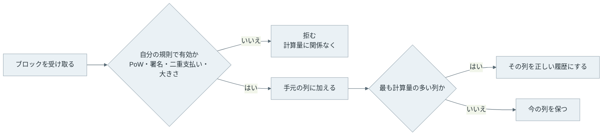

複数の会社や利用者で 1 つの台帳（誰が誰にいくら送ったかの記録）を共有したい時、Web や DB を扱うエンジニアが最初に思い付くのは、DB を 1 つ用意して全員の書き込みを集める形です。ブロックチェーン（blockchain）は、参加者が台帳を各自で複製し、記録をまとめたブロックを順につないで追記する仕組みで、管理者を置きません。まず、DB を使う手を 2 つ検討します。

1 つ目は、1 社が運営する DB に、書き換えを後から検出できる履歴を持たせる手です。AWS の [Amazon QLDB](https://aws.amazon.com/qldb/) は、[暗号で検証できる変更履歴](https://www.infoq.com/news/2024/07/aws-kill-qldb/)を持つ台帳用の DB として提供されていましたが、2025 年 7 月 31 日にサポートを終了しました。改ざんは検出できますが、どの書き込みを受け付け、どの順に並べるかは運営者が決めます。

運営者を信頼できるなら、これで足ります。2016 年に AWS でブロックチェーンへの投資を検討したエンジニアの Tim Bray も、誰も信頼しない仕組みを現実の利用者が求めていると確信できなかった、と[振り返っています](https://www.tbray.org/ongoing/When/202x/2022/11/19/AWS-Blockchain)。

<br>

2 つ目は、複数の会社が DB の複製を持ち、過半数の同意で書き込みを決める手です。複製の間で書き込みの順番をそろえる [Raft](https://raft.github.io/) のような合意の手順は、参加するノード（台帳の複製を持つコンピュータ）の名簿を前提に票を数えます。詳しくは [Leader and Followers](../../distributed-systems/leader-and-followers/) と [Quorum](../../distributed-systems/quorum/) で説明しています。

誰でも参加できるネットワークで同じ数え方をすると、1 人がノードを 1,000 台立てるだけで票を握れます。この攻撃をどう防ぐかは、[Byzantine Fault Tolerance](../../distributed-systems/byzantine-fault-tolerance/#参加者の決め方と票の重み) で扱っています。

| 手 | どの履歴を正とするかを決める者 | 足りない所 |
| --- | --- | --- |
| 1 社の DB と検証できる履歴 | 運営者 | 運営者を信頼する必要がある |
| 複製と過半数の同意 | 名簿に載ったノードの票 | 名簿が無いと票を水増しできる |
| ブロックチェーン | 各ノードが自分の規則で判定し、最も計算量の多い列を選ぶ | 本記事で扱う |

金融機関を通さない直接の支払いを目的にした [Bitcoin のホワイトペーパー](https://bitcoin.org/bitcoin.pdf)は、名簿の代わりに計算量で票を数えます。計算量とは、決められた条件を満たす値が出るまで計算を繰り返した量で、計算の中身は後の節で説明します。

[Bitcoin](https://bitcoin.org/) のネットワークには登録も許可も要らず、ソフトウェアを動かせば誰でもノードになれます。各ノードは、届いたブロック（トランザクションをまとめた記録の単位）を自分の持つ規則で判定し、有効なブロックだけでつながる列のうち、最も多くの計算を積んだ列を正しい履歴として選びます。票はノードの台数ではなく計算した量で数えるので、ノードを増やすだけでは票を水増しできません。

<br>

この仕組みでは、規則そのものは票で決まりません。他のノードが何台いても、各ノードは自分の規則で無効なブロックを受け取らないからです。そこで、ブロックの大きさの上限を変える小さなブロックチェーンを手元で動かし、古い規則で判定する旧ノードと、新しい規則で判定する新ノードが選ぶ列を記録しました。

図の各行は、上限を厳しくするか緩めるかと、新しい規則でブロックを作る新マイナーが計算量の何割を持つかの組み合わせです。マイナーの仕事と、ソフトフォーク・ハードフォークという呼び名は後の節で説明します。



新マイナーが計算量の 70% を持っていても、上限を緩めた 3 行目では、旧ノードは最後まで乗り換えず、列は 2 本のまま伸びました。1 本に戻ったのは 1 行目と 4 行目で、どちらも上限の小さい方の規則でブロックを作るマイナーが 70% を持つ行です。

<br>

本記事では、ブロックチェーンを使い始めるエンジニアに向けて、次の疑問に順に答えます。

- DB と比べて、ブロックチェーンは何を別の仕組みに任せているのか。
- ブロックは、なぜ直前ブロックのハッシュ値を持つのか。
- 誰が次のブロックを作り、同時に 2 つできたらどちらが残るのか。
- 規則を変えると、なぜ 1 本に戻る場合と割れる場合があるのか。
- 実際のチェーンで割れた時、何が起きてどう収まったのか。
- 受け取ったトランザクションは、いつ覆らないとみなせるのか。

---

### 管理者の代わりに決める仕組み

管理者のいる DB では、運営者が送金の可否、残高、記録の順番、規則の変更をまとめて決めていました。ブロックチェーンでは、これらを別々の仕組みが受け持ちます。トランザクションは、送金などの変更要求に署名を付けたデータです。

Bitcoin のトランザクションは、過去のトランザクションが作った出力を指して使い、新しい出力を作ります。出力は金額と使う条件の組で、まだ使われていない出力が残高になります。同じ出力を指すトランザクションが 2 つあれば、それが二重支払いで、ノードは参照の重複から見分けられます。どちらを残すかは、後の節で説明する合意が決めます。

| 管理者が決めていたこと | 受け持つ仕組み | 詳細 |
| --- | --- | --- |
| 送金してよいのは誰か | 秘密鍵によるデジタル署名 | [Digital Signature](../digital-signature/)、[Wallet](../wallet/) |
| どんな条件で使えるか | 出力に書く条件の小さなプログラム | [Bitcoin Script](../bitcoin-script/) |
| 残高はいくらか | 未使用の出力、またはアカウントの残高 | [UTXO](../utxo/)、[Ethereum Account Model](../ethereum-account-model/) |
| 過去の記録を書き換えていないか | 直前ブロックのハッシュ値 | [Hash Function](../hash-function/)、[Bitcoin Block](../bitcoin-block/) |
| 次のブロックを誰が作るか | Proof of Work、Proof of Stake など | [Proof of Work](../proof-of-work/)、[Proof of Stake](../proof-of-stake/) |
| 届いたトランザクションの順番 | ブロックを作る者の選択 | [Mempool](../mempool/)、[MEV](../mev/) |
| いつ覆らないとみなすか | 承認数、ファイナリティ | [Finality](../finality/) |
| 規則をどう変えるか | ソフトフォーク、ハードフォーク | 本記事、[Ethereum Hard Forks](../ethereum-hard-forks/) |

本記事では、このうちブロックをつなぐ方法と、どの列を選ぶか、規則を変えた時の振る舞いを扱います。署名や残高の持ち方は、表の右端に挙げたノートで説明しています。1 件の送金がウォレットからブロックに入るまでの流れは、[Bitcoin Transaction Lifecycle](../bitcoin-transaction-lifecycle/) で追っています。

---

### ブロックと直前ブロックのハッシュ値

ハッシュ値は、どんな長さのデータからでも計算できる固定長の値です。入力が 1 バイトでも変わると、全く別の値になり、同じハッシュ値になる別のデータを作ることも事実上できません。詳しくは [Hash Function](../hash-function/) で説明しています。

ブロックチェーンでは、各ブロックが直前ブロックのハッシュ値（以下 prev）を持ちます。古いブロックの中身を書き換えると、そのブロックのハッシュ値が変わり、次のブロックが持つ prev と合わなくなります。

次のコードは、3 個のブロックを作った後で、ブロック 1 の送金額だけを書き換えます。ハッシュ関数には [SHA-256](/notes/security/sha-256/) を使いました。

```python
import hashlib
import json


def block_hash(prev, txs):
    data = json.dumps({"prev": prev, "txs": txs}, sort_keys=True).encode()
    return hashlib.sha256(data).hexdigest()


def build(blocks):
    chain, prev = [], "0" * 64
    for txs in blocks:
        h = block_hash(prev, txs)
        chain.append({"prev": prev, "txs": txs, "hash": h})
        prev = h
    return chain


def broken_links(chain):
    """各ブロックが持つ prev と、手元で計算し直した前のブロックのハッシュ値を比べる。"""
    out = []
    for i in range(1, len(chain)):
        actual = block_hash(chain[i - 1]["prev"], chain[i - 1]["txs"])
        out.append((i, chain[i]["prev"] == actual))
    return out


chain = build([["alice -> bob 5"], ["bob -> carol 2"], ["carol -> dave 1"]])
for i, b in enumerate(chain):
    print(f"block {i}: prev={b['prev'][:8]} hash={b['hash'][:8]}")

chain[1]["txs"] = ["bob -> carol 200"]          # 中身だけ書き換え、prev と hash は残す
print("rewrite block 1:", chain[1]["txs"][0])
print("block 1 hash now:", block_hash(chain[1]["prev"], chain[1]["txs"])[:8])
for i, ok in broken_links(chain):
    print(f"link {i - 1} -> {i}:", "ok" if ok else "mismatch")
```

```text
block 0: prev=00000000 hash=79a81103
block 1: prev=79a81103 hash=1bca3eed
block 2: prev=1bca3eed hash=9046d9cb
rewrite block 1: bob -> carol 200
block 1 hash now: 78e0f675
link 0 -> 1: ok
link 1 -> 2: mismatch
```

Bitcoin で使うブロックは、ヘッダとトランザクションの並びから成ります。ヘッダには、直前ヘッダのハッシュ値と、トランザクション全体を 1 つの値に要約した [Merkle root](../merkle-tree/) が入ります。prev は直前のヘッダだけから計算した値ですが、トランザクションを 1 つ書き換えると Merkle root が変わり、ヘッダのハッシュ値も変わります。そのため、上のコードと同じく、次のブロックが持つ prev と合わなくなります。



Merkle root の求め方は [Bitcoin Merkle Tree](../bitcoin-merkle-tree/) と [Merkle Tree Design](../merkle-tree-design/)、ヘッダに入る他の項目は [Bitcoin Block](../bitcoin-block/) で説明しています。

ただし、ハッシュ値でつないだだけでは書き換えを防げません。書き換えた者が、書き換えたブロックより後ろのハッシュ値を全て計算し直せば、つながりの合った列になるからです。ブロックを書き換えて後続が崩れる様子は、Anders Brownworth の [Blockchain Demo](https://andersbrownworth.com/blockchain/) でブラウザから試せます。

QLDB のような DB も、この性質で書き換えを検出していました。ブロックチェーンが違うのは、計算し直した列と元の列のどちらを選ぶか、運営者ではなく各ノードが同じ規則で決める点です。

---

### 次のブロックを作る者と、残る列

Bitcoin では、ブロックのハッシュ値が目標の値（ターゲット）以下になった時だけ、そのブロックを有効とします。ハッシュ値は計算するまで予測できないので、ブロックを作りたい参加者は、ブロックに入れた数値（[nonce](/notes/security/nonce/)）を変えながら計算を繰り返します。

この方式が [Proof of Work](../proof-of-work/)（PoW）で、計算を繰り返す参加者が冒頭で触れたマイナー（miner）です。マイナーは、新しく発行される BTC（Bitcoin の単位）とトランザクションの手数料を報酬として受け取ります。条件を満たすには大量の試行が要りますが、受け取ったノードはハッシュ値を 1 回計算するだけで判定できます。本記事の実験では、ハッシュ値の先頭 12 ビットが 0 になる条件にしたので、平均 4,096 回の計算で 1 個のブロックが見つかります。

<br>

古いブロックを書き換えると、後ろのブロック全てについて、この計算をやり直します。その間も他のマイナーは元の列を伸ばすので、ネットワーク全体で過半の計算量を持たない限り、書き換えた列が追い付く見込みは、積まれたブロックが増えるほど小さくなります。

次のブロックを足せる者と採用する列を決め、全ノードの列をそろえることを合意（consensus）と呼びます。各ノードは、届いたブロックを次の順に判定します。



同じ出力を 2 回使うトランザクションを含むブロックは最初の判定で拒まれるので、二重支払いはどちらか一方しか列に残りません。計算量で比べるのは、最初の判定を通ったブロックの列だけです。

2 人のマイナーがほぼ同時にブロックを見つけると、列の先頭が一時的に 2 つに分かれます。次のブロックが片方に積まれると、その列が長くなり、全てのノードが選びます。外れたブロックに入っていたトランザクションは、選ばれた列と矛盾しなければ、置き場（[mempool](../mempool/)）に戻ります。

この分岐を起こした実験は [Proof of Work](../proof-of-work/) にあります。どのノードも同じ規則を持つので、いずれ同じ列に戻ります。規則が違うと、この前提が崩れます。

---

### 規則を変えた時の分岐

ここでの規則は、ブロックとトランザクションが有効かを判定する条件の集まりです。署名が正しいか、残高を超えて送っていないか、ブロックの大きさが上限以内か、などが含まれます。規則を変える方法は 2 つあります。

- ソフトフォーク（soft fork）: 有効とする範囲を狭める変更
- ハードフォーク（hard fork）: 古い規則では無効なブロックを有効にする変更

実験では、古い規則の上限を 1,000 バイトとし、厳しくした規則を 500 バイト、緩めた規則を 2,000 バイトにしました。3 つの規則で有効な範囲は、次のように入れ子になります。



厳しい規則で作ったブロックは、緩い規則で判定するノードにとっても有効です。そのため、厳しい規則のマイナーが計算量の過半を持てば、緩い規則のノードもその列に乗り換え、1 本に戻ると予想できます。

逆に、緩い規則でしか有効でないブロックは、厳しい規則のノードが何度受け取っても拒みます。緩い規則のマイナーが過半を持ち、そうしたブロックを作り続ければ、列は 2 本のまま伸びるはずです。

<br>

#### 2 組のノードで試す

本物の SHA-256 でブロックを作る Python のコードで、この予想を試しました。旧マイナーと新マイナーは、10 回の計算ごとに、計算量の割合で試す回数を分けます。新マイナーが 70% なら、10 回のうち 7 回を新マイナー、3 回を旧マイナーが試します。両方を合わせてブロックが 100 個見つかるまで続けます。見つかったブロックは、すぐに旧ノードと新ノードの両方へ届きます。

最も割れやすい条件にするため、上限を厳しくした場合は旧マイナーが毎回 800 バイトのブロックを作り、緩めた場合は新マイナーが毎回 1,500 バイトのブロックを作ります。各ノードの判定は、次の `receive` だけです。自分の規則で無効なブロックと、その子孫を拒み、有効な列のうち最も長い列の先頭を持ちます。

```python
OLD_LIMIT = 1000
RULES = {"soft": 500, "hard": 2000}
SIZES = {"soft": {"old": 800, "new": 400}, "hard": {"old": 800, "new": 1500}}


class Node:
    """1 つの規則でブロックを検証し、最も長い有効な列の先頭（tip）を持つ。"""

    def __init__(self, limit, genesis):
        self.limit, self.tip, self.valid = limit, genesis, {genesis.hash}

    def receive(self, block):
        if block.size > self.limit or block.prev.hash not in self.valid:
            return False                     # 自分の規則で無効、または無効な親の子
        self.valid.add(block.hash)
        if block.height > self.tip.height:   # 同じ長さなら先に届いた方を保つ
            self.tip = block
        return True
```

`receive` はブロックの数で列を比べます。[Bitcoin Core](https://bitcoincore.org/) の実装はブロックごとの計算量を足し合わせた値で比べますが、実験ではターゲットの厳しさ（難易度）が一定なので、同じ結果になります。

ブロックを掘る処理と集計を含む全体は [fork_rules.py](lab/fork_rules.py) にあります。4 通りをシードを変えて 20 回ずつ実行した結果が次の表で、数値は 20 回の[中央値](/ml/math/median/)です。最小と最大を添えた出力は [output.txt](lab/output.txt) にあります。

| 変更・新マイナー | 厳しい側 | 共有 | 分かれた後 旧・新 | 外れたブロック |
| --- | --- | --- | --- | --- |
| 厳しくする・70% | 70% | 70 個 | 1・0 個 | 旧マイナーの 97% |
| 厳しくする・30% | 30% | 0 個 | 70・29 個 | 0% |
| 緩める・70% | 30% | 0 個 | 30・70 個 | 0% |
| 緩める・30% | 70% | 70 個 | 1・2 個 | 新マイナーの 93% |

厳しい側は、厳しい規則に従うマイナーが持つ計算量の割合です。外れたブロックは、マイナーが作ったブロックのうち、同じ規則で判定するノードが選んだ列から外れた割合です。予想の通り、1 本に戻ったのは厳しい側が 70% の 2 通りでした。冒頭の動く図は、この 4 通りの 1 回目の記録です。

1 本に戻った行でも、最後のコマでは末尾の数個が分かれています。1 行目では、分かれた後に旧マイナーが見つけた 6 個で旧ノードの列が新ノードの列より長くなっていました。旧ノードは新マイナーが作ったブロックも有効とみなすので、新ノードの列が追い越せば乗り換え、末尾の 6 個は外れます。

<br>

1 本に戻る場合も、少数のマイナーは無傷ではありません。厳しくした規則に 70% が移った 1 行目では、旧マイナーは毎回 800 バイトのブロックを作り、その 97% が旧ノード自身の列からも外れました。マイナーは列に残ったブロックでしか報酬を受け取れません。少数のマイナーが新しい規則で無効なブロックを作り続けると、その計算はほとんど報酬になりません。

---

### 実際のチェーンで起きた分岐

実際のチェーンでも、規則の違いによる分岐は起きています。2010 年と 2013 年は実験と同じ入れ子の規則で、実験の行に当てはまります。2016 年と 2017 年は、互いに相手のブロックを拒む形で、実験では試していません。規則を意図して変えた場合だけでなく、実装の違いが知らないうちに規則の違いになった場合もあります。

| 出来事 | 変更の向き | 計算量の過半 | 結果 |
| --- | --- | --- | --- |
| 2010 年 Bitcoin の値のあふれ | 厳しくする | 最初は元の列、後に修正した側 | 1 本に戻った |
| 2013 年 Bitcoin 0.8 と 0.7 | 0.8 が緩い | 最初は 0.8、後に 0.7 | 0.7 の列に戻った |
| 2016 年 Ethereum と The DAO | 互いに拒む | 変更した側 | 2 本のまま |
| 2017 年 Bitcoin と Bitcoin Cash | 互いに拒む | 変更しなかった側 | 2 本のまま |

<br>

#### 2010 年の値のあふれ

2010 年 8 月 15 日、Bitcoin のブロック 74638 に、整数のあふれを使って、Bitcoin の単位で 184,467,440,737.09551616 BTC を作り出すトランザクションが入りました（[CVE-2010-5139](https://nvd.nist.gov/vuln/detail/CVE-2010-5139)）。修正したクライアントは、このトランザクションを無効にする規則を足しました。有効な範囲を狭める変更です。

修正したクライアントは、あふれを含む列にブロックを積まない[検査](https://github.com/bitcoin/bitcoin/commit/85de7d7c0cbb1e9aa311606644b697674c84f6f9)も足し、修正したマイナーは 74638 より前のブロックから別の列を伸ばしました。修正したバージョンが出た後も、修正していない多くのノードは元の列を伸ばしましたが、[Bitcoin Wiki の記録](https://en.bitcoin.it/wiki/Value_overflow_incident)によると、高さ 74691 でこの列が元の列を追い越し、全てのノードが乗り換えました。現在、Bitcoin のチェーンで高さ 74638 にあるのはこの列のブロックで、問題のトランザクションは入っていません。厳しい規則のマイナーが過半を持った 1 行目と同じ形です。

<br>

#### 2013 年の 0.8 と 0.7

2013 年 3 月、入力の多い大きなブロックが現れました。[LevelDB](https://github.com/google/leveldb) に移った Bitcoin 0.8 はこのブロックを受け入れ、0.7 以前のバージョンは一部のノードで拒みました。BIP は Bitcoin への改善提案を書く文書で、この分岐を事後に報告した文書が [BIP 50](https://github.com/bitcoin/bips/blob/master/bip-0050.mediawiki) です。BIP 50 によると、原因は古いバージョンが使う Berkeley DB で、ロック数の上限が暗黙のうちにブロックの有効性を決める規則になっていました。つまり、0.8 は意図せず緩い規則を持っていたことになります。

0.8 の列は計算量の約 60% を持っていたので、分岐は自然には収まりませんでした。緩い規則のマイナーが過半を持った 3 行目に近い形です。そこで、多数のマイナーから計算を集める事業者であるマイニングプールの BTCGuild と Slush が、自分のノードを 0.7 に戻しました。

過半が厳しい規則に移り、0.8 のノードも 0.7 の列へ乗り換えました。4 行目と同じ形です。BIP 50 によると、2 つのプールは大きな額の報酬を犠牲にして 0.7 に戻しました。分岐の間には、二重支払いが少なくとも 1 件成功しています。

<br>

#### 2016 年の ETH と ETC

2016 年 6 月、Ethereum 上で資金を集めていた [The DAO](../reentrancy/) から資金が流出しました。資金を戻すかどうかで参加者の意見が分かれ、開発を支える財団も 1 者では[決められない](https://blog.ethereum.org/2016/07/15/to-fork-or-not-to-fork)としました。

最終的に Ethereum は、流出した資金を移すため、2016 年 7 月 20 日のブロック 1,920,000 で規則を切り替えたと、Ethereum Foundation が[告知](https://blog.ethereum.org/2016/07/20/hard-fork-completed)しています。切り替えたノードは、このブロックで特定アカウントの残高を書き換えることを必須にし、切り替えなかったノードは、その書き換えを含むブロックを拒みます。

どちらの規則も相手の列を受け入れないので、計算量の差に関係なく 2 本のまま続きました。切り替えなかった列は、[Ethereum Classic](https://blog.ethereum.org/2016/07/26/onward-from-the-hard-fork)（ETC）として続いています。分かれた直後は、片方の列に送った署名付きのトランザクションが、もう片方でもそのまま有効でした。このように別の列で同じトランザクションを使い回すことをリプレイと呼びます。この問題は [Replay Protection](../replay-protection/) で、Ethereum が規則を切り替える手順は [Ethereum Hard Forks](../ethereum-hard-forks/) で扱っています。

なお、計算量の少ない列は、少ない計算量で書き換えられます。ETC で多数のブロックが置き換わった事件は [Proof of Work](../proof-of-work/) で取り上げています。

<br>

#### 2017 年の Bitcoin Cash

2017 年 8 月に Bitcoin から分かれた Bitcoin Cash も、最初のブロックを 1,000,000 バイトより大きくすることを[規則](https://github.com/bitcoincashorg/bitcoincash.org/blob/master/spec/uahf-technical-spec.md)にして、互いに拒む形を選びました。この規則では、署名に SIGHASH_FORKID という新しい印を付けたトランザクションだけを受け付けるので、ETH と ETC のようなリプレイは最初から防いでいます。

---

### 覆らないとみなす時点

実験の動く図で、1 本に戻った行の末尾には、まだ入れ替わる可能性があるブロックが残っていました。実際のチェーンでも、最新のブロックに入ったトランザクションは、列が置き換わると外れることがあります。

そのため、Bitcoin では自分のトランザクションを含むブロックと、その後に積まれたブロックの数（承認数、confirmations）を数え、多いほど覆りにくいとみなします。何個待てば足りるかは、相手の計算量と扱う金額で変わります。

Ethereum のように [Proof of Stake](../proof-of-stake/) で投票を集めるチェーンには、投票が集まった時点で覆らないとみなすファイナリティ（finality）があります。2 つの違いと待つ数の決め方は [Finality](../finality/) で説明しています。

---

### ブロックチェーンを使う前に見ること

冒頭の 2 つの手に戻ると、台帳を共有する相手の中に信頼できる運営者がいるなら、ハッシュ値でつないだ履歴を持つ DB で足ります。ブロックチェーンが必要になるのは、名簿も運営者も無いまま、どの履歴を正とするか決めたい時です。

チェーンを使うと決めたら、そのチェーンの規則を自分のノードやライブラリが同じように判定しているかを見ます。規則を緩める変更に古いソフトウェアのまま残ると、冒頭の図で 3 行目にいる旧ノードのように、他の参加者と別の列を正しい履歴として持ち続けます。Ethereum が規則を切り替える予定と、切り替えに合わせて更新するものは [Ethereum Hard Forks](../ethereum-hard-forks/) にまとめています。

入金を受け付ける処理では、規則の切り替えの前後に承認数を多めに待つかを決めておきます。
