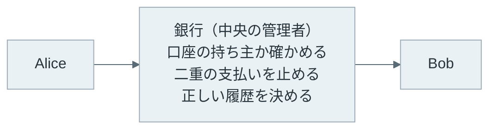
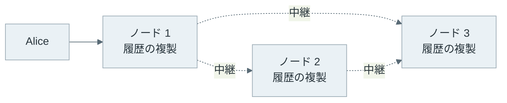
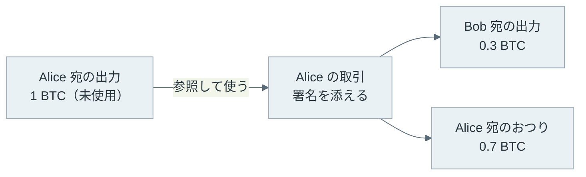
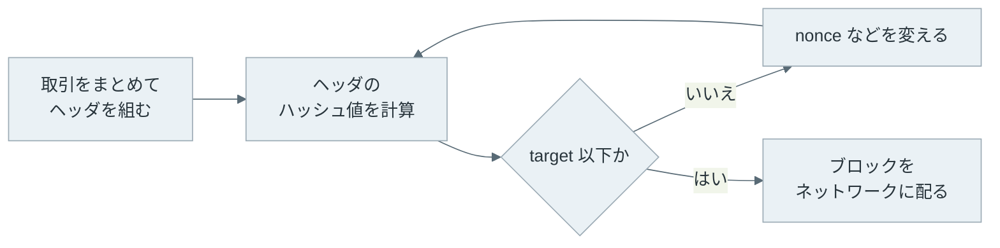
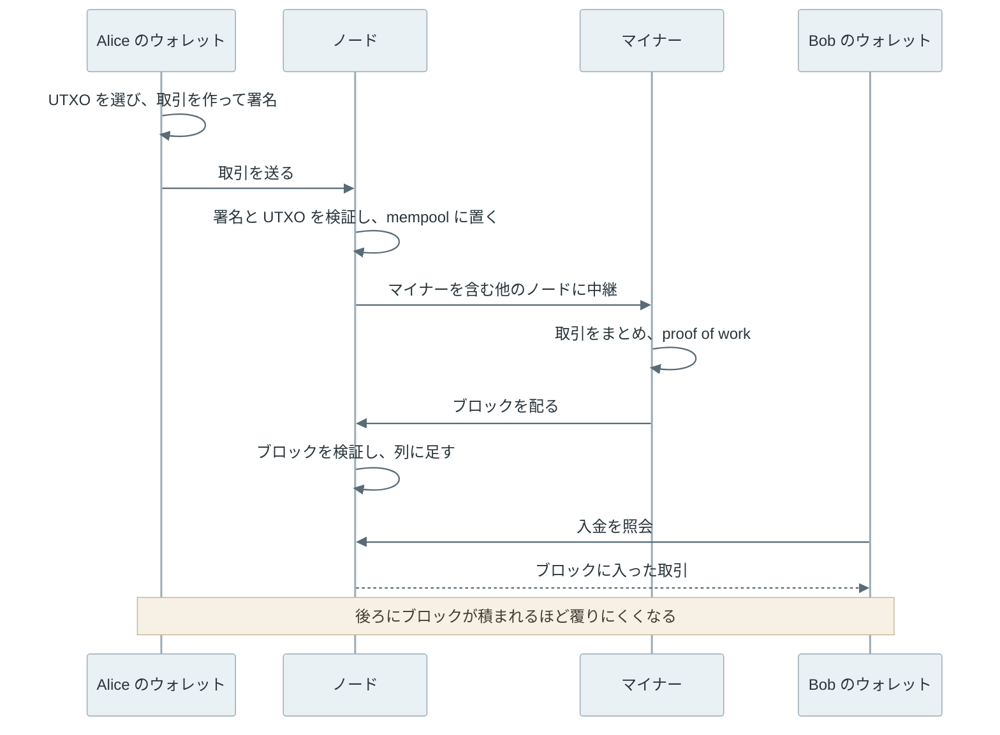

ブロックチェーンは、取引の履歴を参加者がそれぞれ複製して持ち、新しい取引をまとめた塊（ブロック）を順に繋いで追記していく仕組みです。[Bitcoin](https://bitcoin.org/) は、この仕組みで送金の履歴を共有します。以下は、5 人の参加者がそれぞれ同じブロックの列を複製して持つ様子です。



上記の図の 1 つの四角がブロックで、線で繋がった列がチェーンです。右端の濃い四角が新しく追記したブロックです。3 の参加者のように自分の複製だけを書き換えると、後ろのブロックとの繋がりが崩れ、他の参加者の複製とも食い違います。繋がりが崩れる理由は、後半のブロックとハッシュ値の節で説明します。

 

本記事では、Bitcoin を例に、中央の管理者がいない環境で同じ履歴を共有するには何を決める必要があり、それをどの仕組みが受け持つのかを説明します。銀行の場合と比べた後、次の疑問に順に答えます。

- 取引をどんなデータで表し、正しいかをどう判定するのか。
- ブロックはハッシュ値でどう繋がり、書き換えがなぜ見つかるのか。
- 次のブロックを誰が決め、参加者はどの履歴を採用するのか。
- 1 件の送金は、どの順で履歴に入るのか。

各仕組みの内部構造は扱わず、それぞれのノートのリンクで示します。

---

### 中央の管理者がいる場合

銀行の送金では、口座の残高と入出金の履歴を銀行が管理します。内部で DB（データベース）が[複製・分散](/notes/distributed-systems/leader-and-followers/)されていても、どの記録を正しいものとするかは銀行が決められます。利用者から見た経路を以下に示します。

上記の図の銀行が決めているのは 3 つです。送金を指示したのが口座の持ち主かどうか、同じ資金を使う指示が 2 つ来た時にどちらを通すか、どの記録を正しい履歴とするかです。

[Bitcoin の白書](https://bitcoin.org/bitcoin.pdf)は、金融機関を通さずに一方から他方に直接送る支払いを目的として挙げています。金融機関を介さない場合は、上記の 3 つを決める中央の管理者がいません。

---

### 中央の管理者がいない場合

Bitcoin のネットワークには、参加の登録も許可も必要ありません。ソフトウェアを動かせば誰でもノード（ネットワークに参加する計算機）になれ、各ノードが履歴の複製を持ちます。冒頭の図の参加者が複製を置いている所が、このノードです。

取引が広まる様子は以下の通りです。

上記の図のノード 1・2・3 は対等で、どの取引や履歴を正しいとするかについて、どれか 1 台の判断が他を従わせるわけではありません。ノードの多数決で決めることもできません。誰でも参加でき、1 人が多数のノードを動かして[票を水増しできる](/notes/distributed-systems/byzantine-fault-tolerance/#参加者の決め方と票の重み)からです。多数決の代わりに何を使うかは、後半の合意の節で説明します。

記録を書き換える権限を持つ者もいません。どの取引やブロックを正しいとみなすかの規則は、各ノードが動かすソフトウェアに書かれており、各ノードはその規則で受け取ったデータを自分で検証します。そのため、一部の参加者が規則を変えたソフトウェアに切り替え、例えばある資金を別の場所に移すブロックを作っても、古い規則のソフトウェアはそのブロックを受け入れません。切り替えなかった参加者は元の履歴を伸ばし続け、以下のように履歴が 2 つに分かれます。



2016 年には、Bitcoin とは別のブロックチェーンの [Ethereum](https://ethereum.org/) で、盗まれた資金を戻すかどうかで参加者が分かれ、開発を支える団体も 1 者では[決められない](https://blog.ethereum.org/2016/07/15/to-fork-or-not-to-fork)としました。資金を[戻すソフトウェア](https://blog.ethereum.org/2016/07/20/hard-fork-completed)を動かした参加者の列が今の Ethereum で、動かさなかった参加者の列は [Ethereum Classic](https://blog.ethereum.org/2016/07/26/onward-from-the-hard-fork) として続いています。

この出来事は The DAO の事件と呼ばれ、[Reentrancy](../reentrancy/) で扱います。古いソフトウェアが受け入れない形に規則を変えることはハードフォークと呼び、[Ethereum Hard Forks](../ethereum-hard-forks/) で扱います。

 

銀行が決めていた 3 つを参加者どうしで決めるには、細かく分けると次の 7 つを決める必要があります。

- 取引をどう表し、同じ資金の二重使用をどう見分けるか
- その資金を使う資格を示せるか
- 支払いの条件をどう表すか
- データの変更をどう検出するか
- 多数の取引をどの単位でまとめて履歴に足すか
- 次のブロックを誰が追加し、どの履歴を採用するか
- 過去の履歴の書き換えをどう困難にするか

初めの 3 つは持ち主の確認と二重の支払いの話で、取引の表し方で扱います。ただし二重使用は、取引の表し方で見分けた後、どちらを残すかを合意で決めます。残りの 4 つは、正しい履歴を参加者どうしで決める話です。以下、この順に説明します。

---

### 取引の表し方と有効性の判定

取引は、使う資金を指す入力と、新しく作る出力からなります。出力は、金額と使う条件の組です。UTXO（Unspent Transaction Output、未使用の取引出力）は、出力のうちまだ使われていないものです。支払いは、口座の残高の行を書き換えるのではなく、過去の出力を丸ごと消費して新しい出力を作る形で表し、差額はおつりとして自分宛ての出力にします。以下は、Alice が 1 BTC（BTC は Bitcoin の通貨単位）の出力から Bob に 0.3 BTC を払う例です（手数料は省いています）。

上記の図の取引が履歴に入ると、左の 1 BTC の出力は使用済みになり、右の 2 つが新しい UTXO になります。

取引は、使う出力の場所として、それを作った取引の ID（その取引のハッシュ値。ハッシュ値は後の節で説明します）と何番目の出力かを持ちます。各ノードは未使用の出力の一覧（UTXO の集合）を持ち、取引が使う出力がその一覧にあるかを確認します。同じ出力を使う取引が 2 つあれば、参照の重複としてデータに表れます。どちらを履歴に残すかは、後述の合意の規則が決めます（[UTXO](../utxo/)）。

 

デジタル署名は、秘密鍵を持つ人だけが作れて、対になる公開鍵を持つ誰もが検証できるデータです。支払う人は取引に署名を添え、各ノードは、その署名で、出力を使う条件が満たされているかを検証します。確認できるのは資格の有無で、支払った人が現実の誰であるかは分かりません（[Digital Signature](../digital-signature/)）。

Bitcoin Script は、出力に「使う条件」を書くための小さな言語です。例えば、「この公開鍵に対応する署名を添えた者だけが使える」という条件を書けます。各ノードは、使う側が添えた署名などのデータを出力側の条件と一緒に実行し、成功すれば使ってよいと判定します。言語なので、複数の署名を求める条件も同じ仕組みで書けます（[Bitcoin Script](../bitcoin-script/)）。

---

### ブロックとハッシュ値の連鎖

ハッシュ関数は、任意の長さのデータを固定長の短い値に変換する関数です。変換後の値をハッシュ値と呼びます。入力が 1 バイト変わるだけで出力が別の値になり、同じハッシュ値になる別のデータを作ることも事実上できません。そのため、データの変更が短い値の違いとして現れます（[Hash Function](../hash-function/)）。

ブロックは、取引をまとめて履歴に追加する単位で、要約部のブロックヘッダと取引の並びからなります。ヘッダには、直前のブロックのヘッダのハッシュ値と、取引の並び全体の要約が入ります。

要約は、多数のデータをハッシュ関数で畳み込んで 1 つの値にまとめる木構造の [Merkle Tree](../merkle-tree/) で求めた値で、Merkle root と呼びます（[Bitcoin Merkle Tree](../bitcoin-merkle-tree/)、[Merkle Tree Design](../merkle-tree-design/)）。以下の図は、ヘッダの主な項目だけを示しています。



上記の図のブロック 100 の取引 2 を書き換えると、取引の要約（Merkle root）が変わり、ヘッダのハッシュ値も変わります。ブロック 101 のヘッダは書き換える前のハッシュ値を持っているので、繋がりが合わなくなります（[Bitcoin Block](../bitcoin-block/)）。

ただし、書き換えた人がブロック 101 以降のハッシュ値も全て計算し直せば、繋がりは元通りになります。ハッシュ値は誰でもすぐに計算できるので、上記の連鎖だけでは書き換えを見つけられても、困難にはできません。図のヘッダにある nonce は、困難にするための次の節の仕組みで使う値です。

---

### 合意 - 次のブロックを誰が決めるか

どのノードも取引を集めてブロックを作れますが、各自が好きなブロックを足すと、参加者ごとに列が食い違います。次のブロックを追加できる者と、全員が採用する列を決める規則が必要です。この規則で参加者の列を 1 つに揃えることを合意（consensus）と呼び、Bitcoin は proof of work（作業証明）を使います。

ブロックを作る役のノードをマイナー（miner）と呼びます。マイナーは、ブロックに新しく発行される BTC と、中の取引の手数料を報酬として受け取ります。

報酬を得るために、マイナーはブロックヘッダのハッシュ値を数として見て、決められた値（target）以下になるまで、ヘッダの nonce などを変えて計算し直します。入力が少し変わるだけでハッシュ値は別の値になるため、どの nonce で条件を満たすかは事前に求められず、値を変えては計算し直すしかありません。条件を満たすには平均して大量の試行が必要な一方で、受け取ったノードはハッシュ値を計算し直すだけで成立を確認できます。マイナーの作業は以下の通りです。

最初に条件を満たしたマイナーは、ブロックをネットワークに配ります。各ノードは、ブロックの proof of work、前のブロックのハッシュ値、中の取引の署名などを検証し、通れば自分の列に足します。同じ出力を 2 回使う取引を含むブロックは拒否するので、二重使用はどちらか一方しか履歴に残りません。多数決の票の代わりに、計算の量が次のブロックを決める権利になります。ノードの数を増やしても計算能力は増えないため、前半の票の水増しは効きません（[Proof of Work](../proof-of-work/)）。

 

2 人のマイナーがほぼ同時に条件を満たすと、列の末尾が分岐します。前半の規則の切り替えによる分岐と違い、同じ規則のもとで偶然起きる一時的な分岐です。



上記の図では、ブロック 3 の後ろに 4 と 4' がほぼ同時にできました。マイナーは、先に受け取った方の後ろに次のブロックを作ります。4 の後ろに 5 が付くと、4' を先に受け取っていたノードも含め、各ノードは積まれた計算量が最も大きい列（4 と 5 の列）を正しい履歴として採用します。4' だけに入っていた取引は、採用した列の取引と矛盾しなければ、まだブロックに入っていない状態に戻り、後のブロックに入るのを待ちます。

過去の書き換えが困難なのは、この規則があるからです。ブロック 100 の取引を書き換えた列を採用させるには、101 以降の全てのブロックで proof of work をやり直し、さらに他のマイナー全員を合わせた速さより速く列を伸ばす必要があります。ネットワーク全体の計算能力の過半を持たない限り、この追い上げはほぼ成功しません。

積まれた計算量で選ぶのは、自分のソフトウェアの規則で有効と判定したブロックの列の中だけです。そのため、過半の計算能力があっても規則に反する取引は通せず、前半の規則の違いで分かれた列どうしは、計算量に関係なく合流しません。

後ろに積まれたブロックが多いほど取引は覆りにくくなるため、受け取る側は何ブロック積まれたか（確認数）を見て受け取りを確定させます（[Finality](../finality/)）。

---

### 1 件の送金が履歴に入るまで

ここまでの仕組みが 1 件の送金のどこで使われるのか、Alice が Bob に送る場合で追います。ウォレットは鍵を管理し、取引を作るソフトウェアで、mempool はまだブロックに入っていない取引をノードが一時的に置く場所です。

上記の図の最初の 3 段が取引の節の話です。マイナーの proof of work からブロックを列に足すまでが合意の節の話で、列に足す前の検証では、ブロックの節のハッシュ値の繋がりも確認します。各段階の詳細は [Bitcoin Transaction Lifecycle](../bitcoin-transaction-lifecycle/)、ウォレットの機能は [Wallet](../wallet/)、取引の置き場は [Mempool](../mempool/) で扱います。

---

### 問題と仕組みの対応

ここまでに挙げた 7 つの決める必要があることと、各仕組みの役割を整理すると、以下の通りです。

| 決める必要があること | Bitcoin で使う仕組み | 詳細 |
| --- | --- | --- |
| 取引をどう表し、二重使用をどう見分けるか | UTXO | [UTXO](../utxo/) |
| その資金を使う資格を示せるか | デジタル署名 | [Digital Signature](../digital-signature/) |
| 支払いの条件をどう表すか | Bitcoin Script | [Bitcoin Script](../bitcoin-script/) |
| データの変更をどう検出するか | ハッシュ関数 | [Hash Function](../hash-function/) |
| 多数の取引をどの単位でまとめて履歴に足すか | ブロックと Merkle Tree | [Bitcoin Block](../bitcoin-block/) / [Merkle Tree](../merkle-tree/) |
| 次のブロックを誰が追加し、どの履歴を採用するか | proof of work | [Proof of Work](../proof-of-work/) |
| 過去の履歴の書き換えをどう困難にするか | ハッシュ値の連鎖と proof of work | [Bitcoin Block](../bitcoin-block/) / [Proof of Work](../proof-of-work/) / [Finality](../finality/) |

Ethereum などの他のブロックチェーンも同じ問題を解いていますが、仕組みの一部が違います。例えば Ethereum は、取引をアカウントの残高の更新として表し（[Ethereum Account Model](../ethereum-account-model/)）、資産を預け入れた参加者の中から次のブロックを作る者を選び、採用する列も預け入れた額で重み付けした投票で決めます（[Proof of Stake](../proof-of-stake/)）。
