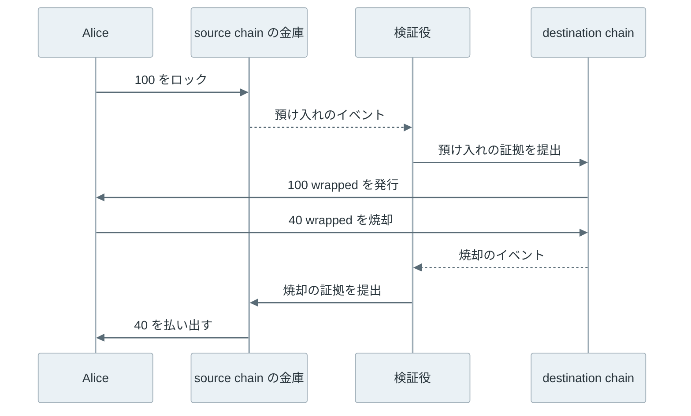

[Cross-chain bridge](https://ethereum.org/en/developers/docs/bridges/)（以下、bridge）は、あるブロックチェーンで起きた預け入れや焼却の事実を別のブロックチェーンに伝えて、資産を移す仕組みです。よく使われるタイプでは、送り出す側の source chain で資産を金庫にロックし、受け取る側の destination chain で同じ量の wrapped token（金庫の中身への引換券にあたるトークン）を発行します。

例えば、Alice が [Ethereum](https://ethereum.org/) の 100 ETH を別のチェーンのアプリケーションで使いたいとします。Ethereum の ETH は Ethereum の外へ出られないため、bridge のコントラクトに 100 ETH をロックし、destination chain で 100 wrapped ETH を受け取ります。Alice が Ethereum に戻す時は、wrapped ETH を焼却して金庫から ETH を払い出してもらいます。



上記の図の中央にある検証役が、bridge の安全性を決めます。destination chain のコントラクトは、source chain の状態を直接読めません。誰かが「100 ETH の預け入れがあった」と伝え、destination chain はその主張を何らかの方法で確かめてから発行します。この確認を偽れば、金庫に何も入れずに wrapped token を作れます。

<br>

本記事では、bridge が資産を移すタイプと、預け入れを確かめる方法を説明し、実際に起きた事故がどの部分で起きたのかを見ていきます。

- チェーン同士は、なぜ互いの状態を直接確かめられないのか。
- ロックと発行、焼却と発行、交換では、何が移動するのか。
- 外部の署名者、軽量クライアント、異議の受付期間、有効性の証明は、それぞれ何を信頼するのか。
- 署名鍵の過半を奪われた bridge では、wrapped token に何が起きるのか。

source chain の取引をどの時点で確定と見なすかは [Finality](../finality/) で扱っています。Ethereum とその L2 の間の bridge は [Rollup](../rollup/) の出金の仕組みと重なるため、本記事では L2 に固有の手順は扱いません。

---

### チェーン同士が互いを読めない理由

ブロックチェーンのノードは、自分のチェーンの取引を検証し、自分のチェーンの状態を保持します。[Smart Contract](../smart-contract/) で説明したように、コントラクトの実行結果は全てのノードで一致する必要があるため、コントラクトは外部の API を呼んだり、別のチェーンのノードに問い合わせたりできません。

そのため、destination chain のコントラクトが source chain の出来事を知るには、誰かが取引としてその情報を持ち込む必要があります。この構造は、価格などのチェーンの外の情報を渡す [Oracle](../oracle/) と同じです。違いは、持ち込む情報が別のブロックチェーンの状態であり、その状態には署名やハッシュといった検証できる材料が付いている点です。

<br>

ただし、材料があることと、destination chain がそれを安く検証できることは別です。source chain のブロックヘッダを全て追い、合意の規則（誰の署名が何票あれば確定か）を再現するには、相手のチェーンの合意の仕組みを destination chain のコントラクトとして実装する必要があります。相手が [Proof of Work](../proof-of-work/) なのか [CometBFT](../cometbft/) なのかで、必要な処理も変わります。この負担を避けるために、多くの bridge は確認を外部の署名者に任せてきました。

---

### 資産を移すタイプ

bridge で「資産を移す」と言っても、同じトークンがチェーンの間を移動するわけではありません。ethereum.org の [bridge の解説](https://ethereum.org/en/developers/docs/bridges/)では、lock and mint、burn and mint、atomic swap の 3 つのタイプに分けています。

最初の lock and mint では、source chain の金庫にロックした資産を裏付けとして、destination chain で wrapped token を発行します。戻す時は wrapped token を焼却し、金庫から払い出します。



上記の流れでは、wrapped token の価値は金庫の中身に依存します。発行済みの wrapped token の総量が金庫の残高を超えると、最後に払い出しを求めた人から順に受け取れなくなります。bridge の事故の多くは、この 2 つの量の対応が崩れることで起きます。

<br>

2 つ目の burn and mint は、同じ発行者が複数のチェーンでトークンを発行している場合に使えます。例えば、[Circle](https://www.circle.com/) の [CCTP（Cross-Chain Transfer Protocol）](https://developers.circle.com/cctp) は、source chain で [USDC](https://www.circle.com/usdc) を焼却し、Circle の attestation（焼却を確かめた証明）を受けて destination chain で USDC を発行します。金庫に資産が残らないため、wrapped token のような引換券は生まれません。その代わりに、焼却を確かめて attestation を出す Circle を信頼します。USDC の利用者は既に発行者として Circle を信頼しているため、新しく加わる信頼の相手はいません。

3 つ目の atomic swap は、資産を移すのではなく、source chain の自分の資産と、交換相手が持つ destination chain の資産を交換します。[Lightning Network](../lightning-network/) の HTLC（[Hash Time-Locked Contract](https://github.com/lightning/bolts/blob/master/03-transactions.md)）と同じく、同じハッシュの原像を明かした時だけ両方の支払いが成立する条件を両方のチェーンに置きます。交換相手が見つかる範囲でしか使えず、コントラクトの呼び出しのような任意のメッセージは運べません。

---

### 預け入れを確かめる方法

lock and mint と burn and mint のどちらでも、destination chain は「source chain でロックや焼却があった」という主張を確かめる必要があります。その確かめ方によって、利用者が何を信頼するかが変わります。



<br>

#### 外部の署名者

bridge の運営者が選んだ署名者（validator や guardian などと呼ばれます）が source chain を監視し、預け入れを見つけたらメッセージに署名します。destination chain のコントラクトは、[Multisig](../multisig/) と同じく、決められた数以上の有効な署名があるかだけを確かめます。

この方法は、新しいチェーンに対応する時も署名者が監視するノードを足すだけで済むため、多くのチェーンをつなぐ bridge で使われてきました。しかし、destination chain は署名者が正しい預け入れを見たかを確かめられません。過半数の署名鍵を持つ者は、存在しない預け入れや焼却に署名して資産を発行・払い出しできます。利用者が信頼するのは、source chain ではなく署名者の集団です。

<br>

#### 軽量クライアント

destination chain に source chain の軽量クライアント（ブロックヘッダだけを追い、全取引は保持しないクライアント）をコントラクトとして実装し、ヘッダと [Merkle Tree](../merkle-tree/) の経路から預け入れを確かめます。[Cosmos](https://cosmos.network/) のチェーン間で使われる [IBC（Inter-Blockchain Communication）](https://github.com/lfdt-ibc/ibc) は、相手のチェーンの軽量クライアントを各チェーンに置き、相手のヘッダに付いた validator の署名と、パケットの存在を示す Merkle proof を検証します。

この方法で信頼するのは、source chain 自体の合意です。source chain の validator の多くが結託して不正な状態に署名すれば、軽量クライアントも騙されます。しかし、それは source chain 自体が壊れた状態であり、bridge のために新しい信頼の相手は増えません。その代わりに、相手のチェーンごとに合意の規則を検証するコードが要り、[Finality](../finality/) の確率的なチェーンでは何ブロック待つかも決める必要があります。検証コードの欠陥も、そのまま bridge の欠陥になります。

<br>

#### 異議の受付期間

optimistic な bridge は、提出されたメッセージをすぐには受け入れず、決められた期間に誰も異議を出さなければ受け入れます。[Rollup](../rollup/) の Optimistic Rollup と同じ考え方で、不正なメッセージを見つけた監視者が 1 人でも期間内に異議を出せば止められます。

安全の条件は、監視者のうち 1 人が正直で、期間内に動けることです。署名者の過半を信頼するより弱い仮定ですが、期間の分だけ資産の到着が遅れます。

<br>

#### 有効性の証明

[Zero-Knowledge Proof](../zero-knowledge-proof/) の技術を使い、source chain のヘッダの署名の検証や合意の規則の確認を回路で行い、その正しさを示す短い proof を destination chain で検証します。軽量クライアントの検証を destination chain が安く確かめられる形に変えたものと考えると分かりやすいです。信頼の相手は source chain の合意に加えて、証明系と回路の実装です。

---

### 署名鍵を奪われた bridge の実験

外部の署名者を使う bridge で、署名鍵の過半を奪われると何が起きるかを Python で確かめました。2 つのチェーンを辞書で表し、9 人の署名者のうち 5 人の署名があればメッセージを受け入れます。標準ライブラリだけで動かすため、署名は [HMAC](https://docs.python.org/3/library/hmac.html) で代用しています。実際の bridge は [Digital Signature](../digital-signature/) で扱った公開鍵の署名を使いますが、閾値を数えて受け入れる処理は同じです。

```python
import hashlib
import hmac

KEYS = [f"validator-{i}".encode() for i in range(9)]
THRESHOLD = 5


def message(kind, nonce, to, amount):
    return f"{kind}|{nonce}|{to}|{amount}".encode()


def sign(key, msg):
    return hmac.new(key, msg, hashlib.sha256).hexdigest()


def enough_signatures(msg, sigs):
    valid = {i for i, s in sigs.items() if hmac.compare_digest(s, sign(KEYS[i], msg))}
    return len(valid) >= THRESHOLD


class Bridge:
    def __init__(self):
        self.locked = 0  # coins held by the vault on the source chain
        self.wrapped = {}  # wrapped coins on the destination chain
        self.used = set()  # nonces already processed

    def supply(self):
        return sum(self.wrapped.values())

    def mint(self, nonce, to, amount, sigs):
        """Destination chain: mint after a signed deposit message."""
        msg = message("deposit", nonce, to, amount)
        if nonce in self.used or not enough_signatures(msg, sigs):
            return False
        self.used.add(nonce)
        self.wrapped[to] = self.wrapped.get(to, 0) + amount
        return True

    def release(self, nonce, to, amount, sigs):
        """Source chain: pay out of the vault after a signed burn message."""
        msg = message("burn", nonce, to, amount)
        if nonce in self.used or not enough_signatures(msg, sigs):
            return False
        self.used.add(nonce)
        self.locked -= amount
        return True


def all_sign(msg, signers):
    return {i: sign(KEYS[i], msg) for i in signers}


def report(label, b):
    print(f"{label:<36} locked={b.locked:>4} wrapped={b.supply():>4}")


b = Bridge()
honest = range(9)

# 1. Alice and Carol lock coins on the source chain; validators sign the deposits.
for nonce, (who, amount) in enumerate([("alice", 100), ("carol", 300)]):
    b.locked += amount
    b.mint(nonce, who, amount, all_sign(message("deposit", nonce, who, amount), honest))
report("after deposits", b)

# Alice burns 40 wrapped coins and gets 40 coins back from the vault.
b.wrapped["alice"] -= 40
b.release(2, "alice", 40, all_sign(message("burn", 2, "alice", 40), honest))
report("after alice withdraws 40", b)

# Four keys are not enough.
stolen4 = range(4)
ok = b.release(3, "mallory", 360, all_sign(message("burn", 3, "mallory", 360), stolen4))
print(f"release with 4 stolen keys accepted: {ok}")

# 2. With 5 stolen keys, a release without any burn passes the check.
stolen5 = range(5)
ok = b.release(3, "mallory", 360, all_sign(message("burn", 3, "mallory", 360), stolen5))
print(f"release with 5 stolen keys accepted: {ok}")
report("after forged release", b)
print(f"wrapped coins without backing: {b.supply() - b.locked}")
```

上記は [lab/bridge_sim.py](https://github.com/nao1215/debimate/blob/main/content/notes/blockchain-systems/cross-chain-bridge/lab/bridge_sim.py) の前半で、後半は次節の Nomad の再現です。出力は以下です。

```text
after deposits                       locked= 400 wrapped= 400
after alice withdraws 40             locked= 360 wrapped= 360
release with 4 stolen keys accepted: False
release with 5 stolen keys accepted: True
after forged release                 locked=   0 wrapped= 360
wrapped coins without backing: 360
```



4 本の鍵では払い出しを拒否しましたが、5 本目で通りました。`release` は署名の数だけを確かめ、destination chain で焼却があったかを確かめる手段を持たないからです。偽の払い出しの後も destination chain の 360 wrapped はそのまま残り、Alice と Carol の残高の表示は変わりません。しかし、金庫は空なので、2 人が焼却して払い出しを求めても受け取れません。

---

### 実際に起きた事故

以下は、2022 年に起きた bridge の大きな事故で、前節までのどの部分が破られたかを並べた表です。金額は当時の公式発表と報道によるもので、ドル換算は当時の価格です。

| 事故 | 時期 | 破られた部分 |
| --- | --- | --- |
| Wormhole | 2022 年 2 月 | 外部の署名者の署名を確かめるコード |
| Ronin | 2022 年 3 月 | 外部の署名者の鍵（9 本中 5 本） |
| Nomad | 2022 年 8 月 | 異議の受付期間を使う検証の初期値 |
| BNB Chain の BSC Token Hub | 2022 年 10 月 | 軽量クライアントの Merkle proof の検証 |

4 件とも、金庫やトークンのコントラクト自体ではなく、相手のチェーンの預け入れや焼却を確かめる部分が破られています。Wormhole と BSC Token Hub では偽の預け入れで発行され、Ronin と Nomad では偽の焼却で金庫から払い出されました。

<br>

#### Ronin

[Ronin](https://roninchain.com/) は、ゲームの [Axie Infinity](https://axieinfinity.com/) のために作られたチェーンで、Ethereum との bridge は 9 人の validator のうち 5 人の署名で払い出しを受け入れていました。[Halborn の分析](https://www.halborn.com/blog/post/explained-the-ronin-hack-march-2022)によると、事故は次の順序で起きました。

1. 攻撃者は、運営する [Sky Mavis](https://www.skymavis.com/) の validator の鍵 4 本を手に入れた。
2. 2021 年 11 月に負荷対策として、Axie DAO の validator が Sky Mavis に署名を代行させる許可を出していた。12 月に代行は終わったが、許可は取り消されていなかった。攻撃者はこの経路で Axie DAO の署名も得て、5 本目にした。
3. 2022 年 3 月 23 日、偽の払い出しで Ethereum 側の金庫から 173,600 ETH と 2,550 万 USDC を引き出した。発覚したのは 6 日後で、利用者が 5,000 ETH を払い出せなかったことがきっかけだった。

前節の実験の 5 本目の鍵の場面です。金庫が空になった後も、Ronin 側には裏付けを失った wrapped token が残りました。

<br>

#### Wormhole

[Wormhole](https://wormhole.com/) は、[19 の guardian のうち 13 の署名](https://wormhole.com/docs/protocol/infrastructure/guardians/)でメッセージを受け入れる bridge です。2022 年 2 月 2 日、[Solana](https://solana.com/) 側のコントラクトで署名の検証が回避されました。[Halborn の分析](https://www.halborn.com/blog/post/explained-the-wormhole-hack-february-2022)によると、流れは次の通りです。

1. Solana の `verify_signatures` は、同じ取引の中で署名の検証が実行済みかどうか、命令の一覧を持つ特別なアカウント（[Instructions sysvar](https://docs.anza.xyz/runtime/sysvars#instructions)）から読んで確かめていた。
2. 渡されたアカウントが本物の sysvar かを確かめていなかったため、攻撃者は検証済みに見える偽のアカウントを渡した。
3. guardian の署名が揃ったと扱われたメッセージで、Ethereum に預け入れの無い 120,000 wETH を Solana 上で発行した。

鍵は奪われていません。署名の数を数える前の、署名を確かめるコードの欠陥です。

本物の sysvar かを確かめる [`load_instruction_at_checked`](https://docs.rs/solana-program/latest/solana_program/sysvar/instructions/index.html) へ置き換える[コミット](https://github.com/wormhole-foundation/wormhole/commit/7edbbd3677ee6ca681be8722a607bc576a3912c8)は、事故の 3 週間前の 2022 年 1 月 13 日に公開リポジトリへ入っていました。しかし、Solana 上で動いていたプログラムは古いままでした。不足した 120,000 ETH は、Wormhole の開発に関わる [Jump Crypto](https://jumpcrypto.com/) が[補填しました](https://www.theblock.co/post/132909/wormhole-replenishes-its-blockchain-bridge-after-325-million-exploit)。

<br>

#### Nomad

[Nomad](https://www.nomad.xyz/) は、メッセージの root を提出してから一定期間後に受け入れる optimistic な bridge でした。2022 年 8 月 1 日の事故は、[Halborn の分析](https://www.halborn.com/blog/post/the-nomad-bridge-hack-a-deeper-dive)によると次の順序で起きました。

1. コントラクトの更新時の初期化で、0x00 を確認済みの root として登録してしまった。
2. [Solidity の mapping](https://docs.soliditylang.org/en/latest/types.html#mapping-types) は、登録されていないキーに 0 を返す。証明されていないメッセージの root を引くと 0x00 になり、それが信頼済みとして扱われた。
3. どんなメッセージも証明済みとして処理されるようになり、最初の攻撃の取引をコピーして宛先だけ変えた取引が数百のアドレスから送られた。損失は約 1.9 億ドル。

lab/bridge_sim.py の後半は、この初期値の誤りを再現しています。

```python
ZERO = "00" * 32
proven = {ZERO: True}  # the mistake: the initial root 0x00 is marked as proved
root_of = {}  # message -> root it belongs to; unknown messages give ZERO


def accept(msg):
    return proven.get(root_of.get(msg, ZERO), False)


print(f"unproved message accepted: {accept(message('deposit', 99, 'mallory', 1000))}")
proven = {}  # without the mistake
print(f"unproved message accepted after fix: {accept(message('deposit', 99, 'mallory', 1000))}")
```

```text
unproved message accepted: True
unproved message accepted after fix: False
```

異議の受付期間は、不正なメッセージに異議を出す仕組みです。メッセージが期間を経ずに受け入れられる状態では、監視者が異議を出す機会もありませんでした。

<br>

#### BNB Chain の BSC Token Hub

[BNB Chain](https://www.bnbchain.org/) の BSC Token Hub（[TokenHub.sol](https://github.com/bnb-chain/bsc-genesis-contract/blob/master/contracts/TokenHub.sol)）は、BNB Beacon Chain と [BNB Smart Chain](https://docs.bnbchain.org/) の間の bridge で、Beacon Chain の状態を Merkle proof（[IAVL](https://github.com/cosmos/iavl) という木の proof）で確かめていました。[Nansen の分析](https://www.nansen.ai/post/bnb-chains-cross-chain-bridge-exploit-explained)によると、攻撃者は前日に BSC Token Hub の relayer（メッセージを中継する役）として登録し、2022 年 10 月 6 日に存在しない預け入れの proof を提出して、1,000,000 BNB の発行を 2 回通しました。BNB Chain は validator と調整してチェーンを止めたため、外のチェーンへ持ち出されたのは一部に留まりました。

[Verichains の分析](https://blog.verichains.io/p/binance-bridge-exploitation-preliminary)によると、原因は IAVL の範囲の proof を検証するコードにありました。proof の経路の要素が左右の子を両方持つ時、右の子の値を root の計算に使っていなかったため、そこに偽の葉を置いても root は変わりません。root が一致するので、検証コードは偽の葉も木の中にあると判定しました。

軽量クライアントの方式でも、proof を検証するコードに欠陥があれば外部の署名者と同じく偽の預け入れが通ります。source chain の合意を信頼するという前提は、検証コードが正しい場合に限ります。

---

### 利用者が確かめること

bridge の wrapped token は、名前に元の資産の名前が入っていても、金庫への引換券です。同じ ETH を元にした wrapped token でも、どの bridge が発行したかで裏付けと信頼の相手が異なります。

以下は、bridge を使う前に確かめる点です。

- 預け入れを誰が、どの方法で確かめているか。外部の署名者なら、署名者の人数と閾値、鍵を誰が持っているか。
- コントラクトを更新できる管理者がいるか。更新の権限を持つ鍵は、検証の方法を丸ごと差し替えられます（[ERC-1967 / ERC-7201](../upgradeable-proxy/)）。
- source chain の取引をどの時点で確定と見なしているか。[Finality](../finality/) より前に発行する bridge は、末尾の組み替えで裏付けを失います。
- 受け取るトークンが発行者の発行したものか、bridge の wrapped token か。CCTP の USDC のように発行者自身が発行するトークンなら、金庫の裏付けに依存しません。

2026 年 11 月時点の CCTP の公式ドキュメントでは、Ethereum とその L2 からの標準の転送に 15〜19 分、Fast Transfer では 8〜20 秒かかると記載しています。速さの違いは、source chain の取引を確定と見なす時点の違いです。Fast Transfer は確定前に attestation を出し、末尾の組み替えで生じる損失は Circle が用意した [Fast Transfer Allowance](https://developers.circle.com/cctp/concepts/fast-transfer-allowance) が引き受けます。どの bridge でも、速さと引き換えに何を信頼しているかを分けて確認する必要があります。
