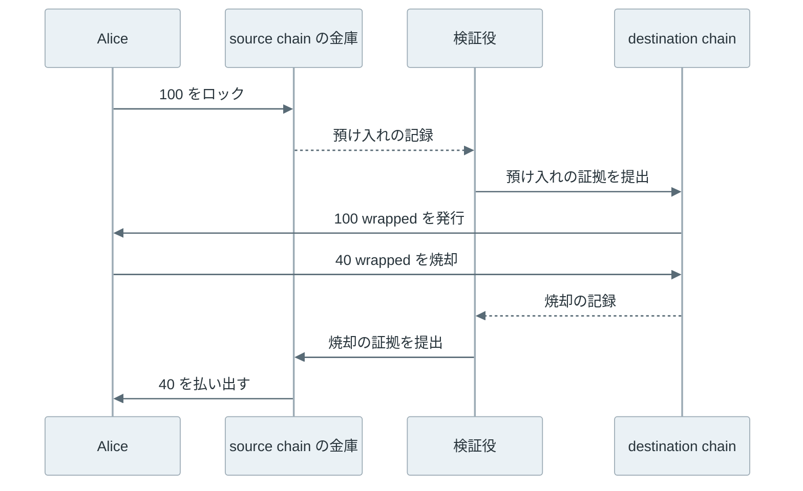

[Cross-chain bridge](https://ethereum.org/en/developers/docs/bridges/)（以下、bridge）は、あるブロックチェーンで起きた預け入れの事実を別のブロックチェーンに伝えて、資産を移す仕組みです。

ブロックチェーン（以下、チェーン）は、参加するコンピュータが同じ取引の記録を共有する台帳で、[Ethereum](https://ethereum.org/) や [Bitcoin](https://bitcoin.org/) がその例です。チェーンごとに台帳は別々なので、Ethereum の通貨である ETH は Ethereum の台帳の中にしか存在しません。

例えば、Alice が手持ちの 100 ETH を別のチェーンのアプリケーションで使いたいとします。bridge を使う場合、Alice は Ethereum 上の bridge の金庫に 100 ETH を預けてロックし、相手のチェーンで 100 wrapped ETH を受け取ります。

wrapped ETH は、金庫の中の ETH への引換券にあたるトークン（チェーン上で残高を管理される資産）です。以下では、預ける側を source chain、受け取る側を destination chain と呼びます。



上記の図の中央にある検証役が、本記事の主題です。destination chain は source chain の台帳を直接読めないため、誰かが「100 ETH の預け入れがあった」と伝え、destination chain はその主張を何らかの方法で確認してから引換券を発行します。この確認を偽れば、金庫に何も入れずに引換券を作れます。

<br>

本記事では、bridge は何を信頼して、別のチェーンの出来事を受け入れるのかを説明します。チェーン同士が直接確かめ合えない理由から始め、資産の移し方を 2 つのタイプに絞って確認した後、預け入れの確かめ方を 4 つ比べます。最後に、署名の鍵を奪われた時に何が起きるかを Python の実験で確認し、実際の事故がどの確かめ方を破ったかを対応させます。

source chain の取引をどの時点で確定と見なすかは [Finality](../finality/) で、事故の経緯の詳細は [Bridge の事故](../bridge-incidents/) で扱います。

---

### チェーン同士が互いを読めない理由

ブロックチェーンのノード（台帳を保持して取引を検証するコンピュータ）は、自分のチェーンの取引を検証し、自分のチェーンの状態を保持します。チェーン上で動くプログラムを [Smart Contract](../smart-contract/)（以下、コントラクト）と呼びます。コントラクトの実行結果は全てのノードで一致する必要があるため、コントラクトは外部の API を呼んだり、別のチェーンのノードに問い合わせたりできません。

そのため、destination chain のコントラクトが source chain の出来事を知るには、誰かが取引としてその情報を持ち込む必要があります。この構造は、価格などのチェーンの外の情報を渡す [Oracle](../oracle/) と同じです。違いは、持ち込む情報が別のチェーンの状態であり、その状態には署名やハッシュといった検証できる材料が付いている点です。

<br>

ただし、材料があることと、destination chain がそれを安く検証できることは別です。source chain の取引が正しく確定したかを自分で確認するには、source chain の合意の規則（どのブロックを正しいと認めるか。承認者の署名の数や、計算量の大きさで決まる）をコントラクトとして実装する必要があります。相手が [Proof of Work](../proof-of-work/) なのか [CometBFT](../cometbft/) なのかで、必要な処理も変わります。この負担を避けるために、多くの bridge は確認を外部の署名者に任せてきました。

---

### 資産を移すタイプ

bridge で「資産を移す」と言っても、同じ[トークン](../erc-20/)がチェーンの間を移動するわけではありません。ethereum.org の [bridge の解説](https://ethereum.org/en/developers/docs/bridges/)は、lock and mint、burn and mint、atomic swap の 3 つのタイプを挙げています。

このうち atomic swap は、交換相手と直接資産を交換するタイプで、[Lightning Network](../lightning-network/) と同じ仕組みの条件付きの支払いを両方のチェーンに置きます。間で預け入れを確認する役が無いため、本記事では残りの 2 つを扱います。

<br>

#### lock and mint

lock and mint は、冒頭の Alice の例のタイプです。source chain の金庫にロックした資産を裏付けとして destination chain で wrapped token を発行し、戻す時は wrapped token を焼却（残高から消して二度と使えなくすること）して金庫から払い出します。検証役が見るのは、行きは預け入れ、帰りは焼却です。



上記の流れでは、wrapped token の価値は金庫の中身に依存します。発行済みの wrapped token の総量が金庫の残高を超えると、最後に払い出しを求めた人から順に受け取れなくなります。bridge の事故の多くは、この 2 つの量の対応が崩れることで起きます。

<br>

#### burn and mint

burn and mint は、同じ発行者が複数のチェーンでトークンを発行している場合に使えます。例えば、[Circle](https://www.circle.com/) は米ドルと 1 対 1 で交換できるトークン [USDC](https://www.circle.com/usdc) を多くのチェーンで発行しており、[CCTP（Cross-Chain Transfer Protocol）](https://developers.circle.com/cctp)で移せます。

source chain で USDC を焼却し、Circle が焼却を確認して attestation（焼却があったことを示す署名付きの証明）を出し、destination chain がそれを確認して USDC を発行します。

金庫に資産が残らないため、wrapped token のような引換券は生まれません。確かめ方は次節の外部の署名者のタイプで、署名するのは Circle です。USDC の利用者は既に発行者として Circle を信頼しているため、新しく加わる信頼の相手はいません。

---

### 預け入れを確かめる方法

lock and mint と burn and mint のどちらでも、destination chain は「source chain でロックや焼却があった」という主張を確認する必要があります。

主張を destination chain へ取引として送る役を relayer と呼びます。relayer は誰でもなれる場合が多く、relayer を信頼しなくて済むように、主張には確認できる材料を付けます。その材料と確かめ方によって、利用者が何を信頼するかが変わります。

<br>

#### 外部の署名者

bridge の運営者が選んだ署名者（bridge によって validator や guardian などと呼ばれます）が source chain を監視し、預け入れを見つけたらメッセージに署名します。destination chain のコントラクトは、[Multisig](../multisig/) と同じく、決められた数以上の有効な署名があるかだけを確認します。

この方法は、新しいチェーンに対応する時も署名者が監視するノードを足すだけで済むため、多くのチェーンをつなぐ bridge で使われてきました。しかし、destination chain は署名者が正しい預け入れを見たかを確認できません。署名者の過半の鍵を持つ者は、存在しない預け入れや焼却に署名して資産を発行・払い出しできます。利用者が信頼するのは、source chain ではなく署名者の集団です。

<br>

#### 軽量クライアント

軽量クライアントは、チェーンの全取引を持たずにブロックヘッダ（ブロックの要約。ブロック内の取引をまとめたハッシュを含む）だけを追い、取引がブロックに入っていることを短い証明で確認するクライアントです（Bitcoin での例は [Bitcoin Merkle Tree](../bitcoin-merkle-tree/)）。この証明は、[Merkle Tree](../merkle-tree/) の葉から根までの経路のハッシュで、Merkle proof と呼びます。

bridge では、source chain の軽量クライアントを destination chain のコントラクトとして実装し、ヘッダと Merkle proof から預け入れを確認します。[Cosmos](https://cosmos.network/) のチェーン間で使われる [IBC（Inter-Blockchain Communication）](https://github.com/lfdt-ibc/ibc) は、相手のチェーンの軽量クライアントを各チェーンに置き、相手のヘッダに付いた承認者（相手のチェーンでブロックを承認する参加者）の署名と、メッセージの存在を示す Merkle proof を検証します。この承認者は bridge の署名者ではなく、source chain 自体の参加者で、validator とも呼ばれます。



上記の図のように、軽量クライアントはまずヘッダに付いた承認者の署名を確認し、次に預け入れと Merkle proof から根のハッシュ（root）を計算し直して、ヘッダの root と比べます。

<br>

この方法で信頼するのは、source chain 自体の合意です。source chain の承認者の[多くが結託して](/notes/distributed-systems/byzantine-fault-tolerance/)不正な状態に署名すれば、軽量クライアントも騙されます。しかし、それは source chain 自体が壊れた状態であり、bridge のために新しい信頼の相手は増えません。

その代わりに、相手のチェーンごとに合意の規則を検証するコードが要ります。Bitcoin のように、後からブロックが差し替わる可能性が残るチェーンでは、何ブロック待つかも決める必要があります。検証コードや証明の形式に欠陥があれば、偽の Merkle proof が通ります。Bitcoin の Merkle Tree には、64 バイトの取引を使って偽の包含の証明を通す[弱点](../bitcoin-merkle-tree-attacks/)が知られています。

<br>

#### 異議の受付期間

optimistic な bridge は、relayer が提出したメッセージをすぐには受け入れず、決められた期間に誰も異議を出さなければ受け入れます。不正なメッセージを見つけた監視者（watcher）は、期間内に異議を出してメッセージを止めます。[Rollup](../rollup/) の Optimistic Rollup と同じ考え方です。

安全の条件は、監視者のうち 1 人が正直で、期間内に動けることです。署名者の過半が正直であることを求めるより前提は少なくて済みますが、期間の分だけ資産の到着が遅れます。

<br>

#### 有効性の証明

[Zero-Knowledge Proof](../zero-knowledge-proof/) の技術を使い、source chain のヘッダの署名の検証や合意の規則の確認を回路（証明を作れる形の計算）として書きます。

destination chain は、その計算を正しく実行したことを示す短い証明を検証します。軽量クライアントが行う検証を destination chain が安く確認できるようにしたもの、と考えると分かりやすいです。信頼の相手は source chain の合意に加えて、証明を作り検証する仕組み（証明系）と回路の実装です。

<br>

4 つの確かめ方を並べると、次のようになります。



外部の署名者だけは、bridge のために新しく加わる相手を信頼します。軽量クライアントと有効性の証明は、source chain の合意と検証のコードに寄せています。異議の受付期間は、正直な監視者が 1 人いることに寄せています。

---

### 署名鍵を奪われた bridge の実験

外部の署名者を使う bridge で、署名鍵の過半を奪われると何が起きるかを Python で確認しました。2 つのチェーンを辞書で表し、9 人の署名者のうち 5 人の署名があればメッセージを受け入れます。

標準ライブラリだけで動かすため、署名は [HMAC](https://docs.python.org/3/library/hmac.html) で代用しています。実際の bridge は [Digital Signature](../digital-signature/) で扱った公開鍵の署名を使いますが、閾値を数えて受け入れる処理は同じです。

```python
import hashlib
import hmac

KEYS = [f"validator-{i}".encode() for i in range(9)]
THRESHOLD = 5


def message(kind, nonce, to, amount):
    return f"{kind}|{nonce}|{to}|{amount}".encode()


def sign(key, msg):
    return hmac.new(key, msg, hashlib.sha256).hexdigest()


def enough_signatures(msg, sigs):
    valid = {i for i, s in sigs.items() if hmac.compare_digest(s, sign(KEYS[i], msg))}
    return len(valid) >= THRESHOLD


class Bridge:
    def __init__(self):
        self.locked = 0  # coins held by the vault on the source chain
        self.wrapped = {}  # wrapped coins on the destination chain
        self.used = set()  # nonces already processed

    def supply(self):
        return sum(self.wrapped.values())

    def mint(self, nonce, to, amount, sigs):
        """Destination chain: mint after a signed deposit message."""
        msg = message("deposit", nonce, to, amount)
        if nonce in self.used or not enough_signatures(msg, sigs):
            return False
        self.used.add(nonce)
        self.wrapped[to] = self.wrapped.get(to, 0) + amount
        return True

    def release(self, nonce, to, amount, sigs):
        """Source chain: pay out of the vault after a signed burn message."""
        msg = message("burn", nonce, to, amount)
        if nonce in self.used or not enough_signatures(msg, sigs):
            return False
        self.used.add(nonce)
        self.locked -= amount
        return True


def all_sign(msg, signers):
    return {i: sign(KEYS[i], msg) for i in signers}


def report(label, b):
    print(f"{label:<36} locked={b.locked:>4} wrapped={b.supply():>4}")


b = Bridge()
honest = range(9)

# 1. Alice and Carol lock coins on the source chain; validators sign the deposits.
for nonce, (who, amount) in enumerate([("alice", 100), ("carol", 300)]):
    b.locked += amount
    b.mint(nonce, who, amount, all_sign(message("deposit", nonce, who, amount), honest))
report("after deposits", b)

# Alice burns 40 wrapped coins and gets 40 coins back from the vault.
b.wrapped["alice"] -= 40
b.release(2, "alice", 40, all_sign(message("burn", 2, "alice", 40), honest))
report("after alice withdraws 40", b)

# Four keys are not enough.
stolen4 = range(4)
ok = b.release(3, "mallory", 360, all_sign(message("burn", 3, "mallory", 360), stolen4))
print(f"release with 4 stolen keys accepted: {ok}")

# 2. With 5 stolen keys, a release without any burn passes the check.
stolen5 = range(5)
ok = b.release(3, "mallory", 360, all_sign(message("burn", 3, "mallory", 360), stolen5))
print(f"release with 5 stolen keys accepted: {ok}")
report("after forged release", b)
print(f"wrapped coins without backing: {b.supply() - b.locked}")
```

`nonce` はメッセージの通し番号で、処理済みの番号を `used` に記録して同じメッセージの二重処理を防ぎます。上記は、冒頭の説明文を除いた [lab/bridge_sim.py](https://github.com/nao1215/debimate/blob/main/content/notes/blockchain-systems/cross-chain-bridge/lab/bridge_sim.py) の全体です。出力は以下です。

```text
after deposits                       locked= 400 wrapped= 400
after alice withdraws 40             locked= 360 wrapped= 360
release with 4 stolen keys accepted: False
release with 5 stolen keys accepted: True
after forged release                 locked=   0 wrapped= 360
wrapped coins without backing: 360
```



4 本の鍵では払い出しを拒否しましたが、5 本目で通りました。`release` は署名の数だけを確認し、destination chain で焼却があったかを確認する手段を持たないからです。なお、拒否された時は `used` に記録しないため、同じ番号 3 で送り直せます。

偽の払い出し（forged release）の後も destination chain の 360 wrapped はそのまま残り、Alice と Carol の残高の表示は変わりません。しかし、金庫（locked）は空なので、2 人が焼却して払い出しを求めても受け取れません。外部の署名者のタイプで信頼していた「署名者の過半は正直」という前提が崩れると、destination chain の側からは何も異常が見えないまま裏付けが消えます。

---

### 事故で破られた所

2022 年には、bridge の大きな事故が続きました。以下の表は、そのうち 4 件について、前節までのどの確かめ方のどこが破られたかを並べたものです。

| 事故 | 時期 | 確かめ方 | 破られた所 |
| --- | --- | --- | --- |
| [Wormhole](../bridge-incidents/#wormhole) | 2022 年 2 月 | 外部の署名者 | 署名を確認するコード |
| [Ronin](../bridge-incidents/#ronin) | 2022 年 3 月 | 外部の署名者 | 署名者の鍵 4 本と、残っていた署名の代行の許可（計 9 人中 5 人分） |
| [Nomad](../bridge-incidents/#nomad) | 2022 年 8 月 | 異議の受付期間 | 確認済みの扱いにする初期値 |
| [BSC Token Hub](../bridge-incidents/#bsc-token-hub) | 2022 年 10 月 | 軽量クライアント | Merkle proof を確認するコード |

Ronin は、前節の実験と同じ場面です。運営する会社の鍵 4 本と、署名の代行の許可が残っていた 1 本の計 5 本で、偽の払い出しが通りました。残りの 3 件では鍵は奪われておらず、署名や証明を確認するコードの欠陥で、偽の預け入れや焼却が本物として扱われました。

4 件とも、金庫やトークンのコントラクト自体ではなく、相手のチェーンの預け入れや焼却を確認する部分が破られています。どの確かめ方でも、信頼の前提には「確認するコードが正しい」ことが含まれます。各事故の経緯と再現は [Bridge の事故](../bridge-incidents/) で扱います。

---

### 利用者が確かめること

bridge の wrapped token は、名前に元の資産の名前が入っていても、金庫への引換券です。同じ ETH を元にした wrapped token でも、どの bridge が発行したかで裏付けと信頼の相手が異なります。

以下は、bridge を使う前に確認する点です。

- 預け入れを誰が、どの方法で確認しているか。外部の署名者なら、署名者の人数と閾値、鍵を誰が持っているか。
- コントラクトを更新できる管理者がいるか。更新の権限を持つ鍵は、検証の方法を丸ごと差し替えられます（[Upgradeable Proxy](../upgradeable-proxy/)）。
- source chain の取引をどの時点で確定と見なしているか。[Finality](../finality/) より前に発行する bridge は、source chain のブロックが差し替わると裏付けを失います。
- 受け取るトークンが発行者自身の発行したものか、bridge の wrapped token か。

確定と見なす時点は、速さとの引き換えです。2026 年 11 月時点の CCTP の[公式ドキュメント](https://developers.circle.com/cctp/concepts/finality-and-block-confirmations)では、Ethereum からの標準の転送は確定を待つため約 65 ブロック・15〜19 分かかり、確定前に attestation を出す Fast Transfer は 2 ブロック・約 20 秒です。

確定前の発行は、Circle が確保した USDC の枠（[Fast Transfer Allowance](https://developers.circle.com/cctp/concepts/fast-transfer-allowance)）の範囲に限られます。source chain の焼却が確定すると枠に戻り、枠を使い切ると Fast Transfer は一時的に使えません。枠は、確定前の焼却を信じて発行してよい総額の上限です。どの bridge でも、速さと引き換えに何を信頼しているかを分けて確認する必要があります。
