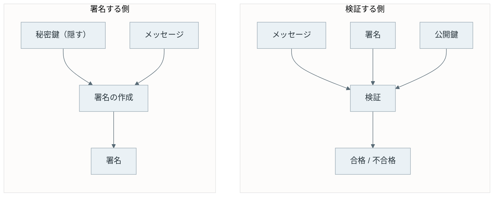
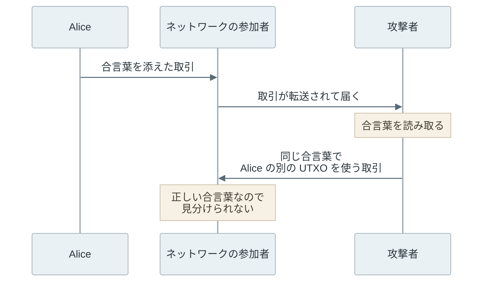
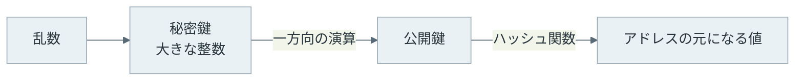
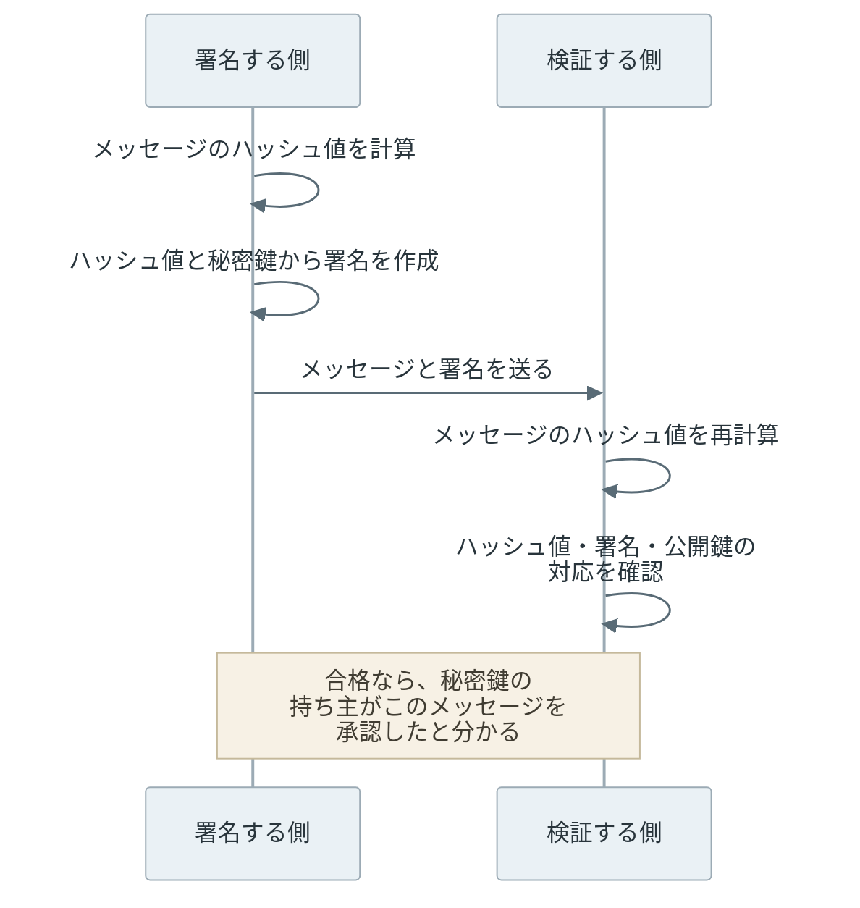
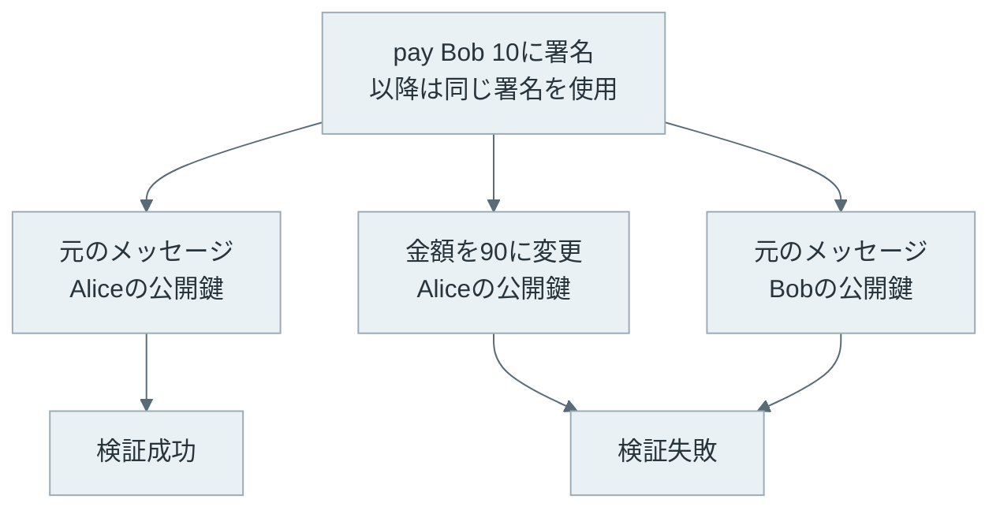
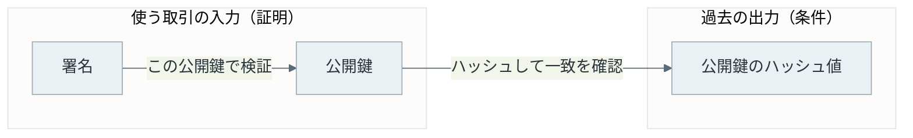

デジタル署名は、秘密鍵の持ち主だけが作れて、対になる公開鍵を持つ誰もが検証できるデータです。メッセージに署名を添えると、受け取った側は「秘密鍵の持ち主がこのメッセージを承認したこと」と「メッセージが署名の後に書き換えられていないこと」を確かめられます。

[UTXO](../utxo/) で説明したように、Bob が自分宛の出力を使うには、出力に書かれた条件を満たす証明を入力に添えます。その代表がデジタル署名です。[Bitcoin の白書がコインを「電子署名のチェーン」と定義した](https://bitcoin.org/bitcoin.pdf)のも、所有の移転が署名の連なりとして表されるからです。

署名を作る側と検証する側の関係を以下に示します。



上記の図のとおり、検証する側が使うのはメッセージ・署名・公開鍵の 3 つだけで、全て公開して差し支えない情報です。秘密鍵は署名の作成にだけ必要で、検証には登場しません。この性質が、世界中の参加者がそれぞれ検証する Bitcoin の構成に合っています。

<br>

本記事では、合言葉による証明が壊れる例から始めて、署名の役割と Bitcoin での使われ方を説明します。扱う疑問は次の通りです。

- 持ち主であることの証明に、なぜ署名が必要なのか。
- 公開する鍵と隠す鍵は、どのように作られるのか。
- 署名は、公開情報だけでどのように検証できるのか。
- Bitcoin は、どの方式と曲線で署名を作るのか。
- Android のウォレットで秘密鍵が漏れた時、署名の何が鍵を明かしたのか。

楕円曲線の数学的な計算手順は本記事では扱いません。

---

### 署名が必要な理由

Bitcoin の取引は、誰でも作ってネットワークに流せます。出力に「持ち主だけが使える」という制限を掛けるには、持ち主であることの証明を取引に含める必要があります。単純な案は、出力を作る時に合言葉を決めておき、使う時にその合言葉を添える方式です。

この案は、検証者が世界中に居る環境では成立しません。合言葉を添えた取引はネットワーク全体に転送されるので、検証した参加者の全員が合言葉を知ります。合言葉は使い回せるので、見た人は同じ合言葉で守られた Alice の別のコインを奪う取引を作れます。以下は、合言葉方式が壊れる流れです。



上記の図の問題は、証明そのものが再利用できる点にあります。合言葉のハッシュ値（原文に戻せない要約）を出力に置き、使う時に原文を見せる改良も考えられます。この改良は事前に合言葉を隠せるものの、使う瞬間には原文が公開されます。取引はブロックに入るまで確定しないので、その間に公開された原文を流用し、宛先を自分宛に書き換えた別の取引を割り込ませる余地が残ります。

2 つの案に共通する穴は、証明が「誰が・どの取引で使うか」と結び付いていないことです。必要なのは、見せても悪用できない証明です。デジタル署名は、署名をメッセージの中身と結び付けることでこれを実現します。秘密鍵そのものはネットワークに一度も流れません。

---

### 鍵ペア - 公開する鍵と隠す鍵

署名の土台は、対になる 2 つの鍵です。秘密鍵は乱数から作る大きな整数で、持ち主だけが保管します。公開鍵は秘密鍵から一方向の演算で導出した値で、誰に見せても構いません。

Bitcoin の秘密鍵は 256 ビットの整数なので、取り得る値はおよそ 2 の 256 乗通りあります。これは [Hash Function](../hash-function/) の試行回数の表で見た規模で、偶然同じ秘密鍵が生成されることも、総当たりで当てられることも心配しなくて良い数です。

例えば、Bitcoin の代表的なアドレスでは、次の流れで鍵とアドレスを導出します。図の矢印は導出の向きで、逆向きの計算は現実的にできません。



秘密鍵から公開鍵を計算するのは一瞬です。一方で、公開鍵から秘密鍵を求める問題は楕円曲線離散対数問題（Elliptic Curve Discrete Logarithm Problem、ECDLP）と呼ばれ、現実的な計算量では解けないと考えられています。逆向きが困難という見た目は [Hash Function](../hash-function/) の一方向性と似ているものの、根拠になっている問題は別です。

上記の図の最後の段が、[UTXO](../utxo/) で触れた「アドレスは条件を組み立てるための情報を符号化した文字列」の中身です。アドレスの種類によっては、公開鍵をハッシュ関数で短縮した値がアドレスの材料になります。

鍵ペアは誰の許可も無しに手元で作れます。銀行口座の開設のような登録の手続きは無く、乱数から秘密鍵を作った瞬間に、対応するアドレス宛のコインを受け取る準備が整います。1 人 1 個という決まりも無く、ウォレットは多数の鍵ペアを内部で管理します。

---

### 署名と検証 - 公開情報だけによる確認

署名の対象は、メッセージそのものではなくメッセージのハッシュ値です。署名の計算では決まった大きさの数を扱うので、どんな大きさのメッセージも、まず固定長のハッシュ値に要約してから署名します。署名の作成は「メッセージのハッシュ値と秘密鍵から署名を計算する」処理で、検証は「メッセージのハッシュ値・署名・公開鍵の 3 つが対応しているかを確かめる」処理です。流れは以下の通りです。



上記の図の検証が合格した時に分かるのは、「対応する秘密鍵の持ち主がこのメッセージに署名した」ことと、「メッセージが署名の後に書き換えられていない」ことの 2 つです。メッセージを 1 バイトでも書き換えるとハッシュ値が変わり、署名との対応が取れずに不合格になります。取引の文脈では、この 2 つが「出力の持ち主が、この内容の取引を承認した」ことの検証になります。

冒頭の合言葉は何に添えても同じ文字列なので、見た人が再利用できました。署名はメッセージごとに別の値になり、公開しても、別のメッセージに対する署名を作る材料にはなりません。

ハッシュ値を経由する分だけ、署名の安全性はハッシュ関数の性質にも依存します。同じハッシュ値を持つ別のメッセージを作れるなら、片方への署名がもう片方にも通用してしまいます。[Hash Function](../hash-function/) の第二原像計算困難性と衝突耐性は、署名の流用を防ぐ土台になっています。

署名の検証は、鍵とメッセージの対応を示すだけで、その鍵の持ち主が現実の誰なのかは示しません。鍵と人を結び付ける証明書と信頼の連鎖は [PKI](../../security/pki/) で扱います。Bitcoin はこの結び付けを必要としない設計で、署名を求める条件が付いた出力では、鍵を持っていることそれ自体が、コインを使う資格になります。

---

### メッセージを変えた時の検証結果

署名した後に金額を変えると、本当に検証が落ちるのかを確かめます。Python の [cryptography](https://cryptography.io/en/50.0.0/hazmat/primitives/asymmetric/ec/) を使い、`pay Bob 10` という文字列に ECDSA（Elliptic Curve Digital Signature Algorithm、楕円曲線を使うデジタル署名方式）で署名します。曲線は Bitcoin でも使う secp256k1、メッセージのハッシュ関数は [SHA-256](/notes/security/sha-256/) です。これは署名の性質を確認する実験で、Bitcoin の取引形式や署名対象の組み立てを再現するものではありません。

以下が [verify_changes.py](lab/verify_changes.py) の全体です。`alice` は実行時に作る一時的な秘密鍵で、ファイルには保存せず、画面にも出しません。

```python
"""ECDSA/secp256k1 message experiment, not Bitcoin transaction signing.
Requires cryptography==50.0.0. Keys are ephemeral and never saved or printed.
"""

from pathlib import Path
import cryptography
from cryptography.exceptions import InvalidSignature
from cryptography.hazmat.primitives import hashes
from cryptography.hazmat.primitives.asymmetric import ec

alice = ec.generate_private_key(ec.SECP256K1())
bob = ec.generate_private_key(ec.SECP256K1())
message = b'pay Bob 10'
signature = alice.sign(message, ec.ECDSA(hashes.SHA256()))


def valid(public_key, data):
    try:
        public_key.verify(signature, data, ec.ECDSA(hashes.SHA256()))
        return True
    except InvalidSignature:
        return False


cases = [
    ('original', alice.public_key(), message, True),
    ('amount changed: 10 -> 90', alice.public_key(), b'pay Bob 90', False),
    ('different public key', bob.public_key(), message, False),
    ('same message replayed', alice.public_key(), message, True),
]
lines = []
for label, public_key, data, expected in cases:
    result = valid(public_key, data)
    assert result == expected
    lines.append(f'{label}: {"VALID" if result else "INVALID"}')
lines.append('Assertions: PASS')
output = '\n'.join(lines) + '\n'
Path(__file__).with_name('output.txt').write_text(output)
Path(__file__).with_name('versions.txt').write_text(f'cryptography {cryptography.__version__}\n')
print(output, end='')
```

`verify` は成功すれば通常どおり戻り、署名が一致しなければ `InvalidSignature` という例外になります。公開鍵やメッセージを変え、同じ検証を行います。実行前に、最後の「同じメッセージをもう一度検証する」ケースがどうなるかも考えてみてください。



[再現手順](lab/README.txt)に従って依存ライブラリを用意した後、リポジトリのルートから実行します。

```bash
python3 -m venv .venv
.venv/bin/pip install cryptography==50.0.0
.venv/bin/python content/notes/blockchain-systems/digital-signature/lab/verify_changes.py
```

以下は、cryptography 50.0.0 で実行した[結果](lab/output.txt)です。

```text
original: VALID
amount changed: 10 -> 90: INVALID
different public key: INVALID
same message replayed: VALID
Assertions: PASS
```

元の文字列は検証を通り、1 バイトだけ変えた `pay Bob 90` と、別の公開鍵での検証は失敗しました。署名を公開しても、金額を変更したメッセージの承認としては使えません。

一方で、元のメッセージと署名をもう一度渡すと、再び成功します。署名の検証は、そのメッセージを以前に処理したかどうかを記憶しません。支払いの二重実行を防ぐには、Bitcoin なら参照先の [UTXO](../utxo/) が未使用かを確認し、Ethereum なら [nonce](../ethereum-account-model/) を確認するなど、状態に基づく検査も必要です。

---

### Bitcoin での署名 - ECDSA と secp256k1

Bitcoin の署名に使われる ECDSA の計算には、楕円曲線を使います。ECDSA は、署名ごとに使う秘密の値（nonce）を混ぜて計算します。[乱数](/notes/security/random-number/)から生成する方法に加え、秘密鍵とメッセージから決定的に導出する方法もあります。この nonce は、Ethereum の取引に付ける通し番号とは別物です。楕円曲線には複数の規格があり、Bitcoin は [secp256k1](https://en.bitcoin.it/wiki/Secp256k1) という曲線を使います。秘密鍵は 256 ビットの整数で、この曲線の上の演算で公開鍵を導出します。

<br>

P2PKH（Pay to Public Key Hash）や P2WPKH（Pay to Witness Public Key Hash）などの代表的な形式（出力に掛ける条件の型）では、署名と公開鍵が「使う資格の証明」として入力側に置かれます。P2PKH では入力の scriptSig という欄に、P2WPKH では [Bitcoin Merkle Tree](../bitcoin-merkle-tree/) で説明した witness 領域に置かれます。witness 領域は署名などの証明を取引本体から切り離して置く欄で、取引の識別子である txid の計算に含まれません。

これらの形式では、出力の条件に公開鍵のハッシュ値が置かれ、使う側は公開鍵と署名の 2 つを出します。証明の出し方は形式ごとに違い、公開鍵を入力側で示さない形式もあります。以下は、出力の条件と入力の証明を照合する流れです。



上記の図の検証者は、入力の公開鍵をハッシュして出力の値と一致することと、署名がその公開鍵での検証に合格することの 2 つを確かめます。条件の書き方の仕組みは [Bitcoin Script](../bitcoin-script/) で扱います。

署名の対象には、署名自身を含められません。署名を計算する時点で、その値はまだ存在しないからです。Bitcoin では、決められた規則に従って、取引の一部と、使用する出力の情報から署名対象のハッシュ値を組み立てます。

どの入力・出力を署名の範囲に含めるかは sighash type という指定で選べます。最も広く使われる指定では取引の全ての入力と出力が範囲に入り、通常の支払いで宛先や金額を書き換えると検証が通らなくなるのはこのためです。範囲を狭める指定もあり、外した部分は後から書き換えても検証は通ります。自分の入力だけに署名し、他の人が入力を足して共同で 1 件の取引を作る場面などで使います。組み立ての規則は形式ごとに違い、本記事では扱いません。

<br>

1 つのメッセージに対する正しい署名は、1 通りではありません。ECDSA の署名は 2 つの数の組で、秘密鍵を知らない第三者でも、片方の数を置き換えて別の有効な署名に作り替えられます。署名の値だけが変わっても検証は合格し続けるため、署名を含めて txid を計算すると、取引の内容が同じまま識別子だけが変わります。[Bitcoin Merkle Tree](../bitcoin-merkle-tree/) で説明した transaction malleability の一因がこれで、witness が txid の計算から外されている背景になっています。

なお、2021 年の Taproot という仕様変更で、ECDSA に加えて Schnorr 署名という別の署名方式も使えるようになりました。役割は同じ「使う資格の証明」で、方式の違いは本記事では扱いません。

---

### 利点

以下は、資格の証明をデジタル署名で表したことで得られる性質です。

- 検証に使うものが全て公開情報で、世界中の参加者が独立に検証できる
- 署名がメッセージの中身と結び付いており、別の取引に流用できない
- 秘密鍵を一度も見せずに、持ち主であることを証明できる
- 鍵ペアを手元で作れるので、口座開設のような登録の手続きが必要ない

---

### 欠点

鍵と署名の管理には、次の注意点があります。

- 秘密鍵を失うと、対応する UTXO を使う手段が失われる（再発行の仕組みが無い）
- 秘密鍵が漏れると、漏れた先の誰でも正当な署名を作れる（取り消しの仕組みが無い）
- 署名は鍵とメッセージの対応しか示さず、鍵の持ち主が誰かは別の問題として残る
- ECDSA の安全性は署名のたびに使う乱数の質に大きく左右され、同じ乱数を別のメッセージに 2 回使うと、2 つの署名から秘密鍵が計算で求まる

1 番目と 2 番目は、中央の管理者による鍵の再発行や取り消しができないことに関係します。パスワードの再設定のような救済の窓口が存在しないため、秘密鍵の保管が利用者の責任になります。

署名ごとの秘密の値を再利用して秘密鍵が漏れる事故は、実際に起きています。2013 年 8 月、Android の乱数生成器（SecureRandom）に重大な欠陥があり、その乱数生成器を使うウォレットが作った署名の一部に、乱数から決まる方の数（R）が[重なった](https://mirror.b10c.me/lists/bitcoindev/5207BB9D.3090701@plan99.net/)ものが見つかりました。R が重なると乱数を使い回したことになり、2 つの署名から秘密鍵が解けます。壊れていたのは ECDSA でも Bitcoin でもなく、署名のたびに乱数を渡す Android の部品です。

更新版のウォレットは、乱数を別の経路から読んで新しい鍵を作り、古い鍵の UTXO を新しい鍵宛に自動で送り直す作りでした。Android で作った鍵は全て危険と[告知](https://bitcoin.org/en/alert/2013-08-11-android)され、古いアドレスを知る相手には新しいアドレスを伝え直すよう求められました。
