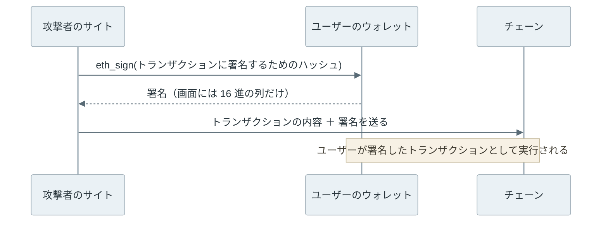
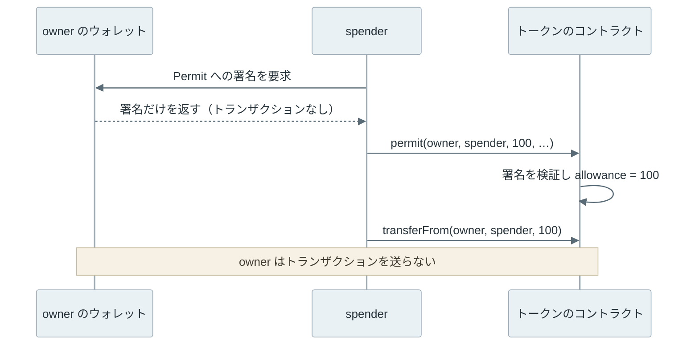
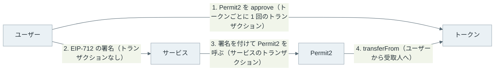

[Ethereum](https://ethereum.org/) の署名は、トランザクション（transaction）を送る時だけに使うものではありません。サイトへのログインやトークンの利用承認のように、トランザクションを送らずにメッセージだけに署名させる場面があります。これを「オフチェーン署名」と呼びます。

署名を受け取ったサービスは、自分のサーバーで検証するか、後でその署名を[コントラクト](../smart-contract/)に渡して検証させます。

EIP-712 は、このメッセージが構造を持つデータ（型と項目名の付いたデータ）の時に、それを[ハッシュ](../hash-function/)して署名する手順を定めた規格です。EIP（Ethereum Improvement Proposal）は Ethereum の仕様の提案で、その中でアプリが共通で使う規格を ERC（Ethereum Request for Comments）と呼びます。

[ウォレット](../wallet/)は署名を求める画面で、例えばトークンの利用承認なら `spender`（使う相手）・`value`（量）・`deadline`（期限）のような項目を並べて表示でき、コントラクトは同じ手順でハッシュを計算して署名を検証します。

以下は、EIP-712 で鍵が署名する 32 バイトの組み立てです。



上記の図の左の黄土色の部分（domain separator、署名の領域を表すハッシュ）が「どのチェーンの、どのコントラクト向けの署名か」を表し、右の青い部分（hashStruct(message)、メッセージのハッシュ）が署名する中身を表します。どちらか 1 項目でも違えば、別の 32 バイトになります。

赤い ≠ は chainId を例にした印で、verifyingContract などの他の項目でも同じです。keccak256 は Ethereum が使うハッシュ関数で、先頭の `1901` は後の節で説明する接頭辞です。右の枠の中身は、後で扱う permit の例です。

<br>

本記事では、[ERC-20](../erc-20/) の承認（Approve）と [Digital Signature](../digital-signature/) の署名と検証を前提に、次の疑問を順に説明します。

- 署名を求める画面で、なぜ中身を読めないことがあったのか。
- EIP-712 は何をハッシュに含め、別のチェーンや別のコントラクトでの再利用をどう防ぐのか。
- トランザクションを送っていないのに、permit の署名 1 つで資産を失うのはなぜか。

途中では、ローカルのチェーンでハッシュを手で計算し、ウォレットの署名とコントラクトの検証が一致することと、署名だけでトークンを移される流れを確認します。秘密鍵を持たないコントラクトのアカウントが署名を示す方法は、[ERC-1271](../erc-1271/) のノートで扱います。

---

### 中身の読めない署名要求

署名を検証するコントラクトの多くは、ecrecover という組み込みの関数を用います。ecrecover は、ハッシュと署名から署名者のアドレスを復元する関数です。コントラクトは、復元したアドレスが期待する相手かを比べます。

コントラクトが受け取るのはハッシュと署名だけで、ユーザーが署名の前に画面で何を見たかは分かりません。何を見せるかは、署名を頼まれたウォレットに任されています。

サイトがウォレットに署名を頼む時は、JSON-RPC（ウォレットやノードを呼ぶ共通の API）のメソッドを呼びます。[MetaMask](https://metamask.com/) の `eth_sign` は、渡された 32 バイトのハッシュにそのまま署名するメソッドでした。ハッシュから元のデータは分からないので、ウォレットは `0x9f3b…` のような 16 進の列しか表示できません。

トランザクションへの署名も、トランザクションのハッシュに対する署名なので、渡されたハッシュがトランザクションに署名するためのハッシュ（署名を除いた内容から作るハッシュ）であれば、その署名を付けて誰でもトランザクションとして送れます。ユーザーは知らないうちにトランザクションに署名することになります。以下は、その流れです。



MetaMask は 2024 年 5 月作成の [MIP-3](https://github.com/MetaMask/metamask-improvement-proposals/blob/main/MIPs/mip-3.md) で、この方法の廃止を決めています。

<br>

トランザクションと取り違えないための約束が、[EIP-191](https://eips.ethereum.org/EIPS/eip-191) です。署名するデータを `0x19 ‖ バージョン（1 バイト）‖ バージョンごとのデータ` の形にすると定めました（`‖` はバイト列の連結）。

[トランザクション](../ethereum-transaction/)を符号化したバイト列の先頭は、旧来の形なら 0xc0 以上（[RLP](https://ethereum.org/developers/docs/data-structures-and-encoding/rlp/) という符号化でのリストの印）、新しい形ならトランザクションの種類を表す番号（[EIP-2718](https://eips.ethereum.org/EIPS/eip-2718)、2026 年 11 月時点で 0x01〜0x04）です。どちらも `0x19` にならないので、この形のデータへの署名は、トランザクションの署名として使えません。



上記の図の帯は、先頭 1 バイトが取りうる 256 通りの値を左から並べたものです。トランザクションが使う範囲は左端の 4 つと右側の 64 個で、EIP-191 の `0x19` はその間に入ります。

よく使われる `personal_sign` は、この形の 1 つ（バージョン `0x45`）で、メッセージの前に `\x19Ethereum Signed Message:\n` と長さを付けてからハッシュします。文字列なら画面に表示できますが、ハッシュを渡されれば、やはり 16 進の列が並ぶだけです。

| 方法 | 署名する 32 バイト | ウォレットが表示できるもの |
| --- | --- | --- |
| `eth_sign`（MetaMask の旧実装） | 渡されたハッシュ | 16 進の列 |
| `personal_sign`（EIP-191 のバージョン 0x45） | keccak256(接頭辞 ‖ 長さ ‖ メッセージ) | 文字列。ハッシュを渡されたら 16 進の列 |
| `eth_signTypedData_v4`（EIP-712） | keccak256(0x19 0x01 ‖ domain separator ‖ hashStruct) | 型と項目名の付いた値 |

表の最後の `_v4` は、MetaMask が付けた実装の版です。[eth-sig-util](https://github.com/MetaMask/eth-sig-util/blob/9e0cdc2be912415e0cc9159b52d26db76ffe99b0/src/sign-typed-data.ts#L50-L60) によると、v3 は配列と再帰的なデータ構造（自分の型を含む構造体など）を扱えず、v4 はそれらも扱えます。

以下は、`eth_signTypedData_v4` で署名を求められた時の MetaMask の画面です。後の実験で使う仕様の `Mail` の例（送り主・宛先・本文）で、送り主のアドレスを配列に変えた形です。

{{< figure src="images/metamask-signtypeddata.webp" link="https://docs.metamask.io/wallet/how-to/sign-data/" width="360" alt="MetaMask の Signature request の画面。Network は Ethereum、Request from は metamask.github.io、Interacting with は 0xCcCCc…ccccC。Message の欄に Primary type: Mail、Contents: Hello, Bob!、From の Name: Cow と Wallets の 2 つのアドレスが並び、下に Cancel と Confirm のボタンがある" caption="eth_signTypedData_v4 の署名画面（MetaMask）<br>出典：[MetaMask 公式ドキュメント Sign data](https://docs.metamask.io/wallet/how-to/sign-data/)。" align="center" >}}

上記の画面では、型の名前（Primary type）と項目名ごとの値が並び、Interacting with に署名を検証するコントラクト（verifyingContract）が出ています。Request from には署名を求めたサイトも出ていますが、これはウォレットが表示する情報で、署名するハッシュには入りません。

---

### EIP-712 のハッシュの組み立て

[EIP-712](https://eips.ethereum.org/EIPS/eip-712) は、コントラクトを書く言語 [Solidity](https://www.soliditylang.org/) の構造体（struct）に近い形でデータの型を宣言し、型と値の両方からハッシュを作ります。例として、本記事の後半で扱う [ERC-2612](https://eips.ethereum.org/EIPS/eip-2612) の permit（署名でトークンの利用を承認する関数）では、次の型に署名します。

```text
Permit(address owner,address spender,uint256 value,uint256 nonce,uint256 deadline)
```

この型の文字列を `encodeType`、そのハッシュを `typeHash` と呼びます。

値は `encodeData` で、各項目を 32 バイトに揃えて型の順に繋ぎます。アドレスや `uint` は左を 0 で埋め（負の `int` は 2 の補数のまま 32 バイトに広げる）、`string` と `bytes` は中身の keccak256 に置き換えます。別の構造体を含む項目は、その構造体のハッシュに置き換え、`encodeType` の後ろにも、その構造体と、さらにその先で参照する構造体の型の文字列も、名前の順で連結します（例：後の実験 1 の `Mail(…)Person(…)`）。

```text
hashStruct(s)   = keccak256(typeHash ‖ encodeData(s))
digest          = keccak256(0x19 ‖ 0x01 ‖ domainSeparator ‖ hashStruct(message))
```

`typeHash` を先頭に入れるので、項目の並びが同じでも、型の名前や項目名が違えば別のハッシュになります。EIP-712 の Rationale は、ERC-20 と [ERC-721](../erc-721/)（NFT の規格）の `transfer(address,uint256)` が、数量と識別子という別の意味の `uint256` を同じ形で持つ例を挙げ、型の意味まで区別する理由にしています。

先頭の `0x19 0x01` は、EIP-191 のバージョン `0x01` を表します。トランザクションの署名対象は `0x19` で始まらず、`personal_sign` はバージョン `0x45` なので、3 種類の署名対象が同じバイト列になることはありません。

<br>

domain separator は、`EIP712Domain` という型の hashStruct です。項目は次の 5 つから、アプリが必要なものを選びます。

| 項目 | 意味 | 違うと防げる再利用 |
| --- | --- | --- |
| `name` | 署名の領域の名前（アプリやプロトコルの名前） | 別のアプリでの再利用 |
| `version` | 署名の領域（アプリやプロトコル）のメジャーバージョン | 古いバージョンの署名の流用 |
| `chainId` | [EIP-155](https://eips.ethereum.org/EIPS/eip-155) のチェーン ID | 別のチェーンでリプレイされる |
| `verifyingContract` | 署名を検証するコントラクトのアドレス | 別のコントラクトでリプレイされる |
| `salt` | 最後の手段として区別に使う 32 バイト | 上記で区別できない場合 |

`name` と `version` は、アプリが自分で名乗る文字列です。登録制ではないので、別のコントラクトも同じ名前を名乗れます。区別の決め手になるのは `chainId` と `verifyingContract` です。

一方で、[同じドメインの中での再利用](../replay-protection/)は、EIP-712 の範囲外です。仕様の冒頭にも「It does not include replay protection.」（リプレイの防止は含まない）とあります。permit はメッセージに `nonce`（使うたびに増える番号）を入れ、使うたびにコントラクト側の値を 1 増やして、同じ署名の 2 回目を拒否します。期限の `deadline` も、メッセージ側の項目です。

---

### ローカルでのハッシュと署名の照合

EIP-712 の手順を Python で書き、仕様のテストベクタ（仕様に載っている入力と期待値。送り主・宛先・本文を持つ `Mail` という型の例）、ウォレットの署名、コントラクトの検証の 3 つと突き合わせます。

環境は、開発ツール [Foundry](https://github.com/foundry-rs/foundry) の Anvil（手元だけで動くローカルのノード）を `127.0.0.1` だけで 2 つ起動し、chain ID を 31337 と 31338 にしたものです。秘密鍵は Anvil が既定で作るテスト用のアカウントだけを使います。広く公開されている鍵なので、公開のネットワークでは使えません。ツールの版は [lab/output/versions.txt](https://github.com/nao1215/debimate/blob/main/content/notes/blockchain-systems/eip-712/lab/output/versions.txt) に残しています。

トークンは、[OpenZeppelin Contracts v5.1.0](https://github.com/OpenZeppelin/openzeppelin-contracts/tree/v5.1.0)（MIT ライセンス）の [ERC20Permit](https://github.com/OpenZeppelin/openzeppelin-contracts/blob/v5.1.0/contracts/token/ERC20/extensions/ERC20Permit.sol) を継承した学習用の `StudyPermitToken` です（監査していません）。

EIP-712 のドメインは `name = "Study Token"`、`version = "1"`、実行中のチェーンの chain ID、トークンのアドレスです。`decimals()` を 0 にして、数量を 1 枚単位の整数で読めるようにしています。

```solidity
contract StudyPermitToken is ERC20, ERC20Permit {
    constructor(address holder) ERC20("Study Token", "STK") ERC20Permit("Study Token") {
        _mint(holder, 100);
    }

    function decimals() public pure override returns (uint8) {
        return 0;
    }
}
```

<br>

Python 側の中心は、次の 3 つの関数です。keccak256 は標準ライブラリの [`hashlib.sha3_256`](https://docs.python.org/3/library/hashlib.html) では計算できません。[SHA-3 の標準化](https://csrc.nist.gov/pubs/fips/202/final)の際に末尾の埋め方（padding）が変わり、Ethereum は変更前の Keccak を使っているからです。そのため、lab には標準ライブラリだけで書いた [keccak.py](https://github.com/nao1215/debimate/blob/main/content/notes/blockchain-systems/eip-712/lab/keccak.py) を置いています。

```python
def encode_data(primary, data, types):
    return b''.join(encode_value(f['type'], data[f['name']], types) for f in types[primary])


def hash_struct(primary, data, types):
    return keccak256(type_hash(primary, types) + encode_data(primary, data, types))


def digest(typed):
    types = typed['types']
    domain_separator = hash_struct('EIP712Domain', typed['domain'], types)
    return keccak256(b'\x19\x01' + domain_separator
                     + hash_struct(typed['primaryType'], typed['message'], types))
```

<br>

<details>
<summary>lab/eip712.py の全体</summary>

```python
"""EIP-712 hashing written by hand (structs, atomic types, string and bytes; no arrays)."""
from keccak import keccak256


def encode_type(primary, types):
    deps = set()

    def collect(name):
        for field in types[name]:
            t = field['type']
            if t in types and t not in deps:
                deps.add(t)
                collect(t)

    collect(primary)
    deps.discard(primary)
    def one(name):
        return name + '(' + ','.join(f"{f['type']} {f['name']}" for f in types[name]) + ')'
    return one(primary) + ''.join(one(d) for d in sorted(deps))


def type_hash(primary, types):
    return keccak256(encode_type(primary, types).encode())


def encode_value(t, value, types):
    if t in types:                      # nested struct -> its hashStruct
        return hash_struct(t, value, types)
    if t == 'string':                   # dynamic -> keccak256 of the contents
        return keccak256(value.encode())
    if t == 'bytes':
        return keccak256(bytes.fromhex(value.removeprefix('0x')))
    if t == 'address':
        return int(value, 16).to_bytes(32, 'big')
    if t == 'bool':
        return int(bool(value)).to_bytes(32, 'big')
    if t.startswith('uint'):
        return int(value).to_bytes(32, 'big')
    if t.startswith('int'):
        return (int(value) % 2**256).to_bytes(32, 'big')
    if t.startswith('bytes'):           # bytes1..bytes32, right padded
        return bytes.fromhex(value.removeprefix('0x')).ljust(32, b'\0')
    raise NotImplementedError(t)


def encode_data(primary, data, types):
    return b''.join(encode_value(f['type'], data[f['name']], types) for f in types[primary])


def hash_struct(primary, data, types):
    return keccak256(type_hash(primary, types) + encode_data(primary, data, types))


def digest(typed):
    types = typed['types']
    domain_separator = hash_struct('EIP712Domain', typed['domain'], types)
    return keccak256(b'\x19\x01' + domain_separator
                     + hash_struct(typed['primaryType'], typed['message'], types))
```

</details>

<br>

実験は、Anvil の起動とデプロイを含む [lab/run.py](https://github.com/nao1215/debimate/blob/main/content/notes/blockchain-systems/eip-712/lab/run.py) で行います。以下の例（run.py の抜粋）では、permit の署名を作り、別の環境に持ち込んでいます。

トークンの `permit(owner, spender, value, deadline, v, r, s)` は、owner の署名を検証して、spender が owner のトークンを使える上限を設定する関数です（詳しくは後の permit の節）。`v, r, s` は、65 バイトの署名を次の図のように 3 つに分けたものです。



ecrecover は、上記の図の r・s・v の 3 つから署名者を復元します。v は、署名から求まる公開鍵の 2 つの候補のどちらを使うかを選ぶ値です。コードの `sig[130:132]` などは、16 進の文字列からこの区切りを切り出しています。

`a` と `b` は chain ID 31337 と 31338 の Anvil、`token_b` は 31338 にデプロイしたトークンです。コントラクトのアドレスはデプロイした側のアドレスとそのトランザクション数で決まるので、同じアカウントの 1 件目のデプロイにすると 31337 のトークンと同じアドレスになります。`token_2` は 31337 にもう 1 つデプロイした同名のトークン、`psig` は permit の関数の型です。

`permit_typed` は前述の Permit 型と domain を組み立てる関数（spender、value = 100、nonce = 0、期限 1 時間）、`checker` は ecrecover でアドレスを復元する学習用のコントラクト `SigCheck`（監査していません）、`a.call` は [`eth_call`](https://ethereum.org/developers/docs/apis/json-rpc/) （トランザクションを送らずに関数を呼ぶ）で呼び出して、結果か失敗（revert）の理由を返す関数です。

```python
typed = permit_typed(31337, token, owner)
sig = a.rpc('eth_signTypedData_v4', owner, typed)            # Anvil signs with the test key
d = '0x' + digest(typed).hex()
sep = '0x' + hash_struct('EIP712Domain', typed['domain'], typed['types']).hex()
v, r, s = int(sig[130:132], 16), '0x' + sig[2:66], '0x' + sig[66:130]
log('DOMAIN_SEPARATOR() == Python', a.call(token, 'DOMAIN_SEPARATOR()', returns='bytes32') == sep)
log('owner', owner)
log('ecrecover(Python digest, wallet signature)',
    a.call(checker, 'recover(bytes32,bytes)', d, sig, returns='address'))
permit_args = (owner, spender, 100, deadline, v, r, s)
psig = 'permit(address,address,uint256,uint256,uint8,bytes32,bytes32)'
log('same signature, token on 31338', b.call(token_b, psig, *permit_args))
log('same signature, 2nd token on 31337', a.call(token_2, psig, *permit_args))
```

run.py は、コンパイルまで行う次のスクリプトから呼ばれます。

```bash
bash content/notes/blockchain-systems/eip-712/lab/run.sh
```

以下は[出力](https://github.com/nao1215/debimate/blob/main/content/notes/blockchain-systems/eip-712/lab/output/summary.txt)の 1 と 2 です。

```text
# 1. EIP-712 Mail example, hashed by hand
encodeType | Mail(Person from,Person to,string contents)Person(string name,address wallet) | matches EIP-712
typeHash | 0xa0cedeb2dc280ba39b857546d74f5549c3a1d7bdc2dd96bf881f76108e23dac2 | matches EIP-712
domainSeparator | 0xf2cee375fa42b42143804025fc449deafd50cc031ca257e0b194a650a912090f | matches EIP-712
hashStruct(message) | 0xc52c0ee5d84264471806290a3f2c4cecfc5490626bf912d01f240d7a274b371e | matches EIP-712
digest | 0xbe609aee343fb3c4b28e1df9e632fca64fcfaede20f02e86244efddf30957bd2 | matches EIP-712
ecrecover(digest, signature in EIP-712) | 0xCD2a3d9F938E13CD947Ec05AbC7FE734Df8DD826

# 2. permit signature from eth_signTypedData_v4
token on 31337 | 0x5FbDB2315678afecb367f032d93F642f64180aa3
token on 31338 | 0x5FbDB2315678afecb367f032d93F642f64180aa3
2nd token on 31337 | 0xe7f1725E7734CE288F8367e1Bb143E90bb3F0512
DOMAIN_SEPARATOR() == Python | True
owner | 0x70997970C51812dc3A010C7d01b50e0d17dc79C8
ecrecover(Python digest, wallet signature) | 0x70997970C51812dc3A010C7d01b50e0d17dc79C8
same signature, token on 31338 | revert ERC2612InvalidSigner(recovered=0x099c16B41fFF273062593931BD35cC9F324B9B4A, owner=0x70997970C51812dc3A010C7d01b50e0d17dc79C8)
same signature, 2nd token on 31337 | revert ERC2612InvalidSigner(recovered=0x0eEA99498227F3E451059ae4d26d00c98b81f2fB, owner=0x70997970C51812dc3A010C7d01b50e0d17dc79C8)
```

1 は、EIP-712 の仕様にある `Mail` の例です。手で計算した 5 つの値は、仕様の [Example.js](https://github.com/ethereum/EIPs/blob/master/assets/eip-712/Example.js) の期待値と一致し、仕様に載っている署名から復元したアドレスも、例の送り主 `0xCD2a…D826` になりました。

2 では、コントラクトの `DOMAIN_SEPARATOR()` と Python の値が一致し、Python で計算したハッシュから owner のアドレスが復元されました。ウォレット（Anvil）とコントラクトと Python が、同じ 32 バイトを見ていたことになります。

同じ署名を chain ID 31338 の同じアドレスのトークンや、同じ名前の別のトークンに渡すと、どちらも `ERC2612InvalidSigner` で失敗（revert）しました。以下は、1 つの署名を 3 つのトークンに渡した結果をまとめた図です。



ドメインが違うのでトークンが計算するハッシュが変わり、署名から復元されるのは owner とは無関係のアドレスになります。署名が「無効」と判定されるのではなく、別人の署名として扱われる点が、ecrecover で署名者を復元する検証の特徴です。

同じ 32 バイトに `personal_sign` で署名させた結果が、出力の 3 です。

```text
# 3. personal_sign over the same 32-byte digest
ecrecover(digest, personal_sign) | 0x317EddB3BcF4583bA6C9C7744A4Ded28CAC3DE57
ecrecover(EIP-191 hash, personal_sign) | 0x70997970C51812dc3A010C7d01b50e0d17dc79C8
```

`personal_sign` の署名は、接頭辞を付けたハッシュに対してだけ owner を復元します。permit の検証は接頭辞の無いハッシュで行うので、この署名では承認できません。逆に、接頭辞を付けない `eth_sign` が使えるウォレットでは、16 進の列に署名させるだけで permit が成立していたことになります。

---

### permit - 署名だけで成立する承認

ERC-20 の `approve` は、所有者がトランザクションを送り、`msg.sender`（トランザクションの送り主）として承認を記録します。そのため、トークンを使うには承認と利用の 2 件のトランザクションが必要で、[手数料](../gas-eip-1559/)の ETH も持っている必要がありました。

ERC-2612 の `permit(owner, spender, value, deadline, v, r, s)` は、所有者の EIP-712 署名を受け取って `allowance[owner][spender]`（spender が使える上限）を設定します。仕様にも明記されている通り、`permit` を呼ぶのは誰でも構いません。

利点は、利用するサービスが署名と利用の処理を 1 件のトランザクションにまとめ、手数料も肩代わりできることです。しかし、署名を受け取った相手が、所有者の知らない時点で承認を成立させられることも意味します。実験の 4 では、owner は署名しただけでトランザクションを 1 件も送らず、spender が `permit` と `transferFrom`（承認された上限の範囲で、owner のトークンを移す関数）を送りました。



```text
# 4. owner only signs; spender submits permit and transferFrom
after signing | owner txs | 0 | owner STK | 100 | spender STK | 0 | allowance | 0
permit status=1 | owner txs | 0 | owner STK | 100 | spender STK | 0 | allowance | 100
transferFrom status=1 | owner txs | 0 | owner STK | 0 | spender STK | 100 | allowance | 0
same permit again (nonce is now 1) | revert ERC2612InvalidSigner(recovered=0x42DDf6111b34C60364e145b18BC71e52dE14fC4B, owner=0x70997970C51812dc3A010C7d01b50e0d17dc79C8)
```

owner の送信数（`owner txs`）は最後まで 0 で、100 枚すべてが spender に移りました。同じ署名の 2 回目は、トークン側の nonce が 1 に進んでいるので失敗します。

<br>

「署名は送金ではないので、署名するだけなら安全」と考える方がいるかもしれません。しかし、permit の署名は、`approve` のトランザクションと同じ権限を渡します。違いは、相手がいつ使うかを所有者が見られないことです。

期限前の署名は、所有者が自分で permit を送って nonce を進めれば無効にできます（ERC-2612 の Security Considerations）。ただし、それもトランザクションで、トランザクションがブロックに入る順は[送った順とは限らない](../mempool/)ので、相手より先に届く保証はありません。サイトとの接続を解除しても、渡した署名は相手の手元に残ります。

<br>

permit は、ERC-2612 に対応したトークンでしか使えません。対応していないトークンでも署名で承認できるよう、交換サービス [Uniswap](https://uniswap.org/) は [Permit2](https://github.com/Uniswap/permit2/tree/cc56ad0f3439c502c246fc5cfcc3db92bb8b7219) というコントラクトを公開しています。ユーザーは先に各トークンで Permit2 を `approve` しておき、以後はサービスごとの許可を EIP-712 の署名で Permit2 に渡します。



上記の図の 1 で、ユーザーは Permit2 に自分の残高を動かす権限を渡し、トークンがそれを記録しています。2 以降の許可は署名だけで済むので便利な反面、Permit2 を承認済みのトークンは、Permit2 向けの署名 1 つで動かせる状態になります。次の節の詐欺は、この点も狙います。

---

### 署名を悪用する詐欺

署名を集める詐欺サイトは、正規のトークンや Permit2 のドメインのまま、spender を攻撃者にした署名を求めます。詐欺の検知サービスを提供する [Scam Sniffer の 2024 年の報告](https://drops.scamsniffer.io/?p=971)では、資産を抜き取る詐欺（wallet drainer）による 2024 年の被害は約 4 億 9,400 万ドルで、大口の被害を署名の種類で分けると、損失額の 56.7% が Permit でした。

2024 年 9 月 28 日、同社は 1 件の [Permit の署名で 12,083 spWETH（約 3,243 万ドル）が失われた](https://x.com/realScamSniffer/status/1839923975184625832)と報告しています。spWETH は、貸借サービス [Spark](https://spark.finance/) に WETH（ETH を ERC-20 の形にしたトークン）を預けると受け取るトークンです。

では、EIP-712 で項目が読めれば、署名の中身も安全なのでしょうか。EIP-712 が保証するのは、画面に出した項目と署名するハッシュが対応することまでです。



上記の図の黄土色の項目は本物のままで、赤の項目だけが攻撃者の都合に変わっています。上記の詐欺でも、ドメインは本物のトークンで、署名も仕様通りに作られていました。署名を求めたサイトの URL は、ウォレットの画面に出ることはあっても、ドメインにもメッセージにも含まれません。`name` は自己申告の文字列なので、攻撃者のコントラクトが有名なトークンと同じ名前を名乗ることもできます。

画面で判断するのは人です。例えば Permit なら、図の 5 つの項目を次のように確認します。

- `verifyingContract` と `chainId` が、操作するつもりのトークンとチェーンか。
- `spender` が、利用するつもりのサービスのコントラクトか。
- `value` が必要な量か。最大値（無制限）になっていないか。
- `deadline` が、遠い将来になっていないか。

---

### 利点

- 署名の画面に型と項目名が出るので、ユーザーやウォレットが中身を検査できる。
- ドメインに chain ID とコントラクトのアドレスを入れれば、別のチェーンや別のコントラクトでは同じ署名が通らない。
- 所有者がトランザクションを送らずに、承認を渡せる。手数料をサービスが肩代わりし、トランザクションを 1 件にまとめられる。

---

### 欠点

- 同じドメインの中の再利用は防がない。nonce や期限はアプリが設計する。
- 署名は相手の手元に残り、所有者は使われる時点を見られない。取り消しにはトランザクションが必要になる。
- 読めることと安全なことは別で、詐欺は正規のドメインのまま spender だけを差し替える。
- ecrecover で比べる検証は、秘密鍵を持たないコントラクトのアカウントの署名を受け付けない。その対処は [ERC-1271](../erc-1271/) のノートで説明している。
