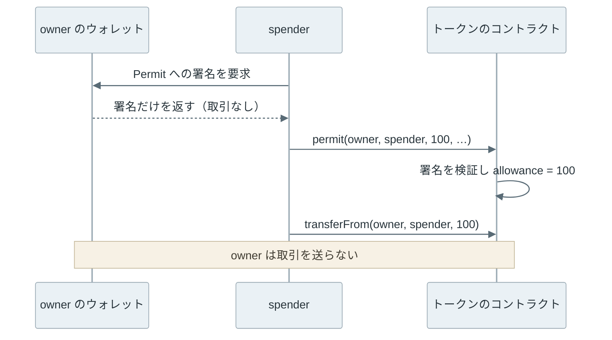

EIP-712 は、[Ethereum](https://ethereum.org/) で構造を持つデータ（型と項目名の付いたデータ）をハッシュし、署名する手順を定めた規格です。ウォレットは署名を求める画面で `spender`・`value`・`deadline` のような項目を並べて表示でき、コントラクトは同じ手順でハッシュを計算して署名を検証します。

ERC-1271 は、秘密鍵を持たないコントラクトのアカウントが「この署名は自分のものとして有効か」を返すための関数の規格です。

2 つとも、取引（transaction）を送らずにメッセージだけに署名する「オフチェーン署名」で使われます。以下は、EIP-712 で鍵が署名する 32 バイトの組み立てです。



上記の図の左半分（domain separator）が「どのチェーンの、どのコントラクト向けの署名か」を表し、右半分が署名する中身を表します。どちらか 1 項目でも違えば、別の 32 バイトになります。

<br>

本記事では、[ERC-20](../erc-20/) の承認（Approve）と [Digital Signature](../digital-signature/) の署名と検証を前提に、次の疑問を順に説明します。

- 署名を求める画面で、なぜ中身を読めないことがあったのか。
- EIP-712 は何をハッシュに含め、別のチェーンや別のコントラクトでの再利用をどう防ぐのか。
- 取引を送っていないのに、permit の署名 1 つで資産を失うのはなぜか。
- 秘密鍵を持たないコントラクトのアカウントは、どうやって署名を示すのか。

後半では、ローカルのチェーンでハッシュを手で計算し、ウォレットの署名とコントラクトの検証が一致することと、署名だけでトークンを移される流れを確かめます。

---

### 中身の読めない署名要求

Ethereum の署名は、取引の送信だけに使うものではありません。サイトへのログイン、取引所の注文、トークンの利用承認など、チェーンに取引を送らずにメッセージに署名させる場面があります。署名を受け取ったサービスは、後でその署名をコントラクトに渡して検証させます。多くのコントラクトは、ハッシュと署名から署名者のアドレスを復元する組み込みの関数 ecrecover を使い、復元したアドレスが期待する相手かを比べます。

[MetaMask](https://metamask.com/) の `eth_sign` は、渡された 32 バイトのハッシュにそのまま署名する方法でした。ハッシュから元のデータは分からないので、ウォレットは `0x9f3b…` のような 16 進の列しか表示できません。そのハッシュが取引のハッシュであれば、ユーザーは知らないうちに取引に署名することになります。MetaMask は 2024 年 5 月作成の [MIP-3](https://github.com/MetaMask/metamask-improvement-proposals/blob/main/MIPs/mip-3.md) で、この方法の廃止を決めています。

[EIP-191](https://eips.ethereum.org/EIPS/eip-191) は、署名するデータの先頭を `0x19` で始める形を定めました。[RLP](https://ethereum.org/developers/docs/data-structures-and-encoding/rlp/)（取引の符号化）では 0x00〜0x7f の 1 バイトがそれだけで 1 つの値になるので、`0x19` で始まるバイト列は全体で 1 件の旧来の取引になりません。

よく使われる `personal_sign` は、この形の 1 つ（バージョン `0x45`）で、メッセージの前に `\x19Ethereum Signed Message:\n` と長さを付けてからハッシュします。文字列なら画面に表示できますが、ハッシュを渡されれば、やはり 16 進の列が並ぶだけです。

| 方法 | 署名する 32 バイト | ウォレットが表示できるもの |
| --- | --- | --- |
| `eth_sign`（MetaMask の旧実装） | 渡されたハッシュ | 16 進の列 |
| `personal_sign`（EIP-191 のバージョン 0x45） | keccak256(接頭辞 ‖ 長さ ‖ メッセージ) | 文字列。ハッシュを渡されたら 16 進の列 |
| `eth_signTypedData_v4`（EIP-712） | keccak256(0x19 0x01 ‖ domain separator ‖ hashStruct) | 型と項目名の付いた値 |

なお、`eth_sign` の意味は実装で異なります。本記事の実験で使うローカルのノード [Anvil](https://getfoundry.sh/anvil/overview) 1.7.1 の `eth_sign` は、`personal_sign` と同じ接頭辞を付けて署名しました。`_v4` は MetaMask が付けた実装のバージョンで、[eth-sig-util](https://github.com/MetaMask/eth-sig-util/blob/9e0cdc2be912415e0cc9159b52d26db76ffe99b0/src/sign-typed-data.ts#L50-L60) によると、v3 は配列と再帰的な構造体を扱えず、v4 は扱えます。

---

### EIP-712 のハッシュの組み立て

[EIP-712](https://eips.ethereum.org/EIPS/eip-712) は、コントラクトを書く言語 [Solidity](https://www.soliditylang.org/) の構造体（struct）に近い形でデータの型を宣言し、型と値の両方からハッシュを作ります。例えば、[ERC-2612](https://eips.ethereum.org/EIPS/eip-2612) の permit では、次の型に署名します。

```text
Permit(address owner,address spender,uint256 value,uint256 nonce,uint256 deadline)
```

この型の文字列を `encodeType`、そのハッシュを `typeHash` と呼びます。値は `encodeData` で、各項目を 32 バイトに揃えて型の順に繋ぎます。アドレスや `uint` は左を 0 で埋め（`int` は符号拡張）、`string` と `bytes` は中身の keccak256 に置き換えます。別の構造体を含む項目は、その構造体のハッシュに置き換えます。

```text
hashStruct(s)   = keccak256(typeHash ‖ encodeData(s))
digest          = keccak256(0x19 ‖ 0x01 ‖ domainSeparator ‖ hashStruct(message))
```

`typeHash` を先頭に入れるので、項目の並びが同じでも、型の名前や項目名が違えば別のハッシュになります。EIP-712 の Rationale は、ERC-20 と ERC-721 の `transfer(address,uint256)` が、数量と識別子という別の意味の `uint256` を同じ形で持つ例を挙げ、型の意味まで区別する理由にしています。

先頭の `0x19 0x01` は、EIP-191 のバージョン `0x01` を表します。取引の署名対象は `0x19` で始まらず（[EIP-2718](https://eips.ethereum.org/EIPS/eip-2718) の型付き取引も、2026 年 11 月時点で型 0x19 を使っていません）、`personal_sign` はバージョン `0x45` なので、3 種類の署名対象が同じバイト列になることはありません。

<br>

domain separator は、`EIP712Domain` という型の hashStruct です。項目は次の 5 つから、アプリが必要なものを選びます。

| 項目 | 意味 | 違うと防げる再利用 |
| --- | --- | --- |
| `name` | 署名の領域の名前（アプリやプロトコルの名前） | 別のアプリでの再利用 |
| `version` | 署名の領域（アプリやプロトコル）のメジャーバージョン | 古いバージョンの署名の流用 |
| `chainId` | [EIP-155](https://eips.ethereum.org/EIPS/eip-155) のチェーン ID | 別のチェーンでの再生 |
| `verifyingContract` | 署名を検証するコントラクトのアドレス | 別のコントラクトでの再生 |
| `salt` | 最後の手段として区別に使う 32 バイト | 上記で区別できない場合 |

`name` と `version` は、アプリが自分で名乗る文字列です。登録制ではないので、別のコントラクトも同じ名前を名乗れます。区別の決め手になるのは `chainId` と `verifyingContract` です。

一方で、同じドメインの中での再利用は、EIP-712 の範囲外です。仕様の冒頭にも「It does not include replay protection.」（再生の防止は含まない）とあります。permit はメッセージに `nonce` を入れ、使うたびにコントラクト側の値を 1 増やして、同じ署名の 2 回目を拒否します。期限の `deadline` も、メッセージ側の項目です。

---

### ローカルでのハッシュと署名の照合

EIP-712 の手順を Python で書き、仕様のテストベクタ、ウォレットの署名、コントラクトの検証の 3 つと突き合わせます。環境は次の通りです。

- 開発ツール [Foundry](https://github.com/foundry-rs/foundry) の Anvil（ローカルのノード）と cast（コマンドラインの道具）1.7.1、Solidity のコンパイラ solc 0.8.28。Anvil は `127.0.0.1` だけで 2 つ起動し、chain ID を 31337 と 31338 にする。
- トークンは [OpenZeppelin Contracts v5.1.0](https://github.com/OpenZeppelin/openzeppelin-contracts/tree/v5.1.0)（MIT ライセンス）の [ERC20Permit](https://github.com/OpenZeppelin/openzeppelin-contracts/blob/v5.1.0/contracts/token/ERC20/extensions/ERC20Permit.sol) を継承した `StudyPermitToken`。
- 秘密鍵は Anvil が既定で作るテスト用のアカウントだけを使う。広く公開されている鍵なので、公開のネットワークでは使えない。

自作のコントラクト（`StudyPermitToken`・`StudyAccount`・`SigCheck`）は学習用で、監査していません。トークンの定義は次の通りで、EIP-712 のドメインは `name = "Study Token"`、`version = "1"`、実行中のチェーンの chain ID、トークンのアドレスです。

```solidity
contract StudyPermitToken is ERC20, ERC20Permit {
    constructor(address holder) ERC20("Study Token", "STK") ERC20Permit("Study Token") {
        _mint(holder, 100);
    }

    function decimals() public pure override returns (uint8) {
        return 0;
    }
}
```

<br>

Python 側の中心は、次の 3 つの関数です。keccak256 は標準ライブラリの [`hashlib.sha3_256`](https://docs.python.org/3/library/hashlib.html) では計算できません。[SHA-3 の標準化](https://csrc.nist.gov/pubs/fips/202/final)の際に末尾の埋め方（padding）が変わり、Ethereum は変更前の Keccak を使っているからです。そのため、lab には標準ライブラリだけで書いた [keccak.py](https://github.com/nao1215/debimate/blob/main/content/notes/blockchain-systems/eip-712/lab/keccak.py) を置いています。

```python
def encode_data(primary, data, types):
    return b''.join(encode_value(f['type'], data[f['name']], types) for f in types[primary])


def hash_struct(primary, data, types):
    return keccak256(type_hash(primary, types) + encode_data(primary, data, types))


def digest(typed):
    types = typed['types']
    domain_separator = hash_struct('EIP712Domain', typed['domain'], types)
    return keccak256(b'\x19\x01' + domain_separator
                     + hash_struct(typed['primaryType'], typed['message'], types))
```

<details>
<summary>lab/eip712.py の全体</summary>

```python
"""EIP-712 hashing written by hand (structs, atomic types, string and bytes; no arrays)."""
from keccak import keccak256


def encode_type(primary, types):
    deps = set()

    def collect(name):
        for field in types[name]:
            t = field['type']
            if t in types and t not in deps:
                deps.add(t)
                collect(t)

    collect(primary)
    deps.discard(primary)
    def one(name):
        return name + '(' + ','.join(f"{f['type']} {f['name']}" for f in types[name]) + ')'
    return one(primary) + ''.join(one(d) for d in sorted(deps))


def type_hash(primary, types):
    return keccak256(encode_type(primary, types).encode())


def encode_value(t, value, types):
    if t in types:                      # nested struct -> its hashStruct
        return hash_struct(t, value, types)
    if t == 'string':                   # dynamic -> keccak256 of the contents
        return keccak256(value.encode())
    if t == 'bytes':
        return keccak256(bytes.fromhex(value.removeprefix('0x')))
    if t == 'address':
        return int(value, 16).to_bytes(32, 'big')
    if t == 'bool':
        return int(bool(value)).to_bytes(32, 'big')
    if t.startswith('uint'):
        return int(value).to_bytes(32, 'big')
    if t.startswith('int'):
        return (int(value) % 2**256).to_bytes(32, 'big')
    if t.startswith('bytes'):           # bytes1..bytes32, right padded
        return bytes.fromhex(value.removeprefix('0x')).ljust(32, b'\0')
    raise NotImplementedError(t)


def encode_data(primary, data, types):
    return b''.join(encode_value(f['type'], data[f['name']], types) for f in types[primary])


def hash_struct(primary, data, types):
    return keccak256(type_hash(primary, types) + encode_data(primary, data, types))


def digest(typed):
    types = typed['types']
    domain_separator = hash_struct('EIP712Domain', typed['domain'], types)
    return keccak256(b'\x19\x01' + domain_separator
                     + hash_struct(typed['primaryType'], typed['message'], types))
```

</details>

実験は、Anvil の起動とデプロイを含む [lab/run.py](https://github.com/nao1215/debimate/blob/main/content/notes/blockchain-systems/eip-712/lab/run.py) で行います。以下は、permit の署名を作って別の環境に持ち込む部分の抜粋です。

`a` と `b` は chain ID 31337 と 31338 の Anvil、`token_b` は 31338 に同じアカウント・同じ nonce でデプロイしたトークン（アドレスも同じ）、`token_2` は 31337 にもう 1 つデプロイした同名のトークンです。

`permit_typed` は前述の Permit 型と domain を組み立てる関数（spender、value = 100、nonce = 0、期限 1 時間）、`checker` は ecrecover でアドレスを復元する学習用のコントラクト `SigCheck`、`a.call` は [`eth_call`](https://ethereum.org/developers/docs/apis/json-rpc/) で呼び出して結果か revert の理由を返す関数です。

```python
typed = permit_typed(31337, token, owner)
sig = a.rpc('eth_signTypedData_v4', owner, typed)            # Anvil signs with the test key
d = '0x' + digest(typed).hex()
sep = '0x' + hash_struct('EIP712Domain', typed['domain'], typed['types']).hex()
v, r, s = int(sig[130:132], 16), '0x' + sig[2:66], '0x' + sig[66:130]
log('DOMAIN_SEPARATOR() == Python', a.call(token, 'DOMAIN_SEPARATOR()', returns='bytes32') == sep)
log('owner', owner)
log('ecrecover(Python digest, wallet signature)',
    a.call(checker, 'recover(bytes32,bytes)', d, sig, returns='address'))
permit_args = (owner, spender, 100, deadline, v, r, s)
psig = 'permit(address,address,uint256,uint256,uint8,bytes32,bytes32)'
log('same signature, token on 31338', b.call(token_b, psig, *permit_args))
log('same signature, 2nd token on 31337', a.call(token_2, psig, *permit_args))
```

```bash
bash content/notes/blockchain-systems/eip-712/lab/run.sh
```

以下は[出力](lab/output/summary.txt)の 1 と 2 です。

```text
# 1. EIP-712 Mail example, hashed by hand
encodeType | Mail(Person from,Person to,string contents)Person(string name,address wallet) | matches EIP-712
typeHash | 0xa0cedeb2dc280ba39b857546d74f5549c3a1d7bdc2dd96bf881f76108e23dac2 | matches EIP-712
domainSeparator | 0xf2cee375fa42b42143804025fc449deafd50cc031ca257e0b194a650a912090f | matches EIP-712
hashStruct(message) | 0xc52c0ee5d84264471806290a3f2c4cecfc5490626bf912d01f240d7a274b371e | matches EIP-712
digest | 0xbe609aee343fb3c4b28e1df9e632fca64fcfaede20f02e86244efddf30957bd2 | matches EIP-712
ecrecover(digest, signature in EIP-712) | 0xCD2a3d9F938E13CD947Ec05AbC7FE734Df8DD826

# 2. permit signature from eth_signTypedData_v4
token on 31337 | 0x5FbDB2315678afecb367f032d93F642f64180aa3
token on 31338 | 0x5FbDB2315678afecb367f032d93F642f64180aa3
2nd token on 31337 | 0xe7f1725E7734CE288F8367e1Bb143E90bb3F0512
DOMAIN_SEPARATOR() == Python | True
owner | 0x70997970C51812dc3A010C7d01b50e0d17dc79C8
ecrecover(Python digest, wallet signature) | 0x70997970C51812dc3A010C7d01b50e0d17dc79C8
same signature, token on 31338 | revert ERC2612InvalidSigner(recovered=0x099c16B41fFF273062593931BD35cC9F324B9B4A, owner=0x70997970C51812dc3A010C7d01b50e0d17dc79C8)
same signature, 2nd token on 31337 | revert ERC2612InvalidSigner(recovered=0x0eEA99498227F3E451059ae4d26d00c98b81f2fB, owner=0x70997970C51812dc3A010C7d01b50e0d17dc79C8)
```

1 は、EIP-712 の仕様にある `Mail` の例です。手で計算した 5 つの値は、仕様の [Example.js](https://github.com/ethereum/EIPs/blob/master/assets/eip-712/Example.js) の期待値と一致し、仕様に載っている署名から復元したアドレスも、例の送り主 `0xCD2a…D826` になりました。

2 では、コントラクトの `DOMAIN_SEPARATOR()` と Python の値が一致し、Python で計算したハッシュから owner のアドレスが復元されました。ウォレット（Anvil）とコントラクトと Python が、同じ 32 バイトを見ていたことになります。

同じ署名を chain ID 31338 の同じアドレスのトークンや、同じ名前の別のトークンに渡すと、どちらも `ERC2612InvalidSigner` で失敗しました。以下は、1 つの署名を 3 つのトークンに渡した結果をまとめた図です。



ドメインが違うのでトークンが計算するハッシュが変わり、署名から復元されるのは owner とは無関係のアドレスになります。署名が「無効」と判定されるのではなく、別人の署名として扱われる点が、ecrecover で署名者を復元する検証の特徴です。

同じ 32 バイトに `personal_sign` で署名させた結果が、出力の 3 です。

```text
# 3. personal_sign over the same 32-byte digest
ecrecover(digest, personal_sign) | 0x317EddB3BcF4583bA6C9C7744A4Ded28CAC3DE57
ecrecover(EIP-191 hash, personal_sign) | 0x70997970C51812dc3A010C7d01b50e0d17dc79C8
```

`personal_sign` の署名は、接頭辞を付けたハッシュに対してだけ owner を復元します。permit の検証は接頭辞の無いハッシュで行うので、この署名では承認できません。逆に、接頭辞を付けない `eth_sign` が使えるウォレットでは、16 進の列に署名させるだけで permit が成立していたことになります。

---

### permit - 署名だけで成立する承認

ERC-20 の `approve` は、所有者が取引を送り、`msg.sender` として承認を記録します。そのため、トークンを使うには承認と利用の 2 件の取引が必要で、手数料の ETH も持っている必要がありました。ERC-2612 の `permit(owner, spender, value, deadline, v, r, s)` は、所有者の EIP-712 署名を受け取って `allowance[owner][spender]` を設定します。仕様にも明記されている通り、`permit` を呼ぶのは誰でも構いません。

利点は、利用するサービスが署名と利用の処理を 1 件の取引にまとめ、手数料も肩代わりできることです。しかし、署名を受け取った相手が、所有者の知らない時点で承認を成立させられることも意味します。実験の 4 では、owner は署名しただけで取引を 1 件も送らず、spender が `permit` と `transferFrom` を送りました。



```text
# 4. owner only signs; spender submits permit and transferFrom
after signing | owner txs | 0 | owner STK | 100 | spender STK | 0 | allowance | 0
permit status=1 | owner txs | 0 | owner STK | 100 | spender STK | 0 | allowance | 100
transferFrom status=1 | owner txs | 0 | owner STK | 0 | spender STK | 100 | allowance | 0
same permit again (nonce is now 1) | revert ERC2612InvalidSigner(recovered=0x42DDf6111b34C60364e145b18BC71e52dE14fC4B, owner=0x70997970C51812dc3A010C7d01b50e0d17dc79C8)
```

owner の送信数（`owner txs`）は最後まで 0 で、100 枚すべてが spender に移りました。同じ署名の 2 回目は、トークン側の nonce が 1 に進んでいるので失敗します。

<br>

「署名は送金ではないので、署名するだけなら安全」と考える方がいるかもしれません。しかし、permit の署名は、`approve` の取引と同じ権限を渡します。違いは、相手がいつ使うかを所有者が見られないことです。期限前の署名は、所有者が自分で permit を送って nonce を進めれば無効にできます（ERC-2612 の Security Considerations）。ただし、それも取引で、相手より先に届く保証はありません。サイトとの接続を解除しても、渡した署名は相手の手元に残ります。

交換サービス [Uniswap](https://uniswap.org/) の [Permit2](https://github.com/Uniswap/permit2/tree/cc56ad0f3439c502c246fc5cfcc3db92bb8b7219) は、permit を持たないトークンでも署名で承認できるようにするコントラクトです。ユーザーは先に各トークンで Permit2 を `approve` しておき、以後はサービスごとの許可を EIP-712 の署名で Permit2 に渡します。期限付きの許可や、1 回の取引だけで使える署名による送金があります。一方で、Permit2 を承認済みのトークンは、Permit2 向けの署名 1 つで動かせる状態になります。

注文も同じ形です。NFT（1 つずつ区別されるトークン）の取引で使われる [Seaport](https://github.com/ProjectOpenSea/seaport/blob/7f966fe7bd75932beb0366f6485aa720512b1259/docs/SeaportDocumentation.md) の注文は、[EIP-712 の署名](https://github.com/ProjectOpenSea/seaport-core/blob/523097f9cee66c15d308c900c50f336b291cda08/src/lib/ConsiderationBase.sol)で承認されます。出品者が事前に Seaport の利用を承認していれば、注文を出す時に取引を送らなくても、買い手の取引で約定します。

---

### 署名を悪用する詐欺

署名を集める詐欺サイトは、正規のトークンや Permit2 のドメインのまま、spender を攻撃者にした署名を求めます。詐欺の検知サービスを提供する [Scam Sniffer の 2024 年の報告](https://drops.scamsniffer.io/?p=971)では、資産を抜き取る詐欺（wallet drainer）による 2024 年の被害は約 4 億 9,400 万ドルで、大口の被害を署名の種類で分けると、損失額の 56.7% が Permit でした。

2024 年 9 月 28 日、同社は 1 件の [Permit の署名で 12,083 spWETH（貸借サービス [Spark](https://spark.finance/) に WETH を預けると受け取るトークン。約 3,243 万ドル）が失われた](https://x.com/realScamSniffer/status/1839923975184625832)と報告しています。

では、EIP-712 で項目が読めれば、署名の中身も安全なのでしょうか。EIP-712 が保証するのは、画面に出した項目と署名するハッシュが対応することまでです。上記の詐欺では、ドメインは本物のトークンで、署名も仕様通りに作られています。署名を求めたサイトの URL は、ドメインにもメッセージにも含まれません。`name` は自己申告の文字列なので、攻撃者のコントラクトが有名なトークンと同じ名前を名乗ることもできます。

画面で判断するのは人です。例えば Permit なら、次の項目を確かめます。

- `verifyingContract` と `chainId` が、操作するつもりのトークンとチェーンか。
- `spender` が、利用するつもりのサービスのコントラクトか。
- `value` が必要な量か。最大値（無制限）になっていないか。
- `deadline` が、遠い将来になっていないか。

NFT でも、権限を渡す操作が詐欺に使われます。[ERC-721](../erc-721/) の `setApprovalForAll` は、署名ではなく取引ですが、資産を動かす権限だけを渡す点で同じ構造です。

---

### ERC-1271 - コントラクトのアカウントの署名

[スマートアカウント](../erc-4337/)や[マルチシグ](../multisig/)のような、コントラクトのアカウントは秘密鍵を持ちません。アドレスはデプロイの方法から決まり、EOA の署名方式 ECDSA の公開鍵から導かれたものではないので、どんな署名を ecrecover しても、このアドレスは復元されません。

[ERC-1271](https://eips.ethereum.org/EIPS/eip-1271) は、検証する側がアカウントに問い合わせる形でこれを解きます。アカウントは次の関数を実装し、署名が有効なら `0x1626ba7e` を返します。この値は、関数自身の識別子（`isValidSignature(bytes32,bytes)` の keccak256 の先頭 4 バイト）です。

```solidity
function isValidSignature(bytes32 hash, bytes memory signature) external view returns (bytes4 magicValue);
```

何を有効とするかは、アカウントのコードが決めます。所有者 1 人の ECDSA 署名でも、3 人中 2 人の署名でも、別の署名方式でも構いません。関数は `view` で状態を変えられませんが、判定はアカウントの状態によって変わります。所有者を入れ替えれば、同じ署名が後から無効になります。

検証するコントラクトは、アドレスにコードがあれば `isValidSignature` を呼び、無ければ ecrecover を使います。



OpenZeppelin の [SignatureChecker](https://github.com/OpenZeppelin/openzeppelin-contracts/blob/v5.1.0/contracts/utils/cryptography/SignatureChecker.sol) も、Permit2 の [SignatureVerification](https://github.com/Uniswap/permit2/blob/cc56ad0f3439c502c246fc5cfcc3db92bb8b7219/src/libraries/SignatureVerification.sol) も、この分岐です。なお、[EIP-7702](../ethereum-account-model/) で委任を設定した EOA はコードを持つので、この分岐では `isValidSignature` を呼ぶ方に進みます。

<br>

実験の 5 では、所有者の EOA の署名なら有効とする `StudyAccount` を作り、Permit の署名を 3 通りの方法で検証しました。

```solidity
function isValidSignature(bytes32 hash, bytes calldata signature) external view returns (bytes4) {
    (address recovered, ECDSA.RecoverError err, ) = ECDSA.tryRecover(hash, signature);
    if (err == ECDSA.RecoverError.NoError && recovered == owner) {
        return IERC1271.isValidSignature.selector; // 0x1626ba7e
    }
    return 0xffffffff;
}
```

```text
# 5. contract account (ERC-1271)
account | 0xCf7Ed3AccA5a467e9e704C703E8D87F634fB0Fc9 | code bytes | 1367
account owner EOA | 0x90F79bf6EB2c4f870365E785982E1f101E93b906
ecrecover(digest, sig) | 0x90F79bf6EB2c4f870365E785982E1f101E93b906
checkEcrecover(account, ...) | false
checkWith1271(account, ...) | true
account.isValidSignature(digest, sig) | 0x1626ba7e
account.isValidSignature(digest, bad sig) | 0xffffffff
token.permit(owner=account, ...) | revert ERC2612InvalidSigner(recovered=0x90F79bf6EB2c4f870365E785982E1f101E93b906, owner=0xCf7Ed3AccA5a467e9e704C703E8D87F634fB0Fc9)
another account of the same owner .isValidSignature | 0x1626ba7e
```

ecrecover で復元されるのは所有者の EOA で、アカウントのアドレスではありません。そのため、ecrecover だけで比べる `checkEcrecover` は false、コードの有無で分岐する `checkWith1271` は true を返しました。

OpenZeppelin v5.1.0 の `ERC20Permit` も ecrecover だけで比べるので、アカウントを owner にした permit は失敗します。ERC-2612 の仕様が、permit の署名を owner の [secp256k1](https://www.secg.org/sec2-v2.pdf) 署名と定めているからです。コントラクトのアカウントで署名による承認を使うなら、Permit2 のように ERC-1271 を扱う仕組みが必要です。

「署名の検証は ecrecover で済む」と書いたアプリは、EOA の署名だけを受け付けます。ログインや注文の署名を受け取るサービスは、スマートアカウントの利用者を締め出すことになります。

最後の行は、同じ所有者の別の `StudyAccount` も、同じ署名を有効と返した結果です。`StudyAccount` はハッシュにアカウント自身のアドレスを含めずに判定するので、アカウントのアドレスを含まないメッセージなら、別のアカウントの署名として使い回せます。この問題を防ぐ再ハッシュの方法として、[ERC-7739](https://eips.ethereum.org/EIPS/eip-7739) が提案されています（2026 年 11 月時点で Draft）。

---

### まだデプロイされていないアカウント

スマートアカウントは、アドレスを先に計算しておき、最初の取引の時にデプロイすることがあります。[CREATE2](https://eips.ethereum.org/EIPS/eip-1014) という命令でデプロイすると、デプロイ前にアドレスが分かるからです。しかし、コードの無いアドレスに `isValidSignature` は呼べず、デプロイ前のアカウントはログインの署名を示せません。

[ERC-6492](https://eips.ethereum.org/EIPS/eip-6492)（2023 年 9 月に Final、2026 年 11 月時点も Final）は、アカウントを作るファクトリのアドレス、その呼び出しデータ、元の署名の 3 つを Solidity の [ABI 形式](https://docs.soliditylang.org/en/v0.8.28/abi-spec.html)（`abi.encode`）でまとめ、その後ろに 32 バイトの `0x6492…6492` を付ける形を定めています。検証する側はこの末尾を見つけたら、`eth_call` の中でファクトリを呼んでデプロイを模擬し、続けて `isValidSignature` を呼びます。オフチェーンで検証する場合は取引を送らないので、チェーンの状態は変わりません。

---

### 利点

- 署名の画面に型と項目名が出るので、ユーザーやウォレットが中身を検査できる。
- ドメインに chain ID とコントラクトのアドレスを入れれば、別のチェーンや別のコントラクトでは同じ署名が通らない。
- 所有者が取引を送らずに、承認や注文を渡せる。手数料をサービスが肩代わりし、取引を 1 件にまとめられる。
- ERC-1271 により、ECDSA の鍵を持たないアカウントも、同じ「署名を検証する」呼び出しで扱える。

---

### 欠点

- 同じドメインの中の再利用は防がない。nonce や期限はアプリが設計する。
- 署名は相手の手元に残り、所有者は使われる時点を見られない。取り消しには取引が必要になる。
- 読めることと安全なことは別で、詐欺は正規のドメインのまま spender だけを差し替える。
- ecrecover だけの検証はコントラクトのアカウントを受け付けず、ERC-1271 の判定はアカウントの状態で後から変わる。
