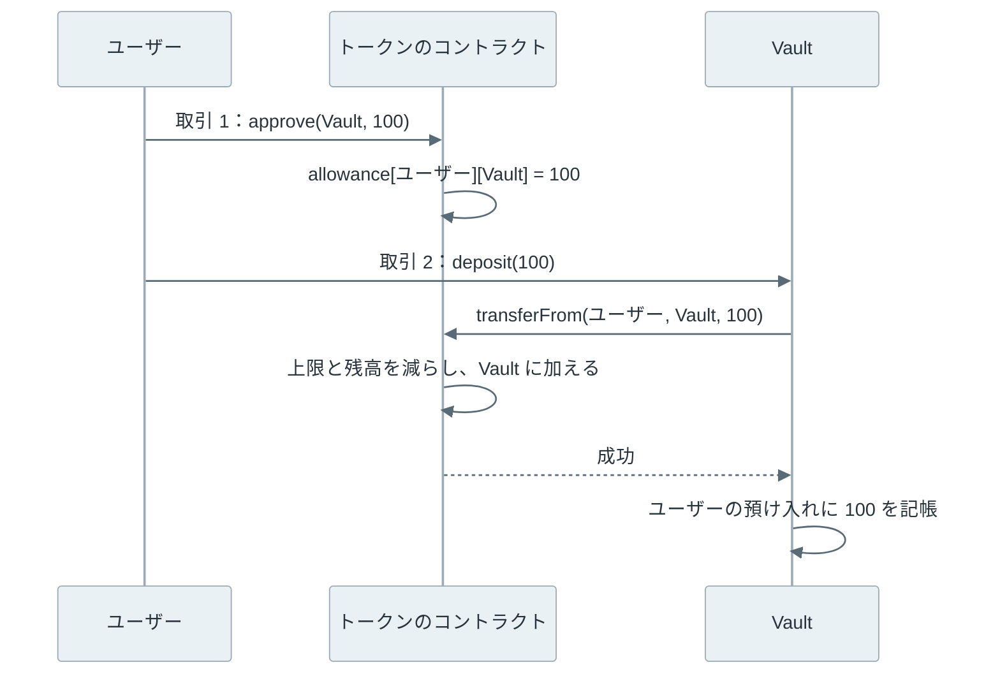

交換サービスや貸し借りのサービスに、米ドルと同じ値で動く暗号資産の USDC を預けようとすると、ウォレットは送金の前に「このサイトに USDC の使用を許可しますか」と聞いてきます。許可の画面には金額の欄があり、既定で無制限になっているサービスもあります。開発する側も同じ所で迷います。ユーザーから受け取るコードを書くと、テスト用のトークンでは通るのに、USDT を渡すと取引が取り消されることがあるからです。

この 2 つの場面に出てくるのが [ERC-20](https://eips.ethereum.org/EIPS/eip-20) です。トークンは、[Ethereum](https://ethereum.org/) の上で ETH とは別に発行される暗号資産の単位です。ERC-20 は、このトークンについて、扱う関数とイベントを決めた規格です。同じ種類のトークンは 1 枚ごとの区別が無く、数量だけで扱います。

USDC・USDT など、ETH 以外に流通する資産の多くがこの形で作られています。1 枚ずつ区別する NFT は、[ERC-721](../erc-721/) という別の規格が扱います。仕様の文書は、EIP-20 という番号で公開されています。

{{< figure src="images/approve_race.webp" alt="3 段の動画。上の段では、所有者が spender への許可を 100 から 50 に下げる approve(50) を送ると、spender がそれを mempool で見て transferFrom(100) を送り、同じブロック 6 に transferFrom(100)、approve(50) の順で入る。続いて spender が transferFrom(50) を送り、ブロック 7 に入って受け取りが 150 になる。中の段は approve(0) を挟んでから approve(50) を送る形で、同じく 150 になる。下の段は decreaseAllowance(50) で、transferFrom(100) が先に入った後に decreaseAllowance が失敗し、受け取りは 100 で止まる。実測した時刻を 0.5 倍速で再生する" caption="許可を 100 から 50 に下げる間に割り込まれた結果。ローカルの Anvil で手数料の高い順に並べる設定にし、別々に 3 回実測して、所有者が送った時刻を揃えた（0.5 倍速）" align="center" >}}

上記の動画は、本記事で行った実験の 1 つです。自分の PC で動かしたチェーンは、手数料の高い取引から先にブロックへ入れる設定にし、相手が送信待ちの取引を見張って高い手数料で割り込める条件を作りました。その上で、相手に引き出しを許した 100 トークンを 50 に下げようとしました。ところが相手は、下げる取引がブロックに入る前に 100 を引き出し、下げた後の 50 も引き出して、合計 150 を受け取りました。所有者が許したのは、最大でも 100 だった筈です。

動画に出てくる関数名や mempool は、後の節で 1 つずつ説明します。

<br>

本記事では、ERC-20 のトークンを受け取るコードを書く人と、ウォレットで許可を求められて迷った人に向けて、次の疑問に、上から順に答えていきます。

- トークンの残高はどこに記録され、送金すると何が変わるのか。
- 受け取る側はなぜ approve と transferFrom の 2 段階で受け取るのか。
- 許可を付け替える途中で、上記の動画のような割り込みが起きるのはなぜか。
- 許可はいつまで残り、どこまで使われるのか。
- 規格どおりに見えるトークンで、受け取るコードはどう誤るのか。
- permit や Permit2 は、approve の何を変えたのか。

実験は全て、コントラクト開発のツール群 [Foundry](https://getfoundry.sh/) に含まれる [Anvil](https://getfoundry.sh/anvil/overview) で自分の PC に立てたチェーンで行いました。実資産、普段使う秘密鍵、公開のネットワークは使っていません。

---

### 残高を持つ表

ERC-20 のトークンは、チェーン上で動くプログラムである[スマートコントラクト](../smart-contract/)として作ります。トークンごとにコントラクトが 1 つあり、その中にアドレスと残高を対応させた表を持ちます。規格が決めているのは、この表を読み書きする関数とイベントの形で、表の持ち方は決めていません。以下の表に出る spender は、所有者の残高から引き出すことを許された相手で、その上限を allowance と呼びます。

| 関数・イベント | 働き |
| --- | --- |
| `balanceOf(owner)` | owner の残高を返す |
| `transfer(to, value)` | 呼び出した人の残高から to に value を移す |
| `approve(spender, value)` | spender が自分の残高から引き出せる上限を value にする |
| `allowance(owner, spender)` | owner が spender に許した残りの上限を返す |
| `transferFrom(from, to, value)` | 許された spender が from の残高から to に移す |
| `Transfer`・`Approval` イベント | 残高・上限が変わったことを記録に残す |

ほかに発行量を返す `totalSupply` があり、表示用の名前・記号・小数点の桁数を返す `name`・`symbol`・`decimals` は任意です。

コントラクトが扱う数量は全て整数です。例えば USDC の `decimals` は 6 で、残高の整数 1,000,000 を画面では 1 USDC と表示します。コントラクトの部品を公開している [OpenZeppelin による ERC-20 の解説](https://docs.openzeppelin.com/contracts/5.x/erc20)にある通り、`decimals` は表示のための値で、計算を小数に変えるわけではありません。

<br>

ETH の残高と比べると、置き場所の違いが分かります。ETH の残高は、[Ethereum のアカウント](../ethereum-account-model/)が持つ状態の 1 つです。一方で、トークンの残高はトークンのコントラクトが持つストレージにあり、受取人のアカウントは何も変わりません。100 STU（実験用のトークン）を送って、両方を比べました。



送金は `transfer(受取人, 100)` という関数の呼び出しで、取引の宛先は受取人ではなくトークンのコントラクトです。実験の取引も、宛先はコントラクトのアドレスで、一緒に送る ETH の額は 0 でした。途中で失敗すると取引全体が取り消されるので、送った人の残高だけが減ることはありません。

以下は、受取人が持つ ETH の残高と、コントラクトのストレージを送金の前後で読む部分の抜粋です（全体は [experiment.py](lab/experiment.py) の `exp_storage`）。`calldata` は、関数名と引数を[取引に載せるバイト列に符号化](../evm/#calldata-と-abi)する補助関数です。

```python
eth_before = int(rpc("eth_getBalance", receiver, "latest"), 16)
# balanceOf の表で受取人の行が置かれる位置を計算する
slot = subprocess.check_output(["cast", "index", "address", receiver, "3"], text=True).strip()
st_before = int(rpc("eth_getStorageAt", tok, slot, "latest"), 16)
r = receipt(send(owner, tok, calldata("transfer(address,uint256)", receiver, 100 * UNIT)))
eth_after = int(rpc("eth_getBalance", receiver, "latest"), 16)
st_after = int(rpc("eth_getStorageAt", tok, slot, "latest"), 16)
```

```text
receiver_eth_before_wei: 10000000000000000000000
receiver_eth_after_wei:  10000000000000000000000
storage_before: 0
storage_after:  100000000000000000000   (= 100 STU、decimals は 18)
transfer_gasUsed: 51689
```

手数料（[gas](../gas-eip-1559/)）は送った人が ETH で払い、トークンでは払えません。gas の量も、[Wallet のノート](../wallet/)で ETH だけを送った時の 21,000 に対して 51,689 でした。受取人の行を 0 から書き込むストレージの更新が特に高く、関数と引数のデータ、イベントを残す処理の分も加わるからです。

トークンの残高を知るには、コントラクトの `balanceOf` を呼ぶか、過去の `Transfer` イベントを集計します。ウォレットが「トークンを追加」という操作を求めるのは、どのコントラクトに問い合わせるかを知らないと、残高を表示できないからです。同じ `name` や `symbol` のコントラクトは誰でも作れるので、トークンは名前ではなく、チェーンと[コントラクトのアドレス](../ethereum-address/)で見分けます。

---

### approve と transferFrom

ユーザーがサービスのコントラクト（以下、Vault と呼びます）にトークンを預ける場面を考えます。`transfer` で Vault のアドレスに送れば、残高は移ります。しかし、Vault のコードは呼ばれません。表を書き換えるのはトークンのコントラクトで、Vault には「入金があった」という通知が届かないからです。誰がいくら預けたかを Vault が記帳できません。

そこで ERC-20 では、ユーザーが先に `approve` で引き出しを許し、Vault が自分のコードで `transferFrom` を呼んで引き出します。引き出しと記帳が同じ取引の中で起きるので、Vault は受け取った分だけを記帳できます。



上記の図で `approve` を受けるのはトークンのコントラクトで、allowance は残高と同じく、トークン側の表に入ります。spender はコントラクトでも通常のアカウントでもよく、この図では Vault が spender です。

トークンは、`transferFrom` を呼んだアドレス（[Solidity](https://soliditylang.org/) の `msg.sender`）が spender かどうかで判定します。そのため、ユーザーが[交換サービス](../amm/)のコントラクトを呼び、そのコントラクトがトークンを呼ぶ場合、許可が必要なのは交換サービスのコントラクトです。

`approve` で変わるのは上限だけで、残高は動かず、その分が予約されるわけでもありません。上限が 100 あっても、所有者が先に残高を使えば、spender は残高の分までしか引き出せません。上限を超える `transferFrom` は失敗します。また、上限は「誰が引き出せるか」に紐づき、送り先には紐づきません。spender は `transferFrom` の宛先を自由に選べるので、許可の画面で見るべきは相手のアドレスです。

ETH を送る時は、受け取るコントラクトのコード（`receive` 関数）が呼ばれます。トークンでも同じことをしようとした規格に、[ERC-777](https://eips.ethereum.org/EIPS/eip-777) と [ERC-1363](https://eips.ethereum.org/EIPS/eip-1363) があります。

| 受け取り方 | 受取人のコードが動くか | 取引の数 |
| --- | --- | --- |
| ETH の送金 | 受取人がコントラクトなら `receive` 関数が動く | 1 |
| ERC-20 の `transfer` | 動かない | 1。ただし受取人は記帳できない |
| ERC-20 の `approve` → `transferFrom` | 引き出す側が自分で呼ぶ | 2 |
| ERC-777・ERC-1363 | 送った後に受取人の関数が呼ばれる | 1 |

ERC-777 の呼び出しは、送金の途中で外部のコードが動くため、[Reentrancy](../reentrancy/) の入口になりました。[OpenZeppelin Contracts](https://github.com/OpenZeppelin/openzeppelin-contracts) は 5.0（2023 年 10 月）で ERC-777 の実装を外しています。結果として、2 段階の approve が今も標準の受け取り方です。そして、この 2 段階の間に残る「許可」が、以下で扱う問題の入口になります。

---

### 許可の付け替えと割り込み

冒頭の動画で示した実験を詳しく見ます。登場するのは、トークンの所有者と、100 の引き出しを許された spender です。所有者が上限を 50 に下げようと思った時、素直な書き方は `approve(spender, 50)` で上書きすることです。

取引は、ブロックに入るまでの間、ノードの [mempool](../mempool/) という置き場で待ちます。mempool の取引は他の参加者からも見え、どの順でブロックに入れるかは、ブロックを作る側が手数料などで決めます。この並べ替えから利益を得る行為は [MEV](../mev/) と呼ばれます。

<br>

実験では、Anvil を 2 秒ごとにブロックを作る設定にし、手数料の高い取引を先に並べるようにしました（`--order fees`）。

spender 役のスレッドは mempool を 0.05 秒ごとに読み、所有者の取引を見つけたら、所有者の 20 倍の優先手数料で `transferFrom(所有者, spender, 100)` を送ります。優先手数料は、先に並べてもらうために上乗せする手数料です。以下は、その部分の抜粋です。

```python
def attacker():
    seen = set()
    while not done.is_set():
        pool = rpc("txpool_content")["pending"]
        for frm, txs in pool.items():
            for tx in txs.values():
                if frm.lower() == owner.lower() and tx["hash"] not in seen:
                    seen.add(tx["hash"])
                    h = send(spender, tok,
                             calldata("transferFrom(address,address,uint256)", owner, spender, 100 * UNIT),
                             tip_gwei=20)  # 所有者の取引は tip_gwei=1
                    t0_box["front"] = h
                    return
        time.sleep(0.05)
```

所有者の下げ方を 3 通りに変えて、ブロックに入った順と spender の受け取りを記録しました。時刻は、所有者が取引を送った時を 0 秒とした経過時間です。

```text
approve(50) で上書き
  0.012 秒  所有者が approve(50) を送る
  0.060 秒  spender が transferFrom(100) を送る
  1.611 秒  ブロック 6: transferFrom(100) 成功 → approve(50) 成功   残りの許可 50
  3.599 秒  ブロック 7: transferFrom(50) 成功                       受け取り 150

approve(0) の後に approve(50)
  1.599 秒  ブロック 15: transferFrom(100) 成功 → approve(0) 成功    残りの許可 0
  3.597 秒  ブロック 16: approve(50) 成功                            残りの許可 50
  5.606 秒  ブロック 17: transferFrom(50) 成功                       受け取り 150

decreaseAllowance(50) で 50 を引く
  1.615 秒  ブロック 11: transferFrom(100) 成功 → decreaseAllowance(50) 失敗
                                                                    受け取り 100
```

`approve` は「上限を足し引きする」のではなく「上限をこの値にする」関数です。所有者の取引は、spender が 100 を使い切った後に入っても成功し、新しく 50 を許してしまいます。

<br>

#### 0 を挟む方法と、差を指定する方法

ERC-20 の仕様は、この割り込みを承知しています。`approve` の注記で、同じ spender の上限を変える時は、利用者の画面で先に 0 にしてから新しい値にするよう求めています。[USDT のコントラクト](https://sourcify.dev/#/lookup/0xdAC17F958D2ee523a2206206994597C13D831ec7)は、さらに強く、0 でない上限を 0 以外の値に直接変える `approve` を取り消します。

```solidity
// USDT（TetherToken）の approve から抜粋
require(!((_value != 0) && (allowed[msg.sender][_spender] != 0)));
```

しかし、動画の中段のように、0 にした結果を見ずに 50 を送ると、0 を挟んでも受け取りは 150 のままです。0 にした取引の前に 100 を引き出されているからです。仕様の注記が意味を持つのは、0 にした後で `Transfer` イベントや残高を見て、引き出されていないことを確認してから次の値を送る場合だけです。

動画の下段で使った `decreaseAllowance` は、今の上限から指定した分を引く関数です。先に 100 を引き出されると上限は 0 になり、50 を引けずに取引が失敗します。spender の受け取りは、もともと許していた 100 で止まりました。失敗した取引もブロックに入り、送った所有者は手数料を払っています。

ただし、この関数は規格にありません。OpenZeppelin Contracts は 4.x まで `decreaseAllowance` を ERC-20 の実装に入れていましたが、[5.0 で外しました](https://github.com/OpenZeppelin/openzeppelin-contracts/pull/4585)。[議論の issue](https://github.com/OpenZeppelin/openzeppelin-contracts/issues/4583) では、この割り込みが本番のチェーンで起きた例を示した人に 1,500 DAI 以上を払う懸賞も紹介されています。DAI は米ドルと同じ値で動くトークンです。

手元では 2 秒のブロックで再現できる一方で、上限を下げる場面を狙った被害の記録は見当たりません。目立つ被害は、次に扱う、残り続ける無制限の許可から出ています。

---

### 残り続ける許可

`approve` で記録した上限は、所有者が別の値で上書きするまで、トークンのコントラクトに残ります。期限はありません。上限はトークン・所有者・spender の組ごとの記録なので、1 つを 0 にしても、別のトークンや別の spender への許可は残ります。[ウォレット](../wallet/)でサイトとの接続を解除しても、チェーン上の上限は消えません。

多くのサービスは、2 回目以降に許可の取引を省けるよう、上限に `uint256` の最大値（約 1.16 × 10^77）を求めます。規格どおりに作った実験用のトークンも、[OpenZeppelin が公開する ERC20 の実装](https://github.com/OpenZeppelin/openzeppelin-contracts/blob/v5.0.2/contracts/token/ERC20/ERC20.sol)と同じく、上限が最大値の時は `transferFrom` で減らしません。こうした「無制限の許可」を出した後で、許可先のコントラクトに欠陥が見つかると、そこから全額を引き出されます。

例えば、チェーンをまたいでトークンを交換するサービス [LI.FI の 2024 年 7 月 16 日の事故報告](https://li.fi/knowledge-hub/incident-report-16th-july)では、新しく足したコントラクトの部品に呼び出し先の検証が抜けており、任意のコントラクトを呼べる状態でした。攻撃者はそこから、ユーザーが許可を出したトークンの `transferFrom` を呼び、Ethereum と、Ethereum の上に重ねたチェーン（L2、[Rollup](../rollup/)）の 1 つである Arbitrum で、153 個のウォレットから約 1,160 万ドルを引き出しました。

報告によれば、被害は無制限の許可を出したウォレットに限られ、必要な額だけを許可したウォレットは影響を受けていません。

<br>

#### 0 トークンの transferFrom

許可を出していない相手からも、引き出しに見える記録は作れます。ERC-20 の仕様は「0 の移転も通常の移転として扱い、`Transfer` イベントを出す」と決めています。上限の判定は「上限 ≥ 移転額」なので、許可が 0 の他人でも 0 なら通ります。実験で、許可を持たないアカウントから、所有者のアドレスに似せたアドレスへの 0 トークンの `transferFrom` を送りました。

```text
allowance(所有者, 他人) = 0
transferFrom(0xf39fd6e5…b92266, 0xf39F0000…00002266, 0) を他人が送る
status: 1（成功）
Transfer の topics[1]（from）: 0x…f39fd6e51aad88f6f4ce6ab8827279cfffb92266
Transfer の topics[2]（to）:   0x…f39f000000000000000000000000000000002266
data（value）: 0
所有者の残高: 1000（変わらない）
```

残高は 1 トークンも動いていません。しかし、イベントを集計して履歴を作るウォレットや、取引を閲覧する Web サービス（エクスプローラ）では、所有者が自分でこの宛先に送ったように表示されます。先頭と末尾を本物の送金先に似せたアドレスをこの方法で履歴に混ぜ、利用者が履歴からコピーするのを待つのが「アドレス・ポイズニング」です。

暗号資産のニュースサイト [Cointelegraph の 2023 年 2 月の報道](https://cointelegraph.com/news/scammers-are-targeting-crypto-users-with-new-zero-value-transferfrom-trick)では、1 つのアカウントが 1 日に約 4,000 件の 0 トークンの移転を送っていました。代表的なエクスプローラの Etherscan も、[ポイズニングの解説](https://info.etherscan.com/address-poisoning-attacks-are-rising-on-ethereum)で、0 トークンの移転を既定で隠すと説明しています。

<br>

`Transfer` イベントは、残高が変わったことの証拠になりません。どのコントラクトでも、同じ形のイベントを出せるからです。入金を検知するサービスは、イベントを出したコントラクトが本物のトークンと同じアドレスか、`balanceOf` の値と合うかまで見る必要があります。

---

### 規格から外れたトークン

冒頭で触れた「USDT を渡すと取り消される」問題は、トークン側の作りに原因があります。ERC-20 の仕様は `transfer` などが `bool` を返すと定め、呼ぶ側は false を処理しなければならず、false が返らないと仮定してはならないとも書いています。しかし、仕様より前に作られた、または仕様と違う作りのトークンが、大きな額を動かしています。[weird-erc20](https://github.com/d-xo/weird-erc20) は、そうした振る舞いを実在のトークン名と一緒に集めた一覧です。

実験では、振る舞いの違うトークンを 4 種用意し、Vault の預け入れを 4 通りの書き方で作って、全ての組み合わせで 100 を預けました。以下の表と後の結果に出る revert は、その取引で起きた変更を全て取り消して失敗させる命令です。

| トークン | 図での呼び名 | 振る舞い | 実在の例 |
| --- | --- | --- | --- |
| StandardToken | EIP-20 どおり | 成功で true、失敗で revert | OpenZeppelin の実装 |
| NoReturnToken | USDT 型 | 関数が何も返さない | USDT |
| FalseToken | ZRX 型 | 失敗しても revert せず false を返す | ZRX |
| FeeToken | STA 型 | 移転のたびに手数料が引かれる（実験は 2%） | STA |

Vault の 4 通りの書き方は次の通りです。コメントの番号は、後に示す結果の図で列に振った番号と同じです。3 番目は、OpenZeppelin のライブラリ SafeERC20 と同じ判定で、後の節で説明します。

```solidity
// 1. 戻り値を require で見る
require(IERC20(token).transferFrom(msg.sender, address(this), amount), "returned false");
credited[token][msg.sender] += amount;

// 2. 戻り値を見ない
IERC20(token).transferFrom(msg.sender, address(this), amount);
credited[token][msg.sender] += amount;

// 3. SafeERC20 と同じ判定：低水準の call で呼び、空の戻り値か true なら成功
(bool ok, bytes memory ret) = token.call(
    abi.encodeWithSelector(IERC20.transferFrom.selector, msg.sender, address(this), amount));
require(ok && (ret.length == 0 || abi.decode(ret, (bool))), "transfer failed");
require(ret.length > 0 || token.code.length > 0, "not a contract");
credited[token][msg.sender] += amount;

// 4. 3 に加えて、受け取る前後の残高の差を記帳する
uint256 before = IERC20(token).balanceOf(address(this));
/* 3 と同じ呼び出しと判定 */
credited[token][msg.sender] += IERC20(token).balanceOf(address(this)) - before;
```

結果は以下の通りです。赤いマスは、取引は成功したのに、Vault が記帳した額と実際に届いた額が食い違った組み合わせです。



<br>

#### 戻り値の無いトークン

USDT 型の行は、戻り値を見ない書き方でも取り消されました。Solidity は、`returns (bool)` と宣言したインターフェースで呼ぶと、戻り値を使わなくても、返ってきたデータが 32 バイトに足りるかを確認します。何も返さないトークンでは、ここで revert します。[USDT のソース](https://sourcify.dev/#/lookup/0xdAC17F958D2ee523a2206206994597C13D831ec7)を見ると、インターフェースを宣言した段階で戻り値がありません。

```solidity
// USDT（TetherToken）のインターフェースから抜粋
function transfer(address to, uint value) public;
function transferFrom(address from, address to, uint value) public;
function approve(address spender, uint value) public;
```

[OpenZeppelin の SafeERC20](https://docs.openzeppelin.com/contracts/5.x/api/token/erc20#SafeERC20) は、この差を吸収するライブラリです。低水準の `call` で呼び、空の戻り値か true を成功として扱います。空の戻り値の時は、相手のアドレスにコードがあるかも確認します。コードの無いアドレスを呼ぶと、何もせずに成功が返るからです。

<br>

#### false を返すトークンと手数料付きのトークン

ZRX 型の行は、失敗の扱いを見るために、残高 0 の利用者で預けた結果です。危ないのは戻り値を見ない書き方で、残高が 0 なのに預け入れが成功し、Vault は 1 トークンも受け取らずに 100 を記帳しました。エラーも警告も出ません。この利用者が後で 100 を引き出せば、他の利用者が預けた分が減ります。

STA 型の行では、SafeERC20 を使っても 100 と記帳し、届いたのは 98 でした。2% の差は、取引のたびに Vault の帳簿と手元の残高のずれとして溜まります。[1inch の解析](https://medium.com/@1inch.exchange/balancer-hack-2020-a8f7131c980e)によると、2020 年 6 月には、複数のトークンを預けたプールで交換する Balancer が、STA の移転手数料で帳簿を狂わされ、約 50 万ドルを抜かれました。受け取る前と後で `balanceOf` を読み、差を記帳する 4 番目の書き方だけが、98 を正しく記帳しています。

関数の形が同じでも、トークンごとに持つ権限は違います。USDT のソースには、所有者が移転の手数料を設定できる `setParams` があります。初期値は 0 ですが、仕組みとしては STA 型の行に移れるトークンです。

ほかにも、発行者が特定のアドレスを止める、処理を別のコントラクトへ移すといった権限を持つトークンがあります。USDT と USDC は、どちらもこの 2 つの権限を持ちます。ERC-20 に対応していることは、関数の呼び方が揃っていることを示すだけで、価値や発行者の行動を保証しません。

---

### permit と Permit2

ここまでの話は、`approve` を取引として送ることが前提でした。許可のたびに取引を送り、ETH で手数料を払う手間を省くために、署名だけで許可を与える仕組みが 2 つ作られています。

1 つは [ERC-2612](https://eips.ethereum.org/EIPS/eip-2612) の `permit` です。所有者は「spender に value を deadline まで許す」というメッセージに署名し、サービスがその署名をトークンの `permit` 関数に渡します。署名する内容は [EIP-712](../eip-712/) が定める型付きの形式で、ウォレットは項目を並べて表示できます。ただし、`permit` はトークンのコントラクトに実装されている必要があり、Ethereum の USDT のように `permit` を持たないトークンでは使えません。

もう 1 つは、交換サービスの Uniswap が公開した [Permit2](https://github.com/Uniswap/permit2) です。利用者は各トークンで Permit2 のコントラクトに 1 回だけ `approve` し、以後はサービスごとの許可を Permit2 に対する署名で与えます。Permit2 の許可には期限があり、取引ごとに使い切る署名も作れます。

| 方法 | 許可の与え方 | 期限 | トークン側の対応 |
| --- | --- | --- | --- |
| `approve` | 所有者が取引を送る | 無い | 不要（規格の関数） |
| ERC-2612 の `permit` | 署名を誰かが送る | deadline で指定 | `permit` の実装が必要 |
| Permit2 | Permit2 に `approve` した後は署名 | 署名ごとに指定 | 不要 |

署名だけで許可が成立するということは、取引を送らず、手数料も払わずに、資産を引き出す権利を渡せるということです。偽のサイトが `permit` や Permit2 の署名を求める詐欺は、この性質を使います。署名を求められた時の見方は、[EIP-712 のノート](../eip-712/)で扱っています。

---

### トークンを扱う前に確認すること

冒頭の 2 つの場面に戻ります。ウォレットで許可を求められた人は、許可の画面で 3 つのことを見てください。

1. 許可を受ける spender が、使おうとしているサービスの正しいコントラクトか。
2. 金額の欄が無制限になっていないか。必要な額だけにできるなら、そうする。
3. 使い終えたサービスへの許可が残っていないか。

使い終えた許可は、[Revoke.cash](https://revoke.cash/) のように許可の一覧を表示するサービスで、上限を 0 にする取引を送って消します。消す前に引き出された分は戻りません。

<br>

受け取るコードを書く人は、テスト用のトークンだけでなく、上記のマス目に並べた 4 種のトークンで試してください。戻り値は SafeERC20 の判定で扱い、手数料付きのトークンを受け付けるなら残高の差を記帳します。受け付けないなら、残高の差と指定額が違う時に取り消す方が安全です。入金の検知は、イベントだけでなく、イベントを出したアドレスと `balanceOf` の値で裏を取ります。

<br>

冒頭の動画に出た 150 は、`approve` が「上限をこの値にする」関数で、許可が取引の外に残り続けることから生まれた数字です。割り込みは本番で被害の例が見当たりませんが、LI.FI の事故では無制限の許可を出したウォレットだけが引き出されました。上限を下げる工夫より先に、許可を必要な額と期間に絞ってください。

実験の環境は [lab/README.txt](lab/README.txt)、Solidity のコードは [lab/Tokens.sol](lab/Tokens.sol)、実行の全体は [lab/run.sh](lab/run.sh) と [lab/experiment.py](lab/experiment.py)、図の生成元は [figures.py](figures.py) にあります。
