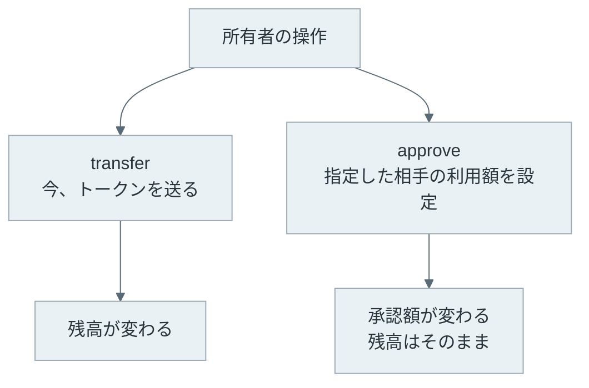
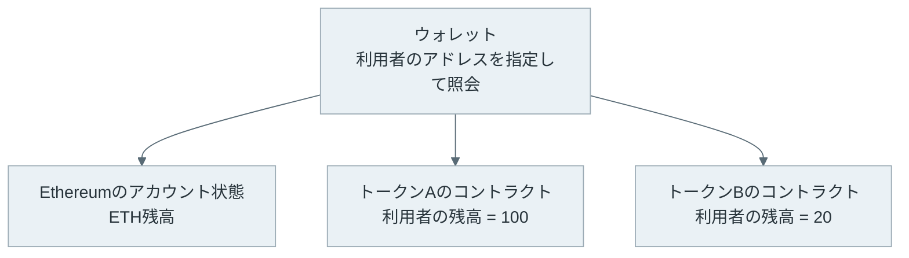
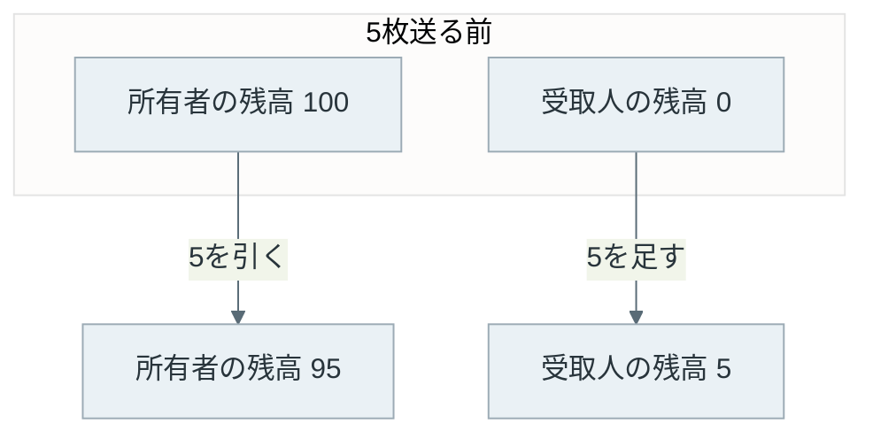
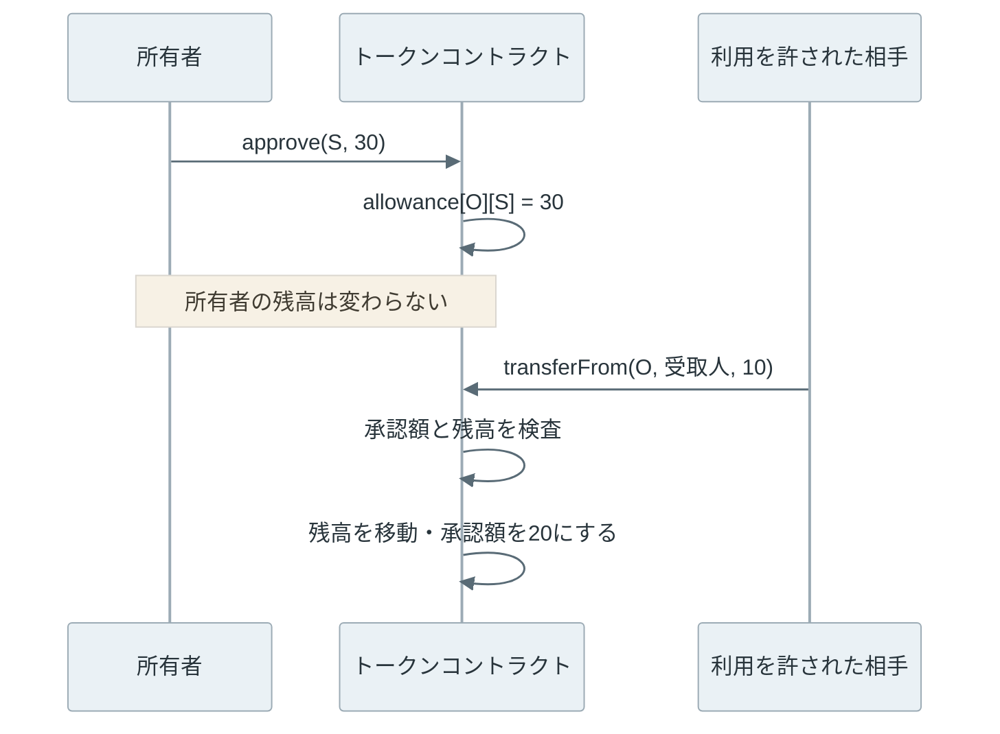
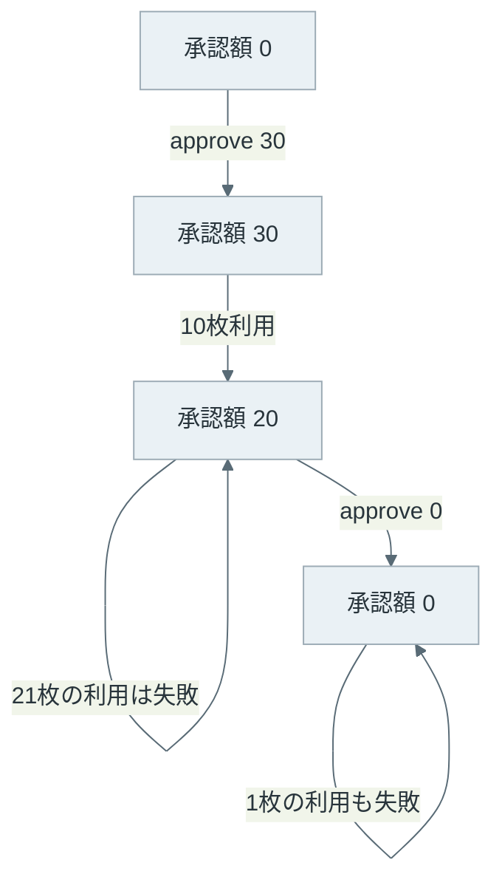

ERC-20は、Ethereum上のトークンについて、残高の照会や送金などの呼び出し方を揃える規格です。同じ種類のトークンを数量で扱い、1枚ごとに異なる識別子は付けません。ウォレットや交換サービスは、この共通の呼び出し方を使って複数のトークンに対応できます。

トークンを使うアプリでは、送金の前にApproveという操作を求められることがあります。これは、別のアドレスにトークンを使う権限を与える操作です。送金そのものとは、変更する記録が異なります。



本記事では、[Smart Contract](../smart-contract/)で説明したコードと保存状態の関係をトークンの実例で確認します。

- ETHとトークンの残高は、どこに記録されるのか。
- トークンを送ると、どの残高が変わるのか。
- Approveは、誰に何を許可する操作なのか。
- 承認額を超えた利用や、承認の取り消し後の利用はどうなるのか。

後半では、ローカルにテスト用トークンを作成し、残高と承認額の変化を追います。価格や投資判断、NFTの規格は扱いません。

---

### ETHとトークンの保存場所

ETHはEthereumのネイティブな資産で、アカウントの状態に残高があります。一方で、ERC-20の残高はトークンコントラクトが管理します。例えば、同じアドレスがトークンAを100枚、トークンBを20枚持つ場合、それぞれのコントラクトに残高が記録されます。



図の3つの残高は、ウォレットの画面では並んで表示されても、同じ場所から取得しているわけではありません。ETHの残高はノードのAPIで照会し、ERC-20の残高は対象コントラクトの `balanceOf(アドレス)` を呼んで取得します。

トークンを識別する時は、名前や略称だけでは不十分です。同じ名前のコントラクトを別の人が作成できるため、チェーンとコントラクトのアドレスを確認します。ウォレットにトークンを追加する操作は、多くの場合、この照会先を登録する操作です。

通常のERC-20送金では、取引の宛先は受取人ではなくトークンコントラクトです。受取人のアドレスと数量は `transfer` の引数に入ります。トークンの送金だけなら、取引の `value` にETHを入れる必要はありません。秘密鍵で操作する通常のアカウント（EOA: Externally Owned Account）が直接取引を送る場合は、gasの手数料を払うETHは別に必要です。

---

### 共通の関数と数量の単位

[ERC-20の仕様](https://eips.ethereum.org/EIPS/eip-20)は、残高の保存方法まで1つに固定する規格ではありません。アプリから呼び出す関数と、処理を通知するイベントを定めています。主な関数は次の通りです。

| 関数 | 役割 |
| --- | --- |
| `totalSupply()` | トークンの総供給量を取得 |
| `balanceOf(owner)` | 指定アドレスの残高を取得 |
| `transfer(to, amount)` | 呼び出した本人の残高から送金 |
| `approve(spender, amount)` | 指定した相手の承認額を設定 |
| `allowance(owner, spender)` | 所有者が相手に認めた残りの利用額を取得 |
| `transferFrom(from, to, amount)` | 承認された範囲で所有者の残高から送金 |

送金の記録には `Transfer`、承認の設定には `Approval` というイベントを使います。これらは、アプリが履歴を作る時などに利用できます。

名前を返す `name`、略称を返す `symbol`、表示上の小数桁数を返す `decimals` もよく使われますが、ERC-20では任意の項目です。すべてのトークンにあるとは限りません。

トークンの内部の数量は整数です。例えば `decimals = 6` なら、内部の1,000,000を画面では1枚と表示します。[OpenZeppelinのERC-20解説](https://docs.openzeppelin.com/contracts/5.x/erc20)でも、`decimals` は表示のための情報で、コントラクト内部の計算を小数演算に変えるものではないと説明しています。

本記事のサンプルは変化を追いやすくするため、`decimals = 0` にします。内部の数量と表示上の枚数が一致するので、30という値はそのまま30枚です。

---

### 所有者からの送金

典型的な実装では、アドレスごとの残高をmappingで持ちます。mappingは、キーから値を引くSolidityのデータ型です。`mapping(address => uint256)` なら、アドレスをキーとして整数の残高を取得できます。

サンプルの `transfer` は、呼び出した人を表す `msg.sender` の残高から、指定した宛先に数量を移します。以下は[StudyToken.sol](lab/StudyToken.sol)の抜粋です。

```solidity
function transfer(address to, uint256 amount) external returns (bool) {
    _transfer(msg.sender, to, amount);
    return true;
}

function _transfer(address from, address to, uint256 amount) internal {
    require(to != address(0), "zero recipient");
    require(balanceOf[from] >= amount, "balance");
    balanceOf[from] -= amount;
    balanceOf[to] += amount;
    emit Transfer(from, to, amount);
}
```

`require` は条件を満たさなければ実行を失敗させます。この例では、宛先がゼロアドレスでないことと、送り主の残高が十分であることを確かめます。ゼロアドレスは、値がすべて0のアドレスです。



本サンプルは、送金の前後で総供給量が変わりません。ファイルが受取人に移動するのではなく、同じコントラクト内で2つの残高を更新します。後の処理が失敗して取引全体がrevertすれば、片方の残高だけが減った状態は残りません。

---

### 利用承認と第三者による送金

交換サービスがユーザーのトークンを受け取り、別のトークンを返す場面では、サービス側のコントラクトからユーザーの残高を動かす必要があります。そのための仕組みが、`approve` と `transferFrom` です。

所有者は `approve(spender, amount)` を呼びます。`spender` は利用を許すアドレス、`amount` は利用を認める数量です。この操作で変わるのは、所有者とspenderの組み合わせに紐づく `allowance` です。残高は移動せず、その分が予約されるわけでもありません。



spenderはコントラクトでも、通常のアカウントでも構いません。トークンコントラクトから見た `msg.sender` が、承認を受けたアドレスかどうかで判定します。ユーザーが交換コントラクトを呼び、そのコントラクトがトークンを呼ぶ場合、トークンから見た呼び出し元は交換コントラクトです。

サンプルの承認と送金は次のように実装しています。残高を更新する `_transfer` は前の節と共通です。

```solidity
function approve(address spender, uint256 amount) external returns (bool) {
    allowance[msg.sender][spender] = amount;
    emit Approval(msg.sender, spender, amount);
    return true;
}

function transferFrom(address from, address to, uint256 amount)
    external returns (bool)
{
    require(allowance[from][msg.sender] >= amount, "allowance");
    allowance[from][msg.sender] -= amount;
    _transfer(from, to, amount);
    return true;
}
```

承認額は、送り先ではなく利用する相手に紐づきます。spenderは `transferFrom` の宛先を選べるため、承認画面では「誰に許可するか」が重要です。特定の受取人だけへの送金を許す機能は、この標準的な承認には含まれません。

また、承認額が30あっても、実際の残高が10しかなければ30は送れません。承認後に所有者自身が残高を使えるからです。本サンプルでは、承認額を減らした後に残高不足で失敗しても、その承認額の変更を含めて取り消されます。

---

### ローカルでの残高と承認額の変化

実験では、Anvil 1.7.1とSolidityコンパイラ0.8.28を使い、ローカルチェーンに `StudyToken` をデプロイします。Ethereumの実行規則はCancunに固定しています。デプロイしたアカウントに100枚を発行し、所有者、spender、受取人の3つのテスト用アカウントを使います。

`StudyToken` は、処理を追うために作成した学習用の実装です。本番の資産管理用として監査されたコードではありません。既存OSSを利用する場合は、[OpenZeppelin ContractsのERC20実装](https://github.com/OpenZeppelin/openzeppelin-contracts/blob/v5.0.2/contracts/token/ERC20/ERC20.sol)などで、エラー処理や拡張方法を確認できます。

再現用のファイルは[lab/README.txt](lab/README.txt)にまとめています。`anvil`、`cast`、`solc`をPATHに置き、リポジトリのルートから実行します。

```bash
bash content/notes/blockchain-systems/erc-20/lab/run.sh
```

このスクリプトは、Smart Contractのノートの実験ランナーを共有しています。独自に起動したローカルノードだけを操作し、終了時に停止します。以下は、実際の[出力](lab/output/summary.txt)です。

```text
stage | owner | receiver | allowance | status
initial | 100 | 0 | 0 | -
transfer 5 | 95 | 5 | 0 | 1
approve 30 | 95 | 5 | 30 | 1
spend 10 | 85 | 15 | 20 | 1
overspend 21 | 85 | 15 | 20 | 0
revoke | 85 | 15 | 0 | 1
spend after revoke | 85 | 15 | 0 | 0
Assertions: PASS
```

最初に、所有者本人が `transfer` で5枚送っています。その後で30枚を承認しても、所有者の残高95と受取人の残高5は変わりません。

spenderが10枚を送ると、所有者の残高は85、受取人は15、残りの承認額は20になります。次に21枚を使おうとした取引は失敗しました。所有者の残高は足りていますが、承認額を超えているからです。

所有者が `approve(spender, 0)` を実行すると、残りの承認額は0になります。その後の1枚の送金も失敗し、両者の残高は変わりません。`status = 0` の行もブロックに送った取引で、送信者は手数料を払います。取り消し操作そのものも取引です。



この図の数量の減り方は、本サンプルの実装に対応しています。実装によっては最大整数を無制限の承認として扱い、利用しても承認額を減らしません。例えば、上記のOpenZeppelin Contracts v5.0.2では、その場合を `_spendAllowance` で特別に扱っています。

---

### 承認の変更と取り消しの範囲

`approve` は、現在の承認額に追加する操作ではありません。新しい値で上書きします。現在20なら `approve(spender, 5)` の後は5で、25にはなりません。

承認額を変更する取引がまだブロックに入っていない間は、古い承認が使われる可能性があります。例えば30から10に変更する前にspenderが30を使い、その後で新しい10の承認が成立すると、合計40を使える状況になります。ERC-20の仕様は、この問題を踏まえて、ユーザーインターフェースでいったん0に変更してから新しい値を設定する方法を挙げています。

0にする操作も即座には確定しません。取り消しを待つ間に利用される可能性があり、すでに完了した送金を巻き戻すこともできません。実際の利用履歴と取り消しの成立を確認してから、必要な承認を改めて設定します。

承認はトークン、所有者、spenderごとの記録です。あるアプリへの承認を取り消しても、別のトークンや別のspenderへの承認は残ります。ウォレットの接続解除だけで、チェーン上の承認が消えるわけでもありません。

---

### 共通規格の利点と実装差

ERC-20が揃えるのは、アプリが呼び出す基本的な操作です。トークンごとに残高取得や送金のAPIを覚え直さずに済み、ウォレットやコントラクトを組み合わせやすくなります。

一方で、同じ関数名があっても、発行権限、停止権限、送金時の手数料、実装の更新権限などは異なります。ERC-20への対応は、価値の裏付けや管理者の行動を保証するものではありません。

呼び出し側の実装にも注意が必要です。ERC-20は送金などの結果として `false` を返す場合を想定しています。本サンプルは失敗時にrevertしますが、すべてのトークンが同じとは限りません。呼び出しがrevertしなかっただけで、送金が成功したと判断してはいけません。[OpenZeppelinのSafeERC20](https://docs.openzeppelin.com/contracts/5.x/api/token/erc20#SafeERC20)は、返り値がfalseのケースや返り値のないトークンなどの差を扱うためのライブラリです。

利用時には、残高だけでなく、利用を認めた相手と承認額も資産管理の対象になります。秘密鍵を守ることと、コントラクトに渡す権限を確かめることの両方が必要です。
