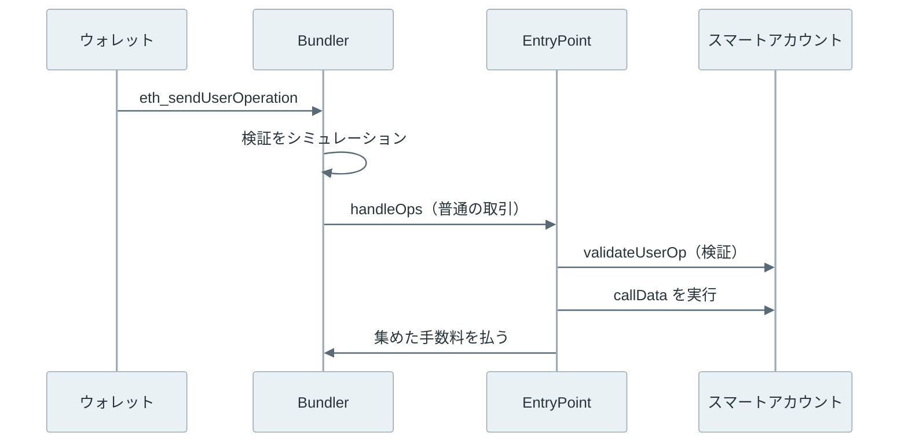

[ERC-4337](https://eips.ethereum.org/EIPS/eip-4337) は、Ethereum のプロトコルを変えずに、スマートコントラクトのアカウントを取引の送り主のように使えるようにする規格です。署名の検証方法をアカウントのコードで決められるので、複数人の承認や鍵の差し替えを組み込めます。手数料を別の誰かに肩代わりしてもらうこともできます。

例えば、[ERC-20](../erc-20/) のトークンである [USDC](https://www.circle.com/usdc)（米ドルに連動するステーブルコイン）だけを持ち、ETH を 1 wei も持たないアドレスからは、通常は USDC を送れません。取引の手数料は送り主が ETH で払う決まりだからです。ERC-4337 では、この送金を「UserOperation」という取引とは別の形式で出し、第三者がまとめて 1 件の普通の取引としてチェーンに載せます。



上記の図の灰色の層は、従来の Ethereum と何も変わりません。チェーンから見えるのは、Bundler という EOA が EntryPoint というコントラクトを呼ぶ普通の取引だけです。

<br>

本記事では、ローカルの実験で確かめながら、ERC-4337 の部品と処理の流れを説明します。軸になるのは次の疑問です。

- ERC-4337 は、EOA の何を解決するのか。
- UserOperation は、誰がどうやってチェーンに載せるのか。
- 検証で使える処理が制限されているのは、なぜか。
- スマートアカウントの手数料は、誰が払うのか。
- まだ存在しないアカウントのアドレスに、なぜ送金できるのか。
- EIP-7702 とは、どういう関係にあるのか。

アカウントの状態や nonce は [Ethereum Account Model](../ethereum-account-model/)、取引の項目と手数料の計算は [Ethereum Transaction](../ethereum-transaction/) を前提にします。

---

### アカウント抽象化が必要な理由

EOA（Externally Owned Account）の取引は、プロトコルが決めた 1 通りの方法で検証されます。secp256k1 の署名から送り主を復元し、nonce と ETH の残高を確かめます。そのため、次のことは EOA だけではできません。

| EOA の決まり | 困る場面 |
| --- | --- |
| 1 つの秘密鍵の署名だけを受け付ける | 鍵を失うと資産を取り戻せない。2 人の承認を必須にできない |
| 手数料は送り主が ETH で払う | ETH を持たない新しい利用者は、最初の操作ができない |
| 1 件の取引で呼べる宛先は 1 つ | `approve` と交換を 1 回でまとめられない |

アカウント抽象化（account abstraction）は、検証と手数料の払い方をプロトコルの固定の規則から外し、アカウント自身のコードに任せる考え方です。[Wallet](../wallet/) で触れたスマートアカウントや [マルチシグ](../multisig/) は、この考え方をコントラクトで実現しています。しかし、従来のスマートアカウントは取引を起こせないので、誰かの EOA が呼び出す必要がありました。

<br>

ERC-4337 は Ethereum のプロトコルを変えた、と思うかもしれません。しかし、仕様の Abstract が述べる通り、ERC-4337 はコンセンサス層の変更を完全に避けています。取引の型を足す代わりに、UserOperation を別の mempool（未確定の要求の置き場）で配り、EntryPoint というコントラクトで処理します。

ERC はアプリケーション層の規格の分類で、ERC-4337 は 2021 年 9 月に提案され、2026 年 6 月に Final になりました（[ethereum/ERCs の変更履歴](https://github.com/ethereum/ERCs/commits/master/ERCS/erc-4337.md)）。

---

### UserOperation と部品

UserOperation は、アカウントにさせたい操作を表す構造体です。取引に似た項目（送り主・nonce・呼び出しデータ・手数料の上限・署名）に加えて、アカウントを作るための `initCode` や、手数料を肩代わりする Paymaster の指定を持ちます。`signature` の中身はプロトコルではなく、アカウントのコードが解釈します。

UserOperation を受け取ってからチェーンに載るまでには、次の部品が関わります。

| 部品 | 役割 |
| --- | --- |
| スマートアカウント | `validateUserOp` で署名を検証し、操作を実行するコントラクト |
| Bundler | UserOperation を集め、`handleOps` を呼ぶ取引を EOA から送るノード |
| EntryPoint | 全てのアカウントが共有するコントラクト。検証と実行を順に呼ぶ |
| Factory | まだ無いアカウントを作るコントラクト |
| Paymaster | 手数料を肩代わりするかを判断するコントラクト |
| Aggregator | 複数の UserOperation の署名をまとめて 1 回で検証するコントラクト |
| UserOperation mempool | Bundler どうしが UserOperation を交換する P2P のネットワーク |

以下は、1 件の UserOperation がチェーンに載るまでの流れです。



上記の図で、ウォレットが Bundler に渡すのは取引ではありません。チェーンに載る取引の送り主は Bundler で、UserOperation はその呼び出しデータの中に入ります。

---

### 検証と実行の分離

EntryPoint の `handleOps` は、ループを 2 回回します。1 回目は全ての UserOperation の検証で、必要ならアカウントを作り、`validateUserOp` を呼び、手数料の前払いを受け取ります。2 回目で、検証を通った UserOperation の `callData` を実行します。

2 つを分けるのは、手数料を誰が負担するかが検証の結果で変わるからです。検証で失敗した UserOperation は手数料を払いません。`handleOps` は `FailedOp` で取引ごと失敗し、その取引のガス代は Bundler の損になります。Bundler は送る前に検証を手元でシミュレーションし、通ったものだけを載せます。

<br>

しかし、シミュレーションで通った検証が、ブロックに入った時にも通るとは限りません。例えば、検証のコードが `block.timestamp` を読むと、シミュレーションとブロックでは値が違います。1 件の取引で多数のアカウントが共通に読む値を書き換えれば、mempool の UserOperation をまとめて無効にでき、Bundler に無料で計算をさせる攻撃になります。

そのため、[ERC-7562](https://eips.ethereum.org/EIPS/eip-7562) が検証の段階で使える処理を制限しています（2026 年 11 月時点の状態は Review）。例えば、`TIMESTAMP` や `BLOCKHASH` のように環境を読む命令は使えず、読み書きできる記憶領域も、原則としてアカウント自身のものと、外部のコントラクトにあるそのアカウントに紐づく値に限られます。

ETH を担保として預けた（stake した）Paymaster と Factory には、もう少し広い範囲が認められます。禁止される命令、記憶領域の範囲、stake と評判（reputation）の仕組みは [ERC-7562](../erc-7562/) のノートで説明します。

制限が掛かるのは検証だけで、実行の段階では任意のコードが動きます。規則を破った UserOperation は mempool から外されます。規則を緩めた別の mempool（alternative mempool）を作る道も仕様は残しています。

---

### 手数料を払う主体

ETH を持たないアカウントの UserOperation でも、チェーンに載る以上はガス代が掛かります。チェーンに載るのは Bundler の取引なので、ガス代はまず Bundler の EOA が ETH で払います。EntryPoint v0.9.0 の `handleOps` は、呼び出し元が `tx.origin` と一致し、コードを持たないことを確かめます（[EntryPoint.sol](https://github.com/eth-infinitism/account-abstraction/blob/v0.9.0/contracts/core/EntryPoint.sol)）。

Bundler の負担は、EntryPoint が後で返します。EntryPoint は、アカウントか Paymaster が預けた ETH（deposit）から使った分を引き、`handleOps` の引数 `beneficiary` に払います。払う側は次のどちらかです。

| UserOperation の指定 | 手数料を払う主体 |
| --- | --- |
| Paymaster なし | アカウント自身。検証の中で不足分を EntryPoint に前払いし、余りは deposit に残る |
| Paymaster あり | Paymaster の deposit。代わりに USDC を受け取る、アプリの運営者が負担する、などは Paymaster のコードで決める |

つまり、手数料が消えるわけではなく、ETH で払う主体が利用者からほかの誰かに移るだけです。Paymaster は、自分の deposit を減らす相手を選ぶ必要があるので、署名した承認やトークンの支払いを `validatePaymasterUserOp` で確かめます。

<br>

EntryPoint が測れないガスもあります。Bundler の取引の基本料 21,000 を束ねた UserOperation の数で割った分や、UserOperation を呼び出しデータとして載せる分です。これは UserOperation の `preVerificationGas` に書き、アカウントや Paymaster が一緒に払います。低すぎる値の UserOperation は Bundler の赤字になるので、受け取られません。

---

### 作る前から決まるアドレス

EOA が `CREATE` で作るコントラクトは、作る側の nonce でアドレスが変わるので、先に別の取引を出すと予定のアドレスからずれます。ERC-4337 の Factory は `CREATE2` を使い、アドレスは次の式で作る前から決まります。

```text
address = keccak256(0xff ‖ factory ‖ salt ‖ keccak256(creationCode))[12:]
```

`creationCode` は、作るコントラクトの生成用のコードです。実験で使う SimpleAccountFactory では、アカウントの初期化に渡す所有者のアドレスもここに入ります。そのため、別の人が先回りして同じアドレスにアカウントを作っても、所有者を自分に変えることはできません。仕様も、アドレスが最初の署名者に依存するよう求めています。

<br>

ウォレットはこのアドレスを先に利用者に見せ、ETH やトークンを受け取れるようにします。アドレスに残高はあっても、まだコードはありません。最初の UserOperation の `initCode` に Factory のアドレスと `createAccount` の呼び出しを入れておくと、EntryPoint は検証の前にアカウントを作ります。

`initCode` を呼ぶのは EntryPoint ではなく、専用の SenderCreator というコントラクトです。`initCode` には任意の宛先を書けるので、EntryPoint から呼ぶと、EntryPoint からの呼び出しを無条件に信頼するアカウントや Paymaster を操作できてしまいます。Factory も、呼び出し元が SenderCreator であることを確かめます。

---

### ローカルでの UserOperation 実験

実験では、[Foundry](https://github.com/foundry-rs/foundry) のローカル開発用ノードである [Anvil](https://getfoundry.sh/anvil/overview) 1.7.1（実行規則は Prague）に、[eth-infinitism/account-abstraction](https://github.com/eth-infinitism/account-abstraction/tree/v0.9.0) の v0.9.0（コミット `b36a1ed`）から EntryPoint、[SimpleAccount](https://github.com/eth-infinitism/account-abstraction/blob/v0.9.0/contracts/accounts/SimpleAccount.sol) と Factory、テスト用の Paymaster をデプロイします。

コンパイラは [solc 0.8.28](https://github.com/argotorg/solidity/releases/tag/v0.8.28) で、設定はリポジトリの [Hardhat](https://hardhat.org/) の設定に合わせています。依存する [OpenZeppelin Contracts](https://github.com/OpenZeppelin/openzeppelin-contracts/tree/v5.1.0) は v5.1.0 です。

ライセンスは EntryPoint とテスト用 Paymaster が GPL-3.0、SimpleAccount と Factory が MIT です。ソースは本記事のリポジトリに複製せず、実行時に固定したコミットを取得します。`TestPaymasterAcceptAll` は無条件に手数料を払う試験用のコントラクトで、本番には使えません。

Bundler のソフトウェアと UserOperation の mempool は使いません。スクリプトが UserOperation を組み立て、テスト用の EOA から `handleOps` を直接呼んで Bundler の役を代わります。鍵は Anvil の公開されたテスト用のニーモニックから作ったものだけで、所有者の鍵には ETH を一度も入れません。

以下は、UserOperation を作って署名し、`handleOps` を送る部分の抜粋です。[`cast`](https://getfoundry.sh/cast/overview) は Foundry の CLI、`call` は読み取りの呼び出し、`send` は取引の送信、`entry_point` と `sender` はデプロイ済みの EntryPoint と、作る前のアカウントのアドレスです。

```python
def user_op(nonce, to, init=b'', pm='0x'):
    return {'sender': sender, 'nonce': nonce, 'initCode': init or '0x',
            'callData': cast('calldata', 'execute(address,uint256,bytes)', to, ETH // 100, '0x'),
            'accountGasLimits': u128x2(400_000, 60_000),   # verificationGasLimit, callGasLimit
            'preVerificationGas': 50_000,
            'gasFees': u128x2(2 * GWEI, 2 * GWEI),          # maxPriorityFeePerGas, maxFeePerGas
            'paymasterAndData': pm, 'signature': '0x'}


def sign(op, key):
    op['signature'] = '0x'
    h = call(entry_point, f'getUserOpHash({OP_TYPE})(bytes32)', op_tuple(op))
    # SimpleAccount v0.9 recovers the signer from the raw EIP-712 userOpHash.
    op['signature'] = cast('wallet', 'sign', '--no-hash', '--private-key', key, h)
    return h

# Bundler role: a funded test EOA calls handleOps directly.
r = send(bundler, handle_ops(o, bundler), entry_point, gas=3_000_000)
```

署名の対象 `userOpHash` は、`signature` 以外の全項目と chain ID、EntryPoint のアドレスから作る [EIP-712](../eip-712/) の型付きハッシュです。起動・デプロイ・残高の検査を含む全体は以下です。

<details>
<summary>run.py の全体（268 行）</summary>

```python
#!/usr/bin/env python3
"""Local-only ERC-4337 experiment (EntryPoint v0.9.0). Run through run.sh.

The script plays the bundler itself: it builds UserOperations and calls
EntryPoint.handleOps directly from a funded test EOA. No bundler software,
no alt mempool, no external RPC. Keys are Anvil's public test mnemonic only.
"""
import json
import os
from pathlib import Path
import shutil
import socket
import subprocess
import time
import urllib.request

HERE = Path(__file__).resolve().parent
OUT = HERE / 'output'
OUT.mkdir(exist_ok=True)
TOOLS = {n: os.environ.get(n.upper(), shutil.which(n)) for n in ('anvil', 'cast')}
if not all(TOOLS.values()):
    raise SystemExit('Put anvil and cast on PATH (or set ANVIL, CAST).')
BUILD = json.loads(Path(os.environ['BUILD']).read_text())['contracts']
MNEMONIC = 'test test test test test test test test test test test junk'  # Anvil default, public
GWEI = 10**9
ETH = 10**18
OP_TYPE = '(address,uint256,bytes,bytes,bytes32,uint256,bytes32,bytes,bytes)'


def cast(*args):
    return subprocess.check_output([TOOLS['cast'], *map(str, args)], text=True).strip()


def artifact(suffix):
    return next(v for k, v in BUILD.items() if k.endswith(suffix))


with socket.socket() as s:
    s.bind(('127.0.0.1', 0))
    port = s.getsockname()[1]
URL = f'http://127.0.0.1:{port}'


def rpc(method, *params):
    body = json.dumps({'jsonrpc': '2.0', 'id': 1, 'method': method, 'params': params}).encode()
    req = urllib.request.Request(URL, body, {'Content-Type': 'application/json'})
    with urllib.request.urlopen(req, timeout=10) as r:
        res = json.load(r)
    if 'error' in res:
        raise RuntimeError(res['error'])
    return res['result']


def send(sender, data, to=None, value=0, gas=15_000_000):
    # Legacy gasPrice keeps the bundler's price fixed at 2 gwei in every block.
    tx = {'from': sender, 'data': data, 'value': hex(value), 'gas': hex(gas), 'gasPrice': hex(2 * GWEI)}
    if to:
        tx['to'] = to
    h = rpc('eth_sendTransaction', tx)
    for _ in range(200):
        r = rpc('eth_getTransactionReceipt', h)
        if r:
            assert int(r['status'], 16) == 1, r
            return r
        time.sleep(0.05)
    raise TimeoutError(h)


def deploy(sender, suffix, *ctor):
    a = artifact(suffix)
    args = cast('abi-encode', 'f(address)', *ctor)[2:] if ctor else ''
    return send(sender, '0x' + a['bin'] + args)['contractAddress']


def call(to, sig, *args):
    return cast('call', '--rpc-url', URL, to, sig, *args)


def balance(addr):
    return int(rpc('eth_getBalance', addr, 'latest'), 16)


def u128x2(hi, lo):  # two uint128 packed into one bytes32
    return '0x' + f'{hi:032x}{lo:032x}'


def op_tuple(op):
    return '(' + ','.join(str(op[k]) for k in (
        'sender', 'nonce', 'initCode', 'callData', 'accountGasLimits',
        'preVerificationGas', 'gasFees', 'paymasterAndData', 'signature')) + ')'


def sign(op, key):
    op['signature'] = '0x'
    h = call(entry_point, f'getUserOpHash({OP_TYPE})(bytes32)', op_tuple(op))
    # SimpleAccount v0.9 recovers the signer from the raw EIP-712 userOpHash.
    op['signature'] = cast('wallet', 'sign', '--no-hash', '--private-key', key, h)
    return h


def handle_ops(op, beneficiary):
    data = cast('calldata', f'handleOps({OP_TYPE}[],address)', f'[{op_tuple(op)}]', beneficiary)
    return data


def frames(txhash):
    """Gas of the call frames that ERC-4337 splits into validation and execution."""
    trace = rpc('debug_traceTransaction', txhash, {'tracer': 'callTracer'})
    names = {cast('sig', s): s.split('(')[0] for s in (
        'createSender(bytes)', 'validateUserOp(' + OP_TYPE + ',bytes32,uint256)',
        'validatePaymasterUserOp(' + OP_TYPE + ',bytes32,uint256)',
        'execute(address,uint256,bytes)')}
    found = {}

    def walk(f):
        name = names.get(f.get('input', '')[:10])
        if name and name not in found:
            found[name] = int(f['gasUsed'], 16)
        for c in f.get('calls', []):
            walk(c)
    walk(trace)
    return found


def user_op_event(receipt):
    topic = cast('sig-event', 'UserOperationEvent(bytes32,address,address,uint256,bool,uint256,uint256)')
    log = next(l for l in receipt['logs'] if l['topics'][0] == topic)
    words = [int(log['data'][2 + i * 64: 2 + (i + 1) * 64], 16) for i in range(4)]
    return {'success': words[1], 'actualGasCost': words[2], 'actualGasUsed': words[3]}


lines = []
log = (OUT / 'node.log').open('w')
node = subprocess.Popen([TOOLS['anvil'], '--host', '127.0.0.1', '--port', str(port),
                         '--chain-id', '31337', '--hardfork', 'prague', '--timestamp', '1700000000',
                         '--accounts', '3', '--quiet'], stdout=log, stderr=log)
try:
    for _ in range(200):
        try:
            bundler, funder, pm_owner = rpc('eth_accounts')[:3]
            break
        except (OSError, RuntimeError):
            time.sleep(0.05)
    else:
        raise TimeoutError('Anvil startup')
    owner_key = cast('wallet', 'private-key', MNEMONIC, 5)    # never funded
    owner = cast('wallet', 'address', '--private-key', owner_key)
    other_key = cast('wallet', 'private-key', MNEMONIC, 6)    # not the owner

    entry_point = deploy(bundler, ':EntryPoint')
    factory = deploy(bundler, ':SimpleAccountFactory', entry_point)
    paymaster = deploy(pm_owner, ':TestPaymasterAcceptAll', entry_point)
    send(pm_owner, cast('calldata', 'deposit()'), paymaster, value=1 * ETH)

    # --- 1. Address before deployment (CREATE2) ---
    salt = 0
    implementation = call(factory, 'accountImplementation()(address)')
    init_args = cast('abi-encode', 'f(address,bytes)', implementation,
                     cast('calldata', 'initialize(address)', owner))
    proxy_init_code = '0x' + artifact(':ERC1967Proxy')['bin'] + init_args[2:]
    by_formula = cast('compute-address', factory, '--salt', f'0x{salt:064x}',
                      '--init-code-hash', cast('keccak', proxy_init_code)).split()[-1]
    by_factory = call(factory, 'getAddress(address,uint256)(address)', owner, salt)
    init_code = factory + cast('calldata', 'createAccount(address,uint256)', owner, salt)[2:]
    try:
        rpc('eth_call', {'to': entry_point, 'data': cast('calldata', 'getSenderAddress(bytes)', init_code)}, 'latest')
        raise AssertionError('getSenderAddress must revert')
    except RuntimeError as e:
        by_entry_point = cast('decode-error', '--sig', 'SenderAddressResult(address)', e.args[0]['data'])
    sender = by_factory
    assert by_formula.lower() == by_factory.lower() == by_entry_point.lower()
    assert rpc('eth_getCode', sender, 'latest') == '0x'
    send(funder, '0x', sender, value=ETH // 10)
    lines += ['# 1. counterfactual address',
              f'CREATE2 formula      : {by_formula}',
              f'factory.getAddress   : {by_factory}',
              f'getSenderAddress     : {by_entry_point}',
              f'code before          : {rpc("eth_getCode", sender, "latest")}  balance: {balance(sender) / ETH} ETH']

    recipients = [cast('wallet', 'address', '--private-key', cast('wallet', 'private-key', MNEMONIC, i)) for i in (7, 8, 9)]

    def user_op(nonce, to, init=b'', pm='0x'):
        return {'sender': sender, 'nonce': nonce, 'initCode': init or '0x',
                'callData': cast('calldata', 'execute(address,uint256,bytes)', to, ETH // 100, '0x'),
                'accountGasLimits': u128x2(400_000, 60_000),   # verificationGasLimit, callGasLimit
                'preVerificationGas': 50_000,
                'gasFees': u128x2(2 * GWEI, 2 * GWEI),          # maxPriorityFeePerGas, maxFeePerGas
                'paymasterAndData': pm, 'signature': '0x'}

    # --- 2. Broken signatures are rejected in validation ---
    lines.append('# 2. validation failures (eth_call to handleOps, nothing is mined)')
    op = user_op(0, recipients[0], init_code)
    sign(op, owner_key)
    tampered = dict(op, callData=cast('calldata', 'execute(address,uint256,bytes)', recipients[0], ETH, '0x'))
    wrong_key = dict(op)
    sign(wrong_key, other_key)
    for label, bad in (('value changed after signing', tampered), ('signed by another key', wrong_key)):
        try:
            rpc('eth_call', {'from': bundler, 'to': entry_point, 'data': handle_ops(bad, bundler)}, 'latest')
            raise AssertionError('must fail')
        except RuntimeError as e:
            err = cast('decode-error', '--sig', 'FailedOp(uint256,string)', e.args[0]['data']).splitlines()
            lines.append(f'{label:28}: FailedOp({err[0]}, {err[1]})')
    assert rpc('eth_getCode', sender, 'latest') == '0x'

    # --- 3. Three UserOperations: deploy + self-paid, self-paid, paymaster ---
    lines.append('# 3. handleOps sent by the bundler EOA (beneficiary = bundler)')
    pm_data = paymaster + f'{100_000:032x}{0:032x}'  # paymaster, verification gas, postOp gas
    cases = [('op1 initCode, self-paid', op),
             ('op2 self-paid', user_op(1, recipients[1])),
             ('op3 paymaster', user_op(2, recipients[2], pm=pm_data))]
    rows, gas_rows = [], []
    for i, (label, o) in enumerate(cases):
        if i:
            sign(o, owner_key)
        before = {'bundler': balance(bundler), 'sender': balance(sender),
                  'sender_deposit': int(call(entry_point, 'balanceOf(address)(uint256)', sender).split()[0]),
                  'pm_deposit': int(call(entry_point, 'balanceOf(address)(uint256)', paymaster).split()[0]),
                  'owner': balance(owner)}
        r = send(bundler, handle_ops(o, bundler), entry_point, gas=3_000_000)
        ev = user_op_event(r)
        assert ev['success'] == 1
        after = {'bundler': balance(bundler), 'sender': balance(sender),
                 'sender_deposit': int(call(entry_point, 'balanceOf(address)(uint256)', sender).split()[0]),
                 'pm_deposit': int(call(entry_point, 'balanceOf(address)(uint256)', paymaster).split()[0]),
                 'owner': balance(owner)}
        d = {k: after[k] - before[k] for k in before}
        tx_fee = int(r['gasUsed'], 16) * int(r['effectiveGasPrice'], 16)
        assert d['owner'] == 0 and balance(owner) == 0
        assert d['bundler'] == ev['actualGasCost'] - tx_fee
        if i == 2:
            assert d['sender'] == -ETH // 100 and d['sender_deposit'] == 0
            assert d['pm_deposit'] == -ev['actualGasCost']
        else:
            assert d['sender'] + d['sender_deposit'] == -ETH // 100 - ev['actualGasCost']
        f = frames(r['transactionHash'])
        g = lambda wei: f'{wei // GWEI:>+10}'  # all values are multiples of 1 gwei here
        rows.append(f"{label:24}| {g(d['sender'] + d['sender_deposit'])} | {g(d['pm_deposit'])} | "
                    f"{g(-tx_fee)} | {g(ev['actualGasCost'])} | {g(d['owner'])}")
        gas_rows.append(f"{label:24}| {int(r['gasUsed'], 16):>8} | {ev['actualGasUsed']:>8} | "
                        f"{f.get('createSender', 0):>8} | {f['validateUserOp']:>8} | "
                        f"{f.get('validatePaymasterUserOp', 0):>8} | {f['execute']:>8}")
        if i == 0:
            code_len = (len(rpc('eth_getCode', sender, 'latest')) - 2) // 2
            lines.append(f'code after op1       : {code_len} bytes at {sender}')
    lines.append('change in gwei          | sender     | paymaster  | bundler    | bundler    | owner')
    lines.append('                        | ETH+deposit| deposit    | tx fee     | received   | EOA')
    lines += rows
    # --- 4. Baseline: plain EOA transfer of the same 0.01 ETH to a fresh address ---
    fresh = cast('wallet', 'address', '--private-key', cast('wallet', 'private-key', MNEMONIC, 10))
    base = send(funder, '0x', fresh, value=ETH // 100, gas=21_000)
    lines.append('# 4. gas (tx = handleOps receipt gasUsed, op = UserOperationEvent.actualGasUsed)')
    lines.append('case                    | tx gas   | op gas   | create   | validate | pm valid | execute')
    lines += gas_rows
    lines.append(f"{'EOA transfer (baseline)':24}| {int(base['gasUsed'], 16):>8} |")
    lines.append('Assertions: PASS')
    summary = '\n'.join(lines) + '\n'
    (OUT / 'summary.txt').write_text(summary)
    (OUT / 'versions.txt').write_text('\n'.join(
        subprocess.check_output([t, '--version'], text=True).splitlines()[0] for t in TOOLS.values()) + '\n')
    print(summary, end='')
finally:
    node.terminate()
    try:
        node.wait(timeout=5)
    except subprocess.TimeoutExpired:
        node.kill()
    log.close()
```

</details>

```bash
bash content/notes/blockchain-systems/erc-4337/lab/run.sh
```

実行すると、4 段に分かれた[出力](lab/output/summary.txt)が出ます。手順は [lab/README.txt](lab/README.txt) にまとめています。

<details>
<summary>summary.txt の全体</summary>

```text
# 1. counterfactual address
CREATE2 formula      : 0xD34A413E5659cCDc5f14B5DDb5e8c3C232E4EA21
factory.getAddress   : 0xD34A413E5659cCDc5f14B5DDb5e8c3C232E4EA21
getSenderAddress     : 0xD34A413E5659cCDc5f14B5DDb5e8c3C232E4EA21
code before          : 0x  balance: 0.1 ETH
# 2. validation failures (eth_call to handleOps, nothing is mined)
value changed after signing : FailedOp(0, "AA24 signature error")
signed by another key       : FailedOp(0, "AA24 signature error")
# 3. handleOps sent by the bundler EOA (beneficiary = bundler)
code after op1       : 141 bytes at 0xD34A413E5659cCDc5f14B5DDb5e8c3C232E4EA21
change in gwei          | sender     | paymaster  | bundler    | bundler    | owner
                        | ETH+deposit| deposit    | tx fee     | received   | EOA
op1 initCode, self-paid |  -10597632 |         +0 |    -585516 |    +597632 |         +0
op2 self-paid           |  -10248598 |         +0 |    -234634 |    +248598 |         +0
op3 paymaster           |  -10000000 |    -241398 |    -228528 |    +241398 |         +0
# 4. gas (tx = handleOps receipt gasUsed, op = UserOperationEvent.actualGasUsed)
case                    | tx gas   | op gas   | create   | validate | pm valid | execute
op1 initCode, self-paid |   292758 |   298816 |   141089 |    33547 |        0 |    35768
op2 self-paid           |   117317 |   124299 |        0 |    22929 |        0 |    35768
op3 paymaster           |   114264 |   120699 |        0 |    11425 |      498 |    35768
EOA transfer (baseline) |    21000 |
Assertions: PASS
```

</details>

1 段目で、式・Factory・EntryPoint の 3 通りで計算したアドレスが一致し、コードが空のまま 0.1 ETH を受け取っています。



op1 の後、同じアドレスに 141 バイトのコード（OpenZeppelin の [ERC1967Proxy](https://github.com/OpenZeppelin/openzeppelin-contracts/blob/v5.1.0/contracts/proxy/ERC1967/ERC1967Proxy.sol)）が置かれました。SimpleAccount の本体は Factory が作った別のアドレスにあり、アカウントのアドレスにあるのは、処理を本体に委ねる[プロキシ](../upgradeable-proxy/)です。

2 段目は、署名した後に送金額を 0.01 ETH から 1 ETH に書き換えた場合と、所有者以外の鍵で署名した場合です。どちらも検証で `AA24 signature error` になり、アカウントは作られません。ちなみに、`AA2` で始まるコードはアカウントの検証での失敗を表します。

```text
value changed after signing : FailedOp(0, "AA24 signature error")
signed by another key       : FailedOp(0, "AA24 signature error")
```

<br>

3 段目の各行は 0.01 ETH の送金で、所有者の EOA の残高は全ての行で 0 のままです。op1 と op2 では、アカウントの残高と deposit の合計が、送金額に加えて手数料（op1 は 298,816 gas × 2 gwei = 597,632 gwei）だけ減りました。op3 では、アカウントは送金額しか減らず、手数料は Paymaster の deposit から引かれています。

以下は、3 段目の UserOperation の手数料と、Bundler 自身が払った取引のガス代を並べたグラフです。手数料の棒は、払った主体で色を分けています。



どの行も、Bundler は取引のガス代を ETH で払い、それより少し多い額を EntryPoint から受け取っています。差額は、実験で `preVerificationGas` に置いた 50,000 が、EntryPoint の測れない部分より大きかったからです。

以下は、4 段目のガスを処理ごとに分けたグラフです。



作成を含まない op2 でも、EOA の送金の約 5.6 倍、op3 で約 5.4 倍です。実行の 35,768 には、使われていないアドレスに ETH を送る `CALL` の追加分 25,000 が含まれます。EOA が取引で同じ送金をする時には、この追加分は掛かりません。op3 の検証が op2 より軽いのは、アカウントが EntryPoint に前払いの ETH を送らないからです。

---

### EIP-7702 との関係

[EIP-7702](https://eips.ethereum.org/EIPS/eip-7702) は、2025 年 5 月 7 日の Pectra（[Ethereum Foundation の告知](https://blog.ethereum.org/2025/04/23/pectra-mainnet)）で有効になった、EOA にコントラクトのコードを委任する仕組みです。委任の書き方と nonce の扱いは [Ethereum Account Model](../ethereum-account-model/) で説明しました。ERC-4337 とは競合せず、次のように組み合わせて使います。

| | ERC-4337 だけ | EIP-7702 で委任した EOA |
| --- | --- | --- |
| アドレス | 新しいアカウントのアドレス。資産の移動が必要 | 今の EOA のアドレスのまま |
| 鍵の扱い | 所有者の鍵や承認の条件はアカウントのコードが決め、差し替えもできる | EOA の元の秘密鍵が、委任後も取引に署名でき、委任先も変えられる |
| 変わる層 | コントラクトと別の mempool だけ | プロトコル（新しい取引の型） |

EntryPoint v0.8 以降は、委任済みの EOA を UserOperation の送り主として扱えます。`initCode` の先頭を `0x7702` の目印にすると、EntryPoint は委任先のアドレスを `userOpHash` に含めます。

Bundler は、UserOperation に付いた委任の承認を EIP-7702 の取引の型で一緒に送ります。EOA でも Paymaster と Bundler の仕組みを使えるようになる一方で、元の鍵が漏れると、委任先のコードに関係なく資産を動かされる点は変わりません。

---

### EntryPoint のバージョン

アカウントは信頼する EntryPoint のアドレスをコードに持つので（SimpleAccount では `immutable`）、EntryPoint のバージョンを変えるにはアカウントの更新が必要です。以下は、eth-infinitism のリリースノート（2026 年 11 月時点、最新は v0.9.0）を元にした比較です。

| バージョン | リリース | 主な変更 | Mainnet のアドレス |
| --- | --- | --- | --- |
| [v0.6](https://github.com/eth-infinitism/account-abstraction/releases/tag/v0.6.0) | 2023 年 4 月 | nonce を EntryPoint で管理、userOpHash の計算を変更 | `0x5FF137D4b0FDCD49DcA30c7CF57E578a026d2789` |
| [v0.7](https://github.com/eth-infinitism/account-abstraction/releases/tag/v0.7.0) | 2024 年 2 月 | チェーン上の形式を PackedUserOperation に変更、未使用ガスへの 10% の罰金、検証の規則を ERC-7562 に分離 | `0x0000000071727De22E5E9d8BAf0edAc6f37da032` |
| [v0.8](https://github.com/eth-infinitism/account-abstraction/releases/tag/v0.8.0) | 2025 年 3 月 | EIP-7702 への対応、userOpHash を EIP-712 の形式に変更 | `0x4337084d9e255ff0702461cf8895ce9e3b5ff108` |
| [v0.9](https://github.com/eth-infinitism/account-abstraction/releases/tag/v0.9.0) | 2025 年 11 月 | Paymaster の署名を後から付けられる、既存のアカウントでは initCode を無視 | `0x433709009B8330FDa32311DF1C2AFA402eD8D009` |

v0.6 と v0.7 では構造体の形が違い、ABI（Application Binary Interface、関数の呼び出し形式）に互換性がありません。v0.9 は v0.7・v0.8 と ABI の互換があり、既存の関数は変えずに関数やイベントを足しています。ただし、v0.8 で userOpHash の計算が変わったので、署名を作る側は合わせる必要があります。

アドレスはリリースノートに載っている値で、v0.9.0 のリリースノートは使う前に監査報告のアドレスとコードのハッシュを確かめるよう警告しています。

---

### 利点

- プロトコルを変えずに、署名の方式・複数人の承認・鍵の差し替えをアカウントごとに決められる
- Paymaster で、ETH を持たない利用者の手数料を肩代わりできる
- アドレスを先に配り、最初の操作の時にアカウントを作れる
- 検証の規則を守る限り、誰でも Bundler になれる

---

### 欠点

- 同じ送金でも、EOA より多くのガスを使う（実験では作成なしで約 5.4〜5.6 倍）
- Bundler・mempool・Paymaster という、取引の外の仕組みに頼る
- 全てのアカウントが EntryPoint を信頼するので、EntryPoint の欠陥が全体に及ぶ
- 検証のコードに ERC-7562 の制限が掛かる。時刻は直接読めず、有効期間を返す形（validAfter・validUntil）でしか条件にできない。他のコントラクトの状態を広く読むには stake が必要

---

### 適さないケース

- 1 つの鍵で ETH を送るだけで、承認の方式も手数料の肩代わりも使わない場合。EOA の方が安く済む
- 既存の EOA のアドレスを変えずに機能を足したい場合。EIP-7702 の委任を先に検討する
- 検証に外部の価格など、他のコントラクトの変わりやすい状態を使いたい場合。検証ではなく実行の段階で確かめる設計にする
