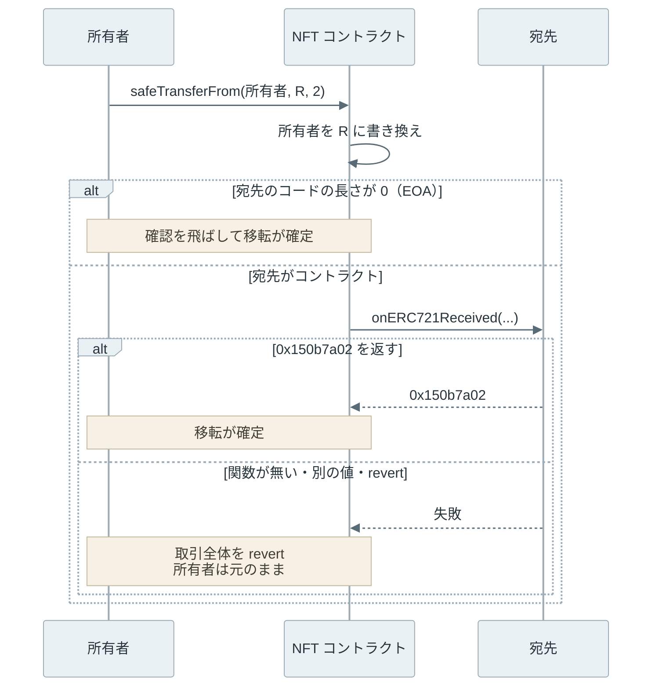

ERC-721 は、[Ethereum](https://ethereum.org/) 上で 1 つずつ区別できるトークンを扱うための規格です。このトークンは NFT（Non-Fungible Token、代替できないトークン）と呼ばれ、ゲームのアイテム、会員証、作品の所有証明などに使われます。

ここでのトークンは、[スマートコントラクト](../smart-contract/)（チェーン上に置かれ、取引で呼び出されるプログラム。以下、コントラクト）が記録する「誰が何を持っているか」の表です。チェーンは、取引をまとめたブロックを順につないだ記録で、参加するノードが同じ内容を持ちます。コントラクトの記録も、その一部として全員に共有されます。

ERC は、Ethereum の改善提案 [EIP](https://eips.ethereum.org/EIPS/eip-1)（Ethereum Improvement Proposal）のうち、コントラクトのインターフェース（関数の名前や引数）などアプリケーションの層の規格に付く分類で、721 は提案の番号です。[ERC-20](../erc-20/) がアドレス（アカウントの宛先）ごとの数量を記録するのに対して、ERC-721 は `tokenId` という番号ごとに所有者を記録します。

画面に表示される NFT には、画像や名前が付いています。しかし、ERC-721 のコントラクトが持っているのは、番号と所有者の対応と、説明の置き場所を指す [URI](https://www.rfc-editor.org/rfc/rfc3986)（Uniform Resource Identifier）の文字列です。以下は、NFT コントラクトが記録するものと、画像や説明の置き場所を分けた図です。



上記の図の右側は、チェーンの外にあります。チェーン上の所有の記録が変わらなくても、サーバーの JSON や画像は書き換えられることがあり、消えることもあります。

<br>

本記事では、ERC-20 との違いを軸に、ERC-721 の所有・移転・承認の仕組みを説明します。

- 数量ではなく番号で所有を記録すると、何が変わるのか。
- 受け取れない相手に送ると何が起きるのか。`safeTransferFrom` は何を確かめるのか。
- `approve` と `setApprovalForAll` は、それぞれ誰に何を許すのか。
- NFT の画像や説明は、どこに保存されているのか。

後半では、ローカルのチェーンに学習用の NFT をデプロイし、上記の 4 つを実行結果で確かめます。最後に、受け手の確認で引っかかりやすい場面と、ERC-1155 という別の規格との違いを扱います。価格や取引所の手数料、著作権の扱いは説明しません。

---

### 番号ごとの所有者

ERC-20 の残高は「アドレス → 数量」の対応で、同じトークンの 1 枚同士は区別しません。ERC-721 では、`uint256`（256 ビットの符号なし整数）の番号 `tokenId` が 1 つの資産を表し、「tokenId → 所有者」の対応を記録します。[ERC-721 の仕様](https://eips.ethereum.org/EIPS/eip-721)では、コントラクトのアドレスと `tokenId` の組が、チェーン上でその資産を一意に指す識別子です。

所有者は `ownerOf(tokenId)` で照会します。`balanceOf(owner)` もありますが、返すのは同じ種類のトークンの枚数ではなく、そのアドレスが持つ区別できる NFT が何個あるかです。どの番号を持っているかは、`balanceOf` からは分かりません。番号の振り方も規格は決めておらず、仕様は呼び出し側が番号に規則性を仮定しないよう求めています。

ERC-20 と並べると、主な違いは以下の通りです。

| 項目 | ERC-20 | ERC-721 |
| --- | --- | --- |
| 記録する対応 | アドレス → 数量 | tokenId → 所有者 |
| 所有の照会 | `balanceOf(owner)` で数量 | `ownerOf(tokenId)` で所有者 |
| 本人の送金 | `transfer(to, amount)` | 専用の関数は無く、`transferFrom` などを本人が呼ぶ |
| 第三者への許可 | `approve(spender, amount)` で数量 | `approve` で 1 つ、`setApprovalForAll` で全部 |
| 受け手の確認 | 規格に無い | `safeTransferFrom` が受け手のコントラクトを確かめる |

新しい NFT を作る発行（mint）と、消す焼却（burn）の関数は、ERC-20 と同じく規格に含まれていません。関数の名前や呼べる人は実装が決め、規格はその通知の仕方だけを決めています（後述のイベントの節）。

---

### 移転の 3 つの関数

ERC-721 で NFT を移す関数は、`transferFrom` と、引数の数が違う 2 つの `safeTransferFrom` です。ERC-20 の `transfer` に相当する本人専用の関数は無く、所有者も `transferFrom(自分, 宛先, tokenId)` を呼びます。引数が 4 つの `safeTransferFrom` は、宛先に渡す任意のバイト列 `data` を足したものです。

`transferFrom` は、呼び出し元が所有者か、所有者から許可を受けた相手（後述の承認の節）であれば、宛先を確かめずに所有者を書き換えます。仕様のコメントには、次の注意があります。

> THE CALLER IS RESPONSIBLE TO CONFIRM THAT `_to` IS CAPABLE OF RECEIVING NFTS OR ELSE THEY MAY BE PERMANENTLY LOST

（宛先が NFT を受け取れることを確かめる責任は呼び出し側にあり、確かめなければ NFT が永久に失われ得る）

<br>

#### 受け取れない宛先

Ethereum のアカウントには、秘密鍵で取引に署名する EOA（Externally Owned Account）と、コードを持つコントラクトの 2 種類があります（[Ethereum Account Model](../ethereum-account-model/#eoa-とコントラクトアカウント)）。EOA のコードの長さは 0 で、コントラクトは 1 バイト以上のコードを持ちます。

NFT を動かせるのは、所有者と許可を受けた相手が `msg.sender`（その関数の呼び出し元）として呼んだ時だけです。所有者がコントラクトになると、そのコントラクトのコードが `transferFrom` や `approve` を呼ばない限り、誰も動かせません。以下は、NFT を扱うコードを持たないコントラクト（後半の実験の `Counter`）に #1 を送った後の図です。



元の所有者の alice が秘密鍵を持っていても、呼び出し元は alice のアドレスです。`Counter` のアドレスとして呼び出す方法は無いので、#1 は取り戻せません。

<br>

#### safeTransferFrom による受け手の確認

`safeTransferFrom` は、この事故を防ぐための関数です。移転の後で宛先のコードの長さを見て、0 より大きければ宛先の `onERC721Received` を呼びます。宛先が決められた値 `0x150b7a02` を返さなければ、取引全体を revert（取り消して状態を元に戻すこと。[Ethereum Transaction](../ethereum-transaction/#実行が止まった時に消費する-gas) を参照）します。



上記の図の通り、確認は所有者を書き換えた後で行います。失敗すれば書き換えも取り消されるので、受け取れない宛先に NFT が残ることはありません。

決められた値の `0x150b7a02` は、`onERC721Received(address,address,uint256,bytes)` という関数の名前と引数の型を keccak256 という[ハッシュ関数](../hash-function/)でハッシュした先頭 4 バイトです。この 4 バイトは関数の識別子（セレクター）と呼ばれ、呼び出す関数を選ぶ時にも使われます。

本記事のサンプル（後半の実験で使う学習用の実装）では、次のように書いています。コントラクトを書く言語 [Solidity](https://soliditylang.org/) で広く使われるライブラリ、[OpenZeppelin Contracts v5.7.0 の ERC721Utils](https://github.com/OpenZeppelin/openzeppelin-contracts/blob/v5.7.0/contracts/token/ERC721/utils/ERC721Utils.sol) も、同じくコードの長さで判定しています。

```solidity
function safeTransferFrom(address from, address to, uint256 tokenId, bytes memory data) public {
    transferFrom(from, to, tokenId);
    if (to.code.length > 0) {
        try IERC721Receiver(to).onERC721Received(msg.sender, from, tokenId, data) returns (bytes4 r) {
            require(r == IERC721Receiver.onERC721Received.selector, "receiver rejected");
        } catch {
            revert("receiver rejected");
        }
    }
}
```

`onERC721Received` が確かめるのは、宛先が「受け取る」と答えたことだけです。受け取った NFT を後で送り出す関数を宛先が持っているかは、宛先のコードを読まないと分かりません。また、移転の途中で宛先のコードを実行させるので、宛先が同じコントラクトの関数を呼び直す[再入](../reentrancy/)の入口にもなります。

コードの長さで判定することには、EOA 宛てでも失敗する場面があります。これは実験の後の「委任した EOA 宛ての失敗」で扱います。

---

### 承認の 2 段

ERC-721 の承認には、範囲の違う 2 つの関数があります。ERC-20 と違い、承認に数量はありません。

- `approve(相手, tokenId)`：1 つの NFT について、動かせる相手を 1 人だけ設定します。現在の相手は `getApproved(tokenId)` で照会でき、NFT が移転すると解除されます。
- `setApprovalForAll(相手, true)`：所有者がそのコントラクトで持つ NFT 全部について、相手（operator と呼ばれます）に操作を許します。`false` で取り消すまで続き、`isApprovedForAll(所有者, 相手)` で照会できます。

以下は、後半の実験と同じ状況で、2 つの承認が覆う範囲を比べた図です。



下段に #3 が無いのは、実験では先に carol が #3 を移したためです。

`setApprovalForAll` は、1 つの NFT を出品するための許可だと思うかもしれません。しかし、許可は番号ではなく所有者と相手の組に紐づくので、承認した後で受け取った NFT も含まれます。operator は、個々の NFT の `approve` を別の相手に設定することもできます。

許可は `setApprovalForAll(相手, false)` で取り消せます。ただし、取り消しも取引なので、その取引がブロックに入る前の移転や、すでに終わった移転は戻りません。また、許可はコントラクトごとの記録なので、別の NFT コレクション（別のコントラクト）への許可は残ります。

この形の承認は、取引所（NFT の売買を仲介するコントラクトとサイト）とのやり取りを簡単にします。後述の [ERC-1155 の仕様](https://eips.ethereum.org/EIPS/eip-1155)も、同じ形の承認をそのためと説明しています。一方で、承認を求める画面を偽装する詐欺の典型的な経路にもなっています。

<br>

#### 事故の例：PREMINT

2022 年 7 月 17 日の PREMINT（NFT の優先購入の登録を扱うサービス）の事件は、次のような流れでした。

1. 攻撃者は、画像のアップロードに使われていた OSS の脆弱性を突き、サイトが読み込む JavaScript を書き換えた。
2. 書き換えた JavaScript が、通常の「ウォレット（秘密鍵を管理し、取引に署名するアプリ）の接続」の画面を偽の画面に置き換え、ウォレットへの全面的なアクセスを求めた。
3. 承認したユーザーの NFT が攻撃者のウォレットに移された。

上記の 1 と 2 は [PREMINT の発表](https://web.archive.org/web/20221201231600/https://blog.premint.xyz/p/july-17-2022-incident-update)（Internet Archive の保存ページ）に基づきます。セキュリティ企業の [CertiK の分析](https://www.certik.com/blog/premint-nft-incident-analysis)によると、PREMINT は「Set Approval For All」（すべてを承認）の取引に署名しないよう呼びかけ、攻撃者のウォレット 2 つが 314 個の NFT を奪い、攻撃全体で約 275 ETH（ETH は Ethereum の通貨）の損失が出ました。

どちらの資料も NFT を移した取引の中身までは示していませんが、呼びかけの内容からは `setApprovalForAll` の許可が悪用されたと読めます。改ざんされたのはサイトの JavaScript で、チェーンの規則は破られていません。

---

### イベント

イベントは、コントラクトが実行中に残す記録（[ログ](../evm/#イベントとログ)）です。コントラクトの状態とは別に、取引の結果に付いて保存されます。アプリやインデクサー（ログを集めて検索できるようにするサービス）は、ERC-721 の 3 つのイベントから所有の履歴や許可の一覧を作ります。

| イベント | 出す時 | indexed の引数（後述） |
| --- | --- | --- |
| `Transfer(from, to, tokenId)` | 移転・発行・焼却 | 3 つとも |
| `Approval(owner, approved, tokenId)` | `approve` で 1 つの許可を設定・再設定した時 | 3 つとも |
| `ApprovalForAll(owner, operator, approved)` | `setApprovalForAll` を呼んだ時 | owner と operator |

仕様では、`Transfer` が出た時点で、その NFT の `approve` の許可も解除されたことを表します。解除のために別の `Approval` を出す必要はありません。

発行と焼却は、ゼロアドレス（値がすべて 0 のアドレス）を使った `Transfer` で通知します。発行は送り主をゼロアドレスに、焼却は宛先をゼロアドレスにします。コントラクトの作成中に発行する分だけは、`Transfer` を出さなくて良い例外があります。

<br>

ログには、検索用の欄 topics とデータ欄があります。topics の先頭（topic0）は、イベントの名前と引数の型を並べた文字列のハッシュで、イベントの種類を表します。ERC-721 の `Transfer` は名前と引数の型が ERC-20 と同じ `Transfer(address,address,uint256)` なので、topic0 も一致します。

違いは 3 つ目の引数が `indexed` であることです。`indexed` を付けた引数は topics に入ります。ERC-721 の `Transfer` では `tokenId` が topics に入り、ERC-20 の `Transfer` では数量がデータ欄に入ります。

以下は、2 つの規格の `Transfer` のログの欄を並べた図です。



ログを集める側は、topic0 だけでは 2 つの規格を区別できません。topics の数やデータ欄の中身で見分けるか、次の節の方法でコントラクトに問い合わせます。

---

### 対応する機能の問い合わせ

ウォレットや取引所は、コントラクトに「ERC-721 の関数を実装しているか」を直接問い合わせられます。ERC-721 は、そのための規格 [ERC-165](https://eips.ethereum.org/EIPS/eip-165) の `supportsInterface(bytes4)` を実装することを求めています。引数はインターフェース（関数の組）を表す 4 バイトの識別子です。

| 識別子 | インターフェース |
| --- | --- |
| `0x01ffc9a7` | ERC-165 |
| `0x80ac58cd` | ERC-721 |
| `0x5b5e139f` | ERC-721 Metadata（名前と tokenURI） |
| `0x780e9d63` | ERC-721 Enumerable（番号の一覧） |

インターフェースの識別子は、含まれる関数の識別子（前述のセレクター）をすべて XOR した値です。`supportsInterface` が返すのはコントラクトの自己申告で、`true` を返しても、関数が仕様通りに動く保証にはなりません。

---

### tokenURI とメタデータ

名前や画像の情報は、実装しなくても良い拡張（任意の拡張）である ERC-721 Metadata が扱います。この拡張は `name()`、`symbol()`、`tokenURI(tokenId)` の 3 つの関数を定め、`tokenURI` は「ERC721 Metadata JSON Schema」（メタデータの JSON の形式）に従う JSON を指して良いとしています。

JSON の項目は `name`、`description`、`image` で、`image` は画像の URI です。

```json
{"name": "Study NFT #2", "image": "http://127.0.0.1:WEB/img/blue.svg"}
```

規格が定めるのは URI の文字列を返すことだけで、画像はチェーンに保存されているとは限りません。JSON と画像をどこに置くかは実装が決め、仕様は URI が時々変わって良い（MAY be mutable）とも書いています。チェーン上に残るのは、URI を組み立てるコードと文字列です。

URI の指す先によって、壊れ方が変わります。以下の表の [IPFS](https://ipfs.tech/)（InterPlanetary File System）は、中身のハッシュでデータを指す分散型のファイル共有の仕組みです。`data:` は、中身を URI に埋め込む [RFC 2397](https://www.rfc-editor.org/rfc/rfc2397) の形式です。

| URI の例 | 中身が変わるか | 消えるか |
| --- | --- | --- |
| `https://example.com/2.json` | サーバーの管理者が書き換えられる | サーバーやドメインが無くなれば消える |
| `ipfs://<CID>` | CID（中身のハッシュから作る識別子）が同じなら変わらない | 誰も保存（pin）していなければ取得できなくなる |
| `data:application/json;base64,...` | コントラクトの規則による | チェーンに残る |

IPFS の場合は、[IPFS の NFT データのベストプラクティス](https://docs.ipfs.tech/how-to/best-practices-for-nft-data/)が、ゲートウェイの HTTP URL ではなく `ipfs://` の URI を記録することと、データを pin し続けることを勧めています。

所有者や発行者がコントラクトの関数で URI を変えられる実装もあります。本記事のサンプルでは、`tokenURI` は管理者が設定した先頭部分（base URI）に番号と `.json` を付けた文字列を返し、管理者は `setBaseURI` で先頭部分を変えられます。

メタデータ（JSON の中身）が変わったことを取引所などに知らせるイベントとして、[ERC-4906](https://eips.ethereum.org/EIPS/eip-4906) が `MetadataUpdate(tokenId)`（範囲なら `BatchMetadataUpdate`）を定めています。逆に、サーバーの上で JSON を書き換えた時は、チェーンに何の記録も残りません。

---

### ローカルでの確認

実験では、[Foundry](https://github.com/foundry-rs/foundry) のローカル用ノード [Anvil](https://getfoundry.sh/anvil/overview) と Solidity のコンパイラを使い、ローカルのチェーンに学習用の `StudyNFT` をデプロイします。使った版とチェーンの設定は [lab/README.txt](lab/README.txt) にあります。

アカウントは Anvil の既定のテスト用アカウントの先頭 4 つ（alice・bob・carol・keeper）で、公開のネットワークには繋ぎません。メタデータの JSON は、同じ PC の 127.0.0.1 で動かす HTTP サーバーから返します。以下は、実験の登場人物を並べた図です。



`StudyNFT` は ERC-721 と Metadata 拡張を最小限で実装した学習用のコードで、監査を受けていません。`mint` と `setBaseURI` は、サンプル独自の管理用の関数です。

宛先には、[Smart Contract](../smart-contract/) のノートの `Counter` から `increment` だけを残したもの（NFT を扱うコードが無い）と、`onERC721Received` と送り出す関数 `withdraw` を持つ `StudyReceiver` を置きました。`StudyReceiver` をデプロイした keeper だけが `withdraw` を呼べます。本番で使う場合は、[OpenZeppelin Contracts の ERC721](https://github.com/OpenZeppelin/openzeppelin-contracts/blob/v5.7.0/contracts/token/ERC721/ERC721.sol)（MIT ライセンス）のような実装を確認してください。

<br>

実験は次の 4 つです。

1. alice に #1〜#3 を発行し、`ownerOf` と `supportsInterface` を確かめる。
2. `Counter` と `StudyReceiver` に、`safeTransferFrom` と `transferFrom` で送る。
3. #4〜#6 を追加で発行しながら、`approve` と `setApprovalForAll` で carol と bob に許可を出して動かさせ、最後に取り消す。
4. サーバーの上と `setBaseURI` で、#2 の JSON を書き換える。

以下は、2 と 3 の部分の抜粋です。`step` は取引を送り、成否と、成功ならイベントのログ、失敗なら revert の理由を 1 行にまとめる補助関数です。`ok` は期待する成否（1 が成功、0 が失敗）で、違えば実験を止めます。

```python
step('safeTransferFrom #1 -> Counter', alice,
     'safeTransferFrom(address,address,uint256)', alice, counter, 1, ok=0)
step('safeTransferFrom #2 -> StudyReceiver', alice,
     'safeTransferFrom(address,address,uint256)', alice, receiver, 2, ok=1)
step('transferFrom #1 -> Counter', alice,
     'transferFrom(address,address,uint256)', alice, counter, 1, ok=1)
step('alice pulls #1 back from Counter', alice,
     'transferFrom(address,address,uint256)', counter, alice, 1, ok=0)

step('approve carol for #3', alice, 'approve(address,uint256)', carol, 3, ok=1)
step('carol moves #4', carol, 'transferFrom(address,address,uint256)', alice, carol, 4, ok=0)
step('setApprovalForAll(bob, true)', alice, 'setApprovalForAll(address,bool)', bob, 'true', ok=1)
step('mint #5 to alice (after the approval)', alice, 'mint(address,uint256)', alice, 5, ok=1)
step('bob moves #5', bob, 'transferFrom(address,address,uint256)', alice, bob, 5, ok=1)
```

<details>
<summary>run.py の全体（ノードと HTTP サーバーの起動・デプロイ・4 つの実験・後始末、270 行）</summary>

```python
#!/usr/bin/env python3
"""Local-only ERC-721 experiment. Requires Python 3, Anvil, cast and solc 0.8.28.

It starts its own loopback-only Anvil and a loopback HTTP server for the
metadata JSON, and stops both on exit. No external RPC or real key is used.
"""
import functools
import http.server
import json
import os
from pathlib import Path
import shutil
import socket
import subprocess
import tempfile
import threading
import time
import urllib.error
import urllib.request

LAB = Path(__file__).resolve().parent
OUT = LAB / 'output'
WWW = Path(tempfile.mkdtemp(prefix='erc721-www-'))  # metadata server root, removed on exit
TOOLS = {n: os.environ.get(n.upper(), shutil.which(n)) for n in ('anvil', 'cast', 'solc')}
if not all(TOOLS.values()):
    raise SystemExit('Put anvil, cast and solc on PATH (or set ANVIL, CAST, SOLC).')


def cli(name, *args):
    return subprocess.check_output([TOOLS[name], *args], text=True).strip()


def free_port():
    # Select a free loopback port; fail if another process takes it first.
    with socket.socket() as sock:
        sock.bind(('127.0.0.1', 0))
        return sock.getsockname()[1]


shutil.rmtree(OUT, ignore_errors=True)
OUT.mkdir()
(OUT / 'versions.txt').write_text('\n'.join(cli(n, '--version') for n in TOOLS) + '\n')
compiled = json.loads(cli('solc', '--evm-version', 'cancun', '--combined-json', 'abi,bin',
                          str(LAB / 'StudyNFT.sol'), str(LAB / 'Receivers.sol')))
BIN = {k.split(':')[1]: v['bin'] for k, v in compiled['contracts'].items()}
RPC = f'http://127.0.0.1:{free_port()}'
WEB_PORT = free_port()
WEB = f'http://127.0.0.1:{WEB_PORT}'


def rpc(method, *params):
    body = json.dumps({'jsonrpc': '2.0', 'id': 1, 'method': method, 'params': params}).encode()
    req = urllib.request.Request(RPC, body, {'Content-Type': 'application/json'})
    with urllib.request.urlopen(req, timeout=5) as res:
        result = json.load(res)
    if 'error' in result:
        raise RuntimeError(result['error'])
    return result['result']


def data(signature, *args):
    return cli('cast', 'calldata', signature, *map(str, args))


def send(label, sender, payload, to=None):
    """Send a transaction, save its receipt and return (status, revert reason)."""
    tx = {'from': sender, 'data': payload, 'gas': hex(3000000), 'gasPrice': hex(2000000000)}
    reason = ''
    if to:
        tx['to'] = to
        try:
            rpc('eth_call', tx, 'latest')
        except RuntimeError as e:
            reason = e.args[0].get('message', '')
    txhash = rpc('eth_sendTransaction', tx)
    for _ in range(100):
        receipt = rpc('eth_getTransactionReceipt', txhash)
        if receipt:
            (OUT / f'{label}.json').write_text(json.dumps(receipt, indent=2) + '\n')
            return receipt, reason
        time.sleep(0.05)
    raise TimeoutError(txhash)


def call(to, signature, *args):
    return rpc('eth_call', {'to': to, 'data': data(signature, *args)}, 'latest')


def word_addr(word):
    return '0x' + word[-40:]


def fetch(url):
    try:
        with urllib.request.urlopen(url, timeout=5) as res:
            return json.load(res)
    except urllib.error.HTTPError as e:
        return f'HTTP {e.code}'


def put(path, name, image):
    file = WWW / path
    file.parent.mkdir(parents=True, exist_ok=True)
    file.write_text(json.dumps({'name': name, 'image': f'{WEB}/img/{image}'}) + '\n')


class QuietHandler(http.server.SimpleHTTPRequestHandler):
    def log_message(self, *args):
        pass


def main():
    web = http.server.ThreadingHTTPServer(
        ('127.0.0.1', WEB_PORT), functools.partial(QuietHandler, directory=str(WWW)))
    threading.Thread(target=web.serve_forever, daemon=True).start()
    log = (OUT / 'node.log').open('w')
    node = subprocess.Popen([TOOLS['anvil'], '--host', '127.0.0.1', '--port', RPC.rsplit(':', 1)[1],
                             '--chain-id', '31337', '--hardfork', 'cancun',
                             '--timestamp', '1700000000', '--accounts', '4', '--quiet'],
                            stdout=log, stderr=log)
    try:
        for _ in range(100):
            if node.poll() is not None:
                raise RuntimeError('Anvil exited; inspect output/node.log')
            try:
                accounts = rpc('eth_accounts')
                break
            except (OSError, RuntimeError):
                time.sleep(0.05)
        else:
            raise TimeoutError('Anvil startup')
        experiment(accounts)
    finally:
        node.terminate()
        try:
            node.wait(timeout=5)
        except subprocess.TimeoutExpired:
            node.kill()
            node.wait()
        log.close()
        web.shutdown()
        shutil.rmtree(WWW, ignore_errors=True)


def experiment(accounts):
    alice, bob, carol, keeper = accounts[:4]
    deploy = {}
    for name, sender, args in [('StudyNFT', alice, cli('cast', 'abi-encode', 'f(string)', f'{WEB}/v1/')),
                               ('Counter', alice, '0x'), ('StudyReceiver', keeper, '0x')]:
        receipt, _ = send(f'deploy-{name}', sender, '0x' + BIN[name] + args[2:])
        assert int(receipt['status'], 16) == 1
        deploy[name] = receipt['contractAddress']
    nft, counter, receiver = deploy['StudyNFT'], deploy['Counter'], deploy['StudyReceiver']
    names = {alice: 'alice', bob: 'bob', carol: 'carol', keeper: 'keeper',
             nft: 'nft', counter: 'Counter', receiver: 'StudyReceiver',
             '0x' + '0' * 40: 'zero'}
    lines = []

    # The experiment itself (shown in the note). ------------------------------
    TRANSFER = cli('cast', 'keccak', 'Transfer(address,address,uint256)')
    APPROVAL_FOR_ALL = cli('cast', 'keccak', 'ApprovalForAll(address,address,bool)')

    def owner(token):
        try:
            return names[word_addr(call(nft, 'ownerOf(uint256)', token))]
        except RuntimeError:
            return 'none'

    def balance(who):
        return int(call(nft, 'balanceOf(address)', who), 16)

    def events(receipt):
        out = []
        for log in receipt['logs']:
            t = log['topics']
            if t[0] == TRANSFER:
                out.append(f'Transfer({names[word_addr(t[1])]}->{names[word_addr(t[2])]}, '
                           f'id={int(t[3], 16)}) topics={len(t)} data={log["data"]}')
            elif t[0] == APPROVAL_FOR_ALL:
                out.append(f'ApprovalForAll({names[word_addr(t[1])]}, {names[word_addr(t[2])]}, '
                           f'{bool(int(log["data"], 16))})')
            else:
                out.append(f'Approval({names[word_addr(t[1])]}, {names[word_addr(t[2])]}, '
                           f'id={int(t[3], 16)})')
        return '; '.join(out) or 'no event'

    def step(label, sender, signature, *args, ok):
        receipt, reason = send(f'step-{len(lines):02d}', sender, data(signature, *args), nft)
        status = int(receipt['status'], 16)
        assert status == ok, (label, reason)
        detail = events(receipt) if status else reason
        lines.append(f'{label} | {names[sender]} | status={status} | {detail}')

    lines.append('== 1. mint and ownerOf')
    for token in (1, 2, 3):
        step(f'mint #{token} to alice', alice, 'mint(address,uint256)', alice, token, ok=1)
    assert [owner(t) for t in (1, 2, 3)] == ['alice'] * 3 and balance(alice) == 3
    lines.append(f'ownerOf(1..3)={[owner(t) for t in (1, 2, 3)]} balanceOf(alice)={balance(alice)}')
    lines.append(f'Transfer topic0 = {TRANSFER} (same as ERC-20)')
    ids = {'ERC165': '0x01ffc9a7', 'ERC721': '0x80ac58cd', 'Metadata': '0x5b5e139f',
           'Enumerable': '0x780e9d63', 'invalid': '0xffffffff'}
    support = {k: int(call(nft, 'supportsInterface(bytes4)', v), 16) == 1 for k, v in ids.items()}
    assert support == {'ERC165': True, 'ERC721': True, 'Metadata': True,
                       'Enumerable': False, 'invalid': False}
    lines.append(f'supportsInterface: {support}')

    lines.append('== 2. transfer to contracts')
    step('safeTransferFrom #1 -> Counter', alice,
         'safeTransferFrom(address,address,uint256)', alice, counter, 1, ok=0)
    step('safeTransferFrom #2 -> StudyReceiver', alice,
         'safeTransferFrom(address,address,uint256)', alice, receiver, 2, ok=1)
    step('transferFrom #1 -> Counter', alice,
         'transferFrom(address,address,uint256)', alice, counter, 1, ok=1)
    step('alice pulls #1 back from Counter', alice,
         'transferFrom(address,address,uint256)', counter, alice, 1, ok=0)
    step('alice approves herself for #1', alice, 'approve(address,uint256)', alice, 1, ok=0)
    receipt, _ = send(f'step-{len(lines):02d}', keeper,
                      data('withdraw(address,address,uint256)', nft, alice, 2), receiver)
    assert int(receipt['status'], 16) == 1
    lines.append(f'StudyReceiver.withdraw #2 -> alice | keeper | status=1 | {events(receipt)}')
    assert owner(1) == 'Counter' and owner(2) == 'alice'
    lines.append(f'ownerOf(1)={owner(1)} ownerOf(2)={owner(2)}')

    lines.append('== 3. approve vs setApprovalForAll')
    step('mint #4 to alice', alice, 'mint(address,uint256)', alice, 4, ok=1)
    step('approve carol for #3', alice, 'approve(address,uint256)', carol, 3, ok=1)
    step('carol moves #4', carol, 'transferFrom(address,address,uint256)', alice, carol, 4, ok=0)
    step('carol moves #3', carol, 'transferFrom(address,address,uint256)', alice, carol, 3, ok=1)
    lines.append(f'getApproved(3)={names[word_addr(call(nft, "getApproved(uint256)", 3))]} after the transfer')
    step('setApprovalForAll(bob, true)', alice, 'setApprovalForAll(address,bool)', bob, 'true', ok=1)
    step('bob moves #2', bob, 'transferFrom(address,address,uint256)', alice, bob, 2, ok=1)
    step('bob moves #4', bob, 'transferFrom(address,address,uint256)', alice, bob, 4, ok=1)
    step('mint #5 to alice (after the approval)', alice, 'mint(address,uint256)', alice, 5, ok=1)
    step('bob moves #5', bob, 'transferFrom(address,address,uint256)', alice, bob, 5, ok=1)
    step('setApprovalForAll(bob, false)', alice, 'setApprovalForAll(address,bool)', bob, 'false', ok=1)
    step('mint #6 to alice', alice, 'mint(address,uint256)', alice, 6, ok=1)
    step('bob moves #6', bob, 'transferFrom(address,address,uint256)', alice, bob, 6, ok=0)
    held = {who: [t for t in range(1, 7) if owner(t) == who] for who in ('alice', 'bob', 'carol')}
    assert held == {'alice': [6], 'bob': [2, 4, 5], 'carol': [3]}
    lines.append(f'holdings={held}')

    lines.append('== 4. tokenURI and metadata (token #2)')

    def show(label):
        uri = cli('cast', 'abi-decode', 'f()(string)', call(nft, 'tokenURI(uint256)', 2)).strip('"')
        block = int(rpc('eth_blockNumber'), 16)
        lines.append(f'{label} | block={block} owner={owner(2)} | {uri} -> {fetch(uri)}')
        return block

    put('v1/2.json', 'Study NFT #2', 'blue.svg')
    b0 = show('initial')
    put('v1/2.json', 'Study NFT #2', 'red.svg')
    assert show('server edits v1/2.json') == b0
    put('v2/2.json', 'Study NFT #2 (v2)', 'green.svg')
    step('setBaseURI(v2)', alice, 'setBaseURI(string)', f'{WEB}/v2/', ok=1)
    show('after setBaseURI')
    (WWW / 'v2' / '2.json').unlink()
    show('server deletes v2/2.json')
    assert owner(2) == 'bob'
    # -------------------------------------------------------------------------

    lines.append('Assertions: PASS')
    summary = '\n'.join(lines).replace(f':{WEB_PORT}', ':WEB') + '\n'
    (OUT / 'deploy.json').write_text(json.dumps(deploy, indent=2) + '\n')
    (OUT / 'summary.txt').write_text(summary)
    print(summary, end='')


if __name__ == '__main__':
    main()
```

</details>

<details>
<summary>StudyNFT.sol と Receivers.sol の全体</summary>

```solidity
// SPDX-License-Identifier: MIT
pragma solidity 0.8.28;

interface IERC721Receiver {
    function onERC721Received(address operator, address from, uint256 tokenId, bytes calldata data)
        external returns (bytes4);
}

// Educational ERC-721 with the Metadata extension; no production security audit.
contract StudyNFT {
    event Transfer(address indexed from, address indexed to, uint256 indexed tokenId);
    event Approval(address indexed owner, address indexed approved, uint256 indexed tokenId);
    event ApprovalForAll(address indexed owner, address indexed operator, bool approved);

    string public constant name = "Study NFT";
    string public constant symbol = "SNFT";
    address public immutable admin;
    string private baseURI;

    mapping(uint256 => address) private owners;
    mapping(address => uint256) private balances;
    mapping(uint256 => address) private tokenApprovals;
    mapping(address => mapping(address => bool)) private operatorApprovals;

    constructor(string memory baseURI_) {
        admin = msg.sender;
        baseURI = baseURI_;
    }

    // ERC-165, ERC-721 and ERC-721 Metadata interface IDs.
    function supportsInterface(bytes4 id) external pure returns (bool) {
        return id == 0x01ffc9a7 || id == 0x80ac58cd || id == 0x5b5e139f;
    }

    function balanceOf(address owner) external view returns (uint256) {
        require(owner != address(0), "zero owner");
        return balances[owner];
    }

    function ownerOf(uint256 tokenId) public view returns (address owner) {
        owner = owners[tokenId];
        require(owner != address(0), "no token");
    }

    function getApproved(uint256 tokenId) external view returns (address) {
        ownerOf(tokenId);
        return tokenApprovals[tokenId];
    }

    function isApprovedForAll(address owner, address operator) public view returns (bool) {
        return operatorApprovals[owner][operator];
    }

    function tokenURI(uint256 tokenId) external view returns (string memory) {
        ownerOf(tokenId);
        return string.concat(baseURI, _toString(tokenId), ".json");
    }

    function approve(address to, uint256 tokenId) external {
        address owner = ownerOf(tokenId);
        require(msg.sender == owner || isApprovedForAll(owner, msg.sender), "not owner nor operator");
        tokenApprovals[tokenId] = to;
        emit Approval(owner, to, tokenId);
    }

    function setApprovalForAll(address operator, bool approved) external {
        operatorApprovals[msg.sender][operator] = approved;
        emit ApprovalForAll(msg.sender, operator, approved);
    }

    function transferFrom(address from, address to, uint256 tokenId) public {
        address owner = ownerOf(tokenId);
        require(owner == from, "from is not owner");
        require(to != address(0), "zero recipient");
        require(
            msg.sender == owner || isApprovedForAll(owner, msg.sender) || tokenApprovals[tokenId] == msg.sender,
            "not authorized"
        );
        delete tokenApprovals[tokenId];
        balances[from] -= 1;
        balances[to] += 1;
        owners[tokenId] = to;
        emit Transfer(from, to, tokenId);
    }

    function safeTransferFrom(address from, address to, uint256 tokenId) external {
        safeTransferFrom(from, to, tokenId, "");
    }

    function safeTransferFrom(address from, address to, uint256 tokenId, bytes memory data) public {
        transferFrom(from, to, tokenId);
        if (to.code.length > 0) {
            try IERC721Receiver(to).onERC721Received(msg.sender, from, tokenId, data) returns (bytes4 r) {
                require(r == IERC721Receiver.onERC721Received.selector, "receiver rejected");
            } catch {
                revert("receiver rejected");
            }
        }
    }

    // Not part of ERC-721: this sample's own functions for minting and moving the metadata.
    function mint(address to, uint256 tokenId) external {
        require(msg.sender == admin, "admin only");
        require(to != address(0), "zero recipient");
        require(owners[tokenId] == address(0), "already minted");
        balances[to] += 1;
        owners[tokenId] = to;
        emit Transfer(address(0), to, tokenId);
    }

    function setBaseURI(string calldata uri) external {
        require(msg.sender == admin, "admin only");
        baseURI = uri;
    }

    function _toString(uint256 v) private pure returns (string memory) {
        if (v == 0) return "0";
        uint256 len;
        for (uint256 t = v; t != 0; t /= 10) len++;
        bytes memory out = new bytes(len);
        for (; v != 0; v /= 10) out[--len] = bytes1(uint8(48 + v % 10));
        return string(out);
    }
}
```

```solidity
// SPDX-License-Identifier: MIT
pragma solidity 0.8.28;

interface IERC721 {
    function transferFrom(address from, address to, uint256 tokenId) external;
}

// The Counter of the Smart Contract note with only increment(): it knows nothing about NFTs.
contract Counter {
    uint256 public count;
    event Changed(uint256 value);

    function increment() external {
        count += 1;
        emit Changed(count);
    }
}

// Educational receiver; no production security audit.
contract StudyReceiver {
    address public immutable keeper;

    constructor() {
        keeper = msg.sender;
    }

    function onERC721Received(address, address, uint256, bytes calldata) external pure returns (bytes4) {
        return this.onERC721Received.selector;
    }

    function withdraw(address nft, address to, uint256 tokenId) external {
        require(msg.sender == keeper, "keeper only");
        IERC721(nft).transferFrom(address(this), to, tokenId);
    }
}
```

</details>

再現用のファイルは [lab/README.txt](lab/README.txt) にまとめています。`anvil`、[`cast`](https://getfoundry.sh/cast/overview)、`solc` を PATH に置き、次のように実行します。

```bash
bash content/notes/blockchain-systems/erc-721/lab/run.sh
```

以下は、各実験の[出力](lab/output/summary.txt)から要る行を抜き出したものです。HTTP サーバーのポート番号は実行ごとに変わるので、`WEB` に置き換えています。出力の全体（37 行）は、リンク先のファイルにあります。

```text
== 1. mint and ownerOf
mint #1 to alice | alice | status=1 | Transfer(zero->alice, id=1) topics=4 data=0x
mint #2 to alice | alice | status=1 | Transfer(zero->alice, id=2) topics=4 data=0x
mint #3 to alice | alice | status=1 | Transfer(zero->alice, id=3) topics=4 data=0x
Transfer topic0 = 0xddf252ad1be2c89b69c2b068fc378daa952ba7f163c4a11628f55a4df523b3ef (same as ERC-20)
supportsInterface: {'ERC165': True, 'ERC721': True, 'Metadata': True, 'Enumerable': False, 'invalid': False}
```

1 の発行では、3 回とも送り主がゼロアドレス（`zero`）の `Transfer` が出て、topics が 4 つ、データ欄は空（`0x`）です。topic0 は [ERC-20 の実験](../erc-20/)のログと同じ `0xddf252ad…` でした。

`supportsInterface` は、実装した 3 つに `true`、実装していない Enumerable と、仕様が `false` を求める `0xffffffff`（出力の `invalid`）に `false` を返しました。

```text
== 2. transfer to contracts
safeTransferFrom #1 -> Counter | alice | status=0 | execution reverted: receiver rejected
safeTransferFrom #2 -> StudyReceiver | alice | status=1 | Transfer(alice->StudyReceiver, id=2) topics=4 data=0x
transferFrom #1 -> Counter | alice | status=1 | Transfer(alice->Counter, id=1) topics=4 data=0x
alice pulls #1 back from Counter | alice | status=0 | execution reverted: not authorized
alice approves herself for #1 | alice | status=0 | execution reverted: not owner nor operator
StudyReceiver.withdraw #2 -> alice | keeper | status=1 | Transfer(StudyReceiver->alice, id=2) topics=4 data=0x
```

2 では、`Counter` 宛ての `safeTransferFrom` が `receiver rejected` で失敗し、`StudyReceiver` 宛ては成功しました。同じ `Counter` 宛てでも `transferFrom` は成功し、#1 の所有者は `Counter` になります。

その後、元の所有者の alice が取り戻そうとしても、呼び出し元が所有者ではないので失敗しました（移転の節の図の状態です）。alice が自分に `approve` することもできません。`Counter` のコードは NFT の関数を呼ばないので、#1 はこのチェーンが続く限り `Counter` のものです。`StudyReceiver` の #2 は、keeper が `withdraw` を呼んで alice に戻せました。

```text
== 3. approve vs setApprovalForAll
approve carol for #3 | alice | status=1 | Approval(alice, carol, id=3)
carol moves #4 | carol | status=0 | execution reverted: not authorized
carol moves #3 | carol | status=1 | Transfer(alice->carol, id=3) topics=4 data=0x
getApproved(3)=zero after the transfer
setApprovalForAll(bob, true) | alice | status=1 | ApprovalForAll(alice, bob, True)
bob moves #2 | bob | status=1 | Transfer(alice->bob, id=2) topics=4 data=0x
bob moves #4 | bob | status=1 | Transfer(alice->bob, id=4) topics=4 data=0x
mint #5 to alice (after the approval) | alice | status=1 | Transfer(zero->alice, id=5) topics=4 data=0x
bob moves #5 | bob | status=1 | Transfer(alice->bob, id=5) topics=4 data=0x
setApprovalForAll(bob, false) | alice | status=1 | ApprovalForAll(alice, bob, False)
mint #6 to alice | alice | status=1 | Transfer(zero->alice, id=6) topics=4 data=0x
bob moves #6 | bob | status=0 | execution reverted: not authorized
```

3 では、carol は承認された #3 を動かせましたが、#4 は動かせませんでした。#3 を動かした後の `getApproved(3)` はゼロアドレスで、移転と同時に許可が解除されています。bob は `setApprovalForAll` の後で #2 と #4 を動かし、承認の後で発行された #5 も動かせました。取り消した後に発行した #6 は動かせません。

```text
== 4. tokenURI and metadata (token #2)
initial | block=24 owner=bob | http://127.0.0.1:WEB/v1/2.json -> {'name': 'Study NFT #2', 'image': 'http://127.0.0.1:WEB/img/blue.svg'}
server edits v1/2.json | block=24 owner=bob | http://127.0.0.1:WEB/v1/2.json -> {'name': 'Study NFT #2', 'image': 'http://127.0.0.1:WEB/img/red.svg'}
setBaseURI(v2) | alice | status=1 | no event
after setBaseURI | block=25 owner=bob | http://127.0.0.1:WEB/v2/2.json -> {'name': 'Study NFT #2 (v2)', 'image': 'http://127.0.0.1:WEB/img/green.svg'}
server deletes v2/2.json | block=25 owner=bob | http://127.0.0.1:WEB/v2/2.json -> HTTP 404
```

4 では、bob が持つ #2 の JSON の中身が 3 回変わりました。最初の base URI は `…/v1/` で、`setBaseURI` で `…/v2/` に替えています。以下の図は、所有者とブロック番号、サーバーが返した JSON を段階ごとに並べたものです。



Anvil は取引を 1 件受け取るたびにブロックを 1 つ作ります。1 回目はサーバー上のファイルの書き換えで、ブロック番号は 24 のままです。つまり、取引は 1 つも発生していません。2 回目は `setBaseURI` の取引で、ブロックは進みましたが、本サンプルは ERC-4906 のイベントを出さないので、出力は `no event` です。最後にファイルを消すと、`ownerOf(2)` は bob のまま、JSON は 404 になりました。

---

### 委任した EOA 宛ての失敗

`safeTransferFrom` は、宛先のコードの長さが 0 なら EOA とみなして確認を飛ばします。2025 年の Ethereum の規則の更新（[Pectra](https://ethereum.org/roadmap/pectra/)。規則の切り替え方は [Ethereum Hard Forks](../ethereum-hard-forks/) を参照）で、この前提が崩れる場面ができました。

この更新で入った [EIP-7702](https://eips.ethereum.org/EIPS/eip-7702) は、呼び出された EOA の処理を指定したコントラクトのコードに任せる（委任する）仕組みです。委任を設定した EOA は、委任先のアドレスを指す 23 バイトのコード（`0xef0100` の後に委任先のアドレス 20 バイト）を持ちます。そのため `safeTransferFrom` は委任先のコードで `onERC721Received` を呼び、委任先がこの関数を実装していなければ、EOA 宛ての送付でも失敗します。

本記事のサンプルで試すと、次のようになりました。[eip7702.sh](lab/eip7702.sh) は、Pectra の規則（Anvil の設定名は Prague）で別のローカルのチェーンを起動し、`StudyNFT` と `Counter` を置き直して alice に #1 を発行します。その後、テスト用の EOA（出力の dave）のコードを `Counter` に委任し、委任の前後で、alice から dave への `safeTransferFrom` が通るかどうかだけを試しています（取引は送らない呼び出し）。

```text
dave code before: 0x
safeTransferFrom #1 -> dave (no code): 0x
dave code after EIP-7702 delegation to Counter: 0xef0100e7f1725e7734ce288f8367e1bb143e90bb3f0512
safeTransferFrom #1 -> dave (delegated): Error: server returned an error response: error code 3: execution reverted: receiver rejected
```

委任する前は確認を飛ばして呼び出しが通り（`0x` は戻り値が空という意味です）、委任した後は同じ EOA 宛てが `receiver rejected` で revert しました。委任先を選ぶ時は、NFT を受け取るなら `onERC721Received` を実装しているかも確かめる必要があります。

---

### ERC-1155 との違い

ERC-1155 は、1 つのコントラクトで複数の種類のトークンを数量付きで扱う規格です。同じ番号のトークンを 1 つだけ発行すれば、NFT のようにも使えます。ERC-721 との主な違いは、以下の通りです。

| 項目 | ERC-721 | ERC-1155 |
| --- | --- | --- |
| 記録する対応 | tokenId → 所有者 | （アドレス, id）→ 数量 |
| 所有の照会 | `ownerOf(tokenId)` | `balanceOf(owner, id)`。所有者の一覧を返す関数は無い |
| 移転 | `transferFrom` と `safeTransferFrom` | `safeTransferFrom` と、まとめて送る `safeBatchTransferFrom` だけ |
| 受け手の確認 | `safeTransferFrom` だけが `onERC721Received` を呼ぶ | 規格の移転関数は、宛先がコントラクトなら必ず `onERC1155Received` などを呼ぶ |
| 承認 | `approve` と `setApprovalForAll` | `setApprovalForAll` だけ |
| メタデータ | `tokenURI(tokenId)` | `uri(id)`（任意の拡張）。クライアントが URI の `{id}` を 64 桁の 16 進数に置き換える |

ERC-1155 の規格には確認を飛ばす移転の関数が無く、承認は全部か無しかの 2 択です。`setApprovalForAll` の範囲が、ERC-721 よりも広い種類のトークンに及ぶことになります。

---

### 共通規格で揃うことと揃わないこと

ERC-721 が揃えるのは、所有の照会、移転、許可、通知、機能の判定の呼び出し方です。ウォレットや取引所は、コレクションごとにコードを読まなくても、同じ関数で NFT を表示し、移せます。

一方で、規格に含まれない部分はコントラクトごとに異なります。発行できる人、URI を変えられる人、移転を止める機能などです。規格は移転と受け取りの関数について、必ず失敗させる（MUST throw。Solidity の今の書き方では revert）条件だけを定めており、それ以外の場面で失敗させることは実装に任せています。ERC-721 に対応していることは、画像が残り続けることも、発行者が URI を変えないことも保証しません。

利用者が確かめることは、ERC-20 と同じく 2 つです。送る時は宛先が受け取れるか、許可する時は相手が誰で、どこまで許すかです。特に `setApprovalForAll` は、そのコレクションの NFT 全部を相手に渡す許可として読む必要があります。サイトとの接続を解除しても許可が残ることと、承認する前の確かめ方は、[Wallet のノート](../wallet/#鍵の保護と誤承認への対策)で扱っています。
