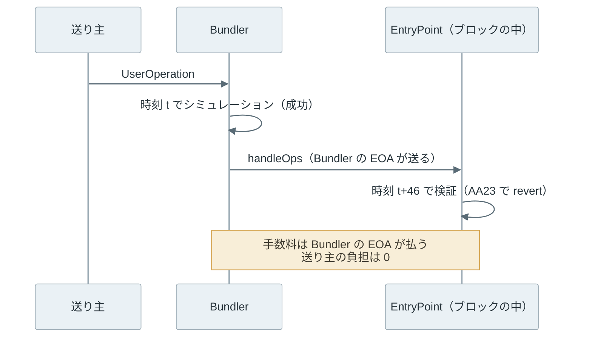

[ERC-7562](https://eips.ethereum.org/EIPS/eip-7562) は、[ERC-4337](../erc-4337/) の Bundler が UserOperation を受け付ける前に、検証のコードが使って良い命令と storage を決めた規則です。スマートアカウントの検証（`validateUserOp`）には任意のコードを書けますが、Bundler が mempool に入れるのは、この規則の範囲で書かれた検証だけです。

この規則で守られるのは、Bundler を運用する人です。Bundler は、受け取った UserOperation の検証を手元でシミュレーションし、通ったものをまとめて自分の EOA から送ります。

チェーン上で検証が失敗すると、取引の手数料は Bundler が払い、UserOperation の送り主は 1 wei も払いません。ERC-7562 は、検証のコードの書き方を制限して、シミュレーションで通った UserOperation を他人がまとめて無効にできないようにします。



上記の図の左側の値は、シミュレーションした時とブロックに入った時で変わり得るので、検証からは読めません。中央の 2 つは、1 回の変更で影響を受けるのがそのアカウントの UserOperation だけに限られる値です。制限が掛かるのは検証だけで、右側の実行では任意のコードが動きます。

<br>

本記事では、ローカルの実験で確かめながら、ERC-7562 の規則の中身と Bundler が規則を確かめる仕組みを説明します。軸になるのは次の疑問です。

- 検証に制限が無いと、誰がどう損をするのか。
- どの命令と storage が禁止され、何が許されるのか。
- stake（担保）と reputation（評判）は、何を防ぐのか。
- EIP-7702 で EOA がコードを持つと、何が変わったのか。
- Bundler は、規則に従っているかどうかをどう確かめるのか。

UserOperation・Bundler・EntryPoint・Paymaster の全体は [ERC-4337](../erc-4337/) のノートを前提にします。仕様の引用は、2026 年 10 月 23 日時点の内容（[ethereum/ERCs のコミット cab9f75](https://github.com/ethereum/ERCs/blob/cab9f75eaf10ffb30d4aa4b4f712e8324a24f4db/ERCS/erc-7562.md)、状態は Review）に基づきます。

---

### 検証の規則が必要な理由

EOA の取引を受け付けるノードは、署名・nonce・残高の 3 つを見れば、取引が有効かどうかを判定できます。取引を無効にする方向にこの 3 つを変えられるのは、同じ EOA の別の取引だけです。その取引も手数料を払うので、mempool に入った取引をただで無効にする方法がありません。

UserOperation の検証は、アカウントのコードが決めます。コードがブロックの時刻や他のコントラクトの storage を読むと、無関係な取引や時間の経過で結果が変わります。以下は、検証が `block.timestamp` を読むアカウントで起きる流れです。



上記の図で、送り主の deposit から手数料を受け取る処理は、検証を通った後にしか動きません。検証で revert した取引は、Bundler が手数料を払っただけで終わります。

<br>

ERC-7562 の Rationale は、これを大量無効化攻撃（mass invalidation attack）と呼び、方法を 3 つ挙げています。

1. 最初の検証は通り、バンドル（bundle、複数の UserOperation をまとめた 1 件の `handleOps`）を作る時の検証で失敗する UserOperation を送る
2. 1 件ずつなら有効で、同じバンドルに入ると無効になる UserOperation を送る
3. 有効な UserOperation の前に、それを無効にする状態の変更を割り込ませる

どれも、攻撃者の少ないコストで、多数の UserOperation を Bundler にただで検証させる経路です。ERC-7562 は検証のコードを砂場（sandbox）に閉じ込め、他の UserOperation、外部の storage の変更、ブロックの時刻のような環境から切り離します。

ERC-7562 はプロトコルの規則だと思うかもしれません。しかし、仕様の Abstract が述べる通り、規則を守らせるのはブロックビルダーと Bundler で、確かめる場所はオフチェーンです。EntryPoint のコントラクトは、時刻を読む検証もそのまま実行します。[Mempool](../mempool/) のノートの言葉では、consensus rule ではなく policy に入る規則です。

---

### 禁止される命令

ERC-7562 は、storage とコード以外の情報を読む命令を「環境」と呼び、検証での使用を禁じています（規則 OP-011）。値がブロックや取引ごとに変わるからです。

| 区分 | 禁止される命令 |
| --- | --- |
| ブロックの情報 | `TIMESTAMP`・`NUMBER`・`BLOCKHASH`・`PREVRANDAO`・`COINBASE`・`GASLIMIT`・`BASEFEE`・`BLOBBASEFEE` |
| 取引の情報 | `GASPRICE`・`ORIGIN`・`BLOBHASH` |
| 作成と削除 | `CREATE`（Factory の例外あり）・`SELFDESTRUCT` |
| その他 | `INVALID`・割り当てのない命令（OP-013） |

上記に加えて、次の制限があります。

- `GAS` は、直後に `CALL` などの呼び出しが続く場合だけ使える（OP-012）。残りのガスをそのまま呼び出し先に渡す定型で、値をほかの命令が読めないから
- `BALANCE` と `SELFBALANCE` は、後述の stake をした主体だけが使える（OP-080）
- 値を付けた `CALL` は、EntryPoint への支払いを除いて禁止（OP-061）
- コードの無いアドレスへの `CALL` や `EXTCODESIZE` などは禁止（OP-041）。例外は、デプロイ中の Factory が送り主のアドレスに触れる場合だけ（OP-042）
- precompile は、状態を読まない `0x1`〜`0x11` と `P256VERIFY` だけ使える（OP-062）

<br>

時刻で期限を付けたい検証は、`validationData` という戻り値に `validUntil` と `validAfter` を入れて書きます。EntryPoint がブロックの時刻と比べ、範囲外なら `AA22 expired or not due` で失敗させます。

Bundler はシミュレーションの trace から期限を読めるので、期限の近い UserOperation をバンドルに入れずに済みます（[ERC-4337](https://eips.ethereum.org/EIPS/eip-4337) は、すぐに期限が切れる UserOperation を落とすよう求めています）。

コードの中で `TIMESTAMP` を読む場合との違いは、期限が Bundler に見えるかどうかです。

禁止の一覧は、プロトコルに命令が増えると伸びます。2026 年 10 月には、まだメインネットで有効になっていない `SETCODEFROM` と `SLOTNUM` が一覧に足されました（[ERCs の変更履歴](https://github.com/ethereum/ERCs/commits/master/ERCS/erc-7562.md)）。

---

### 触って良い storage

命令の制限だけでは、他のコントラクトの storage を読む検証を止められません。例えば、多数のアカウントが 1 つのコントラクトの開閉スイッチを読むと、スイッチを 1 回切り替えるだけで、全ての UserOperation が無効になります。そのため、ERC-7562 は検証で触れる storage を原則としてそのアカウントに紐づくものに限ります。

アカウントに関連する storage（associated storage）は、どのコントラクトにある slot でも、次のどちらかを満たすものです。A はアカウントのアドレスです。

- slot の番号が A に等しい
- slot の番号が `keccak(A || x) + n`（x は 32 バイトの値、n は 0〜128）

例えば、[Solidity](https://soliditylang.org/) の `mapping(address => uint256) balanceOf` は、`balanceOf[A]` を `keccak(A || p)` の slot に置きます（p は mapping 自体の slot 番号）。そのため、ERC-20 のトークンにある自分の残高は、アカウントに関連する storage です。n の幅があるので、mapping の値が複数の slot を占める構造体でも含まれます。

storage を触れる範囲は、誰の検証か、stake しているかで変わります。以下は、仕様の Storage Rules を整理した表です。

| 触れる storage | 許される条件 |
| --- | --- |
| アカウント自身の storage | 常に（STO-010） |
| 他のコントラクトにある、アカウントに関連する slot | アカウントが作成済み、または Factory が stake している（STO-021・STO-022） |
| stake した Paymaster・Factory 自身の storage | 常に（STO-031） |
| 他のコントラクトにある、stake した Paymaster・Factory に関連する slot | 読み書きできる（STO-032） |
| 主体でないコントラクトの任意の slot | stake した Paymaster・Factory だけ、読むことができる（STO-033） |

`TLOAD`・`TSTORE` で扱う一時的な storage（[EIP-1153](https://eips.ethereum.org/EIPS/eip-1153)）も、同じ規則で判定します（OP-070）。

この制限で、1 回の storage の変更で無効にできる UserOperation は、原則として 1 つのアカウントの分に限られます。

仕様の試算では、無効化に必要な最小の変更は storage の書き換え 1 回の 5,000 gas です。ノードが 1 ブロックで 2,000 件の不正な UserOperation を処理できるとすると、攻撃のコストは 1 ブロックあたり 10,000,000 gas になります。

---

### stake と reputation

Paymaster や Factory は多くのアカウントから共通に使われ、利用者ごとの残高の管理のように、自分の storage を読みたい場面があります。ERC-7562 は、stake した主体（entity）にだけ広い storage を認め、その代わりに失敗の多い主体を止めます。

主体は、UserOperation が名指しする Factory・Paymaster・Aggregator（複数の署名をまとめて検証するコントラクト）と、stake したアカウントです。

stake は、EntryPoint の `addStake` で ETH を預け、引き出しに待ち時間を設ける仕組みです。標準の mempool は、`MIN_STAKE_VALUE`（チェーンごとに決める値で、仕様の目安は 1,000 ドル相当）以上の ETH を 1 日（`MIN_UNSTAKE_DELAY` = 86,400 秒）以上の待ち時間で預けた主体を staked と見なします。

stake は没収されません。検知はオフチェーンなので没収はせず、資金を 1 日以上ロックさせることで、主体を作り直して攻撃を続けるコストを上げています。

<br>

Bundler は、主体ごとに 2 つの数を数えます。`opsSeen` は受け取った有効な UserOperation のうちその主体を参照した数、`opsIncluded` はそのうちチェーンに載った数です。どちらも 1 時間ごとに 23/24 倍され、4 日で 2% 弱に減ります。`max_seen = opsSeen // 10` として、状態は次の通りです。

| 状態 | 条件 | 扱い |
| --- | --- | --- |
| BANNED | `max_seen > opsIncluded + 50` | mempool に入れず、参照する UserOperation も外す |
| THROTTLED | `max_seen > opsIncluded + 10` | mempool に 4 件、1 つのバンドルに 4 件、mempool に 10 ブロックまで |
| OK | それ以外 | stake した主体は件数の制限なし |

例えば、`opsSeen` が 1,000 なら `max_seen` は 100 で、載った数が 89 件以下で THROTTLED、49 件以下で BANNED です。受け付けた UserOperation の 1 割ほどがチェーンに載っていれば、OK のままです。2 回目の検証を通った後にバンドルの作成で失敗させた主体は、数に関係なく BANNED になります（GREP-040）。

stake しない主体にも上限があります。ERC-7562 では、stake しない送り主は mempool に同時に 4 件まで（UREP-010。ERC-4337 の受け付け時の検査は 1 件まで）、stake しない Paymaster を参照する UserOperation は、新しい Paymaster なら 10 件までです（UREP-020）。

---

### 同じ送り主の扱い

[ERC-4337](https://eips.ethereum.org/EIPS/eip-4337) は、1 つのバンドルに入れる UserOperation を送り主ごとに 1 件までとしています（stake した送り主は例外）。ERC-7562 の Rationale も、同じアカウントの UserOperation を複数入れるなら、先に一緒に検証するよう求めています。1 件ずつなら有効でも、一緒になると無効になる組み合わせがあるからです。大量無効化の 2 つ目の方法です。

例えば、アカウントが前払いの手数料を自分の ETH から払う場合、残高が 1 件分しか無いと、2 件目の検証で前払いが足りなくなります。nonce の key（並列に使える nonce の系列）を分ければ、同じ送り主でも順序に縛られずに 2 件を出せるので、残高だけが衝突します。この例は後の実験で確かめます。

同じ理由で、バンドルを作る Bundler は、別の UserOperation の送り主のアドレスに触れる UserOperation と、同じバンドルで作られるアカウントに触れる UserOperation を除きます（ERC-4337 の Bundling）。送り主の storage は、その送り主自身の検証が書き換えられるので、後ろの検証の前提が崩れ得ます。

---

### EIP-7702 で変わったこと

[EIP-7702](https://eips.ethereum.org/EIPS/eip-7702) は、2025 年 5 月 7 日の Pectra（[ハードフォーク](../ethereum-hard-forks/)の名前）で有効になった、EOA がコントラクトのコードに実行を委任する仕組みです。委任の書き方は [Ethereum Account Model](../ethereum-account-model/) で説明しています。委任した EOA のコードは誰からでも呼べるので、委任先のコード次第では、他人の取引の中でその EOA の残高が引き出されます。

その結果、EOA の取引は他人の取引に左右されない、という前節までの前提が、委任した EOA では崩れました。EIP-7702 の Security Considerations は、委任した EOA の保留中の取引を 1 件までに抑えるよう、クライアントに勧めています。通常の取引の mempool にも、ERC-7562 と同じ種類の問題が入ったわけです。

ERC-7562 には、EIP-7702 の承認（authorization）を扱う規則が足されました。AUTH-010〜030 は 2024 年 12 月、AUTH-040 は 2025 年 3 月の追加です。

- 1 つの UserOperation に載せられる承認は 1 つまで
- 委任した EOA は送り主としてだけ使え、Paymaster や Factory にはなれない
- 委任した EOA のコードに触れて良いのは、その EOA が送り主の UserOperation だけ
- 同じ送り主の承認付き UserOperation は、全て同じ委任先を指す

EntryPoint が委任した EOA を送り主として扱えるのは v0.8 以降で、詳細は [ERC-4337](../erc-4337/) のノートにあります。

---

### 規則を確かめる仕組み

Bundler は、1 件の UserOperation を 3 回検証します。受け取った時に 1 回、バンドルに入れる前に 1 件ずつもう 1 回、送る直前にバンドル全体でもう 1 回です（ERC-4337 の「Bundler behavior upon receiving a UserOperation」（UserOperation を受け取った時の Bundler の動作））。



3 回目が必要なのは、stake した主体が、バンドルの中で動いていることを検知して revert できるからです。

`eth_call` で `handleOps` を呼ぶだけでは、成否と戻り値しか分かりません。規則を当てるには、検証で使われた命令、触れた storage の slot、`keccak` の入力（関連する slot の判定に必要）が必要で、Bundler は [`debug_traceCall`](https://geth.ethereum.org/docs/interacting-with-geth/rpc/ns-debug#debugtracecall) の tracer でこれを集めます。

参照実装の [eth-infinitism/bundler](https://github.com/eth-infinitism/bundler/tree/aae77140e5c2b1386d04eaeba2d23fc17a62bd87)（2026 年 11 月時点の master の最新、2025 年 6 月のコミット `aae7714`、リポジトリの LICENSE は GPL-3.0）は、既定では [go-ethereum](https://github.com/ethereum/go-ethereum) の native tracer `erc7562Tracer` の出力を [ERC7562Parser](https://github.com/eth-infinitism/bundler/blob/aae77140e5c2b1386d04eaeba2d23fc17a62bd87/packages/validation-manager/src/ERC7562Parser.ts) で規則と照合します。

[erc7562Tracer](https://github.com/ethereum/go-ethereum/blob/v1.17.10/eth/tracers/native/erc7562.go) は go-ethereum v1.16.0 から入っていて（[PR #31006](https://github.com/ethereum/go-ethereum/pull/31006)）、呼び出しごとの `usedOpcodes`・`accessedSlots` と、最上位の呼び出しにまとめた取引全体の `keccak`（ハッシュの入力）を返します。

実装は仕様より遅れることがあります。2026 年 11 月時点で、この参照実装の禁止命令の一覧（[ERC7562BannedOpcodes.ts](https://github.com/eth-infinitism/bundler/blob/aae77140e5c2b1386d04eaeba2d23fc17a62bd87/packages/validation-manager/src/ERC7562BannedOpcodes.ts)）には、2026 年 10 月に仕様に足された `SETCODEFROM` と `SLOTNUM` がありません。Bundler を選ぶ時は、仕様と実装のバージョンを揃えて確かめる必要があります。

---

### ローカルでの検証の実験

実験では、[Foundry](https://github.com/foundry-rs/foundry) の [Anvil](https://getfoundry.sh/anvil/overview) 1.7.1（実行規則は Prague）に、ERC-4337 のノートと同じ [eth-infinitism/account-abstraction](https://github.com/eth-infinitism/account-abstraction/tree/v0.9.0) v0.9.0（コミット `b36a1ed`）の EntryPoint（GPL-3.0）と [SimpleAccount](https://github.com/eth-infinitism/account-abstraction/blob/v0.9.0/contracts/accounts/SimpleAccount.sol)・Factory（MIT）をデプロイします。

依存する [OpenZeppelin Contracts](https://github.com/OpenZeppelin/openzeppelin-contracts/tree/v5.1.0) は v5.1.0（MIT）、コンパイラは [solc 0.8.28](https://github.com/argotorg/solidity/releases/tag/v0.8.28) です。ソースは本記事のリポジトリに複製せず、実行時に固定したコミットを取得します。

比べるアカウントは次の 6 つです。SimpleAccount 以外は本記事のために書いた学習用のコントラクト（[Lab.sol](lab/Lab.sol)）で、監査しておらず、署名の検証も省いています。鍵は Anvil の公開されたテスト用のニーモニックから作ったものだけです。

| アカウント | 検証で確かめること |
| --- | --- |
| SimpleAccount v0.9.0 | 所有者の署名（自分の storage にある所有者と照合） |
| TokenAccount | LabToken の `balanceOf[自分]` が 1 以上 |
| DeadlineAccount | 何も読まず、`validUntil` を返す |
| TimeAccount | `block.timestamp` が期限より前 |
| BalanceAccount | 自分の ETH の残高が 0 より多い |
| GateAccount | Gate というコントラクトの `isOpen` が true |

時刻を扱う 2 つのアカウントの違いは、次の部分だけです。

```solidity
// TimeAccount: TIMESTAMP を読む（OP-011 の違反）
function _check() internal view override returns (uint256) {
    require(block.timestamp < deadline, "too late");
    return 0;
}

// DeadlineAccount: validUntil を返し、比較は EntryPoint に任せる
function _check() internal view override returns (uint256) {
    return uint256(deadline - 1) << 160; // validUntil, inclusive
}
```

Bundler のソフトウェアは使いません。Anvil 1.7.1 は `erc7562Tracer` に対応していない（`unsupported tracer type` を返す）ので、スクリプトが Bundler の役を代わり、`debug_traceCall` の既定の tracer（命令ごとの記録）から規則を判定します。

以下は、その小さな検査器から規則を当てる部分の抜粋です。呼び出しの深さを追ってアカウントの frame（呼び出しの単位）だけを選ぶ処理は、後の run.py の全体にあります。

対応する規則は OP-011・OP-012・OP-070・OP-080・STO-010・STO-021 だけで、stake や Factory・Paymaster の規則は判定しません。`keccak` の入力も、アカウントの frame の中で計算したものだけを見ます。

```python
# Inside check7562(): one struct log `log` of the account's frames.
# st = stack (top last), store = storage address of the current frame.
        if op in BANNED:                       # TIMESTAMP, NUMBER, ...
            violations.append(f'OP-011 {op} in {where}')
        if op in STAKED_ONLY:                  # BALANCE, SELFBALANCE
            violations.append(f'OP-080 {op} in {where} (unstaked)')
        if op == 'KECCAK256':                  # remember result -> preimage
            pre = mem(log, st[-1], st[-2])
            hashes[int(struct_logs[i + 1]['stack'][-1], 16)] = pre
        if op in STORAGE:                      # SLOAD, SSTORE, TLOAD, TSTORE
            slot = st[-1]
            if store == sender:
                rule, ok = 'own storage (STO-010)', True
            elif associated(slot, sender, hashes):
                rule, ok = 'associated (STO-021)', True
            else:
                rule, ok = 'not associated', False
                violations.append(f'STO-021 {op} slot {slot:#x} of {label(store)}')


def associated(slot, addr, hashes):
    """ERC-7562 'associated storage': slot == A, or slot == keccak(A || x) + n, 0 <= n <= 128."""
    if slot == addr:
        return True
    for n in range(129):
        pre = hashes.get(slot - n)
        if pre is not None and len(pre) == 64 and int.from_bytes(pre[:32], 'big') == addr:
            return True
    return False
```

`KECCAK256` の入力と結果を記録しておき、`SLOAD` の slot がその結果と一致すれば、関連する storage と判定します。

trace を取る時は、検証の対象の後ろに、コードの無い送り主の UserOperation を足して `handleOps` を呼びます。2 件目が `AA20 account not deployed` で失敗するので、バンドルは実行の前に revert し、trace には検証だけが残ります。ERC-4337 の Simulation の節が挙げている手法です。

<details>
<summary>run.py の全体（376 行）</summary>

```python
#!/usr/bin/env python3
"""Local-only ERC-7562 experiment (EntryPoint v0.9.0). Run through run.sh.

The script plays a bundler itself. It simulates UserOperations with eth_call,
traces their validation with debug_traceCall, and checks the trace against a
subset of the ERC-7562 rules (check7562 below). No bundler software, no
external RPC. Keys are Anvil's public test mnemonic only.
"""
import json
import os
from pathlib import Path
import shutil
import socket
import subprocess
import time
import urllib.request

HERE = Path(__file__).resolve().parent
OUT = HERE / 'output'
OUT.mkdir(exist_ok=True)
TOOLS = {n: os.environ.get(n.upper(), shutil.which(n)) for n in ('anvil', 'cast')}
if not all(TOOLS.values()):
    raise SystemExit('Put anvil and cast on PATH (or set ANVIL, CAST).')
BUILD = json.loads(Path(os.environ['BUILD']).read_text())['contracts']
MNEMONIC = 'test test test test test test test test test test test junk'  # Anvil default, public
GWEI = 10**9
ETH = 10**18
OP_TYPE = '(address,uint256,bytes,bytes,bytes32,uint256,bytes32,bytes,bytes)'


def cast(*args):
    return subprocess.check_output([TOOLS['cast'], *map(str, args)], text=True,
                                   stderr=subprocess.DEVNULL).strip()


def artifact(suffix):
    return next(v for k, v in BUILD.items() if k.endswith(suffix))


with socket.socket() as s:
    s.bind(('127.0.0.1', 0))
    port = s.getsockname()[1]
URL = f'http://127.0.0.1:{port}'


def rpc(method, *params):
    body = json.dumps({'jsonrpc': '2.0', 'id': 1, 'method': method, 'params': params}).encode()
    req = urllib.request.Request(URL, body, {'Content-Type': 'application/json'})
    with urllib.request.urlopen(req, timeout=60) as r:
        res = json.load(r)
    if 'error' in res:
        raise RuntimeError(res['error'])
    return res['result']


def submit(sender, data, to=None, value=0, gas=15_000_000, price=2 * GWEI):
    # Legacy gasPrice keeps the price fixed, as in the erc-4337 note.
    tx = {'from': sender, 'data': data, 'value': hex(value), 'gas': hex(gas), 'gasPrice': hex(price)}
    if to:
        tx['to'] = to
    return rpc('eth_sendTransaction', tx)


def receipt(h):
    for _ in range(400):
        r = rpc('eth_getTransactionReceipt', h)
        if r:
            return r
        time.sleep(0.05)
    raise TimeoutError(h)


def send(*args, **kw):
    r = receipt(submit(*args, **kw))
    assert int(r['status'], 16) == 1, r
    return r


def deploy(sender, suffix, sig='', *ctor):
    a = artifact(suffix)
    args = cast('abi-encode', f'f({sig})', *ctor)[2:] if ctor else ''
    return send(sender, '0x' + a['bin'] + args)['contractAddress']


def call(to, sig, *args):
    return cast('call', '--rpc-url', URL, to, sig, *args)


def balance(addr):
    return int(rpc('eth_getBalance', addr, 'latest'), 16)


def deposit_of(addr):
    return int(call(entry_point, 'balanceOf(address)(uint256)', addr).split()[0])


def u128x2(hi, lo):
    return '0x' + f'{hi:032x}{lo:032x}'


def op_tuple(op):
    return '(' + ','.join(str(op[k]) for k in (
        'sender', 'nonce', 'initCode', 'callData', 'accountGasLimits',
        'preVerificationGas', 'gasFees', 'paymasterAndData', 'signature')) + ')'


def user_op(sender, to):
    return {'sender': sender, 'nonce': 0, 'initCode': '0x',
            'callData': cast('calldata', 'execute(address,uint256,bytes)', to, 0, '0x'),
            'accountGasLimits': u128x2(200_000, 50_000),   # verificationGasLimit, callGasLimit
            'preVerificationGas': 50_000,
            'gasFees': u128x2(2 * GWEI, 2 * GWEI),          # maxPriorityFeePerGas, maxFeePerGas
            'paymasterAndData': '0x', 'signature': '0x'}


def handle_ops(ops):
    return cast('calldata', f'handleOps({OP_TYPE}[],address)',
                '[' + ','.join(op_tuple(o) for o in ops) + ']', bundler)


def simulate(ops):
    """First validation of a naive bundler: eth_call handleOps. Returns 'ok' or the FailedOp text."""
    try:
        rpc('eth_call', {'from': bundler, 'to': entry_point, 'data': handle_ops(ops), 'gas': hex(3_000_000)}, 'latest')
        return 'ok'
    except RuntimeError as e:
        data = e.args[0].get('data', '')
        for sig in ('FailedOpWithRevert(uint256,string,bytes)', 'FailedOp(uint256,string)'):
            try:
                idx, msg = cast('decode-error', '--sig', sig, data).splitlines()[:2]
                return f'op {idx}: {msg}'
            except subprocess.CalledProcessError:
                pass
        return str(e.args[0])


# ---------------------------------------------------------------------------
# A small ERC-7562 checker over the default (struct log) tracer of debug_traceCall.
# It covers OP-011, OP-012, OP-080 and the storage rules for an existing,
# unstaked account without paymaster or factory (STO-010, STO-021).
BANNED = {'ORIGIN', 'GASPRICE', 'BLOCKHASH', 'COINBASE', 'TIMESTAMP', 'NUMBER', 'PREVRANDAO',
          'DIFFICULTY', 'GASLIMIT', 'BASEFEE', 'BLOBHASH', 'BLOBBASEFEE', 'CREATE', 'INVALID',
          'SELFDESTRUCT'}                                   # OP-011 (CREATE: no factory here)
STAKED_ONLY = {'BALANCE', 'SELFBALANCE'}                    # OP-080
CALLS = {'CALL', 'STATICCALL', 'DELEGATECALL', 'CALLCODE'}
STORAGE = {'SLOAD', 'SSTORE', 'TLOAD', 'TSTORE'}


def mem(log, off, size):
    blob = bytes.fromhex(''.join(w.removeprefix('0x') for w in log.get('memory') or []))
    return blob[off:off + size].ljust(size, b'\0')


NAMES = {}  # address (int) -> short name, for printing only


def label(a):
    return NAMES.get(a, f'{a:#x}'[:10])


def check7562(sender, struct_logs):
    """Return (opcodes, slots, violations, validUntil) for the frames of `sender` and below."""
    sender = int(sender, 16)
    stack = []            # [(depth, code_addr, storage_addr)] of frames under the sender
    pending = None        # call seen at depth d; resolved by the next log
    hashes = {}           # keccak result -> preimage, as seen in the trace
    opcodes, slots, violations, valid_until = {}, [], [], None
    for i, log in enumerate(struct_logs):
        d, op, st = log['depth'], log['op'], [int(x, 16) for x in log['stack']]
        if pending:
            pd, code, store = pending
            pending = None
            if d == pd + 1 and (stack or code == sender):
                stack.append((d, code, store))
        while stack and d < stack[-1][0]:
            stack.pop()
        if op in CALLS:
            target = st[-2]
            store = stack[-1][2] if op in ('DELEGATECALL', 'CALLCODE') and stack else target
            pending = (d, target, store)
        if not stack or d != stack[-1][0]:
            continue
        code, store = stack[-1][1], stack[-1][2]
        opcodes[op] = opcodes.get(op, 0) + 1
        where = label(code)
        if op in BANNED:
            violations.append(f'OP-011 {op} in {where}')
        if op in STAKED_ONLY:
            violations.append(f'OP-080 {op} in {where} (unstaked)')
        if op == 'GAS' and struct_logs[i + 1]['op'] not in CALLS:
            violations.append(f'OP-012 GAS not followed by CALL in {where}')
        if op == 'KECCAK256':
            pre = mem(log, st[-1], st[-2])
            hashes[int(struct_logs[i + 1]['stack'][-1], 16)] = pre
        if op in STORAGE:
            slot = st[-1]
            if store == sender:
                rule, ok = 'own storage (STO-010)', True
            elif associated(slot, sender, hashes):
                rule, ok = 'associated (STO-021)', True
            else:
                rule, ok = 'not associated', False
                violations.append(f'STO-021 {op} slot {slot:#x} of {label(store)}')
            short = f'{slot:#x}' if slot < 2**32 else f'{slot:#x}'[:12] + '..'
            slots.append(f'{op} {label(store)} slot {short}: {rule}')
        if op == 'RETURN' and len(stack) == 1 and st[-2] == 32:
            valid_until = int.from_bytes(mem(log, st[-1], 32), 'big') >> 160 & (2**48 - 1)
    return opcodes, slots, violations, valid_until


def associated(slot, addr, hashes):
    """ERC-7562 'associated storage': slot == A, or slot == keccak(A || x) + n, 0 <= n <= 128."""
    if slot == addr:
        return True
    for n in range(129):
        pre = hashes.get(slot - n)
        if pre is not None and len(pre) == 64 and int.from_bytes(pre[:32], 'big') == addr:
            return True
    return False


def trace_validation(op):
    """debug_traceCall of handleOps([op, stopper]): the stopper fails with AA20,
    so the bundle reverts before any execution and the trace holds validation only."""
    stopper = dict(op, sender=cast('wallet', 'address', '--private-key', cast('wallet', 'private-key', MNEMONIC, 19)))
    tx = {'from': bundler, 'to': entry_point, 'data': handle_ops([op, stopper]), 'gas': hex(3_000_000)}
    res = rpc('debug_traceCall', tx, 'latest', {'enableMemory': True, 'disableStorage': True})
    return res['structLogs']


lines = []
log = (OUT / 'node.log').open('w')
node = subprocess.Popen([TOOLS['anvil'], '--host', '127.0.0.1', '--port', str(port),
                         '--chain-id', '31337', '--hardfork', 'prague', '--timestamp', '1700000000',
                         '--accounts', '4', '--quiet'], stdout=log, stderr=log)
try:
    for _ in range(200):
        try:
            bundler, deployer, attacker = rpc('eth_accounts')[:3]
            break
        except (OSError, RuntimeError):
            time.sleep(0.05)
    else:
        raise TimeoutError('Anvil startup')
    rpc('anvil_setBlockTimestampInterval', 1)                 # +1 s per block: reproducible times
    owner_key = cast('wallet', 'private-key', MNEMONIC, 5)    # never funded
    owner = cast('wallet', 'address', '--private-key', owner_key)
    recipient = cast('wallet', 'address', '--private-key', cast('wallet', 'private-key', MNEMONIC, 7))

    entry_point = deploy(deployer, ':EntryPoint')
    factory = deploy(deployer, ':SimpleAccountFactory', 'address', entry_point)
    token = deploy(deployer, ':LabToken')
    gate = deploy(attacker, ':Gate')                          # the attacker owns the switch
    t0 = int(rpc('eth_getBlockByNumber', 'latest', False)['timestamp'], 16)
    deadline = t0 + 60
    acct = {
        'SimpleAccount v0.9.0': None,
        'TokenAccount': deploy(deployer, ':TokenAccount', 'address,address', entry_point, token),
        'DeadlineAccount': deploy(deployer, ':DeadlineAccount', 'address,uint48', entry_point, deadline),
        'TimeAccount': deploy(deployer, ':TimeAccount', 'address,uint256', entry_point, deadline),
        'BalanceAccount': deploy(deployer, ':BalanceAccount', 'address', entry_point),
        'GateAccount': deploy(deployer, ':GateAccount', 'address,address', entry_point, gate),
    }
    acct['SimpleAccount v0.9.0'] = call(factory, 'getAddress(address,uint256)(address)', owner, 0)
    NAMES.update({int(v, 16): k.split()[0] for k, v in acct.items()})
    NAMES.update({int(token, 16): 'LabToken', int(gate, 16): 'Gate'})
    send(deployer, cast('calldata', 'mint(address,uint256)', acct['TokenAccount'], 1), token)
    send(deployer, '0x', acct['BalanceAccount'], value=ETH // 100)
    for a in acct.values():   # prepaid deposit, so validation never sends ETH (missingAccountFunds = 0)
        send(deployer, cast('calldata', 'depositTo(address)', a), entry_point, value=ETH // 10)

    def op_for(name, init='0x'):
        o = user_op(acct[name], recipient)
        o['nonce'] = int(call(entry_point, 'getNonce(address,uint192)(uint256)', acct[name], 0).split()[0])
        o['initCode'] = init
        if name.startswith('SimpleAccount'):
            h = call(entry_point, f'getUserOpHash({OP_TYPE})(bytes32)', op_tuple(o))
            o['signature'] = cast('wallet', 'sign', '--no-hash', '--private-key', owner_key, h)
        return o

    # SimpleAccount is created by its first UserOperation (initCode = factory + createAccount).
    init = factory + cast('calldata', 'createAccount(address,uint256)', owner, 0)[2:]
    send(bundler, handle_ops([op_for('SimpleAccount v0.9.0', init)]), entry_point, gas=3_000_000)

    # --- 1. trace each validation and check it ---
    now = int(rpc('eth_getBlockByNumber', 'latest', False)['timestamp'], 16)
    lines.append(f'# 1. validation traced with debug_traceCall (block time {now}, deadline {deadline})')
    lines.append(f'{"account":21}| eth_call | ERC-7562 check')
    details = []
    for name in acct:
        o = op_for(name)
        sim = simulate([o])
        opcodes, slots, bad, vu = check7562(acct[name], trace_validation(o))
        verdict = 'accept' if not bad else 'reject: ' + bad[0].split(' in ')[0].split(' slot')[0]
        lines.append(f'{name:21}| {sim:8} | {verdict}')
        details.append(f'[{name}] {sum(opcodes.values())} opcodes executed in the account frames'
                       + (f', validUntil {vu}' if vu else ''))
        details += [f'  {s}' for s in slots]
        details += [f'  violation: {v}' for v in bad]
    lines += details
    expected = {'SimpleAccount v0.9.0': [], 'TokenAccount': [], 'DeadlineAccount': []}
    for name in expected:
        assert not check7562(acct[name], trace_validation(op_for(name)))[2], name

    # --- 2. TIMESTAMP: passes the simulation, fails in the block, the bundler pays ---
    lines.append('# 2. TimeAccount: simulated now, mined at the deadline')
    o = op_for('TimeAccount')
    b0, d0 = balance(bundler), deposit_of(acct['TimeAccount'])
    now = int(rpc('eth_getBlockByNumber', 'latest', False)['timestamp'], 16)
    lines.append(f'simulation at {now}  : {simulate([o])}')
    rpc('evm_setNextBlockTimestamp', hex(deadline))
    r = receipt(submit(bundler, handle_ops([o]), entry_point, gas=1_000_000))
    gas_used, price = int(r['gasUsed'], 16), int(r['effectiveGasPrice'], 16)
    assert int(r['status'], 16) == 0
    lines.append(f'mined at {deadline}       : status {int(r["status"], 16)} (reverted), gasUsed {gas_used}')
    lines.append(f'bundler balance change : {(balance(bundler) - b0) / GWEI:+.0f} gwei'
                 f' (= {gas_used} gas x {price // GWEI} gwei)')
    lines.append(f'account deposit change : {(deposit_of(acct["TimeAccount"]) - d0) / GWEI:+.0f} gwei')
    assert balance(bundler) - b0 == -gas_used * price and deposit_of(acct['TimeAccount']) == d0
    lines.append(f'DeadlineAccount now    : {simulate([op_for("DeadlineAccount")])}'
                 f' (validUntil {deadline - 1} was visible in the trace)')

    # --- 3. one storage write invalidates many UserOperations ---
    lines.append('# 3. ten GateAccounts and one Gate.close() from the attacker')
    gates = [deploy(deployer, ':GateAccount', 'address,address', entry_point, gate) for _ in range(10)]
    for a in gates:
        send(deployer, cast('calldata', 'depositTo(address)', a), entry_point, value=ETH // 10)
    ops = [user_op(a, recipient) for a in gates]
    lines.append(f'first validation  : {sum(simulate([x]) == "ok" for x in ops)}/10 ok, '
                 f'bundle of 10: {simulate(ops)}')
    b0, a0 = balance(bundler), balance(attacker)
    g0 = sum(deposit_of(a) + balance(a) for a in gates)
    rpc('evm_setAutomine', False)
    hb = submit(bundler, handle_ops(ops), entry_point, gas=3_000_000, price=2 * GWEI)
    ha = submit(attacker, cast('calldata', 'close()'), gate, gas=100_000, price=3 * GWEI)  # front-runs
    rpc('evm_mine')
    rpc('evm_setAutomine', True)
    rb, ra = receipt(hb), receipt(ha)
    assert rb['blockNumber'] == ra['blockNumber'] and int(ra['transactionIndex'], 16) < int(rb['transactionIndex'], 16)
    assert int(ra['status'], 16) == 1 and int(rb['status'], 16) == 0
    cost = lambda x: int(x['gasUsed'], 16) * int(x['effectiveGasPrice'], 16)
    lines.append(f'same block        : close() index {int(ra["transactionIndex"], 16)} status 1, '
                 f'handleOps index {int(rb["transactionIndex"], 16)} status 0')
    lines.append(f'attacker paid     : {cost(ra) // GWEI} gwei ({int(ra["gasUsed"], 16)} gas x 3 gwei)')
    paid = g0 - sum(deposit_of(a) + balance(a) for a in gates)
    lines.append(f'bundler paid      : {cost(rb) // GWEI} gwei ({int(rb["gasUsed"], 16)} gas x 2 gwei)')
    lines.append(f'10 GateAccounts   : {paid // GWEI} gwei (deposit + balance change)')
    assert b0 - balance(bundler) == cost(rb) and a0 - balance(attacker) == cost(ra) and paid == 0
    after = [simulate([x]) for x in ops]
    lines.append(f'second validation : {sum(x == "ok" for x in after)}/10 ok ({after[0]})')

    # --- 4. same sender twice in one bundle (two nonce keys, ETH for one prefund) ---
    lines.append('# 4. one sender, two UserOperations, ETH for one prefund only')
    solo = deploy(deployer, ':TokenAccount', 'address,address', entry_point, token)
    send(deployer, cast('calldata', 'mint(address,uint256)', solo, 1), token)
    prefund = (200_000 + 50_000 + 50_000) * 2 * GWEI
    send(deployer, '0x', solo, value=prefund * 3 // 2)
    pair = [dict(user_op(solo, recipient), nonce=k << 64) for k in (0, 1)]  # nonce keys 0 and 1
    lines.append(f'prefund per op    : {prefund // GWEI} gwei, account balance {balance(solo) // GWEI} gwei')
    lines.append(f'op(key 0) alone   : {simulate(pair[:1])}')
    lines.append(f'op(key 1) alone   : {simulate(pair[1:])}')
    lines.append(f'both in one bundle: {simulate(pair)}')
    assert simulate(pair[:1]) == simulate(pair[1:]) == 'ok' and simulate(pair) != 'ok'
    lines.append('Assertions: PASS')
    summary = '\n'.join(lines) + '\n'
    (OUT / 'summary.txt').write_text(summary)
    (OUT / 'versions.txt').write_text('\n'.join(
        subprocess.check_output([t, '--version'], text=True).splitlines()[0] for t in TOOLS.values()) + '\n')
    print(summary, end='')
finally:
    node.terminate()
    try:
        node.wait(timeout=5)
    except subprocess.TimeoutExpired:
        node.kill()
    log.close()
```

</details>

<details>
<summary>Lab.sol の全体（120 行）</summary>

```solidity
// SPDX-License-Identifier: MIT
// Learning contracts for the ERC-7562 note. Not audited. Do not deploy.
// Signature checks are left out on purpose: anyone could use these accounts.
pragma solidity 0.8.28;

import {PackedUserOperation} from "contracts/interfaces/PackedUserOperation.sol";

abstract contract LabAccount {
    address public immutable entryPoint;

    constructor(address ep) {
        entryPoint = ep;
    }

    function validateUserOp(PackedUserOperation calldata, bytes32, uint256 missingAccountFunds)
        external
        returns (uint256 validationData)
    {
        require(msg.sender == entryPoint, "not EntryPoint");
        validationData = _check();
        if (missingAccountFunds > 0) {
            (bool ok,) = payable(msg.sender).call{value: missingAccountFunds}("");
            ok;
        }
    }

    function _check() internal view virtual returns (uint256);

    function execute(address to, uint256 value, bytes calldata data) external {
        require(msg.sender == entryPoint, "not EntryPoint");
        (bool ok,) = to.call{value: value}(data);
        require(ok, "call failed");
    }

    receive() external payable {}
}

// Reads TIMESTAMP inside validation (OP-011).
contract TimeAccount is LabAccount {
    uint256 public immutable deadline;

    constructor(address ep, uint256 d) LabAccount(ep) {
        deadline = d;
    }

    function _check() internal view override returns (uint256) {
        require(block.timestamp < deadline, "too late");
        return 0;
    }
}

// Same intent, but returns validUntil and lets the EntryPoint compare it.
contract DeadlineAccount is LabAccount {
    uint48 public immutable deadline;

    constructor(address ep, uint48 d) LabAccount(ep) {
        deadline = d;
    }

    function _check() internal view override returns (uint256) {
        return uint256(deadline - 1) << 160; // validUntil, inclusive
    }
}

// A switch in another contract that anyone's account may depend on.
contract Gate {
    address public immutable owner = msg.sender;
    bool public isOpen = true;

    function close() external {
        require(msg.sender == owner, "not owner");
        isOpen = false;
    }
}

// Reads a slot of Gate that is not associated with the account (STO-021 fails).
contract GateAccount is LabAccount {
    Gate public immutable gate;

    constructor(address ep, Gate g) LabAccount(ep) {
        gate = g;
    }

    function _check() internal view override returns (uint256) {
        require(gate.isOpen(), "gate closed");
        return 0;
    }
}

contract LabToken {
    mapping(address => uint256) public balanceOf; // slot 0

    function mint(address to, uint256 v) external {
        balanceOf[to] += v;
    }
}

// Reads balanceOf[this] in a token: keccak(this || 0), associated storage (STO-021 allows).
contract TokenAccount is LabAccount {
    LabToken public immutable token;

    constructor(address ep, LabToken t) LabAccount(ep) {
        token = t;
    }

    function _check() internal view override returns (uint256) {
        require(token.balanceOf(address(this)) > 0, "no token");
        return 0;
    }
}

// Reads its own ETH balance with SELFBALANCE (OP-080: staked entities only).
contract BalanceAccount is LabAccount {
    constructor(address ep) LabAccount(ep) {}

    function _check() internal view override returns (uint256) {
        require(address(this).balance > 0, "empty");
        return 0;
    }
}
```

</details>

```bash
bash content/notes/blockchain-systems/erc-7562/lab/run.sh
```

以下は、[出力](lab/output/summary.txt)の 1 段目です。2〜4 段目を含む全体は、その下に畳んでいます。手順とバージョンは [lab/README.txt](lab/README.txt) にまとめています。

```text
# 1. validation traced with debug_traceCall (block time 1700000018, deadline 1700000064)
account              | eth_call | ERC-7562 check
SimpleAccount v0.9.0 | ok       | accept
TokenAccount         | ok       | accept
DeadlineAccount      | ok       | accept
TimeAccount          | ok       | reject: OP-011 TIMESTAMP
BalanceAccount       | ok       | reject: OP-080 SELFBALANCE
GateAccount          | ok       | reject: STO-021 SLOAD
```

<details>
<summary>出力の全体（4 段、Assertions: PASS まで）</summary>

```text
# 1. validation traced with debug_traceCall (block time 1700000018, deadline 1700000064)
account              | eth_call | ERC-7562 check
SimpleAccount v0.9.0 | ok       | accept
TokenAccount         | ok       | accept
DeadlineAccount      | ok       | accept
TimeAccount          | ok       | reject: OP-011 TIMESTAMP
BalanceAccount       | ok       | reject: OP-080 SELFBALANCE
GateAccount          | ok       | reject: STO-021 SLOAD
[SimpleAccount v0.9.0] 385 opcodes executed in the account frames
  SLOAD SimpleAccount slot 0x360894a13b..: own storage (STO-010)
  SLOAD SimpleAccount slot 0x0: own storage (STO-010)
[TokenAccount] 224 opcodes executed in the account frames
  SLOAD LabToken slot 0x2bdc1ac19b..: associated (STO-021)
[DeadlineAccount] 89 opcodes executed in the account frames, validUntil 1700000063
[TimeAccount] 79 opcodes executed in the account frames
  violation: OP-011 TIMESTAMP in TimeAccount
[BalanceAccount] 77 opcodes executed in the account frames
  violation: OP-080 SELFBALANCE in BalanceAccount (unstaked)
[GateAccount] 209 opcodes executed in the account frames
  SLOAD Gate slot 0x0: not associated
  violation: STO-021 SLOAD slot 0x0 of Gate
# 2. TimeAccount: simulated now, mined at the deadline
simulation at 1700000018  : ok
mined at 1700000064       : status 0 (reverted), gasUsed 36926
bundler balance change : -73852 gwei (= 36926 gas x 2 gwei)
account deposit change : +0 gwei
DeadlineAccount now    : op 0: "AA22 expired or not due" (validUntil 1700000063 was visible in the trace)
# 3. ten GateAccounts and one Gate.close() from the attacker
first validation  : 10/10 ok, bundle of 10: ok
same block        : close() index 0 status 1, handleOps index 1 status 0
attacker paid     : 64287 gwei (21429 gas x 3 gwei)
bundler paid      : 207780 gwei (103890 gas x 2 gwei)
10 GateAccounts   : 0 gwei (deposit + balance change)
second validation : 0/10 ok (op 0: "AA23 reverted")
# 4. one sender, two UserOperations, ETH for one prefund only
prefund per op    : 600000 gwei, account balance 900000 gwei
op(key 0) alone   : ok
op(key 1) alone   : ok
both in one bundle: op 1: "AA21 didn't pay prefund"
Assertions: PASS
```

</details>

---

### 実験の結果

1 段目の `eth_call` の列は、6 つとも `ok` です。`TIMESTAMP` を読むアカウントも、他のコントラクトの storage を読むアカウントも、EntryPoint は普通に検証を通しています。

規則で落としたのは検査器の列の 3 つで、ERC-7562 は EntryPoint ではなく Bundler が当てる規則だと分かります。TokenAccount が読んだ LabToken の slot は、trace の中の `keccak(TokenAccount || 0)` の結果と一致したので、関連する storage と判定されました。

2 段目では、期限の 46 秒前のブロックでシミュレーションが通り、期限ちょうどのブロックで `handleOps` が revert しました。Bundler の EOA は 36,926 gas × 2 gwei = 73,852 gwei を払い、アカウントの deposit は 1 gwei も減っていません。

一方、DeadlineAccount では trace から `validUntil` が読めるので、Bundler は期限を過ぎる前にバンドルから外せます。期限の後に送れば EntryPoint が `AA22` で拒否するので、期限を守らせる仕組みはチェーンの上にも残ります。

<br>

3 段目は、大量無効化の 3 つ目の方法です。10 件の UserOperation は、1 件ずつでもバンドルでもシミュレーションを通りました。攻撃者が同じブロックで `Gate.close()` を Bundler の取引より高い単価で割り込ませると、`handleOps` は revert しました。



Bundler が払ったのは 207,780 gwei、攻撃者が払ったのは 64,287 gwei で、10 個の GateAccount の deposit と残高は 1 gwei も減っていません。10 件の UserOperation は全て、次の検証で無効になっています。GateAccount は Gate の slot 0 を読む時点で検査器に落とされるので、ERC-7562 に従う Bundler はこのバンドルを作りません。

4 段目では、1 件分の前払い（600,000 gwei）に対して 900,000 gwei しか持たないアカウントが、nonce の key を変えて 2 件を出しています。1 件ずつなら通り、バンドルにすると 2 件目（op 1）が `AA21 didn't pay prefund` で失敗しました。送り主ごとに 1 件、または一緒に検証する、という規則が必要な理由です。

---

### 利点

- Bundler が、他人の取引や時間の経過でただ働きさせられる経路を塞げる
- 規則を共有するので、どの Bundler も同じ UserOperation を有効と判定し、P2P の mempool で配れる
- stake すれば、Paymaster や Factory も自分の storage を使った検証を書ける
- `validUntil` と `validAfter` で、時刻の条件を Bundler に見える形で書ける

---

### 欠点

ERC-7562 は、検証を他の UserOperation から切り離す代わりに、検証で書けるコードを狭めています。その結果、次の制約があります。

- 外部の価格や他のコントラクトの状態に頼る検証は、標準の mempool では受け付けられない
- 規則を当てるには `debug_traceCall` と専用の tracer が必要で、Bundler を動かすノードを選ぶ
- 命令が増えるたびに一覧の更新が必要で、仕様と実装の間に遅れが出る
- reputation は Bundler ごとの数え方なので、同じ主体の扱いが Bundler で一時的にずれ得る

---

### 適さないケース

- 検証の段階で、オラクルの価格や他のアカウントの状態を読みたい場合。読むのは実行の段階に移す
- 規則を緩めた検証が必要で、標準の mempool に載せられない場合。仕様は alternative mempool（規則を合意し直した別の mempool）を用意しているが、参加する Bundler に限られる
- Bundler を経由せず、自分の EOA から `handleOps` を直接送る運用。この場合は自分で手数料のリスクを負うので、ERC-7562 は守る相手がいない
