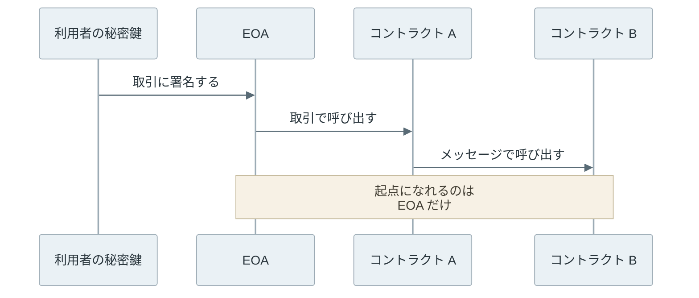
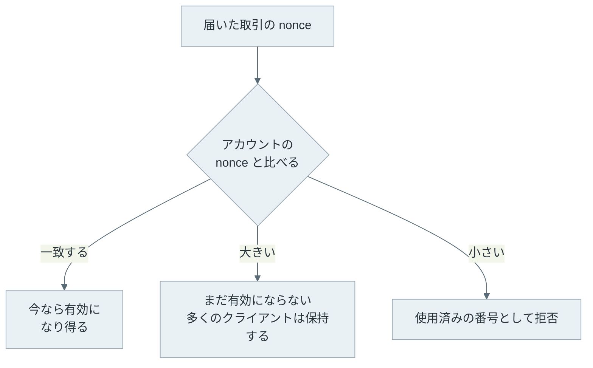
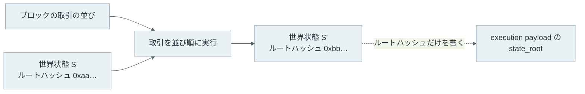

アカウントモデル（account model）は、アドレスごとに残高などの状態を保存し、取引がその状態を書き換える形で送金を表すモデルです。Ethereum が採用しています。[UTXO](../utxo/) で説明した Bitcoin の表し方には残高という保存された値が無く、コインは使い切りの出力として存在します。同じ送金でも、アカウントモデルは保存された数値を書き換え、UTXO モデルは出力を作り直します。

この違いが表に出るのは、ウォレットから続けて送金した時ではないでしょうか。2 件の送金を短い間隔で出すと、ウォレットが付けた通し番号（nonce）の小さい方から順に取り込まれ、1 件目が取り込まれないうちは 2 件目も待たされます。同じアカウントから自動で取引を出すサービスを書くなら、この番号を誰が採番するのかを決める必要があります。

1 件の送金がアカウントの状態をどう書き換えるのかを以下に示します。


- title: 取引の前
  items:
  - Alice：残高 5 ETH、nonce 7
  - Bob：残高 2 ETH、nonce 0
- title: 取引の後
  items:
  - Alice：残高は 4 ETH から手数料を引いた値、nonce 8
  - Bob：残高 3 ETH、nonce 0


上記の図の Bob のように受け取るだけのアカウントでは、nonce は動きません。送り主の残高からは、送る 1 ETH に加えて手数料も引かれます。手数料は、実行に要した計算量を gas という単位で計り、その量と単価から決まります。

<br>

本記事では、nonce を中心に、アカウントが持つ状態と、取引がその状態をどう変えるのかを説明します。軸になるのは次の疑問です。

- アカウントは、どのような状態を持つのか。
- EOA とコントラクトアカウントは、何が違うのか。
- nonce は、何を防ぐのか。
- nonce は、取引の順序をどのように縛るのか。
- 番号を飛ばして送った取引は、実際のノードでどう扱われるのか。
- 全アカウントの状態は、どのようにブロックと結び付くのか。

EVM（Ethereum Virtual Machine）の命令、スマートコントラクトの書き方、手数料の決まり方、ブロックを繋いで履歴を作る部分は、本記事では扱いません。

---

### アカウントが持つ 4 つの状態

Ethereum のアカウントには、利用者が秘密鍵で操作する EOA（Externally Owned Account、外部所有アカウント）と、コードを持つコントラクトアカウント（contract account）の 2 種類があります。どちらも、アドレスに対応付けられた同じ 4 つの項目で表されます。公式ドキュメントが挙げる項目は以下の通りです。

| 項目 | 何を表すか |
| --- | --- |
| nonce | 取引の順序付けやコントラクト作成に使われるカウンタ。EOA では取引の送信ごとに増える |
| balance | そのアドレスが持つ wei の量。1 ETH は `10^18` wei |
| storageRoot | そのアカウントの記憶領域の中身全体を 1 つのハッシュ値に要約した値（記憶領域を表す木のルート） |
| codeHash | EVM 上のそのアカウントのコードのハッシュ |

公式ドキュメントは 1 行目の nonce を「[the number of transactions sent from an externally-owned account or the number of contracts created by a contract account](https://ethereum.org/en/developers/docs/accounts/)」（外部所有アカウントから送られた取引の件数、またはコントラクトアカウントが作ったコントラクトの件数）と定義しています。

3 行目の記憶領域には、コードが実行のたびに読み書きし、次の実行にも残したい値が入ります。例えば、トークンの残高表がここに置かれます。中身を 1 つの値にまとめる木の構造は、後の「世界状態と execution layer の `state_root`」で扱います。

---

### EOA とコントラクトアカウント

コントラクトアカウントのコードは、そのアカウントへの呼び出し（例えば、トークンを送る関数の実行）を受けた時に実行されます。呼び出しには、EOA が署名して送る取引と、実行の中でコントラクトが別のコントラクトに渡すメッセージがあり、メッセージは署名も nonce も持ちません。2 種類の違いは、取引を起こせるかどうかに出ます。署名して送り出す取引の起点になれるのは EOA だけです。

以下は、1 件の取引が 2 つのコントラクトに届くまでの流れです。



上記の図でコントラクト A から B への呼び出しは、EOA が出した取引の実行の中で起きます。

<br>

従来は、コードの有無を 2 種類の見分けの手掛かりにできました。公式ドキュメントにも、EOA について「[the codeHash field is the hash of an empty string](https://ethereum.org/en/developers/docs/accounts/)」（codeHash の項目は空文字列のハッシュになる）と書かれています。

今の Ethereum では、コードが空なら EOA という判定は成り立ちません。2025 年に実施された Pectra というプロトコルの更新で [EIP-7702](https://eips.ethereum.org/EIPS/eip-7702) が有効になり、EOA は指定したコントラクトのコードに自分の取引の実行を委ねられるようになりました。例えば、複数の操作を 1 件の取引にまとめたり、手数料を別のアカウントに払ってもらったりできます。EIP は Ethereum Improvement Proposal の略で、仕様変更の提案を指します。

委任先を指す短いデータがコードの項目に書かれるので、EOA でもコードを持つことがあります。委任先のコードは EOA のアドレスで動くため、読み書きする記憶領域も EOA のものになります。概念上の違いは、EOA が秘密鍵による認証を起点に取引を送り出せるのに対し、コントラクトアカウントはコードの実行によって動く点にあります。

---

### nonce が防ぐ再生

残高を引いて足すだけを取引の内容にすると、同じ取引データをもう一度ネットワークに流せば、同じ支払いを再び実行できます。[署名](../digital-signature/)は取引のデータに対して作られるため、データが同じなら検証を何度でも通ります。

[UTXO](../utxo/) では、データの構造そのものがこの再生を防ぎます。取引が消費する出力は outpoint で名指しされており、一度消費された出力は集合から消えるため、同じ取引は 2 度成立しません。アカウントモデルには消費される対象が無く、更新される残高があるだけです。

アカウントモデルで再生を止める役割を担うのが [nonce](https://masteringethereum.xyz/chapter_6.html) です。以下では、通常の EOA が取引を送る場合を扱い、EIP-7702 の委任コードの実行で nonce が追加で変わる場合は除きます。取引には送り主の nonce を書く項目があり、その値は、送り主のアカウントが今持っている nonce と一致している必要があります。取り込まれると 1 増えるため、同じ取引をもう一度流しても古い番号として弾かれます。

<br>

nonce で防げるのは、同じチェーンでの再送です。別のチェーンへの再生は、chain ID を署名の対象に含めることで防ぎます。この仕組みを旧来の形式の取引（legacy transaction）に導入したのが [EIP-155](https://eips.ethereum.org/EIPS/eip-155) で、先頭に型を表すバイトを持つ現在の形式（typed transaction）も chain ID を署名の対象に含みます。

---

### nonce が制約する順序

#### nonce が増える時点

nonce の一致は、取引が有効である条件の 1 つです。このほかに署名が有効か、手数料と送る額を払える残高があるかなども検査されます。これらの検査を通らない取引はブロックに入れられず、アカウントの nonce も動きません。

実行が始まった後にコードが `REVERT`（実行を中止して変更を取り消す命令）を呼んだ場合や gas を使い切った場合、その取引による状態の変更は取り消されます。それでも送り主の nonce の増加と手数料の支払いは残るため、次に有効な番号は 1 つ進んだままです。

#### ブロックの並びと nonce による順序

実行の順序を決めているのは、ブロックに並んだ取引の並びです。全てのノードがその並びのとおりに実行するため、どのノードに先に届いたかに関わらず、結果は全員で一致します。

nonce が制約するのは、同じ送り主が出した取引どうしの前後だけです。ブロックを作る参加者は取引の並べ方を決められます。ただし、同じ送り主の取引を番号の小さい順に置かない並びは、受け入れられません。

例えば、同じ送り主の 2 件を含む並びには、次の 2 通りがあります。


- title: 受け入れられる並び
  steps:
  - Alice nonce 3
  - Carol の取引
  - Alice nonce 4
- title: 受け入れられない並び
  steps:
  - Alice nonce 4
  - Alice nonce 3


上記の図の受け入れられない並びの先頭にある nonce 4 は、その時点の Alice の nonce（3）と一致しないため、取引として有効になりません。

#### 飛んだ番号と、同じ番号の競合

番号が飛んだ取引も、欠けた番号が取り込まれるまでは有効になりません。

送り主が通常の EOA の場合、多くのクライアント（ノードが動かす Ethereum の実装ソフトウェア）はこの取引を mempool に置いて待ちます。保持するかどうかはコンセンサス規則（全ノードが守り、破るとブロックが拒否される規則）ではなくクライアントの方針で決まり、件数や時間の上限を超えると捨てられます。未確認の取引の置き場の性質は、Bitcoin を例に [Mempool](../mempool/) で扱っています。

以下は、届いた取引の nonce と、送り主のアカウントの nonce を比べた結果の行き先です。



上記の図の行き先は、外部と接続しないローカルのチェーン（geth 1.17.10 の開発用モード）で確かめられます。開発用モードは取引が届くとすぐブロックを作ります。geth は、mempool を txpool と呼び、すぐ実行できる取引を pending、番号の欠けで待つ取引を queued と数えます。nonce 0 のアカウントから nonce 2・0・1 の順に送り、最後に nonce 0 の取引を流し直した結果が以下です。

```text
アカウントの nonce: 0
nonce 2 を送信:  アカウントの nonce 0、txpool pending 0・queued 1
nonce 0 を送信:  アカウントの nonce 1、txpool pending 0・queued 1
nonce 1 を送信:  アカウントの nonce 3、txpool pending 0・queued 0
nonce 0 を再送: nonce too low: next nonce 3, tx nonce 0
```

2 行目で、nonce 2 は queued で待ちます。3 行目で nonce 0 が取り込まれても 1 が欠けているので 2 は動かず、4 行目で 1 が届くと 1 と 2 が続けて取り込まれました。5 行目の再送は、使用済みの番号として拒否されました。

同じ番号を 2 件に付けた場合、両方が同じチェーンに入ることはありません。片方が取り込まれた時点でアカウントの nonce が進み、もう片方は古い番号になります。どちらが残るかはコンセンサス規則では決まらず、クライアントの方針とブロックを作る参加者の選択で決まります。

送った取引の差し替えは、この性質を使います。多くのクライアントは、手数料を一定以上引き上げた後発の取引で、同じ番号の先着を置き換えます。同じアカウントから複数のプログラムが同時に取引を出すと、番号の重複や欠けが起きます。冒頭で挙げた「誰が採番するか」はこの問題のことで、採番を 1 か所に集めるなどの調整が必要です。

---

### 世界状態と execution layer の `state_root`

全アカウントの現在の状態をまとめたものを世界状態（world state）と呼びます。公式ドキュメントには「[Instead of a distributed ledger, Ethereum is a distributed state machine](https://ethereum.org/en/developers/docs/evm/)」（Ethereum は分散台帳ではなく分散状態機械である）と書かれています。取引は、この状態を次の状態に移す入力です。そのため、同じ送金の取引でも、先に別の取引が残高を減らしていれば失敗します。

世界状態は、アドレスを `keccak256` でハッシュした値を経路に使う trie で表されます。trie は、キーを先頭から 1 桁ずつ辿って値に着く木です。現在の Ethereum の本番ネットワーク（Mainnet）では、modified Merkle Patricia Trie が使われます。キーで経路が決まる trie を Merkle Tree と組み合わせた構造の性質は、[Merkle Tree Design](../merkle-tree-design/) で扱っています。

<br>

現在の Ethereum のブロックは、取引を実行する execution layer と、ブロックについて合意を取る consensus layer の 2 層で扱われます。取引の並びは execution payload という execution layer 用のまとまりに入り、それが consensus layer のブロックに含まれます。consensus layer のブロックにある同名の `state_root` は、EVM の状態を指しません。

ブロックに入るのは状態そのものではありません。以下は、実行した後の状態と、そこから書かれる値の関係です。



上記の図の S' は各ノードが手元に保持します。

[公式ドキュメント](https://ethereum.org/en/developers/docs/blocks/)には、全てのクライアントが execution payload の取引を実行し直し、得られた状態が `state_root` の示す状態と一致することを確かめると書かれています。一致しなければ、そのブロックは受け入れられません。

[Bitcoin Block](../bitcoin-block/) で説明した Bitcoin のブロックヘッダは、そのブロックに入った取引の並びを代表する値を持っていました。Ethereum の execution layer では、取引の並びを代表する値に加えて、実行し終えた後の状態を代表する値を持ちます。

全状態を持たない利用者は、このルートハッシュと 1 本の経路だけで、あるアカウントの残高を確かめられます。

---

### 利点

以下は、アカウントごとに状態を保存し、連番の nonce で送り主ごとの順序を縛る Ethereum の設計から得られる性質です。

- アドレスを 1 つ引けば残高が読めるため、支払いのたびに使う入力を選ぶ処理が必要ない
- 同じチェーンでの同じ取引データの再送が、通し番号の不一致で弾かれる
- 同じ送り主が出した取引の前後が、ネットワークの到着順に関わらず番号どおりに決まる
- 実行をまたいで残る記憶領域をアカウントが持てるため、コードが状態を読み書きできる

---

### 欠点

状態を書き換え、番号で順序を縛る同じ設計が、次の場面では足かせになります。

- 番号を送り主が決めるため、同じアカウントから並行して取引を出すと調整が必要
- 番号が 1 つ欠けると、後続の取引がその番号の取り込みまで有効にならない
- 取引の結果が実行時点の状態で変わるため、取引のデータだけを見ても結果が決まらない
- ノードが保持する状態が、使われているアカウントと記憶領域の分だけ大きくなる

1 つ目と 2 つ目は nonce の決め方から来ており、番号を連番にせず別の方法で取引の重複を弾くアカウントモデルもあります。

4 つ目は、状態の持ち方の違いから来ます。UTXO では、検証に使う UTXO 集合から、消費された出力を外せます。アカウントモデルでは、実行に必要なアカウントと記憶領域の状態を保持し続ける必要があります。記憶領域の値は上書きも 0 への書き戻しもできるので、個々の書き込みが永久に残るわけではありません。
