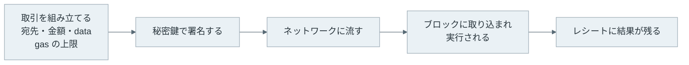
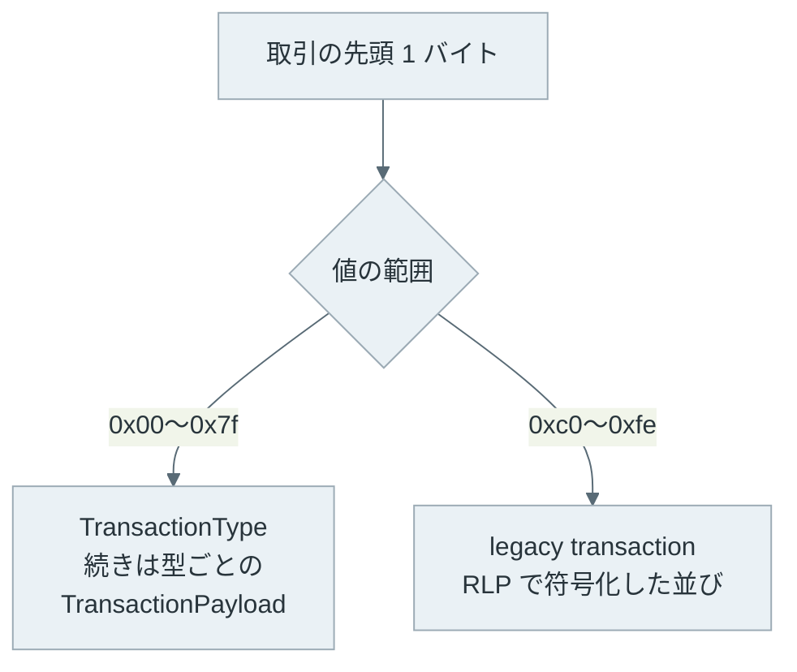
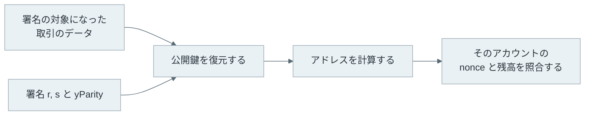
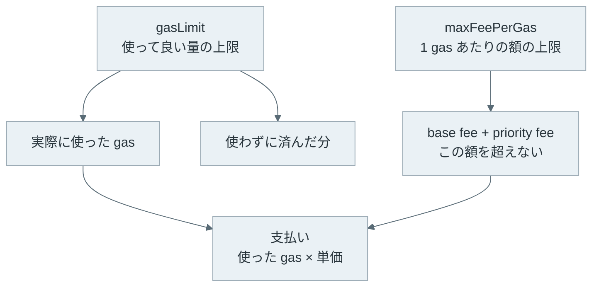
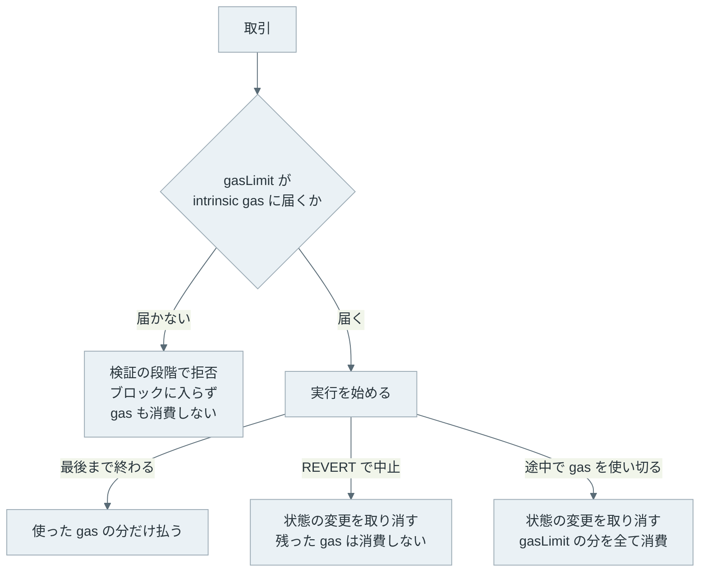
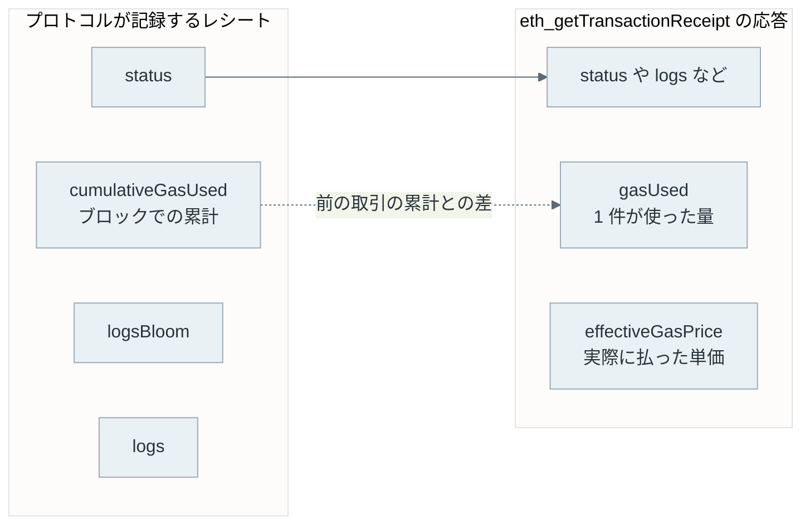
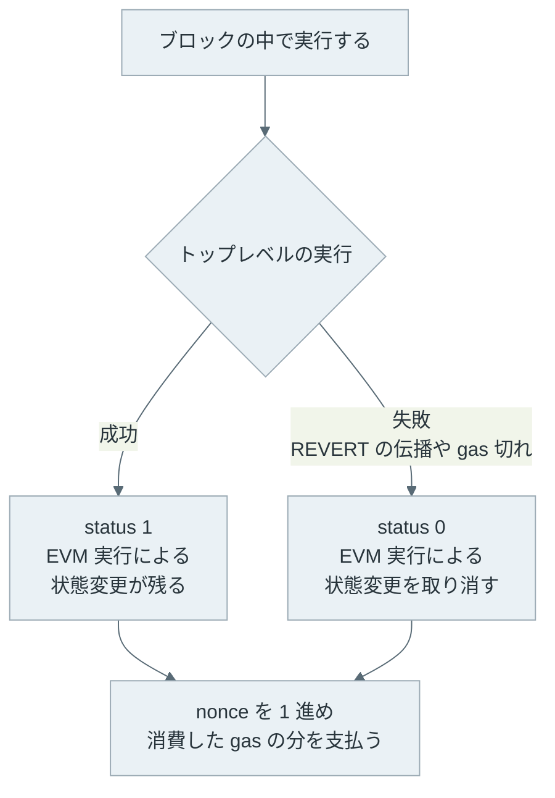

取引（transaction）は、EOA（Externally Owned Account、外部所有アカウント）が秘密鍵で署名した指示のデータです。[公式ドキュメント](https://ethereum.org/en/developers/docs/transactions/)も、取引はアカウントが暗号で署名して出す指示だと定義しています。送金も、コントラクト（コードを持つアカウント）の呼び出しも、コントラクトの作成も、この 1 つの形で表されます。

読者がこの形に触れるのは、ウォレットの確認画面ではないでしょうか。金額のほかに、実行の計算量を測る単位である gas に関わる「ガスの上限」や「最大手数料」が並び、実行に失敗した取引からも手数料が引かれます。どちらも、取引が送金の指示にとどまらず、宛先のコードを動かす依頼にもなるために生じます。2 つの欄の意味は「使った gas と単価による手数料」で、失敗しても手数料が引かれる理由は「レシートに残る実行の結果」で取り上げます。

取引が作られてから結果が残るまでを以下に示します。

上記の図で秘密鍵を使うのは、署名の段階だけです。中継するノードが中身を書き換えること自体はできます。書き換えた取引がどう扱われるのかは、「署名からの送り主の復元」で扱います。

 

本記事では、1 件の取引に何が書かれ、送り主がどう確かめられ、手数料がどう決まるのかを説明します。手掛かりにするのは次の疑問です。

- 取引には、なぜ gas の上限を書くのか。
- 1 件の取引には、どの項目が書かれるのか。
- 送り主は、どのように確かめられるのか。
- 手数料は、どのように決まるのか。
- 中の送金が失敗しても、取引が成功として残るのはなぜか。

アカウントが持つ状態と nonce による順序は [Ethereum Account Model](../ethereum-account-model/) で扱っており、EVM（Ethereum Virtual Machine）の命令とコントラクトの書き方は本記事では扱いません。

---

### 取引に gas の上限を書く理由

コントラクトとは、アドレスの下にコードと storage（値を保存する領域）を持つアカウントです。取引の宛先がコードを実行するアカウントであれば、そのコードが EVM で実行されます。

Bitcoin の取引は、消費する出力と作る出力を並べたデータで、検証に必要な手間が中身からほぼ決まります（[UTXO](../utxo/)）。Ethereum の取引は宛先のコードを動かせるため、何段階の処理になるのかがデータを見ただけでは分かりません。

素朴に「実行が終わるまで動かす」形にすると、終わらない処理を含む取引を 1 件流すだけで、全ノードの計算を占有できます。実行の量を測る単位が [gas](https://ethereum.org/en/developers/docs/gas/) です。

[公式ドキュメント](https://ethereum.org/en/developers/docs/gas/)は、1 件あたりの上限を課す理由として、コードの中の意図しない、または悪意のある無限ループなど、計算の浪費を防ぐことを挙げています。送り主は、その取引が使って良い gas の上限（gasLimit）を自分で書きます。処理が終わらなくても、実行は gasLimit で止まります。

---

### 取引に書かれる項目

取引には複数の型があり、先頭 1 バイトで区別されます。以降は、仕様変更の提案である EIP（Ethereum Improvement Proposal）の 1 つ、[EIP-1559](https://eips.ethereum.org/EIPS/eip-1559) が定めた、手数料の上限を 2 つ書く型を中心の例にします。先頭バイトが 0x02 のこの型を Type 2 transaction と呼びます。

扱う手数料は、実行に使う gas（execution gas）の分です。大きなデータを伴う取引のために EIP-4844 が足した blob gas とその手数料は扱いません。以下は、1 件の取引が持つ主な項目です。

| 項目 | 何を決めるか |
| --- | --- |
| nonce | 送り主のアカウントの通し番号 |
| to | 宛先のアドレス。空のバイト列にすると新しいコントラクトの作成になる |
| value | 宛先に送る wei の量 |
| data | 宛先のコードに渡す任意の長さのデータ |
| gasLimit | この取引が使って良い gas の上限 |
| maxFeePerGas | 1 gas あたりに払う額の上限 |
| maxPriorityFeePerGas | 1 gas あたりで、ブロックを作る参加者に渡す分の上限 |
| accessList | 実行中に触る予定のアドレスと storage key を先に申告する。使わない場合は空のリストにする |
| chainId | どのチェーン向けの取引か |
| 署名 | 送り主が承認した証拠。`r`、`s` と、公開鍵の復元に使う `yParity` |

nonce が何を防ぎ、どの範囲の順序を縛るのかは [Ethereum Account Model](../ethereum-account-model/) で扱っています。value と data は独立していて、`value` が 0 でも `data` を渡してコントラクトを呼べます。

accessList は、列挙するだけで安くなる項目ではありません。列挙した分にも gas が掛かります。その代わりに、申告したアドレスと storage key は最初から触ったことのある扱い（warm）になり、実行中のアクセスが安く済みます。EIP-2930 にも、一覧に無い所へのアクセスは「[possible, but become more expensive](https://eips.ethereum.org/EIPS/eip-2930)」（可能。ただし、より高くつく）と書かれています。実行中に触らない項目まで並べると、申告の分だけ gas が増えます。

 

項目の並びは 1 通りではありません。EIP-2718 は「[`TransactionType || TransactionPayload` is a valid transaction](https://eips.ethereum.org/EIPS/eip-2718)」（TransactionType と TransactionPayload を繋いだものが有効な取引になる）と書いており、先頭の 1 バイトで中身の読み方が切り替わります。

型を持たない旧来の legacy transaction は、Ethereum の符号化規則である RLP（Recursive Length Prefix）で項目を並べたリストで、先頭のバイトは必ず 0xc0 以上になります。型の番号はこれと重ならない 0x7f 以下に置かれます。以下は、先頭のバイトで読み方が分かれる様子です。

上記の図で TransactionType を持つ側が typed transaction で、Type 2 もここに入ります。この分岐があるため、新しい項目を持つ型を足しても、古い形の取引はそのまま検証できます。0xff は将来の拡張用に予約されています。

型はほかにもあります。legacy transaction は、maxFeePerGas と maxPriorityFeePerGas の代わりに gasPrice を 1 つ持ちます。chain ID を独立した項目としては持たず、含める場合は署名の中に埋め込みます。

[EIP-4844](https://eips.ethereum.org/EIPS/eip-4844) の blob transaction は、blob と呼ばれる大きなデータを伴い、実行用の gas とは別に blob gas という単位で課金されます。EIP-7702 の型もあります。EOA が指定したコントラクトのコードに自分の実行を委ねる委任（delegation）の仕組みで、この型を使った EOA はコントラクトのようにコードを動かせます。

---

### 署名からの送り主の復元

上記の表に、送り主のアドレスを書く項目がありません。取引のデータには送り主が入っておらず、署名から復元します。[『Mastering Ethereum』第 2 版の第 6 章](https://masteringethereum.xyz/chapter_6.html)にも、legacy transaction の形を説明する中で、EOA の公開鍵が ECDSA 署名の `v`、`r`、`s` の 3 つの値から導けると書かれています。公開鍵からアドレスが決まるため、送り主も決まります。

ここでの復元は、手元の公開鍵で署名を検証する操作とは別です。楕円曲線を使う署名方式である ECDSA では、署名と対象のデータから公開鍵の候補が求まり、legacy transaction の `v` や typed transaction の `yParity` が、どれを使うのかを指します。署名の計算は [Digital Signature](../digital-signature/) で扱っています。

署名から送り主が決まるまでの流れを図にすると、以下のようになります。

上記の図で、取引のデータを 1 バイトでも書き換えると、署名の対象が変わります。元の署名をそのまま付けても、復元されるのは元の送り主とは別のアドレスになるか、復元そのものが失敗します。どちらにしても、元の送り主が承認した取引としては成立しません。

署名済みの取引をそのまま別のチェーンに流されると、送り主が承認していない送金が成立してしまいます。これを防ぐために、署名の対象に chain ID を入れます。入るかどうかは取引の形で変わります。typed transaction と、[EIP-155 に従う legacy transaction](https://eips.ethereum.org/EIPS/eip-155) では、署名のためのハッシュを計算する対象に chain ID を含めます。同じ EIP は、chain ID を含めない以前の署名も引き続き有効だと書いており、その形の取引に chain ID は入りません。

---

### 使った gas と単価による手数料

送り主が払う額は、`使った gas × (base fee + priority fee)` で決まります。base fee はブロックごとに決まる 1 gas あたりの最低額で、priority fee はブロックを作る参加者に渡す上乗せ分です。[公式ドキュメント](https://ethereum.org/en/developers/docs/gas/)には、base fee の分が焼却されて流通から取り除かれ、priority fee の分が参加者に渡ると説明されています。base fee がブロックごとにどう調整されるのかは、本記事では扱いません。

取引に書く 2 つの上限は、この式の別々の箇所を制限します。gasLimit は使う量の上限で、maxFeePerGas は 1 gas あたりの額の上限です。委任を設定していない EOA に data 無しで ETH を送るだけなら 21,000 gas で、data を付けたりコードが動いたりすると増えます。

実際に渡る priority fee は、maxPriorityFeePerGas と、maxFeePerGas から base fee を引いた残りのうち、小さい方になります。base fee が maxFeePerGas を超えている間、その取引は取り込まれません。以下は、2 つの上限と支払う額の関係です。

実行が gasLimit に届かずに終われば、使わずに済んだ分は手数料になりません。それでも取引を出す時点では、`gasLimit × maxFeePerGas + value` の残高が必要です。ウォレットの確認画面に出る「最大手数料」は、実際に引かれる額ではなく、この `gasLimit × maxFeePerGas` を指します。

つまり、送り主が取引に書けるのは上限までで、払う額は、使った gas と、取り込まれたブロックの base fee が分かるまで確定しません。Bitcoin の手数料は、入力が参照する出力の合計と作る出力の合計の差なので、出来上がった取引のデータで額が決まっています（[UTXO](../utxo/)）。

取引には、実行を始める前に必ず掛かる intrinsic gas があります。上に挙げた単純な送金なら 21,000 で、data や accessList を付ければ、その内容に応じて増えます。

実行を始めた後は、コードが条件を満たさない時（例えば、トークンの残高が足りない時）に `REVERT` 命令で自分から実行を中止し、状態の変更を取り消せます。以下は、gasLimit と実行の進み方によって、消費される gas が分かれる様子です。

上記の図のうち、手数料を払わずに済むのは、検証の段階で拒否される経路だけです。

[gas の公式ドキュメント](https://ethereum.org/en/developers/docs/gas/)の例では、単純な送金に 20,000 の gasLimit を付けた取引は、検証の段階で拒否されます。

---

### レシートに残る実行の結果

ブロックに入ったことは、実行が成功したことを意味しません。Ethereum は、取引として有効かどうかの検査と、実行が成功したかどうかを分けて扱います。有効でない取引はブロックに入りませんが、有効であれば、実行に失敗しても手数料を払ってブロックに残ります。

Bitcoin にはこの 2 段の区別が無く、検証を通らない取引はブロックに入らないだけです（[Bitcoin Transaction Lifecycle](../bitcoin-transaction-lifecycle/)）。Ethereum で実行の結果を読み取る先が、取引ごとに作られる取引レシート（receipt）です。

プロトコルが定めるレシートの中身は 4 つです。[EIP-2718 には legacy receipt が `rlp([status, cumulativeGasUsed, logsBloom, logs])` と書かれています](https://eips.ethereum.org/EIPS/eip-2718)。状態コード、そのブロックでの累計の gas、logs bloom、ログです。typed transaction のレシートには、この 4 つの前に型のバイトが付きます。1 件が使った量はこの中に無く、前の取引の累計との差として求まります。

ログはコントラクトが実行中に残す出来事の記録（例えば、トークンが送られた）で、アプリはこれを読んで結果を知ります。logs bloom は、中身を読まずに、あるアドレスや出来事のログが含まれ得るかを判定するための値です。

以下は、プロトコルが記録するレシートと、ノードが API で返すレシートの違いです。

ノードに問い合わせる時に見るのは、上記の図の左側の形そのものではありません。[JSON-RPC のドキュメント](https://ethereum.org/en/developers/docs/apis/json-rpc/)によれば、`eth_getTransactionReceipt` は、1 件が使った量の `gasUsed` や、実際に払った単価の `effectiveGasPrice` も含めて返します。

`REVERT` で中止した取引も、gas を使い切った取引も、成否はレシートの中の status という 1 つの値で表されます。EIP-658 はこの項目を「[a status code, 0 indicating failure ... and 1 indicating success](https://eips.ethereum.org/EIPS/eip-658)」（0 が失敗、1 が成功を示す状態コード）と定めています。

この値が表すのは、取引のトップレベルの実行（取引の宛先として最初に呼ばれた実行）が成功したかどうかです。コントラクトが別のコントラクトを呼び、その中で `REVERT` が起きても、呼び出し元がその失敗を受け止めて最後まで進めば、取引としては成功になります。そのため、status が 1 でも、中の処理が失敗していることがあります。

2016 年 2 月のゲーム King of the Ether Throne（新しい王が座を買うと、前の王に補償金が送られる）では、[中の送金の失敗が見落とされました](https://www.kingoftheether.com/postmortem.html)。補償金の送り先が Ethereum のウォレットアプリ Mist の作るコントラクト型のウォレットだった時、Solidity の `send` が渡す 2,300 gas では足りず、送金が失敗しています。コントラクトは結果を確かめずに処理を続けたため、取引は成功として進み、補償金は送り元のコントラクトに残りました。

内側の失敗は `REVERT` ではなく gas 切れですが、呼び出し元が受け流せば取引が成功になる点は同じです。当時のレシートに status はありませんでしたが、今の規則なら 1 になります。

 

`REVERT` 命令が導入される前は、失敗した取引は必ず gas を使い切るので、消費した量から成否を推測できました。`REVERT` は gas を残して失敗するため、この推測は使えません。[同じ EIP](https://eips.ethereum.org/EIPS/eip-658) は、これを status を入れた理由の 1 つに挙げています。

以下は、実行の結果によって分かれる処理です。

取り消されるのは、EVM の実行中に生じた状態の変更です。`value` の移動も、コードが storage に書き込んだ分もここに入ります。失敗した取引で送った額は送り主に残り、消えるのは手数料の分だけということです。

一方、取引の処理として行う nonce の更新と手数料の支払いは、どちらの経路でも残ります（[Ethereum Account Model](../ethereum-account-model/)）。冒頭で挙げた、失敗した取引からも手数料が引かれる理由はここにあります。

---

### この設計で得られる性質

以下は、実行の依頼を署名付きのデータにし、gas の上限を書かせる形から得られる性質です。

- 送り主のアドレスを書かなくても、署名から復元して残高と nonce を照合できる
- 実行の量が事前に決まらない処理でも、1 件あたりの上限を gasLimit で切れる
- 送金、コントラクトの呼び出し、コントラクトの作成が 1 つの形で表される
- 先頭 1 バイトの型により、古い形の取引を残したまま新しい項目を足せる

---

### 利用時に生じる制約

Ethereum は、実行の量が読めないコードを取引から動かせるようにしました。その代わりに、利用者は次の手間と不確かさを負います。

- 実行に必要な gas を送る前に見積もる必要があり、外すと実行を始められないか、gas 切れで失敗する
- 実行に失敗しても、消費した gas の分の手数料は支払う。gas 切れなら gasLimit の分が消費される
- 実行時の状態によって結果が変わるため、送った時点では成否が決まらない
- 取引のデータだけでは何が起きるか読み取れず、data の中身の解釈が必要

1 つ目と 2 つ目は、実行の量を事前に決められないコードを扱えるようにしたことの裏返しです。見積もりを外した時の損失を小さくするため、ウォレットはノードに依頼し、ブロックに入れずに同じ取引を試してもらって、使われた gas の量を見積もります。試した時点と実行される時点で状態が違えば、必要な量も変わります。
