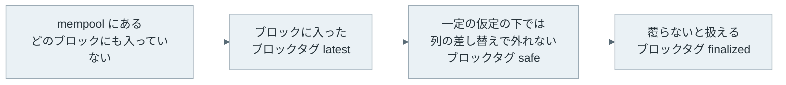
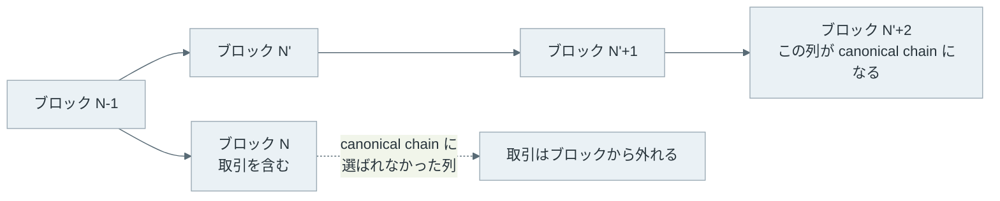
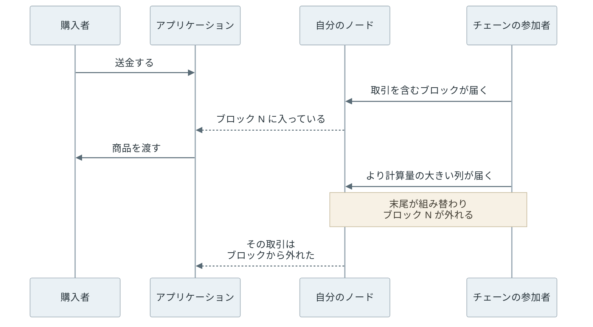
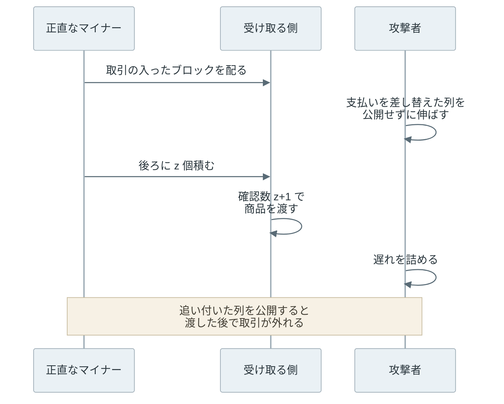
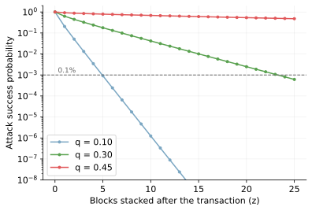
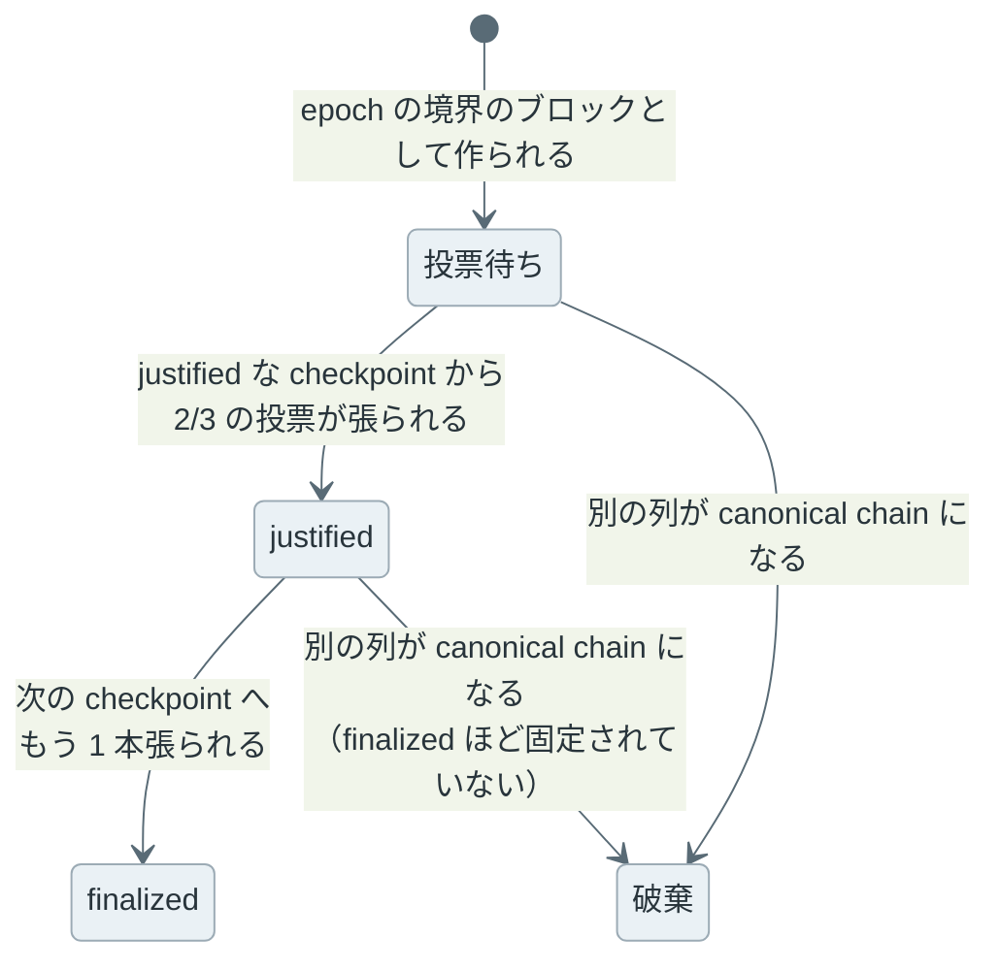
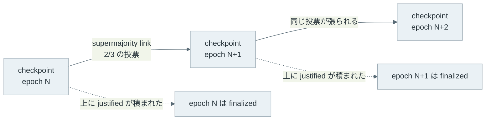
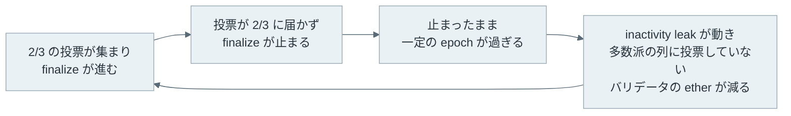
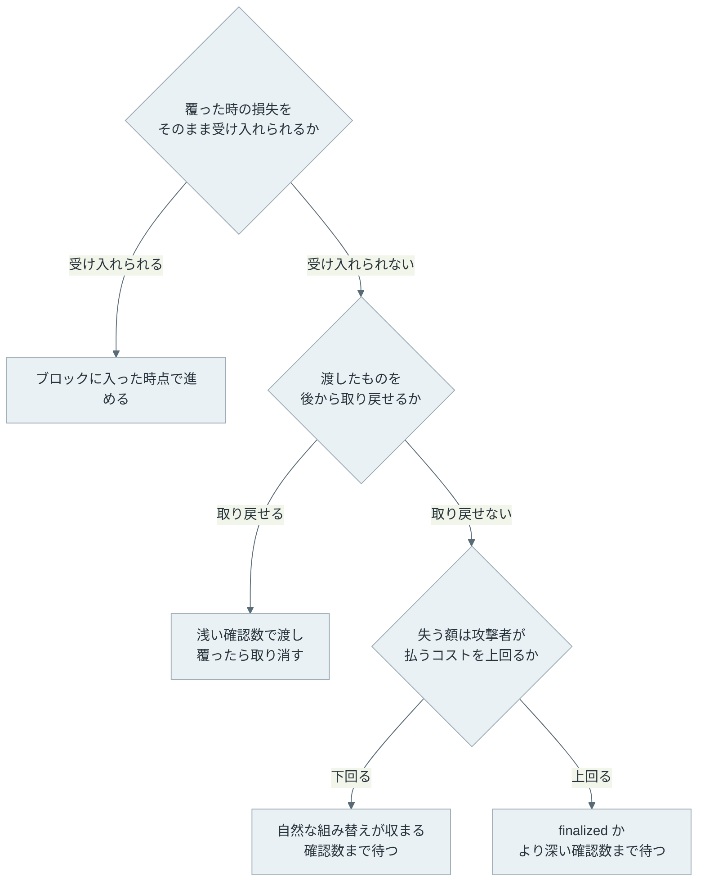
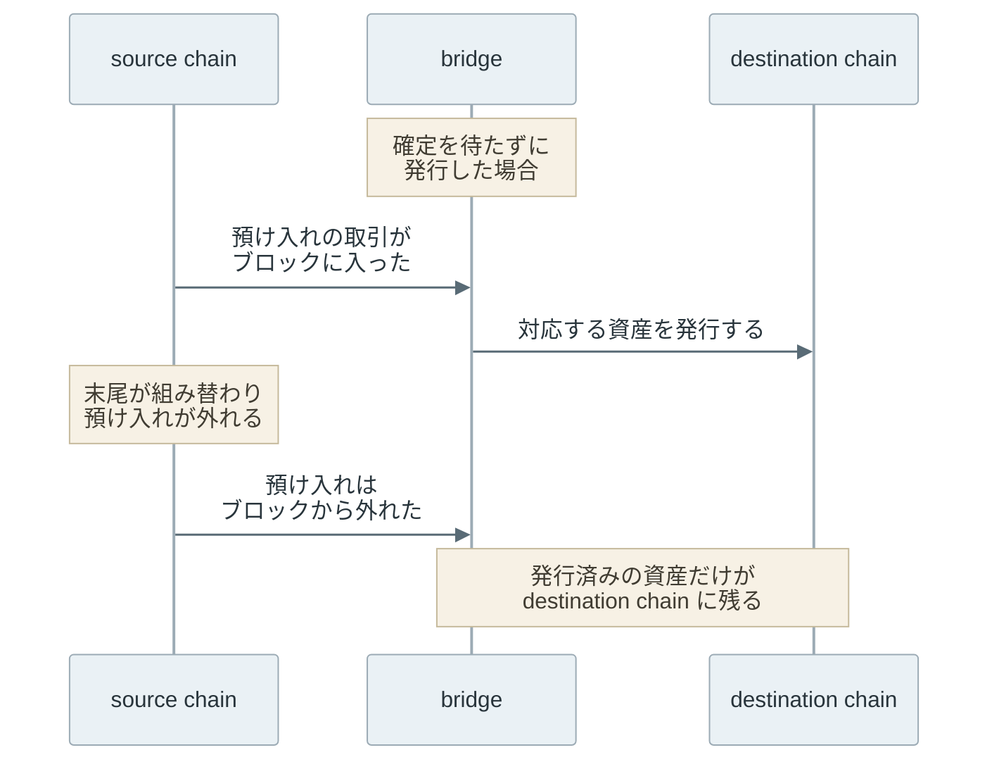

finality（ファイナリティ、確定性）は、一度確定したと扱った取引が後から覆らない性質です。この性質を注意深く扱う必要があるのは、入金を検知して商品を発送したり、[アカウントの残高](../ethereum-account-model/)を加算したりするアプリケーションを書く時です。取引が後で履歴から消えても、渡したものは戻ってきません。

取引がブロックに入ったことと、その取引をもう覆らないものとして扱えることは、別です。ブロックに入った後、外れにくくなる段階を経て、覆らないと扱える段階に至ります。Bitcoin は確認数で、Ethereum は投票でこの最後の段階を作ります。Ethereum のノードは段階を `latest`・`safe`・`finalized` の 3 つに分けます。この 3 つはブロック番号を使わずにブロックを指す文字列で、ブロックタグと呼びます。残高を尋ねる `eth_getBalance` にも、アドレスと一緒に渡します。

1 件の取引が通る段階と、3 つのタグの対応は以下の通りです。

`latest` を読むコードは最も早く反応できます。その代わり、読んだ内容が覆る確率も最も高くなります。

本記事では、アプリケーションが取引をいつ確定済みとして扱えるのかを説明します。ブロックに入った所から段階を追って、次の疑問に答えます。

- なぜ「ブロックに入った」と「確定した」を分けるのか。
- Bitcoin の確認数は、何を数えているのか。
- Ethereum では、checkpoint への投票がどのように finality を作るのか。投票が集まらなかった 2023 年 5 月には、何が起きたのか。
- finalized と「十分安全」は、どう違う判断なのか。
- 確認数をいくつ待つかは、何を材料に決めるのか。

1 件の送金がどの段階を通るのかは、[Bitcoin Transaction Lifecycle](../bitcoin-transaction-lifecycle/) で追っています。

---

### 「ブロックに入った」と「確定した」を分ける理由

ブロックに入った取引も、後から列から外れることがあります。典型的な例は、複数のマイナー（計算作業でブロックを作る参加者）がほぼ同時にブロックを作り、チェーンの末尾が一時的に 2 本に分かれた場合です。分かれた直後は、どちらの列も規則を満たしています。各参加者は、積まれた計算量が最も大きい列を canonical chain（正しい履歴として扱う列）に選び、選ばれなかった側のブロックは列から外れます。

この差し替えを reorg（chain reorganization、チェーンの組み替え）と呼びます。[Bitcoin Block](../bitcoin-block/) が「巻き戻り」と呼んでいるのは、reorg で取引がブロックから外れる現象です。

reorg を考えずに最新のブロックだけを見て入金を判定すると、次の流れで商品を失います。

外れた取引は、それだけで無効になるわけではありません。ただし、取り込みを待つ状態に戻るかどうかは、プロトコルの外で決まります。取引がまだ有効で、新しい canonical chain の取引と競合しない場合に限り、そのノードの [mempool](../mempool/) に戻ることがあります。逆に、支払う人が同じコインを別の宛先に使う取引を先に通した場合、その取引を含む列を canonical chain としているノードは、元の取引を受け入れなくなります。

---

### confirmation の数と覆る確率

Bitcoin には、この取引はもう覆らないと宣言する仕組みがありません。代わりに使うのが確認数（confirmation）で、取引を含むブロック自身を 1 個目として数え、後ろに積まれたブロックを足した値です。後ろにブロックが積まれるほど、その取引を外すためにやり直す [proof of work](../proof-of-work/) は大きくなります。

正直なマイナーは、規則どおりにブロックを作り、見つけたらすぐ公開する参加者です。攻撃者の書き換えが成功するのは、攻撃者が公開せずに伸ばした列が、正直なマイナーの列に追い付いた時です。

[Bitcoin の白書](https://bitcoin.org/bitcoin.pdf)は、支払った本人が攻撃者になる場合を想定しています。攻撃者はハッシュ計算能力の割合 `q` を握り、取引を送った時点から、支払いを取り消した列を公開せずに伸ばして追い付こうとします。次のブロックを正直な側と攻撃者のどちらが先に作るかの賭けを繰り返す形になるため、追い付ける確率は Gambler's Ruin（賭博者の破産問題）として計算できます。`q` が大きいほど、同じ確率まで下げるのに必要な `z` は増えます。

攻撃者が過半のハッシュ計算能力を握っていない限り、確率は `z` に対して指数的に下がります。一方で、0 には届きません。この性質を probabilistic finality（確率的な確定性）と呼びます。

白書は、成功確率が 0.1% を下回る `z` を `q` ごとに並べています。

| 攻撃者のハッシュ計算能力の割合 `q` | 必要な `z`（後ろに積むブロック数） | 確認数（`z + 1`） |
| --- | --- | --- |
| 0.10 | 5 | 6 |
| 0.15 | 8 | 9 |
| 0.20 | 11 | 12 |
| 0.25 | 15 | 16 |
| 0.30 | 24 | 25 |
| 0.35 | 41 | 42 |
| 0.40 | 89 | 90 |
| 0.45 | 340 | 341 |

確認数 6 は、Bitcoin の規則で定められた値ではなく、`q` を 0.10 と置いた時の値です。`q` を 0.30 と見るなら 25 必要になります。また、表の値は上のモデルの中での確率で、ネットワークの分断、実装とコンセンサスの不具合、参加者の調整による介入は含みません。

---

### checkpoint への投票による finality

Ethereum のバリデータ（validator）は、ether をプロトコルに預けて、ブロックの提案と検証と投票を行う参加者です。規則に反する投票を残すと、預けた ether が減らされます。

この投票を finality に変える仕組みが Casper FFG（Casper the Friendly Finality Gadget）です。Ethereum の時間は 12 秒の slot に区切られ、32 slot で 1 epoch（6 分 24 秒）になります。[finality のための投票が対象にするのは全てのブロックではなく、epoch の境界にあるブロックだけ](https://ethereum.org/en/developers/docs/consensus-mechanisms/pos/gasper/)で、これを checkpoint と呼びます。

checkpoint は 2 段階で確定します。1 票には、起点と行き先の 2 つの checkpoint を書きます。起点は既に justified な checkpoint で、最初の起点はチェーンの最初のブロックです。預けられた ether の 2/3 が同じ起点と行き先の組に投票すると、行き先の checkpoint が justified になります。justified になった checkpoint を起点に、直後の checkpoint へ同じように 2/3 の投票が集まると、その起点が finalized に変わります。

ブロックタグの `finalized` が指すのは、この finalized になった checkpoint です。確定が投票より 1 epoch 遅れるのは、この 2 段階を踏むためです。2 つの checkpoint を繋ぐ 2/3 の投票は supermajority link と呼ばれ、これが途切れずに続く限り、justified は 1 つずつ先へ延びていきます。

finalized な checkpoint と矛盾する別の checkpoint を finalized にするには、2/3 の投票が 2 つ必要です。2 つの 2/3 は必ず 1/3 以上重なるので、預けられた ether の 1/3 以上を占めるバリデータが、処罰の対象になる投票を証拠として残し、その ether を失います。[Casper FFG](https://arxiv.org/abs/1710.09437) は、この性質を accountable safety と呼びます。誰が矛盾する投票をしたのかを特定できる点が、計算量を積み直す方式との違いです。

ただし、この保証が効くのはバリデータの預け入れが動かない間です。後で触れる inactivity leak が働くと、誰も処罰されないまま両方の checkpoint が finalized になり得ます。

---

### finalized と「十分安全」の判断の違い

finalized も確認数の閾値も、もう覆らないだろうという判断です。しかし、線を引いた主体が違います。

`finalized` という保証には、例外が書き添えられています。ブロックタグを定義している [Ethereum 実行層 API の schema](https://github.com/ethereum/execution-apis/blob/main/src/schemas/block.yaml) には、「cannot be re-orged outside of manual intervention driven by community coordination」（コミュニティの調整による手動の介入を除いて、reorg され得ない）とあります。

手動の介入がどう働くかは、Bitcoin で起きた分岐が参考になります。

2013 年 3 月、実装の間で規則が食い違ってチェーンが 2 本に分かれました。片方が当時のハッシュ計算能力の約 60% を持っていた一方、もう片方の実装はそのブロックを規則違反として拒み続けたため、分岐は自動では解消しませんでした。マイニングプール（採掘を共同で行うマイナーの集まり）が古いバージョンへ切り替えたことで、チェーンは 1 本に戻りました。[BIP 50](https://github.com/bitcoin/bips/blob/master/bip-0050.mediawiki) には、実験として行われた二重支払いが成立したことも記録されています。

チェーンの選択を決めたのは、プロトコルではなく、外にいる人の調整です。Bitcoin には Ethereum の finalized checkpoint に相当する宣言がないため、これは finality が覆った例ではありません。

 

3 つのブロックタグのうち、まだ触れていない `safe` は、`latest` と `finalized` の間にあります。ブロックタグの定義では、正直なバリデータ（規則どおりに投票する参加者）が多数派であるという仮定と、ネットワークの遅延が想定の範囲に収まるという仮定の下で、reorg されない最も新しいブロックを指します。

どのブロックが `safe` かを決めるのは、取引を実行する実行層ではなく、バリデータの投票を集める合意層（consensus layer）です。

`safe` は処罰ではなく仮定を根拠にしており、仮定が崩れれば誰も処罰されないまま覆り得ます。この点が `finalized` との違いです。

4 つの判断それぞれについて、誰がどこに線を引いているのかを以下にまとめます。

| 判断の拠り所 | 何が言えるか | 引いた主体 |
| --- | --- | --- |
| `latest` | 健全な状態でも外れ得る | クライアントの観測 |
| `safe` | 正直な多数派と、遅延が想定内という仮定の下では reorg されない | 合意層（仮定を根拠に） |
| `finalized` | 手動の介入を除いて覆らない | プロトコル（処罰を根拠に） |
| 確認数の閾値 | 白書のモデルの下で、覆る確率が自分で決めた値を下回った | アプリケーションの運用 |

---

### finalize の停止と inactivity leak

Casper FFG が証明しているのは、先に触れた accountable safety と、plausible liveness の 2 つです。plausible liveness は、過去に何が起きていても、2/3 のバリデータが規則に従っている限り、誰も処罰されずに次の checkpoint を finalize できるという性質です。

その 2/3 が集まらない状態から抜け出す手段も、同じ論文が inactivity leak として示しています。Ethereum では finality の遅れが一定の epoch 数を超えると leak に入り、投票している側が全体の 2/3 を占めるまで、多数派の列に投票していないバリデータの残高を減らし続けます。ネットワークが 2 つに分かれ続けると、両側でそれぞれ相手側の残高が減り、両側が別々に 2/3 に届いて finalize し得ます。

2023 年 5 月 11 日と 12 日には、Ethereum のメインネットで finalize が実際に 2 回止まり、合意層を動かすソフトウェア（クライアント）の 1 つである Prysm の開発元が[事後報告](https://prysm.offchainlabs.com/docs/misc/mainnet-postmortems/)を公開しています。古い checkpoint を行き先とする投票が大量に届き、Prysm などは、その投票を検証するために過去の状態を計算し直して資源を使い果たしました。処理が追い付かなくなると、ブロックと投票が欠けて、投票が 2/3 に届かない epoch が続きました。

1 回目は約 25 分、2 回目は約 1 時間止まり、2 回目は途中から inactivity leak の処罰が掛かりました。回復を助けたのは影響を受けなかった別のクライアントで、誰も介入しないまま finalize が再開しました。その間もブロックは作られ続け、ユーザーの取引への影響はわずかでした。

進まなくなるのは `finalized` を待つアプリケーションで、`latest` だけを見ているコードは finalize の停止に気付きません。

---

### 確認数をいくつ待つかを決める材料

確認数の閾値は、チェーンではなくアプリケーションが決めます。判断の出発点は、覆った時の損失をそのまま受け入れられるかどうかです。

図で攻撃コストを最後に問うのは、攻撃者がいなくても、複数のマイナーが同時にブロックを作れば組み替えが起きるからです。攻撃コストは、後ろに積まれたブロックを作り直す計算のコストで見積もります。

待てる時間も材料です。ブロック間隔が 10 分のチェーンで確認数 6 まで待つと、取り込まれてから 50 分、送信から数えると 1 時間ほどかかります。Ethereum の `finalized` が指すのは、順調な時でも 2 epoch 前の checkpoint です。現在が epoch のどこにいるかで、13 分から 19 分ほど過去のブロックになります。

チェーンの性質も、同じ確認数の意味を変えます。ハッシュ計算能力が少数の参加者に集中している proof of work のチェーンでは、仮定する `q`（攻撃者が握るハッシュ計算能力の割合）を大きく取る方が現実的で、必要な `z` はその分だけ増えます。

少額はブロックに入った時点、中額は決めた確認数、高額は finalized と、金額のレンジごとに待つ段階を変える方法もあります。閾値を設定として外に出しておくと、変える時にコードを触らずに済みます。

取引を見つけた時のブロックのハッシュを控えておくと、後から同じ位置に残っているかを確かめられます。

---

### 別のチェーンの状態を信じる時点

2 つのチェーンをまたいで資産を移す bridge も、同じ判断をプログラムとして下しています。source chain（送り出す側のチェーン）で資産が預けられたことを確かめてから、destination chain（受け取る側のチェーン）で対応する資産を発行します。

destination chain に裏付けのない資産が残るのは、bridge が預け入れを確定と扱うのが早すぎたからです。

取引がブロックに入っていることは、[Bitcoin Merkle Tree](../bitcoin-merkle-tree/) の包含証明で確かめられます。しかし、包含証明が示すのはブロックの中にあることまでで、そのブロックが canonical chain に残るかどうかは別です。確率的な finality を相手にする bridge は、何ブロック待つかを自分で決めます。

相手が Casper FFG のような finality gadget を持つチェーンなら、確認数を自分で決める代わりに、プロトコルが finalized とした状態を検証する方法があります。Ethereum には、finalized としたヘッダを追跡できる Light Client Protocol があり、[その仕様](https://github.com/ethereum/consensus-specs/blob/master/specs/altair/light-client/sync-protocol.md)には、想定する利用先の 1 つとして cross-chain bridge を動かす環境が挙げられています。

この手順で軽量クライアントが受け取るのは、sync committee（署名役として一定期間ごとに選ばれるバリデータの一団）が署名したヘッダ（attested header）と、そのヘッダが要約する状態に finalized checkpoint が含まれることを示す Merkle の経路（finality branch）です。署名でヘッダを認証し、経路で finalized checkpoint を確かめます。

この署名と経路をどこまで信頼して良いのかは軽量クライアントの設計の話であり、本記事では扱いません。

---

### 確定を待たずに進めて良い場面

以下は、確認数を積む前に進めても損害が限定される場面です。

- 覆った時の損害が、攻撃者の払うコストより明らかに小さい少額の受け取り
- アカウントの機能開放のように、後から停止して取り消せる操作
- 残高を仮に加算し、確定後に差額を調整する会計上の記録
- 未確認であることを添えて取引の状態を見せるだけの、価値を渡さない表示
- 同じ運営者が両端を持ち、食い違いを後から直せる内部の移動

どの項目も、覆った時の損害を誰かが引き受けることを前提にしています。相手が決まっていない設計では、待つ選択の方が安全だと考えられます。
