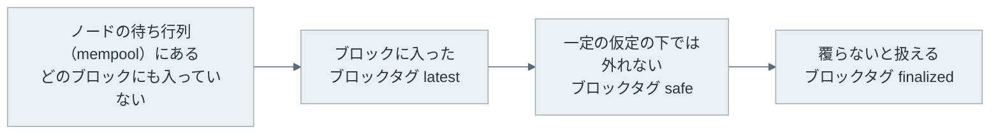
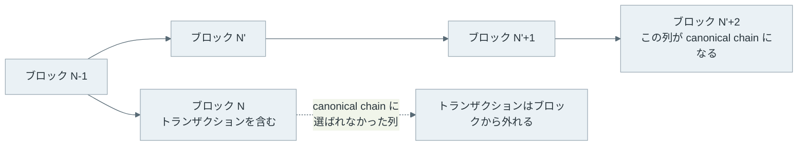
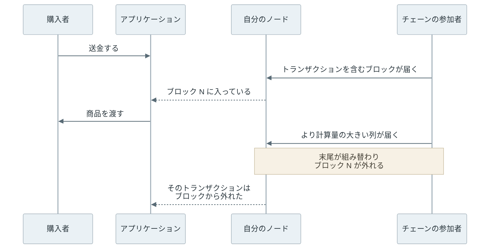
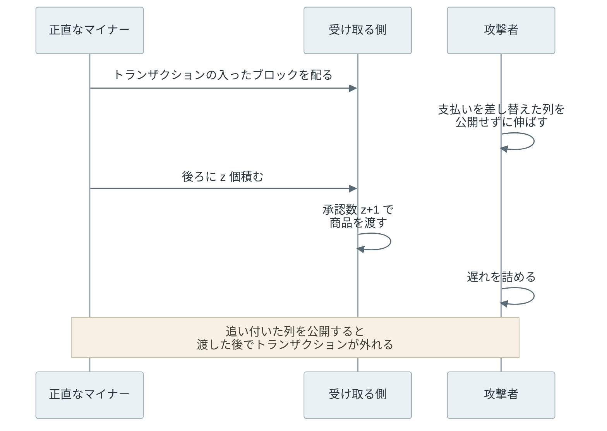
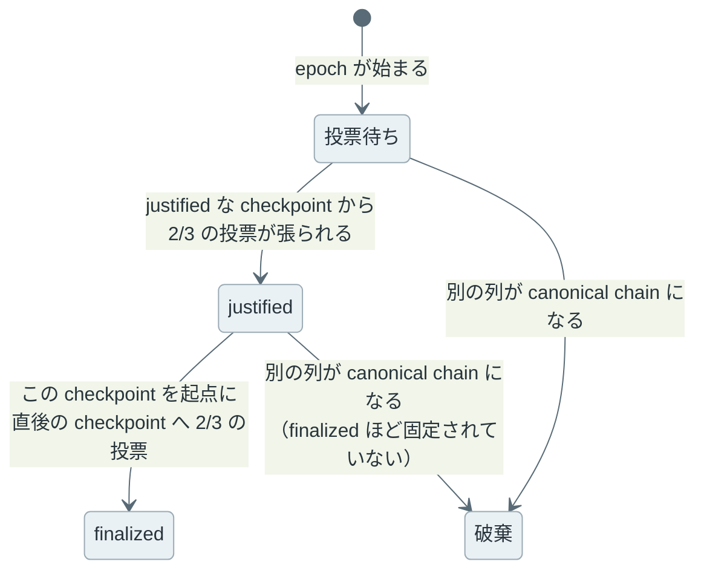
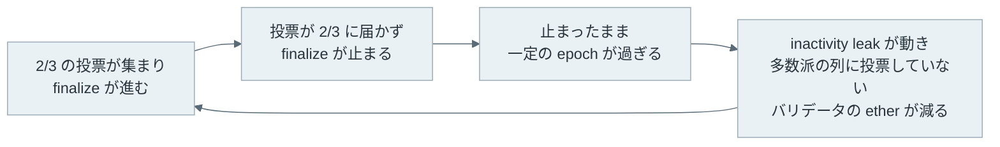
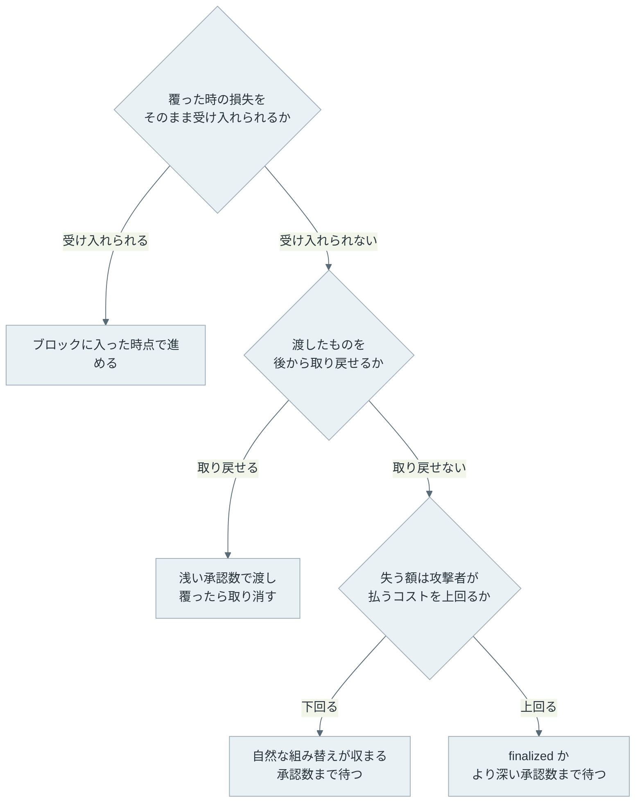
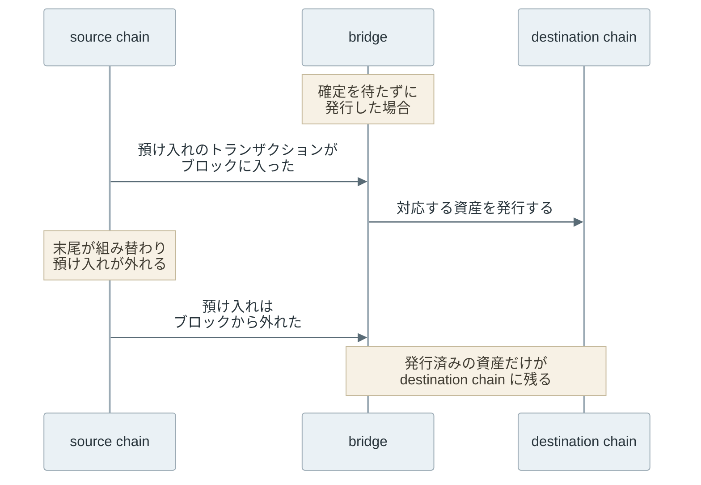

finality（ファイナリティ、確定性）は、一度確定したと扱ったトランザクションが後から覆らない性質です。この性質を注意深く扱う必要があるのは、入金を検知して商品を発送したり、[アカウントの残高](../ethereum-account-model/)を加算したりするアプリケーションを書く時です。トランザクションが後で履歴から消えても、渡したものは戻ってきません。

トランザクションがブロックに入ったことと、そのトランザクションをもう覆らないものとして扱えることは、別です。ブロックに入った後、外れにくくなる段階を経て、覆らないと扱える段階に至ります。[Bitcoin](https://bitcoin.org/) は後ろに積まれたブロックの数（承認数）で近似し、[Ethereum](https://ethereum.org/) は参加者（バリデータ）の投票でこの最後の段階を作ります。

Ethereum のノード（チェーンのデータを保持し、アプリケーションからの問い合わせに答えるサーバー）は、段階を `latest`・`safe`・`finalized` の 3 つに分けます。この 3 つはブロック番号を使わずにブロックを指す文字列で、ブロックタグと呼びます。ノードに残高を尋ねる API（`eth_getBalance`）にも、アドレスと一緒に渡します。

1 件のトランザクションが通る段階と、3 つのタグの対応は以下の通りです。

`latest` を読むコードは最も早く反応できます。その代わり、読んだ内容が覆る確率も最も高くなります。

 

本記事では、アプリケーションがトランザクションをいつ確定済みとして扱えるのかを説明します。ブロックに入った所から段階を追って、次の疑問に答えます。

- なぜ「ブロックに入った」と「確定した」を分けるのか。
- Bitcoin の承認数は、何を数えているのか。
- Ethereum では、バリデータの投票がどのように finality を作るのか。投票が集まらなかった 2023 年 5 月には、何が起きたのか。
- `finalized`・`safe`・承認数は、それぞれ誰が何を根拠に決めるのか。
- 承認数をいくつ待つかは、何を材料に決めるのか。
- 別のチェーンの状態を受け入れる bridge はどこまで待つのか。待たずに進めて良いのはどんな場面か。

1 件の送金がどの段階を通るのかは、[Bitcoin Transaction Lifecycle](../bitcoin-transaction-lifecycle/) で追っています。Bitcoin と Ethereum 以外のチェーンが確定を作る方法は、[CometBFT](../cometbft/)・[Snowman](../snowman/)・[Proof of Authority](../proof-of-authority/)・[Proof of History](../proof-of-history/) のノートで説明しています。

---

### 「ブロックに入った」と「確定した」を分ける理由

ブロックに入ったトランザクションも、後から列から外れることがあります。Bitcoin での典型的な例は、複数のマイナー（計算作業でブロックを作る参加者）がほぼ同時にブロックを作り、チェーンの末尾が一時的に 2 本に分かれた場合です。分かれた直後は、どちらの列も規則を満たしています。各参加者は、積まれた計算量（ブロックを作るのに費やした計算の総量）が最も大きい列を canonical chain（正しい履歴として扱う列）に選び、選ばれなかった側のブロックは列から外れます。

この差し替えを reorg（chain reorganization、チェーンの組み替え）と呼びます。

reorg を考えずに最新のブロックだけを見て入金を判定すると、次の流れで商品を失います。

外れたトランザクションは、それだけで無効になるわけではありません。ただし、取り込みを待つ状態に戻るかどうかは規則で保証されておらず、各ノードの扱いによります。トランザクションがまだ有効で、新しい canonical chain のトランザクションと競合しない場合に限り、そのノードの [mempool](../mempool/) に戻ることがあります。

逆に、支払う人が同じコインを別の宛先に使うトランザクションを先に通した場合、そのトランザクションを含む列を canonical chain としているノードは、元のトランザクションを受け入れなくなります。

---

### confirmation の数と覆る確率

Bitcoin には、このトランザクションはもう覆らないと宣言する仕組みがありません。代わりに使うのが承認数（confirmation）で、トランザクションを含むブロック自身を 1 個目として数え、後ろに積まれたブロックを足した値です。後ろにブロックが積まれるほど、そのトランザクションを外すためにやり直す [proof of work](../proof-of-work/) は大きくなります。

ここまでの分岐は偶然に起きるものでした。承認数が意味を持つのは、トランザクションを意図して外そうとする攻撃者がいる場合です。

正直なマイナーは、規則どおりにブロックを作り、見つけたらすぐ公開する参加者です。攻撃者の書き換えが成功するのは、攻撃者が公開せずに伸ばした列が、正直なマイナーの列に追い付いた時です。

[Bitcoin のホワイトペーパー](https://bitcoin.org/bitcoin.pdf)は、支払った本人が攻撃者になる場合を想定しています。攻撃者は全体のハッシュ計算能力（ブロックを見つける計算の速さ）のうち割合 `q` を握り、トランザクションを送った時点から、支払いを取り消した列を公開せずに伸ばして追い付こうとします。受け取る側は、トランザクションの後ろに `z` 個のブロックが積まれるまで待ちます。

次のブロックを正直な側と攻撃者のどちらが先に作るかの賭けを繰り返す形になるため、追い付ける確率は Gambler's Ruin（賭博者の破産問題）として計算できます。`q` が大きいほど、同じ確率まで下げるのに必要な `z` は増えます。



攻撃者が過半のハッシュ計算能力を握っていない限り、攻撃の成功確率（追い付く確率）は `z` に対して指数的に下がります。一方で、0 には届きません。この性質を probabilistic finality（確率的な確定性）と呼びます。一度確定したブロックは組み替えず、ノードの間で確定が食い違う確率だけが小さく残る方式もあります（[Snowman](../snowman/#確率的な確定の意味)）。

ホワイトペーパーは、成功確率が 0.1% を下回る `z` を `q` ごとに並べています。

| 攻撃者のハッシュ計算能力の割合 `q` | 必要な `z`（後ろに積むブロック数） | 承認数（`z + 1`） |
| --- | --- | --- |
| 0.10 | 5 | 6 |
| 0.15 | 8 | 9 |
| 0.20 | 11 | 12 |
| 0.25 | 15 | 16 |
| 0.30 | 24 | 25 |
| 0.35 | 41 | 42 |
| 0.40 | 89 | 90 |
| 0.45 | 340 | 341 |

承認数 6 は、Bitcoin の規則で定められた値ではなく、`q` を 0.10 と置いた時の値です。`q` を 0.30 と見るなら 25 必要になります。また、表の値は上のモデルの中での確率で、ネットワークの分断、実装と合意の規則の不具合、コミュニティの調整による手動の介入は含みません。

---

### checkpoint への投票による finality

Ethereum のバリデータ（validator）は、Ethereum の通貨 ether をプロトコルに預けて、ブロックの提案と検証と投票を行う参加者です。規則に反する投票（矛盾する 2 票など）を残すと、その証拠によって預けた ether の一部または全部が没収されます。

これを slashing と呼び、本記事で「スラッシング」と書く時はこれだけを指します。参加の仕組みと報酬・罰則の違いは、[Proof of Stake](../proof-of-stake/) で説明しています。

Ethereum では、どの列を canonical chain に選ぶかを計算量ではなく、バリデータの投票の重み（預けた ether の量）で決めます。この選び方でも末尾は組み替わり得るので、Ethereum でも `latest` のブロックは、より重い列が現れれば外れます。

この投票を finality に変える仕組みが [Casper FFG](https://arxiv.org/abs/1710.09437)（Casper the Friendly Finality Gadget）です。投票の対象を説明するために、まず Ethereum の時間の区切りを見ます。

Ethereum の時間は 12 秒の slot に区切られ、1 つの slot で作られるブロックは最大 1 個です。32 slot で 1 epoch（6 分 24 秒）になります。finality の投票が対象にするのは全てのブロックではなく、各 epoch に 1 つずつ置かれる checkpoint です。



checkpoint は、epoch の先頭 slot のブロックです。図の epoch N+1 のように先頭 slot が空（ブロックが作られなかった slot）なら、直前までに作られた最新のブロックを checkpoint とします（[Consensus Specifications](https://ethereum.github.io/consensus-specs/specs/phase0/beacon-chain/#get_block_root) の規則）。

 

checkpoint の状態は、投票待ち・justified（正当化済み）・finalized（確定済み）の 3 つです。出発点として、チェーンの最初のブロックの checkpoint だけは、初めから justified かつ finalized と決めておきます。

1 票は「既に合意した checkpoint から、次の checkpoint まで合意を延ばしてよい」という意思表示で、ある checkpoint から別の checkpoint への矢印として書きます。矢印の根元を起点（source）、先をターゲット（target）と呼び、起点には既に justified な checkpoint を選びます。



図の矢印に添えた 2/3 は、預けられた ether の 2/3 にあたるバリデータが、同じ起点とターゲットの組に投票したことを表します。justified（正当化済み）な起点から 2/3 の投票が張られたターゲットの checkpoint が、justified になります。最初のブロックから epoch 1 への 2/3 で epoch 1 が、epoch 1 から epoch 2 への 2/3 で epoch 2 が justified になり、1 つずつ先へ延びていきます。

起点とターゲットが隣り合う checkpoint の場合は、ターゲットが justified になるのに加えて、起点が finalized（確定済み）に変わります。図で epoch 1 が finalized なのは、epoch 1 から直後の epoch 2 へ 2/3 が集まったからです。

Casper FFG の論文の規則では、epoch を飛ばした投票（epoch 1 から epoch 3 へなど）でターゲットは justified になりますが、起点は finalized になりません。Ethereum の実装は少し広く、間の checkpoint も justified なら、1 つ飛ばしの投票でも起点が finalized になる場合があります。以下の状態図は、論文の規則で描いています。

ブロックタグの `finalized` が指すのは、この finalized になった checkpoint です。finalized が justified より 1 epoch 遅れるのは、この 2 段階を踏むためです。

投票は epoch の間ずっと集まるため、ある epoch の checkpoint が justified になるのは、その epoch が終わる頃です。そのため順調な時、現在から見て justified は 1 つ前、finalized は 2 つ前の epoch の checkpoint になります。

状態図の「破棄」は、checkpoint を含む列が選ばれなかった場合です。justified になった checkpoint でも、別の列が選ばれれば捨てられます。

 

ある checkpoint A が finalized になった後で、A と矛盾する（同じ列に並ばない、別の分岐にある）checkpoint B も finalized になったとします。この時、A を確定させた 2/3 の投票と、B に至る justified の列を作った 2/3 の投票が両方存在します。[2 つの 2/3 は必ず 1/3 以上重なる](/notes/distributed-systems/byzantine-fault-tolerance/)ので、預けられた ether（stake）の 1/3 以上を占めるバリデータが、A 側と B 側の両方に投票していることになります。

以下は、2 つの 2/3 が全体の中でどう重なるかを簡略化した図です。



規則では、1 人のバリデータが同じ epoch をターゲットとする 2 票を投じることと、一方がもう一方を内側に包む 2 票（例えば epoch 1→4 と epoch 2→3）を投じることを禁じています。Casper FFG の論文の証明によると、矛盾する 2 つの checkpoint が両方確定した時は、stake の 1/3 以上を占めるバリデータが、必ずどこかでこの禁じられた組を投じています。

そのため、少なくとも stake の 1/3 にあたるバリデータが、スラッシング（slashing）の対象になる投票を証拠として残し、預けた ether を没収されます。Casper FFG の論文は、この性質を accountable safety と呼びます。誰が矛盾する投票をしたのかを特定できる点が、計算量を積み直す方式との違いです。

---

### finalized・safe・承認数の違い

`finalized` という保証には、例外が書き添えられています。ブロックタグを定義している [Ethereum の API の schema](https://github.com/ethereum/execution-apis/blob/main/src/schemas/block.yaml) には、「cannot be re-orged outside of manual intervention driven by community coordination」（コミュニティの調整による手動の介入を除いて、reorg され得ない）とあります。

つまり、例えば参加者が話し合ってソフトウェアを差し替えるような、プロトコルの規則の外にある手段までは保証していません。

 

3 つのブロックタグのうち、まだ触れていない `safe` は、`latest` と `finalized` の間にあります。ブロックタグの定義では、正直なバリデータ（規則どおりに投票する参加者）が多数派であるという仮定と、ネットワークの遅延が想定の範囲に収まるという仮定の下で、reorg されない最も新しいブロックを指します。

Ethereum のノードは、トランザクションを実行して残高などを管理する実行レイヤー（execution layer）と、バリデータの投票を集めてどのブロックを列に採るかを決めるコンセンサス・レイヤー（consensus layer）の 2 つのソフトウェアで動きます。それぞれのソフトウェアをクライアントと呼びます。

どのブロックが `safe` かを決めるのは、実行レイヤーではなくコンセンサス・レイヤーです。アプリケーションが呼ぶ `eth_getBalance` などは実行レイヤーの API で、コンセンサス・レイヤーの判断が実行レイヤーへ渡され、ブロックタグとして返ってきます。

順調な時に 3 つのブロックタグが指す位置は、以下の通りです。



`safe` はスラッシングではなく仮定を根拠にしており、仮定が崩れれば誰もスラッシングされないまま覆り得ます。この点が `finalized` との違いです。

`safe` の位置を図で幅にしたのは、どのブロックを返すかがクライアントの実装と版で変わるからです。

2026 年 11 月時点の [Consensus Specifications](https://github.com/ethereum/consensus-specs/blob/master/specs/bellatrix/fast-confirmation.md) には、投票の集まり具合から finalized を待たずに外れないと判断する規則（Fast Confirmation Rule）で確認したブロックを `safe` とする定義があります。ただし、各クライアントがその規則をいつ採り入れるかは別です。

同じ時点で、[Lighthouse](https://github.com/sigp/lighthouse) と [Prysm](https://github.com/OffchainLabs/prysm) はこの規則をオプションで有効にする形です。既定では、Lighthouse は justified な checkpoint のブロックを、Prysm は集計途中の投票で justified の条件を満たした checkpoint（unrealized justified）のブロックを `safe` として返します。

`safe` を使う時は手元のクライアントの説明を確認する必要があります。

ここまでの 3 つは、ノードがブロックタグとして返すものです。一方で、Bitcoin と同じく承認数で判断する方法は Ethereum でも使え、その閾値はアプリケーションの運用者が決めます。4 つの判断それぞれについて、誰がどこに線を引いているのかを以下にまとめます。

| 判断の拠り所 | 何が言えるか | 引いた主体 |
| --- | --- | --- |
| `latest` | 健全な状態でも外れ得る | ノード（受け取った最新のブロック） |
| `safe` | 正直な多数派と、遅延が想定内という仮定の下では reorg されない | コンセンサス・レイヤー（仮定を根拠に） |
| `finalized` | 手動の介入を除いて覆らない | コンセンサス・レイヤー（スラッシングを根拠に） |
| 承認数の閾値 | ホワイトペーパーが置いたモデルの下で、覆る確率が自分で決めた値を下回った | アプリケーションの運用 |

---

### finalize の停止と inactivity leak

Casper FFG が証明しているのは、先に触れた accountable safety と、plausible liveness の 2 つです。plausible liveness は、2/3 以上のバリデータが規則に従っている限り、それまでに何が起きていても、誰もスラッシングされずに次の checkpoint を finalize できる余地が常に残る、という性質です。

投票が 2/3 に届かない場合に確定を再開する仕組みとして、同じ論文では inactivity leak を示しています。

Ethereum では finality の遅れが一定の epoch 数を超えると leak に入り、投票している側が全体の 2/3 を占めるまで、多数派の列に投票していないバリデータの残高を減らし続けます。これは矛盾する投票の証拠による slashing ではなく、投票に参加しないことによる残高の減少です。

ネットワークが 2 つに分かれ続けると、両側でそれぞれ相手側の残高が減り、両側が別々に 2/3 に届いて finalize し得ます。

この場合は誰もスラッシングされないまま、矛盾する 2 つの checkpoint が finalized になり得ます。checkpoint の節で見た重なりの保証は、各バリデータの残高（投票の重み）が変わらない間だけ効くということです。この時どちらの列を残すかは、`finalized` の例外として触れた手動の介入で決めることになります。

2023 年 5 月 11 日と 12 日には、Ethereum の[メインネット](../mainnet-and-testnet/)で finalize が実際に 2 回止まり、コンセンサス・レイヤーのクライアントである Prysm の開発元が[事後報告](https://prysm.offchainlabs.com/docs/resources/mainnet-postmortems/)を公開しています。

実行レイヤーのクライアントが応答しない時に古い checkpoint へ投票する一部のクライアントの挙動により、古い checkpoint をターゲットとする投票が大量に届きました。Prysm などは、その投票がその epoch に投票を割り当てられたバリデータのものかを検証するために、古い checkpoint の時点に戻したコンセンサス・レイヤーの状態（バリデータの一覧や残高などのデータ）を計算し直して資源を使い果たしました。処理が追い付かなくなると、ブロックと投票が欠けて、投票が 2/3 に届かない epoch が続きました。

止まっていた長さを epoch 単位で並べると、以下のようになります。



1 回目は約 25 分、2 回目は約 1 時間止まり、2 回目は途中から inactivity leak による残高の減少が始まりました。回復を助けたのは影響を受けなかった別のクライアントで、誰も介入しないまま finalize が再開しました。その間もブロックは作られ続け、ユーザーが送るトランザクションへの影響はわずかでした。

進まなくなるのは `finalized` を待つアプリケーションで、`latest` だけを見ているコードは finalize の停止に気付きません。

---

### 承認数をいくつ待つかを決める材料

承認数の閾値は、チェーンではなくアプリケーションが決めます。判断の出発点は、覆った時の損失をそのまま受け入れられるかどうかです。

攻撃コストが損失を上回る（攻撃が割に合わない）場合でも、自然な組み替えが収まるまでは待ちます。攻撃者がいなくても、複数のマイナーが同時にブロックを作れば組み替えが起きるからです。攻撃コストは、proof of work では後ろに積まれたブロックを作り直す計算のコストで見積もります。Ethereum の `finalized` を覆す場合は、前の重なりの図のとおり、預け入れの 1/3 以上がスラッシングの対象になります。

アプリケーションが入金確認に使える時間も、待つ承認数を決める条件です。ブロック間隔が 10 分のチェーンで承認数 6 まで待つと、取り込まれてから 50 分、送信から数えると 1 時間ほどかかります。

Ethereum の `finalized` が指すのは、「finalized・safe・承認数の違い」の図のとおり、順調な時でも 2 epoch 前の checkpoint です。現在が epoch のどこにいるかで、13 分から 19 分ほど過去のブロックになります。

Bitcoin の承認数 3 と 6、Ethereum の `finalized` について、取り込まれてから確定扱いにするまでの時間を並べると、以下のようになります。Ethereum の棒の濃い部分は、取り込まれた位置が epoch のどこかで変わる幅です。



Bitcoin の値は平均で、ブロックの間隔は毎回ばらつきます。

チェーンの性質も、同じ承認数の意味を変えます。ハッシュ計算能力が少数の参加者に集中している proof of work のチェーンでは、仮定する `q`（攻撃者が握るハッシュ計算能力の割合）を大きく取る方が現実的で、必要な `z` はその分だけ増えます。

少額はブロックに入った時点、中額は決めた承認数、高額は finalized と、金額のレンジごとに待つ段階を変える方法もあります。閾値を設定として外に出しておくと、変える時にコードを触らずに済みます。

トランザクションを見つけた時のブロックのハッシュを控えておくと、後から同じ位置に残っているかを確かめられ、reorg で外れたことに気付けます。

---

### 別のチェーンの状態を信じる時点

2 つのチェーンをまたいで資産を移す [bridge](../cross-chain-bridge/) も、同じ判断をプログラムとして下しています。source chain（送り出す側のチェーン）で資産が預けられたことを確認してから、destination chain（受け取る側のチェーン）で対応する資産を発行します。

destination chain に裏付けのない資産が残るのは、bridge が預け入れを確定と扱うのが早すぎたからです。

トランザクションがブロックに入っていることは、[Bitcoin Merkle Tree](../bitcoin-merkle-tree/) の包含証明（トランザクションがブロックに含まれることを示す短い証明）で確認できます。しかし、包含証明が示すのはブロックの中にあることまでで、そのブロックが canonical chain に残るかどうかは別です。確率的な finality を相手にする bridge は、何ブロック待つかを自分で決めます。

 

相手が Casper FFG のような finality gadget（投票で確定を作る仕組み）を持つチェーンなら、承認数を自分で決める代わりに、プロトコルが finalized とした状態を検証する方法があります。Ethereum には、全てのブロックを検証しなくても、finalized なブロックのヘッダ（ブロックの要約）を追えるライト・クライアント（light client）のための Light Client Protocol があります。

Light Client Protocol の[仕様](https://github.com/ethereum/consensus-specs/blob/master/specs/altair/light-client/sync-protocol.md)には、想定する利用先の 1 つとして cross-chain bridge を動かす環境が挙げられています。

ライト・クライアントがどう検証するのかは、本記事では扱いません。

---

### 確定を待たずに進めて良い場面

以下は、確定（`finalized` や十分な承認数）を待つ前に進めても損害が限定される場面です。

- 覆った時の損失をそのまま受け入れられる少額の受け取り
- アカウントの機能開放のように、後から停止して取り消せる操作
- 残高を仮に加算し、確定後に差額を調整する会計上の記録
- 未確認であることを添えてトランザクションの状態を見せるだけの、価値を渡さない表示
- 同じ運営者が両端を持ち、食い違いを後から直せる内部の移動

価値を渡さない表示を除けば、どの項目も、覆った時の損害を誰かが引き受けることを前提にしています。損害を引き受ける相手が決まっていない設計では、待つ選択の方が安全だと考えられます。
