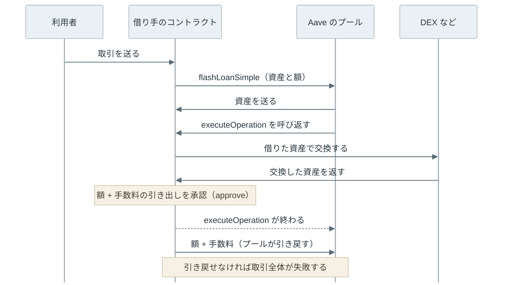

flash loan は、担保を預けずに暗号資産を借り、同じ取引の中で返済する貸し出しです。[Lending](../lending/) で扱ったレンディングプロトコル（ブロックチェーンの上で暗号資産を貸し借りする仕組み）の [Aave](https://aave.com/docs/aave-v3/overview) などが提供しています。通常の借入では、借りる額より価値の大きい担保を先に預けますが、flash loan ではその担保が要りません。

担保なしで貸せば、借り手が返さずに逃げてしまいそうです。flash loan では、返済が無ければ借りたこと自体が取り消されます。貸し手から見ると、手数料付きで返ってくるか、最初から貸していなかったかのどちらかです。



 

本記事では、[Aave v3](https://github.com/aave-dao/aave-v3-origin) の実装を例に、次の疑問を順に扱います。コードへのリンクは、Aave v3 の実装のリポジトリ（aave-v3-origin）の v3.6.0（2026 年 1 月公開）を指します。2026 年 11 月時点の最新は v3.7.0 ですが、本記事で扱う flash loan の処理は同じです。

- 返済が無い時、なぜ借りたこと自体を取り消せるのか。
- 借り手は、借りた資産をどこで使うのか。
- 何に使われ、なぜ攻撃の道具として知られるようになったのか。

後半では、2020 年 2 月に貸し出しサービスの bZx で起きた事故について、取引の中の順序に沿って説明します。DEX（Decentralized Exchange、チェーン上の取引所）の価格の決まり方は [AMM](../amm/) を前提にします。

---

### 取引が丸ごと取り消される仕組み

Ethereum では、利用者が署名して送る実行の依頼を[取引（transaction）](../ethereum-transaction/)と呼びます。1 つの取引の中で、あるコントラクトが別のコントラクトを呼び、その先がさらに別のコントラクトを呼ぶ、という入れ子の処理を実行できます。取引は 1 つずつ順に実行されるので、1 つの取引の途中に他人の取引が割り込むことはありません。

取引の途中で処理が失敗し、その失敗が呼び出し元へ伝わって取引全体が失敗すると、その取引で行った[全ての状態変更が取り消されます](../evm/#失敗の扱い)。残高の移動も、途中で書き換えた値も、取引の前の状態に戻ります。DB（データベース）のトランザクションを ROLLBACK した時に近い動きです。ただし、計算の量に応じた手数料（[gas 代](../gas-eip-1559/)）だけは、失敗しても払います。

flash loan はこの性質を使います。貸し出しのコントラクトは、資産を送った後に返済を確かめ、足りなければ自分で処理を失敗させます。すると、資産を送ったことも含めて取引全体が取り消されるので、貸し手は返済されない状態を見ることがありません。

---

### Aave v3 での借り方と返し方

flash loan の借り手は、人が鍵で操作するアドレスではなく、自分で用意したコントラクトです。貸し出しのコントラクトが、資産を送った直後に借り手のコントラクトを呼び返し、その中で借りた資産を使わせるからです。利用者は、このコントラクトを呼ぶ取引を 1 つ送り、残りは全てその取引の中で進みます。Aave v3 で 1 種類の資産を借りる `flashLoanSimple` の流れは次の通りです。

Aave v3 の [FlashLoanLogic.sol](https://github.com/aave-dao/aave-v3-origin/blob/v3.6.0/src/contracts/protocol/libraries/logic/FlashLoanLogic.sol#L179-L196) は、借り手のコントラクトに資産を送り、そのコントラクトの `executeOperation` を呼びます。借り手は、この関数の中で借りた資産を使います。呼び出しが終わると、プールは借りた額に手数料（premium）を加えた額を借り手から[引き戻し](https://github.com/aave-dao/aave-v3-origin/blob/v3.6.0/src/contracts/protocol/libraries/logic/FlashLoanLogic.sol#L239-L243)、足りなければ取引全体が失敗します。

引き戻しは、[ERC-20](../erc-20/) の利用承認（approve）を使った送金です。借り手のコントラクトは、`executeOperation` の中で、額と手数料の合計をプールが引き出せるよう承認しておく必要があります。

なお、複数の資産を一度に借りる `flashLoan` には、返済の代わりに通常の借入へ切り替える指定もあります。この場合は通常の借入と同じく担保が要るので、担保なしで済むのは同じ取引の中で返す時だけです。

---

### 何に使われるか

flash loan で借りた資産は、取引が終わる前に返す必要があります。そのため、使い道は 1 つの取引の中で利益や結果が出る処理に限られます。

- 裁定取引: 2 つの DEX で同じトークンの価格が違う時、安い方で買って高い方で売ります。[AMM](../amm/#裁定取引で揃う価格) の節で扱った、価格を揃える取引です。手元の資金が少なくても、大きな額で差を取れます。
- 清算の資金: [Lending の清算](../lending/#誰が清算するのか)では、清算者が借り手の借入を代わりに返済し、担保を割引価格で受け取ります。返済に使う資産を flash loan で借り、受け取った担保を DEX で売って返せば、清算者は資金を持たずに参加できます。

どちらも、それまでは大きな資金を持つ人だけができた処理です。flash loan によって、資金を持たない人もできるようになりました。一方で、大きな資金で価格を動かす攻撃も、資金を持たない攻撃者ができるようになりました。

---

### bZx の事故

2020 年 2 月 18 日、貸し出しと証拠金取引（借りた資金を足して、手元の資金より大きな額で売買する取引）を提供していた [bZx](https://github.com/bZxNetwork) で、flash loan で DEX の価格を動かし、その価格で担保を評価させる攻撃が起きました。bZx は、担保の価格を DEX から読んでいました。DEX の価格は、プールに残っているトークンの比で決まります。大きく買えば、その場で価格を吊り上げられます（[AMM](../amm/#プールの価格を価格の情報源に使う危険) で扱った危険です）。

 

#### 1 つの取引の中の手順

[Qin らの分析](https://arxiv.org/abs/2003.03810)によると、攻撃者は [1 つの取引](https://etherscan.io/tx/0x762881b07feb63c436dee38edd4ff1f7a74c33091e534af56c9f7d49b5ecac15)の中で次の順に処理しています。sUSD は、[Synthetix](https://synthetix.io/) が発行する米ドル連動のトークンです。

1. 攻撃者は bZx から flash loan で 7,500 ETH を借りた。bZx も、Aave と同じように flash loan を提供していた。
2. [Uniswap](https://uniswap.org/) と [Kyber](https://kyber.network/) で、540 ETH と 360 ETH を sUSD に替えた。両方の取引所で 1 ETH と交換できる sUSD は、本来の 268.30 から約 106〜108 に減った。sUSD が本来の約 2.5 倍の価値に見える状態である。
3. Synthetix からは、DEX を通さずに 3,517.86 ETH で sUSD を買った。この交換（Synthetix の Depot というコントラクト）は DEX ではなく Synthetix 側の価格で約定するので、DEX の操作の影響を受けない。手順 2 は価格を吊り上げるため、手順 3 は sUSD を本来の価格で多く集めるための買い物である。
4. 手に入れた約 110 万 sUSD を bZx に担保として預けた。bZx は DEX の吊り上がった価格で担保を評価し、6,799.27 ETH を貸した。
5. flash loan の 7,500 ETH を返済した。



上記の図の左は、手順 1〜5 での攻撃者の ETH の出入りです。右は、約 110 万 sUSD を本来の価格（1 ETH = 268.30 sUSD）で ETH に換算した値と、借りた ETH を比べたものです。担保の本来の価値は約 4,100 ETH で、借りた 6,799 ETH を大きく下回ります。攻撃者は担保を取り戻さず、借りた ETH を持ち去れば得をします。

flash loan を返済した後、攻撃者の手元には 2,381.41 ETH が残りました。分析では、bZx の貸し手の損失を 2,699.97 ETH と見積もっています。攻撃者の取り分が損失より約 319 ETH 少ないのは、DEX で価格を吊り上げながら sUSD を買った分、本来の価値（約 4,100 ETH）より多くの ETH（合計 4,417.86 ETH）を払ったためです。

 

bZx は、前年の 2019 年にも、担保の価格を DEX から読む同じ型の弱点を研究者から報告されていました（[AMM のノート](../amm/#プールの価格を価格の情報源に使う危険)で紹介した、セキュリティ研究者の samczsun の報告です）。

flash loan は、自己資金の無い攻撃者にも大きな資金での操作を可能にしましたが、原因そのものではありません。原因は、担保の評価に、1 つの取引の中で動かせる DEX のその時点の価格を使ったことです。flash loan が無くても、資金を持つ攻撃者なら同じ手順を実行できます。

価格を動かしにくくする方法として、Uniswap v2 は時間で平均した価格を作れるようにしました（[AMM の TWAP](../amm/#twap-と操作のコスト)）。複数の取引所の価格を集めてチェーンに届ける方法は [Oracle](../oracle/) で扱っています。
