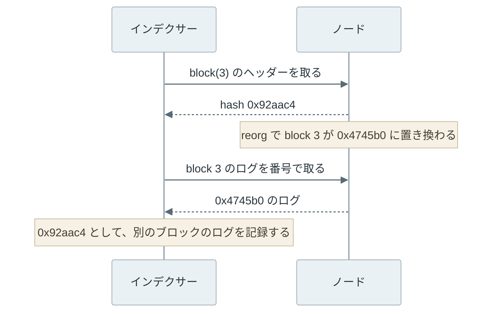

[ウォレット](../wallet/)の履歴画面に、届いたはずの入金が出ない。ブロックエクスプローラー（チェーンの中身を Web で見せるサイト）の残高が、ノードに直接聞いた値と合わない。こうしたずれは、画面の値がノードにその場で聞いた値ではないことから起きます。画面に並ぶ送金と残高は、インデクサー（indexer）と呼ぶソフトウェアがブロックを順に取得し、あらかじめ作っておいた表の値です。この表は、チェーンと食い違うことがあります。

例えば 2023 年 2 月 22 日、[Ethereum](https://ethereum.org/) と互換のチェーン [Polygon PoS](https://polygon.technology/polygon-pos) で、一度チェーンに入った 157 個のブロックが、別のブロックに置き換わりました。この置き換わりを reorg（chain reorganization）と呼びます。

Polygon 向けのエクスプローラーである Polygonscan は止まりました。ノードを API として提供する Rivet は、[CoinDesk の報道](https://www.coindesk.com/tech/2023/02/22/polygon-blockchain-suffers-apparent-outage)によると、自動で直せるのが約 125 ブロックまでで、この reorg はそれを超えました。

インデクサーの多くは、reorg で戻せる深さに上限を持っています。以下は、Rivet と、後で取り上げる OSS の一部が既定で戻せる深さに、157 ブロックの線を重ねた図です。Ponder の 90 ブロックは、180 秒という時間の上限を当時のブロック間隔で換算した値です。



上限の内側でも、作り方を誤ると表はずれます。手元のチェーンで 2 ブロックの reorg を起こすと、ブロックの番号だけを記録する素朴なインデクサーでは、あるアカウントのトークン残高が -10 になりました。ノードに聞けば 90 です。取り込んだブロックのハッシュを記録するインデクサーは、2 ブロック巻き戻して 90 に直しました。

上限を超えた時も、既製の OSS が止まって知らせてくれるとは限りません。OSS の [Ponder](https://github.com/ponder-sh/ponder) に上限を超える reorg を当てると、取り込みを止めたまま古い表を返し続け、準備ができたかを示す応答は正常のままでした。

<br>

本記事では、手元で動かしたチェーンでの 3 つの実験を使い、インデクサーを使う人・作る人が最初にぶつかる問いに、次の順で答えます。

- ノードの API だけで、どこまで調べられるか
- インデクサーは、どう表を作るのか
- reorg が起きると、表の何がずれるのか
- reorg に備えて、どこまで戻せるようにするか
- 上限を超える reorg で、OSS はどう振る舞うか
- どんな OSS があり、どう違うか

---

### ノードの API で答えられる問い

ノードは、[ブロックチェーン](../blockchain-basics/)のブロックを全部持ち、検証しながら他のノードと共有するコンピューターです。ブロックには、トランザクションが並んでいます。トランザクションは、利用者が署名して送る、送金やプログラム呼び出しの依頼です。

Ethereum で送られるものは 2 種類あります。ETH は Ethereum 自体が持つ通貨で、残高はチェーンがアカウントごとに持ちます。トークンは、チェーン上で動くプログラム（[コントラクト](../smart-contract/)）が残高の表を持って管理する独自の通貨です。コントラクトは、実行中にログという記録を書き残せます。[ERC-20](../erc-20/) という規格のトークンは、送金のたびに Transfer というログを書きます。

Ethereum のノードは、[JSON-RPC](https://ethereum.org/developers/docs/apis/json-rpc/) という形式で問い合わせを受けます。メソッド名と引数を JSON で送り、結果を JSON で受け取る形式です。主なメソッドは、ブロック・トランザクション・今の状態のどれかについて、番号・ハッシュ・アドレスで指して取得するものです。

| 問い | 使うメソッド | ノードだけで答えられるか |
|---|---|---|
| block 3 の中身 | `eth_getBlockByNumber` | 答えられる |
| alice が今持つトークンの数 | `eth_call` で `balanceOf` を呼ぶ | 答えられる |
| bob が関わったトークンの送金 | `eth_getLogs` で topic を絞る | 範囲を区切れば答えられる |
| carol が受け取った ETH | 標準のメソッドには無い | 答えられない |

2 行目の `balanceOf` は ERC-20 のトークンが持つ残高を返す関数で、`eth_call` はコントラクトの関数を読み取りだけで呼ぶメソッドです。

3 行目の `eth_getLogs` はログを返し、ログを出したコントラクトのアドレスと topic で絞り込めます。topic はログが持つ欄で、ログの種類と、検索用の値が入ります。Transfer なら、送り手と受け手のアドレスが topic に、量は data という別の欄に入ります。仕組みは [EVM のノート](../evm/#イベントとログ)で扱いました。

この絞り込みには、毎回ブロックの範囲を付けます。ノードを API として貸すサービスの多くは、この範囲に上限を置いています。例えば [Alchemy の eth_getLogs](https://www.alchemy.com/docs/reference/eth-getlogs) は、2026 年 11 月時点で無料の契約だと 1 回に 10 ブロックまでです。何年分もの履歴を引くたびにこれを繰り返すのは現実的ではありません。一度だけ全部を取得して表に保存しておく、というのがインデクサーの出発点です。

表の 4 行目にある ETH の送金は、ログに残りません。次の実験で確認します。

---

### ログに残らない送金

実験には、[Foundry](https://www.getfoundry.sh/) に含まれる手元用のノード [Anvil](https://www.getfoundry.sh/anvil/overview) を使いました。外部のネットワークにはつながず、アカウントは Anvil が作るテスト用のものです。

最小限の ERC-20 もどき（[Token.sol](https://github.com/nao1215/debimate/blob/main/content/notes/blockchain-systems/indexer/lab/Token.sol)）を置き、block 1 でトークンを作って alice に 1,000 を渡しました。続けて block 2〜4 で、alice→bob に 100、alice→carol に 50、bob→carol に 30 のトークンを送り、block 3 には alice→carol に 1 ETH を送る送金も一緒に入れています。

```python
# block 3: alice→carol 50 と、alice→carol に 1 ETH をそのまま送る（ログが出ない）
rpc('eth_sendTransaction', transfer_tx(token, alice, carol, 50))
eth_tx = rpc('eth_sendTransaction', {'from': alice, 'to': carol, 'value': hex(ETH)})
rpc('evm_mine')
receipt = rpc('eth_getTransactionReceipt', eth_tx)
```

`transfer_tx` はトークンの `transfer` を呼ぶトランザクションを組む補助の関数で、`evm_mine` は Anvil にブロックを 1 つ作らせるメソッドです。トランザクションの結果をまとめたレシートを比べたのが、以下の図です。



図の下にある 4 件は、block 1〜4 で送ったトークンに当たります。block 1 でトークンを作って alice に 1,000 を渡した分も、Transfer のログとして数えています。1 ETH の送金は、4 件に入りません。

```text
== ETH の送金: status 0x1, logs []
== eth_getLogs の件数（block 0〜4、Transfer）: 4
```

トークンの送金でログが出るのは、ERC-20 のコントラクトが `emit Transfer(...)` を実行し、ログを書く命令を通るからです。ETH の送金は、トランザクションの `value` で残高が動くだけで、ログを書く命令をどこも通りません。冒頭で挙げた「届いたはずの入金が出ない」は、ログだけを集めるインデクサーなら、ETH の入金で実際に起きます。

コントラクトの中から別のアドレスへ ETH を送る場合も同じです。こうした送金は、トランザクションの実行をたどった記録（trace）を `debug_traceTransaction` などで取り出さないと見えません。trace はブロックを実行し直して作るので重く、古いブロックでは実用上、過去の全状態を持つアーカイブノードが必要です。

例えば [geth](https://geth.ethereum.org/) で動かす通常のノードは、直近 128 ブロック分の状態しか持ちません。[geth の説明](https://geth.ethereum.org/docs/developers/evm-tracing)によると、それより古いブロックは残っている状態から実行し直すので遅く、届かなければエラーになります。ETH の動きまで扱うインデクサーが重くなるのはこのためです。表の 4 行目も、[reth](https://reth.rs/jsonrpc/trace) などが持つ `trace_filter` という拡張のメソッドなら、アドレスで trace を絞って答えられます。

<br>

ETH の送金でも Transfer と同じ形のログを出す改善提案 [EIP-7708](https://eips.ethereum.org/EIPS/eip-7708) があり、2026 年 11 月 21 日時点では、意見募集の締切だった 11 月 1 日を過ぎても、最後の意見募集となる Last Call の段階のままです。採用されても、それより前のブロックは今のままなので、過去の ETH を追うには trace が必要です。

---

### 取得・変換・保存

ノードが持つ標準の API は、ブロックの番号やトランザクションのハッシュを指定して中身を返す作りで、「このアドレスが関わった送金を全部」という問いに答えるメソッドを持ちません。インデクサーは、その問いに答える表を先に作っておきます。以下は、ノードとインデクサーが答えられる問いの違いを示した図です。



インデクサーの仕事は、図の中央にある 3 段です。図の ABI（Application Binary Interface）は、ログのバイト列を「誰から誰へいくら」という値に戻すための型の定義です。

1. 取得: ノードからブロック、ログ、必要なら trace を取得する
2. 変換: ABI を使い、ログの topic と data にあるバイト列を `from`・`to`・`value` などの値に戻す
3. 保存: DB の表に行として入れ、どのブロックまで取り込んだかを記録する

実験では、Transfer のログだけを取得し、アドレスごとの残高を足し引きする最小のインデクサーを書きました。上の図に描いた表のように送金を 1 行ずつ入れる代わりに、それを足し引きした結果の残高だけを持つ形です。どこまで取り込んだかは、最後に取り込んだブロックの番号だけで記録します。

```python
class NaiveIndexer:
    """最後に取り込んだブロック番号だけを記録し、新しい番号のログを足していく。"""

    def __init__(self, token):
        self.token, self.cursor, self.balance = token, 0, {}

    def poll(self):
        h = head()
        if h > self.cursor:
            for a, d in deltas(logs(self.token, self.cursor + 1, h)):
                self.balance[a] = self.balance.get(a, 0) + d
            self.cursor = h
```

上記は抜粋で、`head()` は最新のブロック番号、`logs()` は範囲を付けた `eth_getLogs`、`deltas()` は Transfer のログを「アドレスと増減」の組に直す関数です。block 4 までは、この素朴な作りでもノードの `balanceOf` と同じ値になります。

ずれるのは、取り込み済みのブロックが、後から別の中身に変わった時です。

---

### reorg による表のずれ

冒頭で触れた reorg は、ほぼ同時に作られた 2 つのブロックのどちらを残すかが、後で決まる時などに起きます。仕組みと、どこから覆らないとみなせるかは [Finality のノート](../finality/)で扱いました。

実験では、Anvil の `anvil_reorg` を使い、block 3 と 4 を別の 2 ブロックに置き換えました。新しい block 3 には alice→dave の 100 だけが入り、block 4 は空です。その後、block 5 で dave→carol に 10 を送っています。インデクサーは 2 つ並べました。1 つは前の節で書いた素朴なもの、もう 1 つは取り込んだブロックのハッシュを記録しておくものです。



block 5 まで進んだ時点の、残高の比較です。truth はノードが `balanceOf` で返す値、naive は素朴なインデクサー、careful はハッシュを記録するインデクサーです。

```text
  truth    {'alice': 800, 'bob': 100, 'carol': 10, 'dave': 90}
  naive    {'alice': 850, 'bob': 70, 'carol': 90, 'dave': -10}
  careful  {'alice': 800, 'bob': 100, 'carol': 10, 'dave': 90}
  careful: rollback block 4
  careful: rollback block 3
```

素朴なインデクサーは、捨てられた block 3 と 4 の送金を持ち続けました。置き換わった block 3 の alice→dave 100 は、番号 3 を取り込み済みとして扱うので取得しません。その結果、dave は 100 を受け取らないまま 10 を送ったことになり、残高が -10 になりました。ERC-20 では起こり得ない値で、表を見た人が初めて異常に気付く形です。

<br>

#### parentHash による照合

ブロックの番号は列での位置を表すだけで、中身を指す名前ではありません。中身を指すのはハッシュです。そこで、もう一方のインデクサーは、取り込んだブロックごとにハッシュと、そのブロックで足した増減を記録します。次のブロックを取り込む前に、そのブロックが持つ `parentHash` と記録したハッシュを比べます。`parentHash` は、1 つ前に当たるブロックのハッシュです。違えば一致する所まで巻き戻し、増減を取り消します。

```python
    def poll(self):
        events = []
        n = max(self.hashes, default=0) + 1
        while n <= head():
            b = block(n)
            if n - 1 in self.hashes and b['parentHash'] != self.hashes[n - 1]:
                # 記録したブロックが今のチェーンに無い。一致する所まで戻る
                k = n - 1
                while k in self.hashes and block(k)['hash'] != self.hashes[k]:
                    self.apply(k, -1, self.undo.pop(k))
                    del self.hashes[k]
                    events.append(f'rollback block {k}')
                    k -= 1
                n = k + 1
                continue
            # ブロックのハッシュで取る。番号で取ると、取る間に置き換わったブロックを取得することがある
            ds = deltas(rpc('eth_getLogs', {'address': self.token, 'topics': [TRANSFER], 'blockHash': b['hash']}))
            self.apply(n, 1, ds)
            self.undo[n], self.hashes[n] = ds, b['hash']
            n += 1
        return events
```

上記は抜粋です。`block()` は番号でブロックのヘッダーを取る関数、`apply()` は増減を残高に足し引きする関数で、`__init__` を含む全体は [lab/run.py](https://github.com/nao1215/debimate/blob/main/content/notes/blockchain-systems/indexer/lab/run.py) にあります。

コードの `block(n)` が取るのは、ブロックのヘッダーです。ヘッダーは、番号・ハッシュ・`parentHash` などを持つ、ブロックの見出しに当たる部分です。ヘッダーを取った後にログを番号で取ると、その間に reorg が起きた時、次の順で別のブロックから来たログを混ぜます。



ログもハッシュで取れば、返るログは必ずそのハッシュを持つブロックから来るので、取り違えません。`eth_getLogs` にハッシュを渡す形は [EIP-234](https://eips.ethereum.org/EIPS/eip-234) で入りました。本線から外れたブロックでも、ノードが持っていればログが返ります。外れたかどうかは、次に取り込むブロックが持つ `parentHash` と比べた時に分かります。

<br>

#### 番号が変わらない置き換え

動く図の 2 コマ目では、ハッシュを記録した方も古い値のままでした。置き換えの後も最新の番号は 4 のままで、新しい番号が来ていないからです。この方式が気付くのは、次の block 5 が来て、その親が記録した block 4 と違うと分かった時です。

最新に近い数ブロックを早く正したいなら、新しい番号が無くても、最新ブロックのハッシュを毎回比べます。

ノードの通知を購読する方法もあります。購読は、WebSocket でノードにつないだまま、新しいログを知らせてもらう方法です。Ethereum のノードを動かすソフトウェアの 1 つ、[geth](https://geth.ethereum.org/) で logs を購読すると、reorg で外れたログに `removed: true` を付けて送り直します。ただし、[geth の説明](https://geth.ethereum.org/docs/interacting-with-geth/rpc/pubsub)のとおり購読は接続が切れると消えるので、ハッシュでの確認を省く理由にはなりません。

---

### 戻せる深さの上限

巻き戻すには、ブロックごとの増減を残しておく必要があります。全部のブロックについて残すと DB が膨らむので、戻れる深さに上限を置く実装があります。

冒頭で触れた Polygon の件は、reorg が起きたブロックの番号が 39,599,624 で、[Polygon のフォーラム](https://forum.polygon.technology/t/157-block-reorg-at-block-height-39599624/11388)に報告があります。報道によると、Rivet は自動で処理できる深さを超えると、バックアップから手で戻します。

冒頭の図にある深さは既定の値で、設定で変えられる実装が多くあります。Ponder の 90 ブロックは、Polygon のノードを動かすソフトウェア bor が持つ [mainnet の設定](https://github.com/0xPolygon/bor/blob/master/builder/files/genesis-mainnet-v1.json)にある 2 秒間隔から換算しました。同じ設定では、番号 80,084,800 から 1 秒間隔に変わるので、その後は 180 ブロックに当たります。後で取り上げる OSS のうち、Bitcoin 系のチェーンに向けた Fulcrum も、既定で 100 ブロックまで巻き戻せます。深さを上げるほど、残しておく増減の記録が増えます。

戻れる深さの決め方は、チェーンに覆らない時点があるかで変わります。

Ethereum では、`eth_getBlockByNumber` などで番号の代わりに `"finalized"` を渡すと、ノードが覆らないとみなせる最新のブロックを返します。それより前は、参加者が話し合ってソフトウェアを差し替えるような、規則に無い手段を除いて覆りません。順調な時の `finalized` は、最新のブロックより 13〜19 分ほど前のブロックです。

| 取り込む範囲 | 表の遅れ | reorg への備え | 向くチェーン |
|---|---|---|---|
| `finalized` まで | 13〜19 分ほど | 不要 | `finalized` がある |
| 最新まで | ほぼ無し | `finalized` より後を戻す | `finalized` がある |
| 最新まで | ほぼ無し | 決めた深さまで戻す | 覆らない時点が無い |

3 行目は、覆らない時点をノードが返さないチェーンでも使えるやり方です。Polygon の件のように、決めた深さを超えた時にどう止まるか、止まったことにどう気付くかまで決めておく必要があります。

---

### 上限を超える reorg と Ponder の実測

戻せる深さの上限を超えた時の振る舞いは、OSS ごとに違います。The Graph で使われるインデクサーの Graph Node は、既定の 250 ブロックより大きな reorg が来ると、[食い違ったデータを処理するかもしれません](https://github.com/graphprotocol/graph-node/blob/master/docs/environment-variables.md)。

Ponder は、直近 180 秒より前のブロックを覆らないものとして扱います。この 180 秒を reorg の窓と呼び、設定の reorgWindow で 0〜600 秒の間に変えられます。[Ponder が設定について書いた説明](https://github.com/ponder-sh/ponder/blob/main/docs/pages/docs/config/chains.mdx)には、窓を越える reorg が来ると、食い違ったデータのまま進まずに致命的なエラーで落ちる（crashes with a fatal error）とあります。

この「落ちる」がどう見えるのか、手元で検証しました。Anvil に Ponder 0.18.9 をつなぎ、Transfer のログから残高の表を作らせています。ブロックの時刻は 1 個ごとに 12 秒ずつ進めました。Ponder の窓はブロックの時刻で数えるので、180 秒は 15 ブロック分です。直近 3 ブロック（36 秒分）と 30 ブロック（360 秒分）の置き換えを順に当て、表をノードの `balanceOf` と比べました。

Ponder に渡したのは、Transfer のログを受けて残高を足し引きする、次のハンドラーです。

```typescript
import { ponder } from "ponder:registry";
import { balance } from "ponder:schema";

const ZERO = "0x0000000000000000000000000000000000000000";

ponder.on("Token:Transfer", async ({ event, context }) => {
  const { from, to, value } = event.args;
  if (from !== ZERO) {
    await context.db.insert(balance).values({ address: from, amount: -value })
      .onConflictDoUpdate((row) => ({ amount: row.amount - value }));
  }
  await context.db.insert(balance).values({ address: to, amount: value })
    .onConflictDoUpdate((row) => ({ amount: row.amount + value }));
});
```

Ponder は、ポーリングの間隔ごとにノードへ最新ブロックを聞きます。間隔の既定は 1 秒で、実験では短く 200 ms にしています。以下の図は、上下の段で横軸の範囲が違います。



窓の内側では、最新の番号が変わらない置き換えにも 0.65 秒で気付き、表を巻き戻しました。既定の 1 秒間隔なら 1 秒前後かかる見込みです。「番号が変わらない置き換え」の節で、自作のインデクサーが次のブロックまで気付けなかった場面です。Ponder は、聞いた最新ブロックのハッシュが記録と違うのに番号が増えていなければ reorg とみなし、親のハッシュを辿って共通の祖先まで巻き戻します。

窓の外側では、ログに「Encountered unrecoverable reorg」（戻せない reorg に出会った）と出て、取り込みは止まりました。ただし、プロセスは落ちず、Ponder が出す GraphQL の API は reorg より前に作った表を返し続けました。ログの重さも ERROR ではなく WARN です。以下は、reorg の約 12 秒後から 60 秒間、5 秒ごとに見た最後の行です。

```text
after outside {'t': 60.2, 'alive': True, 'ready': 200, 'status_block': 51, 'node_head': 63, ...}
```

`/ready` は Ponder が HTTP で出す応答で、[過去のブロックを取り込み終えて最新に追いついた時に 200](https://github.com/ponder-sh/ponder/blob/main/docs/pages/docs/production/self-hosting.mdx) になり、その後は 503 に戻りません。取り込んだ最新のブロックを返す `/status` は 51 で止まり、ノードの最新は 63 まで進みました。

[Ponder 0.18.9 のソース](https://github.com/ponder-sh/ponder/blob/ponder%400.18.9/packages/core/src/sync-realtime/index.ts)では、この失敗を新しいブロックが届くたびに 1 回と数えます。10 回以上かつ、回数とポーリングの間隔を掛けた値が 10 分を超えた時に、初めて例外を投げます。既定の 1 秒なら 600 ブロック分で、12 秒ごとのチェーンでは約 2 時間、表は止まったまま答え続けます。`/ready` だけを監視していると、この間に気付けません。実験のコードと出力は [lab/ponder](https://github.com/nao1215/debimate/tree/main/content/notes/blockchain-systems/indexer/lab/ponder) にあります。

---

### インデクサーの OSS

ここまでの仕組みを自分で書かずに済ませる OSS が多くあります。大きく分けると、どのコントラクトの何を表にするかを利用者が書く汎用のものと、エクスプローラーやウォレットのように用途が決まったものです。

ただし、OSS として紹介されることが多くても、2026 年 11 月時点で OSI（Open Source Initiative）が認めたライセンスでないものが 2 つあります。Envio HyperIndex と Blockscout で、どちらも独自のライセンスです。

<br>

#### 利用者が変換を書くもの

いずれも、Ethereum と同じ仮想マシン EVM（Ethereum Virtual Machine、コントラクトを動かす仕組み）でコントラクトを動かすチェーン（EVM チェーン）を主に扱います。保存先は PostgreSQL が中心で、問い合わせは GraphQL か SQL です。

| 名前 | 利用者が書くもの | reorg への備え |
|---|---|---|
| [Graph Node](https://github.com/graphprotocol/graph-node) | AssemblyScript | 250 ブロックまで想定 |
| [Ponder](https://github.com/ponder-sh/ponder) | TypeScript | 直近 180 秒を戻す |
| [Envio HyperIndex](https://github.com/enviodev/hyperindex) | TypeScript など | 200 ブロックを戻す |
| [SQD squid-sdk](https://github.com/subsquid/squid-sdk) | TypeScript | 確定前を戻す |
| [Substreams](https://github.com/streamingfast/substreams) | Rust | 確定前を戻す |
| [rindexer](https://github.com/joshstevens19/rindexer) | YAML、必要なら Rust | 256 ブロックを戻す |
| [Shovel](https://github.com/indexsupply/shovel) | JSON の設定 | 最新から消して取り直す |

reorg への備えの列にある数は、どれも既定の値です。確定前を戻す 2 つは、まだ覆り得るブロックの分だけ変更の記録を残し、reorg が来たらその分を戻します。

Envio HyperIndex は、ノードの JSON-RPC から直接取得する時に [reorg を見逃す場合があります](https://docs.envio.dev/docs/HyperIndex/reorgs-support)。RPC の問い合わせが、まとめて 1 回では行われないからです。「parentHash による照合」の節で、ヘッダーを取得してからログを取得するまでの間に置き換わる話をしたのと同じ問題です。

表を作らず、ブロックやログをファイルに書き出すだけの道具もあります。[cryo](https://github.com/paradigmxyz/cryo) と [Ethereum ETL](https://github.com/blockchain-etl/ethereum-etl) で、どちらも reorg への備えは最新のブロックから決めた数だけ離れて書き出すことです。この数は既定で 0 です。

<br>

#### 用途が決まったもの

下の表のものは、利用者が変換を書かず、設定だけで動かします。Bitcoin も対象に入ってきます。Bitcoin にはコントラクトのログが無いので、これらは、トランザクションが「どのコインを使い、どのアドレスへいくら渡すか」という[入力と出力](../utxo/)から、アドレスごとの入出金を直接表にします。

表の Electrum は、Bitcoin のウォレット [Electrum](https://electrum.org/) がアドレスの履歴を問い合わせる時のプロトコルで、そのサーバーとして動くのが electrs・Blockstream electrs・Fulcrum の 3 つです。Blockbook は、ハードウェアウォレットの [Trezor](https://trezor.io/) が使うサーバーです。

| 名前 | 用途 | 対象 | reorg への備え |
|---|---|---|---|
| [Blockscout](https://github.com/blockscout/blockscout) | エクスプローラー | EVM チェーン | 外れたブロックに印 |
| [Blockbook](https://github.com/trezor/blockbook) | Trezor のウォレット | Bitcoin 系・EVM 系 | 300 ブロックを戻す |
| [electrs](https://github.com/romanz/electrs) | 個人用 Electrum | Bitcoin | 外れた項目を捨てる |
| [Blockstream electrs](https://github.com/Blockstream/electrs) | エクスプローラー | Bitcoin | 共通の祖先まで戻す |
| [Fulcrum](https://github.com/cculianu/Fulcrum) | Electrum サーバー | Bitcoin 系 | 100 ブロックを戻す |

Blockscout は、2026 年 4 月 22 日に GPL-3.0 から独自のライセンスへ変わりました。README には、今も「open-source alternative」という言葉が残っています。自分で立てる前に、[LICENSE](https://github.com/blockscout/blockscout/blob/master/LICENSE) で使い方が許されているかを確認する必要があります。

---

### 使う前・作る前に確認すること

インデクサーを選ぶ時も作る時も、最初に答えたい問いを並べ、ログだけで足りるかを確認します。ETH の送金や、コントラクトが中から送った ETH まで扱うなら、trace を返せるノードと、その分のコストが必要です。

次に、表がどこまで遅れて良いかを決めます。`finalized` まで待てるなら、reorg の巻き戻しは不要です。最新に近い値を見せたいなら、ハッシュでの確認と増減の記録が必要です。

動かし始めたら、`/ready` のような応答だけでなく、インデクサーが取り込んだ最新ブロックの番号と、ノードが返す最新ブロックの番号を比べて監視します。Ponder の実験のように、取り込みが止まっても API は答え続けることがあるからです。残高がずれた時は、インデクサーが記録したハッシュと、同じ番号でノードが今返すハッシュを比べると、reorg が原因かどうかを切り分けられます。

<br>

実験のコードは [lab/run.py](https://github.com/nao1215/debimate/blob/main/content/notes/blockchain-systems/indexer/lab/run.py)、出力の全体は [lab/output/output.txt](https://github.com/nao1215/debimate/blob/main/content/notes/blockchain-systems/indexer/lab/output/output.txt) にあります。Anvil 1.7.1 と Solidity のコンパイラ 0.8.28 を使いました。
