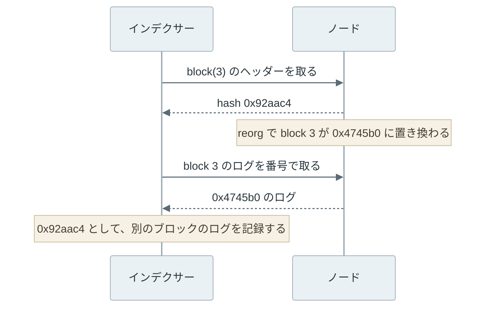

[ウォレット](../wallet/)の履歴画面に、届いたはずの入金が出ない。ブロックエクスプローラー（チェーンの中身を Web で見せるサイト）の残高が、ノードに直接聞いた値と合わない。こうしたずれは、画面の値がノードにその場で聞いた値ではないことから起きます。画面に並ぶ送金と残高は、インデクサー（indexer）と呼ぶソフトウェアがブロックを順に取得し、あらかじめ作っておいた表の値です。この表は、チェーンと食い違うことがあります。

例えば 2023 年 2 月 22 日、[Ethereum](https://ethereum.org/) と互換のチェーン [Polygon PoS](https://polygon.technology/polygon-pos) で、一度チェーンに入った 157 個のブロックが、別のブロックに置き換わりました。この置き換わりを reorg（chain reorganization）と呼びます。

Polygon 向けのエクスプローラーである Polygonscan は止まりました。ノードを API として提供する Rivet は、[CoinDesk の報道](https://www.coindesk.com/tech/2023/02/22/polygon-blockchain-suffers-apparent-outage)によると、自動で直せるのが約 125 ブロックまでで、この reorg はそれを超えました。

インデクサーの多くは、reorg で戻せる深さに上限を持っています。以下は、Rivet と、後で取り上げる OSS が既定で戻せる深さに、157 ブロックの線を重ねた図です。

OSS には、EVM と呼ぶ Ethereum の仕組みを使うチェーン向けに表を作る道具と、Bitcoin のウォレットやエクスプローラーが使うサーバーがあり、どちらも同じ基準で並べました。Ponder の 90 ブロックは、180 秒という時間の上限を当時のブロック間隔で換算した値です。



では、上限を超えた時に何が起きるのか。図の 11 個に SQD を加えた 12 個の OSS に、手元のチェーンで上限を超える reorg を当てました。reorg の検出は有効にし、戻せる深さは既定のままです。既定値の無い SQD だけは 10 にし、Graph Node は刈り込みを設定せず、履歴を全部残す形にしました。プロセスが終了して止まったのは 2 個だけで、4 個は上限が無く、正しく戻しました。

残る 6 個は、表がノードと食い違ったまま、ヘルスチェックや同期の指標に正常と答え続けました。ヘルスチェックは、動いているかを外から確認するための HTTP の応答です。6 個のうち 2 個は、食い違いを残したまま新しいブロックを取り込み続けたので、取り込みの遅れを見る監視でも気付けません。

<br>

本記事では、手元で動かしたチェーンでの実験を使い、インデクサーを使う人・作る人が最初にぶつかる問いに、次の順で答えます。

- ノードの API だけで、どこまで調べられるか
- インデクサーは、どう表を作るのか
- reorg が起きると、表の何がずれるのか
- reorg に備えて、どこまで戻せるようにするか
- 上限を超える reorg で、OSS はどう振る舞うか
- 使う前・作る前に、何を確認するか

---

### ノードの API で答えられる問い

ノードは、[ブロックチェーン](../blockchain-basics/)のブロックを全部持ち、検証しながら他のノードと共有するコンピューターです。ブロックには、トランザクションが並んでいます。[トランザクション](../ethereum-transaction/)は、利用者が署名して送る、送金やプログラム呼び出しの依頼です。

Ethereum で送られるものは 2 種類あります。ETH は Ethereum 自体が持つ通貨で、残高はチェーンが[アカウント](../ethereum-account-model/)ごとに持ちます。トークンは、チェーン上で動くプログラム（[コントラクト](../smart-contract/)）が残高の表を持って管理する独自の通貨です。コントラクトは、実行中にログという記録を書き残せます。[ERC-20](../erc-20/) という規格のトークンは、送金のたびに Transfer というログを書きます。

Ethereum のノードは、[JSON-RPC](https://ethereum.org/developers/docs/apis/json-rpc/) という形式で問い合わせを受けます。メソッド名と引数を JSON で送り、結果を JSON で受け取る形式です。チェーンが今持つ残高やコントラクトの値をまとめて、状態と呼びます。主なメソッドは、ブロック・トランザクション・今の状態のどれかについて、番号・ハッシュ・アドレスで指して取得するものです。

| 問い | 使うメソッド | ノードだけで答えられるか |
|---|---|---|
| block 3 の中身 | `eth_getBlockByNumber` | 答えられる |
| alice が今持つトークンの数 | `eth_call` で `balanceOf` を呼ぶ | 答えられる |
| bob が関わったトークンの送金 | `eth_getLogs` で topic を絞る | 範囲を区切れば答えられる |
| carol が受け取った ETH | 標準のメソッドには無い | 答えられない |

2 行目の `balanceOf` は ERC-20 のトークンが持つ残高を返す関数で、`eth_call` はコントラクトの関数を読み取りだけで呼ぶメソッドです。

3 行目の `eth_getLogs` はログを返し、ログを出したコントラクトのアドレスと topic で絞り込めます。topic はログが持つ欄で、ログの種類と、検索用の値が入ります。Transfer なら、送り手と受け手のアドレスが topic に、量は data という別の欄に入ります。仕組みは [EVM のノート](../evm/#イベントとログ)で扱いました。

この絞り込みには、毎回ブロックの範囲を付けます。ノードを API として貸すサービスの多くは、この範囲に上限を置いています。例えば [Alchemy の eth_getLogs](https://www.alchemy.com/docs/reference/eth-getlogs) は、2026 年 11 月時点で無料の契約だと 1 回に 10 ブロックまでです。何年分もの履歴を引くたびにこれを繰り返すのは現実的ではありません。一度だけ全部を取得して表に保存しておく、というのがインデクサーの出発点です。

表の 4 行目にある ETH の送金は、ログに残りません。次の実験で確認します。

---

### ログに残らない送金

実験には、[Foundry](https://www.getfoundry.sh/) に含まれる手元用のノード [Anvil](https://www.getfoundry.sh/anvil/overview) を使いました。外部のネットワークにはつながず、アカウントは Anvil が作るテスト用のものです。

最小限の ERC-20 もどき（[Token.sol](https://github.com/nao1215/debimate/blob/main/content/notes/blockchain-systems/indexer/lab/Token.sol)）を置き、block 1 でトークンを作って alice に 1,000 を渡しました。続けて block 2〜4 で、alice→bob に 100、alice→carol に 50、bob→carol に 30 のトークンを送り、block 3 には alice→carol に 1 ETH を送る送金も一緒に入れています。

```python
# block 3: alice→carol 50 と、alice→carol に 1 ETH をそのまま送る（ログが出ない）
rpc('eth_sendTransaction', transfer_tx(token, alice, carol, 50))
eth_tx = rpc('eth_sendTransaction', {'from': alice, 'to': carol, 'value': hex(ETH)})
rpc('evm_mine')
receipt = rpc('eth_getTransactionReceipt', eth_tx)
```

`transfer_tx` はトークンの `transfer` を呼ぶトランザクションを組む補助の関数で、`evm_mine` は Anvil にブロックを 1 つ作らせるメソッドです。トランザクションの結果をまとめたレシートを比べたのが、以下の図です。



図の下にある 4 件は、block 1〜4 で送ったトークンに当たります。block 1 でトークンを作って alice に 1,000 を渡した分も、Transfer のログとして数えています。1 ETH の送金は、4 件に入りません。

```text
== ETH の送金: status 0x1, logs []
== eth_getLogs の件数（block 0〜4、Transfer）: 4
```

トークンの送金でログが出るのは、ERC-20 のコントラクトが `emit Transfer(...)` を実行し、ログを書く命令を通るからです。ETH の送金は、トランザクションの `value` で残高が動くだけで、ログを書く命令をどこも通りません。冒頭で挙げた「届いたはずの入金が出ない」は、ログだけを集めるインデクサーなら、ETH の入金で実際に起きます。

コントラクトの中から別のアドレスへ ETH を送る場合も同じです。こうした送金は、トランザクションの実行をたどった記録（trace）を `debug_traceTransaction` などで取り出さないと見えません。trace はブロックを実行し直して作るので重く、古いブロックでは実用上、過去の全状態を持つアーカイブノードが必要です。

例えば、ノードのソフトウェア [geth](https://geth.ethereum.org/) で動かす通常のノードは、直近 128 ブロック分の状態しか持ちません。[geth の説明](https://geth.ethereum.org/docs/developers/evm-tracing)によると、それより古いブロックは残っている状態から実行し直すので遅く、届かなければエラーになります。表の 4 行目も、ノードを動かす別のソフトウェア [reth](https://reth.rs/jsonrpc/trace) などが持つ `trace_filter` という拡張のメソッドなら、アドレスで trace を絞って答えられます。

<br>

ETH の送金でも Transfer と同じ形のログを出す改善提案 [EIP-7708](https://eips.ethereum.org/EIPS/eip-7708) があり、2026 年 11 月 21 日時点では、意見募集の締切だった 11 月 1 日を過ぎても、最後の意見募集となる Last Call の段階のままです。採用されても、それより前のブロックは今のままなので、過去の ETH を追うには trace が必要です。

---

### 取得・変換・保存

ノードが持つ標準の API は、ブロックの番号やトランザクションのハッシュを指定して中身を返す作りで、「このアドレスが関わった送金を全部」という問いに答えるメソッドを持ちません。インデクサーは、その問いに答える表を先に作っておきます。ログを順に読んで検索用の表を作り続ける形は、Event Sourcing で[読み取りモデルを作るプロジェクション](../../software-architecture/event-sourcing/#読み取りモデルへのプロジェクション)と同じです。以下は、ノードとインデクサーが答えられる問いの違いを示した図です。



インデクサーの仕事は、図の中央にある 3 段です。図の ABI（Application Binary Interface）は、ログのバイト列を「誰から誰へいくら」という値に戻すための型の定義です。

1. 取得: ノードからブロック、ログ、必要なら trace を取得する
2. 変換: ABI を使い、ログの topic と data にあるバイト列を `from`・`to`・`value` などの値に戻す
3. 保存: DB の表に行として入れ、どのブロックまで取り込んだかを記録する

実験では、Transfer のログだけを取得し、アドレスごとの残高を足し引きする最小のインデクサーを書きました。上の図に描いた表のように送金を 1 行ずつ入れる代わりに、それを足し引きした結果の残高だけを持つ形です。どこまで取り込んだかは、最後に取り込んだブロックの番号だけで記録します。

```python
class NaiveIndexer:
    """最後に取り込んだブロック番号だけを記録し、新しい番号のログを足していく。"""

    def __init__(self, token):
        self.token, self.cursor, self.balance = token, 0, {}

    def poll(self):
        h = head()
        if h > self.cursor:
            for a, d in deltas(logs(self.token, self.cursor + 1, h)):
                self.balance[a] = self.balance.get(a, 0) + d
            self.cursor = h
```

上記は抜粋で、`head()` は最新のブロック番号、`logs()` は範囲を付けた `eth_getLogs`、`deltas()` は Transfer のログを「アドレスと増減」の組に直す関数です。block 4 までは、この素朴な作りでもノードの `balanceOf` と同じ値になります。

ずれるのは、取り込み済みのブロックが、後から別の中身に変わった時です。

---

### reorg による表のずれ

冒頭で触れた reorg は、ほぼ同時に作られた 2 つのブロックのどちらを残すかが、後で決まる時などに起きます。ノードの間で分かれた枝が長く続き、後から別の枝が選ばれると、何百ものブロックが一度に置き換わることもあります。仕組みと、どこから覆らないとみなせるかは [Finality のノート](../finality/)で扱いました。

実験では、Anvil の `anvil_reorg` を使い、block 3 と 4 を別の 2 ブロックに置き換えました。新しい block 3 には alice→dave の 100 だけが入り、block 4 は空です。その後、block 5 で dave→carol に 10 を送っています。インデクサーは 2 つ並べました。1 つは前の節で書いた素朴なもの、もう 1 つは取り込んだブロックのハッシュを記録しておくものです。



block 5 まで進んだ時点の、残高の比較です。truth はノードが `balanceOf` で返す値、naive は素朴なインデクサー、careful はハッシュを記録するインデクサーです。

```text
  truth    {'alice': 800, 'bob': 100, 'carol': 10, 'dave': 90}
  naive    {'alice': 850, 'bob': 70, 'carol': 90, 'dave': -10}
  careful  {'alice': 800, 'bob': 100, 'carol': 10, 'dave': 90}
  careful: rollback block 4
  careful: rollback block 3
```

素朴なインデクサーは、捨てられた block 3 と 4 の送金を持ち続けました。置き換わった block 3 の alice→dave 100 は、番号 3 を取り込み済みとして扱うので取得しません。その結果、dave は 100 を受け取らないまま 10 を送ったことになり、残高が -10 になりました。ERC-20 では起こり得ない値で、表を見た人が初めて異常に気付く形です。どこまで取り込んだかを番号 1 つで記録し、その手前は変わらないとみなす作りは、[Transactional Outbox の relay](../../distributed-systems/transactional-outbox/#id-の順に読む-relay-が飛ばす行) が行を飛ばす原因とも同じです。

<br>

#### parentHash による照合

ブロックの番号は列での位置を表すだけで、中身を指す名前ではありません。中身を指すのは[ハッシュ](../hash-function/)です。そこで、もう一方のインデクサーは、取り込んだブロックごとにハッシュと、そのブロックで足した増減を記録します。次のブロックを取り込む前に、そのブロックが持つ `parentHash` と記録したハッシュを比べます。`parentHash` は、1 つ前に当たるブロックのハッシュです。違えば一致する所まで巻き戻し、増減を取り消します。

```python
    def poll(self):
        events = []
        n = max(self.hashes, default=0) + 1
        while n <= head():
            b = block(n)
            if n - 1 in self.hashes and b['parentHash'] != self.hashes[n - 1]:
                # 記録したブロックが今のチェーンに無い。一致する所まで戻る
                k = n - 1
                while k in self.hashes and block(k)['hash'] != self.hashes[k]:
                    self.apply(k, -1, self.undo.pop(k))
                    del self.hashes[k]
                    events.append(f'rollback block {k}')
                    k -= 1
                n = k + 1
                continue
            # ブロックのハッシュで取る。番号で取ると、取る間に置き換わったブロックを取得することがある
            ds = deltas(rpc('eth_getLogs', {'address': self.token, 'topics': [TRANSFER], 'blockHash': b['hash']}))
            self.apply(n, 1, ds)
            self.undo[n], self.hashes[n] = ds, b['hash']
            n += 1
        return events
```

上記は抜粋です。`block()` は番号でブロックのヘッダー（次の段落で説明）を取る関数、`apply()` は増減を残高に足し引きする関数で、`__init__` を含む全体は [lab/run.py](https://github.com/nao1215/debimate/blob/main/content/notes/blockchain-systems/indexer/lab/run.py) にあります。

コードの `block(n)` が取るのは、ブロックのヘッダーです。ヘッダーは、番号・ハッシュ・`parentHash` などを持つ、ブロックの見出しに当たる部分です。ヘッダーを取った後にログを番号で取ると、その間に reorg が起きた時、次の順で別のブロックから来たログを混ぜます。



ログもハッシュで取れば、返るログは必ずそのハッシュを持つブロックから来るので、取り違えません。`eth_getLogs` にハッシュを渡す形は [EIP-234](https://eips.ethereum.org/EIPS/eip-234) で入りました。本線から外れたブロックでも、ノードが持っていればログが返ります。外れたかどうかは、次に取り込むブロックが持つ `parentHash` と比べた時に分かります。

<br>

#### 番号が変わらない置き換え

動く図の 2 コマ目では、ハッシュを記録した方も古い値のままでした。置き換えの後も最新の番号は 4 のままで、新しい番号が来ていないからです。この方式が気付くのは、次の block 5 が来て、その親が記録した block 4 と違うと分かった時です。

最新に近い数ブロックを早く正したいなら、新しい番号が無くても、最新ブロックのハッシュを毎回比べます。

ノードの通知を購読する方法もあります。購読は、WebSocket でノードにつないだまま、新しいログを知らせてもらう方法です。geth で logs を購読すると、reorg で外れたログに `removed: true` を付けて送り直します。ただし、[geth の説明](https://geth.ethereum.org/docs/interacting-with-geth/rpc/pubsub)のとおり購読は接続が切れると消えるので、ハッシュでの確認を省く理由にはなりません。

---

### 戻せる深さの上限

巻き戻すには、ブロックごとの増減を残しておく必要があります。全部のブロックについて残すと DB が膨らむので、戻れる深さに上限を置く実装があります。

冒頭で触れた Polygon の件は、reorg が起きたブロックの番号が 39,599,624 で、[Polygon のフォーラム](https://forum.polygon.technology/t/157-block-reorg-at-block-height-39599624/11388)に報告があります。報道によると、Rivet は自動で処理できる深さを超えると、バックアップから手で戻します。

冒頭の図にある深さは既定の値で、設定で変えられる実装が多くあります。Ponder の 90 ブロックは、Polygon のノードを動かすソフトウェア bor が持つ [mainnet の設定](https://github.com/0xPolygon/bor/blob/master/builder/files/genesis-mainnet-v1.json)にある 2 秒間隔から換算しました。同じ設定では、番号 80,084,800 から 1 秒間隔に変わるので、その後は 180 ブロックに当たります。深さを上げるほど、残しておく増減の記録が増えます。

戻れる深さの決め方は、チェーンに覆らない時点があるかで変わります。

Ethereum では、`eth_getBlockByNumber` などで番号の代わりに `"finalized"` を渡すと、ノードが覆らないとみなせる最新のブロックを返します。それより前は、参加者が話し合ってソフトウェアを差し替えるような、規則に無い手段を除いて覆りません。順調な時の `finalized` は、最新のブロックより 13〜19 分ほど前のブロックです。

| 取り込む範囲 | 表の遅れ | reorg への備え | 向くチェーン |
|---|---|---|---|
| `finalized` まで | 13〜19 分ほど | 不要 | `finalized` がある |
| 最新まで | ほぼ無し | `finalized` より後を戻す | `finalized` がある |
| 最新まで | ほぼ無し | 決めた深さまで戻す | 覆らない時点が無い |

3 行目は、覆らない時点をノードが返さないチェーンでも使えるやり方です。Polygon の件のように、決めた深さを超えた時にどう止まるか、止まったことにどう気付くかまで決めておく必要があります。

rindexer は戻せる深さをチェーンごとに変え、Polygon には 400 ブロックを当てています。その値を決める[ソースのコメント](https://github.com/joshstevens19/rindexer/blob/v1.0.0/core/src/indexer/reorg/mod.rs)には、理由として 2023 年 2 月の 157 ブロックの reorg が書かれています。ただし、この備えは、設定に `reorg_handling` の節を書いた時だけ動きます。

---

### 上限を超えた reorg と Ponder

まず Ponder で、上限を超えた時の振る舞いを詳しく見ます。[Ponder](https://github.com/ponder-sh/ponder) は、TypeScript で変換を書くインデクサーです。

Ponder は、直近 180 秒より前のブロックを覆らないものとして扱います。この 180 秒を reorg のウィンドウと呼び、設定の reorgWindow で 0〜600 秒の間に変えられます。[Ponder が設定について書いた説明](https://github.com/ponder-sh/ponder/blob/main/docs/pages/docs/config/chains.mdx)には、ウィンドウを越える reorg が来ると、食い違ったデータのまま進まずに致命的なエラーで落ちる（crashes with a fatal error）とあります。

この「落ちる」がどう見えるのか、手元で検証しました。Anvil に Ponder 0.18.9 をつなぎ、Transfer のログから残高の表を作らせています。ブロックの時刻は 1 個ごとに 12 秒ずつ進めました。Ponder のウィンドウはブロックの時刻で数えるので、180 秒は 15 ブロック分です。直近 3 ブロック（36 秒分）と 30 ブロック（360 秒分）の置き換えを順に当て、表をノードの `balanceOf` と比べました。

Ponder に渡したのは、Transfer のログを受けて残高を足し引きする、次のハンドラーです。

```typescript
import { ponder } from "ponder:registry";
import { balance } from "ponder:schema";

const ZERO = "0x0000000000000000000000000000000000000000";

ponder.on("Token:Transfer", async ({ event, context }) => {
  const { from, to, value } = event.args;
  if (from !== ZERO) {
    await context.db.insert(balance).values({ address: from, amount: -value })
      .onConflictDoUpdate((row) => ({ amount: row.amount - value }));
  }
  await context.db.insert(balance).values({ address: to, amount: value })
    .onConflictDoUpdate((row) => ({ amount: row.amount + value }));
});
```

Ponder は、ポーリングの間隔ごとにノードへ最新ブロックを聞きます。間隔の既定は 1 秒で、実験では短く 200 ms にしています。以下の図は、上下の段で横軸の範囲が違います。



ウィンドウの内側では、最新の番号が変わらない置き換えにも 0.65 秒で気付き、表を巻き戻しました。既定の 1 秒間隔なら 1 秒前後かかる見込みです。「番号が変わらない置き換え」の節で、自作のインデクサーが次のブロックまで気付けなかった場面です。Ponder は、聞いた最新ブロックのハッシュが記録と違うのに番号が増えていなければ reorg とみなし、親のハッシュを辿り、2 つの枝が分かれる直前のブロック（共通の祖先）まで巻き戻します。

ウィンドウの外側では、次のブロックが来た所で、ログに「Encountered unrecoverable reorg」（戻せない reorg に出会った）と出て、取り込みは止まりました。ただし、プロセスは落ちず、Ponder が出す GraphQL の API は reorg より前に作った表を返し続けました。ログの重さも ERROR ではなく WARN です。以下は、reorg の約 12 秒後から 60 秒間、5 秒ごとに見た最後の行です。

```text
after outside {'t': 60.2, 'alive': True, 'ready': 200, 'status_block': 51, 'node_head': 63, ...}
```

`/ready` は Ponder が HTTP で出す応答で、[過去のブロックを取り込み終えて最新に追いついた時に 200](https://github.com/ponder-sh/ponder/blob/main/docs/pages/docs/production/self-hosting.mdx) になり、その後は 503 に戻りません。取り込んだ最新のブロックを返す `/status` は 51 で止まり、ノードの最新は 63 まで進みました。

[Ponder 0.18.9 のソース](https://github.com/ponder-sh/ponder/blob/ponder%400.18.9/packages/core/src/sync-realtime/index.ts)では、この失敗を新しいブロックが届くたびに 1 回と数え、回数とポーリングの間隔を掛けた値が 10 分を超えるまで例外を投げません。既定の 1 秒間隔なら 600 回、つまり新しいブロック 600 個分です。12 秒ごとのチェーンでは約 2 時間、表は止まったまま答え続けます。

`/ready` だけを監視していると、この間に気付けません。動いているように見えて仕事をしていない状態は、[ハートビートだけが届き続ける障害](../../distributed-systems/heartbeat/#届いているのに答えない時)と同じ形です。

<br>

ほかの 11 個の OSS にも、同じ形の実験を当てました。次の節で、OSS の一覧と合わせて結果を示します。

---

### インデクサーの OSS

ここまでの仕組みを自分で書かずに済ませる OSS が多くあります。大きく分けると、どのコントラクトの何を表にするかを利用者が書く汎用のものと、エクスプローラーやウォレットのように用途が決まったものです。

実験は Ponder と同じ手順です。EVM（Ethereum Virtual Machine）でコントラクトを動かすチェーン、つまり EVM チェーン向けのものは Anvil に、Bitcoin 向けのものは [Bitcoin Core](https://bitcoincore.org/) を外部とつながない試験用のモード regtest で動かしたノードにつなぎました。既定で戻せる深さより浅い reorg と、深い reorg を順に当て、表とノードの値、ヘルスチェックの応答を比べています。

バージョンは 2026 年 11 月 21 日時点で取得できた最新のもので、一覧は lab に置きました。浅い reorg は、後の節で見る reorg の検出が動く設定なら、12 個すべてが 0.1〜5 秒で表をノードの値に戻しました。数え始めは、reorg の時点か、その次に届いたブロックの時点です。違いが出たのは上限を超えた時で、下の 2 つの表では最後の列に示しました。

<br>

#### 利用者が変換を書くもの

いずれも、EVM チェーンを主に扱います。保存先は PostgreSQL が中心で、問い合わせは GraphQL か SQL です。

| 名前 | 利用者が書くもの | 既定で戻せる深さ | 上限を超えた時 |
|---|---|---|---|
| [Graph Node](https://github.com/graphprotocol/graph-node) | AssemblyScript | 上限なし | 正しく戻す |
| [Ponder](https://github.com/ponder-sh/ponder) | TypeScript | 180 秒 | 止まる |
| [Envio HyperIndex](https://github.com/enviodev/hyperindex) | TypeScript など | 199 ブロック | ずれたまま進む |
| [SQD squid-sdk](https://github.com/subsquid/squid-sdk) | TypeScript | 利用者が決める | 止まる |
| [Substreams](https://github.com/streamingfast/substreams) | Rust | 200 ブロック | 落ちる |
| [rindexer](https://github.com/joshstevens19/rindexer) | YAML、必要なら Rust | Polygon は 400 ブロック | ずれたまま進む |
| [Shovel](https://github.com/indexsupply/shovel) | JSON の設定 | 10 ブロック | 止まる |

表を作らず、ブロックやログをファイルに書き出すだけの道具もあります。[cryo](https://github.com/paradigmxyz/cryo) と [Ethereum ETL](https://github.com/blockchain-etl/ethereum-etl) で、どちらも reorg への備えは、最新のブロックから決めた数だけ離れて書き出すことです。この数は既定で 0 です。

この表のうち Envio HyperIndex は、OSS として紹介されることが多いものの、2026 年 11 月時点で OSI（Open Source Initiative）が認めたライセンスではなく、独自のライセンスです。

<br>

#### 用途が決まったもの

下の表のものは、利用者が変換を書かず、設定だけで動かします。Bitcoin も対象に入ってきます。Bitcoin にはコントラクトのログが無いので、これらは、トランザクションが「どのコインを使い、どのアドレスへいくら渡すか」という[入力と出力](../utxo/)から、アドレスごとの入出金を直接表にします。

表の Electrum は、Bitcoin のウォレット [Electrum](https://electrum.org/) がアドレスの履歴を問い合わせる時のプロトコルで、そのサーバーとして動くのが electrs・Blockstream electrs・Fulcrum の 3 つです。Blockbook は、ハードウェアウォレットの [Trezor](https://trezor.io/) が使うサーバーです。

| 名前 | 用途 | 対象 | 既定で戻せる深さ | 上限を超えた時 |
|---|---|---|---|---|
| [Blockscout](https://github.com/blockscout/blockscout) | エクスプローラー | EVM チェーン | 上限なし | 正しく戻す |
| [Blockbook](https://github.com/trezor/blockbook) | Trezor のウォレット | Bitcoin 系・EVM 系 | 300 ブロック | 止まる |
| [electrs](https://github.com/romanz/electrs) | 個人用 Electrum | Bitcoin | 上限なし | 正しく戻す |
| [Blockstream electrs](https://github.com/Blockstream/electrs) | エクスプローラー | Bitcoin | 上限なし | 正しく戻す |
| [Fulcrum](https://github.com/cculianu/Fulcrum) | Electrum サーバー | Bitcoin 系 | 100 ブロック | 落ちる |

Blockscout も、2026 年 4 月 22 日に GPL-3.0 から独自のライセンスへ変わりました。README には、今も「open-source alternative」という言葉が残っています。自分で立てる前に、[LICENSE](https://github.com/blockscout/blockscout/blob/master/LICENSE) で使い方が許されているかを確認する必要があります。

---

### 上限を超えた時の 4 つの型

2 つの表で最後の列に並ぶ振る舞いは、4 つの型に分かれます。どれも reorg の検出が動いている時の話で、検出そのものが動かない設定は次の節で扱います。以下は、型ごとに、reorg の後でノードが返す最新の番号、インデクサーが取り込んだ番号、表の値がどう動いたかを描いた模式図です。

{{< figure src="images/types.webp" alt="2 行 2 列の模式図。各枠に、灰色の線（ノードの最新の番号）、黒い線（インデクサーが取り込んだ番号）、その下に表の値の帯がある。左上の上限が無く正しく戻す型（electrs、Blockstream electrs、Blockscout、Graph Node の全履歴）は、reorg で黒い線が一瞬下がってすぐ戻り、帯は短い赤の後に緑。右上の落ちる型（Fulcrum、Substreams）は、黒い線が途中の×で終わり、帯は緑の後に灰色の応答なしで、これは Fulcrum の場合（Substreams の表は古い値のまま DB に残る）。左下の止まるが正常と答える型（Ponder、SQD、Shovel、Blockbook、刈り込んだ Graph Node）は、黒い線が reorg の所から水平になり、灰色の線との差が開く。帯は赤のまま。右下のずれたまま進み正常と答える型（rindexer、Envio HyperIndex）は、黒い線が灰色の線に沿って進み続けるが、帯は赤のまま。下の 2 つはヘルスチェックが正常のままで、気付く手がかりは、左下が取り込んだ番号とノードの最新の差、右下が古いブロックのハッシュの照合" caption="上限を超えた reorg を受けた後の 4 つの型（実測した振る舞いの模式図）" align="center" >}}

下の 2 つは、どちらもヘルスチェックが正常のままです。違うのは取り込んだ番号で、止まる型ではノードの最新から離れていき、ずれたまま進む型では追いつき続けます。右下の型は、左上の型と番号の動きが同じで、表の値をノードと比べない限り区別できません。

<br>

#### 上限が無く正しく戻す

electrs、Blockstream electrs、Blockscout は、Ponder と同じく親のハッシュを辿って共通の祖先まで戻し、戻す深さに上限を置きません。Bitcoin の 2 つには 120 ブロック、Blockscout には 300 ブロックの reorg を当て、どれも 5 秒以内に正しい値に戻りました。

Blockscout は、外れたブロックを消さず、consensus という列を false にして残します。

ただし、Blockstream electrs で、アドレスを前方一致で探す索引（`--address-search`）は、[README](https://github.com/Blockstream/electrs) に書かれたとおり reorg で消えません。手元でも、外れたブロックにだけ出たアドレスが検索に残りました。

Graph Node の 250 は、[環境変数の説明](https://github.com/graphprotocol/graph-node/blob/master/docs/environment-variables.md)で `ETHEREUM_REORG_THRESHOLD` として、想定する最大の深さとされる値です。既定ではブロックごとの変更を全部残すので、250 を越える 300 ブロックの reorg も約 4.6 秒で戻しました。

古いブロックの変更記録を捨てる設定、つまり履歴の刈り込み（indexerHints の prune）を有効にすると、残す履歴から 250 を引いた深さが上限になります。

残す履歴を 260 ブロックにすると、上限は 10 ブロックに、次の刈り込みまでに溜まった分を足した深さです。同じ 300 ブロックを当てると、Graph Node は 21 ブロック戻した所で止まり、エラーのログを 80 秒で約 2.2 万行出しながら、状態を問い合わせる API には healthy と同期済みを返し続けました。以下は、繰り返し出たログの 1 行の抜粋です。

```text
ERRO Could not revert block. Retrying, error: store error: No rows affected. This could be due to an attempt to revert beyond earliest_block + reorg_threshold, ...
```

雛形を作る `graph init` は、[刈り込みを有効にする `prune: auto`](https://thegraph.com/docs/en/subgraphs/best-practices/pruning/) を書き込みます。この設定では残す履歴が 500 ブロックなので、上限は約 250 ブロックです。

<br>

#### 落ちる

Fulcrum は、既定の 100 を越える 120 ブロックの reorg で、FATAL のログを出して終了しました。同じデータで起動し直しても、同じ所で落ちました。落ちるまでに誤った値を返すことはありませんでした。

[設定の説明](https://github.com/cculianu/Fulcrum/blob/v2.1.4/doc/fulcrum-example-config.conf)にあるとおり、`max_reorg` は 100〜500,000 の間で上げられ、200 にすると 120 ブロックも戻しました。

Substreams は、[Firehose](https://github.com/streamingfast/firehose-ethereum) という仕組みを通してブロックを受け取ります。実験では、その入り口に、ノードの JSON-RPC からブロックを取得する部品を置きました。

この部品は 200 ブロックより前を確定とみなし、215 ブロックの reorg で異常終了しました。約 75 秒後には全体が止まりました。表は PostgreSQL に reorg 前の値のまま残り、その間もずれていました。

`/healthz` は部品が落ちるまで 200 を返し、その後は応答しなくなりました。全体を動かすプロセスは約 75 秒後に終わり、終了コードは 0 でした。終了コードの 0 は正常な終了を表すので、systemd の `Restart=on-failure` のように異常な終了だけを再起動する設定では、そのまま止まります。落ちる型でも、気付けるかは監視の作り方次第です。

<br>

#### 止まるが、正常と答える

Ponder のほかに、SQD、Shovel、Blockbook がこの型でした。履歴を刈り込んだ Graph Node も同じです。

SQD は、確定とみなすまでの深さに既定値が無く、利用者が `setFinalityConfirmation` で決めます。

10 にして 30 ブロックの reorg を当てると、古い表のまま止まり、共通の祖先が見つからないという WARN を出し続けました。SQD が出す指標の `sync_ratio` は 1.0 のままで、指標が持つチェーンの高さも止まった所の値でした。以下は、reorg の後に 60 秒の監視を始め、その約 63 秒後、reorg からは約 78 秒後に記録した行の抜粋です。ノードの最新は 63 なのに、指標はどちらも 51 です。

```text
after outside {'t': 62.7, 'alive': True, 'metrics': {'sqd_processor_last_block': 51.0, 'sqd_processor_chain_height': 51.0, 'sqd_processor_sync_ratio': 1.0}, 'node_head': 63, ...}
```

Shovel は、2024 年 5 月の v1.6 が最後のタグです。v1.6 で戻せたのは 10 ブロックまでで、11 ブロックの reorg では、プロセスが動いたまま再試行のログを約 1 秒ごとに出して止まりました。上限を 1000 回に上げる[変更](https://github.com/indexsupply/shovel/commit/51f0111d9b)は main にだけあり、タグは打たれていません。

Blockbook は、既定の 300 ブロックの reorg は戻し、301 ブロックでは戻せずに止まりました。この 300 は Bitcoin 向けの[設定](https://github.com/trezor/blockbook/blob/v0.6.0/configs/coins/bitcoin.json)にある値で、コインごとに 30〜10,000 の幅があります。止まった後も API は古い残高を返し、「It is necessary to rebuild index」（索引を作り直す必要がある）というログを新しいブロックのたびに出しました。

同期できているかを示す `inSync` は、新しいブロックが届いている間 true のままでした。Blockbook は同期を始めてから 5 秒は true を返し、ブロックが届くたびに同期を始め直すからです。

この型は、取り込んだ番号が、ノードが返す最新の番号からどれだけ遅れたかで気付けます。ただし、比べる相手はノードに直接聞いた番号にします。SQD の指標のように、チェーンの高さまで止まった値を出す実装があるからです。また、SQD と Blockbook は、起動し直すと落ちました。自動の再起動に任せても、止まった状態が落ち続ける状態に変わるだけで、直りません。

<br>

#### ずれたまま進み、正常と答える

Envio HyperIndex は、[文書](https://docs.envio.dev/docs/HyperIndex/reorgs-support)では既定で 200 ブロックを戻すとありますが、実行中に Envio が DB に作る管理用の表では、値は 199 でした。250 ブロックの reorg を当てると、最新から 200 ブロック前、つまり 199 に 1 を足した位置まで戻して取り直し、それより前で分岐した部分は古いまま残しました。

取り込んだ番号はノードの最新に追いつき、`/healthz` は 200、ログはウィンドウの内側と同じ INFO の「Rollbacked」だけでした。

rindexer は、直近に取り込んだブロックについてハッシュをウィンドウに記録し、その範囲を戻せる深さにします。150 ブロックの reorg でウィンドウの全部が食い違うと、[ウィンドウの一番古いブロックを分岐点とみなし](https://github.com/joshstevens19/rindexer/blob/v1.0.0/core/src/indexer/reorg/coordinator.rs#L405-L408)、ウィンドウの分だけ戻して進みました。ウィンドウより古い 22 件の送金は表に残り、`/health` は healthy のまま、ERROR のログもありません。

この型は、取り込んだ番号を見ても気付けません。戻せる深さより古いブロックについて、表に記録したハッシュと、同じ番号でノードが今返すハッシュを比べる必要があります。

---

### reorg に気付かない設定

設定によっては、浅い reorg にも気付かないものが 2 つありました。

rindexer 1.0.0 は、ネットワークの設定に `reorg_handling` の節を書かないと、reorg の検出が動きません。[CHANGELOG](https://github.com/joshstevens19/rindexer/blob/v1.0.0/documentation/docs/pages/docs/changelog.mdx) には既定で有効、ウィンドウは 256 とありますが、[コード](https://github.com/joshstevens19/rindexer/blob/v1.0.0/core/src/indexer/start.rs#L833-L845)では、節を書いた時だけ有効になります。ウィンドウの大きさは、チェーンごとに決めた距離の 2 倍です。

```yaml
networks:
  - name: anvil
    chain_id: 31337
    rpc: http://127.0.0.1:18791
    reorg_handling:
      enabled: true
```

このウィンドウは、最新に追いついた後に見たブロックだけで埋まります。過去分として取り込んだブロックは入りません。追いついた直後に 3 ブロックの reorg を当てると、過去分にかかった 1 ブロックの置き換えを取りこぼしました。

Shovel は、Transfer のログだけを表に入れる設定だと、ブロックのヘッダーを取得しないので、親のハッシュを比べられません。3 ブロックの reorg でも表は古いまま、ログにも指標にも何も出ませんでした。v1.6 と main のどちらも同じです。以下の抜粋のように、ブロックの時刻などヘッダーにある値を列に足すと、検出が動きます。

```json
"block": [
  {"name": "log_addr", "column": "log_addr", "filter_op": "contains",
   "filter_arg": ["5fbdb2315678afecb367f032d93f642f64180aa3"]},
  {"name": "block_time", "column": "block_time"}
]
```

---

### 使う前・作る前に確認すること

インデクサーを選ぶ時も作る時も、最初に答えたい問いを並べ、ログだけで足りるかを確認します。ETH の送金や、コントラクトが中から送った ETH まで扱うなら、trace を返せるノードと、その分のコストが必要です。

次に、表がどこまで遅れて良いかを決めます。決め方は、[Materialized View の古い結果の許容範囲](../../database-systems/materialized-view/#古い結果の許容範囲)と同じく、その値を見て何を決めるかで変わります。`finalized` まで待てるなら、reorg の巻き戻しは不要です。最新に近い値を見せたいなら、ハッシュでの確認と増減の記録が必要です。

OSS を選ぶなら、文書に書かれた深さを信じる前に、手元で上限を超える reorg を 1 回当てます。Anvil なら、本記事の実験と同じく、次の 1 行で直近のブロックを置き換えられます。

```python
# 直近 30 ブロックを、alice→dave 50 を含むブロックと空のブロックに置き換える
rpc('anvil_reorg', 30, [[transfer_tx(token, alice, dave, 50), 0]])
```

1 つ目の引数が置き換える深さで、続くリストは、入れるトランザクションと、置き換えた後で何個目のブロックに入れるか（0 は最初）の組です。置き換えた後に表とノードの値、ヘルスチェックを比べれば、1 つの OSS あたり数分で型が分かります。rindexer と Envio では、文書と実際の振る舞いが食い違っていました。

<br>

動かし始めたら、ヘルスチェックの応答とは別に、2 つを監視します。

1 つ目は、インデクサーが取り込んだ最新の番号が、ノードに直接聞いた最新の番号からどれだけ遅れているかです。止まる型は、これで気付けます。

2 つ目は、戻せる深さより古いブロックの照合です。表の行にブロックのハッシュを持たせておき、ときどき古い行を選んで、同じ番号でノードが返すハッシュと比べます。ずれたまま進む型は、この照合でしか気付けません。残高がずれた時に、reorg が原因かどうかを切り分ける手がかりにもなります。

<br>

実験のコードは [lab/run.py](https://github.com/nao1215/debimate/blob/main/content/notes/blockchain-systems/indexer/lab/run.py)、出力の全体は [lab/output/output.txt](https://github.com/nao1215/debimate/blob/main/content/notes/blockchain-systems/indexer/lab/output/output.txt) にあります。Anvil 1.7.1 と Solidity のコンパイラ 0.8.28 を使いました。Ponder の実験は [lab/ponder](https://github.com/nao1215/debimate/tree/main/content/notes/blockchain-systems/indexer/lab/ponder)、ほかの 11 個の実験とバージョンの一覧は [lab/oss](https://github.com/nao1215/debimate/tree/main/content/notes/blockchain-systems/indexer/lab/oss) にあります。
