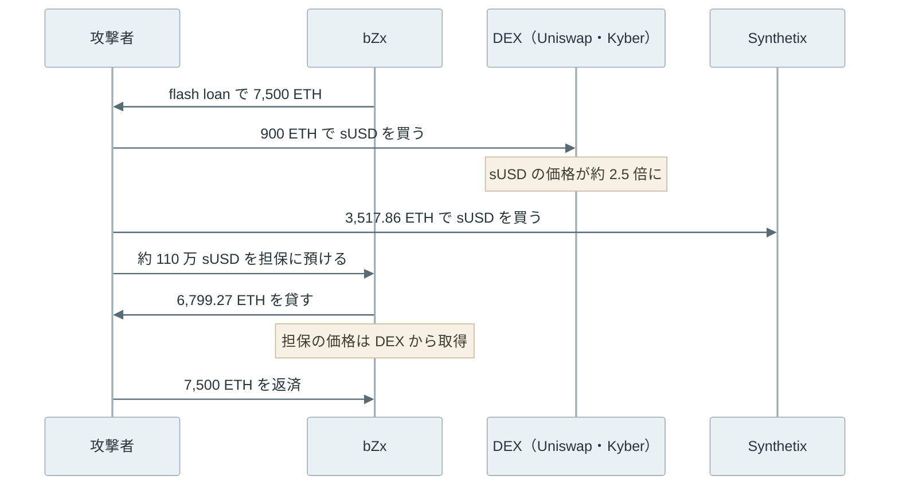

レンディングプロトコル（lending protocol）は、利用者が預けた暗号資産を[スマートコントラクト](../smart-contract/)のプールに集め、担保を預けた別の利用者に貸し出す仕組みです。代表例は [Aave](https://aave.com/docs/aave-v3/overview) と [Compound](https://docs.compound.xyz/) で、預け手は利息を受け取り、借り手は担保を手放さずに別の資産を使えます。

例えば、Alice が 10 ETH を担保に預け、米ドルとの連動を目指すトークンの [USDC](https://www.circle.com/usdc) を 12,000 USDC 借りたとします。Alice は ETH を売らずに手元資金を得られます。

一方で、ETH の価格が下がると、担保の価値が借入に近づきます。担保の価値が決められた線を割ると、誰でも Alice の借入を代わりに返済し、その分の担保を割引価格で受け取れます。この処理が清算（liquidation）です。



上記の図の 3 つ目では、担保の価値（14,000 ドル）はまだ借入（12,000 USDC）を上回っています。それでも清算されるのは、担保が借入を割り込む前に回収を始めるためです。

<br>

本記事では、Aave v3 の実装を例に、借り手の身元を知らないまま貸し出す仕組みを説明します。扱う疑問は次の通りです。

- 審査も裁判所も無いのに、なぜ貸し倒れを防げるのか。
- health factor は何を計算し、清算はいつ・誰が行うのか。
- 金利は誰が決めているのか。
- 価格が一気に動いた時、なぜ貸し手に損失が残るのか。
- 1 つの取引の中だけ担保なしで借りられる flash loan は、何に使われたのか。

担保の価格を届ける仕組みは [Oracle](../oracle/)、清算を取り合う bot と取引の並び順は [MEV](../mev/) で扱っています。トークンの送金と承認は [ERC-20](../erc-20/) を前提にします。

---

### 身元を確かめずに貸す方法

銀行の融資では、借り手の収入や信用を審査し、返済が滞れば契約と裁判所を通じて回収します。レンディングプロトコルも何らかの審査をしていると思うかもしれませんが、実際には借り手について何も確かめていません。借り手はアドレスでしか識別できず、返済しないまま別のアドレスに移っても、追いかける手段が無いからです。

そこで、借りる額より価値の大きい担保を先に預けてもらいます。この形を過剰担保（over-collateralization）と言います。返済されなくても担保を売れば回収できるため、借り手が誰であっても構いません。担保はコントラクトが保管し、借り手は返済するまで引き出せません。

<br>

[Aave v3](https://github.com/aave/aave-v3-core/blob/master/techpaper/Aave_V3_Technical_Paper.pdf) では、担保にする資産ごとに 2 つの割合を設定しています。

- LTV（Loan to Value）: 担保の価値に対して、新しく借りられる上限の割合。
- 清算閾値（liquidation threshold）: 借入が担保の価値のこの割合を超えると、清算できるようになる線。

LTV は清算閾値より低く設定します。借りた直後に清算されないよう、2 つの割合の間に余裕を持たせるためです。

本記事では説明のために LTV を 75%、清算閾値を 80% とします。10 ETH（1 ETH = 2,000 ドルで 20,000 ドル）を預けると 15,000 USDC まで借りられ、借入が担保の価値の 80% を超えると清算の対象になります。実際の値は資産ごとに異なり、Aave のガバナンスの投票で変更されます。

---

### health factor

Aave v3 は、借り手の状態を health factor（以下、HF）という 1 つの数値で表します。担保が複数ある場合は、資産ごとの価値に清算閾値を掛けて合計し、借入の合計で割ります。

```text
HF = Σ（担保 i の価値 × 担保 i の清算閾値） / 借入の合計の価値
```

価値は、[オラクル](../oracle/)の価格で米ドルに換算した値です。HF が 1 以上なら安全で、1 を下回ると清算できます。Aave v3 の [GenericLogic.sol](https://github.com/aave-dao/aave-v3-origin/blob/v3.6.0/src/contracts/protocol/libraries/logic/GenericLogic.sol#L156-L164) は、この式を 18 桁の固定小数点で計算しています。清算する時は、[ValidationLogic.sol](https://github.com/aave-dao/aave-v3-origin/blob/v3.6.0/src/contracts/protocol/libraries/logic/ValidationLogic.sol#L336-L339) で HF が 1 未満かを確かめます。

冒頭の Alice の例では、1 ETH = 2,000 ドルなら HF = 20,000 × 0.8 / 12,000 = 1.33 です。価格が 1,500 ドルまで下がると HF はちょうど 1 になり、それより下がると清算の対象になります。借入は USDC のまま変わらないので、HF を動かすのは主に担保の価格です。ただし、借りている間の利息も借入に加わるため、価格が動かなくても HF は少しずつ下がります。

HF は「担保が借入の何倍あるか」ではありません。担保の価値が借入を上回っていても、清算閾値を掛けた値が借入を下回れば HF は 1 未満です。

---

### 清算

清算者（liquidator）は、HF が 1 を下回った借り手の借入の一部を代わりに返済し、返済額に清算ボーナス（liquidation bonus）を上乗せした価値の担保を受け取ります。

例えば、ETH が 1,455 ドルに下がって HF が 0.97 になった Alice の借入のうち、清算者が 6,000 USDC を返済したとします。ボーナスが 5% なら、清算者は 6,300 ドル分（約 4.33 ETH）の ETH を受け取ります。Alice は 300 ドル分の担保を余分に失い、清算者はその差から gas 代を引いた分を得ます（Aave v3 では、ボーナスの一部をプロトコルが手数料として取る設定もあります）。

Aave v3 の [`_calculateAvailableCollateralToLiquidate`](https://github.com/aave-dao/aave-v3-origin/blob/v3.6.0/src/contracts/protocol/libraries/logic/LiquidationLogic.sol#L578-L591) は、返済額に相当する担保に `liquidationBonus`（105% なら 10500）を掛け、借り手の担保が足りなければ担保の全てを渡します。

<br>

1 回の清算で返済できる量の上限を close factor と言います。Aave v3 の [LiquidationLogic.sol](https://github.com/aave-dao/aave-v3-origin/blob/v3.6.0/src/contracts/protocol/libraries/logic/LiquidationLogic.sol#L256-L274) では、HF が 0.95 より大きく、対象の資産の担保と借入がどちらも 2,000 ドル（米ドル建ての市場の場合）以上ある時は、借入の合計の 50% までです。HF が 0.95 以下まで下がった時や、対象の資産の担保か借入のどちらかが 2,000 ドル未満の時は、一度に全額を清算できます。

なお、Aave は [v4 の清算の解説](https://aave.com/blog/aave-v4-liquidations)で、固定の close factor では借り手が必要以上に清算されやすいと書いています。

<br>

清算は運営者が行うと思うかもしれませんが、Aave v3 の `liquidationCall` には呼び出せるアドレスの制限がありません。回収を運営者だけが担う設計では、その運営者が止まると誰も回収できません。Aave は、ボーナスという利益を示して、回収の作業を誰でも引き受けられる形にしています。

実際には、HF が 1 に近い借入を監視する bot が同じ機会を取り合い、手数料を上乗せして先に清算しようとします。この競争は [MEV](../mev/) の代表例の 1 つです。

[Compound v2](https://docs.compound.xyz/v2/comptroller/#close-factor) も、close factor と liquidation incentive（清算ボーナスにあたる値）で清算者に報酬を与えます。一方で、[Compound III](https://docs.compound.xyz/liquidation/) では、誰でも呼べる `absorb` でプロトコル自身が担保を引き取って借入を消し、引き取った担保は、プロトコルの準備金が目標を下回っている間、`buyCollateral` で割引価格で売ります。

2026 年 11 月時点で、Aave は v4 の清算として、HF が低いほどボーナスが大きくなる方式と、close factor の代わりに目標の HF まで返済させる方式を[公式ブログ](https://aave.com/blog/aave-v4-liquidations)（2025 年 12 月）で説明しています。本記事の説明とコードへのリンクは、[aave-v3-origin](https://github.com/aave-dao/aave-v3-origin) の v3.6.0 に基づきます。

---

### 金利と利用率

預け手の利息と借り手の金利は、運営者が日々決めていると思うかもしれません。実際には、プールの利用率（utilization）から式で計算します。利用率は、プールの資産のうち貸し出されている割合です。

以下は、[Aave v3 の金利モデル](https://github.com/aave-dao/aave-v3-origin/blob/v3.6.0/src/contracts/misc/DefaultReserveInterestRateStrategyV2.sol#L150-L168)と同じ形の式に、説明用の値（最適利用率 80%、傾き 4% と 75%、プロトコルの取り分 15%）を入れた図です。実在する市場の値ではありません。



金利は、利用率が最適利用率（optimal usage ratio）に達するまではゆっくり上がり、それを超えると急に上がります。この折れ曲がる点は、[Compound v2 の JumpRateModel](https://github.com/compound-finance/compound-protocol/blob/master/contracts/JumpRateModel.sol) では kink と呼ばれています。

急に上げる理由は、預け手の引き出しです。プールの資産が全て貸し出されると、預け手は自分の預けた資産を引き出せません。利用率が高い時に金利を大きく上げると、借り手は返済を急ぎ、新しい預け手も集まるので、プールに空きが戻ります。預け手が受け取る利率は、借り手の金利に利用率を掛け、プロトコルの取り分（reserve factor）を引いた値です。

---

### 価格の急落と清算の実験

価格の下がり方で清算の結果がどう変わるか、[Python](https://www.python.org/) で確かめました。3 人の借り手 A・B・C が 10 ETH ずつ預け、8,000・12,000・15,000 USDC を借ります。1 ETH = 2,000 ドルの時点で、担保の 40%・60%・75% です。清算閾値 80%、ボーナス 5%、close factor 50% で、HF が 1 を下回った借り手は、清算者が価格の 1 段ごとに 1 回清算します。

価格の動きは 2 通りです。1 つは 2,000 から 1,200 まで 10 ずつ下がる場合（smooth）、もう 1 つは 1,950 から 1,300 へ一気に飛ぶ場合（gap）です。後者は、オラクルの更新が遅れた後に価格が一度に動く場面や、ネットワークの混雑で清算の取引がしばらく入らない場面に当たります。実際のネットワークや資産は使いません。

```python
LT = 0.80  # liquidation threshold
BONUS = 1.05  # liquidator receives 105% of the repaid debt in collateral
CLOSE_FACTOR = 0.5  # share of the debt repayable per call while HF > 0.95


def health_factor(p, price):
    if p["debt"] == 0:
        return float("inf")
    return p["eth"] * price * LT / p["debt"]


def liquidate(p, price):
    """One liquidation call. Returns the debt left without collateral."""
    hf = health_factor(p, price)
    repay = p["debt"] * (CLOSE_FACTOR if hf > 0.95 else 1.0)
    seize = repay * BONUS / price  # ETH sent to the liquidator
    if seize > p["eth"]:  # not enough collateral: take all of it
        seize = p["eth"]
        repay = seize * price / BONUS
    p["eth"] -= seize
    p["debt"] -= repay
    if p["eth"] == 0 and p["debt"] > 0:
        bad, p["debt"] = p["debt"], 0.0
        return bad
    return 0.0


def run(prices):
    positions = {name: {"eth": 10.0, "debt": debt}
                 for name, debt in (("A", 8000.0), ("B", 12000.0), ("C", 15000.0))}
    bad_debt, calls, history = 0.0, 0, []
    for price in prices:
        for p in positions.values():
            if health_factor(p, price) < 1:
                bad_debt += liquidate(p, price)
                calls += 1
        history.append((price, [health_factor(p, price) for p in positions.values()]))
    return positions, bad_debt, calls, history


smooth = [2000 - 10 * i for i in range(81)]
gap = smooth[:6] + [p for p in smooth if p <= 1300]

for label, prices in (("smooth", smooth), ("gap", gap)):
    positions, bad_debt, calls, history = run(prices)
    print(f"[{label}] {prices[0]} -> {prices[-1]} USDC, {calls} liquidation calls")
    for name, p in positions.items():
        print(f"  {name}: eth={p['eth']:6.3f} debt={p['debt']:9.2f}")
    print(f"  bad debt: {bad_debt:.2f} USDC")
    for price, hfs in history:  # health factors after the liquidations
        print(f"  hf {label} {price} " + " ".join(f"{h:.3f}" for h in hfs))
```

上記は [lab/lending_sim.py](https://github.com/nao1215/debimate/blob/main/content/notes/blockchain-systems/lending/lab/lending_sim.py) から先頭のコメントを除いたものです。以下は出力のうち、各段の HF（`hf` で始まる行）を除いた部分です。全体は [lab/lending_sim_output.txt](https://github.com/nao1215/debimate/blob/main/content/notes/blockchain-systems/lending/lab/lending_sim_output.txt) にあります。

```text
[smooth] 2000 -> 1200 USDC, 6 liquidation calls
  A: eth=10.000 debt=  8000.00
  B: eth= 3.330 debt=  3000.00
  C: eth= 1.123 debt=   937.50
  bad debt: 0.00 USDC
[gap] 2000 -> 1200 USDC, 2 liquidation calls
  A: eth=10.000 debt=  8000.00
  B: eth= 0.308 debt=     0.00
  C: eth= 0.000 debt=     0.00
  bad debt: 2619.05 USDC
```



10 ずつ下がる場合は、C の HF が 1 を割る度に借入の半分が返済され、HF は 1.15 前後に戻りました。B も 1,500 を下回った所で同じように清算されています。担保は減りましたが、借入は全て担保で返済されており、損失は残っていません。

一気に飛ぶ場合は、1,300 の時点で C の担保は 13,000 ドルしかなく、借入の 15,000 USDC を下回っています。清算者は担保を全て受け取る代わりに、ボーナス分を引いた 12,380.95 USDC だけを返済し、残りの 2,619.05 USDC は誰も返済しない借入になりました。これが不良債権（bad debt）です。損をするのは借り手ではなく、プールに預けた貸し手です。

B も HF 0.87 まで飛びましたが、担保が借入を上回っていたので全額を清算でき、損失は出ていません。

<br>

価格の段差が小さくても、清算が HF を下げることがあります。清算で担保から引かれるのは返済額の 105% なので、担保の価値が借入の 1.05 倍を下回った状態（この例では HF が 0.84 未満）で一部だけ清算すると、残った借入に対する担保の割合はかえって悪化します。

Aave v3 は v3.3 から、担保が尽きても残った借入を [`deficit`](https://github.com/aave-dao/aave-v3-origin/blob/v3.6.0/src/contracts/protocol/libraries/logic/LiquidationLogic.sol#L514-L518) として資産ごとに記録します。記録した不足は、Umbrella というコントラクトが保有する aToken（預けた資産の預かり証のトークン）を焼却して埋める設計です。

---

### 清算が間に合わなかった日

実験の gap に近いことが、2020 年 3 月 12〜13 日に [MakerDAO](https://github.com/makerdao/dss) で起きました。MakerDAO は、ETH などを Vault に預けて、米ドル連動のトークン DAI を発行して借りる仕組みです。担保が不足した Vault は清算として担保をオークションにかけ、keeper と呼ばれる bot が DAI で入札して担保を買い取ります。

[Maker Foundation の報告](https://web.archive.org/web/20201205172925/https://blog.makerdao.com/the-market-collapse-of-march-12-2020-how-it-impacted-makerdao/)によると、事故は次の順序で起きました。

1. 36 時間の間に ETH などの暗号資産が 50% 以上値下がりし、[Ethereum](https://ethereum.org/) の取引が急増して gas 代が跳ね上がった。
2. Vault の所有者は、混雑のために担保の追加や返済をプロトコルの 1 時間の猶予に間に合わせにくくなった。この猶予は、オラクルが価格を 1 時間遅らせて反映する仕組み（[OSM](https://github.com/sky-ecosystem/osm/blob/master/src/osm.sol) の `hop`）から生まれる。
3. 多数のオークションが一斉に始まった。清算に参加していた keeper は約 4 者で、1 者は技術的な問題で、1 者は DAI が尽きて、それぞれ数時間入札できなかった。残る 2 者の bot はほぼ 0 DAI の入札を出し、一部のオークションではその入札で担保が落札された。
4. 担保を売っても借入を埋められず、約 540 万 DAI が不足した。MakerDAO は MKR（ガバナンストークン）を新しく発行して売る debt auction を行い、3 月 29 日までに 20,980 MKR を 530 万 DAI と交換して埋めた。

清算は誰でも参加できますが、参加者がその時に取引をチェーンに入れられることを前提にしています。入札が届かなければ競争が起きず、担保は安値で売られ、不足は貸し手側（MakerDAO では MKR の保有者）が負います。

---

### flash loan

flash loan は、担保なしで借り、同じ取引の中で返済する貸し出しです。担保なしで貸せば踏み倒されると思うかもしれませんが、flash loan では返済が無ければ借りたこと自体が取り消されます。Ethereum の取引は、途中で失敗すると全ての状態変更が巻き戻るからです。

Aave v3 の [FlashLoanLogic.sol](https://github.com/aave-dao/aave-v3-origin/blob/v3.6.0/src/contracts/protocol/libraries/logic/FlashLoanLogic.sol#L179-L196) は、借り手のコントラクトに資産を送り、そのコントラクトの `executeOperation` を呼び出します。呼び出しが終わると、手数料（premium）を加えた額を借り手から[引き戻し](https://github.com/aave-dao/aave-v3-origin/blob/v3.6.0/src/contracts/protocol/libraries/logic/FlashLoanLogic.sol#L239-L243)、足りなければ取引全体が失敗します。

`flashLoanSimple` の貸し手から見ると、手数料付きで返ってくるか、最初から貸していなかったかのどちらかです（複数の資産を扱う `flashLoan` には、返済の代わりに通常の借入へ切り替える指定もあります）。

<br>

flash loan は、DEX（Decentralized Exchange）の間の価格差を使う裁定取引や、清算の返済資金にも使えます。問題になるのは、大きな資金で動かせる価格が、別のプロトコルで正しい価格として使われている時です。

2020 年 2 月 18 日、貸し出しと証拠金取引を提供していた bZx で、flash loan で DEX の価格を動かし、その価格で担保を評価させる攻撃が起きました。[Qin らの分析](https://arxiv.org/abs/2003.03810)によると、[1 つの取引](https://etherscan.io/tx/0x762881b07feb63c436dee38edd4ff1f7a74c33091e534af56c9f7d49b5ecac15)の中で次の順に処理しています。



sUSD は、[Synthetix](https://synthetix.io/) が発行する米ドル連動のトークンです。攻撃者が [Uniswap](https://uniswap.org/) と [Kyber](https://kyber.network/) で 540 ETH と 360 ETH を sUSD に替えた結果、両方の取引所で 1 ETH と交換できる sUSD は、本来の 268.30 から約 106〜108 に減りました。sUSD が本来の約 2.5 倍の価値に見える状態です。

bZx はこの 2 つの DEX の価格を担保の評価に使っていたので、攻撃者は市場の価格で買った sUSD を担保に、本来より多くの ETH を借りられました。

flash loan を返済した後、攻撃者の手元には 2,381.41 ETH が残りました。分析では、bZx の貸し手の損失を 2,699.97 ETH と見積もっています。

<br>

flash loan は、自己資金の無い攻撃者にも大きな資金での操作を可能にしましたが、原因そのものではありません。原因は、担保の評価に、1 つの取引の中で動かせる DEX のその時点の価格を使ったことです。

DEX の価格がプールの残高から決まる仕組みは [AMM](../amm/) で扱っています。レンディングプロトコルにとって、オラクルの価格は HF と清算の全てを左右する入力です。価格の出どころと更新の遅れは、[Oracle](../oracle/) で扱った検査と合わせて確認する必要があります。
