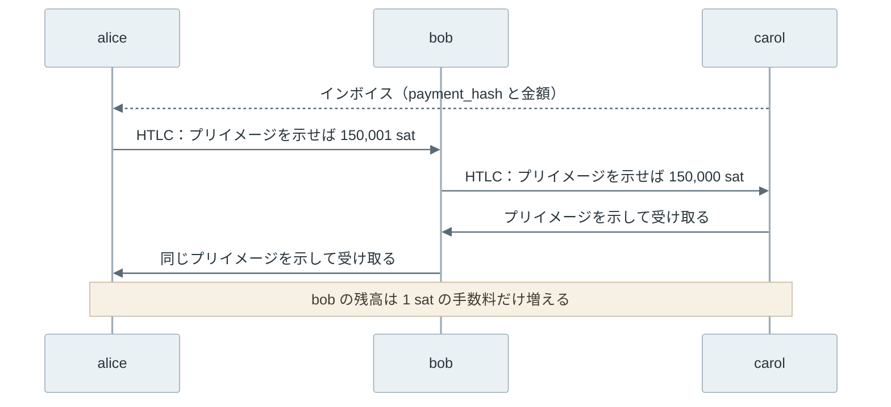

[Lightning Network](https://lightning.network/) は、[Bitcoin](https://bitcoin.org/) の支払いを 2 者の間で何度も繰り返し、そのたびにブロックへ記録せずに済ませる仕組みです。2 者はあらかじめ Bitcoin を「チャネル」に預け、2 人が署名した「残高の分け方」を書き換えることで支払います。チェーンに記録するのは、原則としてチャネルを開く時と閉じる時のトランザクションだけです。

ウォレットの画面では、チャネルの残高が銀行口座の残高のように表示されます。そのため、次のような前提を置きたくなります。

- チャネルを開けば、その相手から支払いを受け取れる
- 残高の分だけ送れる
- 受け取った分は、すぐに送り返せる
- 経路上のチャネルに十分な容量があれば、支払いは届く
- 相手が応答しなくても、閉じればすぐに資金を使える
- 自分に有利な古い状態で閉じれば、その額を手にできる

手元の regtest（自分の PC だけで動かす Bitcoin のテスト用チェーン）で、Lightning の実装である [LND](https://github.com/lightningnetwork/lnd) を 3 台動かして試すと、どれも成り立ちませんでした。下の図は、容量 1,000,000 sat のチャネルを開いた直後と、10,000 sat を受け取った直後に測った値です。sat（satoshi）は 1 億分の 1 BTC を表す単位です。



チャネルを開いた alice は 982,000 sat までしか送れず、受け取れる額は 0 でした。10,000 sat を受け取った bob は、1 sat も送り返せません。

Lightning で支払いを受け付けようとする開発者は、ノードを立ててチャネルを開いた直後に、この 0 に出会いやすくなっています。テストの支払いが `FAILURE_REASON_INSUFFICIENT_BALANCE` や `FAILURE_REASON_NO_ROUTE` で失敗し、残高は十分に見えるのに理由が分からない、という形です。

<br>

本記事では、Lightning で支払いを受け付けたい人と、ノードを運用する人に向けて、上の 6 つの前提が外れる理由を同じ実験で上から順に説明します。先にチャネルの残高が何に守られているかを示し、最後にオンチェーンの送金やカストディ型のウォレットと比べます。

---

### チャネルとコミットメントトランザクション

チャネルを開く側は、2 人の署名が揃わないと使えない出力に Bitcoin を送ります。2 人のうち 2 人の署名を求める [2-of-2 のマルチシグ](../multisig/)です。このトランザクションを開設トランザクション（funding transaction）と呼び、チャネルの容量は、ここに預けた額で決まります。

預けた額をどう分けるかを書いたトランザクションは、[コミットメントトランザクション（commitment transaction）](https://github.com/lightning/bolts/blob/master/03-transactions.md)と呼ばれます。「alice に 900,000 sat、bob に 100,000 sat」のように開設トランザクションの出力を分けるもので、相手の[署名](../digital-signature/)を付けて各自が持っています。どちらも、いつでも自分の分をチェーンに出してチャネルを閉じられます。

開く側は、開設トランザクションをチェーンに出す前に、預けた額を自分に戻す最初のコミットメントトランザクションへ相手の署名をもらっておきます。相手が応答しなくなっても、預けた資金が閉じ込められないようにするためです。

本記事では、コミットメントトランザクションが表す残高の分け方をチャネルの状態とも呼びます。

支払いのたびに、2 人は新しいコミットメントトランザクションに署名し合い、古い状態を失効させます。失効させた状態をチェーンに出すと、出した側が残高を失います。


灰色で描いた 2 つだけがチェーンに載り、間の状態はチェーンに出さずに書き換えていきます。プロトコルは [BOLT（Basis of Lightning Technology）](https://github.com/lightning/bolts)という仕様群で定められていて、LND のほかに [Core Lightning](https://github.com/ElementsProject/lightning) や [Eclair](https://github.com/ACINQ/eclair) などの実装があります。仕組みの元になったのは、2016 年に Joseph Poon と Thaddeus Dryja が公開した[論文](https://lightning.network/lightning-network-paper.pdf)です。

<br>

実験は、Bitcoin Core と LND 3 台（alice・bob・carol）を docker compose で動かし、[lab/run.py](lab/run.py) で各手順を流しました。手順と環境は [lab/README.txt](lab/README.txt)、全ての測定値は [lab/result.json](lab/result.json) にあります。

---

### 受け取れる額は相手の残高で決まる

alice が bob へ 1,000,000 sat のチャネルを開いた直後、bob から alice へ 1 sat を払うと、`FAILURE_REASON_INSUFFICIENT_BALANCE` で失敗しました。

チャネルでの支払いは、状態の上で払う側の残高を減らし、受け取る側の残高を増やす操作です。開いた直後の状態は「alice 996,530 / bob 0」なので、bob の残高から alice へ動かせる額はありません。alice が受け取れる額は、相手である bob の残高で決まります。

自分の残高で送れる額を outbound liquidity、相手の残高で受け取れる額を inbound liquidity と呼びます。本記事では英語のまま使います。自分でチャネルを開くと outbound liquidity だけが増え、inbound liquidity は 0 から始まります。

支払いを受け付けるお店やサービスにとっては、売上の上限が inbound liquidity で決まることになります。増やす方法は、どれも相手側に残高を作る操作です。

| 増やす方法 | 相手側に残高ができる理由 |
| --- | --- |
| 他のノードに、自分へ向けたチャネルを開いてもらう | 開いた相手が預けた分が相手側に乗る |
| 自分の残高を使って、先に何かを支払う | 払った分が相手側へ移る |
| 開く時に push_amt で、相手側へ初めから残高を渡す | 渡した分が相手側に乗る |
| [Lightning Pool](https://lightning.engineering/pool/) で、チャネルを開いてもらう権利を買う | 売り手が預けた分が相手側に乗る |
| [Lightning Loop](https://lightning.engineering/loop/) の Loop Out で、払った額をオンチェーンで受け取る | 事業者へ払った分が相手側へ移る |

Pool と Loop は、相手側に Bitcoin を置いてもらう代わりに手数料が掛かります。

---

### 送れる額は残高より少ない

チャネルを開いた alice の残高は、預けた 1,000,000 sat ではなく 996,530 sat でした。閉じるトランザクションに掛かる手数料と、anchor と呼ぶ 330 sat ずつの小さな出力 2 つ分は開いた側が負担し、あらかじめ残高から差し引かれます。

送れる上限は、さらに少ない 982,000 sat でした。差の 14,530 sat のうち 10,000 sat はチャネルリザーブ（channel reserve）で、相手が「これだけは手元に残しておくこと」と求める額です。

[BOLT #2](https://github.com/lightning/bolts/blob/master/02-peer-protocol.md) は容量の 1% を推奨していて、今回の LND も 1,000,000 sat に対して 10,000 sat を求めました。残りの 4,530 sat は、手数料率が上がった時や、次の節で説明する HTLC の出力が支払いの途中でコミットメントトランザクションに加わる時に備えて、LND が空けておく分です。この分は、現在の手数料率を 2 倍にし、送る HTLC に加えてもう 1 つ出力を足したコミットメントトランザクションの大きさで見積もると [LND のソースコード](https://github.com/lightningnetwork/lnd/blob/v0.18.4-beta/lnwallet/channel.go#L3586-L3602)にあります。

<br>

送れる上限は、払えない支払いを送って二分探索しました。受取人が知らない payment_hash を付けた支払いは、受取人まで届けば「その支払いは知らない」という理由で失敗し、途中で残高が足りなければ別の理由で失敗します。どちらでも残高は動きません。payment_hash は次の節で説明する、支払いを受け取るための鍵になる値です。

```python
def probe(payer, dest, amt):
    r = ln(payer, "sendpayment", "--dest", PUB[dest], "--amt", str(amt),
           "--payment_hash", secrets.token_hex(32), "--final_cltv_delta", "40",
           "--json", "--timeout", "30s", check=False)
    return r.get("failure_reason") == "FAILURE_REASON_INCORRECT_PAYMENT_DETAILS"


def max_reachable(payer, dest, lo, hi):
    while hi - lo > 1:
        mid = (lo + hi) // 2
        if probe(payer, dest, mid):
            lo = mid
        else:
            hi = mid
    return lo
```

`ln` は `docker exec` で各ノードの `lncli` を呼び、JSON を返す補助関数です。`--final_cltv_delta` は次の節で説明する HTLC に付ける期限で、支払いと一緒に指定した値です。上限の測り方には関わらないので、ここでは読み飛ばしてかまいません。

この二分探索を他人のチャネルに使うと、公開されていない残高を外から推測できます。この手法はプロービング（probing）と呼ばれます。

<br>

bob 側のチャネルリザーブも 10,000 sat です。alice から 10,000 sat を受け取った bob は、残高がちょうどチャネルリザーブに届いただけなので、5,000 sat を返そうとすると `FAILURE_REASON_INSUFFICIENT_BALANCE` で失敗しました。BOLT #2 は、開いた直後はリザーブを満たしていない側があることを認め、受け取ってリザーブに届いた後は下回らないように求めています。チャネルリザーブが何のためにあるかは、古い状態を出す実験で分かります。

---

### 直接チャネルが無い相手への支払い

チャネルを開いた相手にしか払えないなら、支払う相手ごとにチャネルが必要です。Lightning では、他のノードが持つチャネルを順に経由して払えます。経由するノードをルーティングノードと呼びます。

途中のノードが受け取った分を持ち逃げしないように、各チャネルで条件付きの支払いを使います。HTLC（Hashed Time-Locked Contract）と呼ばれる条件で、「ある値を示せば受け取れる。期限を過ぎたら払った側に戻る」というものです。この値をプリイメージ（preimage）と呼び、受取人が[インボイス（invoice、請求書）](https://github.com/lightning/bolts/blob/master/11-payment-encoding.md)を作る時に[乱数](../../security/random-number/)で選びます。インボイスに載せるのは、プリイメージから [SHA-256](../../security/sha-256/) で求めた[ハッシュ値](../hash-function/)である payment_hash だけです。



carol がプリイメージを示して受け取ると bob はその値を知り、同じ値を alice に示して受け取れます。bob が carol へ払わなければ carol はプリイメージを明かさないので、bob は alice からも受け取れません。

経路の情報は、[Tor](../../security/tor/) と同じ考え方のオニオンルーティング（[BOLT #4](https://github.com/lightning/bolts/blob/master/04-onion-routing.md)）で包んで送ります。bob が知るのは、直前の alice と直後の carol だけです。

期限は、bob が受け取る HTLC の方が、bob が払う HTLC より遅く切れるように設定します。carol が期限の間際にプリイメージを明かしても、bob が alice から受け取る時間を残すためです。今回の bob は、この差を 80 ブロックに設定していました。差の決め方は、チェーンの再編成（[Finality](../finality/) で扱う reorg）や相手の応答待ちを足し合わせる形で [BOLT #2](https://github.com/lightning/bolts/blob/master/02-peer-protocol.md#cltv_expiry_delta-selection) に示されていて、迷うなら差を 34 ブロック以上にするよう勧めています。

<br>

次の図は、bob が carol へ 500,000 sat のチャネルを開いた後、alice が bob 経由で carol へ 150,000 sat ずつ 4 回払った時の、2 つのチャネルの残高です。



1 回の支払いで、2 つのチャネルの境目が同時に動きます。alice と bob のチャネルでは bob 側が増え、bob と carol のチャネルでは bob 側が減ります。bob の手数料は、基本料 1,000 msat（1 sat）に金額の 100 万分の 1 を足す設定だったので、150,000 sat の支払いで 1 sat でした。手数料の設定は、各ノードが [BOLT #7](https://github.com/lightning/bolts/blob/master/07-routing-gossip.md#the-channel_update-message) の channel_update で公開します。1 回の支払いに掛かった時間は、lncli の実行を含めて 0.36〜0.48 秒です。

4 回目は `FAILURE_REASON_NO_ROUTE` で失敗しました。run.py が記録した 4 回目の結果は次の通りです。

```json
{
  "amt": 150000,
  "status": "FAILED",
  "failure_reason": "FAILURE_REASON_NO_ROUTE",
  "attempts": 14,
  "elapsed_ms": 121394,
  "bc_bob_local": 46530
}
```

`attempts` は LND が試した HTLC の数、`elapsed_ms` は支払いの開始から失敗までの時間、`bc_bob_local` は bob と carol のチャネルに残っていた bob 側の残高です。LND は 14 個の HTLC を試し、121 秒を使った後に支払いを失敗で終えています。

<br>

alice は、bob と carol を結ぶチャネルの容量が 500,000 sat であることを知っていました。ノードはチャネルの存在と容量を互いに知らせ合いますが、どちら側にいくらあるかは知らせないからです。

3 回目の後、bob 側には 46,530 sat しか残っておらず、そこから容量 500,000 sat の 1% で決まる bob 側のチャネルリザーブ 5,000 sat も引かれます。容量の数字だけを見ると届きそうな支払いでも、経路上で一番少ない残高が上限になります。払う側は、それを試して失敗するまで知ることができません。

<br>

LND v0.18.4 の既定では、1 回の支払いを最大 16 個に分けて送る[マルチパス・ペイメント（multi-part payment）](https://github.com/lightning/bolts/blob/master/04-onion-routing.md#basic-multi-part-payments)も使えます。受取人は合計が揃うまでプリイメージを明かさず、揃わなければ少なくとも 60 秒待って失敗として戻すよう推奨されています。

分ければ、1 本の経路に収まらない額も複数の経路で届けられます。今回は経路が bob を通る 1 本だけなので、分けても bob 側の残高は超えられません。

経路上の残高を分からない値として扱い、支払いが届く確率で経路を選ぶ研究もあります（[Pickhardt ら、2021](https://arxiv.org/abs/2103.08576)）。

---

### 閉じ方で変わる待ち時間

チャネルを閉じる方法は 2 つあります。2 人が合意して最新の残高どおりに分けるトランザクションを作る[協調クローズ（cooperative close）](https://github.com/lightning/bolts/blob/master/02-peer-protocol.md#channel-close)と、片方が手元のコミットメントトランザクションをチェーンに出す強制クローズ（force close）です。協調クローズは 1 つのトランザクションで済むので、手数料も抑えられます。相手が応答しない時は、強制クローズしか方法がありません。

比べるために、carol から alice へ 200,000 sat のチャネルを新たに開きました。そのうえで bob が carol とのチャネルを強制クローズし、同時に carol が alice とのチャネルを協調クローズしました。閉じる指示を出してから、それぞれの資金がオンチェーンの残高に入るまでのブロック数は次の通りです。



強制クローズした bob 自身の分は、146 ブロック待ちました。Bitcoin のブロックは平均 10 分に 1 つなので、本番なら約 1 日です。

コミットメントトランザクションの中で、自分の残高を受け取る出力には `OP_CHECKSEQUENCEVERIFY` という時間の条件が付いていて、出した側は指定のブロック数が経つまで使えません。[Bitcoin Script](../bitcoin-script/) で書かれた[条件](https://github.com/lightning/bolts/blob/master/03-transactions.md#to_local-output)で、指定のブロック数を to_self_delay と呼びます。to_self_delay は、チャネルを開く時に相手側が指定する値です。

今回の値は 144 ブロックで、コミットメントトランザクションがブロックに入るまでの 1 ブロックと、待ち明けに LND がウォレットへ移すトランザクションの 1 ブロックを足して 146 になりました。

一方、受け取る側の carol は 3 ブロックで使えました。今回のチャネルは anchor outputs という形式で、相手の分にも 1 ブロックの待ちが付き、LND がウォレットへ移す分を足して 3 ブロックです。長く待たされるのは、自分の状態を出した側だけです。

<br>

出した側を待たせるのは、出された状態が最新かどうかを相手が調べる時間を作るためです。bob が古い状態を出していたら、carol はこの 144 ブロックの間に対応できます。その対応を試したのが次の実験です。

---

### 古い状態で閉じると全額を失う

同じ状態でも、alice が持つコミットメントトランザクションと bob が持つものは別物です。待ち時間の条件は、それぞれ持ち主自身の残高を受け取る出力にだけ付いています。

状態を新しくする時、2 人は BOLT #2 の revoke_and_ack というメッセージで、古い状態を失効させる秘密の値（per_commitment_secret）を相手に渡します。この値と自分の鍵が揃うと、[失効鍵（revocation key）](https://github.com/lightning/bolts/blob/master/03-transactions.md#revocationpubkey-derivation)の秘密鍵を計算できます。

失効させた状態がチェーンに出ると、相手はこの鍵を使い、出した側の残高を待ち時間の間に自分のものにできます。この時に出すトランザクションは、ペナルティトランザクション（penalty transaction）と呼ばれます。[原論文](https://lightning.network/lightning-network-paper.pdf)では Breach Remedy Transaction と呼ばれ、扱い方は [BOLT #5](https://github.com/lightning/bolts/blob/master/05-onchain.md#revoked-transaction-close-handling) にあります。

自分の残高を受け取る出力（to_local）の条件は、[BOLT #3](https://github.com/lightning/bolts/blob/master/03-transactions.md#to_local-output) で次のように決まっています。

```text
OP_IF
    # Penalty transaction
    <revocationpubkey>
OP_ELSE
    `to_self_delay`
    OP_CHECKSEQUENCEVERIFY
    OP_DROP
    <local_delayedpubkey>
OP_ENDIF
OP_CHECKSIG
```

`OP_ELSE` の分岐は、持ち主が to_self_delay の後に自分の鍵で使う道です。`OP_IF` の分岐は、失効鍵を持つ相手が待たずに使う道で、ペナルティトランザクションは `OP_IF` の分岐を通ります。

実験では、経路の実験を終えた alice と bob のチャネルで、bob が古い状態を出す役になりました。この時点で bob の残高は、経路の図で 3 回目の後に示した 460,003 sat です。手順は次の通りです。

1. bob を止め、チャネルの状態を保存した `channel.db` を写す。
2. bob を動かし、alice へ 200,000 sat 払う。最新の残高は 260,003 sat になる。
3. alice を止める。bob は写した `channel.db` に戻し、強制クローズする。
4. alice を止めたまま、古い状態がブロックに入ってから 9 ブロック掘り、alice を動かす。

手順 3 と 4 に当たるコードは次の通りです。[run.py](lab/run.py) から抜粋し、ブロック数は数値に置き換えました。

```python
stop("alice")
stop("bob")
run("docker", "cp", str(HERE / "bob-old-channel.db"), f"lnlab-bob:{db}")
start("bob")
ln("bob", "closechannel", "--force", "--funding_txid", txid, "--output_index", idx,
   "--block=false")
mine(1)    # 古い状態がブロック 120 に入る
mine(9)    # alice はオフラインのまま、ブロック 129 まで
start("alice")
```

`stop`・`start` はコンテナを止めて動かす補助関数、`mine` は regtest でブロックを掘る補助関数です。次の動く図は、掘ったブロック高に沿って、2 人がチャネルから手にした額を示します。



alice は戻ってから最初のブロック 130 でペナルティトランザクションを入れ、古い状態で自分に割り当てられていた 536,526 sat と bob の 460,003 sat を合わせ、手数料を除いた 984,229 sat を受け取りました。

bob がチャネルから手にした額は 0 です。最新の状態で閉じていれば、bob の残高は 260,003 sat でした。LND は、このチャネルの閉じ方を `BREACH_CLOSE` と記録しています。チェーンが不正を見つけたわけではなく、alice が出した証拠を Bitcoin のノードが検証しただけです。

<br>

ここで、チャネルリザーブが求められる理由が分かります。残高が 0 のノードは、古い状態を出して失敗しても失うものがありません。チャネルリザーブは、古い状態を出そうとした時に必ず失うものがあるようにするための額だと、BOLT #2 に書かれています。

<br>

#### 古いバックアップから戻した時

この実験の bob は、悪意を持った相手とは限りません。LND の[復旧に関する文書](https://github.com/lightningnetwork/lnd/blob/v0.18.4-beta/docs/recovery.md)には、`channel.db` を定期的にコピーする方法は「最新の状態かどうか分からないので危険」と書かれています。古いバックアップから戻したノードが強制クローズすれば、本人に悪意が無くても同じ結果になります。

[Core Lightning の文書](https://docs.corelightning.org/docs/backup)でも、バックアップに DB のスナップショットを使う方法は勧められていません。LND が勧めるのは、チャネルを開いた時の情報だけを持つ Static Channel Backup（`channel.backup`）です。Static Channel Backup から戻したノードは残高の分け方を持っていないので、自分の状態を出しません。代わりに [channel_reestablish](https://github.com/lightning/bolts/blob/master/02-peer-protocol.md#message-retransmission) のやり取りで相手に強制クローズを頼み、相手が出した最新の状態から自分の残高を受け取ります。ただし、相手のノードが動いていて、頼みに応じることが前提です。

<br>

#### 見張る役と watchtower

alice がペナルティトランザクションを出せたのは、144 ブロックの間に戻ってきたからです。戻るのが遅れれば、bob は古い状態の残高をそのまま使えました。チャネルを持つノードは、to_self_delay の間に相手の古い状態を見つけられるように、動いている必要があります。[BOLT #5](https://github.com/lightning/bolts/blob/master/05-onchain.md) も、出力の行き先が決まるまでチェーンを監視するよう求めています。

ノードが止まっていなくても、チェーンのブロックを解析できなくなることがあります。2022 年 10 月には、LND が特定の大きなブロックを解析できなくなる不具合があり、緊急の修正リリース [v0.15.2](https://github.com/lightningnetwork/lnd/releases/tag/v0.15.2-beta) が出ました。11 月にも、入力の多いトランザクションを解析できない不具合で [v0.15.4](https://github.com/lightningnetwork/lnd/releases/tag/v0.15.4-beta) が出ています。解析できないブロックに載ったトランザクションには、ノードは気づけません。

常に動かし続けるのが難しいノードは、見張りを他のノードに任せられます。この役を watchtower と呼び、LND は[見張る側と頼む側の両方](https://github.com/lightningnetwork/lnd/blob/v0.18.4-beta/docs/watchtower.md)を持っています。

頼む側は状態を更新するたびに、暗号化したペナルティトランザクションを渡します。watchtower は、古い状態がチェーンに出た時にだけそれを復号して出せます。v0.18.4 の文書によると、watchtower が扱うのは 2 人の残高を受け取る出力だけで、支払い途中の HTLC は対象外です。

---

### オンチェーン・カストディ型との比較

ここまでの手間は、自分でノードを動かす場合のものです。支払いを受け付ける方法として、オンチェーンの送金と、事業者が鍵を管理するカストディ型の Lightning ウォレットと並べます。

| 項目 | オンチェーン | 自分のノードで Lightning | カストディ型の Lightning |
| --- | --- | --- | --- |
| 受け取る前の準備 | アドレスを渡すだけ | inbound liquidity が要る | アカウントを作る |
| チェーンへの記録 | 支払いごと | チャネルの開閉だけ | 事業者の帳簿 |
| 支払いが届くまで | ブロックを待つ | 今回は 1 秒未満 | 事業者の中で即時 |
| 常に動かすノード | 不要 | 要る（watchtower も可） | 不要 |
| バックアップ | 復元フレーズ | 復元フレーズとチャネルの情報 | 事業者に任せる |
| 資金を動かせる人 | 自分 | 自分 | 事業者 |

オンチェーンの送金では、ブロックが平均 10 分に 1 つしか作られず、手数料は金額ではなく、トランザクションのデータ量と[使う UTXO の数](../utxo/)で決まります。

手数料の高い順にブロックへ入るので、[Mempool](../mempool/) が混むと待ちも延びます。数百円の支払いを何度も受けるなら、毎回の手数料と確定の待ちが重くなります。この点を Lightning は開設と閉鎖の 2 回にまとめますが、代わりに上の表で「自分のノードで Lightning」の列に並べた手間を負います。

カストディ型は、その手間を事業者が引き受ける形です。[Wallet のノート](../wallet/)で取り上げた [LNbits](https://github.com/lnbits/lnbits) も、他者のサーバーで使えばカストディ型になり、自分のノードで動かせば自分で管理できます。画面が同じでも、誰が資金を動かせるかは構成で決まります。

Ethereum の L2 である [Rollup](../rollup/) も、支払いをチェーンの外で処理する仕組みです。Rollup は誰とでも同じ残高で送り合える代わりに、処理の結果を Ethereum に載せ続けます。Lightning は、相手ごとの状態と見張りを自分で持つことで、チェーンへの記録を開閉の 2 回に抑えます。

---

### 受け付ける前に決めること

冒頭の図に出た 0 は、どれもチャネルの仕組みから来ていました。受け取れる額は相手の残高で決まり、送れる額はチャネルリザーブと手数料の分だけ少なく、経路では一番少ない残高が上限になります。テストの支払いが失敗したら、まず `lncli listchannels` で自分と相手の残高とチャネルリザーブを見ます。次は、10,000 sat を受け取った後の bob で、送れる額が 0 だった時に出た値を抜粋したものです。

```json
{
  "capacity": "1000000",
  "local_balance": "10000",
  "remote_balance": "986530",
  "local_chan_reserve_sat": "10000",
  "remote_chan_reserve_sat": "10000",
  "csv_delay": 144
}
```

`local_balance` が自分の残高、`local_chan_reserve_sat` が自分に求められたチャネルリザーブで、送れる額はおおよそ前者から後者を引いた額より少なくなります。`csv_delay` は、強制クローズした時に待つ to_self_delay です。

Lightning で支払いを受け付けるなら、ノードを立てる前に次の 4 つを決めておきます。どれも、本記事の実験で見た失敗に対応しています。

| 決めること | 実験で見たこと |
| --- | --- |
| inbound liquidity をどこから用意するか | 開いた直後の alice は 1 sat も受け取れない |
| 1 回で受け付ける最大の額 | 容量 500,000 sat の経路で、4 回目の 150,000 sat が届かない |
| 誰が to_self_delay の間チェーンを見張るか | 古い状態は 144 ブロック以内に見つけないと取り戻せない |
| バックアップの方法 | 古い `channel.db` で閉じた bob は 0 sat |

出金するまでに受け取る見込みの額が、相手側にある残高の合計より大きければ、途中から受け取れなくなります。経路が何本あっても、払う側の outbound liquidity の合計と、受取人の inbound liquidity の合計を超える額は、マルチパス・ペイメントでどう分けても届きません。経路上の残高は払う側から見えないので、大きな額ほど失敗しやすくなります。

ノードを止める予定があるなら watchtower を頼みます。バックアップには Static Channel Backup のように最新の状態を前提にしない方法を選び、戻す時は相手が応じるのを待つことも見込んでおきます。

この 4 つを自分で引き受けないなら、カストディ型を使うか、オンチェーンで受け取るのが選択肢になります。支払いの回数が少なく、開設と閉鎖の手数料を回収できない場合も、オンチェーンの方が向いています。自分のノードを選んだ場合、冒頭の図で alice が 1 sat も受け取れず、bob が 1 sat も送れなかったのは、不具合ではなく仕組みどおりの動作です。
