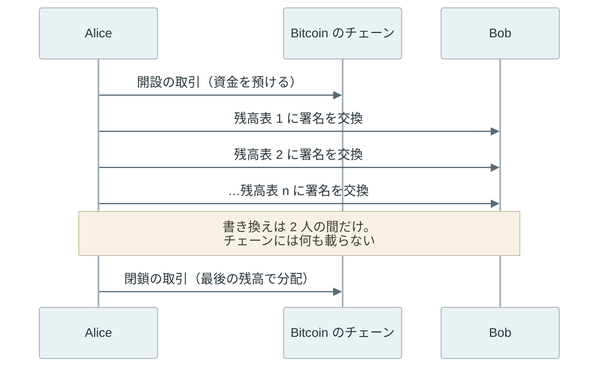
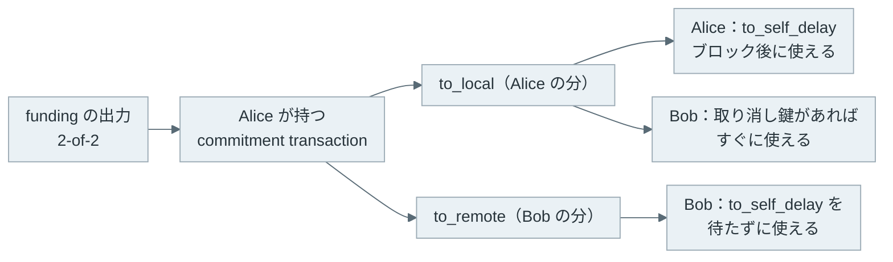
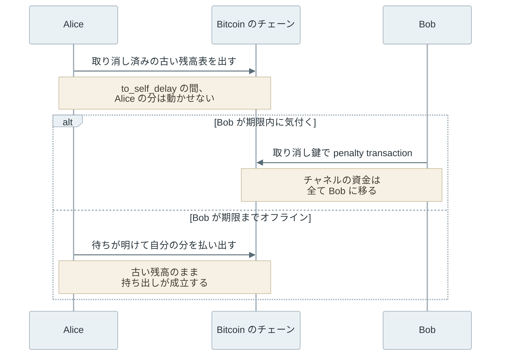
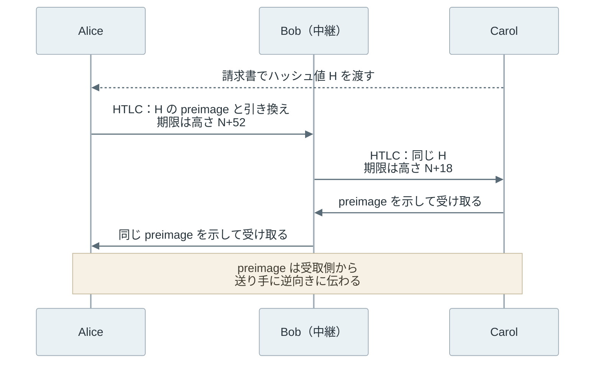
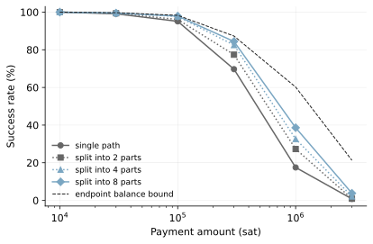

毎朝のコーヒー代を Bitcoin で払うと、1 杯ごとに取引をブロックに入れることになります。ブロックは平均 10 分に 1 つしか作られず、手数料は金額ではなく取引のデータ量で決まるため、数百円の支払いに数十分の確定待ちと見合わない手数料が付く場合があります。

Lightning Network は、2 者が共同で管理する Bitcoin を「チャネル」に預け、2 人だけが署名する残高表を何度も書き換えることで支払いを進めるネットワークです。チェーンに記録するのは、原則としてチャネルを開く取引と閉じる取引の 2 つだけです。複数のチャネルを経由すれば、直接チャネルを持たない相手にも支払えます。プロトコルは [BOLT（Basis of Lightning Technology）](https://github.com/lightning/bolts)という仕様群で定められています。



図のように、チェーンが目にするのは最初と最後の取引だけです。しかし、Bob が署名した古い残高表は Alice の手元に残っており、チェーンにはそれが古いかどうかを判断する材料がありません。チェーンに書かないのに、なぜ持ち逃げできないのでしょうか。

<br>

本記事では、Bitcoin 上の Lightning Network が、チェーンの外の残高更新を Bitcoin のルールで強制する仕組みを説明します。次の疑問を順に扱います。

- チャネルの開設・更新・閉鎖で、チェーンには何が記録されるのか。
- 古い残高表を出す不正は、どのように罰せられるのか。なぜチャネルを見張り続ける必要があるのか。
- 直接チャネルが無い相手への支払いで、中継者の持ち逃げをどう防ぐのか。
- チャネルの残高の偏りは、支払いの成功率にどう影響するのか。

取引の形は、[BOLT 3](https://github.com/lightning/bolts/blob/master/03-transactions.md) が定めるチャネル（2-of-2 マルチシグの出力を使う形）を前提に説明します。出力の考え方は [UTXO](../utxo/)、出力に付ける条件の書き方は [Bitcoin Script](../bitcoin-script/) で説明しています。

---

### チャネルが必要な理由

通常の Bitcoin の送金は、全てのノードに伝わり、各ノードの [mempool](../mempool/) で待ち、マイナーがブロックに入れて初めて記録されます。手数料はデータ量あたりの単価で競うため、1 万円の送金と 300 円の送金で大きくは変わりません。ブロックに入った後も、[Finality](../finality/) の観点では確認数を待ちます。

この待ちと手数料を避けるだけなら、事業者の帳簿で残高を付け替える方法もあります。しかし、事業者が出金を止めれば、利用者は資金を取り戻せません。小額の支払いを繰り返す仕組みに必要なのは、次の 3 つを同時に満たすことです。

- 支払いのたびにブロックを待たない。
- 相手や中継者を信用しなくても、自分の残高を一方的に取り戻せる。
- 最後の分配は、Bitcoin のルールで強制できる。

Lightning Network は、1 つ目をチェーンに書かないことで、残りを「いつでもチェーンに出せる署名済みの取引」を持つことで満たします。

---

### チャネルの開設・更新・閉鎖

開設では、資金を出す側（BOLT では funder）が funding transaction を作ります。この取引の出力は「2 人とも署名した時だけ使える」2-of-2 のマルチシグで、預けた資金は片方の[デジタル署名](../digital-signature/)だけでは動かせません。funder は funding transaction をチェーンに出す前に、その資金を自分に払い戻す取引への相手の署名を受け取ります。そのため、相手が応答しなくなっても資金は閉じ込められません。

更新で書き換える残高表の正体は、funding transaction の出力を入力にし、「Alice に何 sat、Bob に何 sat」という出力を持つ commitment transaction です。sat（satoshi）は Bitcoin の最小単位で、1 BTC の 1 億分の 1 です。例えば、容量 1,000,000 sat のチャネルで Alice が 3,000 sat のコーヒー代を払うと、手数料などを除けば「Alice 997,000 / Bob 3,000」とした新しい commitment transaction に 2 人が署名し直します。この取引は手元に置くだけで、通常はチェーンに出しません。

閉鎖には 2 通りあります。協調 close（mutual close）は、2 人が最終残高で分配する closing transaction に合意して出す方法で、[BOLT 2](https://github.com/lightning/bolts/blob/master/02-peer-protocol.md#channel-close) では資金をすぐに使え、手数料も抑えられます。一方的 close（unilateral close）は、相手が応答しない時に、手元の最新の commitment transaction を片方だけで出す方法です。

| 段階 | チェーンに載るもの | チェーンに載らないもの |
| --- | --- | --- |
| 開設 | funding transaction（2-of-2 の出力） | 払い戻し用の commitment transaction への署名 |
| 更新 | なし | 新しい commitment transaction と、古い残高表を取り消す秘密 |
| 協調 close | 最終残高を分ける closing transaction | 途中の支払いの履歴 |
| 一方的 close | 最新の commitment transaction と、その出力の払い出し | 途中の支払いの履歴 |

一方的 close でも、チェーンに出るのは最後の 1 枚です。その中の更新の番号も、開設時に交換した値を使った排他的論理和（XOR）で隠されており、外からは更新の回数が読めません。

---

### 古い残高表を出した時の罰

Alice は、手元にある古い commitment transaction を一方的に出すこともできます。Bob の署名は本物なので、Bitcoin のノードはその取引を有効と判断します。Lightning Network は、古い残高表を出すことを禁止するのではなく、出すと損をする形にして防ぎます。

そのために、2 人は同じ残高を別々の commitment transaction として持ちます。Alice が持つ commitment transaction では、Alice 自身に払う出力（to_local）に、BOLT 3 が定める次の[条件](https://github.com/lightning/bolts/blob/master/03-transactions.md#to_local-output)が付きます。

```text
OP_IF
    # Penalty transaction
    <revocationpubkey>
OP_ELSE
    `to_self_delay`
    OP_CHECKSEQUENCEVERIFY
    OP_DROP
    <local_delayedpubkey>
OP_ENDIF
OP_CHECKSIG
```

`OP_ELSE` の分岐は、取引がブロックに入ってから `to_self_delay` ブロックが経つまで、Alice が自分の出力を使えないことを表します。`OP_IF` の分岐は、revocation key（取り消し鍵）に対応する秘密鍵を持つ者なら、待たずに使えることを表します。この待ち時間を決めるのは相手の Bob で、チャネルを開く時に指定します。



図は Alice が持つ commitment transaction で、Bob が持つものは 2 人の役割を入れ替えた形です。チェーンに出した本人だけが自分の分を待たされ、相手は to_self_delay を待たずに受け取れます。なお、anchor outputs（option_anchors）を使うチャネルでは、to_remote にも 1 ブロックの待ちが付きます。

取り消しは、更新のたびに行います。新しい commitment transaction に署名し合った後、Alice は古い方に使った per_commitment_secret という秘密を Bob に渡します（BOLT 2 の `revoke_and_ack`）。Bob はこの秘密と自分の秘密を組み合わせて、古い方の取り消し鍵の秘密鍵を計算できるようになります。[鍵の導出](https://github.com/lightning/bolts/blob/master/03-transactions.md#revocationpubkey-derivation)の形から、2 人の秘密が揃うまでは誰もこの秘密鍵を計算できません。

Alice が取り消し済みの commitment transaction を出すと、Bob は `to_self_delay` の待ちが終わる前に、取り消し鍵で Alice の分を自分に送る penalty transaction を出します。Bob の分はもともと Bob に払われるので、[BOLT 5](https://github.com/lightning/bolts/blob/master/05-onchain.md#revoked-transaction-close-handling) の通り、チャネルの資金は全て Bob が請求できます。[Poon 氏と Dryja 氏の論文](https://lightning.network/lightning-network-paper.pdf)で Breach Remedy Transaction と呼ばれていたものです。

---

### チャネルの監視と watchtower

penalty transaction は、Bob が気付いて期限内に出した時だけ働きます。Bob が `to_self_delay` より長くオフラインだった場合、待ちが明けた Alice は古い残高のまま自分の分を持ち出せます。そのため、BOLT 5 は funding transaction を出したか、HTLC を含む commitment transaction に署名したノードに、出力が解決するまでチェーンを監視するよう求めています。



2 つの結末を分けるのは、Bob がチェーンを見ていたかどうかだけです。常時起動していないノードのために、監視を他者に頼む watchtower があります。ノード実装の 1 つである [LND](https://github.com/lightningnetwork/lnd) の [watchtower](https://github.com/lightningnetwork/lnd/blob/master/docs/watchtower.md) では、クライアントが penalty 用の取引を暗号化して預け、watchtower は取り消し済みの commitment transaction がチェーンに出た時に初めてそれを復号して送信します。預けられるのは to_local と to_remote の分だけで、HTLC（次の節で説明します）の出力は今後の対応とされています。

監視と同じくらい厄介なのが、自分の状態のバックアップです。古いバックアップから復元したノードが、最新だと思っている commitment transaction を出すと、相手から見ればそれは取り消し済みです。[Core Lightning のバックアップの文書](https://docs.corelightning.org/docs/backup)も、DB（データベース）のスナップショット型のバックアップを推奨していません。鍵を復元できるだけでは足りないのです。

BOLT 2 の [channel_reestablish](https://github.com/lightning/bolts/blob/master/02-peer-protocol.md#message-retransmission) は、再接続時に自分が遅れていると気付いたノードに、自分の commitment transaction を出さず、相手に close を頼むよう定めています。ただし、相手が応じることが前提です。

---

### 中継支払いと HTLC

支払う相手ごとにチャネルを開くと、開設のたびにチェーンに載せる取引が必要になります。Alice が Bob とチャネルを持ち、Bob が Carol とチャネルを持っていれば、Bob に中継を頼んで Carol に払えます。問題は、Alice が Bob に払った後、Bob が Carol に払わずに終わる場合です。

この中継を成立させるのが HTLC（Hashed Time Locked Contract）です。HTLC は commitment transaction に追加する出力で、「ハッシュ値 H の元の値（preimage）を示せば受取側が受け取れる。期限のブロック高までに示されなければ送り手に戻る」という条件を持ちます。preimage は Carol が乱数で作り、そのハッシュ値だけを[請求書（BOLT 11 の invoice）](https://github.com/lightning/bolts/blob/master/11-payment-encoding.md)で Alice に渡します。ハッシュ値から元の値を求められない性質は、[ハッシュ関数の原像計算困難性](../hash-function/)です。



Bob は Carol から preimage を受け取った時点で、Alice からの HTLC を受け取る材料を得ます。Carol が preimage を示さなければ、Bob から Carol への HTLC は期限で Bob に戻り、Bob も Alice からの HTLC を失敗として戻します。ただし、各区間の決済は同時ではなく、Bob が期限内に行動することが前提です。

期限が下流ほど短くないと、Bob は preimage を知った後に、Alice との HTLC をチェーン上で請求する時間を持てません。BOLT 2 の [cltv_expiry_delta の選び方](https://github.com/lightning/bolts/blob/master/02-peer-protocol.md#cltv_expiry_delta-selection)は、チェーンの組み替え（reorg）・相手の応答待ち・取引がブロックに入るまでの遅れを足し合わせ、迷うなら差を 34 ブロック以上にするよう勧めています。図の 52 は、この 34 と受取人の最小値の既定である 18 を足した説明用の値です。

中継者は [BOLT 7](https://github.com/lightning/bolts/blob/master/07-routing-gossip.md#the-channel_update-message) で公開した手数料を差し引いて次に渡します。経路は [BOLT 4](https://github.com/lightning/bolts/blob/master/04-onion-routing.md) の onion routing で包まれ、中継者には前後のノードしか分かりません。

---

### 流動性とルーティング

チャネルの容量は、どちらの向きにも同じだけ送れる量ではありません。容量 1,000,000 sat のチャネルで Alice 側に 900,000 sat、Bob 側に 100,000 sat ある時、手数料と reserve（各側がチャネルに最低限残す額、channel_reserve_satoshis）を除けば、Alice から Bob には 900,000 sat まで送れますが、Bob から Alice には 100,000 sat までしか送れません。支払うたびに残高は受取側に寄るので、受け取りが多い店舗には、相手側に残高のあるチャネル（受け取りの余地、inbound liquidity）が必要です。

送り手には、各チャネルの片側の残高が見えません。公開されたチャネルの容量は funding transaction の出力額としてチェーンから読めますが、残高は 2 人の間で更新され続けます。そのため、送り手は経路を推測で選び、残高が足りなければ失敗の通知を受けて別の経路を試します。Pickhardt 氏らの 2021 年の論文「[Security and Privacy of Lightning Network Payments with Uncertain Channel Balances](https://arxiv.org/abs/2103.08576)」は、残高を容量の範囲の一様分布とみなし、支払いの成功を確率として扱っています。

大きな支払いは、BOLT 4 の [multi-part payment](https://github.com/lightning/bolts/blob/master/04-onion-routing.md#basic-multi-part-payments)（以下 MPP）で分割できます。各部分は同じハッシュ値を使い、受取人は合計額が揃うまで preimage を出しません。失敗した部分は送り直せます。受取人は最初の部分から少なくとも 60 秒待つことが推奨され、それでも揃わなければ、届いた分も失敗として送り手に戻します。

#### 支払い額と成功率のシミュレーション

分割の効き方はローカルの Python で確かめます。200 ノードのグラフの各チャネルに容量と内訳を乱数で割り当て、同じ支払いを分割せずに送った場合と、2・4・8 等分した場合を比べます。

```python
# Lightning Network の支払い成功率を単純化したモデルで比べる（標準ライブラリのみ）
import json
import pathlib
import random
from collections import deque

N_NODES, LINKS_PER_NODE = 200, 2
AMOUNTS = [10_000, 30_000, 100_000, 300_000, 1_000_000, 3_000_000]  # sat
PARTS = [1, 2, 4, 8]
TRIALS, MAX_ATTEMPTS = 1000, 10

rng = random.Random(42)

# チャネルのグラフ: 後から来たノードは、繋がりの多いノードと開設しやすい
capacity, ends = {}, [0, 1]
capacity[(0, 1)] = capacity[(1, 0)] = 1_000_000
for new in range(2, N_NODES):
    peers = set()
    while len(peers) < min(LINKS_PER_NODE, new):
        peers.add(rng.choice(ends))
    for p in peers:
        c = int(10 ** rng.uniform(5, 7))  # 10 万〜1,000 万 sat
        capacity[(new, p)] = capacity[(p, new)] = c
        ends += [new, p]
neighbors = {}
for u, v in capacity:
    neighbors.setdefault(u, []).append(v)


def find_path(src, dst, amount, excluded):
    """容量だけを見て、ホップ数が最小の経路を探す（残高は送る側に見えない）"""
    prev, queue = {src: None}, deque([src])
    while queue:
        u = queue.popleft()
        if u == dst:
            path = []
            while prev[u] is not None:
                path.append((prev[u], u))
                u = prev[u]
            return path[::-1]
        for v in neighbors[u]:
            if v not in prev and (u, v) not in excluded and capacity[(u, v)] >= amount:
                prev[v] = u
                queue.append(v)
    return None


def pay(src, dst, amount, parts, balance):
    """amount を parts 個に分けて送る。1 つでも届かなければ支払い全体が失敗"""
    excluded = set()
    for _ in range(parts):
        part = amount // parts
        for _ in range(MAX_ATTEMPTS):
            path = find_path(src, dst, part, excluded)
            if path is None:
                return False
            short = next((hop for hop in path if balance[hop] < part), None)
            if short is None:
                for hop in path:  # HTLC が経路上の残高を押さえる
                    balance[hop] -= part
                break
            excluded.add(short)  # 失敗した区間を次の試行から外す
        else:
            return False
    return True


results, bound = {k: [] for k in PARTS}, []
for amount in AMOUNTS:
    ok, possible = {k: 0 for k in PARTS}, 0
    for _ in range(TRIALS):
        balance = {}
        for (u, v), c in capacity.items():
            if u < v:  # 容量の内訳は一様分布で割り当てる
                balance[(u, v)] = rng.randint(0, c)
                balance[(v, u)] = c - balance[(u, v)]
        src, dst = rng.sample(range(N_NODES), 2)
        # 送り手の手元の残高と、受取人の受け取りの余地の小さい方が上限
        out_sum = sum(balance[(src, v)] for v in neighbors[src])
        in_sum = sum(balance[(v, dst)] for v in neighbors[dst])
        possible += min(out_sum, in_sum) >= amount
        for k in PARTS:
            ok[k] += pay(src, dst, amount, k, dict(balance))
    for k in PARTS:
        results[k].append(ok[k] / TRIALS)
    bound.append(possible / TRIALS)

print("amount_sat  " + "  ".join(f"parts={k}" for k in PARTS) + "  endpoint_bound")
for i, amount in enumerate(AMOUNTS):
    row = "  ".join(f"{results[k][i]:>7.1%}" for k in PARTS)
    print(f"{amount:>10,}  {row}  {bound[i]:>14.1%}")

out = pathlib.Path(__file__).with_name("result.json")
out.write_text(json.dumps({"amounts": AMOUNTS, "success": results, "bound": bound}, indent=1))
```

実行結果は以下の通りです。`endpoint_bound` は、送り手の手元の残高の合計と、受取人側の受け取りの余地の合計が、どちらも支払い額以上だった割合です。

```text
amount_sat  parts=1  parts=2  parts=4  parts=8  endpoint_bound
    10,000   100.0%   100.0%   100.0%   100.0%          100.0%
    30,000    99.1%    99.4%    99.5%    99.5%           99.7%
   100,000    95.1%    96.1%    97.7%    97.9%           98.3%
   300,000    69.7%    77.4%    82.5%    84.4%           87.3%
 1,000,000    17.5%    27.3%    32.6%    38.6%           60.2%
 3,000,000     0.8%     0.9%     2.1%     3.8%           21.3%
```



上記の図で、分割が効くのは、支払い額が個々のチャネルの残高に近づく 10 万〜100 万 sat の範囲です。分割すると各区間に必要な額が下がり、別の経路も使えます。しかし、8 分割でも破線の上限には届かず、300 万 sat では 3.8% です。送り手が手元に持つ残高と、受取人が受け取れる余地は、経路の選び方では増えないからです。

残高を一様分布とした仮定は、前述の論文と同じです。一方で、手数料、`cltv_expiry_delta`、HTLC の金額と同時数の上限、reserve は無視しており、グラフも合成したものです。数値は分割の有無を比べる目安として見てください。条件は [lab/README.txt](lab/README.txt)、図は[生成コード](https://github.com/nao1215/debimate/blob/main/content/notes/blockchain-systems/lightning-network/figures.py)にあります。

---

### オンチェーンとオフチェーンの役割分担

ここまでの仕組みを担い手で分けると、以下の通りです。


- title: Bitcoin のチェーン
  items:
  - 2-of-2 の出力で資金を固定する
  - closing transaction による最終残高の分配を記録する
  - to_self_delay と HTLC の期限を数える
  - penalty transaction や HTLC の請求を有効な取引として受け入れる
- title: Lightning のノード
  items:
  - commitment transaction に署名し合って残高を更新する
  - 相手から受け取った取り消し用の秘密を保管する
  - 経路を選び、HTLC を中継する
  - チェーンを監視し、期限内に penalty transaction を出す


チェーンが不正を見つけてくれるのではなく、チェーンは当事者が出した証拠を検証するだけです。

---

### 利点

- 支払いのたびにブロックを待たず、チャネル内の更新は 2 者間のメッセージで済む
- 支払いの回数が増えても、チェーンに載る取引は開設と閉鎖の分に抑えられる
- 相手や中継者を信用しなくても、署名済みの取引で自分の残高を取り戻せる
- 中継の各区間が同じハッシュ値で結ばれ、中継者が片方だけ受け取ることを防げる

### 欠点

Lightning Network は、チェーンに書く回数を減らすために、不正の検出と状態の保管を当事者に任せています。そのため、次の制約があります。

- `to_self_delay` の期間内にチェーンを確認できる状態を保つ必要があり、自分で見られなければ watchtower に頼る
- チャネルの状態を失うと資金を失い得るので、鍵だけのバックアップでは足りない
- 資金はチャネルに固定され、開設と閉鎖にはチェーンの手数料と確定待ちが掛かる
- 残高は向きごとに偏り、送り手には見えないため、大きな支払いほど失敗しやすい

### 効果が小さくなりやすいケース

- 支払いの回数が少なく、開設と閉鎖の取引の手数料を回収できない場合
- 経路上のチャネルの残高に近い、またはそれを超える額を一度に送る場合
- 端末を長期間オフラインにする利用者が、監視を誰にも頼まずにチャネルを持つ場合
