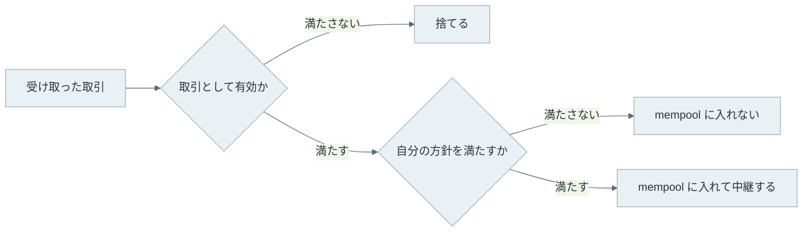
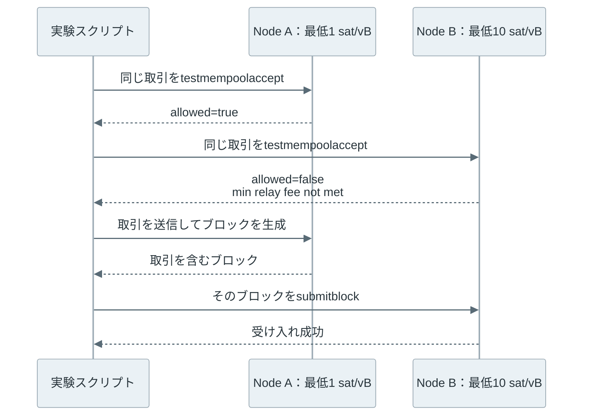
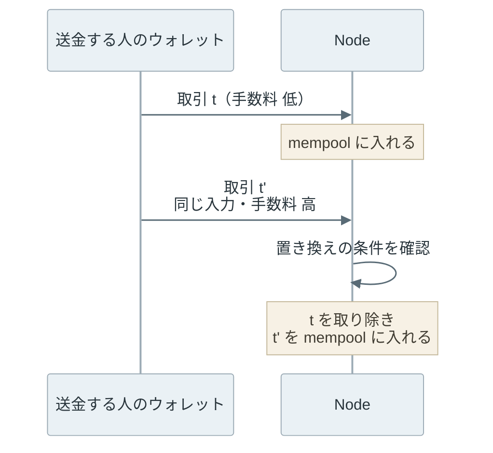

mempool（memory pool）は、まだブロックに入っていない取引をノードが一時的に置いておく場所です。ノードは受け取った取引を検証してから mempool に入れ、隣のノードに中継します。ブロックを作る参加者は、この置き場から取り込む取引を選びます。

送った取引がなかなかブロックに入らず、取引の状況を表示する Web サイト（ブロックエクスプローラ）によって「未確認」（まだブロックに入っていない状態）の表示が違うことがあります。しばらく待つと取引が消える場合もあります。こうした違いが起きる主な理由は、各ノードが別々の mempool を持つからです。

以下は、受け入れる最低手数料率が違う 2 台のノードの mempool を重なる集合で描いた例です。



上記の図の取引 b と取引 c は、片方のノードだけが持っています。b は後半の実験で使う手数料率 2 sat/vB の取引で、Node B の最低手数料率を下回るため A だけに入ります。ネットワーク全体で 1 つの mempool を共有する仕組みは無く、どのノードから見るかで中身が変わります。

<br>

本記事では、以下の疑問に沿って、ノードが取引を受け入れるかどうかをどう決めるのかと、入った取引が消えたり置き換わったりする場面を説明します。

- なぜ有効性の判定だけでは足りないのか。
- consensus rule と policy は、何が違うのか。
- 受け入れと追い出しの材料に、なぜ容量の上限まで入っているのか。
- 競合する取引は、どのような時に置き換わるのか。
- 送った取引は、なぜ見えなくなることがあるのか。

取引と手数料の表し方は [UTXO](../utxo/)、ブロックへの取り込みと確認数は [Bitcoin Block](../bitcoin-block/)、1 件の送金の流れは [Bitcoin Transaction Lifecycle](../bitcoin-transaction-lifecycle/) で説明しています。実験では方針の差が見える設定値を使います。設定項目の全一覧は扱いません。

---

### 有効性の判定だけで足りない理由

取引が有効かどうかについては、全ノードが同じ結論に至る必要があります。ブロックに入った取引の採否が参加者ごとに割れると、どのブロックを受け入れるかの判断まで割れ、履歴が 1 本に揃わなくなるからです。

受け入れの判断は事情が違います。ブロックに入る前の取引はまだ履歴のどこにも載っておらず、それを手元に置くかどうかを他の参加者と揃える必要はありません。ノードは自分のメモリと通信帯域を使って取引を保持し、中継します。

有効な取引を無制限に受け入れる作りにすると、この資源が使い切られます。手数料をほとんど付けない取引を大量に送り付けられても、有効である限り受け入れて中継する必要があるからです。そこで各ノードは、有効性の確認とは別に、自分が持って中継する価値があるかを判定します。

以下が 2 段の判定です。



上記の図の 1 つ目の判定は全ノードで共通の規則、2 つ目はノードごとの方針です。1 つ目は、同じチェーンの状態を前提にすれば、どのノードでも同じ結果になります。2 つ目で落ちた取引は、別の方針を持つノードなら受け入れることがあります。

2 つを分けておくと、資源の使い方をノードごとに調整できます。共通の規則を変えるには参加者の足並みを揃える必要がある一方で、自分が何を持ち、何を中継するかは、他のノードと相談せずに決められるからです。

---

### consensus rule と policy の違い

有効性を決める規則は consensus rule（合意規則）、受け入れと中継の方針は policy（ポリシー）と呼ばれます。

[Bitcoin](https://bitcoin.org/) の代表的な実装である [Bitcoin Core](https://github.com/bitcoin/bitcoin) では、policy は consensus rule に加えて未確認の取引に課す検証規則で、ノードごとに設定できます（[policy のドキュメント](https://github.com/bitcoin/bitcoin/blob/master/doc/policy/README.md)）。ブロックに入った取引の判定に使われるのは、consensus rule だけです。

2 つの違いを整理すると、以下の通りです。

| | consensus rule | policy |
| --- | --- | --- |
| 役割 | 取引やブロックの有効性を決める | 未確認の取引を保持し、中継するかを決める |
| mempool に入れる時 | 前提として確認する | 追加で確認する |
| ブロックを検証する時 | 適用する | 適用しない |
| ノードごとの差 | 同じ規則に従う必要がある | ノードごとに違い得る |

未確認の取引も consensus rule を満たしていることが前提で、policy はその上に足される確認です。形式の面で policy を満たさない取引は「非標準な取引」と呼ばれますが、「無効な取引」とは別物です。

policy を満たさない取引でも、ブロックに入った時点のチェーンの状態に照らして consensus rule を満たしていれば、有効な取引として受け入れられます。中継されにくいだけで、マイナーに直接届いて取り込まれる経路は残っています。

方針が緩いノードだけが持っている取引も、ブロックに取り込まれると共有された履歴の一部になり、そこから先は policy の違いで持つ・持たないが分かれることはありません。

---

### 拒否した取引を含むブロックの受け入れ

自分の mempool では拒否した取引をブロックに入ってからは受け入れることを 2 台のローカルノードで確認します。使うのは Bitcoin Core 30.4 の [regtest](../testnet-history/#bitcoin-のテストネット) です。regtest は、開発者が手元でブロックを生成できる専用のテスト環境で、実際の BTC は使いません。

2 台には、同じ 101 ブロックを読み込ませます。違いは、単独の未確認取引を受け入れる最低手数料率（`minrelaytxfee`）だけです。取引は 2 sat/vB の手数料率で作成します。sat は BTC の最小単位 satoshi、vB は witness の割引を反映した仮想サイズの単位です。

| 対象 | 最低手数料率または設定した手数料率 |
| --- | --- |
| Node A | 最低 1 sat/vB |
| Node B | 最低 10 sat/vB |
| 今回の取引 | 2 sat/vB |

まず、[`testmempoolaccept`](https://bitcoincore.org/en/doc/30.0.0/rpc/rawtransactions/testmempoolaccept/) という RPC（ノードの機能を呼び出す API）で、同じ署名済み取引を試します。この API は受け入れられるかを調べるだけで、mempool には追加しません。



[compare_policy.py](lab/compare_policy.py) は、2 台の起動、テスト用資金の準備、取引の署名、各結果の検査まで行います。公開ネットワークと P2P 接続は無効にし、同じブロックを RPC で渡して状態を揃えます。秘密鍵を含む一時的なウォレットは終了時に削除し、結果だけを保存します。[README](lab/README.txt) に実行条件をまとめています。

以下は、同じ取引を 2 台で検査し、ブロックとして受け入れるところまでの抜粋です。`a` と `b` は起動済みのノード、`rpc` は各ノードの RPC を呼ぶメソッドです。先に A でテスト用の資金を用意し、B に同じブロックを渡しています。`address` は採掘報酬の受取先、`out` は検査結果の保存ディレクトリです。

```python
recipient = a.rpc('getnewaddress', wallet=True)
raw = a.rpc('createrawtransaction', [], {recipient: 1})
funded = a.rpc('fundrawtransaction', raw, {'fee_rate': 2}, wallet=True)
signed = a.rpc('signrawtransactionwithwallet', funded['hex'], wallet=True)
assert signed['complete']
checks = {}
for name, node in [('A', a), ('B', b)]:
    checks[name] = node.rpc('testmempoolaccept', [signed['hex']])[0]
    (out / f'accept-{name}.json').write_text(json.dumps(checks[name], indent=2) + '\n')
assert checks['A']['allowed'] and not checks['B']['allowed']
assert checks['B']['reject-reason'] == 'min relay fee not met'
assert a.rpc('getrawmempool') == [] and b.rpc('getrawmempool') == []
txid = a.rpc('sendrawtransaction', signed['hex'])
assert a.rpc('getrawmempool') == [txid] and b.rpc('getrawmempool') == []
new_block = a.rpc('generatetoaddress', 1, address)[0]
decoded = a.rpc('getblock', new_block)
assert txid in decoded['tx']
assert b.rpc('submitblock', a.rpc('getblock', new_block, 0)) is None
assert a.rpc('getbestblockhash') == b.rpc('getbestblockhash') == new_block
assert txid in b.rpc('getblock', new_block)['tx']
```

`bitcoind` を PATH に置いた環境で、リポジトリのルートから実行します。

```bash
python3 content/notes/blockchain-systems/mempool/lab/compare_policy.py
```

以下は、実際の[出力](lab/output/summary.txt)です。

```text
A minrelaytxfee: 1 sat/vB
B minrelaytxfee: 10 sat/vB
transaction fee_rate: 2 sat/vB
testmempoolaccept A: allowed=true
testmempoolaccept B: allowed=false; min relay fee not met
after preflight: mempool A=0 B=0
after send to A: mempool A=1 B=0
after mining on A and submitting block to B: same_tip=true
B block contains transaction: true
Assertions: PASS
```

Node B が返した `min relay fee not met` は、自分の最低手数料率を満たさないという意味です。取引の署名が不正だったわけではありません。事前確認では両方の mempool が空のままで、その後 Node A だけに送信すると、A に 1 件、B に 0 件となりました。

Node A がこの取引をブロックに取り込み、そのブロックを Node B に渡すと、B も同じ末尾のブロックを採用しました。スクリプトでは、B が採用したブロックの中に対象の txid があることも検査しています。手数料率の方針は未確認取引の保持・中継に対する条件で、ブロックの有効性の条件ではないことが分かります。

この実験は、同じ状態の 2 台で手数料の方針だけを変えた例です。実ネットワークでの伝播速度や、どのマイナーが取引を採るかを測ったものではありません。

---

### 受け入れと追い出しを決める材料

判定の材料は実装と設定で決まります。Bitcoin Core が持つ代表的なものは次の 4 つです。

- 仮想サイズあたりの手数料が、そのノードの決めた最低の手数料率を下回らないか
- 取引の形式が、標準とみなす形の範囲に収まっているか
- mempool に保持している量が上限に達していないか
- 未確認の取引どうしが依存関係で繋がった集合が、ノードの定めた範囲に収まっているか

1 つ目の手数料率は、手数料を取引の大きさで割った値です。大きさには、witness 部分を割り引いて数えた仮想サイズを使います。ブロックに入る量には上限があるため、取引は大きさあたりの手数料で比べられます。

最低の手数料率は、手数料の極端に低い取引を mempool と中継の対象から外す基準です。2 つ目は、Bitcoin Core が標準とみなす形式だけを通常の中継の対象とするための判定です。

<br>

3 つ目の上限は、最初の節で挙げた資源の使い切りへの備えです。2016 年 2 月の [Bitcoin Core 0.12](https://github.com/bitcoin/bitcoin/blob/master/doc/release-notes/release-notes-0.12.0.md) より前は mempool の大きさに上限が無く、最低の手数料率をわずかに上回る取引を大量に送り付ければ、メモリの少ないノードを落とせました。

0.12 は上限（既定 300 MB）を設け、溢れそうになると、手数料率の最も低い取引を依存する取引ごと取り除くようにしました。同時に、そのノードが受け入れる最低の手数料率も、取り除いた取引の手数料率を基準に上がります。

現在の[設計のドキュメント](https://github.com/bitcoin/bitcoin/blob/master/doc/policy/mempool-design.md)では、mempool の取引を手数料率の高い順に並べ、溢れた時はその末尾から取り除きます。判定を通った取引も追い出しの対象です。以下は、上限に達した mempool に手数料率の高い取引が来た時です。



上記の図で取り除かれた取引は、そのノードから消えます。取引そのものが無効になったわけではなく、別のノードがまだ持っていれば、後から中継されて戻ってくることもあります。容量とは別に、受け入れてから一定の時間が経った取引も取り除かれ、Bitcoin Core の既定ではこの期限が 2 週間です。

<br>

Bitcoin Core v30.0 の [txmempool.cpp](https://github.com/bitcoin/bitcoin/blob/v30.0/src/txmempool.cpp) の規則を写したシミュレーションで、追い出しによって最低の手数料率がどう上がり、どう戻るのかを確認します。

取り除いた取引の手数料率に incremental relay fee（既定 0.1 sat/vB）を足した値まで最低値を上げ、その後に新しいブロックが来てからは、12 時間の半減期で下げていく規則です。mempool が上限の 4 分の 1 未満なら半減期は 3 時間、2 分の 1 未満なら 6 時間に縮みます。

前提は以下の通りで、どれも実測ではありません。上限はメモリ使用量ではなく仮想サイズで数え、300 万 vB に縮めています。

- 取引は全て 250 vB で依存関係を持たず、手数料率は中央値 3 sat/vB の対数正規分布（seed 固定）
- ブロックは 600 秒ちょうどに来て、手数料率の高い順に 100 万 vB を取り込む
- 最初の 6 時間はブロック 1.5 個分、その後はブロック 0.6 個分の取引が 10 分ごとに届く

```python
# lab/rolling_min_fee.py の Mempool から抜粋（46〜71 行目）
    def min_fee(self, now):
        if not self.block_since_bump or self.rolling == 0:
            return self.rolling
        if now > self.last_update + 10:
            half = HALFLIFE
            if self.size() < LIMIT / 4:
                half /= 4
            elif self.size() < LIMIT / 2:
                half /= 2
            self.rolling /= 2 ** ((now - self.last_update) / half)
            self.last_update = now
            if self.rolling < INCREMENTAL / 2:
                self.rolling = 0.0
                return 0.0
        return max(self.rolling, INCREMENTAL)

    def accept(self, rate, now):
        if rate < MIN_RELAY or rate < self.min_fee(now):
            return False
        bisect.insort(self.rates, rate)
        while self.size() > LIMIT:
            removed = self.rates.pop(0) + INCREMENTAL
            if removed > self.rolling:
                self.rolling = removed
                self.block_since_bump = False
        return True
```

コード全体は [lab/rolling_min_fee.py](https://github.com/nao1215/debimate/blob/main/content/notes/blockchain-systems/mempool/lab/rolling_min_fee.py) にあります。`python3 rolling_min_fee.py` の[出力](https://github.com/nao1215/debimate/blob/main/content/notes/blockchain-systems/mempool/lab/rolling_min_fee_output.txt)の末尾は以下の通りです。

```text
peak min fee 1.85 sat/vB at hour 6.00
rejected arrivals below the minimum: 64,102
```

<br>

<details>
<summary>3 時間ごとの値（グラフの元）</summary>

```text
hour  mempool_vB  min_fee_sat/vB
   3   3,000,000            1.70
   6   3,000,000            1.85
   9     525,000            1.00
  12     576,750            0.51
  15     600,250            0.25
  18     621,000            0.13
  21     609,750            0.10
  24     612,500            0.10
  27     586,750            0.10
  30     591,750            0.10
  33     608,750            0.10
  36     581,750            0.10
peak min fee 1.85 sat/vB at hour 6.00
rejected arrivals below the minimum: 64,102
```

</details>

<br>



混雑した 6 時間で、最低の手数料率（minimum fee rate）は 0.1 から 1.85 sat/vB まで上がりました。到着が落ち着いて mempool が上限の 2 割ほどに空いた後も、最低値は半減期に沿って下がるだけで、1 sat/vB を下回るまでに約 3 時間かかっています。その間は、空きがあっても 1 sat/vB 未満の取引を受け入れません。

4 つ目の依存関係は、次の取引が未確認の取引の出力を入力で参照する形で生まれます。繋がりが大きいほど、1 件を取り除いた時に一緒に mempool から取り除く必要のある取引が増えます。

---

### 競合する取引と置き換え

同じ入力を使う 2 つの取引は、1 本の有効な履歴の中で両方とも成立することはありません（[UTXO](../utxo/)）。ノードは、片方を mempool に入れた後にもう片方を受け取っても、そのまま両方を保持することはしません。どちらを持つのかの判定が、ブロックに入る前の段階でも必要です。

後から来た取引が既存の取引を置き換える場合があり、この置き換えは replace-by-fee（RBF）と呼ばれます。[Bitcoin Core](https://github.com/bitcoin/bitcoin/blob/master/doc/policy/mempool-replacements.md) は、置き換えによって mempool 全体の手数料の水準が下がらないことや、追加の中継コストに見合う手数料を払うことなどを確認します。条件はバージョンによって変わるため、詳細は上記のドキュメントで確認してください。

以下は、置き換えが起きる流れです。



上記の図の取引 t は、置き換えが成立した時点でそのノードの mempool から消えます。手数料を低く付けすぎた送金は、この置き換えでやり直せます。

一方で、受け取る側から見れば、未確認の取引の内容が変わり得ます。Bitcoin の仕様提案である [BIP（Bitcoin Improvement Proposal）125](https://github.com/bitcoin/bips/blob/master/bip-0125.mediawiki) も、置き換えられる取引の受取人が、確認されるまで支払いとして扱わない選択を取れるとしています。

置き換えの条件が手数料の総額の増加を求めるのは、置き換えを繰り返す送り付けを防ぐためです。手数料率だけを条件にすると、取引を少しずつ小さくして率だけを上げ、総額を増やさないまま何度も中継させられます（Bitcoin Core の置き換えのドキュメント）。置き換えのたびに帯域ぶんの手数料を求めておけば、繰り返す側にコストが積み上がります。

置き換えを認めるかどうかと、どの取引を対象にするかは方針の一部です。[BIP 125](https://github.com/bitcoin/bips/blob/master/bip-0125.mediawiki) は、置き換えを許す意思を取引の中で示す方法と、当時の実装が使っていた条件を定めました。Bitcoin Core の現在の方針はそこから変わっており、意思表示の有無によらず置き換えを認める設定が [v28.0](https://github.com/bitcoin/bitcoin/blob/master/doc/release-notes/release-notes-28.0.md) で既定になりました。

---

### 送った取引が見えなくなる場面

取引の表示が変わる主な原因は、以下の通りです。

| 見えていること | 起きていること |
| --- | --- |
| エクスプローラによって未確認かどうかが違う | 観測しているノードの mempool の中身が違う |
| しばらく待つと取引が消えた | 手数料の面での優先度が低く容量の制限で取り除かれたか、期限切れで削除された可能性がある |
| 同じ資金を使う別の取引が見えている | 競合する取引が受け入れられ、既存の取引が置き換えられた可能性がある |

表の 1 行目と 2 行目の場合は、手数料を上げた取引を作り直して送ることもできます。置き換えられた取引は、置き換えた側がブロックに入った時点で入力が使われ、成立しなくなります。ブロックに取り込まれた後は[確認数](../finality/)の話になり、取引を含むブロック自身を 1 つ目として、その後ろに積まれたブロックまで数えます（[Bitcoin Block](../bitcoin-block/)）。

---

### mempool の利点

- ブロックが作られる前に取引がネットワークに広まり、マイナーは手元の置き場から選ぶだけで済む
- 手数料の面での優先順位が付き、混雑時にどれから取り込まれるかの目安になる
- ブロックに入る前の段階で、同じ入力を使う取引の競合を見つけられる

3 番目は、支払いを受け取る側にも役立ちます。ブロックを待たずに、自分が観測できる範囲で競合する取引が流れていることを知る手掛かりになるからです。競合する取引が別の経路だけを通っている場合は、自分のノードから見えないこともあります。

---

### mempool の制約

mempool は各ノードが自分の資源で持つ置き場なので、次の制約があります。

- 観測するノードによって中身が違い、入った取引も追い出しや置き換えで消えることがある
- 未確認の段階では取り込まれる保証が無く、支払いの完了として扱えない
- 巻き戻りでブロックから外れた取引が、条件を満たせば mempool に戻り、改めて取り込みを待つことがある

最後の巻き戻りは、[Bitcoin Block](../bitcoin-block/) で説明したチェーンの末尾の分岐で起き、短い方の列に入っていた取引がブロックから外れます。そのため、確認数を待たずに支払い完了と判断すると、取引がブロックに入らなかったり、後からブロックから外れたりして、支払いが成立しない可能性があります。
