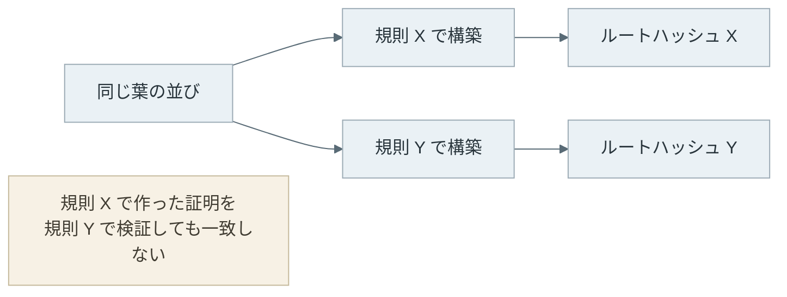
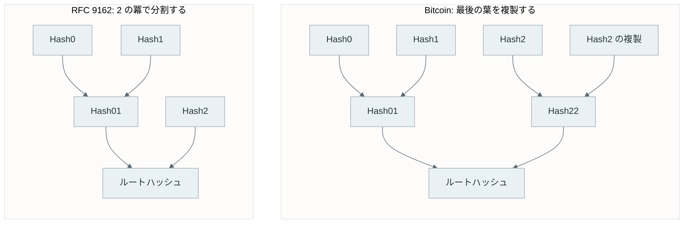
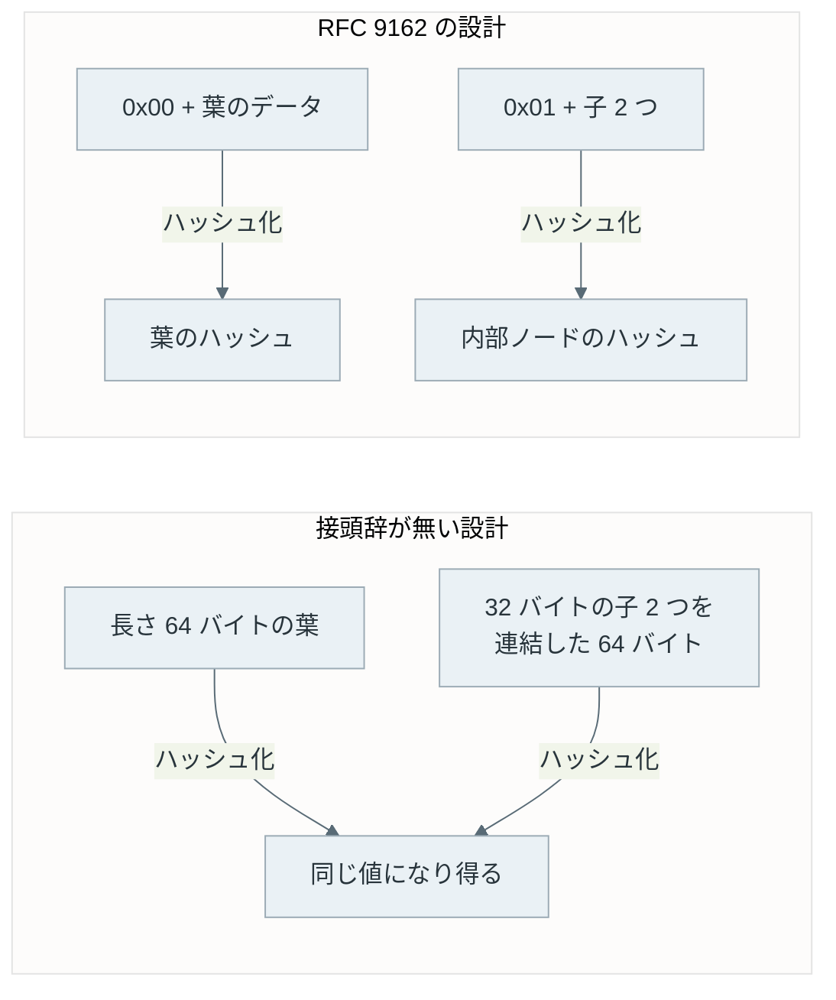
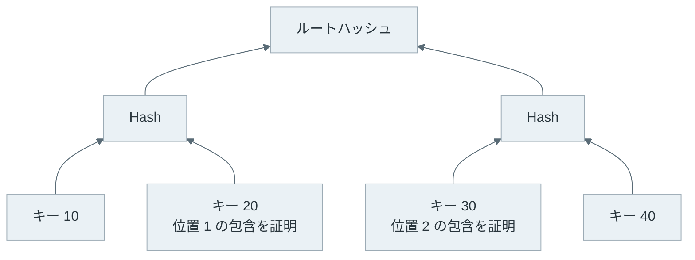

Merkle Tree の構築方法は 1 通りに決まっていません。奇数の葉をどう組むか、葉と内部ノードをどうハッシュするか、葉をどう並べるかは、それぞれのプロトコルが決める設計事項です。ルートハッシュが何を保証しているのかは、この規則を決めて初めて確定します。木の作り方と包含証明の仕組みは [Merkle Tree](../merkle-tree/) を前提とします。

この規則が問題になるのは、新しいプロトコルに Merkle Tree を組み込む時と、既存プロトコルの証明を検証する実装を書く時です。同じ名前で呼ばれていても、Bitcoin と、TLS 証明書の発行記録を公開ログに残す Certificate Transparency と、Ethereum では規則が違い、証明を作る規則と検証する規則が違えば一致しません。

本記事では、Merkle Tree の規則のうち、プロトコルごとに分かれる 3 つの設計事項を説明します。設計事項ごとに、次の疑問へ答えていきます。

- 奇数の葉の扱いで、木の形とルートハッシュはどう変わるのか。
- 葉と内部ノードを区別しない Bitcoin の木には、どんな穴があるのか。
- 葉の並べ方は、不在の証明にどう関わるのか。
- 3 通りの並べ方では、証明できることとコストがどう違うのか。

---

### 奇数の葉の扱いと木の形

葉が奇数になった時の扱いは、大きく 2 つの流儀に分かれます。Bitcoin は、段の中のノード数が奇数になると最後のノードを複製してから組を作ります。複製すると、葉 [A, B, C] と [A, B, C, C] が同じルートハッシュになります。この副作用の検出は [Bitcoin Merkle Tree](../bitcoin-merkle-tree/) で扱っています。

Certificate Transparency を定めた [RFC 9162](https://www.rfc-editor.org/rfc/rfc9162.html)（Certificate Transparency Version 2.0）は複製しません。葉が n 件なら、n 未満で最大の 2 の冪で 2 つに分ける規則を再帰的に当てはめて木の形を決めます。

葉 3 件での違いを以下に示します。

上記の図の 2 つの規則では、同じ 3 件の葉から別のルートハッシュが得られます。Bitcoin の木は全ての葉が同じ深さに揃い、RFC 9162 の木は Hash2 だけが浅い位置に付きます。どちらかが正しいという話ではなく、作る側と検証する側で規則を揃えることが要点です。

---

### 葉と内部ノードを分ける接頭辞

入力の形も手順も区別せずに葉と内部ノードをハッシュする設計では、木の構造が証明の中身だけからは決まりません。内部ノードのハッシュは 32 バイトの子 2 つ、合わせて 64 バイトを入力に取った値で、葉のハッシュは長さの決まっていない元のデータを入力に取ります。

そのため、子 2 つを連結した 64 バイトを「1 件の葉」だと偽って差し出すと、検証者は同じルートハッシュに辿り着きます。木に無いデータの包含証明が通ってしまうわけです。

Bitcoin の木には接頭辞が無く、曖昧さが残っています。葉の txid（取引の識別子）は取引から、内部ノードは子 2 つの 64 バイトから同じ手順で計算するため、署名データ（witness）を除いた大きさがちょうど 64 バイトの取引は内部ノードとしても読めます。取引を内部ノードに見立てて子の位置に偽の txid を置くと、ブロックに無い取引の包含証明が、ブロック全体を持たない検証者に通り得ます。2018 年に [CVE-2017-12842](https://en.bitcoin.it/wiki/Common_Vulnerabilities_and_Exposures#CVE-2017-12842) として公表され、[BIP 54](https://github.com/bitcoin/bips/blob/master/bip-0054.md) が 64 バイトちょうどの取引を無効にする規則を提案しています。

RFC 9162 は、葉と内部ノードでハッシュ関数に渡すバイト列の先頭を変えて、この曖昧さを消しています。RFC の式では、MTH は葉の並びからルートハッシュを求める関数、`||` はバイト列の連結、k は前節の「n 未満で最大の 2 の冪」です。葉は `MTH({d[0]}) = HASH(0x00 || d[0])`、内部ノードは `MTH(D_n) = HASH(0x01 || MTH(D[0:k]) || MTH(D[k:n]))` と定義されており、入力の先頭 1 バイトが違うため 2 つのハッシュは一致しません。

以下が接頭辞の有無による違いです。

用途ごとに入力の先頭を変えるこの工夫は、domain separation と呼ばれます。これが無いと、木全体として second preimage resistance（第 2 原像計算困難性。ある入力と同じハッシュになる別の入力を見つけられない性質）が失われます。

新しく Merkle Tree を設計するなら、接頭辞で葉と内部ノードを分ける方が安全だと考えられます。

---

### 不在の証明と葉の並べ方

ここでのキーは、データを探す時の手掛かりになる値（アカウントのアドレスなど）です。キー順に整列していない Merkle Tree では、対数サイズの証明で不在を示せません。葉の位置がキーから決まっていないため、不在を確かめる側は、全件を受け取って照合する必要があります。

Bitcoin のブロックはブロック作成者が決めた順に、RFC 9162 のログは追加された順に葉が並び、どちらもキーから葉の位置は絞れません。

キー順に葉を並べると、不在を対数サイズで示せるようになります。探しているキーの前後に来る 2 件の包含を証明し、その 2 件の位置が隣り合っていることを示せば、間に別の葉が入る余地はありません。葉の位置は、包含証明の各ハッシュが左右どちらに付くかで分かります。ただし、木を作る側がキー順に並べる規則を守るよう、プロトコルで決めておく必要があります。例えば、キー順に並べた木でキー 25 の不在を示すと、次のようになります。

上記の図では、キー 20 の位置 1 とキー 30 の位置 2 が隣り合うため、25 は木にありません。

trie を使う方法もあります。trie は、キーを 16 進の 1 桁などの単位で先頭から辿り、枝を選んでいく木です。キーが決まれば経路も決まるので、途中で枝が無いことを示せば不在の証明になります。Ethereum はこの型の Merkle Patricia Trie を使っており、アカウントのアドレスを Ethereum のハッシュ関数 keccak256 でハッシュした値を経路として状態を引きます（[公式ドキュメント](https://ethereum.org/en/developers/docs/data-structures-and-encoding/patricia-merkle-trie/)）。不在の証明も同じ経路で行い、[EIP-1186](https://eips.ethereum.org/EIPS/eip-1186) は、アカウントや値が存在しない場合もその事実を検証できるだけのデータを返すと定めています。

---

### 葉の並べ方 3 通りの比較

3 通りの並べ方で、証明できることとコストを整理すると、以下の通りです。

| | Merkle Tree（キー順に整列しない） | Merkle Tree（キー順に整列する） | キーで経路が決まる trie |
|---|---|---|---|
| 包含証明のサイズ | ハッシュ `O(log n)` 個 | ハッシュ `O(log n)` 個 | ノード数は対数。1 ノードが 2 つより多くの枝を持ち、兄弟を複数含むため実サイズは数倍以上 |
| 不在の証明 | 全件を渡して照合する | 前後 2 件の包含と隣接で示せる | 経路 1 本で示せる |
| 葉を 1 件追加する計算量 | 内部ノードを保持していれば根までの `O(log n)` | 挿入位置から根までの再計算と、キー順の維持が必要 | 経路上のノードを保持していれば `O(log n)`。ノードの分割や併合が加わる |
| 代表例 | Bitcoin のブロック、RFC 9162 のログ | キーで引いた結果を証明できる一部の辞書（認証付き辞書） | Ethereum の Merkle Patricia Trie |

証明したい内容が包含だけで済むなら、キー順に整列しない木を選ぶ方が扱いやすいと考えられます。
