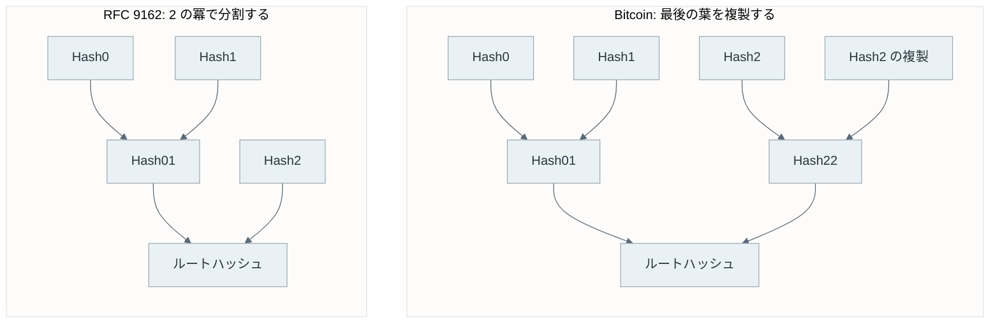
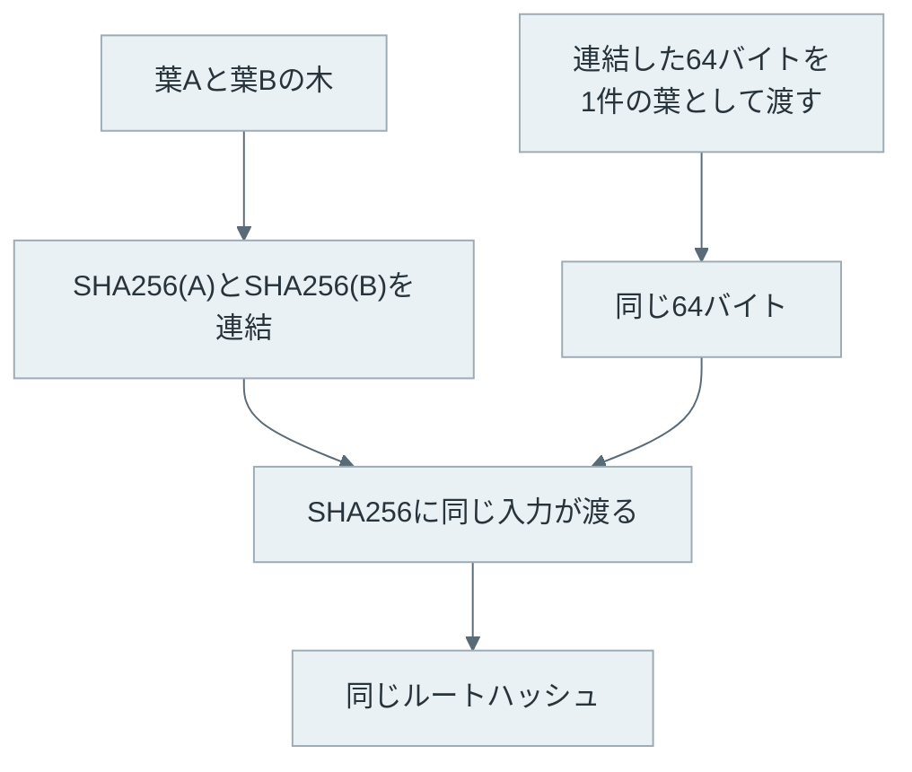
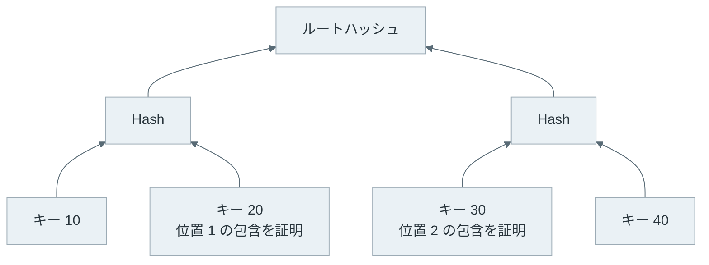

Merkle Tree の構築方法は 1 通りに決まっていません。奇数の葉をどう組むか、葉と内部ノードをどうハッシュするか、葉をどう並べるかは、それぞれのプロトコルが決める設計事項です。ルートハッシュが何を保証しているのかは、この規則を決めて初めて確定します。木の作り方と包含証明の仕組みは [Merkle Tree](../merkle-tree/) を前提とします。

この規則が問題になるのは、新しいプロトコルに Merkle Tree を組み込む時と、既存プロトコルの証明を検証する実装を書く時です。同じ名前で呼ばれていても、[Bitcoin](https://bitcoin.org/) と、[TLS 証明書](/notes/security/pki/)の発行記録を公開ログに残す [Certificate Transparency](https://certificate.transparency.dev/) と、[Ethereum](https://ethereum.org/) では規則が違い、証明を作る規則と検証する規則が違えば一致しません。

規則が保証の範囲を決める例として、Bitcoin の規則では、次の 2 つの葉の並びから同じ木ができます。


上記の図の左では、葉が奇数なので末尾の C を複製して組を作ります。結果は右の 4 件の木と同じで、ルートハッシュ（root）だけでは 2 つの並びを区別できません。

<br>

本記事では、Merkle Tree の 3 つの設計事項について、次の疑問を具体例で説明します。

- 奇数の葉の扱いで、木の形とルートハッシュはどう変わるのか。
- 葉と内部ノードを区別しない Bitcoin の木には、どんな穴があるのか。
- 葉の並べ方は、不在の証明にどう関わるのか。
- 3 通りの並べ方では、証明できることとコストがどう違うのか。

---

### 奇数の葉の扱いと木の形

葉が奇数になった時の扱いは、大きく 2 つの流儀に分かれます。Bitcoin は、段の中のノード数が奇数になると最後のノードを複製してから組を作ります。冒頭の図のとおり、複製すると葉 [A, B, C] と [A, B, C, C] が同じルートハッシュになります。この副作用を使った攻撃と Bitcoin Core の検出は [Bitcoin Merkle Tree の弱点](../bitcoin-merkle-tree-attacks/#正当なブロックを拒ませる攻撃cve-2012-2459) で扱っています。

Certificate Transparency の木では、最後の葉を複製しません。構築規則は [RFC 9162](https://www.rfc-editor.org/rfc/rfc9162.html)（Certificate Transparency Version 2.0）で定められています。葉が n 件なら、n 未満で最大の 2 の冪で 2 つに分ける規則を再帰的に当てはめて木の形を決めます。

葉 3 件での違いを以下に示します。



上記の図の 2 つの規則では、同じ 3 件の葉から別のルートハッシュが得られます。Bitcoin の木は全ての葉が同じ深さに揃い、RFC 9162 の木は Hash2 だけが浅い位置に付きます。証明を作成するプログラムと検証するプログラムでは、同じ構築規則を使う必要があります。

---

### 葉と内部ノードを分ける接頭辞

入力の形も手順も区別せずに葉と内部ノードをハッシュする設計では、木の構造が証明の中身だけからは決まりません。内部ノードのハッシュは 32 バイトの子 2 つ、合わせて 64 バイトを入力に取った値で、葉のハッシュは長さの決まっていない元のデータを入力に取ります。

そのため、子 2 つを連結した 64 バイトを「1 件の葉」だと偽って差し出すと、検証者は同じルートハッシュに辿り着きます。木に無いデータの包含証明が通ってしまうわけです。

左右の子のハッシュを `hL`、`hR` とすると、入力の読み方だけが変わり、計算する内容は変わりません。



同じ H から先の経路も同じなら、ルートハッシュまで一致します。

Bitcoin の木には接頭辞が無く、曖昧さが残っています。葉の txid（トランザクションの識別子）はトランザクションから、内部ノードは子 2 つの 64 バイトから同じ手順で計算するため、署名データ（witness）を除いた大きさがちょうど 64 バイトのトランザクションは内部ノードとしても読めます。

トランザクションを内部ノードに見立てて子の位置に偽の txid を置くと、ブロックに無いトランザクションの包含証明が、ブロック全体を持たない検証者に通り得ます。2018 年に [CVE-2017-12842](https://en.bitcoin.it/wiki/Common_Vulnerabilities_and_Exposures#CVE-2017-12842) として公表され、[BIP 54](https://github.com/bitcoin/bips/blob/master/bip-0054.md) が 64 バイトちょうどのトランザクションを無効にする規則を提案しています。攻撃の手順は [Bitcoin Merkle Tree の弱点](../bitcoin-merkle-tree-attacks/#64-バイトのトランザクションを内部ノードに見せかける攻撃cve-2017-12842) で扱っています。

<br>

RFC 9162 は、葉と内部ノードでハッシュ関数に渡すバイト列の先頭を変えて、この曖昧さを消しています。Merkle proof の検証の穴が実際の損失につながった例には、[BSC Token Hub の事故](../bridge-incidents/#bsc-token-hub)があります。

RFC の式では、MTH は葉の並びからルートハッシュを求める関数、`||` はバイト列の連結、k は前節の「n 未満で最大の 2 の冪」です。葉は `MTH({d[0]}) = HASH(0x00 || d[0])`、内部ノードは `MTH(D_n) = HASH(0x01 || MTH(D[0:k]) || MTH(D[k:n]))` と定義されており、入力の先頭 1 バイトが違うため、同じ入力バイト列を葉と内部ノードの両方に読み替えることはできません。



上記は [RFC 9162 §2.1.1](https://www.rfc-editor.org/rfc/rfc9162.html#section-2.1.1) の規則です。同じ 64 バイトを使っても、先頭が `0x01` と `0x00` なので、ハッシュ関数への入力が異なります。

異なる入力のハッシュ値が偶然一致する可能性まで消すものではなく、その発見の難しさはハッシュ関数の[衝突耐性](../hash-function/)に依存します。

用途ごとに入力の先頭を変えるこの工夫は、domain separation と呼ばれます。これが無いと、木全体として second preimage resistance（第 2 原像計算困難性。ある入力と同じハッシュになる別の入力を見つけられない性質）が失われます。

新しく Merkle Tree を設計するなら、接頭辞で葉と内部ノードを分ける方が安全だと考えられます。

---

### 異なる木が同じ値になる実験

葉を 1 件追加したのにルートハッシュが変わらないことと、内部ノードを葉として読み替えられることを短いデータで確認します。[compare_rules.py](lab/compare_rules.py) は [Python](https://www.python.org/) の標準ライブラリだけで動きます。

比較するのは、末尾を複製し、葉と内部ノードを区別せず [SHA-256](/notes/security/sha-256/)（[FIPS 180-4](https://nvlpubs.nist.gov/nistpubs/FIPS/NIST.FIPS.180-4.pdf)）に渡す単純な木と、[RFC 9162 §2.1](https://www.rfc-editor.org/rfc/rfc9162.html#section-2.1) の分割規則・接頭辞を使う木です。前者は Bitcoin と同じ末尾複製の性質を示す教材ですが、実際の txid や二重 SHA-256 を使う Bitcoin の実装ではありません。

まず、葉を `A, B, C` とした場合と、`A, B, C, C` とした場合を比較します。次に、2 つの子のハッシュを連結した 64 バイトをそのまま 1 件の葉として渡します。以下が `compare_rules.py` の全体です。

```python
"""Demonstrate Merkle construction ambiguity using SHA-256.
Bitcoin-style duplication ONLY: not Bitcoin txid/byte-order/double-SHA rules.
ct_root implements RFC 9162 section 2.1's hash construction on sample bytes;
this is not a complete Certificate Transparency protocol implementation.
"""

from hashlib import sha256
from pathlib import Path


def h(value):
    return sha256(value).digest()


def duplicate_root(values):
    nodes = [h(value) for value in values]
    assert nodes
    while len(nodes) > 1:
        if len(nodes) % 2:
            nodes.append(nodes[-1])
        nodes = [h(nodes[i] + nodes[i + 1]) for i in range(0, len(nodes), 2)]
    return nodes[0]


def ct_root(values):
    if not values:
        return h(b'')
    if len(values) == 1:
        return h(b'\x00' + values[0])
    split = 1 << ((len(values) - 1).bit_length() - 1)
    return h(b'\x01' + ct_root(values[:split]) + ct_root(values[split:]))


abc = [b'A', b'B', b'C']
abcc = abc + [b'C']
assert duplicate_root(abc) == duplicate_root(abcc)
assert ct_root(abc) != ct_root(abcc)
# The very same 64-byte input can be interpreted as a leaf or two child hashes.
children = h(b'A') + h(b'B')
assert len(children) == 64
assert duplicate_root([b'A', b'B']) == duplicate_root([children])
assert ct_root([b'A', b'B']) != ct_root([children])
lines = [
    'duplicate-last: root(A,B,C) == root(A,B,C,C): True',
    f'duplicate root: {duplicate_root(abc).hex()}',
    'RFC9162: root(A,B,C) == root(A,B,C,C): False',
    f'RFC9162 root(A,B,C):   {ct_root(abc).hex()}',
    f'RFC9162 root(A,B,C,C): {ct_root(abcc).hex()}',
    'no prefix: root(A,B) == root(single 64-byte leaf): True',
    'RFC9162: root(A,B) == root(single 64-byte leaf): False',
    'Assertions: PASS',
]
output = '\n'.join(lines) + '\n'
Path(__file__).with_name('output.txt').write_text(output)
print(output, end='')
```

`h` は SHA-256、`duplicate_root` は末尾を複製する木、`ct_root` は RFC 9162 の構築規則を使う関数です。接頭辞がない場合、次の 2 つはまったく同じ 64 バイトを最後のハッシュ計算に渡します。



実行コマンドと、出力のうち比較の結果の行です。ルートハッシュの値を含む全体は[出力](lab/output.txt)にあります。

```bash
python3 content/notes/blockchain-systems/merkle-tree-design/lab/compare_rules.py
```

```text
duplicate-last: root(A,B,C) == root(A,B,C,C): True
RFC9162: root(A,B,C) == root(A,B,C,C): False
no prefix: root(A,B) == root(single 64-byte leaf): True
RFC9162: root(A,B) == root(single 64-byte leaf): False
Assertions: PASS
```

`True` の 2 例では、ハッシュ関数の衝突を探索していません。入力の解釈が違うだけで、最後には同じバイト列をハッシュしているからです。ルートハッシュだけを比較する検証者には、その解釈の違いが分かりません。

RFC 9162 の規則を使った例では、3 件と 4 件の木の組み方が変わり、葉と内部ノードの入力にも異なる接頭辞が付くため、この 2 つの読み替えでは同じルートになりません。この実験は、実際の Bitcoin トランザクションを使った攻撃の再現ではなく、構築規則が必要になる理由を切り出したものです。

---

### 不在の証明と葉の並べ方

ここでのキーは、データを探す時の手掛かりになる値（アカウントのアドレスなど）です。キー順に整列していない Merkle Tree では、対数サイズの証明で不在を示せません。葉の位置がキーから決まっていないため、不在を確認する側は、全件を受け取って照合する必要があります。

Bitcoin のブロックはブロック作成者が決めた順に、RFC 9162 のログは追加された順に葉が並び、どちらもキーから葉の位置は絞れません。

キー順に葉を並べると、不在を対数サイズで示せるようになります。探しているキーの前後に来る 2 件の包含を証明し、その 2 件の位置が隣り合っていることを示せば、間に別の葉が入る余地はありません。

葉の位置は、包含証明の各ハッシュが左右どちらに付くかで分かります。ただし、木を作る側がキー順に並べる規則を守るよう、プロトコルで決めておく必要があります。例えば、キー順に並べた木でキー 25 の不在を示すと、次のようになります。



上記の図では、キー 20 の位置 1 とキー 30 の位置 2 が隣り合うため、25 は木にありません。

trie を使う方法もあります。trie は、キーを 16 進の 1 桁などの単位で先頭から辿り、枝を選んでいく木です。キーが決まれば経路も決まるので、途中で枝が無いことを示せば不在の証明になります。

Ethereum はこの型の Merkle Patricia Trie を使っており、アカウントのアドレスを Ethereum のハッシュ関数 keccak256（[Keccak](https://keccak.team/keccak.html) に基づく）でハッシュした値を経路として状態を引きます（[公式ドキュメント](https://ethereum.org/en/developers/docs/data-structures-and-encoding/patricia-merkle-trie/)）。不在の証明も同じ経路で行い、[EIP-1186](https://eips.ethereum.org/EIPS/eip-1186) は、アカウントや値が存在しない場合もその事実を検証できるだけのデータを返すと定めています。

---

### 葉の並べ方 3 通りの比較

3 通りの並べ方で、証明できることとコストを整理すると、以下の通りです。

| | Merkle Tree（キー順に整列しない） | Merkle Tree（キー順に整列する） | キーで経路が決まる trie |
|---|---|---|---|
| 包含証明のサイズ | ハッシュ `O(log n)` 個 | ハッシュ `O(log n)` 個 | ノード数は対数。1 ノードが 2 つより多くの枝を持ち、兄弟を複数含むため実サイズは数倍以上 |
| 不在の証明 | 全件を渡して照合する | 前後 2 件の包含と隣接で示せる | 経路 1 本で示せる |
| 葉を 1 件追加する計算量 | 内部ノードを保持していれば根までの `O(log n)` | 挿入位置から根までの再計算と、キー順の維持が必要 | 経路上のノードを保持していれば `O(log n)`。ノードの分割や併合が加わる |
| 代表例 | Bitcoin のブロック、RFC 9162 のログ | キーで引いた結果を証明できる一部の辞書（認証付き辞書） | Ethereum の Merkle Patricia Trie |

証明したい内容が包含だけで済むなら、キー順に整列しない木を選ぶ方が扱いやすいと考えられます。
