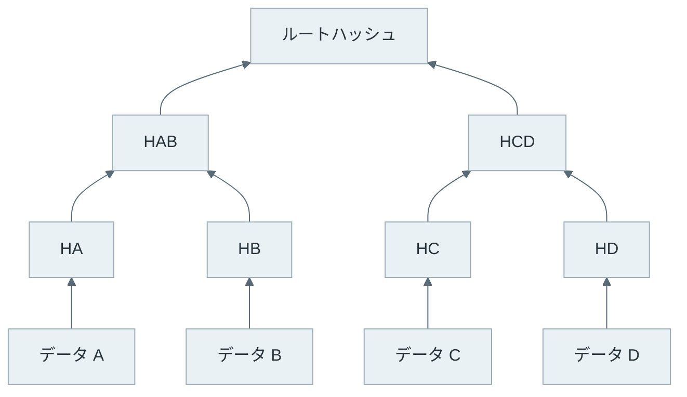
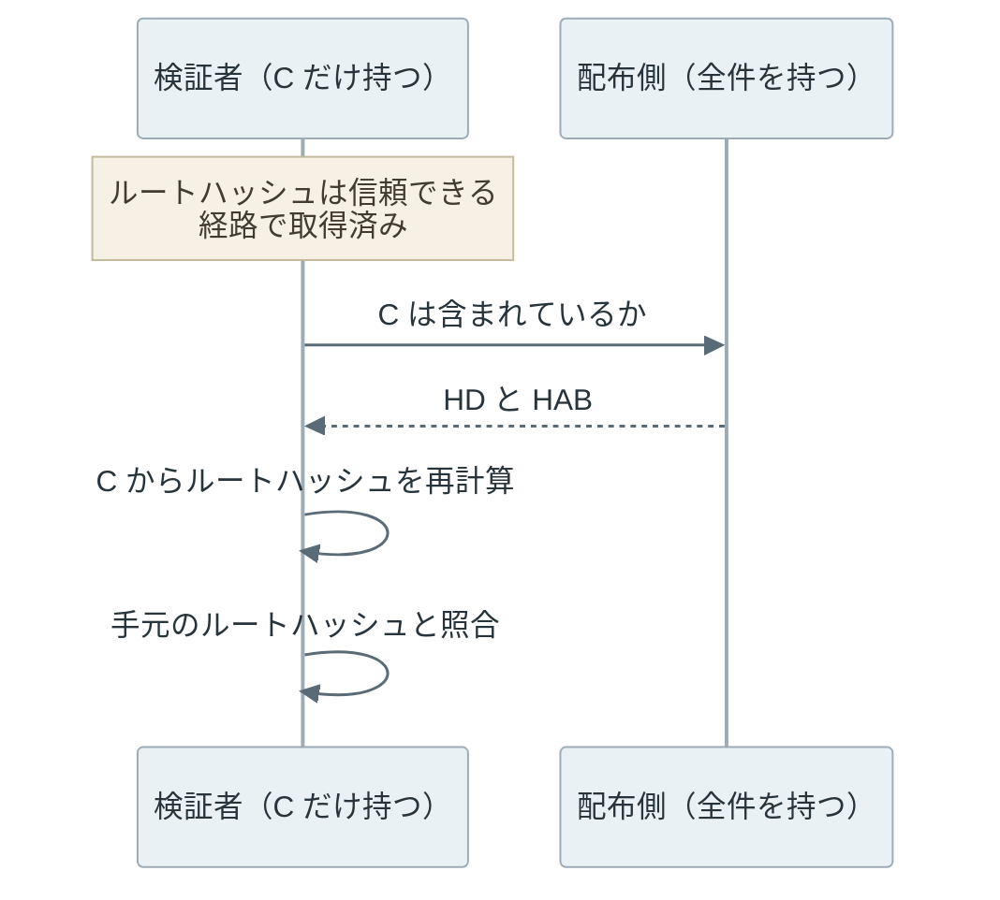
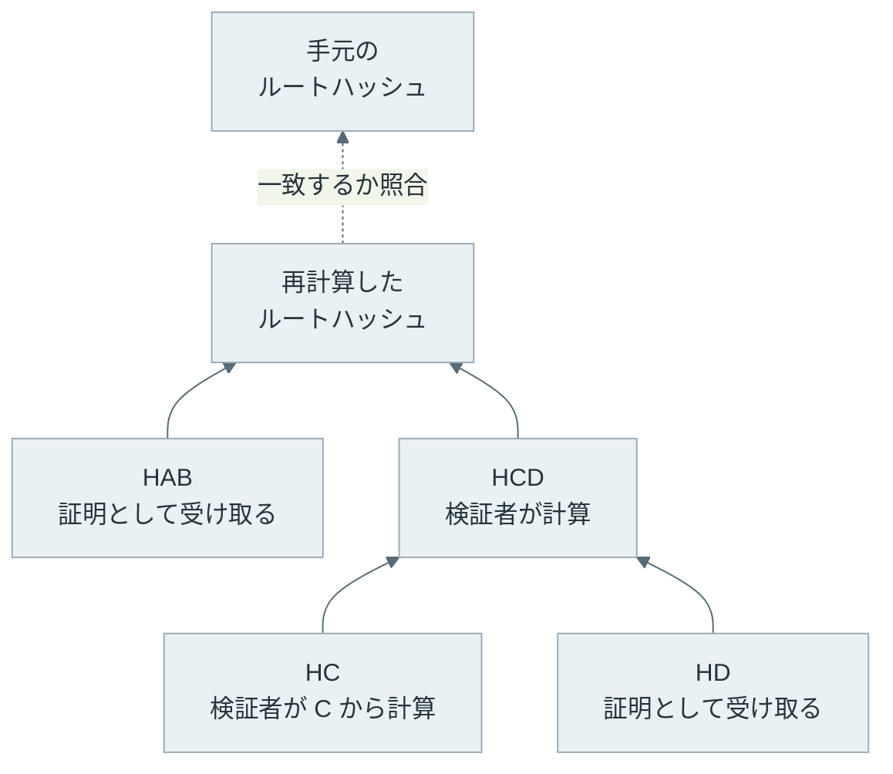
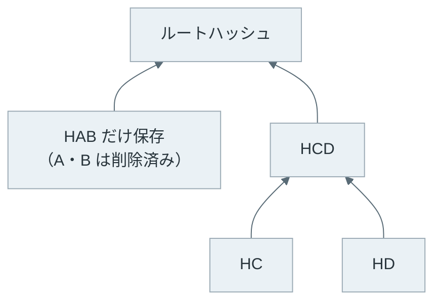

Merkle Tree（マークルツリー、ハッシュ木）は、データの並びを 2 つずつハッシュ関数で畳み込み、最後に 1 つの値にまとめる木構造です。まとまった 1 つの値をルートハッシュと呼びます。全件を持つ側は、データ 1 件と少数のハッシュだけを渡して、その 1 件が並びに確かに含まれていたことを相手に検証させられます。

この証明が必要になるのは、データの集まり全体を持てない相手に、一部だけを渡して検証させたい場面です。代表例は Bitcoin で、数千件の取引をまとめたブロックを丸ごとは持たない利用者が、少数のハッシュだけで自分宛の取引 1 件がブロックに入っていることを確かめます。この方式は [Bitcoin の白書](https://bitcoin.org/bitcoin.pdf)に示されています。

渡すハッシュの並びを包含証明（inclusion proof）と呼びます。件数が増えても、包含証明に入るハッシュの個数はゆっくりとしか増えません。



上記の図の横軸は 100 万件まで伸びていますが、縦軸は 20 個で止まります。

<br>

本記事では、A・B・C・D という 4 件のデータだけを使って、ルートハッシュの決まり方と包含証明を説明します。取り上げる疑問は以下です。

- ルートハッシュは、どのように決まるのか。
- 1 件の包含は、なぜ少数のハッシュで確かめられるのか。
- 100 万件の木では、証明はどれだけ小さくなるのか。
- この木では、何を示せないのか。
- 実際には、どこで使われているのか。

ハッシュ関数は、異なる入力から同じハッシュ値を意図的に作ることが現実的にできない、安全なものを使う前提です。Bitcoin の詳細は扱わず、末尾の「実際の利用例」から [Bitcoin Merkle Tree](../bitcoin-merkle-tree/) に繋ぎます。

---

### 木の作り方とルートハッシュ

4 件のデータ A・B・C・D からルートハッシュがどう決まるかを以下に示します。図の矢印は、下の値から上の値を計算する向きです。



作り方は 3 手順です。各データをハッシュして HA から HD を作る。隣同士を左から組にし、HA と HB をこの順にバイト列として繋げてハッシュした値 HAB を 1 段上に置く（HC と HD から作る HCD も同様）。値が 1 つになるまで同じ操作を繰り返し、最後に残った値がルートハッシュです。

上記の図の最下段にある HA から HD を葉、HAB と HCD を内部ノードと呼びます。木の同じ高さに並ぶ値のまとまりを段、葉からルートハッシュまでに上る回数を木の高さと呼びます。葉が奇数の場合にどう組むかは決め方が複数あり、[Merkle Tree Design](../merkle-tree-design/) で扱います。

ルートハッシュは、4 件の内容と並び順の両方を代表します。例えば、C を 1 バイトでも書き換えると、HC が変わり、HCD が変わり、ルートハッシュも変わります。並びを B・A・C・D に入れ替えた場合も、連結する順序が変わるため別のルートハッシュになります。

---

### 包含証明

登場人物は 2 者です。全件を持つ配布側と、C を 1 件だけ持つ検証者です。検証者は、正しいルートハッシュを信頼できる経路で入手済みとします（証明を送ってくる相手からルートハッシュも受け取ると、両方を偽造できるため検証になりません）。確かめたいのは、手元の C が、そのルートハッシュの表す並びに確かに含まれていたことです。以下が 2 者のやり取りです。



上記の図で配布側が渡すのは、HD と HAB の 2 個だけです。HD と HAB を並べたものが、この例の包含証明です。証明に入るのは、C からルートハッシュまで上る各回で連結相手になるハッシュ 1 個ずつです。4 件なら HC から HCD、HCD からルートハッシュと 2 回上るので、証明に入るハッシュの個数は木の高さと同じ 2 個です。以下が検証者の計算です。



検証者の手順は 3 つです。手元の C をハッシュして HC を作る。HC の右に受け取った HD を繋げてハッシュし、HCD を得る。HCD の左に受け取った HAB を繋げてハッシュし、出てきた値を手元のルートハッシュと照合する。一致すれば、C はルートハッシュが代表する 4 件の中に確かに入っていると分かります。

連結する順序で結果が変わるため、証明の各ハッシュには「左右どちら側に置くか」の情報も添えられています。

A・B・D の元データは 1 件も受け取っていません。A と B は HAB の中に畳み込まれています。Merkle Tree では、元データを受け取らずに、ハッシュ値だけで上の段を計算できます。

偽造は、安全なハッシュ関数を使う限り現実的にできません。攻撃者は C の代わりの偽データも、証明側のハッシュも自由に選べます。どう選んでも、再計算した値を手元のルートハッシュに一致させるには、同じ値に辿り着く別の入力を見つける必要があります。ただし、この保証は木の構築規則の決め方にも依存します。「欠点」の 4 番目と [Merkle Tree Design](../merkle-tree-design/) で扱います。

---

### 葉の件数と証明のサイズ

証明に入るハッシュの個数は、木の高さと同じでした。葉が 4 件から 8 件になると高さが 1 つ増え、証明のハッシュも 3 個に増えます。冒頭の図の階段 1 段分がこの増加です。葉が n 件の時の木の高さは `ceil(log2 n)` で、証明に入るハッシュの個数は多くてもこの値です。冒頭の図は、この最大値を描いています。

全ての葉の証明がちょうど `ceil(log2 n)` 個になるのは、n が 4、8、1,024 のように 2 の何乗かの数の時と、段の最後の値を複製して組む Bitcoin の規則の時です。余った値を複製しない Certificate Transparency（[RFC 9162](https://www.rfc-editor.org/rfc/rfc9162.html)）の規則では、浅い位置に付いた葉の証明はこれより短くなります。

全件を渡す方式との差を確かめるため、`tx-0` から `tx-1048575` までの文字列を葉にした [SHA-256](/notes/security/sha-256/) の木を作り、`tx-777777` の包含証明を取り出しました。末尾に 1 文字足した偽のデータでも、同じ証明を試しています。なお、葉は 2 の 20 乗件なので、どの段でも値の数は偶数です。以下は、Python 3.14 の [hashlib](https://docs.python.org/3/library/hashlib.html) だけを使ったコードです。

```python
import hashlib


def h(data: bytes) -> bytes:
    return hashlib.sha256(data).digest()


def build_levels(leaves):
    """葉のハッシュの段から、ルートハッシュの段までを全て返す。"""
    levels = [[h(x) for x in leaves]]
    while len(levels[-1]) > 1:
        cur = levels[-1]
        levels.append([h(cur[i] + cur[i + 1]) for i in range(0, len(cur), 2)])
    return levels


def make_proof(levels, index):
    """各段で連結相手になるハッシュと、それが左右どちらかを集める。"""
    proof = []
    for level in levels[:-1]:
        sibling = index ^ 1
        proof.append((level[sibling], "left" if sibling < index else "right"))
        index //= 2
    return proof


def verify(data, proof, root):
    value = h(data)
    for sibling, side in proof:
        value = h(sibling + value) if side == "left" else h(value + sibling)
    return value == root


n = 2**20
leaves = [f"tx-{i}".encode() for i in range(n)]
levels = build_levels(leaves)
root = levels[-1][0]
proof = make_proof(levels, 777777)

print(f"leaves={n:,} leaf-hashes={n * 32:,} bytes")
print(f"proof={len(proof)} hashes ({len(proof) * 32} bytes)")
print("verify tx-777777:", verify(b"tx-777777", proof, root))
print("verify tx-777777x:", verify(b"tx-777777x", proof, root))
```

`make_proof` の `index ^ 1` は、各段で組になる相手の位置です。`verify` は、包含証明の節で検証者が行った 3 手順を 20 段分繰り返します。実行結果は以下です。

```text
leaves=1,048,576 leaf-hashes=33,554,432 bytes
proof=20 hashes (640 bytes)
verify tx-777777: True
verify tx-777777x: False
```

1 文字違うデータは、同じ証明を使っても手元のルートハッシュに辿り着きません。証明の 640 バイトは、葉のハッシュを並べただけの 32 MiB の約 5 万分の 1 で、この差が冒頭の「集まり全体を持てない相手に検証させる」使い方を支えます。

---

### 利点

- ルートハッシュ 1 つを持っていれば、任意の 1 件の包含を確かめられる
- 証明のサイズが件数の対数に収まる
- 1 件でも書き換わると上の段の値とルートハッシュが変わり、改竄を検出できる
- 元データを削除しても、その枝をまとめたハッシュを残せば、残りの葉の包含証明を作り続けられる

この性質を使うと、古いデータを削除して保存量を減らせます。A と B を削除した場合の木は、以下の通りです。



---

### 欠点

Merkle Tree が小さく保てるのは包含の証明だけで、それ以外の面では次の制約が残ります。

- 対数サイズの証明では、含まれていないことを示せない
- ルートハッシュが正しいかどうかは、別の仕組みで確かめる必要がある
- 葉を追加・変更するたびにルートハッシュまでの各段を計算し直し、変わったルートハッシュを配り直す必要がある
- 奇数の葉の扱いや、葉と内部ノードの区別をどう決めるかで、保証の内容が変わる

この木で不在を示せないのは、データ E がもしあるならどの位置にあるはずかを決める手掛かりが無いからです。E がどこにも無いことを示すには全ての葉を確かめるしかなく、少数のハッシュで済ませることはできません。値の大小順などで位置が決まるように葉を並べる対策と、4 番目に挙げた構築規則の決め方は [Merkle Tree Design](../merkle-tree-design/) で扱います。

---

### 適さないケース

- 含まれていないことの証明が必要な用途
- 葉の更新のたびに、新しいルートハッシュを信頼できる形で配り直す必要がある構成
- 検証する側がどのみち全件を保持している構成
- 葉が数件しかない構成。証明のサイズが全件を渡す場合とほとんど変わらない

---

### 実際の利用例

Bitcoin は、ブロックに入った取引の識別子（txid）を葉にして、ルートハッシュをブロックヘッダに収めています。ブロック全体を持たない利用者は、自分で検証したブロックヘッダの列からルートハッシュを得て、包含証明だけで自分宛の取引を確かめられます。Bitcoin 固有の計算規則と検証の仕組みは [Bitcoin Merkle Tree](../bitcoin-merkle-tree/) で、前提となるブロックの構造は [Bitcoin Block](../bitcoin-block/) で説明しています。

Web の暗号化通信（TLS）に使う証明書の発行記録を追記専用のログに残す Certificate Transparency（[RFC 9162](https://www.rfc-editor.org/rfc/rfc9162.html)）も、ログ全体をルートハッシュで代表し、個々の証明書の包含を対数サイズで証明します。

Ethereum は、キーの文字を辿って値の位置が決まる木（trie）と組み合わせた [Merkle Patricia Trie](https://ethereum.org/en/developers/docs/data-structures-and-encoding/patricia-merkle-trie/) で、アカウントの残高などの状態を管理しています。プロトコルごとの構築規則の違いは [Merkle Tree Design](../merkle-tree-design/) で扱います。
