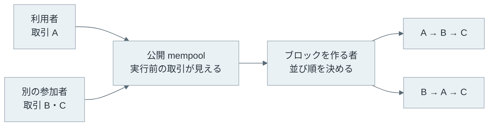
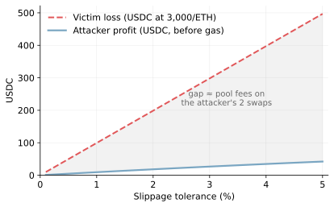
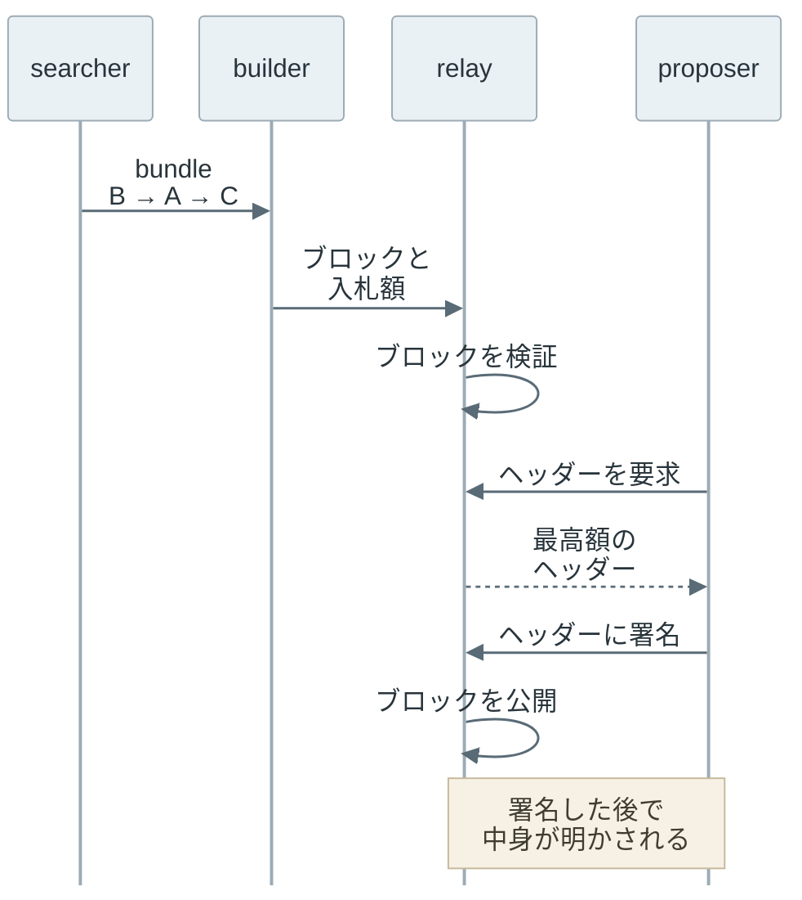
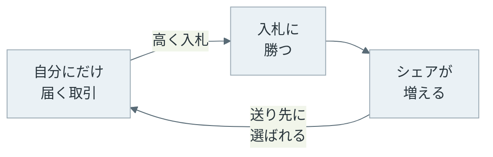

取引所のプログラムに、10,000 USDC で ETH を買う取引 A が送られたとします。USDC は米ドルとの連動を目指すトークンです。同じ時に、別の参加者が ETH を買う取引 B と、B で得た ETH を売る取引 C を送りました。3 件の中身は同じでも、ブロックに並べる順番を変えるだけで、A の送り主が受け取る ETH の量が変わります。

| ブロック内の順番 | A の送り主が受け取る ETH | B と C の送り主の損益 |
| --- | --- | --- |
| A → B → C | 3.312325 ETH | −90.38 USDC |
| B → A → C | 3.279202 ETH | +9.35 USDC |

上記の表は、後半の実験で計算した値です。2 つ目の順番では、A の受取が 0.033 ETH（1 ETH = 3,000 USDC の換算で約 99 USDC）減り、B と C の送り主が利益を得ています。変えたのは並び順だけです。

MEV（Maximal Extractable Value）は、ブロックを作る時に取引を入れる・外す・並べ替えることで得られる、通常のブロック報酬と手数料を超える価値です。最初は Proof of Work のマイナーが順番を決めていたので Miner Extractable Value と呼ばれていました。[ethereum.org の MEV のページ](https://ethereum.org/en/developers/docs/mev/)では、[Proof of Stake](../proof-of-stake/) への移行に合わせて Maximal と呼ぶようになったと説明しています。



上記の図で、送り主が決められるのは取引の中身までです。並び順に値段を付けられるのは、ブロックを作る者です。

<br>

本記事では、取引所の計算をローカルで再現しながら、並び順が価値に変わる仕組みを説明します。扱う疑問は次の通りです。

- 並び順を変えるだけで、なぜ価値が生まれるのか。
- sandwich attack では、誰がいくら得て、誰がいくら失うのか。
- 利用者が払う手数料と、MEV で受ける不利益は何が違うのか。
- proposer・builder・relay は、ブロック作りの中でどう役割を分けているのか。
- 特定の builder に注文が集まると、何が起きるのか。

Ethereum の取引と手数料は [Ethereum Transaction](../ethereum-transaction/) を前提にします。実験は Python の計算だけで行い、実際のネットワークや資産は使いません。

---

### 並び順が価値になる理由

並び順が価値を持つには、2 つの条件が揃う必要があります。1 つは、ブロックを作る者が、取り込む取引とその順番を選べることです。Ethereum のプロトコルは、ブロックに入れた取引が有効であることは検証しますが、同じ送り主の取引を nonce（通し番号）の順に並べること以外に、並び順の規則を定めていません。

もう 1 つは、取引が実行される前に他人から見えることです。公開 mempool に送られた取引は、[mempool](../mempool/)（ブロックに入る前の取引の置き場）を通じてネットワークに広まります。そのため、利用者が「この値段で買う」と署名した取引は、ブロックに入る前に誰でも読めます。

この 2 つが揃うと、他人の取引の前後に自分の取引を差し込む余地が生まれます。[スマートコントラクト](../smart-contract/)は実行時点の状態を読んで動くので、取引所なら直前の取引で動いた価格を次の取引がそのまま使います。

この種の機会を探し、ブロックを作る者に取引を渡す参加者は searcher と呼ばれます。MEV は、分散型取引所の bot を計測した [Flash Boys 2.0](https://arxiv.org/abs/1904.05234)（Daian らの 2019 年の論文）が名付けた呼び名です。

---

### 定数積 AMM の価格

冒頭の取引所は、DEX（Decentralized Exchange、スマートコントラクトで動く取引所）の一種である AMM（Automated Market Maker）です。注文を突き合わせる板は無く、2 種類のトークンを預けたプール（pool）と、交換比率を計算する式だけで売買が成立します。

[Uniswap v2](https://app.uniswap.org/whitepaper.pdf) は、プールの残高 `x`（USDC）と `y`（ETH）の積 `x × y` が交換の前後で減らないように受取量を計算します。これを定数積（constant product）と呼びます。入力の 0.3% は手数料としてプールに残り、流動性提供者（プールにトークンを預けた人）の取り分になります。受取量の計算は、Uniswap v2 の [`getAmountOut`](https://github.com/Uniswap/v2-periphery/blob/master/contracts/libraries/UniswapV2Library.sol) と同じ次の式です。

```text
受取量 = (入力 × 997 × 出力側の残高) / (入力側の残高 × 1000 + 入力 × 997)
```

例えば、3,000,000 USDC と 1,000 ETH のプールでは 1 ETH が約 3,000 USDC ですが、10,000 USDC で受け取れるのは約 3.312 ETH です。手数料に加えて、買うほど 1 ETH あたりの値段が上がるからです。これを価格インパクト（price impact）と呼びます。

価格インパクトは、自分より前に誰かが同じ向きに買っても起きます。そこで利用者は、受取量が見積もりより一定以上減ったら取引を取り消す下限を付けます。この許容幅を slippage tolerance と呼び、Uniswap v2 の [Router](https://github.com/Uniswap/v2-periphery/blob/master/contracts/UniswapV2Router02.sol)（利用者の交換を受け付けるコントラクト）では `amountOutMin` という引数で渡します。受取量がこれを下回ると、取引全体が `INSUFFICIENT_OUTPUT_AMOUNT` で取り消されます。

---

### sandwich attack の計算

sandwich attack は、利用者の買いの直前に同じ向きの買い（front-run）、直後に売り（back-run）を入れる手口です。利用者は値上がり後の価格で買わされ、攻撃者はさらに上がった価格で売り抜けます。冒頭の取引 B が front-run、C が back-run です。

[計算用のコード](lab/sandwich.py)は、前節の式を整数で再現し、同じ 3 件を 2 通りの順で実行します。攻撃者は、利用者の取引が取り消されない範囲で最も大きい front-run を二分探索で選びます。gas 代は含めていません。

```python
"""Uniswap v2 型の定数積プールで、同じ 3 件の取引を並べ替えて結果を比べる。

ネットワークには接続せず、整数の計算だけを行う。gas 代は含めない。
"""

USDC = 10**6   # USDC は小数 6 桁
ETH = 10**18   # ETH は小数 18 桁（wei）


def amount_out(amount_in, reserve_in, reserve_out):
    """UniswapV2Library.getAmountOut と同じ式。入力の 0.3% が手数料になる。"""
    amount_in_with_fee = amount_in * 997
    return amount_in_with_fee * reserve_out // (reserve_in * 1000 + amount_in_with_fee)


class Pool:
    def __init__(self, usdc=3_000_000 * USDC, eth=1_000 * ETH):
        self.usdc = usdc
        self.eth = eth

    def buy_eth(self, usdc_in):
        out = amount_out(usdc_in, self.usdc, self.eth)
        self.usdc += usdc_in
        self.eth -= out
        return out

    def sell_eth(self, eth_in):
        out = amount_out(eth_in, self.eth, self.usdc)
        self.eth += eth_in
        self.usdc -= out
        return out


def run(order, victim_usdc, min_eth, front_usdc):
    """A: 利用者の買い、B: 攻撃者の買い、C: 攻撃者の売り（B で得た ETH を全て売る）。"""
    pool = Pool()
    result = {}
    attacker_eth = 0
    for tx in order:
        if tx == "A":
            # Router は受取量が amountOutMin を下回ると取引全体を取り消す
            if amount_out(victim_usdc, pool.usdc, pool.eth) < min_eth:
                result["A"] = None
                continue
            result["A"] = pool.buy_eth(victim_usdc)
        elif tx == "B":
            attacker_eth = pool.buy_eth(front_usdc)
        elif tx == "C":
            result["C"] = pool.sell_eth(attacker_eth)
    result["profit"] = result["C"] - front_usdc
    return result


def min_out(victim_usdc, tolerance_bps):
    """画面で見積もった受取量から、許容する下落分を引いた最低受取量。"""
    quote = amount_out(victim_usdc, Pool().usdc, Pool().eth)
    return quote * (10_000 - tolerance_bps) // 10_000


def largest_front(victim_usdc, min_eth):
    """利用者の取引が取り消されない範囲で、最も大きい先回りの買いを二分探索する。"""
    lo, hi = 0, 3_000_000 * USDC
    while lo < hi:
        mid = (lo + hi + 1) // 2
        pool = Pool()
        pool.buy_eth(mid)
        if amount_out(victim_usdc, pool.usdc, pool.eth) >= min_eth:
            lo = mid
        else:
            hi = mid - 1
    return lo


def sweep_point(victim_usdc, tolerance_bps):
    """許容幅ごとに、取り消されない最大の先回りで sandwich を組む。"""
    floor = min_out(victim_usdc, tolerance_bps)
    front = largest_front(victim_usdc, floor)
    r = run("BAC", victim_usdc, floor, front)
    r["front"] = front
    return r


def fmt_eth(v):
    return "revert" if v is None else f"{v / ETH:.6f} ETH"


def fmt_usdc(v):
    return f"{v / USDC:+,.2f} USDC"


if __name__ == "__main__":
    victim = 10_000 * USDC
    tol = 100  # 1.00%
    floor = min_out(victim, tol)
    front = largest_front(victim, floor)
    print("pool: 3,000,000 USDC / 1,000 ETH, victim buys with 10,000 USDC")
    print(f"quote {fmt_eth(min_out(victim, 0))}, amountOutMin (1%) {fmt_eth(floor)}")
    print(f"attacker front-run: {front / USDC:,.2f} USDC")
    print()
    for order in ("ABC", "BAC"):
        r = run(order, victim, floor, front)
        print(f"order {'->'.join(order)}: victim gets {fmt_eth(r['A'])}, "
              f"attacker {fmt_usdc(r['profit'])}")
    print()
    print("tolerance  front-run  victim loss        attacker profit")
    quote = min_out(victim, 0)
    for bps in (10, 50, 100, 200, 300, 500):
        r = sweep_point(victim, bps)
        loss = quote - r["A"]
        print(f"{bps / 100:>8.2f}%  {r['front'] / USDC:>9,.0f}  "
              f"{loss / ETH:.6f} ETH ({loss * 3_000 // ETH:>3} USDC)  "
              f"{r['profit'] / USDC:>8.2f} USDC")
```

以下が Python 3.14 での[実行結果](lab/output.txt)です。

```text
pool: 3,000,000 USDC / 1,000 ETH, victim buys with 10,000 USDC
quote 3.312325 ETH, amountOutMin (1%) 3.279202 ETH
attacker front-run: 15,161.30 USDC

order A->B->C: victim gets 3.312325 ETH, attacker -90.38 USDC
order B->A->C: victim gets 3.279202 ETH, attacker +9.35 USDC

tolerance  front-run  victim loss        attacker profit
    0.10%      1,506  0.003312 ETH (  9 USDC)      0.96 USDC
    0.50%      7,552  0.016562 ETH ( 49 USDC)      4.73 USDC
    1.00%     15,161  0.033123 ETH ( 99 USDC)      9.35 USDC
    2.00%     30,554  0.066247 ETH (198 USDC)     18.25 USDC
    3.00%     46,184  0.099370 ETH (298 USDC)     26.68 USDC
    5.00%     78,182  0.165616 ETH (496 USDC)     42.11 USDC
```

slippage tolerance が 1% の時、利用者の受取は `amountOutMin` の 3.279202 ETH に一致しています。攻撃者が取り消しの直前まで front-run を大きくしたので、損失は許容幅の上限に達しています。つまり、slippage tolerance は「この額までなら取られてもよい」という上限としても働きます。

A → B → C の順では、攻撃者は 90.38 USDC を失っています。約 15,000 USDC の 0.3% ずつを 2 回払うので、利用者の買いが間に入らない限り赤字です。B → A → C では、この手数料を払った上で 9.35 USDC が残ります。

<br>

許容幅を 0.1% から 5% まで動かすと、利用者の損失と攻撃者の利益は次のように変わります。



上記の図の 2 本の線の間は、主に攻撃者が 2 回の swap で払うプールの手数料です。この条件では、利用者が失った額のうち攻撃者に残るのは 1 割未満で、残りの大半は流動性提供者に渡ります。実際の攻撃者は、さらに gas 代とブロックを作る者への支払いも負担します。図の生成コードは [figures.py](https://github.com/nao1215/debimate/blob/main/content/notes/blockchain-systems/mev/figures.py) です。

---

### MEV の種類

全ての MEV が利用者から直接奪う形をとるわけではありません。ethereum.org が挙げる例のうち 3 つを並べると、誰が損をするかが分かれます。


- title: DEX の裁定取引
  body: 同じトークンの価格が 2 つの取引所でずれた時に、安い方で買って高い方で売ります。
  items:
  - 結果として、取引所の間の価格が揃う
  - 損をするのは、ずれた価格で取引を受けた側
- title: 清算
  body: 担保の価値が下がった借り手から、規定の割引で担保を買い取ります。担保の価格は[オラクル](../oracle/)から読みます。
  items:
  - 清算が早いと、貸し手側の資産が守られる
  - 清算された借り手は、割引の分を失う
- title: sandwich attack
  body: 利用者の取引を前後から挟み、悪い価格で約定させます。
  items:
  - 価格を揃える働きは無い
  - 損をするのは、挟まれた利用者


同じ機会は複数の searcher が狙います。公開 mempool で手数料を競り上げて順番を取り合う形は、Flash Boys 2.0 で priority gas auction と呼ばれています。負けた取引も失敗のまま gas を消費してブロックの空きを埋めるので、MEV と無関係な利用者も混雑の影響を受けます。

---

### 利用者が払う手数料と受ける損失

ウォレットが「手数料」として表示するのは、gas の代金です。[Ethereum Transaction](../ethereum-transaction/#使った-gas-と単価による手数料) で説明した通り、`使った gas × (base fee + priority fee)` で計算します。sandwich で失う額はここに含まれず、受け取るトークンが少ない形で現れます。

以下は、10,000 USDC の買いで利用者が負担する額を分けた表です。

| 項目 | 渡る先 | 利用者が取引前に分かること | 実験の例 |
| --- | --- | --- | --- |
| base fee | 焼却され、誰にも渡らない | 上限を maxFeePerGas で決められる | 含めていない |
| priority fee | ブロックを作る者 | 上限を maxPriorityFeePerGas で決められる | 含めていない |
| プールの手数料 | 流動性提供者 | 入力の 0.3% と分かっている | 30 USDC |
| 価格インパクト | プール（自分の買いで価格が動く分） | 見積もりの受取量に含まれる | 見積もりに反映済み |
| sandwich による損失 | 攻撃者と、攻撃者の手数料を受けるプール | 上限だけが slippage tolerance で分かる | 0.033123 ETH（約 99 USDC） |

上の 4 行は、見積もりや確認画面で、取引前に額か上限が分かります。最後の行だけは、取引が終わって受取量を見るまで額が分からず、手数料の明細にも失敗の表示にも出てきません。

---

### proposer・builder・relay の分業

Proof of Stake の Ethereum では、slot（ブロック 1 つ分の時間）ごとに 1 つのバリデータが proposer（ブロックの提案者）に選ばれます。MEV を自力で探すのは難しいので、多くの proposer はブロックの中身を作る仕事を外に出しています。この分業を PBS（Proposer-Builder Separation）と呼びます。

Ethereum では、PBS をプロトコルの外で実現するソフトウェアとして [MEV-Boost](https://github.com/flashbots/mev-boost) が使われています。[Who Wins Ethereum Block Building Auctions and Why?](https://arxiv.org/abs/2407.13931)（Öz ら、2024 年）は、論文の執筆時点で Ethereum のブロックの約 90% が MEV-Boost の入札から作られていると報告しています。登場する役割は次の 4 つです。

- searcher: MEV の機会を探し、取引の組を builder に送る。
- builder: 取引と searcher の組を並べてブロックを作り、proposer への支払額を入札する。
- relay: builder のブロックを検証し（builder の担保と引き換えに検証を後回しにする [optimistic relay](https://github.com/michaelneuder/optimistic-relay-documentation/blob/main/proposal.md) もある）、最高額の入札だけを proposer に渡す。
- proposer: ブロックの中身を見ずに、最高額のヘッダーに署名して提案する。

searcher が送る組を bundle と呼びます。[Flashbots のドキュメント](https://docs.flashbots.net/flashbots-auction/advanced/understanding-bundles)によると、bundle は指定した順に実行される取引の組で、mempool にある他人の取引も含められます。冒頭の B → A → C は、まさにこの形の bundle です。



上記の図のように、proposer は中身を見ないまま署名します。中身を先に見せると、proposer が bundle を抜き出して自分の取引に差し替えられるからです。

そのため、proposer はヘッダーの中身が有効であること、builder は自分のブロックを盗まれないことについて、relay に頼っています。つまり relay は、両側から信頼される [doubly-trusted](https://docs.flashbots.net/flashbots-mev-boost/relay) な存在です。

<br>

この信頼が崩れた例が、2023 年 4 月の relay の事故です。[Flashbots の事後報告](https://collective.flashbots.net/t/post-mortem-april-3rd-2023-mev-boost-relay-incident-and-related-timing-issue/1540)によると、次の順で起きました。

1. 攻撃者が、受取量の下限を付けない swap を公開 mempool に流し、sandwich bot に bundle を組ませた。
2. proposer に選ばれた攻撃者が、無効なヘッダーに署名して Ultra Sound relay に返した。
3. relay はブロックの公開を試みて beacon node に拒否されたが、拒否の有無に関わらず中身を proposer に渡した。
4. 攻撃者は中身にあった sandwich の bundle を崩して自分の取引を作り、約 2,000 万ドルを sandwich bot から奪った。

被害を受けたのは、攻撃者の囮の swap を挟みに来た sandwich bot でした。修正では、relay が公開に失敗した時は中身を返さないようにし、合意層のクライアントにも配信前のブロック検証が求められました。

---

### private order flow と builder の集中

入札で勝つには他より価値の高いブロックが必要なので、公開 mempool に流れない取引（private order flow）を持つ builder が有利になります。例えば、ウォレットや取引アプリが利用者の取引を特定の builder にだけ送る契約を結ぶと、その builder だけが組める並び順が生まれます。

集中が進むのは、次の循環が回る時です。



この循環は、勝敗が proposer への支払額だけで決まり、取引の流れを独占する契約が結べる限り止まりません。

Öz らの論文は、2023 年 10 月から 2024 年 3 月の MEV-Boost のブロックのうち 80% を 3 つの builder が作ったと報告し、上記の循環を鶏と卵の関係として指摘しています。[Heimbach らの論文](https://arxiv.org/abs/2305.19037)も、builder と relay の集中に加え、relay が約束を守らない場合があったと報告しています。

builder が少数に集まると、その数社が並び順と取引の選別を握ります。[PBS のロードマップ](https://ethereum.org/en/roadmap/pbs/)は、分散したバリデータが中身を検証できればブロック作りの集中は許容できるとし、builder による検閲には inclusion list という対策を挙げています。

プロトコル自体に PBS を組み込む [EIP-7732](https://eips.ethereum.org/EIPS/eip-7732) は、次のアップグレード Glamsterdam（[EIP-7773](https://eips.ethereum.org/EIPS/eip-7773)）に含まれる予定で、2026 年 11 月時点ではテストネットでのみ有効です。本記事では MEV-Boost の構成を説明しています。

---

### 緩和策と限界

利用者ができる対策と、その限界は次の通りです。

| 対策 | 防げること | 限界 |
| --- | --- | --- |
| slippage tolerance を小さくする | sandwich の上限額を下げる | 小さすぎると価格の変動だけで取り消され、取消でも gas は掛かる |
| private RPC（公開 mempool に流さずに取引を受け付ける送信先）に送る（例：[Flashbots Protect](https://docs.flashbots.net/flashbots-protect/overview)） | 公開 mempool に載らないので、bot が取引を事前に読めない | 送り先の運営者と builder を信頼する。取引の流れが特定の builder に集まる |
| batch auction で約定する（例：[CoW Protocol](https://docs.cow.fi/cow-protocol/concepts/introduction/fair-combinatorial-auction)。同プロトコルでは fair combinatorial batch auction と呼ぶ） | 同じバッチで同じトークンの組を同じ向きに交換する注文に同じ価格を付け、バッチ内の順番を無意味にする | 対応する取引所でしか使えず、約定を組み立てる別の参加者（solver）に頼る |

上記の表の 2 行目は、前節の集中と裏表の関係にあります。取引を private に送るほど、その流れを受け取る builder が有利になります。どの対策も MEV を消すわけではなく、誰が並び順を決め、誰がその価値を受け取るかを変えるだけです。
