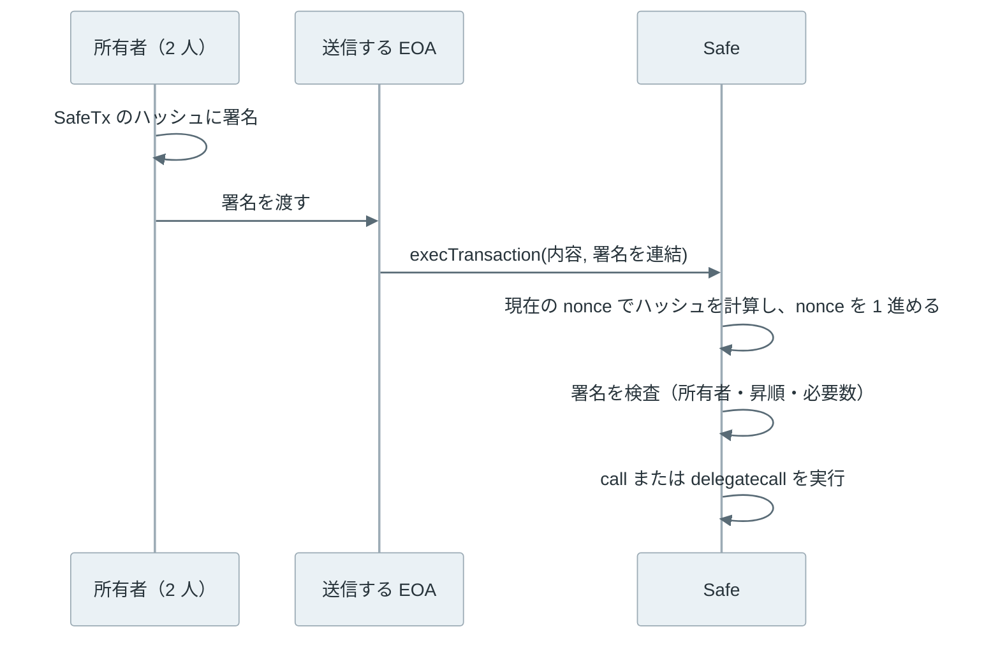

マルチシグ（multisig、multi-signature）は、登録した n 個の鍵のうち m 個の署名が揃った時だけ資産を動かせるようにする仕組みです。「3 個のうち 2 個」なら 2-of-3 と書きます。1 個の鍵を盗まれても送金されず、1 個を失くしても残りの 2 個で資産を動かせます。

使われる場面の代表は、取引所や団体が大きな資産を預かる口座です。担当者 1 人の端末が乗っ取られただけで全額が動く構成は避けたいものの、全員の同意を必須にすると、1 人が鍵を失くした時に資産が動かせなくなります。個人でも、普段の端末・予備の端末・離れた場所の保管用に鍵を分ける用途があります。



上記の図の通り、同じ「3 人で承認する」構成でも、規則を検査する場所とチェーンに残るものは方式ごとに違います。Bitcoin ではスクリプト、Ethereum ではコントラクトが署名を数えます。MuSig2 や MPC では署名者がチェーンの外で 1 つの署名を作るので、チェーンからは 1 人の送金と区別できません。

<br>

本記事では、ローカルの実験で確かめながら、Bitcoin と Ethereum のマルチシグを説明します。軸になるのは次の疑問です。

- m と n は、何に対する備えなのか。
- Bitcoin のマルチシグは、署名をどう数えるのか。署名の並びを間違えると何が起きるのか。
- Ethereum にはプロトコルのマルチシグが無いのに、Safe はどう実現しているのか。
- MuSig2 や MPC は、マルチシグと何が違うのか。
- 署名者を増やしても、資産を失う事故が起きるのはなぜか。

ウォレットの全体像と鍵の保管は [Wallet](../wallet/)、スクリプトの実行は [Bitcoin Script](../bitcoin-script/)、署名の基礎は [Digital Signature](../digital-signature/) を前提にします。

---

### マルチシグが必要な理由

鍵が 1 個だけのアカウントには、壊れ方が 2 つあります。鍵を盗まれれば攻撃者が送金でき、鍵を失くせば本人も送金できません。m-of-n は、この 2 つに別々の数で備えます。攻撃者は m 個の鍵を盗む必要があり、持ち主は n − m 個まで鍵を失っても資産を動かせます。

| 構成 | 盗まれても耐える鍵の数（m − 1） | 失くしても耐える鍵の数（n − m） |
| --- | --- | --- |
| 1-of-1（通常の鍵） | 0 | 0 |
| 2-of-2 | 1 | 0 |
| 2-of-3 | 1 | 1 |
| 3-of-5 | 2 | 2 |

例えば、[Lightning Network](../lightning-network/) のチャネルは 2-of-2 です。2 人の合意が無ければ資金が動かないことが目的で、相手が応答しなくなった時の備えは、資金を預ける前に受け取っておく払い戻しの取引への署名が担います。

<br>

表の数は、鍵がそれぞれ別の場所にある時だけ成り立ちます。3 個の鍵を同じ PC に置けば、その PC が乗っ取られた時点で 3 個とも盗まれ、実質は 1-of-1 です。同じ紙に復元フレーズを書き並べた場合も、同じ金庫に入れた場合も同じです。鍵を分ける軸には、端末（PC・スマートフォン・ハードウェアウォレット）、人（担当者）、場所（自宅・別の拠点）があり、1 つの故障や侵害で m 個が同時に失われない配置を選びます。

---

### Bitcoin の OP_CHECKMULTISIG

Bitcoin のマルチシグは、出力に付ける条件を [Bitcoin Script](../bitcoin-script/) で書いたものです。[BIP-11](https://github.com/bitcoin/bips/blob/master/bip-0011.mediawiki)（BIP は Bitcoin Improvement Proposal、仕様変更の提案文書）が標準の形として定めた条件は、次の 1 行です。

```text
2 <公開鍵A> <公開鍵B> <公開鍵C> 3 OP_CHECKMULTISIG
```

先頭の 2 が m、末尾の 3 が n です。使う側は、先頭にダミー（空のバイト列）を置き、続けて m 個の署名を積みます。OP_CHECKMULTISIG は n、公開鍵 n 個、m、署名 m 個を取り出した後、もう 1 個余分に取り出します。初期の実装の不具合がそのまま規則として残ったもので、[Bitcoin Core の実装](https://github.com/bitcoin/bitcoin/blob/v32.1/src/script/interpreter.cpp#L1203-L1212)にも「A bug causes CHECKMULTISIG to consume one extra argument」（不具合で 1 個余分に引数を消費する）というコメントがあります。

| 取り出す順 | 値 | 意味 |
| --- | --- | --- |
| 1 | `3` | 公開鍵の数 n |
| 2〜4 | `C`・`B`・`A` | 公開鍵 |
| 5 | `2` | 署名の数 m |
| 6〜7 | 署名 2 個 | 署名 |
| 8 | 空のバイト列 | ダミー。中身は検査に使わない |

ダミーの中身は署名の検査に関係しないので、中継するノードが書き換えても、以前の合意規則では通りました（中継の方針では Bitcoin Core 0.10.0 から拒否）。取引の ID（SegWit の取引では wtxid）が変わる余地になるため、2017 年に有効になった [BIP-147](https://github.com/bitcoin/bips/blob/master/bip-0147.mediawiki)（NULLDUMMY）で、ダミーは空のバイト列でなければならない合意規則になりました。

<br>

署名の並びにも決まりがあります。OP_CHECKMULTISIG は署名と公開鍵を並びの端から 1 つずつ照らし合わせ、合わなかった公開鍵は飛ばして、二度と戻りません。そのため、署名はスクリプトに書いた公開鍵と同じ順に並べる必要があります。Bitcoin Core の実装は、上記の表の通り末尾（最後に積んだもの）から照らし合わせます。



公開鍵 A・B・C に対して署名を B、A の順に積むと、最後に積んだ A の署名が公開鍵 C と B を飛ばしてしまい、B の署名に使える公開鍵が残らずに失敗します。

この条件をそのまま出力に書くと、支払う側が公開鍵 3 個を含む長い条件を扱うことになります。そこで、条件のハッシュ値だけを出力に書き、使う時に条件の本体（redeemScript）を出す [P2SH](../bitcoin-script/) が使われます。P2WSH（Pay to Witness Script Hash）は、同じ考え方を SegWit（Segregated Witness。署名などを witness という別の領域に分けた 2017 年の仕様変更）に合わせた形式です。[BIP-141](https://github.com/bitcoin/bips/blob/master/bip-0141.mediawiki) で、出力には条件（witnessScript）の 32 バイトの [SHA-256](/notes/security/sha-256/) を書き、条件の本体と署名は witness に置きます。

---

### regtest で 2-of-3 を作る

[Bitcoin Core](https://bitcoincore.org/) 32.1 の regtest（手元だけで動く検証用のチェーン）で、署名が 1 個では本当に通らないのか、並びを逆にすると何で失敗するのかを確かめました。コンテナはネットワークに繋がず、鍵は使い捨てのウォレットで作っています。Bitcoin Core の公式の配布物は実行ファイルなので、[配布元](https://bitcoincore.org/bin/bitcoin-core-32.1/)から取得して SHA-256 を照合しました。

3 個のウォレット a・b・c から公開鍵を 1 個ずつ集め、`wsh(multi(2,a,b,c))` という [descriptor](https://github.com/bitcoin/bips/blob/master/bip-0380.mediawiki)（出力の条件を表す記法）で 2-of-3 の P2WSH を作ります。署名の受け渡しには、署名前の取引と途中の署名を運ぶ [PSBT](https://github.com/bitcoin/bips/blob/master/bip-0174.mediawiki) を使います。RPC の流れは Bitcoin Core の [multisig-tutorial](https://github.com/bitcoin/bitcoin/blob/v32.1/doc/multisig-tutorial.md) と同じです。ただし tutorial は公開鍵を並べ替える `sortedmulti` を使い、本記事は並びを書いた通りに保つ `multi` を使っています。

正しく署名した取引の witness を組み替え、各組み合わせをブロックに入れようとした時の判定を記録しました。要点は次の部分です。

```python
sig_a, sig_b, ws = wit[1], wit[2], wit[3]   # wit = ['', sig_a, sig_b, witnessScript]
cases = [
    ('only sig_a (dummy, sig_a)', ['', sig_a, ws]),
    ('sig_b before sig_a', ['', sig_b, sig_a, ws]),
    ('dummy = 0x01', ['01', sig_a, sig_b, ws]),
    ('no dummy', [sig_a, sig_b, ws]),
]
for label, items in cases:
    print(f'{label:26} ->', verdict(with_witness(full['ab'], items), miner))
```

`verdict` は mempool に受け付けられなければ `generateblock` でブロックに入れ、合意規則での判定を返します。`with_witness` は取引の witness だけを差し替える関数です。全体は以下です。

<details>
<summary>bitcoin_multisig.py の全体</summary>

```python
#!/usr/bin/env python3
"""Local regtest only. 2-of-3 P2WSH and 3-of-3 MuSig2 with Bitcoin Core 32.1.

Run through run.sh: the container has no network (--network none) and every
key is generated by a throwaway regtest wallet that is deleted afterwards.
"""
import json
import os
import shutil
import subprocess
import time

BIN = os.environ.get('BITCOIN_BIN', '/opt/bitcoin/bin')
DATA = '/tmp/regtest'


def cli(*args, wallet=None):
    cmd = [f'{BIN}/bitcoin-cli', '-regtest', f'-datadir={DATA}']
    if wallet:
        cmd.append(f'-rpcwallet={wallet}')
    r = subprocess.run(cmd + [str(a) for a in args], capture_output=True, text=True)
    if r.returncode:
        raise RuntimeError(r.stderr.strip().splitlines()[-1])
    try:
        return json.loads(r.stdout)
    except json.JSONDecodeError:
        return r.stdout.strip()


def start():
    shutil.rmtree(DATA, ignore_errors=True)
    os.makedirs(DATA)
    subprocess.check_call([f'{BIN}/bitcoind', '-regtest', f'-datadir={DATA}', '-daemon',
                           '-listen=0', '-dnsseed=0', '-fixedseeds=0', '-fallbackfee=0.0001'],
                          stdout=subprocess.DEVNULL)
    for _ in range(300):
        if os.path.exists(f'{DATA}/regtest/.cookie'):
            break
        time.sleep(0.1)
    cli('-rpcwait', 'getblockcount')


# --- helpers to rewrite the witness of input 0 (segwit serialization) ---
def varint(n):
    return bytes([n]) if n < 0xfd else b'\xfd' + n.to_bytes(2, 'little')


def read_varint(b, i):
    return (b[i], i + 1) if b[i] < 0xfd else (int.from_bytes(b[i + 1:i + 3], 'little'), i + 3)


def with_witness(tx_hex, items):
    b = bytes.fromhex(tx_hex)
    assert b[4:6] == b'\x00\x01'  # segwit marker and flag
    n_in, i = read_varint(b, 6)
    assert n_in == 1
    i += 36
    length, i = read_varint(b, i)
    i += length + 4
    n_out, i = read_varint(b, i)
    for _ in range(n_out):
        i += 8
        length, i = read_varint(b, i)
        i += length
    j = i
    count, j = read_varint(b, j)
    for _ in range(count):
        length, j = read_varint(b, j)
        j += length
    witness = varint(len(items)) + b''.join(varint(len(x)) + x for x in map(bytes.fromhex, items))
    return (b[:i] + witness + b[j:]).hex()


def verdict(raw, miner):
    mempool = cli('testmempoolaccept', json.dumps([raw]))[0]
    if mempool['allowed']:
        return 'accepted'
    try:
        cli('generateblock', miner, json.dumps([raw]))
        return 'BLOCK ACCEPTED (unexpected)'
    except RuntimeError as e:  # consensus check when the tx is put in a block
        msg = str(e)
        return 'block rejected: ' + msg[msg.index('(') + 1:msg.index(')')]


def spend(wallet, dest, change):
    opts = json.dumps({'changeAddress': change})
    return cli('-named', 'walletcreatefundedpsbt', 'inputs=[]',
               f'outputs=[{{"{dest}":0.5}}]', f'options={opts}', wallet=wallet)['psbt']


def main():
    start()
    for w in ('miner', 'a', 'b', 'c'):
        cli('-named', 'createwallet', f'wallet_name={w}')
    miner = cli('getnewaddress', wallet='miner')
    cli('generatetoaddress', 101, miner)
    dest = cli('getnewaddress', wallet='miner')

    # One key per signer wallet; only public keys leave each wallet.
    key = {}
    for w in 'abc':
        info = cli('getaddressinfo', cli('getnewaddress', '', 'bech32', wallet=w), wallet=w)
        path = info['hdkeypath'][2:].replace('h', "'")
        key[w] = f"[{info['hdmasterfingerprint']}/{path}]{info['pubkey']}"

    # ---- 1. 2-of-3 P2WSH ----
    desc = cli('getdescriptorinfo', f"wsh(multi(2,{key['a']},{key['b']},{key['c']}))")['descriptor']
    cli('-named', 'createwallet', 'wallet_name=coord', 'disable_private_keys=true', 'blank=true')
    cli('importdescriptors', json.dumps([{'desc': desc, 'timestamp': 'now'}]), wallet='coord')
    addr = cli('deriveaddresses', desc)[0]
    cli('sendtoaddress', addr, 1, wallet='miner')
    cli('generatetoaddress', 1, miner)
    psbt = spend('coord', dest, addr)
    signed = {w: cli('walletprocesspsbt', psbt, wallet=w)['psbt'] for w in 'abc'}

    print('== 2-of-3 P2WSH')
    ws_hex = cli('decodepsbt', psbt)['inputs'][0]['witness_script']['hex']
    asm = cli('decodescript', ws_hex)['asm'].split()
    print('witnessScript:', ' '.join(x if x.startswith('OP_') or len(x) < 8 else x[:6] + '..' for x in asm))
    print('signed by a only     -> complete =', cli('finalizepsbt', signed['a'])['complete'])
    full = {}
    for pair in ('ab', 'ac', 'bc'):
        fin = cli('finalizepsbt', cli('combinepsbt', json.dumps([signed[p] for p in pair])))
        full[pair] = fin['hex']
        print(f'signed by {pair[0]} and {pair[1]}  -> complete = {fin["complete"]},',
              'mempool =', verdict(fin['hex'], miner))
    tx = cli('decoderawtransaction', full['ab'])
    wit = tx['vin'][0]['txinwitness']
    print('witness items (bytes):', [len(x) // 2 for x in wit], '| weight =', tx['weight'])
    sig_a, sig_b, ws = wit[1], wit[2], wit[3]
    cases = [
        ('only sig_a (dummy, sig_a)', ['', sig_a, ws]),
        ('sig_b before sig_a', ['', sig_b, sig_a, ws]),
        ('dummy = 0x01', ['01', sig_a, sig_b, ws]),
        ('no dummy', [sig_a, sig_b, ws]),
    ]
    for label, items in cases:
        print(f'{label:26} ->', verdict(with_witness(full['ab'], items), miner))

    # ---- 2. 3-of-3 MuSig2 key path (BIP-327 aggregation inside Bitcoin Core) ----
    print('== 3-of-3 MuSig2 (tr(musig(...)))')
    pub = cli('getdescriptorinfo', f"tr(musig({key['a']},{key['b']},{key['c']}))")['descriptor']
    master = {}
    for w in 'abc':
        d = [x['desc'] for x in cli('listdescriptors', 'true', wallet=w)['descriptors']
             if x['desc'].startswith('wpkh(') and not x['internal']][0]
        master[w] = d[5:d.index('/')]  # tprv of the throwaway regtest wallet
    for w in 'abc':
        parts = [f"{master[o]}/{key[o].split('/', 1)[1].split(']')[0]}" if o == w else key[o] for o in 'abc']
        priv = f"tr(musig({','.join(parts)}))"
        priv += '#' + cli('getdescriptorinfo', priv)['checksum']
        cli('-named', 'createwallet', f'wallet_name=m{w}', 'blank=true')
        cli('importdescriptors', json.dumps([{'desc': priv, 'timestamp': 'now'}]), wallet=f'm{w}')
    cli('-named', 'createwallet', 'wallet_name=mcoord', 'disable_private_keys=true', 'blank=true')
    cli('importdescriptors', json.dumps([{'desc': pub, 'timestamp': 'now'}]), wallet='mcoord')
    maddr = cli('deriveaddresses', pub)[0]
    cli('sendtoaddress', maddr, 1, wallet='miner')
    cli('generatetoaddress', 1, miner)
    psbt = spend('mcoord', dest, maddr)
    round1 = cli('combinepsbt', json.dumps([cli('walletprocesspsbt', psbt, wallet=f'm{w}')['psbt'] for w in 'abc']))
    inp = cli('decodepsbt', round1)['inputs'][0]
    print('round 1: pubnonces =', len(inp['musig2_pubnonces']), ', partial sigs =', len(inp.get('musig2_partial_sigs', [])))
    round2 = cli('combinepsbt', json.dumps([cli('walletprocesspsbt', round1, wallet=f'm{w}')['psbt'] for w in 'abc']))
    inp = cli('decodepsbt', round2)['inputs'][0]
    print('round 2: partial sigs =', len(inp['musig2_partial_sigs']))
    fin = cli('finalizepsbt', round2)
    mtx = cli('decoderawtransaction', fin['hex'])
    print('complete =', fin['complete'], ', mempool =', verdict(fin['hex'], miner))
    print('witness items (bytes):', [len(x) // 2 for x in mtx['vin'][0]['txinwitness']], '| weight =', mtx['weight'])

    # ---- 3. single-key P2TR with the same shape (1 input, 2 outputs) ----
    print('== single-key P2TR for comparison')
    cli('-named', 'createwallet', 'wallet_name=solo')
    saddr = cli('getnewaddress', '', 'bech32m', wallet='solo')
    cli('sendtoaddress', saddr, 1, wallet='miner')
    cli('generatetoaddress', 1, miner)
    sp = cli('walletprocesspsbt', spend('solo', dest, saddr), wallet='solo')
    stx = cli('decoderawtransaction', cli('finalizepsbt', sp['psbt'])['hex'])
    print('witness items (bytes):', [len(x) // 2 for x in stx['vin'][0]['txinwitness']], '| weight =', stx['weight'])
    for label, a in (('musig2', maddr), ('single', saddr)):
        spk = cli('getaddressinfo', a, wallet='mcoord' if label == 'musig2' else 'solo')['scriptPubKey']
        print(f'{label} scriptPubKey: {spk[:4]} + {len(spk) // 2 - 2}-byte key')
    cli('stop')


if __name__ == '__main__':
    main()
```

</details>

実行結果は以下の通りです。txid と公開鍵は実行ごとに変わります。

```text
== 2-of-3 P2WSH
witnessScript: 2 028414.. 022143.. 02b31c.. 3 OP_CHECKMULTISIG
signed by a only     -> complete = False
signed by a and b  -> complete = True, mempool = accepted
signed by a and c  -> complete = True, mempool = accepted
signed by b and c  -> complete = True, mempool = accepted
witness items (bytes): [0, 71, 71, 105] | weight = 754
only sig_a (dummy, sig_a)  -> block rejected: Operation not valid with the current stack size
sig_b before sig_a         -> block rejected: Script evaluated without error but finished with a false/empty top stack element
dummy = 0x01               -> block rejected: Dummy CHECKMULTISIG argument must be zero
no dummy                   -> block rejected: Operation not valid with the current stack size
```

a だけが署名した PSBT は `complete = False` で、取引として完成しません。2 人の組み合わせは 3 通りとも通り、どの 2 人でも送金できます。

witness を組み替えた 4 通りは、全てブロックに入りませんでした。署名を 1 個にすると、ダミーまで数えた個数が足りずにスタックの不足で止まります。ダミーを抜いた場合も同じエラーで、OP_CHECKMULTISIG が m 個の署名に加えてもう 1 個を必要とすることが分かります。署名の順を逆にした場合は、実行は最後まで進み、結果が偽になって失敗しました。

witness の大きさは `[0, 71, 71, 105]` バイトです。最後の 105 バイトは公開鍵 3 個を含む条件の本体で、使う時に全員の公開鍵がチェーンに出ます。

---

### Taproot と MuSig2

2021 年の Taproot（[BIP-341](https://github.com/bitcoin/bips/blob/master/bip-0341.mediawiki)）以降は、従来の ECDSA とは別の署名方式である [Schnorr 署名](https://github.com/bitcoin/bips/blob/master/bip-0340.mediawiki)を使う出力が選べます。Taproot のスクリプト（tapscript）では OP_CHECKMULTISIG が無効にされ、代わりに署名を 1 個ずつ検査して数を足していく OP_CHECKSIGADD が [BIP-342](https://github.com/bitcoin/bips/blob/master/bip-0342.mediawiki) で加わりました。

もう 1 つの道が [MuSig2](https://github.com/bitcoin/bips/blob/master/bip-0327.mediawiki)（BIP-327）です。n 人の公開鍵を 1 個の公開鍵に集約し、n 人が協力して、その集約鍵に対する 1 個の Schnorr 署名を作ります。署名は 2 往復で作ります。1 往復目で各自が nonce（署名ごとに使い捨てる乱数）の公開値を配り、2 往復目で部分署名を配って 1 個の署名にまとめます。

MuSig2 は n-of-n です。2-of-3 のような m-of-n を 1 個の鍵で表すには、[FROST](https://www.rfc-editor.org/rfc/rfc9591)（RFC 9591）のようなしきい値署名が必要です。Taproot では、全員が揃う時は集約鍵で送り、揃わない時はスクリプトで 2 人の署名を出す、という組み合わせもできます。

<br>

Bitcoin Core 32.1 は、[BIP-390](https://github.com/bitcoin/bips/blob/master/bip-0390.mediawiki) の `musig()` を descriptor に書けます。前の実験と同じ 3 人の鍵で `tr(musig(a,b,c))` を作り、PSBT を 2 回往復させて送金しました。比べるために、1 個の鍵だけの Taproot の出力から、同じ形（入力 1 個、出力 2 個）の送金も作っています。

```text
== 3-of-3 MuSig2 (tr(musig(...)))
round 1: pubnonces = 3 , partial sigs = 0
round 2: partial sigs = 3
complete = True , mempool = accepted
witness items (bytes): [64] | weight = 568
== single-key P2TR for comparison
witness items (bytes): [64] | weight = 568
musig2 scriptPubKey: 5120 + 32-byte key
single scriptPubKey: 5120 + 32-byte key
```

MuSig2 の witness は 64 バイトの署名 1 個だけで、1 個の鍵の送金と同じです。出力の形も、どちらも `51`（witness version 1）と `20`（32 バイトを積む）に 32 バイトの鍵が続くだけです。チェーンを見る人は、この 2 つを区別できません。取引の重さ（weight）は 568 で、P2WSH の 2-of-3 の 754 より小さくなりました。

MuSig2 には、P2WSH に無い注意点があります。1 往復目で配った nonce を別の署名で使い回すと、秘密鍵が漏れる恐れがあります。BIP-327 は、同じ秘密の nonce で 2 回署名することと、nonce をセッションの値から決定的に導くことを禁じています（最後の署名者向けの DeterministicSign は例外）。使い終えた nonce を消すことは、再利用を防ぐ工夫として勧めています。

---

### Ethereum の Safe

Ethereum のマルチシグも、Bitcoin と同じくプロトコルの機能だと思うかもしれません。しかし、Ethereum の通常のアカウント（EOA）は、1 個の秘密鍵の署名しか受け付けません（[Ethereum Account Model](../ethereum-account-model/)）。マルチシグは、資産を持つ[コントラクト](../smart-contract/)が、署名を数えるコードとして実現します。

代表的な実装が [Safe](https://github.com/safe-fndn/safe-smart-account/tree/v1.5.0)（旧 Gnosis Safe。リポジトリは safe-global から safe-fndn に移っています）です。以降は v1.5.0 のソースで説明します。Safe は、資産と設定（所有者・必要数・nonce）を持つプロキシと、検査と実行のコードを持つ実装コントラクト（singleton）に分かれ、プロキシは呼び出しを [`delegatecall`](https://docs.soliditylang.org/en/latest/introduction-to-smart-contracts.html#delegatecall-and-libraries) で実装に回します。

送金は [`execTransaction`](https://github.com/safe-fndn/safe-smart-account/blob/v1.5.0/contracts/Safe.sol#L115-L207) で行います。流れは次の通りです。



上記の図の通り、所有者はチェーンの外で署名するだけで、取引を送るのは誰の EOA でも構いません。送る EOA は手数料を払うだけで、所有者である必要はありません。コントラクトのアカウントの操作を第三者がまとめてチェーンに載せる仕組みを規格にしたのが [ERC-4337](../erc-4337/) で、Safe も [Safe4337Module](https://github.com/safe-global/safe-modules/tree/main/modules/4337) で ERC-4337 のアカウントとして使えます。

<br>

署名の対象は、[EIP-712](../eip-712/) の型付きハッシュです。Safe は [SafeTx の型](https://github.com/safe-fndn/safe-smart-account/blob/v1.5.0/contracts/Safe.sol#L59-L62)を次のように定め、domain には chain ID と Safe 自身のアドレスだけを入れます。

```text
SafeTx(address to,uint256 value,bytes data,uint8 operation,uint256 safeTxGas,
       uint256 baseGas,uint256 gasPrice,address gasToken,address refundReceiver,uint256 nonce)
```

`operation` は 0 が通常の呼び出し、1 が `delegatecall` です。`nonce` は Safe が持つ通し番号で、実行のたびに 1 進みます。ハッシュに nonce が入るので、実行済みの署名は次の取引のハッシュに合いません。

署名は 65 バイトずつ連結して渡し、[`checkNSignatures`](https://github.com/safe-fndn/safe-smart-account/blob/v1.5.0/contracts/Safe.sol#L287-L342) が先頭から必要数だけ検査します。復元した所有者のアドレスは、前の所有者より大きくなければなりません。署名は所有者のアドレスの昇順に並べる決まりで、同じ所有者の署名を 2 回数える不正は、この比較 1 回で防げます。

各署名の末尾の `v` の値で、検査の方法が変わります（[signatures.md](https://github.com/safe-fndn/safe-smart-account/blob/v1.5.0/docs/signatures.md)）。

| `v` | 検査の方法 |
| --- | --- |
| 27・28 | ハッシュから ECDSA で署名者を復元する |
| 31・32 | `eth_sign` の接頭辞を付けたハッシュから復元する |
| 1 | 所有者が事前に `approveHash` で承認したか、送る EOA 自身が所有者か |
| 0 | 所有者のコントラクトに [ERC-1271](https://eips.ethereum.org/EIPS/eip-1271) の `isValidSignature(bytes32,bytes)` を問い合わせる |

`v = 0` を使うと、所有者に秘密鍵を持たないコントラクト（別の Safe など）を置けます。v1.5.0 の Safe は、戻り値が `0x1626ba7e` の時だけ署名を有効とします。ERC-1271 の考え方は [EIP-712](../eip-712/) のノートで扱っています。

---

### anvil で Safe を動かす

Ethereum の開発ツール群 [Foundry](https://getfoundry.sh/) の anvil（手元だけで動く Ethereum のノード）に、2-of-3 の Safe を作りました。所有者は EOA 2 個と、ERC-1271 を実装した学習用のコントラクト `StudySigner` 1 個です。Safe は [safe-smart-account v1.5.0](https://github.com/safe-fndn/safe-smart-account/tree/v1.5.0)（LGPL-3.0-only）をそのままコンパイルしています。鍵は anvil の既定のテスト用の鍵だけで、公開ネットワークには繋いでいません。`StudySigner` は本記事のために書いたもので、監査を受けていません。

```solidity
// SPDX-License-Identifier: MIT
pragma solidity >=0.7.0 <0.9.0;

// Learning-only ERC-1271 signer. Not audited. Do not deploy with real assets.
// The admin approves a hash in advance; the Safe then asks this contract
// whether the hash is approved instead of recovering an ECDSA key.
contract StudySigner {
    bytes4 internal constant MAGIC = 0x1626ba7e; // isValidSignature(bytes32,bytes)
    address public immutable admin;
    mapping(bytes32 => bool) public approved;

    constructor(address admin_) {
        admin = admin_;
    }

    function approve(bytes32 hash) external {
        require(msg.sender == admin, "not admin");
        approved[hash] = true;
    }

    function isValidSignature(bytes32 hash, bytes calldata) external view returns (bytes4) {
        return approved[hash] ? MAGIC : bytes4(0xffffffff);
    }
}
```

0.1 ETH を送る SafeTx に署名し、署名の数・並び・nonce を変えて `execTransaction` を呼びます。要点は次の部分です。

```python
h0 = safe_tx_hash(0)                                  # EIP-712 hash, nonce 0
lo, hi = sorted([o1, o2], key=lambda a: int(a, 16))   # owners by address
ascending = sign(lo, h0) + sign(hi, h0)
for label, sigs in [('1 signature', sign(lo, h0)),
                    ('same owner twice', sign(lo, h0) * 2),
                    ('descending owners', sign(hi, h0) + sign(lo, h0))]:
    print(f'{label:24} -> {execute(sigs)}')           # eth_call, no state change
receipt = execute(ascending, dry=False)                # real transaction
print(f'{"replay nonce-0 sigs":24} -> {execute(ascending)}')
```

<details>
<summary>safe_multisig.py の全体</summary>

```python
#!/usr/bin/env python3
"""Local anvil only. 2-of-3 Safe (safe-smart-account v1.5.0) and execTransaction.

Run through run.sh. Keys are Anvil's public test mnemonic; never reuse them.
Owners: two EOAs and StudySigner (an ERC-1271 contract written for this lab).
"""
import json
import os
import socket
import subprocess
import time
import urllib.request

BIN = os.environ.get('ETH_BIN', '/opt/eth')
BUILD = json.load(open(os.environ['BUILD']))['contracts']
MNEMONIC = 'test test test test test test test test test test test junk'  # Anvil default, public
ZERO = '0x' + '00' * 20
SAFE_TX = ('SafeTx(address to,uint256 value,bytes data,uint8 operation,uint256 safeTxGas,'
           'uint256 baseGas,uint256 gasPrice,address gasToken,address refundReceiver,uint256 nonce)')
EXEC = 'execTransaction(address,uint256,bytes,uint8,uint256,uint256,uint256,address,address,bytes)'


def cast(*args):
    return subprocess.check_output([f'{BIN}/cast', *map(str, args)], text=True).strip()


with socket.socket() as s:
    s.bind(('127.0.0.1', 0))
    PORT = s.getsockname()[1]


def rpc(method, *params):
    body = json.dumps({'jsonrpc': '2.0', 'id': 1, 'method': method, 'params': params}).encode()
    req = urllib.request.Request(f'http://127.0.0.1:{PORT}', body, {'Content-Type': 'application/json'})
    with urllib.request.urlopen(req, timeout=10) as r:
        res = json.load(r)
    if 'error' in res:
        raise RuntimeError(res['error'])
    return res['result']


def send(sender, data, to=None, value=0):
    tx = {'from': sender, 'data': data, 'value': hex(value), 'gas': hex(8_000_000), 'gasPrice': hex(2 * 10**9)}
    if to:
        tx['to'] = to
    h = rpc('eth_sendTransaction', tx)
    for _ in range(200):
        receipt = rpc('eth_getTransactionReceipt', h)
        if receipt:
            return receipt
        time.sleep(0.05)
    raise TimeoutError(h)


def call(to, data, sender=None):
    """eth_call; returns (result, None) or (None, revert message)."""
    try:
        return rpc('eth_call', {'to': to, 'data': data, **({'from': sender} if sender else {})}, 'latest'), None
    except RuntimeError as e:
        return None, e.args[0]['message']


def deploy(sender, name, args=''):
    art = next(v for k, v in BUILD.items() if k.endswith(':' + name))
    receipt = send(sender, '0x' + art['bin'] + args)
    assert int(receipt['status'], 16) == 1
    return receipt['contractAddress']


def main():
    node = subprocess.Popen([f'{BIN}/anvil', '--host', '127.0.0.1', '--port', str(PORT), '--chain-id', '31337',
                             '--hardfork', 'prague', '--timestamp', '1700000000', '--accounts', '5', '--quiet'],
                            stdout=subprocess.DEVNULL, stderr=subprocess.DEVNULL)
    try:
        for _ in range(200):
            try:
                accounts = rpc('eth_accounts')
                break
            except OSError:
                time.sleep(0.05)
        relayer, o1, o2, admin, receiver = accounts
        pk = {a: cast('wallet', 'private-key', '--mnemonic', MNEMONIC, '--mnemonic-index', i)
              for i, a in enumerate(accounts)}

        singleton = deploy(relayer, 'Safe')
        factory = deploy(relayer, 'SafeProxyFactory')
        signer = deploy(relayer, 'StudySigner', cast('abi-encode', 'f(address)', admin)[2:])
        owners = [o1, o2, signer]
        setup = cast('calldata', 'setup(address[],uint256,address,bytes,address,address,uint256,address)',
                     '[' + ','.join(owners) + ']', 2, ZERO, '0x', ZERO, ZERO, 0, ZERO)
        create = cast('calldata', 'createProxyWithNonce(address,bytes,uint256)', singleton, setup, 0)
        safe = '0x' + call(factory, create, relayer)[0][-40:]
        assert int(send(relayer, create, factory)['status'], 16) == 1
        send(relayer, '0x', safe, 10**18)
        threshold = int(call(safe, cast('calldata', 'getThreshold()'))[0], 16)
        print(f'Safe proxy: 3 owners (2 EOAs + 1 ERC-1271 contract), threshold = {threshold}')

        def nonce():
            return int(call(safe, cast('calldata', 'nonce()'))[0], 16)

        def safe_tx_hash(nonce_, operation=0, to=receiver, value=10**17, data='0x'):
            """EIP-712 hash computed off-chain, the same bytes each owner signs."""
            struct = cast('keccak', cast('abi-encode',
                          'f(bytes32,address,uint256,bytes32,uint8,uint256,uint256,uint256,address,address,uint256)',
                          cast('keccak', SAFE_TX), to, value, cast('keccak', data), operation, 0, 0, 0, ZERO, ZERO, nonce_))
            domain = cast('keccak', cast('abi-encode', 'f(bytes32,uint256,address)',
                          cast('keccak', 'EIP712Domain(uint256 chainId,address verifyingContract)'), 31337, safe))
            return cast('keccak', '0x1901' + domain[2:] + struct[2:])

        def sign(owner, h):  # 65 bytes r || s || v with v = 27/28
            return cast('wallet', 'sign', '--no-hash', '--private-key', pk[owner], h)[2:]

        def execute(signatures, dry=True):
            data = cast('calldata', EXEC, receiver, 10**17, '0x', 0, 0, 0, 0, ZERO, ZERO, '0x' + signatures)
            if dry:
                return call(safe, data, relayer)[1]
            return send(relayer, data, safe)

        h0 = safe_tx_hash(0)
        onchain = call(safe, cast('calldata', 'getTransactionHash(address,uint256,bytes,uint8,uint256,uint256,uint256,address,address,uint256)',
                                  receiver, 10**17, '0x', 0, 0, 0, 0, ZERO, ZERO, 0))[0]
        print('off-chain SafeTx hash == getTransactionHash:', h0 == onchain)
        print('same tx with operation=1 (delegatecall) hash:', safe_tx_hash(0, operation=1)[:18] + '..',
              'vs', h0[:18] + '..')

        lo, hi = sorted([o1, o2], key=lambda a: int(a, 16))
        ascending = sign(lo, h0) + sign(hi, h0)
        print('== nonce 0')
        for label, sigs in [('1 signature', sign(lo, h0)),
                            ('same owner twice', sign(lo, h0) * 2),
                            ('descending owners', sign(hi, h0) + sign(lo, h0))]:
            print(f'{label:24} -> {execute(sigs)}')
        before = int(rpc('eth_getBalance', receiver, 'latest'), 16)
        receipt = execute(ascending, dry=False)
        gained = int(rpc('eth_getBalance', receiver, 'latest'), 16) - before
        print(f'{"ascending owners":24} -> status {int(receipt["status"], 16)},',
              f'receiver +{gained / 1e18} ETH, nonce now {nonce()}')
        print(f'{"replay nonce-0 sigs":24} -> {execute(ascending)}')

        print('== nonce 1 (EOA + ERC-1271 owner)')
        h1 = safe_tx_hash(1)
        parts = sorted([lo, signer], key=lambda a: int(a, 16))
        # Contract signature: r = owner address, s = offset of the dynamic part, v = 0.
        contract_sig = '00' * 12 + signer[2:].lower() + format(65 * 2, '064x') + '00'
        sigs = ''.join(sign(lo, h1) if p == lo else contract_sig for p in parts) + format(0, '064x')
        print(f'{"before approve(hash)":24} -> {execute(sigs)}')
        assert int(send(admin, cast('calldata', 'approve(bytes32)', h1), signer)['status'], 16) == 1
        receipt = execute(sigs, dry=False)
        print(f'{"after approve(hash)":24} -> status {int(receipt["status"], 16)}, nonce now {nonce()}')
    finally:
        node.terminate()
        node.wait()


if __name__ == '__main__':
    main()
```

</details>

実行結果は以下の通りです。

```text
Safe proxy: 3 owners (2 EOAs + 1 ERC-1271 contract), threshold = 2
off-chain SafeTx hash == getTransactionHash: True
same tx with operation=1 (delegatecall) hash: 0x48bb5c335f58c852.. vs 0xcb3548365f9ffb27..
== nonce 0
1 signature              -> execution reverted: GS020
same owner twice         -> execution reverted: GS026
descending owners        -> execution reverted: GS026
ascending owners         -> status 1, receiver +0.1 ETH, nonce now 1
replay nonce-0 sigs      -> execution reverted: GS026
== nonce 1 (EOA + ERC-1271 owner)
before approve(hash)     -> execution reverted: GS024
after approve(hash)      -> status 1, nonce now 2
```

チェーンの外で計算した SafeTx のハッシュは、Safe の `getTransactionHash` と一致しました。所有者が署名するのは、この 32 バイトです。

エラーの意味は Safe の[エラーコードの一覧](https://github.com/safe-fndn/safe-smart-account/blob/v1.5.0/docs/error_codes.md)にあります。署名が 1 個だと、長さの検査で `GS020`（Signatures data too short）になります。同じ所有者の 2 回と、降順の並びは `GS026`（Invalid owner provided）で、昇順の比較で止まりました。

実行済みの署名を使い回した場合も `GS026` です。Safe は nonce を別に照合していません。ハッシュが nonce 1 で計算し直されるため、古い署名から復元されるのは所有者ではない無関係のアドレスになり、所有者の検査で失敗します。ERC-1271 の所有者は、コントラクトがハッシュを承認する前は `GS024`（Invalid contract signature provided）で、承認した後は EOA 1 人と合わせて 2 人分として通りました。

---

### MPC・しきい値署名との違い

MPC（Multi-Party Computation）を使うしきい値署名（threshold signature）では、1 本の秘密鍵を作らずに、鍵の断片（share）だけを参加者が持ちます。署名する時も断片を 1 か所に集めず、参加者が計算をやり取りして 1 個の署名を作ります。チェーンに出るのは普通の 1 個の公開鍵と 1 個の署名で、MuSig2 と同じく、マルチシグかどうかはチェーンから分かりません。[Shamir's Secret Sharing](/notes/security/shamir-secret-sharing/) も鍵を断片に分けますが、使う時には断片を集めて鍵を復元します。しきい値署名は、鍵を復元せずに署名を作る点が違います。

MuSig2 との違いは、鍵の作り方です。MuSig2 では各自が独立に作った鍵の公開鍵を集約するため、全員の部分署名が必要な n-of-n になります。しきい値署名では 1 本の鍵の断片を配るので、m 人分の断片で署名できます。断片は参加者が協力して作る方法（DKG）のほか、配布者が鍵を作って分ける方法もあり、後者では一度は鍵の全体が存在します。比べると以下のようになります。

| | Bitcoin P2WSH | Safe | MuSig2 | MPC のしきい値署名 |
| --- | --- | --- | --- | --- |
| 規則を検査する場所 | スクリプト | コントラクト | チェーンの外（n-of-n） | チェーンの外（m-of-n） |
| チェーンに出る署名 | m 個 | m 個 | 1 個 | 1 個 |
| 誰が署名したか | チェーンで分かる | チェーンで分かる | 分からない | 分からない |
| 署名者の入れ替え | 資産を新しい出力に移す | 設定を変える取引 | 資産を新しい出力に移す | 断片を配り直す（資産は動かない） |

上記の表の最後の 2 列は、署名者の数と規則がチェーンに記録されません。誰が承認したかを後からチェーンで確かめられず、m の検査は参加者のソフトウェアが担います。製品ごとに方式が違うので、[Wallet](../wallet/) のノートで触れた通り、どの参加者が揃えば署名できるか、事業者が止まった時に復旧できるかを確認する必要があります。

---

### 署名者が見ている画面

m 個の署名を要求しても、署名者の全員が同じ偽の内容に署名すれば、検査は通ります。署名の数が守るのは鍵を盗まれる場合で、何に署名したかの確認は守りません。2025 年 2 月の [Bybit の事件](../wallet/#bybitsafe-の承認処理の乗っ取り)は、この例です。

Safe の所有者が署名するのは 32 バイトのハッシュです。実験では、同じ宛先・金額のまま `operation` を 0 から 1（delegatecall）に変えると、ハッシュは `0xcb35…` から `0x48bb…` に変わりました。ハッシュの見た目からは、どちらが危険な取引かを判断できません。内容を読めないまま承認すること（blind signing）を避けるには、ハードウェアウォレットの画面で宛先・金額・`operation`・nonce を読める形で確かめるか、別の端末で内容からハッシュを計算し直して照合します（例: [safe-tx-hashes-util](https://github.com/pcaversaccio/safe-tx-hashes-util)）。

<br>

鍵の置き場所を分けても、署名者が共通して頼る部分が残ることがあります。

- 全員が同じ Web 画面で取引を作り、同じ表示を見て署名する。画面が改ざんされると、全員が同じ偽の内容に署名する。
- Safe の `operation = 1` は、任意のコードを Safe の保存領域で動かせる。プロキシの実装の参照先も書き換えられる。
- Safe のモジュールは、[`execTransactionFromModule`](https://github.com/safe-fndn/safe-smart-account/blob/v1.5.0/contracts/base/ModuleManager.sol#L154-L163) で所有者の署名なしに実行できる。有効にしたモジュールは、必要数の署名と同じ権限を持つ。モジュールの追加は通常は必要数の署名を要するが、既存のモジュールからも追加できる。
- Bitcoin の P2WSH は、使う時に公開鍵 3 個を全て含む条件の本体が必要になる。秘密鍵 2 個があっても、3 個目の公開鍵（descriptor）が無いと条件の本体を組み立てられず、出力を見つけることも使うこともできない。

---

### 利点

- 鍵 1 個の盗難でも、紛失でも資産を失わない構成を作れる
- 承認に複数人を必要とし、1 人の判断や 1 台の端末の侵害だけで送金されない
- P2WSH と Safe では、誰が署名したかがチェーンに記録され、後から確かめられる
- Safe では所有者・必要数の変更や、コントラクトの所有者（ERC-1271）を設定の取引で扱える
- MuSig2 では、手数料と見た目は 1 個の鍵の送金と同じになる

---

### 欠点

マルチシグは、1 個の鍵に集まっていた権限を複数の鍵に分け、署名を数える規則を加えます。その代わりに、次の制約があります。

- 署名を集める手順が増え、署名者が揃わないと送金が遅れる
- P2WSH は署名と公開鍵の分だけ取引が重く、手数料が増える（実験では weight 754 と 568）
- 公開鍵・descriptor・Safe の設定のように、鍵以外のバックアップが必要になる
- Safe はコントラクトなので、実装や delegatecall・モジュールの設定が誤ると署名の検査ごと迂回される
- 署名の数は、何に署名したかの確認を代わりに行わない

---

### 適さないケース

- 少額を頻繁に送る用途で、署名を集める手間が資産の保護に見合わない場合
- 鍵を別の端末・人・場所に分けられず、全ての鍵が同じ環境に集まる場合
- 署名者が取引の内容を自分の端末で確かめる手段を持たず、共通の画面の表示を信じるしかない場合
- チェーン上で誰が承認したかを隠したい場合（P2WSH と Safe は署名者の数と公開鍵がチェーンに出る）
