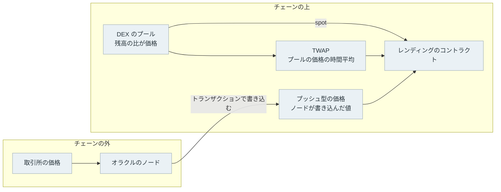
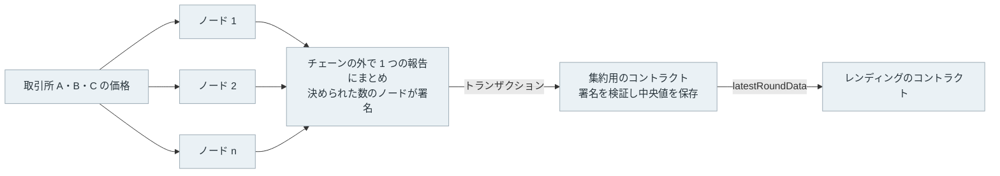
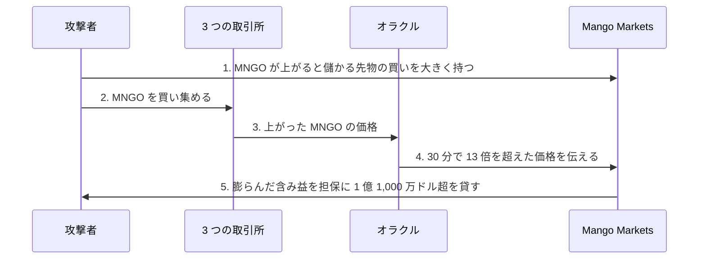

[オラクル（oracle）](https://ethereum.org/en/developers/docs/oracles/)は、チェーンの外にある価格などの情報をチェーンに書き込み、スマートコントラクトから読めるようにする仕組みです。暗号資産を担保に別の資産を貸すレンディングプロトコル（lending protocol）は、担保がいくらに当たるかをオラクルの価格で計算し、貸せる額と、担保を売って返済に充てる清算の時期を決めます。以下では、これを単にレンディングと呼びます。

外から書き込まれる価格を使うには、書き込む誰かを信用する必要があります。それならチェーンの上にある分散型取引所（DEX）の価格を直接読めば、信用する相手が要らず安全だ、と考えたくなります。

しかしローカルのチェーンに 100 tETH しか入っていない小さなプールを作って試すと、資金を持たない攻撃者が、プールの残高と同じ 300,000 tUSD を借りて入れるだけで、1 つのトランザクションの中で DEX の価格を 4 倍にしました。その価格で評価させた担保で 95,856 tUSD（実験用のドル建てトークン）を借りて、61,307 tUSD を手に入れています。



赤い線は、DEX がトークンを預けておくプールの価格です。借りた直後に買った分を売り戻すので、トランザクションが終わった時には 3,714 まで戻っています。1 つのトランザクションの中で完結するこの攻撃は、プールの価格を 30 分で平均した値（TWAP）や、外から書き込まれた価格を読むレンディングには効かず、借りられる額が足りないまま取り消されました。

<br>

本記事では、レンディングや DEX のコントラクトに価格を渡す部分を書く人と、事故の報告でオラクルという語に出会った人に向けて、次の問いを順に扱います。

- コントラクトは、なぜ外の価格を自分で取りに行けないのか。
- プールの価格（spot）を読むと、何が起きるのか。
- TWAP にすれば済むのか。急落にどれだけ遅れるのか。
- Chainlink などのプッシュ型は、いつ価格を書き換えるのか。
- 読む側は、古い価格や範囲外の価格をどう扱うのか。
- Pyth のプル型や UMA の楽観的オラクルは、何が違うのか。

---

### コントラクトが外を見られない理由

[スマートコントラクト](../smart-contract/)の処理は、ブロックを作るノードが実行し、他のノードも同じ入力で実行し直して結果を検証します。もしコントラクトが取引所の Web API を呼べたら、ノードごとに呼んだ時刻が違い、返ってくる価格も違います。そのため、[EVM（Ethereum Virtual Machine）](https://ethereum.org/en/developers/docs/evm/)には外部の API を呼ぶ命令がありません。

そこで、外の価格は誰かがトランザクションでチェーンに書き込み、コントラクトはチェーンに保存された値を読みます。レンディングから見ると、価格の参照先は大きく 3 つあります。



1 つ目は、DEX が持つプールの残高から計算する価格です。以下ではこれを spot と呼びます。2 つ目は、そのプールの価格を一定の時間で平均した TWAP（Time-Weighted Average Price、時間加重平均価格）です。この 2 つはチェーンの中だけで計算でき、外の誰かを信用する必要がありません。

3 つ目は、[Chainlink](https://docs.chain.link/architecture-overview/architecture-decentralized-model) のように、チェーンの外で動くノードが、いくつもの取引所から集めた価格を書き込む値です。ノードが自分から書き込みに来るので、本記事ではプッシュ型と呼びます。オラクルは乱数や、他のチェーンで起きた出来事を届ける時にも使われますが、本記事はレンディングが読む価格に絞ります。チェーン同士で資産やメッセージを受け渡す仕組みは [Cross-Chain Bridge](../cross-chain-bridge/) で扱っています。

---

### 実験の組み立て

同じレンディングのコードで、3 つの参照先を比べます。[Foundry](https://getfoundry.sh/anvil/overview/) の Anvil で手元にチェーンを起動し、実験用のトークンとして tETH と tUSD を作りました。どちらも実在の資産とは関係が無く、実験のコードがいくらでも発行できます。

DEX のプールには、[Uniswap v2](https://docs.uniswap.org/contracts/v2/concepts/core-concepts/oracles) と同じ x × y = k の仕組みで 100 tETH と 300,000 tUSD を入れました。この仕組みでは、2 つの残高の積 k を一定に保つように交換の量を決めます。残高の比から、1 tETH は 3,000 tUSD です。プールの仕組みと、交換の大きさで価格が動く様子は [AMM](../amm/) で扱っています。

レンディングは、tETH を担保に預けると、その評価額の 80% まで tUSD を貸します。評価額は、預けた tETH の量に参照先の価格を掛けた値です。参照先だけを差し替えられるように、価格を返す小さなコントラクトを 3 つ用意しました。以下は [Oracle.sol](lab/Oracle.sol) からの抜粋です。

```solidity
contract SpotSource is IPriceSource {      // プールの残高の比
    Pool public immutable pool;
    function price() external view returns (uint256) { return pool.spot(); }
}

contract TwapSource is IPriceSource {      // 直近 window 秒の平均（実験は 1,800 秒）
    Pool public immutable pool;
    uint256 public immutable window;
    function price() external view returns (uint256) { return pool.twap(window); }
}

contract FeedSource is IPriceSource {      // プッシュ型の値。古ければ読まない
    PushFeed public immutable feed;
    uint256 public immutable maxAge;
    function price() external view returns (uint256) {
        (, int256 a, , uint256 updatedAt, ) = feed.latestRoundData();
        require(a > 0, "bad answer");
        require(block.timestamp - updatedAt <= maxAge, "stale price");
        return uint256(a) * 10 ** (18 - feed.decimals());  // フィードの桁数を 18 桁にそろえる
    }
}

contract Lending {
    uint256 public constant LTV = 80;      // 評価額の 80% まで貸す
    function maxBorrow(address a) public view returns (uint256) {
        uint256 limit = collateral[a] * source.price() / 1e18 * LTV / 100;
        return limit > debt[a] ? limit - debt[a] : 0;
    }
}
```

`PushFeed` は、Chainlink の価格を読む関数 [`latestRoundData`](https://docs.chain.link/data-feeds/api-reference) と同じ形で値を返す、実験用の書き込み先です。値の更新は、実験のスクリプトが 1 つのアカウントで担当します。コンストラクタや状態変数の宣言を含む全体と、実験を動かす [experiment.py](lab/experiment.py)・[run.sh](lab/run.sh) は lab にあります。

<br>

<details>
<summary>FeedSource の桁数の換算と、建てる通貨</summary>

価格は小数を持たない整数で、USD 建てのフィードは多くが小数 8 桁です。`answer` が 300000000000 なら 3,000 ドルを表します。[桁数はフィードごとに違う](https://docs.chain.link/data-feeds/price-feeds#decimal-precision)ので、上記の `FeedSource` も 8 を決め打ちせず `decimals()` から倍率を求めています。トークンが持つ桁数（[ERC-20](../erc-20/) の `decimals`）とは別の値です。

建てる通貨にも注意が要ります。ETH 建てのフィードが返す整数は 1 ETH あたりの量なので、USD 建てと同じ桁数でも、そのままドルとして使えません。

</details>

<br>

---

### 1 つのトランザクションで動かした価格

攻撃者は、手元に 1 tUSD も持たずに始めます。資金は[フラッシュローン](../flash-loan/)で借ります。フラッシュローンは、同じトランザクションの中で返す約束で担保なしに貸す仕組みで、返せなければトランザクションごと取り消されます。実験では、レンディングとは別の貸し手から 300,000 tUSD を手数料 0.09% で借りました。

攻撃のコントラクトは、借りた tUSD を受け取ると次の順に動きます。番号は冒頭に置いた図の横軸と同じで、1 がフラッシュローンを受け取った所です。

2. 300,000 tUSD を全部プールに入れて tETH を買う。プールの tETH が減り、価格が上がる。
3. 買った tETH のうち 10 tETH をレンディングに担保として預ける。
4. レンディングが今の価格で認める上限まで tUSD を借りる。
5. 残りの tETH をプールに売り戻し、tUSD に戻す。
6. フラッシュローンに 300,270 tUSD を返し、残りを手に入れる。

```solidity
function onFlashLoan(uint256 amount, uint256 fee) external {
    require(msg.sender == address(flash));
    pool.swap(address(usd), amount);                        // 2. tETH を買い、価格を押し上げる
    lending.deposit(collateralEth);                         // 3. 10 tETH を担保に入れる
    lending.borrow(lending.maxBorrow(address(this)));       // 4. 上がった価格で評価させて借りる
    pool.swap(address(eth), eth.balanceOf(address(this)));  // 5. 残りの tETH を売り戻す
    uint256 held = usd.balanceOf(address(this));
    if (held < amount + fee) revert CannotRepay(held, amount + fee, lending.debt(address(this)));
    usd.transfer(address(flash), amount + fee);             // 6. 返済
}
```

実際のコードでは、手順の間で 3 つの参照先の値をイベントに記録しています。spot を読むレンディングに当てた時の記録から、主な行を抜き出します。step の番号は、上記の各手順を終えた直後を表します。

```text
[attack/spot] status=1 profit=61,307.05 tUSD debt=95,856.00 collateral=10.0 tETH
    step 1: spot=3,000.00 twap=3,000.00 feed=3,000.00 usd=300,000.00 eth=0.0000
    step 2: spot=11,982.00 twap=3,000.00 feed=3,000.00 usd=0.00 eth=49.9249
    step 4: spot=11,982.00 twap=3,000.00 feed=3,000.00 usd=95,856.00 eth=39.9249
    step 5: spot=3,714.21 twap=3,000.00 feed=3,000.00 usd=361,577.05 eth=0.0000
    step 6: spot=3,714.21 twap=3,000.00 feed=3,000.00 usd=61,307.05 eth=0.0000
```

300,000 tUSD で買うと、プールの tETH は 100 から約 50 に減り、spot は 11,982 になりました。レンディングは 10 tETH を 119,820 tUSD と評価し、その 80% の 95,856 tUSD を貸しました。売り戻しで約 265,700 tUSD が戻るので、返済しても 61,307 tUSD が残ります。

レンディングには、95,856 tUSD の貸し付けと 10 tETH の担保が残りました。担保は 3,000 で数えて 30,000 tUSD 分しか無く、借り手は返しに来ません。差の約 66,000 tUSD は、レンディングに資金を預けた人の損になります。

<br>

#### TWAP とプッシュ型が動かなかった理由

TWAP とプッシュ型を読むレンディングは、同じ 10 tETH を 3,000 で評価し、24,000 tUSD までしか貸しませんでした。売り戻しで戻る額と合わせても返済に 10,549 tUSD 足りず、`CannotRepay` でトランザクションごと取り消されました。攻撃者が失うのは、取り消されたトランザクションの手数料（gas）だけです。

プッシュ型が動かないのは、値を書き換えられるのが、更新を担当するアカウントだけだからです。TWAP が動かないのは、平均の材料となる累積値の付け方によります。プールは、ブロックの中で最初に交換が起きた時に、直前の価格に「前の記録からの経過秒」を掛けて累積値に足します。平均は、2 つの時点で累積値を引き算し、その間の経過秒で割って求めます。

```solidity
function _accumulate() internal {
    uint32 t = uint32(block.timestamp);
    if (t != lastTs) {             // 同じブロックの中では何度呼んでも累積は増えない
        cum += spot() * (t - lastTs);
        lastTs = t;
        obs.push(Obs(t, cum));
    }
}
```

同じブロックの中では経過秒が 0 なので、押し上げた価格は 1 秒分の重みも持たないまま、トランザクションの最後で売り戻されます。平均に効かせるには、ブロックをまたいで価格を高いまま保つ必要があります。その間には、他の取引所より高いプールで売って差額を得る裁定取引が入るのが普通なので、高い価格を保つにはその分の資金が必要です。何ブロック保つと平均がどれだけ動き、いくら掛かるかは [AMM](../amm/#twap-と操作のコスト) で計算しています。

<br>

実際の事故でも、同じ手順が使われています。bZx が 2020 年 2 月 18 日に受けた攻撃では、攻撃者がフラッシュローンで借りた ETH で sUSD（米ドル連動のトークン）を DEX の Kyber で買い上げ、価格を 2 USD 超に押し上げました。bZx は Kyber の価格で担保を評価していたため、約 4,080 ETH 分の sUSD に 6,796 ETH を貸しました。数字は [Mudit Gupta の解析](https://mudit.blog/bzx-hacked-again/)によります。手順の詳しい流れは [Flash Loan](../flash-loan/#bzx-の事故) で扱っています。

---

### 平均にすると急落に遅れる

TWAP は 1 つのトランザクションに閉じた操作には強い一方、本物の値動きも平均の分だけ遅れて反映します。レンディングにとっての遅れは、担保の価値が下がったのに清算できない時間です。清算の詳しい流れは [Lending](../lending/) で扱っています。

遅れを測るため、市場の価格が 3,000 から 2,100 へ 10 分で 30% 下がる 90 分間の値動きを用意し、12 秒ごとのブロックで流しました。この値動きは実験のために決めた架空のもので、実在の相場ではありません。ブロックごとに、裁定取引を担うアカウントがプールの価格を市場の価格に合わせます。更新を担当するアカウントは、次の条件を満たした時だけプッシュ型の価格を書き換えます。

```python
if abs(mp - feed_ans) / feed_ans >= 0.005 or ts - feed_at >= 3600:
    send(a0, env["feed"], calldata("update(int256)", int(mp * 10**8)), gas=200_000)
```

0.5% と 3,600 秒は、Chainlink が Ethereum で提供する ETH / USD と同じ値で、意味は次の節で説明します。この更新役は、市場の価格を見たのと同じブロックに書き込みます。実際のフィードでは観測から書き込みまで時間が掛かるので、これは遅れを 0 にした理想化です。

借り手は 10 tETH を担保に 22,000 tUSD を借りていて、担保を評価した額に 80% を掛けた値が借りた額を下回ると、清算できるとします。価格に直すと 2,750 です。



理想化したプッシュ型では、市場と同じ 23.0 分に清算できるようになりました。この時点で担保の市場価値は 27,354 tUSD あり、借りた額を十分に上回ります。

同じ条件で書き込みが 60 秒遅れて届くフィードは、24.2 分に清算できるようになり、担保の市場価値はその時点で 26,255 tUSD でした。遅れても、この借り手では間に合っています。

TWAP を読むレンディングは 33.6 分まで清算できませんでした。その時点で市場の価格は 2,104 まで下がり、担保の市場価値は 21,039 tUSD でした。借りた額の 22,000 tUSD を既に下回っており、清算する人への報酬を払う前の計算でも、961 tUSD が返ってこない不良債権になります。

30 分の区間は操作のコストを上げるために選んだ長さでしたが、この値動きとこの借り手では、清算できるようになるのが理想化したプッシュ型より 10.6 分、60 秒遅れのフィードより 9.4 分遅れました。

書き込みが届くまでの遅れを 12 秒にしたフィードも加えて、急落中に書き換わった回数と、市場の価格とのずれをまとめます。

| 読む価格 | 急落中の書き換え | 市場とのずれの最大 | 清算できるようになった時刻 |
| --- | --- | --- | --- |
| プッシュ型（遅れなし、理想化） | 50 回 | 0.26% | 23.0 分 |
| プッシュ型（12 秒遅れ） | 49 回 | 0.83% | 23.2 分 |
| プッシュ型（60 秒遅れ） | 9 回 | 7.56% | 24.2 分 |
| TWAP（30 分） | ブロックごと | 35.9% | 33.6 分 |

<br>

区間を短くすれば遅れは減り、操作に必要な資金も減ります。短い区間の TWAP が操作された事故には、[2022 年 4 月の Inverse Finance](../amm/#twap-の区間が短かった事故) があります。どの長さが良いかは、担保の資産と清算の閾値で決まります。

遅れを意図して入れる設計もあり、MakerDAO は価格を 1 時間遅らせて反映する OSM（Oracle Security Module）を通していました。その 1 時間は借り手が担保を足す猶予にもなりますが、2020 年 3 月の急落では混雑で担保の追加が間に合いませんでした。不足が残った主な原因は、清算のオークションに入札する bot がほとんど動けず、担保がほぼ 0 DAI で落札されたことで、オラクルの遅れとは別の問題です。経緯は [Lending](../lending/#清算が間に合わなかった日) にあります。

---

### プッシュ型が値を書き換える条件

Chainlink が提供するプッシュ型の価格は、[ノードが取引所などの価格を集め、合意した値を集約用のコントラクトに書き込む](https://docs.chain.link/architecture-overview/architecture-decentralized-model)ことで更新されます。

各ノードの観測値は[チェーンの外で 1 つの報告にまとめられ](https://docs.chain.link/architecture-overview/off-chain-reporting)、決められた数のノードが署名した報告だけを集約用のコントラクトが受け付けて、[中央値](/ml/math/median/)を価格として公開します。ノードを分けるのは、1 台の故障や 1 者の誤った報告に引きずられないためで、[ビザンチン障害](/notes/distributed-systems/byzantine-fault-tolerance/)への備えに当たります。



書き込みにも gas が掛かるので、毎ブロックは書きません。新しい値を書くのは、次の 2 つの条件のうち先に満たした方の時です。

- deviation threshold: 外の価格が、チェーン上の値から決めた割合以上ずれた時。
- heartbeat: 前の書き込みから決めた時間が過ぎた時。

値が動かなくても一定の間隔で書き込まれるので、読む側は更新が途絶えたことに気付けます。決まった間隔で届く信号が途切れたら止まったとみなす点は、[障害検知の Heartbeat](/notes/distributed-systems/heartbeat/) と同じ考え方です。

値はフィードごとに違います。[Chainlink が公開しているフィードの一覧](https://reference-data-directory.vercel.app/feeds-mainnet.json)では、Ethereum の ETH / USD が 0.5% と 3,600 秒、USDC / USD が 0.25% と 82,800 秒（23 時間）でした（2026 年 11 月 13 日時点）。

書き込みもトランザクションなので、ネットワークが混雑すると[ブロックに入るまで](../mempool/)遅れます。急落の実験で、60 秒遅れると書き換えが 9 回に減ったのは、この実験の更新役が、送った書き込みが届くまで次の判定をしない作りだからです。Chainlink が書き換える回数を表すものではありませんが、遅れて届く値が急落の最中に市場より高くなる点は同じです。heartbeat の時間どおりに更新される保証もありません。

<br>

#### 落ち着いた相場ほど古く見える

プッシュ型を読む側は、`latestRoundData` が返す `updatedAt`（最後に書き込んだ時刻）を見て、古すぎる値を使わないようにします。Chainlink も[更新時刻を確認する](https://docs.chain.link/data-feeds/overview#check-the-timestamp-of-the-latest-answer)よう求めています。実験の `FeedSource` も `maxAge` を超えたら revert します。上限をいくつにするかで、思わぬ所でレンディングが止まります。



価格が動かないと書き込まれないので、相場が落ち着いているほど `updatedAt` は古くなります。この実験では、急落が終わった後の 30〜90 分の値動きを ±0.2% の小さな揺れにしていて、0.5% の閾値に届きません。その間、ブロックの 74% で最後の更新から 15 分を超えていました。古さの上限が 15 分なら、値は正しいのに、その全てで `stale price` の revert になります。

上限を読むフィードの heartbeat より短くすると、相場が落ち着いている間は値が正しくても読めなくなります。heartbeat はフィードごとに違います。ETH / USD に合わせた 1 時間を USDC / USD にも使うと、heartbeat どおりにしか更新されない日は、1 日のほとんどの時間で読めなくなる計算です。一覧には同じ USDC / USD の名前で heartbeat を 86,400 秒とする別のフィードも載っているので、上限は、読むアドレスに載っている値から決めます。逆に上限を外すと、ノードが止まった時に古い価格のまま貸し続けます。

古い値を検出した後に何を止めるかも、操作ごとに決めます。Chainlink は、データの検査や異常時の停止を[使う側の責任](https://docs.chain.link/data-feeds/developer-responsibilities)として挙げています。例えば、新しい借入や清算は止め、返済と担保の追加は受け付ける、といった分け方です。検出した時に 0 や前回の値で処理を続ける実装は、止めるのとは別の結果になります。

<br>

#### 止まった価格と、L2 の停止

古さとは別に、書き込まれた値そのものが外れることもあります。2022 年 5 月に LUNA が暴落した時、Chainlink では、集約用のコントラクトが受け付ける値に下限（minAnswer）があり、LUNA / USD では 0.10 USD でした。市場の価格が下限を割ると新しい値を書き込めなくなり、LUNA / USD は下限より少し上の 0.107 USD で止まりました。

[Venus Protocol](https://venus.io/) は、市場では約 0.01 USD だった LUNA を 0.107 USD で評価し続けました。[The Record の報道](https://therecord.media/collapse-of-luna-cryptocurrency-leads-to-11-million-exploit-on-venus-protocol/)によると、2 つのアカウントが 2 億 3,000 万 LUNA を預けて約 1,350 万ドルを借り、約 1,100 万ドルの損失になりました。

Chainlink は[フィードの選び方の文書](https://docs.chain.link/data-feeds/selecting-data-feeds)で、使う側が用意する例として、価格が下限・上限に近付いた時に処理を止める仕組みを挙げています。[Circuit Breaker](/notes/software-architecture/circuit-breaker/) と同じ考え方です。

Arbitrum や OP Mainnet などの L2 では、トランザクションを並べる sequencer が止まると、価格の書き込みも止まります。Chainlink は sequencer の稼働を知らせる [Sequencer Uptime Feed](https://docs.chain.link/data-feeds/l2-sequencer-feeds) を用意していて、再開の直後に一斉に清算されないよう、猶予の時間を置く使い方を示しています。L2 の仕組みは [Rollup](../rollup/) で扱っています。

---

### 外の価格そのものが動かされる時

プッシュ型が防げるのは、チェーンの中で行う操作だけです。ノードの[デジタル署名](../digital-signature/)で分かるのは、どのノードが報告し、途中で書き換えられていないかまでです。ノードが集める取引所の価格が動かされれば、オラクルは動かされた価格を正しく伝えます。ノードの数と情報源の数も別で、Chainlink には[情報源が 1 つだけのフィード](https://docs.chain.link/data-feeds/selecting-data-feeds)もあり、その場合は使う側で上下限や停止の仕組みを用意するよう求めています。

2022 年 10 月 11 日の Mango Markets の事故がこの形でした。[CFTC（米商品先物取引委員会）の発表](https://www.cftc.gov/PressRoom/PressReleases/8647-23)によると、攻撃者は Mango Markets で、サービス自身のトークン MNGO が値上がりすると利益が出る先物の買いを大きく持った後、オラクルが価格を取る 3 つの取引所で MNGO を買い集めました。



引き出された資産のうち、約 6,700 万ドルは後に返されました。

取引量の少ないトークンは、少ない資金で取引所の価格を動かせます。オラクルの方式を選ぶ前に、担保として認める資産と、資産ごとに貸す上限を決める必要があります。

<br>

<details>
<summary>余談: 有罪の評決が取り消された理由</summary>

攻撃者は 2024 年 4 月に有罪の評決を受けましたが、2025 年 5 月に判事が評決を取り消しました。[Decrypt の報道](https://decrypt.co/322183/mango-markets-attacker-conviction-overturned-why)によると、Mango Markets には利用の規約が無く、借りることが返す意思を表すと示せなかったことが理由の 1 つです。法的な評価がどうであれ、コントラクトは決められたとおりに貸しました。

</details>

<br>

---

### 似た仕組みとの比較

プッシュ型の他にも、価格や出来事をチェーンに届ける方式があります。[Pyth](https://docs.pyth.network/pro/use-prices-on-blockchain) は、使う人が署名付きの価格をオラクルのサーバーから取り、自分のトランザクションに添えてチェーンで検証させてから読むプル型です。[UMA](https://docs.uma.xyz/protocol-overview/how-does-umas-oracle-work) は、誰かが担保を付けて答えを提案し、異議の期間中に反論が無ければその答えを確定させる楽観的オラクル（optimistic oracle）です。

| 方式 | 値を書く人 | 値が変わる時 | 実験・事例で見た弱み |
| --- | --- | --- | --- |
| spot | 交換した人 | 交換のたび | 浅いプールなら 1 トランザクションで 4 倍にできた |
| TWAP | 交換した人 | ブロックごとに少しずつ | 30 分の区間で、実験の急落に 10.6 分遅れた |
| プッシュ型（Chainlink） | オラクルのノード | ずれか heartbeat | 落ち着くと古く、遅れて届くとずれる |
| プル型（Pyth） | 価格を使う人 | 使う人が添えた時 | 古さの上限は読む側が決める |
| 楽観的（UMA） | 担保を付けた提案者 | 異議の期間が過ぎた後 | 確定まで待つ。価格より出来事向き |

プル型は、使う人が読む直前に新しい価格を添えれば、落ち着いた相場でも古くなりません。代わりに、どの時点の価格を添えるかを使う人が選べます。

Pyth の[ベストプラクティス](https://docs.pyth.network/pro/best-practices)はこの選べる点を adversarial selection と呼び、読む側で古さの上限を短く決めるよう勧めています。楽観的オラクルは、予測市場などで、選挙の結果のように価格ではない出来事を確定させる時に使われます。プッシュ型もプル型も、価格を集める元の市場が動かされれば、動かされた価格を届ける点は同じです。

---

### 価格を渡す部分を書く前に

冒頭の図に戻ると、3 つの参照先は攻撃の前まで同じ 3,000 を返していました。違いが出たのは、1 つのトランザクションの中で押し上げられた時と、急落が起きた時です。spot は押し上げに外れ、30 分の TWAP は、10 分で 30% 下がる架空の値動きで清算の価格に近い借り手の清算に間に合いませんでした。プッシュ型は 2 つの実験では間に合いましたが、書き込みが遅れた時、古さの上限が heartbeat と合っていない時、外で市場を動かされた時に外れることがあります。

価格を渡す部分を書く前に、次の順で見ておくと、本記事の実験と事故のどれに当たるかが分かります。

1. 読むフィードの資産・建てる通貨・チェーン・アドレスは合っているか。
2. 1 つのトランザクションの中で動かせる値を読んでいないか。
3. 平均を使うなら、その遅れの間に担保が借りた額を割らないか。
4. 古さの上限は、読むフィードの heartbeat から決めたか。
5. 価格の下限・上限や 0 以下の値、L2 の停止をどう扱うか。
6. 取引所での取引量が少ない資産も、担保に認めていないか。

手元で試すなら、[lab](lab/README.txt) にある `Attacker` に、自分のレンディングが使う参照先を渡し、フラッシュローンの額を変えて `CannotRepay` で取り消されるかを見るのが早い方法です。
