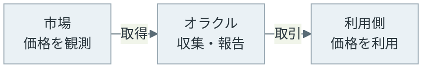
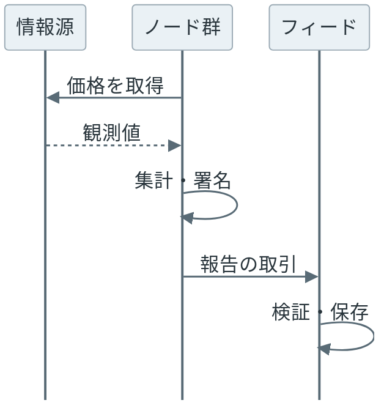
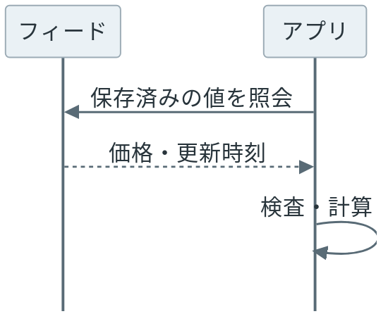

ブロックチェーンの[オラクル（oracle）](https://ethereum.org/en/developers/docs/oracles/)は、外部の情報を取得し、スマートコントラクトが使える形でチェーンに渡す仕組みです。例えば、暗号資産を預けて別の資産を借りるアプリでは、預けた暗号資産が担保になります。

10 ETH（[Ethereum](https://ethereum.org/en/developers/docs/intro-to-ethereum/) の暗号資産）を預けた、という「担保の枚数」だけでは、その担保が何ドル分の価値を持つのかは分かりません。1 ETH が市場で 2,000 ドルなら 10 ETH は 20,000 ドル、1,500 ドルなら 15,000 ドルです。借りられる上限や清算の判定には、この「1 枚あたりの市場価格」が必要になります。



<br>

本記事では、[Smart Contract](../smart-contract/) で触れた外部情報の取り込みについて、価格データを例に説明します。

- なぜコントラクトから直接 Web API を呼ばないのか。
- 価格を集める側と、チェーン上で利用する側は何をするのか。
- 複数の報告者がいても、何を信頼する必要があるのか。
- 古い価格や小数桁の違いを利用側でどう検出するのか。

後半では、Python で模擬価格フィードを作り、受け入れる値と拒否する値を確認します。外部情報を取り込むタイプのオラクルに絞り、乱数の提供や別チェーン間の通信は扱いません。

---

### 外部情報が必要な理由

ETH や [ERC-20](../erc-20/) トークンの残高、送金履歴は、チェーン上の状態から取得できます。一方で、冒頭の 1 ETH あたりの市場価格は、チェーンの外の取引所で決まる値です。チェーン上の状態だけでは分からないので、オラクルが外から届けます。

通常のサーバーなら、計算する時に価格 API を呼べます。一方で、Ethereum では、ブロックを検証するノードが同じ取引を再実行します。ノード A が API から 2,000 ドルを取得し、その後に検証したノード B が 1,900 ドルを取得すると、同じ取引でも計算結果が変わってしまいます。過去のブロックを検証する時に、当時と同じ応答を得られる保証もありません。

そのため、[Ethereum Virtual Machine（EVM）](https://ethereum.org/en/developers/docs/evm/)という実行環境には、任意の Web API に接続する命令がありません。外部で取得した値を取引の入力や保存状態として渡し、ノードが共通の値から計算できるようにします。オラクルを使う場合も、外部 API を呼ぶのはオラクル側で、各ノードは取引に入った値を使います。

この構成で揃えられるのは「どの値を入力にしたか」です。全ノードが 2,000 ドルを使って同じ計算結果を出しても、実際の市場価格が 2,000 ドルだったことまでは証明できません。

---

### 価格の収集と利用

価格フィード（price feed）は、対象資産の価格を継続的に提供する仕組みです。[Chainlink Data Feeds](https://docs.chain.link/data-feeds) では、オラクルのノードが外部データを取得し、結果をチェーン上のコントラクトに公開します。以下は、先に価格を更新し、後からアプリが読む構成です。



図の「ノード群」は、オラクルのノードをまとめて示しています。「フィード」はチェーン上で値を公開する部分です。次に、アプリのコントラクトを呼ぶ取引で、保存済みの価格を使います。



価格を更新する取引と、価格を使うアプリの取引は別なので、アプリの呼び出しに合わせて市場の最新価格を取得する構成ではありません。

Chainlink の [Offchain Reporting（OCR）](https://docs.chain.link/architecture-overview/off-chain-reporting)は、複数ノードの観測値をチェーンの外で報告にまとめ、必要な数のノードが署名した報告を取引で送る仕組みです。チェーン上では署名を検証し、集めた値の中央値を利用側に提供します。全ノードが別々に取引を送る構成と比べて、チェーン上の処理を減らせます。

前の 2 つの図は、フィードを先に更新し、アプリが保存済みの価格を読むタイプの例です。オラクルには、要求を出して後から応答を受け取るタイプもあります。アプリがどの時点のデータを取得できるかは、採用するサービスと更新方法で変わります。

---

### 情報源と報告者への信頼

オラクルを複数ノードで運用すると、1 台の障害や 1 人の誤報への依存を減らせます。しかし、ノードの数と情報源の数は別です。全ノードが同じ誤った API 応答を参照していたら、報告を集計しても情報源の誤りを取り除けません。


- title: 情報源
  body: 何を観測した価格か。
  items:
  - 取引所や市場の対象
  - 取引量と価格操作のされやすさ
- title: 報告者
  body: 誰が価格をチェーンに届けるか。
  items:
  - データの集計と署名の条件
  - 停止や不正な報告への対応
- title: アプリ
  body: 届いた価格をどう使うか。
  items:
  - 対象資産と単位の一致
  - 古い値や異常値を検出した後の動作


[Chainlink の価格フィード](https://docs.chain.link/data-feeds/price-feeds)も、全てが複数の独立した情報源を使うわけではありません。単一の情報源に依存するフィードや、計算で値を求めるフィードがあります。[フィード選定時の確認項目](https://docs.chain.link/data-feeds/selecting-data-feeds)には、対象市場の流動性、情報源の分布、混雑による更新遅延などが含まれます。

署名を検証することで、報告に署名した鍵と、署名後に内容が変わっていないことを確認できます。署名の基本は [Digital Signature](../digital-signature/) で説明しています。一方で、署名した人が正しい市場を観測したかは、署名だけでは判断できません。報告者の分散、情報源の選択、利用側の検査は、それぞれ異なる問題への対策です。

---

### 価格と更新時刻の読み方

Chainlink の EVM 向け価格フィードは、[`AggregatorV3Interface`](https://docs.chain.link/data-feeds/api-reference) を通して値を取得できます。`latestRoundData()` は最新の報告の価格や更新時刻を返し、`decimals()` は価格の小数桁数を返します。価格は小数点を含まない整数なので、次のように解釈します。

| 項目 | 説明用の値 |
| --- | --- |
| `answer` | `200000000000` |
| `decimals()` | `8` |
| 解釈した価格 | `200000000000 ÷ 10⁸ = 2000` |

USD 建てのフィードなら、この例は 1 枚あたり 2,000 ドルです。ETH 建てなら単位が異なるので、同じ整数をそのままドルとして使えません。[小数桁の仕様](https://docs.chain.link/data-feeds/price-feeds#decimal-precision)もフィードごとに確認します。ERC-20 のトークン枚数を表す小数桁とは別の値です。

`updatedAt` は、報告が更新された時刻です。「最新の報告を読めた」と「十分に新しい価格を読めた」は同じではなく、更新が止まっていても最後の値が取得できる場合があります。利用側では、[更新時刻の確認](https://docs.chain.link/data-feeds/overview#check-the-timestamp-of-the-latest-answer)を行い、現在時刻との差がアプリの許容する時間以内かを判定します。

Chainlink Data Feeds は、価格の変化が設定した閾値を超えた時や、heartbeat と呼ぶ更新間隔に達した時に更新を始めます。heartbeat は、その秒数以内に必ず取引が取り込まれるという保証ではありません。ネットワークの混雑によって、更新が届くまでに時間がかかる場合があります。

<br>

許容時間や価格の範囲は、アプリごとに決める必要があります。毎秒更新される想定で条件を作ると、正常な更新間隔でも処理を止めてしまいます。逆に、数時間前の価格を許すと、急変した市場に対応できません。[利用側の責任範囲](https://docs.chain.link/data-feeds/developer-responsibilities)には、データの検査、異常時の停止、代替処理などが含まれます。

価格が 0 以下、未更新、未来の時刻といった値も、用途に応じて検査します。ただし、全ての種類のデータに「正の値」という条件を適用できるわけではありません。次の実験では、正の価格を想定する架空の資産に限定します。

---

### 模擬価格フィードの実験

[Python](https://www.python.org/) の小さなデータ構造で、架空の資産 DEMO の USD 価格を表します。検証対象はフィードを使うアプリの判定処理です。Chainlink の集計や署名、EVM の実行は再現せず、外部サービスにも接続しません。

実験では、経過時間が 300 秒以内、価格が 1〜5,000 ドルの範囲なら受け入れます。この数値は挙動を比較するために置いた実験用の設定です。小数桁は 0〜18 に制限し、許容範囲内なら取得した桁数で換算します。`pair` は対象の組み合わせを表す実験用ラベルで、実際のフィード選択ではネットワークとコントラクトのアドレスも確認します。

以下が実験コードの全体です。[price_feed.py](lab/price_feed.py) にも保存しています。時刻は固定し、価格の換算には組み込みの `float` の代わりに、10 進数を扱う標準ライブラリの [`Decimal`](https://docs.python.org/3/library/decimal.html) を使います。

```python
"""Run with Python 3.10+: python3 price_feed.py (no external dependencies)."""
from dataclasses import dataclass, replace
from decimal import Decimal


@dataclass(frozen=True)
class FeedValue:
    pair: str
    answer: int
    decimals: int
    updated_at: int


NOW = 1_800_000_000
MAX_AGE = 300
MIN_PRICE = Decimal("1")
MAX_PRICE = Decimal("5000")


def read_price(feed: FeedValue, now: int) -> Decimal:
    if feed.pair != "DEMO/USD":
        raise ValueError("wrong pair")
    if not 0 <= feed.decimals <= 18:
        raise ValueError("unsupported decimals")
    if feed.answer <= 0:
        raise ValueError("non-positive price")
    if feed.updated_at <= 0 or feed.updated_at > now:
        raise ValueError("invalid timestamp")
    if now - feed.updated_at > MAX_AGE:
        raise ValueError("stale price")
    price = Decimal(feed.answer) / (Decimal(10) ** feed.decimals)
    if not MIN_PRICE <= price <= MAX_PRICE:
        raise ValueError("price outside application bounds")
    return price


base = FeedValue("DEMO/USD", 2000 * 10**8, 8, NOW - 30)
cases = [
    ("fresh", base, "ACCEPT 2000.00 USD"),
    ("age 300s", replace(base, updated_at=NOW - 300), "ACCEPT 2000.00 USD"),
    ("age 301s", replace(base, updated_at=NOW - 301), "REJECT stale price"),
    ("no update", replace(base, updated_at=0), "REJECT invalid timestamp"),
    ("future", replace(base, updated_at=NOW + 1), "REJECT invalid timestamp"),
    ("zero", replace(base, answer=0), "REJECT non-positive price"),
    ("negative", replace(base, answer=-1), "REJECT non-positive price"),
    ("6 decimals", replace(base, answer=2000 * 10**6, decimals=6),
     "ACCEPT 2000.00 USD"),
    ("bad decimals", replace(base, decimals=19), "REJECT unsupported decimals"),
    ("wrong pair", replace(base, pair="DEMO/ETH"), "REJECT wrong pair"),
    ("huge price", replace(base, answer=100_000 * 10**8),
     "REJECT price outside application bounds"),
    ("plausible wrong", replace(base, answer=1800 * 10**8), "ACCEPT 1800.00 USD"),
]

for name, value, expected in cases:
    try:
        result = f"ACCEPT {read_price(value, NOW):.2f} USD"
    except ValueError as error:
        result = f"REJECT {error}"
    assert result == expected, (name, result, expected)
    print(f"{name}: {result}")

print(f"Assertions: PASS ({len(cases)} cases)")
```

`replace()` は、元のデータの一部を変えたコピーを作ります。正常な価格から、更新時刻、価格、小数桁をそれぞれ変えて、想定した判定になるか確認します。各ケースの末尾にある文字列が期待する結果です。

Python 3.10 以降で、保存したファイルを次のように実行できます。追加パッケージは不要です。

```bash
python3 price_feed.py
```

Python 3.14.4 で実行した[出力](lab/output.txt)は以下の通りです。

```text
fresh: ACCEPT 2000.00 USD
age 300s: ACCEPT 2000.00 USD
age 301s: REJECT stale price
no update: REJECT invalid timestamp
future: REJECT invalid timestamp
zero: REJECT non-positive price
negative: REJECT non-positive price
6 decimals: ACCEPT 2000.00 USD
bad decimals: REJECT unsupported decimals
wrong pair: REJECT wrong pair
huge price: REJECT price outside application bounds
plausible wrong: ACCEPT 1800.00 USD
Assertions: PASS (12 cases)
```

`age 300s` は許容時間と同じなので受け入れ、1 秒古い `age 301s` は拒否しました。`6 decimals` では、整数と小数桁を両方変えています。8 桁のケースと同じ 2,000 ドルに換算できることを確認しています。

最後の `plausible wrong` は、実験で正解とした 2,000 ドルに対して、1,800 ドルという誤った値を渡したケースです。更新時刻が新しく、価格も設定範囲内なので検査を通ります。入力の形式や鮮度を確かめても、その価格が市場を正しく表しているかまでは検証できないことが分かります。

---

### 利用時の利点と制約

オラクルを利用すると、チェーン上の残高と、外部の価格や出来事を組み合わせたアプリを作れます。同じ価格フィードを複数のアプリが参照でき、チェーンに記録された値を使った計算は、他のノードも検証できます。

一方で、アプリはデータ提供元や報告者の運用にも依存します。利用側では、次の点まで決めておく必要があります。

- どの市場・資産・単位のフィードを使うか。対象チェーンとアドレスも確認します。
- 更新が遅れた時に、どの操作を止めるか。借り入れを停止して返済は受け付けるなど、操作ごとに判断します。
- 価格が急変した時に、誤報と正常な相場変動をどう扱うか。固定の上下限だけでは区別できません。
- フィードを変更できる管理者は誰か。代替先を用意する場合は、その情報源と更新状態も確認します。

古い値を拒否すれば、その値で計算することは防げます。しかし、価格が届くまで処理が止まるため、可用性との兼ね合いがあります。エラーを受け取った時に 0 や前回値で計算を続ける実装も、停止とは異なる結果を生みます。異常を検出する条件と、検出した後の操作をセットで設計することが大切です。
