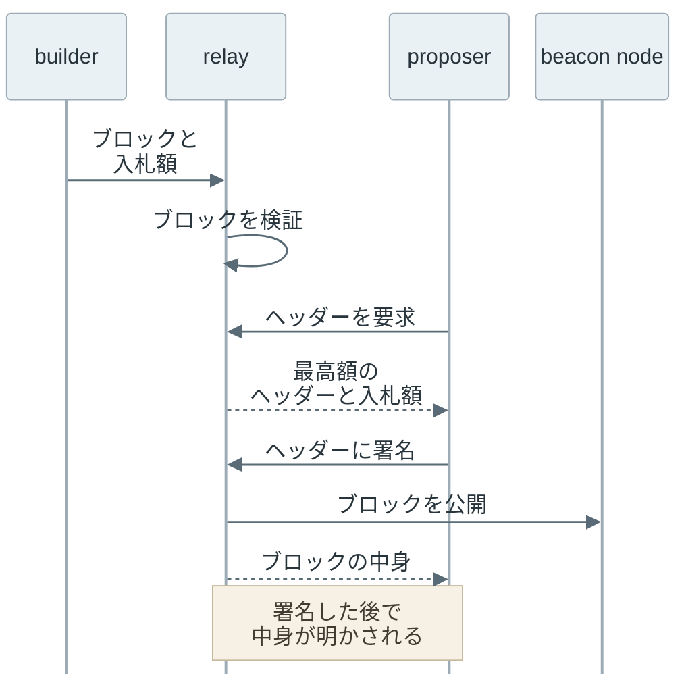
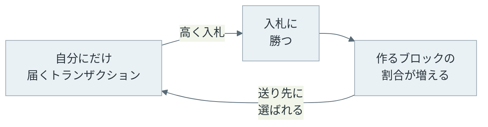

[Proof of Stake](../proof-of-stake/) の Ethereum では、ブロックを作る順番が決まっています。時間を 12 秒ごとの slot（スロット）に区切り、slot ごとに 1 つのバリデータ（ETH を預けてブロックの提案と投票を担う参加者）を proposer（ブロックの提案者）に選びます。proposer は、その slot のブロックに入れるトランザクションと並び順を決め、署名してネットワークに送ります。

[MEV](../mev/) のノートで説明した通り、ブロックに入るトランザクションの並び順は価値を生みます。ただし、価値の高い並び順を探すには、多くのトランザクションを集めて、他の参加者より速く計算する設備が要ります。

 

PBS（Proposer-Builder Separation）は、この仕事を 2 つに分ける考え方です。ブロックの中身を組む仕事を専門の builder に任せ、proposer は署名するだけにします。builder は、並び順で得られる価値の一部を proposer に支払うと申し出て（入札して）、proposer は最も高い入札のブロックを選びます。

PBS は分け方の考え方で、実現する形は 1 つではありません。本記事では主に、現在のメインネット（実際の資産が動く本番のネットワーク）で使われている MEV-Boost という構成（次節で説明）を扱います。もう 1 つの形であるプロトコルへの組み込みは、最後の節で扱います。

この構成では、builder と proposer の間に、入札を集めて仲介する relay が入ります。以下の図は、MEV のノートで説明した searcher を加えた 4 つの役割と、それぞれが見るものです。



上記の図で、proposer に届くのはブロックのヘッダーと入札額だけです。ヘッダーはブロックの見出しにあたる部分で、中身のトランザクション一覧から計算した[ハッシュ値](../hash-function/)（中身が 1 文字でも変わると変わる短い値）を含みます。そのため、ヘッダーに署名すると、中身を見ていなくても署名の対象は 1 つの中身に固定されます。

proposer は中身を見ないままヘッダーに署名し、署名を受け取った relay が中身を公開します。なぜ中身を見せないのか、見せないことで誰が誰を信頼するのかが、本記事の中心です。

 

本記事では、Ethereum のブロックがどう作られているかについて、次の疑問の順に説明します。

- 4 つの役割は、それぞれ何をして、何を受け渡すのか。
- proposer は、なぜ中身を見ないまま署名するのか。
- relay への信頼が崩れると何が起きるのか。
- ブロックを作る builder が少数に集まるのはなぜか。

sandwich attack などの MEV の手口は [MEV](../mev/) で、slot と proposer の選び方は [Proof of Stake のブロックの提案と投票](../proof-of-stake/#ブロックの提案と投票)で説明しています。本記事はこの 2 つを前提にします。

---

### 4 つの役割と bundle

2026 年 11 月時点のメインネットでは、PBS は Ethereum のプロトコルの規則には入っていません。プロトコルの外で PBS を実現しているのが、バリデータが追加で動かす [MEV-Boost](https://github.com/flashbots/mev-boost) というソフトウェアです。

[Who Wins Ethereum Block Building Auctions and Why?](https://arxiv.org/abs/2407.13931)（Öz ら、2024 年）は、論文の執筆時点で Ethereum のブロックの約 90% が MEV-Boost の入札から作られていると報告しています。

MEV-Boost の構成では、冒頭の図の 4 つの役割が次のように動きます。relay は複数あり、proposer は MEV-Boost の設定で選んだ relay に問い合わせて、その中で最も高い入札を選びます。


- title: searcher
  body: MEV の機会を探し、トランザクションのバンドル（bundle）を builder に送る。
- title: builder
  body: bundle と他のトランザクションを並べてブロックを作り、proposer への支払額を入札する。
- title: relay
  body: builder のブロックが有効で、入札額の支払い（ブロックの中の proposer への送金）が含まれているかを検証し、最高額の入札のヘッダーと入札額を proposer に渡す。
- title: proposer
  body: 中身を見ずに、最高額のヘッダーに署名する。


searcher が送る組を bundle と呼びます。[Flashbots のドキュメント](https://docs.flashbots.net/flashbots-auction/advanced/understanding-bundles)によると、bundle は指定した順に実行されるトランザクションの組で、[mempool](../mempool/)（ブロックに入る前のトランザクションを置く場所）にある他人のトランザクションも含められます。MEV のノートの冒頭で並べた B → A → C は、他人のトランザクション A を自分の B と C で挟む bundle です。

---

### 中身を見ないで署名する手順

relay を挟んだやり取りは、次の順で進みます。

Proof of Stake に移った後の Ethereum のノードは、合意（どのブロックを採用するか）を担うコンセンサス・レイヤー（consensus layer）と、トランザクションを実行する実行レイヤー（execution layer）の 2 つのソフトウェアに分かれています。上記の図の beacon node はコンセンサス・レイヤーのソフトウェアで、受け取ったブロックを検証してネットワークに配ります。

proposer は中身を見ないまま署名します。relay は署名を受け取ってから beacon node を通してブロックを公開し、proposer にも中身を返します。中身を先に見せると、proposer が builder のブロックを写し、bundle を崩して自分のトランザクションに差し替えられるからです。そうすれば proposer は、入札額として一部を受け取る代わりに、並び順の価値を丸ごと自分のものにできます。

署名した後なら、relay が署名済みのブロックを先に公開します。proposer が中身を差し替えた別のブロックを出しても、公開済みのブロックと競合するうえ、同じ slot で 2 つのブロックに署名したことになり、[slashing](../proof-of-stake/#報酬と罰則)（預けた ETH を減らす罰則）の対象になります。

ただし、この「先に公開してから中身を返す」順は、次節の事故の後の修正で守られるようになった形です。

この仕組みでは、proposer と builder の両方が、相手ではなく relay に頼っています。


- title: proposer が relay に頼ること
  items:
  - 見ていない中身が有効であること
  - 入札額が本当に支払われること
- title: builder が relay に頼ること
  items:
  - 署名の前に、中身を proposer に見せないこと
  - 公開に失敗した時に、中身を渡さないこと（次節の事故で問題になった点）


つまり relay は、両側から信頼される [doubly-trusted](https://docs.flashbots.net/flashbots-mev-boost/relay) な存在です。

なお、relay の検証には例外もあります。[optimistic relay](https://github.com/michaelneuder/optimistic-relay-documentation/blob/main/proposal.md) は、builder に担保を relay へ預けさせ、検証を後回しにして速くヘッダーを渡します。無効なブロックで proposer が slot を逃した場合は builder が落札額を補填し、builder が払わなければ預けた担保から払います。

---

### relay が中身を渡した事故

この信頼が崩れた例が、2023 年 4 月の relay の事故です。[Flashbots の事後報告](https://collective.flashbots.net/t/post-mortem-april-3rd-2023-mev-boost-relay-incident-and-related-timing-issue/1540)によると、事故は次の順で起きました。1〜2 が bot に bundle を作らせる段階、3〜5 が中身を手に入れて組み替える段階です。

1. 攻撃者が、囮として、slippage tolerance（受取量の下限）を付けずに ETH でトークンを買う交換を公開 mempool に流した。sandwich を狙う searcher の bot（自動でトランザクションを送るプログラム）は、下限が無いので大きく先回りできると見て、これを挟む bundle を組んだ。
2. bot の bundle は builder に渡り、bot のトランザクションを含むブロックの入札が relay に届いた。

後半の 3〜5 を追う前に、proposer が署名するものの形を確認しておきます。ここまで「ヘッダーに署名する」と書いてきましたが、正確には、proposer が署名するのはコンセンサス・レイヤーのブロック（beacon block）です。その中に、トランザクションの中身を指すヘッダー（execution payload header）が入れ子で入っています。

以下の図のように、中身を 1 つに固定しているのは、ヘッダーの中の block_hash（中身のハッシュ値）です。block_hash 以外の欄、例えば parent_root（直前のブロックを指す値）が誤っていると、ブロックは無効になりますが、block_hash が指す中身は変わりません。



3. proposer に選ばれた攻撃者が、Ultra Sound という relay からヘッダーを受け取った。Ultra Sound は、Flashbots が公開する relay のソフトウェア（[mev-boost-relay](https://github.com/flashbots/mev-boost-relay)）を動かしていた。攻撃者は、事後報告によると「state root と parent root を 0 にした」無効なブロックに署名して返した（state root という欄は中身を指すヘッダーの側にもあり、どの階層の欄かは報告に書かれていない）。block_hash は元のままだった。無効なブロックなので、公開は失敗する。
4. relay は、block_hash から自分のブロックへの署名と判断し、中身を proposer に返した。その後に別の処理で試みた公開は beacon node に拒否されたが、当時の relay は公開の結果を待たずに中身を返す作りだった。
5. bot のトランザクションは bot 自身が署名済みなので、中身さえ分かれば誰のブロックにも入れられる。攻撃者は bot の先回りの買いを取り出し、その直後に自分の売りを置いたブロックを作った（囮は入れなかった。bot の売りは攻撃者の売りの後に置かれ、失敗した）。

手順 5 の売りの中身は、[BlockSec の分析](https://blocksec.com/blog/harvesting-mev-bots-by-exploiting-vulnerabilities-in-flashbots-relay)によると次の通りです。bot は囮と同じプールで大量の ETH を払ってトークンを買っており、攻撃者は手元にあった同じトークンを売って、bot がプールに入れた ETH を引き出しました。被害は約 2,000 万ドルでした。

以下は、relay の振る舞いを修正の前後で比べた図です。



relay のブロックは公開されていないので、攻撃者のブロックと競合するブロックはありませんでした。前節の「署名した後なら差し替えられない」という前提は、relay が先に公開できることに頼っていたわけです。

事後報告は slashing に触れていませんが、攻撃者のバリデータ（[552061](https://beaconcha.in/validator/552061)）はその後 slashing を受けています。それでも、[Paradigm の分析](https://www.paradigm.xyz/2023/04/mev-boost-ethereum-consensus)が指摘する通り、バリデータ 1 つが預ける 32 ETH を全て失う罰でさえ、この規模の利益の前では悪意のある振る舞いを思いとどまらせるには足りない場合があります。

修正では、relay が公開に失敗した時は中身を返さないようにしました。

ただし事後報告によると、当時の beacon node は、ブロックを先にネットワークへ配り、配った後で検証を終える実装でした。この実装では、relay から見て公開に失敗した（拒否された）ブロックでも、その時には中身がネットワークに出回っていることがあり、relay が中身を返さなくても他の参加者に読まれてしまいます。そこで、relay が動かす beacon node（実装の 1 つである Prysm）も、検証してから配るよう改修する必要がありました（事後報告は Flashbots が改変した Prysm での修正例を示しています）。

---

### private order flow と builder の集中

builder の入札で勝つには、他より価値の高いブロックが必要です。そのため、公開 mempool に流れないトランザクション（private order flow）を持つ builder が有利になります。例えば、ウォレットや取引アプリが利用者のトランザクションを特定の builder にだけ送る契約を結ぶと、その builder だけが組める並び順が生まれます。

集中が進むのは、次の循環が回る時です。

上記の図で「送り先に選ばれる」の主語は、利用者のトランザクションを集めるウォレットや取引アプリです。作るブロックの割合が大きい builder に送るほど、トランザクションが早くブロックに入るので、送り先に選ばれやすくなります。この循環は、勝敗が proposer への支払額だけで決まり、トランザクションの流れを独占する契約が結べる限り止まりません。利用者を sandwich から守るためにトランザクションを公開 mempool に流さない送信先（MEV のノートの private RPC）も、トランザクションの流れを特定の builder に集める点では、この循環を後押しします。

 

Öz らの論文は、2023 年 10 月から 2024 年 3 月の MEV-Boost のブロックのうち 80% を 3 つの builder が作ったと報告し、上記の循環を鶏と卵の関係として指摘しています。[Heimbach らの論文](https://arxiv.org/abs/2305.19037)も、builder と relay の集中に加え、relay が自ら掲げた方針（例えば、制裁対象のアドレスが関わるトランザクションを入れないという方針）を守らない場合があったと報告しています。

builder が少数に集まると、その数社が並び順と、どのトランザクションを入れるかの選別を握ります。[ethereum.org の PBS のページ](https://ethereum.org/en/roadmap/pbs/)は、ブロック作りが集中しても、多数のバリデータがそのブロックを検証して採否を決める限り、不正なブロックは受け入れられないため許容できるとしています。

一方で、builder が特定のトランザクションを入れない検閲には、proposer が「必ず入れるトランザクション」の一覧を示す inclusion list という対策を挙げています。

---

### プロトコルへの組み込み

ここまでの構成は、relay という外部の参加者への信頼に支えられています。そこで、PBS をプロトコルの規則として組み込み、relay を不要にする変更が進んでいます。

組み込んだ形では、ブロックが「proposer が署名する、入札だけが入ったブロック」と「builder が後で公開するトランザクションの中身」の 2 つに分かれます。builder はプロトコルに資金を預けた上で入札し、proposer は届いた入札（支払いの約束と中身のハッシュ値）だけを自分のブロックに入れて署名します。トランザクションの中身は、builder がその後で別に公開します。proposer は先にハッシュ値に署名で縛られるので、中身を見てから差し替えることはできません。

以下は、組み込んだ形でのブロックの構成を描いた図です。



支払いは、プロトコルが builder の預けた残高から行います。中身が期限までに公開されたかは、slot ごとに選ばれる 512 のバリデータが確認し、その結果でその slot の中身を採用するかが決まります。一方、proposer への支払いは中身の公開を条件にしません。proposer のブロック自体が期限内に通常の投票（そのブロックを採用するという attestation）を十分に集めていれば、builder が中身を出さなくても支払われます。その場合、その slot はトランザクションの中身が無いまま進み、builder は払うだけ払って何も得ません。

builder の側も、中身を自分で持ったまま、proposer のブロックが出た後で自分で公開するので、中身を預ける第三者が要りません。そのため、両側が relay を信頼する必要がなくなります。

Ethereum の規則の変更は、EIP（Ethereum Improvement Proposal）という提案書で議論され、複数の EIP をまとめて全ノードが同時に切り替えます。この切り替えの仕組みは [Ethereum Hard Forks](../ethereum-hard-forks/) で扱っています。

PBS を組み込む提案は [EIP-7732](https://eips.ethereum.org/EIPS/eip-7732) で、次の切り替えである Glamsterdam の一覧（[EIP-7773](https://eips.ethereum.org/EIPS/eip-7773)）に含まれる予定です。2026 年 11 月時点では、[テストネット](../mainnet-and-testnet/)（Sepolia と Hoodi）でのみ有効です。

メインネットで切り替わるまでは、本記事で説明した MEV-Boost と relay の構成が使われます。
