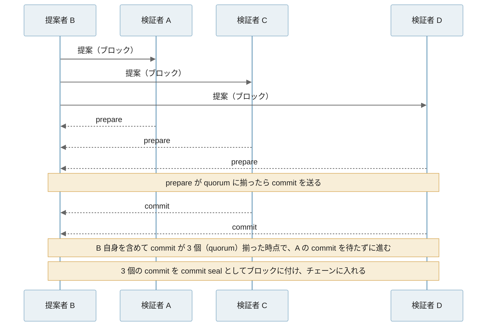
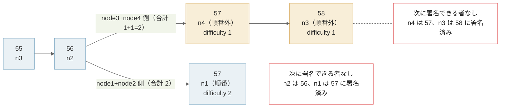
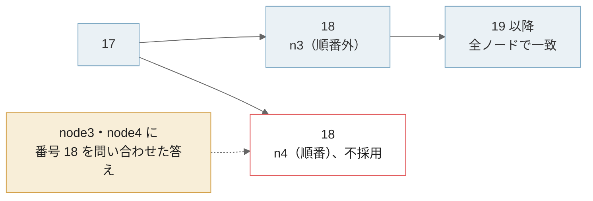

Proof of Authority（PoA）は、あらかじめ許可した署名者（authority）だけにブロックの作成を認める合意の方式の総称です。ブロックは、取引をまとめて前のブロックにつなげた単位です（[Blockchain Basics](../blockchain-basics/)）。

署名者は公開鍵（Ethereum ではアドレス）の一覧で決まり、各ノードは、[ブロックに付いた署名](../digital-signature/)が一覧の誰のものかを検証します。PoA の方式に共通するのは「許可された署名者だけが参加する」ことで、署名の順番・署名者の入れ替え方・不正への対処は方式ごとに違います。

以下は、本記事で扱う 2 つの方式に共通する動きを署名者 4 人の例で描いたものです。



署名者は A→B→C→D の順番でブロックを作ります。D が止まると、D の番のブロックは別の署名者（図では A）が代わりに作り、チェーンは進み続けます。代わりの決め方は方式ごとに違います。本記事で扱う Clique では動いている別の署名者が短い乱数の待ちの後に作り、QBFT では決めた時間だけ待ってから次の署名者がやり直します。一覧に無い E は署名できず、一覧に加えられるまで待つ必要があります。

PoA が使われるのは、参加する組織が互いに分かっている私設のチェーン、価値の無い通貨で動く試験用の[テストネット](../mainnet-and-testnet/)、別のチェーンと資産をやり取りするサイドチェーンなどです。こうした場面では、ネットワークを作る人が、署名者の選び方と、何人止まると何が起きるかを決める必要があります。

<br>

本記事では、Ethereum 系の 2 つの PoA（1 人の署名でブロックになる Clique と、署名者の投票でブロックになる QBFT）を例に、署名の順番・署名者の入れ替え・故障時の振る舞いを説明します。扱う疑問は次の通りです。

- 署名者を信頼するなら、なぜ合意の規則が必要なのか。
- 1 人が署名してブロックを作る方式と、署名者が投票してブロックを作る方式は何が違うのか。
- 署名者はどう追加・削除されるのか。Clique では、なぜ同じ署名者が続けて署名できないのか。
- 何割の署名者が止まると、または不正をすると、チェーンは止まるのか分岐するのか。

ローカルの [Docker](https://www.docker.com/) で 4 台のネットワークを動かし、署名者を止めた時と通信を分断した時の振る舞いも確かめます。各チェーンや実装の対応状況は 2026 年 11 月時点のものです。

---

### 署名者を決めておく理由

誰でも参加できるネットワークでは、1 台に 1 票を与えると、1 人が多数のノードを立てて票を握れます。[Proof of Work（PoW）](../proof-of-work/) は計算量に、[Proof of Stake（PoS）](../proof-of-stake/) は預け入れた資産に票の重みを結び付け、量産できない資源を担保にしてこの問題を避けています。

参加者が契約や組織で決まっている場合は、担保を用意しなくても、署名できる鍵を一覧にしておけば足ります。PoA はこの一覧を合意の前提に置きます。採掘の計算が不要なので、ブロックの間隔を一定に保ちやすく、計算資源の乏しいテストネットでも計算量で負けません。

<br>

実際に、PoW で動いていた Ethereum のテストネット [Ropsten](https://github.com/ethereum/ropsten) は、2017 年に参加者の計算量の少なさを突かれました。攻撃者は 1 ブロックに入れられる計算量の上限（[gas](../gas-eip-1559/) の上限）を 4.7M から 9B まで吊り上げ、巨大な取引でネットワークを麻痺させました。PoA の方式の 1 つである Clique の仕様書は、この事件を動機に挙げています。

署名者を信頼するなら、合意の規則は不要に見えます。しかし、信頼で置き換えたのは「誰に票を与えるか」の部分だけです。例えば 1 人の署名でブロックになる方式（後述の Clique）では、正直な署名者同士でも、同じ高さ（最初のブロックから数えたブロックの番号）のブロックを 2 人が同時に作り得ます。その時にどちらを採用するかを決める規則が必要です。Clique の実験でも、全員正直なまま通信の分断で 2 本に分かれました。署名者が投票する方式（後述の QBFT）では、投票の手順がこの規則を兼ね、票が揃うまでブロックを作りません。

---

### 1 人が署名する方式と投票する方式

Ethereum 系の PoA は、ブロックの作り方で 2 つの系統に分かれます。1 つは 1 人の署名だけでブロックになる系統、もう 1 つは 1 人が提案したブロックに他の署名者が投票し、票が揃って初めてブロックになる系統です。本記事では、前者の例に Clique、後者の例に QBFT を使います。



左の Clique は、Ethereum のクライアント（ノードのソフトウェア）である [Go Ethereum（geth）](https://github.com/ethereum/go-ethereum)の開発者が、既存のクライアントに最小限の変更で入れられるように設計した方式です。仕様は、Ethereum の仕様の提案書である EIP（Ethereum Improvement Proposal）の 225 番、[EIP-225](https://eips.ethereum.org/EIPS/eip-225) にあります。

1 人の署名でブロックになるので、2 人が同時に作るとチェーンが分岐します。Clique では、ブロックに付けた重みの合計が大きい「重いチェーン」を選んで分岐を解消します（重みの中身は次の節で説明します）。Clique には、どのブロックから覆らないかという確定（[finality](../finality/)）の定義がありません。

<br>

右の QBFT は、嘘をつく参加者がいても合意できる[ビザンチン障害耐性（BFT）](/notes/distributed-systems/byzantine-fault-tolerance/)の合意で、ブロックを 1 つずつ決める方式です。提案されたブロックに署名者（QBFT では検証者と呼びます）が投票し、全体の約 2/3 の票が集まるとブロックになります。票は commit seal と呼ぶ署名としてブロックに入ります。票が揃ったブロックは、入れた時点で確定します。代わりに、票が集まらなければ止まります。

---

### Clique の順番と連続署名の制限

Clique では、署名者の一覧をアドレスの昇順に並べ、`ブロック番号 % 署名者数` 番目の署名者を「順番の署名者（in-turn）」とします。それ以外の署名者（out-of-turn）も、ブロックを作れます。冒頭の図で D の番を A が埋めたのが、この順番外のブロックです。

順番どおりかどうかは、ブロックヘッダー（ブロックの先頭に付く要約の情報）の difficulty に書きます。difficulty は PoW では計算の難しさを表す項目ですが、Clique では順番どおりなら 2、順番外なら 1 を入れます。

前の節の「重いチェーン」は、この difficulty の合計が大きいチェーンのことです（Clique の分岐の選び方を整理した提案 [EIP-3436](https://eips.ethereum.org/EIPS/eip-3436) の記述）。そのため、同じ長さなら順番どおりのブロックが多いチェーンが勝ちます。

<br>

順番の署名者が止まっても、順番外の署名者がブロックを作るのでチェーンは進みます。ただし、EIP-225 は順番外の署名者に `rand(署名者数 × 500ms)` の待ち時間を入れるよう推奨しています。順番の署名者が先に出し、順番外の署名者同士が同時に出す確率を下げるためです。

もう 1 つの規則が、連続署名の制限です。署名者数を N とすると、各署名者は連続する `SIGNER_LIMIT = ⌊N/2⌋ + 1` 個のブロックのうち 1 個にしか署名できません（⌊ ⌋ は切り捨て）。SIGNER_LIMIT は署名者の過半数です。N=4 なら SIGNER_LIMIT は 3 で、直近の 2 ブロックのどちらかに署名した署名者は、次のブロックに署名できません。



上段では、ブロック 6 と 7 に署名した C と D はブロック 8 に署名できず、A か B が作ります（8 % 4 = 0 なので、順番の署名者は A です）。下段のように C と D の 2 人しか動いていなければ、2 ブロック作った所で誰も署名できなくなります。

<br>

EIP-225 は、この制限の理由に 2 つの攻撃を挙げています。1 つは、悪意のある署名者（鍵を盗まれた署名者を含む）が、ブロックを大量に作ってチェーンを書き換えたり、スパムを流したりする攻撃です。もう 1 つは、署名者の一部が、自分を削除する投票（後述）が入ったブロックを握り潰し続ける攻撃です。

制限があると、過半数に届かない署名者のグループは、自分たちだけでチェーンを伸ばし続けられません。その間に、残りの正直な署名者が削除の投票を通せます。制限が守っているのは「少数の署名者がチェーンを独占しない」ことで、ブロックの確定ではありません。

---

### QBFT の提案者と round

QBFT は、企業向け Ethereum の業界団体 [Enterprise Ethereum Alliance](http://hub.entethalliance.org/client-spec/qbft_spec.html) が仕様を整理した方式です。[EIP-650](https://github.com/ethereum/EIPs/issues/650) の IBFT（Istanbul BFT）と、その安全性（食い違わないこと）と活性（止まらずに進むこと）の問題を直した [IBFT 2.0](https://arxiv.org/abs/1909.10194) の後継です。Ethereum クライアントの [Hyperledger Besu](https://docs.besu-eth.org/private-networks/how-to/configure/consensus) は、私設のネットワークに QBFT を推奨しています。

QBFT では、提案者（proposer）を検証者の一覧の順に 1 人ずつ回します。提案者がブロックを出すと、検証者は prepare と commit の 2 段で投票します。1 段目の prepare で同じ提案を受け取ったことを示し合い、2 段目の commit で確定に同意します。この流れは BFT の代表的な方式 [PBFT（Practical Byzantine Fault Tolerance）](/notes/distributed-systems/byzantine-fault-tolerance/#pbft-の通常動作) と同じです。

以下は、検証者 4 人で提案者が B の時の流れです。[quorum](/notes/distributed-systems/quorum/) は成立に必要な票の数で、N=4 なら 3 です（prepare と commit は全員が全員に送りますが、図では B に届く分だけを描いています。A の commit は遅れて届く想定です）。



commit の票が quorum の `⌈2N/3⌉` 個（⌈ ⌉ は切り上げ）に達すると、各検証者はその票を commit seal としてブロックに付けて、自分のチェーンに入れます。提案者自身の票も数に入り、N=4 なら quorum は 3 です。ブロックに付くのはこの commit seal で、Clique と違って提案者だけの署名は入りません（提案者はアドレスで記録されます）。

提案者が止まっていると、ブロックは出てきません。その場合、検証者は決めた時間だけ待ってから、同じ高さを次の提案者でやり直します。このやり直しの番号を round と呼び、最初の試みが round 0 です。

<br>

Besu の実装では、round r の待ち時間は、genesis（チェーンの初期設定）に書く `requesttimeoutseconds` × 2 の r 乗です（[`BftRoundExpiryTimeCalculator`](https://github.com/besu-eth/besu/blob/26.11.0/consensus/common/src/main/java/org/hyperledger/besu/consensus/common/bft/BftRoundExpiryTimeCalculator.java)）。設定が 4 秒なら、round 0 で 4 秒、round 1 で 8 秒と、[倍々に伸びます](/notes/distributed-systems/retry-backoff/)。後の実験では、この倍々の待ちが復帰を遅らせました。

---

### 署名者の追加と削除

#### Clique

Clique は、署名者の一覧をコントラクト（チェーン上のプログラム）ではなくブロックヘッダーに持たせます。ヘッダーだけを同期するノードも、取引を実行せずに一覧を追えるようにするためです。投票には、PoA では使わない 2 つのヘッダー項目を流用します。

| 項目 | 通常のブロック | 投票するブロック |
|---|---|---|
| `coinbase`（PoW では報酬の受取先） | 0 | 追加・削除したいアドレス |
| `nonce`（PoW では計算の答え） | 0 | `0xff…ff` なら追加、`0x00…00` なら削除 |
| `extraData`（任意のデータ。投票には使わない） | 32 バイトの任意データ + 65 バイトの署名 | 同じ |

署名者は自分が作るブロックごとに 1 票を入れられ、票が SIGNER_LIMIT（過半数）に達した時点で一覧が変わります。一定の間隔（`EPOCH_LENGTH`、推奨値 30000 ブロック）ごとのチェックポイントでは、未決の票を全て捨て、`extraData` に現在の署名者一覧を書きます。新しく参加するノードは、過去の投票を再生せずに一覧を読めます。

<br>

#### QBFT

Besu の QBFT では、JSON-RPC（ノードへの問い合わせ口）の `qbft_proposeValidatorVote` で、検証者の追加・削除に票を入れます。票が既存の検証者の半数を超えると（4 人なら 3 票）一覧が変わります。一覧は Clique と同じくブロックヘッダーの `extraData` に入ります（一覧をコントラクトで管理する方法も選べます）。次の節の環境で試すと、4 人のうち 3 人が投票した後に、検証者が 5 人に増えました（[出力](https://github.com/nao1215/debimate/blob/main/content/notes/blockchain-systems/proof-of-authority/lab/output/qbft_trial1.txt)）。

---

### 4 台で止める実験

ローカルの Docker で、4 台のうち 1 台ずつ署名者を止めた時の振る舞いを確かめます。QBFT は Besu、Clique は Ethereum クライアントの [Nethermind](https://github.com/NethermindEth/nethermind) で動かしました。Clique を動かせるクライアントが限られているからです（後述）。どちらもブロックの間隔は 2 秒で、外部に経路の無い Docker の内部ネットワークに閉じています。

<details><summary>実験の環境</summary>

| 項目 | 内容 |
|---|---|
| 日付 | 2026-11-10 |
| QBFT | `hyperledger/besu:26.11.0`、検証者 4 台、`blockperiodseconds: 2`、`requesttimeoutseconds: 4` |
| Clique | `nethermind/nethermind:2.2.2`、署名者 4 台、`period: 2` |
| ネットワーク | 外部に経路の無い Docker の internal ネットワーク。ホストのポートは公開しない |
| 鍵 | 文字列の SHA-256 から作った実験専用の鍵。公開ネットワークでは使わない |
| 手順 | 4 台で 30 秒 → 1 台停止 → 2 台停止 → 再起動、の順に、各ノードの JSON-RPC でブロックを読む |

ホストの負荷平均が 20〜35 の状態で計測したので、待ち時間の数値はこの環境での値です。再現の手順は [lab/README.md](https://github.com/nao1215/debimate/blob/main/content/notes/blockchain-systems/proof-of-authority/lab/README.md) にあります。

</details>

#### QBFT

QBFT のシナリオ（[lab/qbft/scenario.py](https://github.com/nao1215/debimate/blob/main/content/notes/blockchain-systems/proof-of-authority/lab/qbft/scenario.py)）は、4 台で 30 秒 → 1 台停止 → 2 台停止 → 再起動、の順にノードを止めながら、0.5 秒ごとにブロック番号を読みます。最後に、各ブロックの提案者（`miner`）と、`extraData`（QBFT ではここに round 番号と commit seal が入ります）から round 番号・commit seal の数を集計します。止めた段階は 40 秒見ています。

同じ手順を 4 回試し、以下はそのうち 1 回分の結果です。`blocks` は各段階で増えたブロック数、`first new` は段階の始めから最初のブロックまでの秒数、`proposers` は提案者のノード番号の並び、`max round` は段階内で最も大きい round、`seals` は commit seal の数（段階内に現れた値の一覧）です。

```text
phase                      blocks first new  proposers / max round / seals
4/4 running                    16      2.0s  1432143214321432 / 0 / [3]
node4 stopped (3/4)            13      0.5s  1321321321321 / 1 / [3]
node3 stopped too (2/4)         0         -   / 0 / []
node3 restarted (3/4)           7    128.8s  3213213 / 5 / [3]
node4 restarted (4/4)           9      1.0s  213214321 / 1 / [3]
heights 1..53: 0 heights differ between nodes
```

提案者は、検証者のアドレス順（node2, node1, node4, node3）に 1 つずつ回っています（出力の並びは途中の node1 から始まっています）。commit seal は全てのブロックで 3 個で、4 台の quorum である ⌈2×4/3⌉ = 3 と一致します。

1 台止めても進み続け、4 回中 3 回は、止めたノードの番だけ round が 1 つ上がりました（4 秒待ってから次の提案者に替わる）。残る 1 回は最初のブロックまで 16.7 秒かかり、round 3 まで上がりました（原因は調べていません）。2 台止めると、40 秒間 1 ブロックも増えませんでした。全ノードで同じ高さのブロックのハッシュを比べると、食い違いは 0 でした。

<br>

意外だったのは復帰の遅さです。node3 を再起動しても、次のブロックまで 128.8 秒かかりました。4 回の計測では、再起動した段階の最大 round が 4 だった 2 回が 64.7 秒と 65.1 秒、5 だった 2 回が 128.8 秒と 130.0 秒でした。

2 台を止めていた間、残りの 2 台は round を上げ続け、待ち時間も伸びていました。

再起動した node3 が他の 2 台の round に飛び移るのか、round 0 から数え直すのかは、翌日の再実行で Besu のログから確かめました。

Besu は round 2 以降、各検証者から最後に受け取った round の一覧（下の `Address: … Round:` の行）をログに出します（[ログの抜粋](https://github.com/nao1215/debimate/blob/main/content/notes/blockchain-systems/proof-of-authority/lab/output/qbft_trial5_rounds.txt)）。以下は node3 のログの抜粋で、時刻は UTC です（日付・スレッド名・ログレベルと一部の行を省き、アドレスを短くしてノード名を書き足しています）。

```text
09:43:23.763 Runner Ethereum main loop is up.
09:43:35.768 RoundTimer Moved to round 2 which will expire in 16 seconds
09:43:41.008 Address: 0x8186...（node1）  Round: 4
09:43:41.008 Address: 0xdd1b...（node3）  Round: 2 (Local node)
09:43:51.769 RoundTimer Moved to round 3 which will expire in 32 seconds
09:44:23.769 RoundTimer Moved to round 4 which will expire in 64 seconds
09:44:23.770 Address: 0x8186...（node1）  Round: 4
09:44:23.770 Address: 0x582a...（node2）  Round: 4
09:45:27.769 RoundTimer Moved to round 5 which will expire in 128 seconds
09:45:27.800 QbftRound Importing proposed block to chain. round=...{Sequence=34, Round=5}
```

node3 は、他の検証者が round 4 にいると受け取った後も飛び移らず、自分の round を 1 つずつ上げていました。起動から round 2 に入るまでの 12 秒は、round 0 の 4 秒と round 1 の 8 秒の合計です（round 0 と 1 に入る時はログが出ません）。

QBFT の仕様には先の round へ飛び移る規則がありますが、Besu では既定で無効です（[`--Xqbft-enable-early-round-change`](https://github.com/besu-eth/besu/blob/26.11.0/app/src/main/java/org/hyperledger/besu/cli/options/unstable/QBFTOptions.java)）。

node3 が round 4 に入った時、他の 2 台も round 4 でしたが、round 4 の提案者は止まったままの node4 の番で、ブロックは出ませんでした。3 台が round 5 で揃い、提案者の node3 がブロックを出しました。

最初の 4 回で最大 round が 4 の回と 5 の回に分かれたのも同じ理由と考えられます。出力の提案者の並びを見ると、round 4 で復帰した 2 回は最初のブロックを node1 か node2 が出し、round 5 で復帰した 2 回は node3 が出しています。提案者は round ごとに 1 つずつ進むので、後者では round 4 の提案者が止まった node4 だったことになります。

倍々の待ち時間を round 0 から積むと、round 4 に入るまでが 4+8+16+32 = 60 秒、round 5 までが 124 秒です。再実行の node3 は、起動から 124.0 秒後に round 5 に入っています。以下は、この計算値と、最初の 4 回の実測を重ねた図です。



実測は計算値の数秒後に並びます。実測には、コンテナが起動してからノードが動き出すまでの時間も入ります。ログで round の推移を追えたのは再実行の 1 回だけで、図の 4 回のログは残していません。

[Besu のドキュメント](https://docs.besu-eth.org/private-networks/how-to/configure/consensus/qbft)も、1/3 を超える検証者が止まると回復に時間がかかる場合があると注意しています。

<br>

#### Clique

Clique は同じ止め方に加えて、node1+node2 と node3+node4 の 2 組に通信を分断し、戻す操作も行いました（[lab/clique/scenario.py](https://github.com/nao1215/debimate/blob/main/content/notes/blockchain-systems/proof-of-authority/lab/clique/scenario.py)）。

右の列は各段階の最初の 12 ブロックの署名者で、`n4*` は node4 が順番外（difficulty 1）で署名したブロックです。以下は 4 回目の試行の出力で、`+5 min` の node2・node4 の行と、末尾の集計行を省いた抜粋です。

```text
in-turn order: n2 n1 n4 n3 (block number % 4)
4/4 running                   15 blocks  first new   1.0s  n3 n2 n1 n4 n3 n2 n1 n4 n3 n2 n1 n4
node4 stopped (3/4)           15 blocks  first new   1.0s  n3* n2* n1* n3* n2* n1* n3* n2* n1* n3 n2 n1
node3 stopped too (2/4)        0 blocks  first new      -
node3, node4 restarted        20 blocks  first new   2.1s  n4* n1* n3 n2 n1 n4 n3 n2 n1 n4 n3 n2
split: node1+node2             1 blocks  first new   2.0s  n1
split: node3+node4             2 blocks                  n4* n3*
healed                         0 blocks  first new      -
  node1 head: 57 0xe8cb15be signed by n1
  node2 head: 57 0xe8cb15be signed by n1
  node3 head: 58 0x6a053e26 signed by n3
  node4 head: 58 0x6a053e26 signed by n3
  +5 min node1 head: 57 0xe8cb15be
  +5 min node3 head: 58 0x6a053e26
```

4 台が揃っている間は、順番の署名者だけでブロックが並びます（負荷が高かった試行 1 では順番外も混ざりました）。node4 を止めると、残る 3 台の巡回が 4 人分の順番とずれ、ほとんどが順番外のブロックになりましたが、30 秒で 15 ブロックと同じ速さで進みました。

2 台止めると、残った node1 と node2 は直近 2 ブロックの署名者だったので、どちらも署名できず止まりました。連続署名の制限の図の下段と同じ状態です。後半の分断（`split` と `healed` の行）は、後の「分断と確定」の節で説明します。

---

### 止まる割合と不正の割合

実験の 4 台では、Clique も QBFT も 3 台が動いていれば進み、2 台では止まりました。台数を変えるとこの境目がずれるので、規則だけを [Python](https://www.python.org/) で数えました。

Clique は連続署名の制限（言い換えると「直近 ⌊N/2⌋ ブロックに署名していない署名者だけが署名できる」）で、何台が動いていればブロックを作り続けられるかを全て試します。QBFT は quorum の式 `⌈2N/3⌉` で計算します（クライアントは動かしていません）。

<details><summary>lab/limits.py</summary>

```python
"""Rule-only simulation (no client): how many signers keep Clique and QBFT going.

Clique: one signer per SIGNER_LIMIT = N // 2 + 1 consecutive blocks; the online
signer that signed longest ago signs next. QBFT: quorum of ceil(2N / 3).
"""


def clique_blocks(n, online, steps=100):
    """Number of blocks `online` of `n` signers can add after a fresh start."""
    limit = n // 2 + 1
    recent = []  # signers of the latest blocks, newest last
    for made in range(steps):
        window = recent[-(limit - 1):] if limit > 1 else []
        free = [s for s in range(online) if s not in window]
        if not free:
            return made  # every online signer signed too recently
        last = {s: max([i for i, r in enumerate(recent) if r == s], default=-1)
                for s in free}
        recent.append(min(free, key=lambda s: last[s]))
    return steps


def qbft_quorum(n):
    return -(-2 * n // 3)  # ceil(2n/3)


print(" N | SIGNER_LIMIT | Clique min online | QBFT quorum (min online)")
for n in range(1, 11):
    need = min(k for k in range(1, n + 1) if clique_blocks(n, k) == 100)
    print(f"{n:2} | {n // 2 + 1:12} | {need:17} | {qbft_quorum(n):11}")

print()
print("Clique, N=4: blocks a group of k signers can add on its own")
for k in range(1, 5):
    got = clique_blocks(4, k)
    print(f"  k={k}: {got if got < 100 else 'unbounded'}")
```

</details>

以下は、N ごとに進み続けるのに必要な台数をグラフにしたものです。数値の全体は [limits_output.txt](https://github.com/nao1215/debimate/blob/main/content/notes/blockchain-systems/proof-of-authority/lab/limits_output.txt) にあります。



N=5 では、Clique は 3 台で進めますが、QBFT は 4 台が必要です。動き続ける条件だけを見ると Clique の方が緩くなります。Clique はブロックごとに投票を集めず、その代わりに確定も約束しません。

同じ出力の下段は、4 台中 k 台のグループが他の署名者なしで作れるブロック数です。

```text
Clique, N=4: blocks a group of k signers can add on its own
  k=1: 1
  k=2: 2
  k=3: unbounded
  k=4: unbounded
```

過半数に届かない 2 台は多くても 2 ブロックで、直前に署名していれば実験のように 0 ブロックです。3 台なら際限なく伸ばせます。

<br>

不正をする署名者がいる場合も含めて、ここまでの規則を PoW・PoS と並べると以下の通りです。PoS は Ethereum の場合で、ETH は Ethereum の通貨、有効残高は検証者が預けて票の重みになる額、finalized は PoS の確定、slashing は不正をした検証者の預け入れ資産を没収する罰則です。QBFT の ⌊(N−1)/3⌋ は、N 台のうち 1/3 未満という意味です。

| | PoW | PoS | Clique | QBFT |
|---|---|---|---|---|
| ブロックを作る権利 | 計算作業 | 預け入れた ETH の重み | 署名者の一覧 | 検証者の一覧 |
| ブロックの署名 | 無い（計算の答えを付ける） | 提案者 1 人 | 作った 1 人 | 投票した ⌈2N/3⌉ 人分の commit seal（提案者自身の分を含む。提案者はアドレスで入る） |
| 確定 | 定義が無く、覆る確率が下がっていく | 有効残高の 2/3 以上の投票で [finalized](../finality/#checkpoint-への投票による-finality) | 定義が無い | ブロックを挿入した時点 |
| 不正への耐性 | 計算量の過半を握られない限り、深い書き換えは難しい | 重みの 1/3 未満なら、finalized は食い違わない | 過半数未満ではチェーンを独占できない。短い分岐は作れる | ⌊(N−1)/3⌋ 人までなら、確定したブロックは食い違わない |
| 止まる条件 | 計算する参加者がいる限り進む | 1/3 を超える重みが止まると finalize が止まる。ブロックは進む | 動く署名者が ⌊N/2⌋+1 未満。全員が動いていても、合計が同点の分岐で止まり得る（後述） | 動く検証者が ⌈2N/3⌉ 未満 |
| 罰則 | 無い。計算のコストが無駄になる | slashing | 無い。投票で外す | 仕様に記載が無い |

Clique の署名者は、同じ高さに別々のブロックを出して短い分岐を作れます。EIP-225 は、そうした署名者を投票で外すことを対策にしています。⌊N/2⌋+1 人以上が組めばチェーンを自由に作れますが、EIP-225 は、その場合は手の打ちようが無いとしています。QBFT の罰則は、QBFT の仕様にも Besu の私設ネットワーク向けドキュメントにも記載がありません。

QBFT の 1/3 は、[BFT のノート](/notes/distributed-systems/byzantine-fault-tolerance/#3f1-台が必要な理由)で説明した quorum の重なりと同じ理由で決まります。Clique と QBFT の罰則は、プロトコルの外にあります。署名者が誰かを全員が知っているので、不正をした組織を契約や評判で追及できる、という前提です。

---

### 分断と確定

署名者の大半が正直なら、PoA のブロックはすぐに確定するのでしょうか。答えは Clique と QBFT で分かれます。Clique の実験の後半では、4 人全員が正直なまま、ブロックが消えるか、チェーンが止まりました。

4 回目の試行では、分断の直前の 2 ブロック（55 と 56）に node3 と node2 が署名していました。分断後、node1+node2 では node1 が順番どおりに 1 ブロック、node3+node4 では順番外の 2 ブロックを作り、difficulty の合計はどちらも 2 です。



Clique の選び方は「difficulty の合計が大きいチェーン」だけなので、合計が同じ 2 本のどちらを選ぶかはクライアントの実装に任されています。同じ手順を 4 回試した結果は以下の通りです。

| 試行 | node1+node2 | node3+node4 | 通信を戻した後 |
|---|---|---|---|
| 1 | 1 ブロック | 2 ブロック | node3+node4 の 2 ブロック（57 と 58）が捨てられ、node1+node2 のチェーンに揃って再開（高さ 1〜75 のうち 1 つで、番号の問い合わせの答えが食い違った。高さは記録していない。後述） |
| 2 | 1 ブロック | 2 ブロック | 40 秒間ブロックが増えない（node1 は自分の 57 のまま。node3・node4 の先頭は記録していない） |
| 3 | 1 ブロック | 2 ブロック | 試行 2 と同じ |
| 4 | 1 ブロック | 2 ブロック | 試行 2 と同じ。さらに 5 分待っても先頭は 57 と 58 のまま（分断より前の高さ 18 で、番号の問い合わせの答えが 1 つ食い違った。後述） |

試行 4 では、node1+node2 は自分の 57 に、node3+node4 は自分の 58 に留まりました（試行 2・3 は各ノードの先頭を記録していませんが、同じく 40 秒間ブロックが増えませんでした）。

node1 と node2 は自分のチェーンの直近 2 ブロックに署名しているので次を作れず、node3 と node4 も同じです。相手のチェーンに乗り換えれば署名できるのに、合計が同じなので乗り換えません。4 人全員が動いていて、全員が正直なのに、チェーンが止まりました。

表の括弧書きは、全ノードに同じ番号のブロックを問い合わせて比べた結果で、1 つの高さだけ答えが食い違いました。試行 4 の食い違いは分断より前の高さ 18 で、分断とは別の現象です（試行 1 は後述のとおり確定できません）。

最初は、負荷の高いノードが時間内に答えなかっただけかと疑いました（当時の集計は 2 秒で 1 回だけ問い合わせ、答えが無いことも食い違いに数えていました）。翌日に数回再実行し（最後まで動いたのは 3 回）、時間を延ばして問い合わせ直すと（[出力](https://github.com/nao1215/debimate/blob/main/content/notes/blockchain-systems/proof-of-authority/lab/output/clique_trial5.txt)）、食い違いは問い合わせの問題ではなく、ノードの中の状態でした。

4 台がたどるチェーンの中身は揃っていて、一部のノードの「番号からブロックを引く索引」だけが、採用されなかったブロックを指したまま残っている、と読めます。表で「揃った」と書いたのは、チェーンの中身のことです。

<details><summary>高さ 18 の食い違いの中身</summary>



図の高さ 18 は、node4 を止めた時のブロックです。18 は node4 の番で、node4 は止まる直前に 18（difficulty 2）を作りました。一方、node3 も順番外で 18（difficulty 1）を作り、チェーンは node3 の 18 の上に伸びました。

高さ 18 だけを見れば node4 の 18 の方が重いのですが、node4 が止まったのでその上には誰も積まず、node3 の 18 の側が伸びて合計で上回ったと考えられます。どのノードがいつ node4 の 18 を受け取ったかは記録していません。

この再実行（[出力](https://github.com/nao1215/debimate/blob/main/content/notes/blockchain-systems/proof-of-authority/lab/output/clique_trial5.txt)）では、node3 と node4 が、番号で 18 を問い合わせると node4 の 18 を返しました（図の点線）。ところが、同じノードの 19 の親は node3 の 18 で、19 以降のブロックは全ノードで一致しました。10 秒の時間切れで問い合わせ直しても（答えが無ければ 3 回まで）、全ノードが答えを返し、同じ食い違いが残りました。

Nethermind の不具合かどうかまでは確かめていません。再実行では、最後まで動いた 3 回のうち 2 回で、同じ高さ 18 に食い違いが出ました（1 回は node4 だけ）。試行 1 は食い違った高さを記録していないので、同じ現象かは確定できません。以下は再実行の出力の抜粋です。

```text
  height 18 node1: 0xca238eb1 signed by n3 difficulty 1 | block 19 parent 0xca238eb1
  height 18 node2: 0xca238eb1 signed by n3 difficulty 1 | block 19 parent 0xca238eb1
  height 18 node3: 0x9db55b86 signed by n4 difficulty 2 | block 19 parent 0xca238eb1
  height 18 node4: 0x9db55b86 signed by n4 difficulty 2 | block 19 parent 0xca238eb1
```

</details>

<br>

この停止は、実験の作り物ではありません。Clique で動いていた Ethereum のテストネット [Görli](https://github.com/eth-clients/goerli) でも、署名者の過半数が動いていたのにチェーンが止まりました。[EIP-3436](https://eips.ethereum.org/EIPS/eip-3436) はこの事例を挙げ、合計が同じ時に短いチェーンを選ぶなどの規則を足す提案をしています（2026 年 11 月時点で、議論が止まった Stagnant の状態）。

つまり、Clique の過半数の規則は、少数の署名者がチェーンを独占しないための制限で、ブロックの確定とは別です。Clique には確定の定義が無く、入金を扱うアプリケーションは、PoW と同じく[何ブロック待つか](../finality/#確認数をいくつ待つかを決める材料)を自分で決める必要があります。

QBFT は、不正な検証者が ⌊(N−1)/3⌋ 人以下なら、ブロックを挿入した時点で確定します。代わりに、quorum に届かない組は 1 ブロックも作れません。同じ 2 対 2 の分断では、どちらの組も止まる筈です（QBFT の分断は今回試していません）。分岐するか止まるかの選択で、QBFT は止まる方を選んでいます。同じく止まる方を選ぶ合意エンジンには [CometBFT](../cometbft/) があります。

---

### 使われる場面と現状

PoA は、署名者を選べる場面で使われてきました。2026 年 11 月時点の状況は次の通りです。

- テストネット: Ethereum の Rinkeby（[geth v1.10.26 の設定](https://github.com/ethereum/go-ethereum/blob/v1.10.26/params/config.go#L179)）と Görli（[geth v1.13.15 の設定](https://github.com/ethereum/go-ethereum/blob/v1.13.15/params/config.go#L115)。後に PoS へ移行）は Clique で動いていましたが、どちらも廃止（deprecated）されています。現在の [Sepolia](https://github.com/eth-clients/sepolia) は PoS ですが、検証者は[クライアントとテストのチームが管理する許可制](https://ethereum.org/developers/docs/networks/)です。入れ替わりの経緯は [Testnet History](../testnet-history/) にあります。
- サイドチェーン: Gnosis Chain（旧 xDai）は、Clique と同じく 1 人が署名する系統の PoA（[Aura](https://openethereum.github.io/Aura)）で動いていました。その後、Ethereum 本体が PoS に移った [The Merge](https://ethereum.org/roadmap/merge/) と同様の切り替えで、PoS で動く Gnosis Beacon Chain と統合し、PoS に移りました（[Gnosis Chain のドキュメント](https://docs.gnosischain.com/about/specs/consensus/)）。
- 私設のチェーン: Besu は QBFT を推奨しています。公開されている PoA のチェーンでは、Nethermind が 日本の企業が署名者を務める [JOC Mainnet](https://www.japanopenchain.org/)（Clique）や、エネルギー業界向けの [Energy Web Chain](https://www.energyweb.org/)（Aura）の設定を[同梱しています](https://github.com/NethermindEth/nethermind/tree/17b84a019d75ed4a03dfce53b5599ace81026c7b/src/Nethermind/Chains)。

<br>

#### Clique を動かせるクライアント

Clique を動かせるクライアントは減っています。geth は [v1.14.0](https://github.com/ethereum/go-ethereum/releases/tag/v1.14.0)（2024 年 4 月）で Clique の署名をやめ、Besu は [26.4.0](https://github.com/besu-eth/besu/releases/tag/26.4.0)（2026 年 4 月）で Clique を削除しました。今回 Clique を Nethermind で動かしたのは、そのためです。今回の実験で、[Nethermind 2.2.2](https://github.com/NethermindEth/nethermind/releases/tag/2.2.2)（2026 年 10 月）が Clique の署名者として動くことを確かめました。

---

### 利点

- 計算作業や預け入れた資産を用意しなくても、署名者の鍵だけでネットワークを始められる
- ブロック間隔が設定どおりに揃いやすい。実験では Clique・QBFT とも、4 台が揃った区間の多くで 2 秒周期どおり 30 秒に 15〜16 ブロックだった
- 署名者が誰かを全員が知っているので、不正をした署名者を投票で外し、チェーンの外でも責任を問える
- QBFT なら、不正な検証者が ⌊(N−1)/3⌋ 人以下である限り、ブロックを挿入した時点で確定する
- Clique なら、進み続けるのに必要な台数が ⌊N/2⌋+1 人で、N が 5 と 7 以上では QBFT（⌈2N/3⌉ 人）より少ない（N=4 ではどちらも 3 人）。ただし、必要な台数が少ないことと実際に止まらないことは別で、分断の後は全員が動いていても止まり得る

---

### 欠点

本記事で扱った Clique と QBFT は、署名者が誰かを全員が知っている前提で、担保とプロトコルの中の罰則を持ちません。その代わりに、次の制約があります。

- 署名者の一覧に入るには既存の署名者の賛成（Clique と Besu の QBFT の投票では過半数）か、一覧を管理するコントラクトの変更が必要で、誰でも参加できるネットワークにはならない
- Clique には確定が無く、全員が正直でも分断の後にブロックが消えたり、チェーンが止まったりする
- QBFT は、1/3 を超える検証者が止まると止まり、round の待ち時間が倍々に伸びるので、復帰にも時間がかかる
- Clique の仕様にも QBFT の仕様にも不正に対する罰則が無く、対処は投票で外すことと、チェーンの外の契約や評判に頼る
- 2026 年 11 月時点で、Clique を署名者として動かせる主要クライアントは少ない

---

### 適さないケース

- 参加者が互いを知らず、誰でも署名者になれる必要があるネットワーク
- 署名者の半数以上（Clique）や 1/3 を超える検証者（QBFT）が、同じ組織・同じクラウド・同じクライアントに偏っている場合。1 つの障害でチェーンが止まり、QBFT では侵害されると確定したブロックが食い違い得る
- Clique のチェーンで、ブロックに入った取引をすぐに確定として扱いたいアプリケーション
