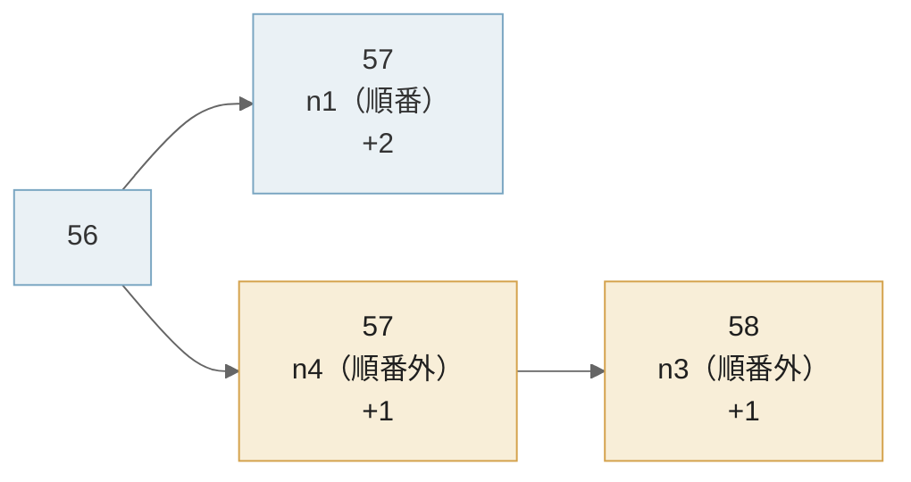

Proof of Authority（PoA）は、あらかじめ許可した署名者（authority）だけにブロックの作成を認め、その署名者が順番にブロックを作る合意の方式です。誰が署名者かは公開鍵（Ethereum ではアドレス）の一覧で決まり、各ノードは、ブロックに付いた署名が一覧の誰のものかを自分で検証します。計算作業や預け入れた資産の代わりに、署名者の一覧に載っていることがブロックを作る条件になります。

以下は、署名者 4 人の PoA で 1 人が止まった時の様子です。



PoA が使われるのは、参加する組織が互いに分かっている私設のチェーン、壊されても困らない価値の無い通貨で動く[テストネット](../mainnet-and-testnet/)、別のチェーンと資産をやり取りするサイドチェーンなどです。こうした場面では、ネットワークを作る人が、署名者の選び方と、何人止まると何が起きるかを決める必要があります。

<br>

本記事では、Ethereum 系の PoA である Clique（EIP-225）と QBFT を中心に、署名の順番・署名者の入れ替え・故障時の振る舞いを説明します。扱う疑問は次の通りです。

- 署名者を信頼するなら、なぜ合意の規則が必要なのか。
- Clique・Aura と、IBFT 2.0・QBFT は何が違うのか。
- 署名者はどう追加・削除され、なぜ同じ署名者が続けて署名できないのか。
- 何割の署名者が止まると、または不正をすると、チェーンは止まるのか分岐するのか。

ローカルの [Docker](https://www.docker.com/) で 4 台のネットワークを動かし、署名者を止めた時と通信を分断した時の振る舞いも確かめます。各チェーンや実装の対応状況は 2026 年 11 月時点のものです。

---

### 署名者を決めておく理由

誰でも参加できるネットワークでは、1 台に 1 票を与えると、1 人が多数のノードを立てて票を握れます。[Proof of Work（PoW）](../proof-of-work/) は計算量に、[Proof of Stake](../proof-of-stake/) は預け入れた資産に票の重みを結び付けて、この問題を避けています。どちらも、量産できない資源を担保にする方法です。

参加者が契約や組織で決まっている場合は、担保を用意しなくても、署名できる鍵を一覧にしておけば足ります。PoA はこの一覧を合意の前提に置きます。採掘の計算が要らないので、ブロックの間隔を一定に保ちやすく、計算資源の乏しいテストネットでも攻撃者に計算量で負けません。[EIP-225](https://eips.ethereum.org/EIPS/eip-225) は、PoW のテストネット [Ropsten](https://github.com/ethereum/ropsten) が 2017 年に計算量の少なさを突かれ、ブロックの gas 上限を吊り上げられた事件を動機に挙げています。

<br>

PoA は署名者を信頼するだけで、合意の仕組みは無いと思うかもしれません。しかし、信頼で置き換えたのは「誰に票を与えるか」の部分だけです。正直な署名者同士でも、同じ高さのブロックを 2 人が同時に作れば、どちらを採用するかを決める規則が必要です。後述の実験では、署名者が全員正直でも、通信を分断すると 2 本のチェーンができました。PoA の各方式は、署名の順番、1 人が作れるブロックの数、分岐した時の選び方や投票による確定を規則として定めています。

---

### 2 つの系統

Ethereum 系の PoA は、1 つのブロックに 1 人が署名する系統と、複数の署名者がブロックに投票する系統に分かれます。前者は PoW の「重いチェーンを選ぶ」規則を残し、後者は[ビザンチン障害耐性（BFT）](/notes/distributed-systems/byzantine-fault-tolerance/)の合意をブロックごとに行います。

| | Clique（EIP-225） | Aura | IBFT 2.0 / QBFT |
|---|---|---|---|
| ブロックの署名 | 作った 1 人 | 作った 1 人 | 提案者 1 人と、投票した ⌈2N/3⌉ 人の commit seal |
| 順番の決め方 | ブロック番号 % 署名者数 | 時刻を区切った step 番号 % 署名者数 | 提案者を検証者一覧の順に回す |
| 分岐の扱い | 起こり得る。difficulty の合計が大きいチェーンを選ぶ | 起こり得る。score が高いチェーンを選ぶ | 不正な検証者が ⌊(N−1)/3⌋ 人以下なら起きない |
| 確定 | 確定の定義が無い | そのブロック以降のブロックに過半数の署名者が署名したら確定（同期ネットワークを仮定） | ブロックが挿入された時点で確定（不正な検証者が ⌊(N−1)/3⌋ 人以下の場合） |

Clique は、[Go Ethereum（geth）](https://github.com/ethereum/go-ethereum)の開発者が、既存のクライアントに最小限の変更で入れられるように設計しました。Aura（Authority Round）は [OpenEthereum](https://openethereum.github.io/Aura)（2022 年にアーカイブ済み）が実装した方式で、時刻を区切った step ごとに 1 人だけがブロックを出せます。

IBFT（Istanbul BFT、[EIP-650](https://github.com/ethereum/EIPs/issues/650)）は、[PBFT](/notes/distributed-systems/byzantine-fault-tolerance/#pbft-の通常動作) と同じく提案・prepare・commit の 3 段階で合意します。最初の IBFT で見つかった安全性と活性の問題を直したのが [IBFT 2.0](https://arxiv.org/abs/1909.10194) です。

QBFT は、[Enterprise Ethereum Alliance](http://hub.entethalliance.org/client-spec/qbft_spec.html)（企業向け Ethereum の業界団体）が仕様を整理した同じ系統の方式で、`⌊(N−1)/3⌋` 人までのビザンチン障害に耐えます。Ethereum クライアントの [Hyperledger Besu](https://docs.besu-eth.org/private-networks/how-to/configure/consensus) は、私設のネットワークに QBFT を推奨しています。

---

### Clique の順番と連続署名の制限

Clique では、署名者の一覧をアドレスの昇順に並べ、`ブロック番号 % 署名者数` 番目の署名者を「順番の署名者（in-turn）」とします。順番の署名者のブロックは difficulty を 2、それ以外の署名者（out-of-turn）のブロックは 1 にします。分岐した時は difficulty の合計が大きいチェーンを選ぶ（[EIP-3436](https://eips.ethereum.org/EIPS/eip-3436) の整理）ので、同じ長さなら順番どおりのブロックが多いチェーンが勝ちます。

順番外の署名者もブロックを作れるので、順番の署名者が止まってもチェーンは進みます。ただし、EIP-225 は順番外の署名者に `rand(署名者数 × 500ms)` の待ち時間を入れるよう推奨しています。順番の署名者が先に出し、順番外の署名者同士が同時に出す確率を下げるためです。

<br>

もう 1 つの規則が、連続署名の制限です。署名者数を N とすると、各署名者は連続する `SIGNER_LIMIT = ⌊N/2⌋ + 1` 個のブロックのうち 1 個にしか署名できません。N=4 なら SIGNER_LIMIT は 3 で、直近の 2 ブロックのどちらかに署名した署名者は、次のブロックに署名できません。

EIP-225 は、この制限の理由に 2 つの攻撃を挙げています。

- 悪意のある署名者（鍵を盗まれた署名者を含む）が、ブロックを大量に作ってチェーンを書き換えたり、取引を詰め込んだりする攻撃
- 署名者の一部が、自分を削除する投票が入ったブロックを握り潰し続ける攻撃

この制限があると、過半数に届かない署名者のグループは、自分たちだけでチェーンを伸ばし続けられません。その間に、残りの正直な署名者が削除の投票を通せます。制限が守っているのは「少数の署名者がチェーンを独占しない」ことで、ブロックの確定ではありません。

---

### 署名者の追加と削除

Clique は、署名者の一覧をコントラクトではなくブロックヘッダーに持たせます。ヘッダーだけを同期するノードも、状態を持たずに一覧を追えるようにするためです。投票には、PoA では使わない 2 つのヘッダー項目を流用します。

| 項目 | 通常のブロック | 投票するブロック |
|---|---|---|
| `coinbase`（miner） | 0 | 追加・削除したいアドレス |
| `nonce` | 0 | `0xff…ff` なら追加、`0x00…00` なら削除 |
| `extraData` | 32 バイトの任意データ + 65 バイトの署名 | 同じ |

署名者は自分が作るブロックごとに 1 票を入れられ、票が SIGNER_LIMIT（過半数）に達した時点で一覧が変わります。`EPOCH_LENGTH`（推奨値 30000）ブロックごとのチェックポイントでは、未決の票を全て捨て、`extraData` に現在の署名者一覧を書きます。新しく参加するノードは、過去の投票を再生せずに一覧を読めます。

Besu の QBFT でも、`qbft_proposeValidatorVote` で検証者の追加・削除に票を入れます（一覧をコントラクトで管理する方法も選べます）。次の節の環境で試すと、4 人のうち 3 人が投票した後に、検証者が 5 人に増えました（[出力](https://github.com/nao1215/debimate/blob/main/content/notes/blockchain-systems/proof-of-authority/lab/output/qbft_trial1.txt)）。

---

### 4 台で止める実験

ローカルの Docker で、署名者を 1 人ずつ止めた時の振る舞いを確かめます。QBFT は Besu、Clique は Nethermind で動かしました。Clique を選べるクライアントが限られているからです（後述）。

| 項目 | 内容 |
|---|---|
| 日付 | 2026-11-10 |
| QBFT | `hyperledger/besu:26.11.0`、検証者 4 台、`blockperiodseconds: 2`、`requesttimeoutseconds: 4` |
| Clique | `nethermind/nethermind:2.2.2`、署名者 4 台、`period: 2` |
| ネットワーク | 外部に経路の無い Docker の internal ネットワーク。ホストのポートは公開しない |
| 鍵 | 文字列の SHA-256 から作った実験専用の鍵。公開ネットワークでは使わない |
| 手順 | 4 台で 30 秒 → 1 台停止 → 2 台停止 → 再起動、の順に、各ノードの JSON-RPC でブロックを読む |

ホストの負荷平均が 20〜35 の状態で計測したので、待ち時間の数値はこの環境での値です。QBFT のシナリオ（[lab/qbft/scenario.py](https://github.com/nao1215/debimate/blob/main/content/notes/blockchain-systems/proof-of-authority/lab/qbft/scenario.py)）は、ノードを止めながら 0.5 秒ごとにブロック番号を読み、最後に各ブロックの提案者（`miner`）と、`extraData` に入った round 番号・commit seal の数を集計します。以下は 1 回分の結果で、`proposers` は提案者のノード番号の並びです。

```text
phase                      blocks first new  proposers / max round / seals
4/4 running                    16      2.0s  1432143214321432 / 0 / [3]
node4 stopped (3/4)            13      0.5s  1321321321321 / 1 / [3]
node3 stopped too (2/4)         0         -   / 0 / []
node3 restarted (3/4)           7    128.8s  3213213 / 5 / [3]
node4 restarted (4/4)           9      1.0s  213214321 / 1 / [3]
heights 1..53: 0 heights differ between nodes
```

提案者は、検証者のアドレス順（node2, node1, node4, node3）に 1 つずつ回っています。commit seal は全てのブロックで 3 個で、4 台の quorum である ⌈2×4/3⌉ = 3 と一致します。

1 台止めても進み続け、4 回中 3 回は、止めたノードの番だけ round が 1 つ上がりました（`requesttimeoutseconds` の 4 秒を待ってから次の提案者に替わる）。2 台止めると、40 秒間 1 ブロックも増えませんでした。全ノードで同じ高さのブロックのハッシュを比べると、食い違いは 0 でした。

<br>

意外だったのは復帰の遅さです。node3 を再起動しても、次のブロックまで 128.8 秒かかりました。Besu は、round r の待ち時間を 4×2ʳ 秒（`requesttimeoutseconds` × 2 の r 乗）にします（[`BftRoundExpiryTimeCalculator`](https://github.com/besu-eth/besu/blob/0627aa6a687b1074b9da5dc05480cbbbad157537/consensus/common/src/main/java/org/hyperledger/besu/consensus/common/bft/BftRoundExpiryTimeCalculator.java)）。

4 回の計測では、復帰したブロックの round が 4 だった 2 回が 64.7 秒と 65.1 秒、5 だった 2 回が 128.8 秒と 130.0 秒でした。round 0 から待ち時間を積むと、round 4 に入るまでが 4+8+16+32 = 60 秒、round 5 までが 124 秒で、測った値とほぼ合います。以下は、round ごとの待ち時間の合計と、4 回の実測を重ねた図です。



再起動した node3 が round を 0 から数え直したためと考えられますが、ログで確かめたわけではありません。[Besu のドキュメント](https://docs.besu-eth.org/private-networks/how-to/configure/consensus/qbft)も、1/3 を超える検証者が止まると回復に時間がかかる場合があると注意しています。

Clique は同じ止め方に加えて、node1+node2 と node3+node4 の 2 組に通信を分断し、戻す操作も行いました（[lab/clique/scenario.py](https://github.com/nao1215/debimate/blob/main/content/notes/blockchain-systems/proof-of-authority/lab/clique/scenario.py)）。`n4*` は node4 が順番外（difficulty 1）で署名したブロックです。以下は 4 回目の試行の出力で、末尾の `+5 min` の行は node2 と node4 を省いた抜粋です。

```text
in-turn order: n2 n1 n4 n3 (block number % 4)
4/4 running                   15 blocks  first new   1.0s  n3 n2 n1 n4 n3 n2 n1 n4 n3 n2 n1 n4
node4 stopped (3/4)           15 blocks  first new   1.0s  n3* n2* n1* n3* n2* n1* n3* n2* n1* n3 n2 n1
node3 stopped too (2/4)        0 blocks  first new      -
node3, node4 restarted        20 blocks  first new   2.1s  n4* n1* n3 n2 n1 n4 n3 n2 n1 n4 n3 n2
split: node1+node2             1 blocks  first new   2.0s  n1
split: node3+node4             2 blocks                  n4* n3*
healed                         0 blocks  first new      -
  node1 head: 57 0xe8cb15be signed by n1
  node2 head: 57 0xe8cb15be signed by n1
  node3 head: 58 0x6a053e26 signed by n3
  node4 head: 58 0x6a053e26 signed by n3
  +5 min node1 head: 57 0xe8cb15be
  +5 min node3 head: 58 0x6a053e26
```

4 台が揃っている間は、順番の署名者だけでブロックが並びます（負荷が高かった試行 1 では順番外も混ざりました）。node4 を止めると、残る 3 台の巡回が 4 人分の順番とずれ、ほとんどが順番外のブロックになりましたが、30 秒で 15 ブロックと同じ速さで進みました。2 台止めると、残った node1 と node2 は直近 2 ブロックの署名者だったので、どちらも署名できず止まりました。後半の分断は、次の節で説明します。

---

### 止まる割合と不正の割合

実験の 4 台では、Clique も QBFT も 3 台が動いていれば進み、2 台では止まりました。台数を変えるとこの境目がずれるので、規則だけを [Python](https://www.python.org/) で数えました。Clique は「直近 ⌊N/2⌋ ブロックに署名していない署名者だけが署名できる」規則で、何台が動いていればブロックを作り続けられるかを全て試します。QBFT は quorum の式 `⌈2N/3⌉` で計算します。クライアントは動かしていないシミュレーションです。

<details><summary>lab/limits.py</summary>

```python
"""Rule-only simulation (no client): how many signers keep Clique and QBFT going.

Clique: one signer per SIGNER_LIMIT = N // 2 + 1 consecutive blocks; the online
signer that signed longest ago signs next. QBFT: quorum of ceil(2N / 3).
"""


def clique_blocks(n, online, steps=100):
    """Number of blocks `online` of `n` signers can add after a fresh start."""
    limit = n // 2 + 1
    recent = []  # signers of the latest blocks, newest last
    for made in range(steps):
        window = recent[-(limit - 1):] if limit > 1 else []
        free = [s for s in range(online) if s not in window]
        if not free:
            return made  # every online signer signed too recently
        last = {s: max([i for i, r in enumerate(recent) if r == s], default=-1)
                for s in free}
        recent.append(min(free, key=lambda s: last[s]))
    return steps


def qbft_quorum(n):
    return -(-2 * n // 3)  # ceil(2n/3)


print(" N | SIGNER_LIMIT | Clique min online | QBFT quorum (min online)")
for n in range(1, 11):
    need = min(k for k in range(1, n + 1) if clique_blocks(n, k) == 100)
    print(f"{n:2} | {n // 2 + 1:12} | {need:17} | {qbft_quorum(n):11}")

print()
print("Clique, N=4: blocks a group of k signers can add on its own")
for k in range(1, 5):
    got = clique_blocks(4, k)
    print(f"  k={k}: {got if got < 100 else 'unbounded'}")
```

</details>

以下は、N ごとに必要な台数をグラフにしたものです。数値の全体は [limits_output.txt](https://github.com/nao1215/debimate/blob/main/content/notes/blockchain-systems/proof-of-authority/lab/limits_output.txt) にあります。



N=5 では、Clique は 3 台で進めますが、QBFT は 4 台が必要です。動き続ける条件だけを見ると Clique の方が緩くなります。Clique はブロックごとに投票を集めず、その代わりに確定も約束しません。

同じ出力の下段は、4 台中 k 台のグループが他の署名者なしで作れるブロック数です。

```text
Clique, N=4: blocks a group of k signers can add on its own
  k=1: 1
  k=2: 2
  k=3: unbounded
  k=4: unbounded
```

過半数に届かない 2 台は多くても 2 ブロックで、直前に署名していれば実験のように 0 ブロックです。3 台なら際限なく伸ばせます。

不正をする署名者がいる場合も含めて、[PoW](../proof-of-work/)・[PoS](../proof-of-stake/) と並べると以下の通りです。PoS は Ethereum の場合です。

| | PoW | PoS | Clique | QBFT |
|---|---|---|---|---|
| ブロックを作る権利 | 計算作業 | 預け入れた ETH の重み | 署名者の一覧 | 検証者の一覧 |
| 確定 | 定義が無く、覆る確率が下がっていく | 有効残高の 2/3 以上の投票で [finalized](../finality/) | 定義が無い | ブロックを挿入した時点 |
| 不正への耐性 | 計算量の過半を握られない限り、深い書き換えは難しい | 重みの 1/3 未満なら、finalized は食い違わない | 過半数未満ではチェーンを独占できない。短い分岐は作れる | ⌊(N−1)/3⌋ 人までなら、確定したブロックは食い違わない |
| 止まる条件 | 計算する参加者がいる限り進む | 1/3 を超える重みが止まると finalize が止まる。ブロックは進む | 動く署名者が ⌊N/2⌋+1 未満。全員が動いていても、合計が同点の分岐で止まり得る（後述） | 動く検証者が ⌈2N/3⌉ 未満 |
| 罰則 | 無い。計算のコストが無駄になる | slashing | 無い。投票で外す | 仕様に記載が無い |

Clique の署名者は、同じ高さに別々のブロックを出して短い分岐を作れます。EIP-225 は、そうした署名者を投票で外すことを対策にしています。⌊N/2⌋+1 人以上が組めばチェーンを自由に作れますが、EIP-225 は、その場合は手の打ちようが無いとしています。QBFT の罰則は、QBFT の仕様にも Besu の私設ネットワーク向けドキュメントにも記載がありません。

QBFT の 1/3 は、[BFT のノート](/notes/distributed-systems/byzantine-fault-tolerance/#3f1-台が必要な理由)で説明した quorum の重なりと同じ理由で決まります。PoA の罰則は、プロトコルの外にあります。署名者が誰かを全員が知っているので、不正をした組織を契約や評判で追及できる、という前提です。

---

### 分断と確定

署名者の過半数が正直なら、PoA のブロックはすぐに確定するのでしょうか。Clique の実験では、4 人全員が正直なまま、ブロックが消えるか、チェーンが止まりました。

4 回目の試行では、分断の直前の 2 ブロック（55 と 56）に node3 と node2 が署名していました。分断後、node1+node2 では node1 が順番どおりに 1 ブロック、node3+node4 では順番外の 2 ブロックを作り、difficulty の合計はどちらも 2 です。



Clique の選び方は「difficulty の合計が大きいチェーン」だけなので、合計が同じ 2 本のどちらを選ぶかはクライアントの実装に任されています。同じ手順を 4 回試した結果は以下の通りです。

| 試行 | node1+node2 | node3+node4 | 通信を戻した後 |
|---|---|---|---|
| 1 | 1 ブロック | 2 ブロック | node1 から見ると 2 ブロックのチェーンが消えて再開（ノード間で食い違う高さが 1 つ残った） |
| 2 | 1 ブロック | 2 ブロック | 各組が自分のチェーンに残り、40 秒間ブロックが増えない |
| 3 | 1 ブロック | 2 ブロック | 試行 2 と同じ |
| 4 | 1 ブロック | 2 ブロック | 試行 2 と同じ。さらに 5 分待っても先頭は 57 と 58 のまま |

試行 2〜4 では、node1+node2 は自分の 57 に、node3+node4 は自分の 58 に留まりました。node1 と node2 は自分のチェーンの直近 2 ブロックに署名しているので次を作れず、node3 と node4 も同じです。相手のチェーンに乗り換えれば署名できるのに、合計が同じなので乗り換えません。4 人全員が動いていて、全員が正直なのに、チェーンが止まりました。

この停止は、実験の作り物ではありません。[EIP-3436](https://eips.ethereum.org/EIPS/eip-3436) は、Clique で動いていたテストネット [Görli](https://github.com/eth-clients/goerli) で、署名者の過半数が動いていたのにチェーンが止まった事例を挙げ、合計が同じ時に短いチェーンを選ぶなどの規則を足す提案をしています（2026 年 11 月時点で Stagnant）。

<br>

つまり、Clique の過半数の規則は、少数の署名者がチェーンを独占しないための制限で、ブロックの確定とは別です。Clique には確定の定義が無く、入金を扱うアプリケーションは、PoW と同じく[何ブロック待つか](../finality/#確認数をいくつ待つかを決める材料)を自分で決める必要があります。Aura は、あるブロック以降のブロックに過半数の署名者が署名したら、そのブロックを確定と定義しますが、メッセージが step の時間内に届く同期ネットワークを仮定しています。

QBFT は、不正な検証者が ⌊(N−1)/3⌋ 人以下なら、ブロックを挿入した時点で確定します。代わりに、quorum に届かない組は 1 ブロックも作れません。同じ 2 対 2 の分断では、どちらの組も止まる筈です（QBFT の分断は今回試していません）。分岐するか止まるかの選択で、QBFT は止まる方を選んでいます。

---

### 使われる場面と現状

PoA は、署名者を選べる場面で使われてきました。2026 年 11 月時点の状況は次の通りです。

- テストネット: Ethereum の Rinkeby（[geth v1.10.26 の設定](https://github.com/ethereum/go-ethereum/blob/v1.10.26/params/config.go#L179)）と Görli（[geth v1.13.15 の設定](https://github.com/ethereum/go-ethereum/blob/v1.13.15/params/config.go#L115)。後に PoS へ移行）は Clique で動いていましたが、どちらも[終了しています](https://ethereum.org/developers/docs/networks/)。現在の [Sepolia](https://github.com/eth-clients/sepolia) は PoS ですが、検証者はクライアントとテストのチームが管理する許可制です。
- サイドチェーン: Gnosis Chain（旧 xDai）は Aura で動いていましたが、Ethereum の [The Merge](https://ethereum.org/roadmap/merge/) と同じ形のハードフォークで Gnosis Beacon Chain と統合し、PoS に移りました（[Gnosis Chain のドキュメント](https://docs.gnosischain.com/about/specs/consensus/)）。
- 私設のチェーン: Besu は QBFT を推奨しています。公開されている PoA のチェーンでは、Nethermind が [JOC Mainnet](https://www.japanopenchain.org/)（Clique）や [Energy Web Chain](https://www.energyweb.org/)（Aura）の設定を[同梱しています](https://github.com/NethermindEth/nethermind/tree/17b84a019d75ed4a03dfce53b5599ace81026c7b/src/Nethermind/Chains)。

Clique を動かせるクライアントは減っています。geth は [v1.14.0](https://github.com/ethereum/go-ethereum/releases/tag/v1.14.0)（2024 年 4 月）で Clique の署名をやめ、Besu は [26.4.0](https://github.com/besu-eth/besu/releases/tag/26.4.0)（2026 年 4 月）で Clique を削除しました。今回 Clique を Nethermind で動かしたのは、そのためです。今回の実験で、[Nethermind 2.2.2](https://github.com/NethermindEth/nethermind/releases/tag/2.2.2)（2026 年 10 月）が Clique の署名者として動くことを確かめました。

---

### 利点

- 計算作業や預け入れた資産を用意しなくても、署名者の鍵だけでネットワークを始められる
- ブロック間隔が設定どおりに揃いやすい。実験では、4 台が揃った区間の多くで 2 秒周期どおり 30 秒に 15〜16 ブロックだった
- 署名者が誰かを全員が知っているので、不正をした署名者を投票で外し、チェーンの外でも責任を問える
- QBFT なら、不正な検証者が ⌊(N−1)/3⌋ 人以下である限り、ブロックを挿入した時点で確定する

---

### 欠点

PoA は、署名者を信頼できる前提で、担保と罰則を省いています。その代わりに、次の制約があります。

- 署名者の一覧に入るには既存の署名者の過半数の賛成が必要で、誰でも参加できるネットワークにはならない
- Clique には確定が無く、全員が正直でも分断の後にブロックが消えたり、チェーンが止まったりする
- QBFT は、1/3 を超える検証者が止まると止まり、round の待ち時間が倍々に伸びるので、復帰にも時間がかかる
- 不正に対する罰則がプロトコルに無く、抑止はチェーンの外の契約や評判に頼る
- 2026 年 11 月時点で、Clique を署名者として動かせる主要クライアントは少ない

---

### 適さないケース

- 参加者が互いを知らず、誰でも署名者になれる必要があるネットワーク
- 署名者の半数以上（Clique）や 1/3 を超える検証者（QBFT）が、同じ組織・同じクラウド・同じクライアントに偏っている場合。1 つの障害でチェーンが止まり、QBFT では侵害されると確定したブロックが食い違い得る
- Clique のチェーンで、ブロックに入った取引をすぐに確定として扱いたいアプリケーション
