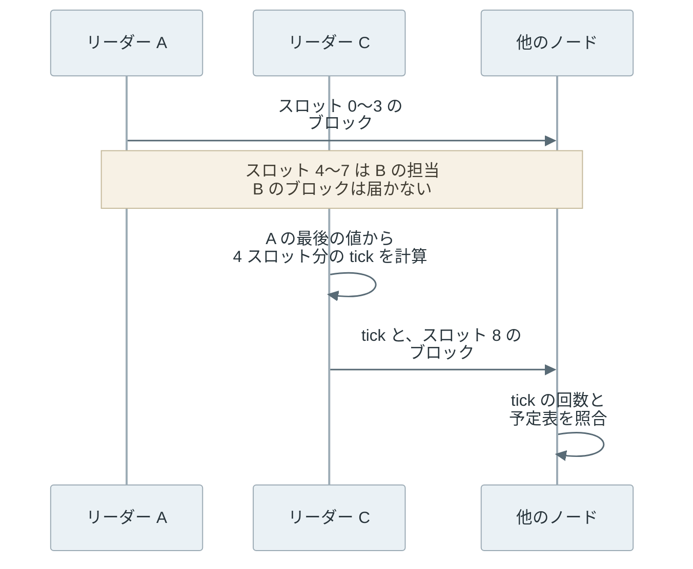

Proof of History（PoH）は、前の出力を次の入力にしてハッシュ関数を計算し続けた「ハッシュの連鎖」で、誰でも検算できる時計の役目を果たす仕組みです。ハッシュ関数は任意のデータから固定長の値を作る関数で、PoH では [SHA-256](/notes/security/sha-256/) を使います。改竄の検出に使われる性質は [Hash Function](../hash-function/) で説明しています。

PoH を導入したのは、ブロックチェーンの 1 つである [Solana](https://solana.com/) です。Solana では、短い時間の枠ごとに担当のノードが 1 台決まり、そのノード（リーダー）が取引をまとめてブロックを作ります。リーダーは連鎖を計算しながら取引を混ぜ込み、「前の記録からハッシュを何回計算したか」と「どの取引がどの位置に入ったか」をブロックに残します。他のノードは同じ計算をやり直し、記録と一致するかを確かめます。

以下は、連鎖を 1 本で作る生成と、区切って並列に確かめる検証の違いです。



生成では次の値を作るのに前の値が要るので、計算は 1 本で順に進むしかありません。一方、ブロックには途中の値も区切りごとに記録されるので（後述する entry という単位です）、検証では区切りごとに同時に計算し直せます。

<br>

本記事では、[Go](https://go.dev/) で書いたハッシュの連鎖の実測と合わせて、PoH が何を示せて何を示せないのかを説明します。扱う疑問は次の通りです。

- 前の出力を入力に使うだけの計算が、なぜ時計の代わりになるのか。
- 取引を混ぜ込むと、どのような順序を示せるのか。
- 生成は 1 本でしか進まないのに、なぜ検証は並列にできるのか。
- 速い計算機を持つ参加者は、どこまで先回りできるのか。

なお、PoH は、どのブロックを正しい記録として採用するかを参加者の間で揃える仕組み（合意）ではありません。計算量で履歴を選ぶ [Proof of Work](../proof-of-work/) や、預けた資産で投票する [Proof of Stake](../proof-of-stake/) とは役割が違い、採用は別の投票の仕組みが決めます。その投票との関係と、2026 年 10 月に Solana が合意の仕組みを切り替えて PoH の役目が変わった点は、後半で短く触れます。

本記事で説明するのは、この切り替えの前の Solana での PoH の役目です。実装は Solana の実装の 1 つである Agave の v4.4.1 から引き、数値の例には、リーダーが交代する時間の枠（スロット）が 400ms だった時期の定数を使います。実験は Agave を動かすものではなく、連鎖の仕組みだけを取り出した説明用のモデルです。それぞれ、該当する箇所でも断ります。

---

### 共通の時計が必要な理由

ブロックチェーンのノードは、それぞれ自分の時計を持っています。時計の進み方はノードごとに[ずれ](/notes/distributed-systems/lease/)、通信の遅れも一定ではありません。そのため、ブロックに書かれた時刻だけを根拠に受け入れを判断すると、ノードによって判断が分かれます。

例えば、[Bitcoin のブロック](../bitcoin-block/)の[時刻](https://en.bitcoin.it/wiki/Block_timestamp)には、「直近 11 ブロックの時刻の中央値より後」「ノードの時刻から 2 時間より先ではない」という緩い条件しか課されていません。厳しくすると、時計のずれたノードが正しいブロックを拒むからです。

Solana は、スロット（slot）と呼ぶ短い時間の枠ごとにリーダーを交代させる設計を取りました。交代を細かくするほど、各ノードは「今は誰の番か」「前のリーダーは自分の番を使わずに飛ばしたのか、まだ届いていないだけなのか」を判断する必要があります。この判断を壁時計（実際の時刻）とメッセージのやり取りに頼ると、交代のたびに待ち時間が増えます。

[Solana のホワイトペーパー](https://github.com/solana-labs/whitepaper/blob/3c499476ff59033d85437db25ab9b4af7a47c20f/solana-whitepaper-en.pdf)は、この問題に対して、時刻ではなく計算の量を共通の基準にする方法を提案しました。リーダーが「前の記録から SHA-256 を n 回計算した」という証拠を付けて送れば、受け取ったノードは自分の時計に頼らずに、間に挟まった計算の量を検算できます。

---

### ハッシュの連鎖で経過を示す

PoH の連鎖は、ある初期値から始めて、前の出力を次の入力にして SHA-256 を計算し続けたものです。n 回目の値を得るには n − 1 回目の値が必要で、途中を飛ばす近道はありません。SHA-256 の出力は入力から予測できないからです。つまり、n 回目の値を示せた参加者は、少なくとも n 回の計算を順に行ったことになります。

全ての値を配る必要はありません。Solana の実装の 1 つである [Agave](https://github.com/anza-xyz/agave) では、連鎖を entry という記録に区切ります。各 entry には、前の entry からのハッシュの回数（`num_hashes`）、区切りの値（`hash`）、その間に混ぜた取引が入ります（[entry.rs](https://github.com/anza-xyz/agave/blob/v4.4.1/entry/src/entry.rs#L33-L61)、Agave v4.4.1）。取引を含まない entry は tick と呼ばれ、経過だけを刻みます。



上記の図の下段の数値は、Solana の開発用ライブラリにある[定数](https://github.com/anza-xyz/solana-sdk/blob/c2995fcbc1fff15ef8cd6d7faeccfe2e1756ad9d/clock/src/lib.rs#L33-L93)のうち、スロットが 400ms だった時期の値です。目標のハッシュの速さを毎秒 1,000 万回とし、400ms 分の計算を 64 tick に分けています。同じファイルの現在の既定のスロットは 200ms で、1 tick あたりの回数も半分の 31,250 回です。本記事では、400ms の時期の値を例にします。

<br>

ただし、連鎖が示すのは、ハッシュを何回、どの順で計算したかまでです。それが何ミリ秒に当たるかは、計算機の速さという連鎖の外の仮定から推定します。Agave の [entry.rs のコメント](https://github.com/anza-xyz/agave/blob/v4.4.1/entry/src/entry.rs#L37-L45)も、世界最速の計算機を仮定すれば「これより短い時間はあり得ない」という見積もりになると書いています。逐次の計算で時間を稼ぐ同じ発想と、計算機が速くなって想定が崩れた例は、[Timelock Encryption](/notes/security/timelock-encryption/) で説明しています。

実装もこの区別に沿っています。Agave のリーダーは、計算が予定より進んだ時に自分の時計で待ちます（[poh_service.rs](https://github.com/anza-xyz/agave/blob/v4.4.1/poh/src/poh_service.rs#L443-L447)）。この待ちはリーダーの手元の判断で、検証する側が確かめられるのはハッシュの回数だけです。

チェーン上で動くプログラム（スマートコントラクト）が読む時刻（`Clock.unix_timestamp`）も、連鎖からは作られていませんでした。後述の切り替えの前は、ブロックを検証して投票するノード（バリデータ）が投票に添えた時刻から決めていました（[stake_weighted_timestamp.rs](https://github.com/anza-xyz/agave/blob/v4.4.1/runtime/src/stake_weighted_timestamp.rs#L14-L24)）。

---

### 出来事を混ぜて順序を示す

出来事を連鎖に混ぜる時は、直前の値と出来事のハッシュを連結して SHA-256 を計算します。式で書くと `次の値 = SHA-256(直前の値 || 混ぜる値)` です。Agave では、entry に入れる取引の署名を葉にした Merkle Tree のルートが[混ぜる値](https://github.com/anza-xyz/agave/blob/v4.4.1/entry/src/entry.rs#L395-L411)です（[poh.rs](https://github.com/anza-xyz/agave/blob/v4.4.1/entry/src/poh.rs#L83-L98)）。[デジタル署名](../digital-signature/)と [Merkle Tree](../merkle-tree/) の仕組みは、それぞれのノートで説明しています。

混ぜた後の値は全て、混ぜた出来事に依存します。そのため、取引 A を k 回目、取引 B を m 回目（k < m）に混ぜた連鎖は、A が k 回目の計算より前に存在し、B が m 回目の計算より前に存在したことを示します。2 つを入れ替えた連鎖は、k 回目以降の値が全て変わるので、記録と一致しません。

<br>

連鎖が示せるのは「この位置より前に存在した」という片側だけです。リーダーが取引を受け取ってから混ぜるまで手元に置いておけば、実際より遅い位置に入れられます。並び順を選べる側が得る利益（MEV、Maximal Extractable Value）と利用者の損失は、[MEV](../mev/) で説明しています。

もう片側については、利用者が最後に見た連鎖の値を出来事に含めて署名し、作られた時点の下限を固定する方法がホワイトペーパーに挙がっています。[Solana の取引](https://solana.com/docs/core/transactions)は、最近のブロックの値（blockhash）を含みます。blockhash はそのブロックの最後の tick の値、つまり連鎖の上の値です（[bank.rs](https://github.com/anza-xyz/agave/blob/v4.4.1/runtime/src/bank.rs#L3805-L3812)）。主な目的は有効期限の判定ですが、取引がその blockhash より後に作られたことも示します。



連鎖だけで固定できるのは右端で、左端は取引に含めた blockhash が固定します。

---

### 逐次の生成と並列の検証

ここまでの説明の通り、連鎖の生成は 1 本の計算で順に進むしかありません。一方、検証では各 entry の始まりの値が前の entry に記録されているので、entry ごとに別のコアで計算し直せます。Go の [crypto/sha256](https://pkg.go.dev/crypto/sha256) で、この非対称を確かめます。実験はローカルの計算だけで、ネットワークには接続しません。

この実験は Agave の実装を動かすものではなく、連鎖・出来事の混ぜ込み・並列の検証だけを取り出した説明用のモデルです。例えば、Agave は取引の署名から作った Merkle Tree のルートを混ぜますが、実験では出来事の文字列の SHA-256 を混ぜます。

以下が実験コードの要点です。`step` が 1 回分の計算、`verify` が entry を goroutine（Go の軽量なスレッド）に配って計算し直す部分です。

```go
// step computes the next hash. An event is mixed in as sha256(prev || sha256(event)).
func step(h [32]byte, event []byte) [32]byte {
	if event == nil {
		return sha256.Sum256(h[:])
	}
	m := sha256.Sum256(event)
	return sha256.Sum256(append(h[:], m[:]...))
}

// verify (excerpt): each goroutine takes the next entry and recomputes it
// from the hash recorded in the previous entry.
start := seed
if i > 0 {
	start = es[i-1].Hash
}
bad[i] = !verifyEntry(start, es[i])
```

<details>
<summary>poh.go の全体（生成・検証・入れ替え・計測、163 行）</summary>

```go
// poh.go builds a SHA-256 hash chain in the style of Solana's Proof of History,
// mixes events into it, and verifies it in parallel. Local only, no network.
//
//	go run poh.go          # 7 runs per measurement
//	go run poh.go -runs 3  # quicker
package main

import (
	"crypto/sha256"
	"flag"
	"fmt"
	"os"
	"runtime"
	"slices"
	"strings"
	"sync"
	"sync/atomic"
	"time"
)

// Entry is one record of the chain. NumHashes counts the hashes since the
// previous entry, including the last one. Event is nil for an empty entry (tick).
type Entry struct {
	NumHashes uint64
	Event     []byte
	Hash      [32]byte
}

// step computes the next hash. An event is mixed in as sha256(prev || sha256(event)).
func step(h [32]byte, event []byte) [32]byte {
	if event == nil {
		return sha256.Sum256(h[:])
	}
	m := sha256.Sum256(event)
	return sha256.Sum256(append(h[:], m[:]...))
}

// generate runs the chain on one goroutine. Each hash needs the previous one.
func generate(seed [32]byte, n int, perEntry uint64, events map[int][]byte) []Entry {
	h, out := seed, make([]Entry, n)
	for i := range out {
		for j := uint64(1); j < perEntry; j++ {
			h = sha256.Sum256(h[:])
		}
		h = step(h, events[i])
		out[i] = Entry{perEntry, events[i], h}
	}
	return out
}

// verifyEntry recomputes one entry from the hash recorded in the previous entry.
func verifyEntry(start [32]byte, e Entry) bool {
	h := start
	for j := uint64(1); j < e.NumHashes; j++ {
		h = sha256.Sum256(h[:])
	}
	return step(h, e.Event) == e.Hash
}

// verify checks every entry with the given number of goroutines and
// returns the index of the first bad entry, or -1.
func verify(seed [32]byte, es []Entry, workers int) int {
	bad := make([]bool, len(es))
	var next atomic.Int64
	var wg sync.WaitGroup
	for range workers {
		wg.Add(1)
		go func() {
			defer wg.Done()
			for {
				i := int(next.Add(1) - 1)
				if i >= len(es) {
					return
				}
				start := seed
				if i > 0 {
					start = es[i-1].Hash
				}
				bad[i] = !verifyEntry(start, es[i])
			}
		}()
	}
	wg.Wait()
	return slices.Index(bad, true)
}

// measure runs f once to warm up, then `runs` times, and returns the median,
// min and max in seconds.
func measure(runs int, f func()) (med, lo, hi float64) {
	f()
	ts := make([]float64, runs)
	for i := range ts {
		t := time.Now()
		f()
		ts[i] = time.Since(t).Seconds()
	}
	slices.Sort(ts)
	return ts[runs/2], ts[0], ts[runs-1]
}

func loadavg() string {
	b, err := os.ReadFile("/proc/loadavg")
	if err != nil {
		return "unknown"
	}
	return strings.Join(strings.Fields(string(b))[:3], " ")
}

func main() {
	runs := flag.Int("runs", 7, "repetitions per measurement")
	flag.Parse()
	seed := sha256.Sum256([]byte("debimate proof-of-history lab"))
	fmt.Printf("go %s, %d logical CPUs, loadavg %s\n", runtime.Version(), runtime.NumCPU(), loadavg())

	// 1. Hash rate of one goroutine.
	const k = 1 << 23
	med, lo, hi := measure(*runs, func() {
		h := seed
		for range k {
			h = sha256.Sum256(h[:])
		}
	})
	rate := k / med
	fmt.Printf("\n[1] hash rate: %.1fM hashes/s (median of %d, range %.1f-%.1fM)\n",
		rate/1e6, *runs, k/hi/1e6, k/lo/1e6)

	// 2. Sequential generation vs. parallel verification.
	const n, per = 2048, 8192 // 16,777,216 hashes
	events := map[int][]byte{100: []byte("A: Alice pays Bob 5"),
		400: []byte("B: Bob pays Carol 3"), 700: []byte("C: Carol pays Dave 1")}
	var es []Entry
	g, glo, ghi := measure(*runs, func() { es = generate(seed, n, per, events) })
	fmt.Printf("\n[2] %d entries x %d hashes, last hash %x...\n", n, per, es[n-1].Hash[:6])
	fmt.Printf("generate (1 goroutine)  %6.3fs (range %.3f-%.3f)\n", g, glo, ghi)
	for _, w := range []int{1, 2, 4, 8, 16, 32} {
		v, vlo, vhi := measure(*runs, func() {
			if verify(seed, es, w) != -1 {
				panic("valid chain rejected")
			}
		})
		fmt.Printf("verify %2d goroutines    %6.3fs (range %.3f-%.3f)  %5.1fx faster than generate\n",
			w, v, vlo, vhi, g/v)
	}

	// 3. Reorder two events, or claim fewer hashes than were computed.
	swapped := slices.Clone(es)
	swapped[100].Event, swapped[400].Event = es[400].Event, es[100].Event
	fmt.Printf("\n[3] swap events A and B   -> first bad entry %d\n", verify(seed, swapped, 16))
	short := slices.Clone(es)
	short[10].NumHashes = per / 2
	fmt.Printf("    entry 10 claims %d hashes -> first bad entry %d\n", per/2, verify(seed, short, 16))
	// Every hash after the mix in entry 100 changes, not only those up to entry 400.
	// An honest redo starts at that mix (the last hash of entry 100) and runs to the end.
	redo := 1 + uint64(n-1-100)*per
	fmt.Printf("    honest redo from the mix in entry 100 to entry %d: %d of %d hashes (%.0f%%)\n",
		n-1, redo, uint64(n)*per, float64(redo)/float64(uint64(n)*per)*100)

	// 4. Hashes in one slot of the 400 ms era (62,500 hashes/tick x 64 ticks).
	const slotHashes = 62_500 * 64
	fmt.Printf("\n[4] one 400ms-era slot = %d hashes -> %.0f ms on this machine\n",
		slotHashes, slotHashes/rate*1e3)
	fmt.Printf("loadavg at end %s\n", loadavg())
}
```

</details>

[poh.go](lab/poh.go) を保存し、`go run poh.go` で実行します（Go 1.22 以降）。各計測は 1 回の空回しの後に 7 回行い、中央値と最小〜最大を出しています。計測は 16 コア 32 スレッドの CPU で、他の作業の負荷が掛かった状態で行いました。以下は実行結果の抜粋です。負荷の値と全ての行は [output.txt](lab/output.txt) にあります。

```text
[1] hash rate: 10.5M hashes/s (median of 7, range 9.4-14.8M)

[2] 2048 entries x 8192 hashes, last hash 0751853592b4...
generate (1 goroutine)   1.987s (range 1.560-2.085)
verify  1 goroutines     1.748s (range 1.117-1.990)    1.1x faster than generate
verify 32 goroutines     0.054s (range 0.053-0.058)   36.7x faster than generate

[3] swap events A and B   -> first bad entry 100
    entry 10 claims 4096 hashes -> first bad entry 10
    honest redo from the mix in entry 100 to entry 2047: 15949825 of 16777216 hashes (95%)

[4] one 400ms-era slot = 4000000 hashes -> 381 ms on this machine
```

[1] の通り、このマシンの 1 本の計算は毎秒約 1,000 万回でした。[2] では、約 1,678 万回の連鎖を 1 本で作るのに約 2 秒かかり、同じ連鎖の検証は goroutine を増やすほど短くなりました。



1 本の検証（verify）が生成（generate）とほぼ同じ時間になるのは、同じ回数のハッシュを計算するからです。2 本以上では本数以上に速く見えます。再実行でも同じ傾向が出たので、1 本の計測が遅く出る系統的な要因（CPU の周波数制御や他の作業との競合など）があるとみられますが、原因は切り分けていません。

読み取るべき点は、生成は 1 本の速さで決まるのに対し、検証はコアを増やすと短くなることです。ホワイトペーパーでは、4,000 コアの GPU で分担する例が示されています。ただし、分担しても計算の総量は生成と同じで、減ってはいません。

[3] では、取引 A と B を入れ替えると entry 100 で、計算の回数を半分と偽ると entry 10 で検証が落ちました。

では、リーダーが A と B の順序を偽り、入れ替えた順で正しい連鎖を作り直そうとすると、どれだけ計算が要るでしょうか。

A を混ぜ直す entry 400 までの計算では足りません。entry 100 で A の代わりに B を混ぜた所から後の値は全て変わるので、末尾の entry 2047 まで約 1,595 万回を順に計算し直す必要があります。連鎖全体（約 1,678 万回）の 95% で、[1] の速さでは約 1.5 秒、ほぼ生成し直すのと同じです。



[4] は先回りの見積もりです。400ms の時期の 1 スロット分（400 万回）は、このマシンでは約 381ms でした。k 倍速い計算機なら同じ回数を約 1/k の時間で計算できるので、10 倍速ければ 1 スロット分を約 40ms で積める計算になります。

これは計測値からの推測で、実際の Solana のリーダーは前述の通り手元の時計で歩調を合わせます。手元の時計で待たない速い計算機が得をし得る場面は、次の節のリーダーの交代と、その次の節の投票の差し替えです。

---

### リーダーの交代と空のスロット

Solana は、どのスロットを誰が担当するかを leader schedule（リーダーの予定表）として事前に決めます。予定表は epoch（スロットをまとめた期間で、既定では 432,000 スロット）ごとに作られ、各バリデータは、担保として預けた Solana の通貨 SOL の量（stake）に応じた確率で選ばれます。

Agave v4.4.1 では、乱数の種に epoch の番号を使い、1 人のリーダーに連続 4 スロットを割り当てます（[leader-schedule の実装](https://github.com/anza-xyz/agave/blob/v4.4.1/leader-schedule/src/lib.rs#L20-L64)）。全ノードが同じ stake の記録と同じ種から計算するので、予定表を配る通信は必要ありません。

PoH がこの予定表に効くのは、リーダーが前の担当分の計算を飛ばして自分の番を始められない点です。切り替え前の Solana では、前のリーダーのブロックが届かない場合、次のリーダーは前の担当分のスロットを tick で埋めてから自分のブロックを作ります（[Fork Generation の文書](https://github.com/anza-xyz/agave/blob/v3.0.0/docs/src/consensus/fork-generation.md)）。以下は、リーダー B のブロックが届かなかった場合の流れです。



C は、B の担当分を飛ばす根拠として、4 スロット分の計算を連鎖で示します。他のノードは、C が予定表どおりのリーダーか、飛ばした分の回数が足りているかを確かめます。

PoH が防ぐのは回数の不足で、速さの差までは防げません。計算の上では、速い計算機を持つ C は、B の 4 スロット分の tick を実際の 4 スロットより短い時間で積み、B のブロックが届く前に自分のブロックを出せます。B のブロックが遅れて届けば、B を含む列と含まない列の 2 つに分岐します。どちらを採用するかは、PoH ではなく投票で決めます。

---

### 採用を決める投票

冒頭で触れた通り、PoH は合意の仕組みではありません。Agave の [Synchronization の文書](https://github.com/anza-xyz/agave/blob/v3.0.0/docs/src/consensus/synchronization.md)にも、PoH は「is not a consensus mechanism」（合意の仕組みではない）と明記されています。

合意の仕組みを切り替える前の Solana で、分岐した列のどちらを採用するかを決めていたのは、[Tower BFT](https://github.com/anza-xyz/agave/blob/v3.0.0/docs/src/implemented-proposals/tower-bft.md) という投票の仕組みです。名前の BFT は、嘘をつくノードが混ざっても合意できる性質（[Byzantine Fault Tolerance](/notes/distributed-systems/byzantine-fault-tolerance/)）を指します。

Tower BFT では、バリデータが分岐した列の 1 つに投票し、投票するたびに lockout（ロックアウト）を負います。lockout は、その列から離れて別の列に投票できないスロット数です。投票は塔のように積まれ、新しい投票を積んで塔が高くなるたびに、その下の投票の lockout は 2 倍に伸びます。以下は、Tower BFT の文書にある例を図にしたものです。図に投票 3 と 4 が無いのは、lockout が切れて、投票 5 を積む前に塔から外れたためです。



32 票積まれた投票は塔から外れ、そのブロックは root（以後覆らないものとして扱うブロック。[Finality](../finality/) の確定に当たります）になります。lockout をスロットで数えられるのは、スロットの経過を PoH が刻んでいたからです。

<br>

lockout が倍々に伸びることは、速い計算機への対策にもなっていました。n 票積まれた投票の lockout は 2^n スロットです。バリデータを別の列へ乗り換えさせるには、その列で 2^n スロットが経過したことを連鎖で示す必要があります。

一方、n 票が積まれるまでに経った時間は少なくとも n スロット分です。つまり、2^n スロット分の tick を n スロットの間に計算する必要があり、必要な速さの倍率は 2^n / n です（Tower BFT の文書の PoH ASIC Resistance の節にも同じ計算があります）。以下は、票の数ごとの lockout と、この倍率を対数の縦軸で並べたグラフです。



浅い投票は数倍速い計算機で覆り得ますが、深く積まれた投票は計算の速さでは追い付けません。ただし、これは PoH の連鎖を作り直す速さだけを見た比較で、投票を集める側の条件は含んでいません。

---

### 2026 年 10 月以降の Solana

2026 年 11 月時点で、Solana のメインネットは合意の仕組みを Tower BFT から Alpenglow に切り替え始めています。[Alpenglow のページ](https://solana.com/upgrades/alpenglow)によると、2026 年 10 月 21 日開始の epoch 1064 で、その第 1 段階である投票の仕組み（Votor）が有効になりました。

切り替えの手順を定めた Solana の改善提案（SIMD、Solana Improvement Document）の [SIMD-0384](https://github.com/solana-foundation/solana-improvement-documents/blob/ae7b00f3287a614c5aa5d0a7ceb7bad0cdc4e022/proposals/0384-alpenglow-migration.md) は、PoH を廃止する手順として、tick の検証を止め、tick をブロックの終わりの 1 つだけにすることを挙げています。

代わりに歩調を取るのは、各ノードが手元で測る [timeout](/notes/distributed-systems/flp-impossibility/) です。Alpenglow の提案（[SIMD-0326](https://github.com/solana-foundation/solana-improvement-documents/blob/ae7b00f3287a614c5aa5d0a7ceb7bad0cdc4e022/proposals/0326-alpenglow.md)）は、timeout の目的は PoH に近いものの、時計を揃える考え方は持たないとしています。本記事で説明した連鎖の役目は、切り替え前の Solana のものです。

---

### 利点

- 経過を計算の回数で示すので、ノード同士が時計を合わせなくても、リーダーの交代と空のスロットを判断できる
- 取引を混ぜた位置が連鎖に残るので、ブロックの中の順序を誰でも同じ計算で確かめられる
- 検証は entry ごとに分けられ、コアを増やすほど短くなる

---

### 欠点

PoH は、時刻の代わりに計算の回数を共通の基準にしました。その代わりに、次の制約があります。

- リーダーは連鎖を休まず計算し続ける必要があり、1 コアを常に使う
- 回数を時間に換算するには計算機の速さという外の仮定が必要で、速い計算機には短い時間で同じ回数を積まれる
- 検証の計算量は生成と同じで、[VDF（Verifiable Delay Function）の論文](https://eprint.iacr.org/2018/601)が求める「効率よく検証できる」性質は持たない
- 取引を混ぜる時期はリーダーが選べるので、連鎖の値は[乱数の源](/notes/security/random-number/)に使えない

---

### 適さないケース

- 壁時計の時刻そのものを証明したい場合。連鎖が示すのは回数と順序で、時刻は別の仕組みから得る
- 参加者が少なく、リーダーの交代も遅い場合。時計を合わせる仕組みや、[CometBFT](../cometbft/) のようなラウンドごとの投票で足りる
- 検証する側の計算資源が乏しい場合。連鎖の検証は生成と同じ回数の計算を必要とする
