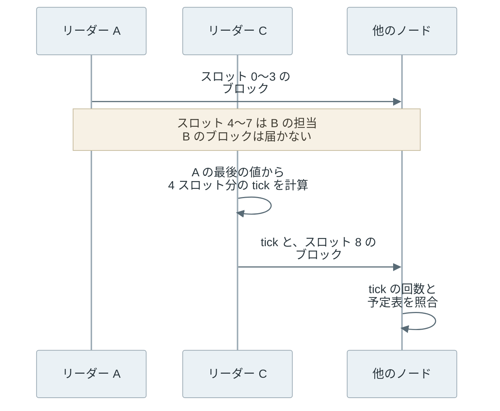

Proof of History（PoH）は、[ハッシュ関数](../hash-function/)の 1 つである SHA-256 を直前の出力に繰り返し適用して作るハッシュの連鎖で、誰でも検算できる時計の役目を果たす仕組みです。

[Solana](https://solana.com/) のリーダー（その時間帯にブロックを作る担当のノード）は、連鎖を計算しながら取引を混ぜ込み、「前の記録からハッシュを何回計算したか」と「どの取引がどの位置に入ったか」をブロックに残します。他のノード（ブロックを検証して投票するバリデータ）は同じ計算をやり直し、記録と一致するかを確かめます。

PoH は、PoW や PoS と並べて合意方式の一覧に載ることがあります。しかし、PoH が作るのは経過と順序の材料で、どのブロックを採用するかは別の投票の仕組みが決めます。以下は、連鎖を 1 本で作る生成と、区切って並列に確かめる検証の違いです。



なお、Solana のメインネットは 2026 年 10 月 21 日に合意の仕組みを Alpenglow（新しい合意の仕組み）の第 1 段階である Votor に切り替え、PoH はブロック生成の歩調を取る役目から外れました（[Solana の Alpenglow のページ](https://solana.com/upgrades/alpenglow)、2026 年 11 月時点）。本文の大半は、切り替え前の Tower BFT と組み合わせて動いていた時期の仕組みです。

<br>

本記事では、[Go](https://go.dev/) で書いたハッシュの連鎖の実測と合わせて、PoH が何を示せて何を示せないのかを説明します。扱う疑問は次の通りです。

- 前の出力を入力に使うだけの計算が、なぜ時計の代わりになるのか。
- 取引を混ぜ込むと、どのような順序を示せるのか。
- 生成は 1 本でしか進まないのに、なぜ検証は並列にできるのか。
- PoH が合意方式ではないなら、何が合意を担っていたのか。
- 速い計算機を持つ参加者は、どこまで先回りできるのか。

計算量で履歴を選ぶ方式は [Proof of Work](../proof-of-work/)、預けた資産で投票する方式は [Proof of Stake](../proof-of-stake/) で説明しています。

---

### 共通の時計が必要な理由

ブロックチェーンのノードは、それぞれ自分の時計を持っています。時計はずれますし、通信の遅れも一定ではありません。そのため、ブロックに書かれた時刻だけを根拠に受け入れを判断すると、ノードによって判断が分かれます。

例えば、Bitcoin は[ブロックの時刻](https://en.bitcoin.it/wiki/Block_timestamp)に「直近 11 ブロックの時刻の中央値より後」「ノードの時刻から 2 時間より先ではない」という緩い条件しか課していません。厳しくすると、時計のずれたノードが正しいブロックを拒むからです。

Solana は、リーダーを短い間隔で交代させる設計を取りました。交代を細かくするほど、各ノードは「今は誰の番か」「前のリーダーは自分の番を使わずに飛ばしたのか、まだ届いていないだけなのか」を判断する必要があります。この判断を壁時計（実際の時刻）とメッセージのやり取りに頼ると、交代のたびに待ち時間が増えます。

[Solana のホワイトペーパー](https://github.com/solana-labs/whitepaper/blob/3c499476ff59033d85437db25ab9b4af7a47c20f/solana-whitepaper-en.pdf)は、この問題に対して、時刻ではなく計算の量を共通の基準にする方法を提案しました。リーダーが「前の記録から SHA-256 を n 回計算した」という証拠を付けて送れば、受け取ったノードは自分の時計に頼らずに、間に挟まった計算の量を検算できます。

---

### ハッシュの連鎖で経過を示す

PoH の連鎖は、ある初期値から始めて、前の出力を次の入力にして SHA-256 を計算し続けたものです。n 回目の値を得るには n − 1 回目の値が必要で、途中を飛ばす近道はありません。SHA-256 の出力は入力から予測できないからです。つまり、n 回目の値を示せた参加者は、少なくとも n 回の計算を順に行ったことになります。

全ての値を配る必要はありません。Solana の実装（[Agave](https://github.com/anza-xyz/agave)）では、連鎖を entry という記録に区切り、各 entry に「前の entry からのハッシュの回数（`num_hashes`）」と「区切りの値（`hash`）」と「その間に混ぜた取引」を入れます（[entry.rs](https://github.com/anza-xyz/agave/blob/v4.4.1/entry/src/entry.rs#L33-L61)、Agave v4.4.1）。取引を含まない entry は tick と呼ばれ、経過だけを刻みます。

<br>

計算の回数は時間の目安になります。例えば、[solana-sdk の定数](https://github.com/anza-xyz/solana-sdk/blob/c2995fcbc1fff15ef8cd6d7faeccfe2e1756ad9d/clock/src/lib.rs#L33-L93)では、目標のハッシュの速さを毎秒 1,000 万回とし、スロット（slot、1 人のリーダーがブロックを作れる時間の枠）が 400ms だった時期の値を 1 tick あたり 62,500 回、1 スロットあたり 64 tick としています。62,500 × 64 = 400 万回の計算が、400ms の 1 スロットに相当するという換算です。

しかし、PoH が時刻を証明すると考えるのは誤りです。連鎖が示すのは、ハッシュを何回、どの順で計算したかまでです。それが何ミリ秒に当たるかは、計算機の速さという連鎖の外の仮定から推定します。

Agave の [entry.rs のコメント](https://github.com/anza-xyz/agave/blob/v4.4.1/entry/src/entry.rs#L37-L45)では、回数に 1 回あたりの時間を掛けると経過の見積もりになるとしています。コメントの語は upper bound ですが、続く文の中身は「世界最速の計算機を仮定すれば、これより短い時間はあり得ない」という下限です。

実装もこの区別に沿っています。Agave のリーダーは、計算が予定より進んだ時に自分の時計で待ちます（[poh_service.rs](https://github.com/anza-xyz/agave/blob/v4.4.1/poh/src/poh_service.rs#L443-L447) の `poh_wait_target`）。この待ちはリーダーの手元の判断で、検証する側が確かめられるのはハッシュの回数だけです。

プログラムが読む時刻 `Clock.unix_timestamp` は、Tower BFT の時期には、バリデータが投票に添えた時刻の、stake（バリデータに担保として預けられた Solana の通貨 SOL）で重み付けした中央値でした（[Alpenglow のページ](https://solana.com/upgrades/alpenglow)の Clock の節）。

この値は、epoch の開始からのスロット数による見積もりの幅（速い側 25%、遅い側 150%）に収められます（[stake_weighted_timestamp.rs](https://github.com/anza-xyz/agave/blob/v4.4.1/runtime/src/stake_weighted_timestamp.rs#L14-L24)）。ハッシュの回数は幅の目安に使われるだけで、時刻は投票から来ていました。

---

### 出来事を混ぜて順序を示す

出来事を連鎖に混ぜる時は、直前の値と出来事のハッシュを連結して SHA-256 を計算します。式で書くと `次の値 = SHA-256(直前の値 || 混ぜる値)` です。Agave では、entry に入れる取引の署名を葉にした Merkle Tree のルートが混ぜる値です（[entry.rs](https://github.com/anza-xyz/agave/blob/v4.4.1/entry/src/entry.rs#L395-L411) の `hash_transactions`、[poh.rs](https://github.com/anza-xyz/agave/blob/v4.4.1/entry/src/poh.rs#L83-L98) の `record`）。

混ぜた後の値は全て、混ぜた出来事に依存します。そのため、取引 A を k 回目、取引 B を m 回目（k < m）に混ぜた連鎖は、A が k 回目の計算より前に存在し、B が m 回目の計算より前に存在したことを示します。2 つを入れ替えた連鎖は、k 回目以降の値が全て変わるので、記録と一致しません。[デジタル署名](../digital-signature/)と [Merkle Tree](../merkle-tree/) の仕組みは、それぞれのノートで説明しています。

<br>

連鎖が示せるのは「この位置より前に存在した」という片側だけです。リーダーが取引を受け取ってから混ぜるまで手元に置いておけば、実際より遅い位置に入れられます。ホワイトペーパーには、利用者が最後に見た連鎖の値を出来事に含めて署名し、出来事が作られた時点の下限も固定する方法が挙がっています。[Solana の取引](https://solana.com/docs/core/transactions)が最近の blockhash を含むのは主に有効期限の判定のためですが、取引がその blockhash より後に作られたことも示します。

以下は、取引が存在した時期が連鎖の上の 2 つの位置に挟まれる様子です。



連鎖だけで固定できるのは右端で、左端は取引に含めた blockhash が固定します。

---

### 逐次の生成と並列の検証

連鎖の生成は 1 本の計算で順に進むしかありません。一方で、検証では各 entry の始まりの値が前の entry に記録されているので、entry ごとに別のコアで計算し直せます。Go の [crypto/sha256](https://pkg.go.dev/crypto/sha256) で、この非対称を確かめます。実験はローカルの計算だけで、ネットワークには接続しません。

以下が実験コードの要点です。`step` が 1 回分の計算、`verify` が entry を goroutine に配って計算し直す部分です。

```go
// step computes the next hash. An event is mixed in as sha256(prev || sha256(event)).
func step(h [32]byte, event []byte) [32]byte {
	if event == nil {
		return sha256.Sum256(h[:])
	}
	m := sha256.Sum256(event)
	return sha256.Sum256(append(h[:], m[:]...))
}

// verify (excerpt): each goroutine takes the next entry and recomputes it
// from the hash recorded in the previous entry.
start := seed
if i > 0 {
	start = es[i-1].Hash
}
bad[i] = !verifyEntry(start, es[i])
```

<details>
<summary>poh.go の全体（生成・検証・入れ替え・計測、161 行）</summary>

```go
// poh.go builds a SHA-256 hash chain in the style of Solana's Proof of History,
// mixes events into it, and verifies it in parallel. Local only, no network.
//
//	go run poh.go          # 7 runs per measurement
//	go run poh.go -runs 3  # quicker
package main

import (
	"crypto/sha256"
	"flag"
	"fmt"
	"os"
	"runtime"
	"slices"
	"strings"
	"sync"
	"sync/atomic"
	"time"
)

// Entry is one record of the chain. NumHashes counts the hashes since the
// previous entry, including the last one. Event is nil for an empty entry (tick).
type Entry struct {
	NumHashes uint64
	Event     []byte
	Hash      [32]byte
}

// step computes the next hash. An event is mixed in as sha256(prev || sha256(event)).
func step(h [32]byte, event []byte) [32]byte {
	if event == nil {
		return sha256.Sum256(h[:])
	}
	m := sha256.Sum256(event)
	return sha256.Sum256(append(h[:], m[:]...))
}

// generate runs the chain on one goroutine. Each hash needs the previous one.
func generate(seed [32]byte, n int, perEntry uint64, events map[int][]byte) []Entry {
	h, out := seed, make([]Entry, n)
	for i := range out {
		for j := uint64(1); j < perEntry; j++ {
			h = sha256.Sum256(h[:])
		}
		h = step(h, events[i])
		out[i] = Entry{perEntry, events[i], h}
	}
	return out
}

// verifyEntry recomputes one entry from the hash recorded in the previous entry.
func verifyEntry(start [32]byte, e Entry) bool {
	h := start
	for j := uint64(1); j < e.NumHashes; j++ {
		h = sha256.Sum256(h[:])
	}
	return step(h, e.Event) == e.Hash
}

// verify checks every entry with the given number of goroutines and
// returns the index of the first bad entry, or -1.
func verify(seed [32]byte, es []Entry, workers int) int {
	bad := make([]bool, len(es))
	var next atomic.Int64
	var wg sync.WaitGroup
	for range workers {
		wg.Add(1)
		go func() {
			defer wg.Done()
			for {
				i := int(next.Add(1) - 1)
				if i >= len(es) {
					return
				}
				start := seed
				if i > 0 {
					start = es[i-1].Hash
				}
				bad[i] = !verifyEntry(start, es[i])
			}
		}()
	}
	wg.Wait()
	return slices.Index(bad, true)
}

// measure runs f once to warm up, then `runs` times, and returns the median,
// min and max in seconds.
func measure(runs int, f func()) (med, lo, hi float64) {
	f()
	ts := make([]float64, runs)
	for i := range ts {
		t := time.Now()
		f()
		ts[i] = time.Since(t).Seconds()
	}
	slices.Sort(ts)
	return ts[runs/2], ts[0], ts[runs-1]
}

func loadavg() string {
	b, err := os.ReadFile("/proc/loadavg")
	if err != nil {
		return "unknown"
	}
	return strings.Join(strings.Fields(string(b))[:3], " ")
}

func main() {
	runs := flag.Int("runs", 7, "repetitions per measurement")
	flag.Parse()
	seed := sha256.Sum256([]byte("debimate proof-of-history lab"))
	fmt.Printf("go %s, %d logical CPUs, loadavg %s\n", runtime.Version(), runtime.NumCPU(), loadavg())

	// 1. Hash rate of one goroutine.
	const k = 1 << 23
	med, lo, hi := measure(*runs, func() {
		h := seed
		for range k {
			h = sha256.Sum256(h[:])
		}
	})
	rate := k / med
	fmt.Printf("\n[1] hash rate: %.1fM hashes/s (median of %d, range %.1f-%.1fM)\n",
		rate/1e6, *runs, k/hi/1e6, k/lo/1e6)

	// 2. Sequential generation vs. parallel verification.
	const n, per = 2048, 8192 // 16,777,216 hashes
	events := map[int][]byte{100: []byte("A: Alice pays Bob 5"),
		400: []byte("B: Bob pays Carol 3"), 700: []byte("C: Carol pays Dave 1")}
	var es []Entry
	g, glo, ghi := measure(*runs, func() { es = generate(seed, n, per, events) })
	fmt.Printf("\n[2] %d entries x %d hashes, last hash %x...\n", n, per, es[n-1].Hash[:6])
	fmt.Printf("generate (1 goroutine)  %6.3fs (range %.3f-%.3f)\n", g, glo, ghi)
	for _, w := range []int{1, 2, 4, 8, 16, 32} {
		v, vlo, vhi := measure(*runs, func() {
			if verify(seed, es, w) != -1 {
				panic("valid chain rejected")
			}
		})
		fmt.Printf("verify %2d goroutines    %6.3fs (range %.3f-%.3f)  %5.1fx faster than generate\n",
			w, v, vlo, vhi, g/v)
	}

	// 3. Reorder two events, or claim fewer hashes than were computed.
	swapped := slices.Clone(es)
	swapped[100].Event, swapped[400].Event = es[400].Event, es[100].Event
	fmt.Printf("\n[3] swap events A and B   -> first bad entry %d\n", verify(seed, swapped, 16))
	short := slices.Clone(es)
	short[10].NumHashes = per / 2
	fmt.Printf("    entry 10 claims %d hashes -> first bad entry %d\n", per/2, verify(seed, short, 16))
	redo := (400 - 100 + 1) * per
	fmt.Printf("    honest redo of entries 100-400 in the new order: %d hashes = %.2fs at [1]\n",
		redo, float64(redo)/rate)

	// 4. Hashes in one slot of the 400 ms era (62,500 hashes/tick x 64 ticks).
	const slotHashes = 62_500 * 64
	fmt.Printf("\n[4] one 400ms-era slot = %d hashes -> %.0f ms on this machine\n",
		slotHashes, slotHashes/rate*1e3)
	fmt.Printf("loadavg at end %s\n", loadavg())
}
```

</details>

[poh.go](lab/poh.go) を保存し、`go run poh.go` で実行します（Go 1.22 以降）。計測は AMD Ryzen AI MAX+ 395（16 コア 32 スレッド）、Go 1.26.4 で、他の作業で負荷が高い状態でした。

各計測は 1 回の空回しの後に 7 回行い、中央値と最小〜最大を出しています。以下は実行結果の抜粋です。環境の記録と全ての行は [output.txt](lab/output.txt) にあります。

```text
[1] hash rate: 10.5M hashes/s (median of 7, range 9.4-14.8M)

[2] 2048 entries x 8192 hashes, last hash 0751853592b4...
generate (1 goroutine)   1.987s (range 1.560-2.085)
verify  1 goroutines     1.748s (range 1.117-1.990)    1.1x faster than generate
verify 32 goroutines     0.054s (range 0.053-0.058)   36.7x faster than generate

[3] swap events A and B   -> first bad entry 100
    entry 10 claims 4096 hashes -> first bad entry 10
    honest redo of entries 100-400 in the new order: 2465792 hashes = 0.24s at [1]

[4] one 400ms-era slot = 4000000 hashes -> 381 ms on this machine
```

[1] の通り、このマシンの 1 本の計算は毎秒約 1,000 万回でした。[2] では、約 1,678 万回の連鎖を 1 本で作るのに約 2 秒かかり、同じ連鎖の検証は goroutine の数にほぼ比例して短くなりました。



1 本の検証が生成とほぼ同じ時間になるのは、同じ回数のハッシュを計算するからです。4 本以上では本数以上に速く見えます。再実行でも同じ傾向が出たので、1 本の計測が遅く出る系統的な要因（CPU の周波数制御や他の作業との競合など）があるとみられますが、原因は切り分けていません。

読み取るべき点は、検証の時間が生成の時間ではなく、使えるコアの数で決まることです。ホワイトペーパーでは、4,000 コアの GPU で分担する例が示されています。

[3] では、取引 A と B を入れ替えると entry 100 で、計算の回数を半分と偽ると entry 10 で検証が落ちました。入れ替えた順で正しい連鎖を作り直すには、entry 100 から 400 までの約 247 万回を順に計算し直す必要があります。

<br>

[4] は先回りの見積もりです。400ms の時期の 1 スロット分（400 万回）は、このマシンでは約 381ms でした。k 倍速い計算機なら同じ回数を約 1/k の時間で計算できるので、10 倍速ければ 1 スロット分を約 40ms で積める計算になります。

これは計測値からの推測で、実際の Solana のリーダーは上記の通り手元の時計で歩調を合わせます。速い計算機が得をする場面は、次の節のリーダーの交代と、Tower BFT の節で扱う履歴の差し替えです。

---

### リーダーの予定表

Solana は、どのスロットを誰が担当するかを leader schedule（リーダーの予定表）として事前に決めます。予定表は epoch（Solana では既定で 432,000 スロット）ごとに作られ、各バリデータが預けられた stake の量に応じた確率で選ばれます。

Agave v4.4.1 では、乱数の種に epoch の番号を使い、1 人のリーダーに連続 4 スロットを割り当てます（[leader-schedule の実装](https://github.com/anza-xyz/agave/blob/v4.4.1/leader-schedule/src/lib.rs#L20-L64)）。全ノードが同じ stake の記録と同じ種から計算するので、予定表を配る通信は必要ありません。

PoH がこの予定表に効くのは、リーダーが自分の番を早く始められない点です。前のリーダーのブロックが届かない場合、次のリーダーは前の担当分のスロットを tick で埋めてから自分のブロックを作ります（[Fork Generation の文書](https://github.com/anza-xyz/agave/blob/v3.0.0/docs/src/consensus/fork-generation.md)）。以下は、リーダー B のブロックが届かなかった場合の流れです。



C は、B の担当分を飛ばす根拠として、4 スロット分の計算を連鎖で示します。他のノードは、C が予定表どおりのリーダーか、飛ばした分の回数が足りているかを確かめます。ただし、B のブロックが遅れて届けば、B を含む列と含まない列の 2 つに分岐します。どちらを採用するかは、PoH ではなく投票で決めます。

---

### Tower BFT との役割分担

PoH は合意方式だと考える方がいるかもしれません。しかし、PoH は合意の仕組みではなく、PoS の合意の性能を上げるために使う時計です。Agave の [Synchronization の文書](https://github.com/anza-xyz/agave/blob/v3.0.0/docs/src/consensus/synchronization.md)にも「is not a consensus mechanism」（合意の仕組みではない）と明記されています。切り替え前の Solana で合意を担っていたのは、[Tower BFT](https://github.com/anza-xyz/agave/blob/v3.0.0/docs/src/implemented-proposals/tower-bft.md) です。

Tower BFT では、バリデータが分岐した列の 1 つに投票し、投票するたびに lockout（ロックアウト）を負います。lockout は、その列から離れて別の列に投票できないスロット数です。投票は塔のように積まれ、上に投票が積み重なるにつれて、下の投票の lockout は 2 倍ずつ伸びます。

32 票積まれた投票は塔から外れ、そのブロックは root（以後覆らないものとして扱うブロック）になります。lockout をスロットで数えられるのは、スロットの経過を PoH が刻んでいたからです。

| | PoH | Tower BFT |
|---|---|---|
| 作るもの | 計算の回数と、取引を混ぜた位置 | どの列を採用するかの投票と、その lockout |
| 誰が作るか | 予定表で決まったリーダー 1 人 | stake を持つ全てのバリデータ |
| 他のノードが確かめること | 連鎖を計算し直して一致するか | 署名と、lockout を破っていないか |
| 分岐への対応 | 分岐は防がない | 重い列を選び、2/3 以上の stake の同意を見てから深く積む |

上記の表の最後の行の「同意を見てから」は threshold check と呼ばれ、Agave v4.4.1 では、新しい投票を積んだ後の直近から 8 番目の投票について、2/3 を超える stake が同じ列に投票していることを確かめます（[consensus.rs](https://github.com/anza-xyz/agave/blob/v4.4.1/core/src/consensus.rs#L157-L158)、[commitment.rs](https://github.com/anza-xyz/agave/blob/v4.4.1/runtime/src/commitment.rs#L9)）。

別の列へ乗り換える時は、38% を超える stake が別の列にいることを求めます。lockout を破った投票への処罰は、Tower BFT の文書では提案として書かれています。

<br>

lockout が倍々に伸びることは、速い計算機への対策にもなっていました。n 票積まれた投票の lockout は 2^n スロットなので、それを覆す列を作るには、2^n スロット分の tick を n スロットの間に計算する必要があります。必要な速さの倍率は 2^n / n です（Tower BFT の文書にある、速い計算機への耐性の節にも同じ計算があります）。以下は、票の数ごとの lockout と、この倍率を対数の縦軸で並べたグラフです。



浅い投票は数倍速い計算機で覆り得ますが、深く積まれた投票は計算の速さでは追い付けません。ただし、これは PoH の連鎖を作り直す速さだけを見た比較で、投票を集める側の条件は含んでいません。

---

### 他の合意方式との比較

PoH は合意方式ではないので、比べる相手は PoH と Tower BFT の組み合わせです。以下は 2026 年 11 月時点の公開資料を元にした比較です。[Tendermint](https://arxiv.org/abs/1807.04938) 系の [CometBFT](../cometbft/) は別のノートで説明しています。

| 方式 | 作る権利の根拠 | 確定の時期 | 耐える不正 | 票が足りない時 |
|---|---|---|---|---|
| Bitcoin の [PoW](../proof-of-work/) | 計算作業 | 確認数に応じて覆る確率が下がる | 計算量の過半未満 | 分岐し、重い方を選ぶ |
| Ethereum の [PoS](../proof-of-stake/) | 預けた ETH | 約 2 epoch 後に finalized | stake の 1/3 未満 | ブロックは続き、確定が止まる |
| [CometBFT](../cometbft/) | 預けた資産による票の重み | ブロックごと | 票の重みの 1/3 未満 | 新しいブロックが止まる |
| Solana（PoH + Tower BFT） | stake で作った予定表 | 32 票で root。約 12.8 秒 | 閾値は 2/3。安全性の証明は無い | 分岐し、root が進まない |
| Solana（Alpenglow） | stake で作った予定表 | 1〜2 回の投票。目標は約 150ms | 悪意 20% と停止 20% | 第 2 ラウンドの 60% の票で確定か skip |

Solana の 2 行は、[SIMD-0326](https://github.com/solana-foundation/solana-improvement-documents/blob/ae7b00f3287a614c5aa5d0a7ceb7bad0cdc4e022/proposals/0326-alpenglow.md) と Alpenglow のページの記載です。確定の時期の Ethereum については [Finality](../finality/) で説明しています。

---

### Alpenglow 以降の Solana

2026 年 11 月時点で、Solana のメインネットは Alpenglow の第 1 段階である Votor で動いています。[Alpenglow のページ](https://solana.com/upgrades/alpenglow)によると、epoch 1064（2026 年 10 月 21 日開始）で有効になり、Agave 系のクライアント v4.3.2 が必要でした。バリデータは投票を取引としてチェーンに書かず、互いに直接送り合い、集めた署名を証明書にまとめます。ブロックの伝搬を担う Rotor は後の段階で、時期は決まっていません。

切り替えの手順を定めた [SIMD-0384](https://github.com/solana-foundation/solana-improvement-documents/blob/ae7b00f3287a614c5aa5d0a7ceb7bad0cdc4e022/proposals/0384-alpenglow-migration.md) は、PoH を廃止する段階として tick の検証を止めることを挙げています。Alpenglow のページによると、tick は shred（ブロックを分割して送る単位）から消え、スロットより細かい時間は台帳から読めなくなりました。代わりに歩調を取るのは各ノードの手元の timeout です。SIMD-0326 では、timeout の目的は PoH に近いものの、時計を揃える考え方を持たないとされています。

<br>

スロットの長さも変わりました。[Reduced Slot Times のページ](https://solana.com/upgrades/reduced-slot-times)によると、400ms から 50ms ずつ 4 段階で短くされ、2026 年 10 月 9 日の epoch 1053 から 200ms です。

`Clock.unix_timestamp` は、リーダーが「親ブロックの時刻」から「親ブロックの時刻 + 経過したスロット時間の 2 倍」までの範囲で決める値に変わりました。PoH が担っていた「経過の証拠」は、台帳の中からは無くなったことになります。

---

### 利点

- 経過を計算の回数で示すので、ノード同士が時計を合わせなくても、リーダーの交代と空のスロットを判断できる
- 取引を混ぜた位置が連鎖に残るので、受け取ったノードはブロックの確定を待たずに順序どおり実行を進められる
- 検証は entry ごとに分けられ、コアを増やすほど短くなる

---

### 欠点

PoH は、時刻の代わりに計算の回数を共通の基準にしました。その代わりに、次の制約があります。

- リーダーは連鎖を休まず計算し続ける必要があり、1 コアを常に使う
- 回数を時間に換算するには計算機の速さという外の仮定が必要で、速い計算機には短い時間で同じ回数を積まれる
- 検証の計算量は生成と同じで、[VDF（Verifiable Delay Function）の論文](https://eprint.iacr.org/2018/601)が求める「効率よく検証できる」性質は持たない
- 取引を混ぜる時期はリーダーが選べるので、連鎖の値は乱数の源に使えない

---

### 適さないケース

- 壁時計の時刻そのものを証明したい場合。連鎖が示すのは回数と順序で、時刻は別の仕組みから得る
- 参加者が少なく、リーダーの交代も遅い場合。時計を合わせる仕組みや、[CometBFT](../cometbft/) のようなラウンドごとの投票で足りる
- 検証する側の計算資源が乏しい場合。連鎖の検証は生成と同じ回数の計算を必要とする
