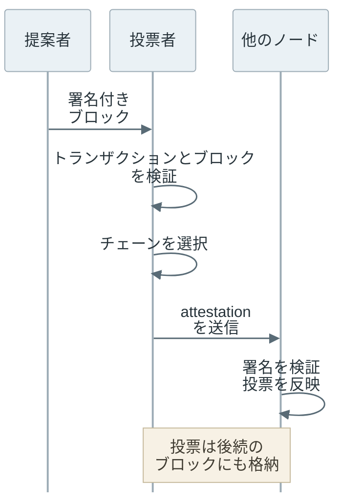
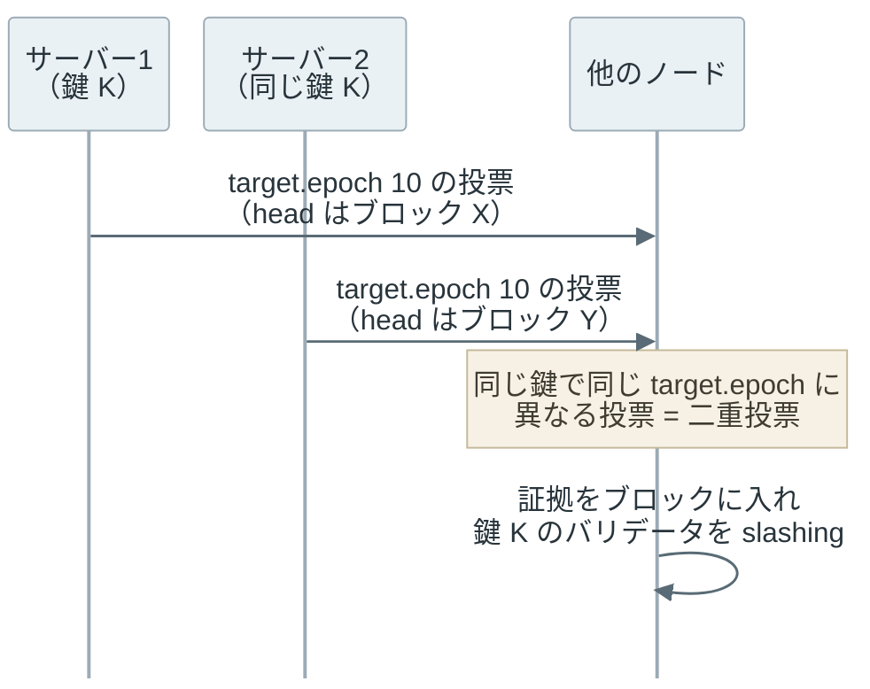

[Proof of Stake（PoS）](https://ethereum.org/en/developers/docs/consensus-mechanisms/pos/)は、参加者が預け入れた暗号資産をブロックの提案や投票に参加するための担保にする仕組みです。PoS を採用するブロックチェーンである [Ethereum](https://ethereum.org/) では、バリデータ（validator）が ether（ETH）を預けて参加し、決められた役割を果たすと報酬を受け取ります。矛盾する投票などの違反には、担保を減らす罰則があります。

以下は、預け入れた額を重みにして参加するバリデータと、矛盾する署名をしたバリデータの扱いです。



<br>

本記事では、Ethereum を例に、誰にブロックを作る機会を与え、どのような行動に報酬や罰則を設けているのかを説明します。

- なぜ、ノードの台数ではなく預け入れた資産を使うのか。
- ブロックを提案する役割と、投票する役割はどう違うのか。
- 通信が途切れた場合と、矛盾する投票をした場合では何が違うのか。
- 2 つの投票から違反を検出するには、どの項目を比較するのか。

トランザクションとブロックの関係は[ブロックチェーンの基本](../blockchain-basics/)、投票を集めてトランザクションを確定する条件は [Finality](../finality/) で説明しています。PoS を使うチェーンでも、参加条件や罰則は同じとは限りません。

---

### 参加者の数と資産の量

誰でも参加できるネットワークで「1 台のノードに 1 票」を与えると、一人で多数のノードを起動した参加者が[投票を支配できます](/notes/distributed-systems/byzantine-fault-tolerance/#参加者の決め方と票の重み)。公開鍵を作るだけで投票権を与える場合も、同じ人が鍵を増やせば票数を増やせます。参加者が契約や組織で決まっている場合に、許可した鍵の一覧で署名者を決める方式は [Proof of Authority](../proof-of-authority/) で説明しています。

[Proof of Work（PoW）](../proof-of-work/)では、ブロックを作る際に計算作業を要求します。一方で、PoS ではプロトコルに預けた資産の量を提案者の選出や投票の重みに使います。鍵を増やしても、同じ資産を何度も担保として数えることはできません。

Ethereum で合意に使う重みは、各バリデータの effective balance（有効残高）です。これはウォレットの残高全体ではなく、預け入れた残高から、上限などの規則に従って計算する値です。[EIP-7251](https://eips.ethereum.org/EIPS/eip-7251) では、参加に必要な最低額の 32 ETH を維持しつつ、条件を満たすバリデータの有効残高の上限を引き上げています。「バリデータ 1 つなら全て同じ重み」とは限りません。

資産を持っているだけで、有効でないトランザクションを正しくできるわけではありません。署名や残高などの検証規則は、各ノードが自分で適用します。PoS が資産の量を使うのは、有効なブロックの候補からどの履歴を選ぶかという合意の部分です。

---

### バリデータとノード

Ethereum のノードは、[実行クライアントと合意クライアント](https://ethereum.org/en/developers/docs/nodes-and-clients/node-architecture/)を組み合わせて動かします。前者はトランザクションを実行して残高などの状態更新を検証し、後者はブロックや投票を受信して採用するチェーンを選びます。自分でチェーンを検証するだけなら、ETH の預け入れは必要ありません。

ブロックの提案と投票にも参加する場合は、ETH を預けてバリデータとして登録し、参加待ちの処理を経ます。稼働が始まると、バリデータクライアントが担当の時間を確認し、秘密鍵で提案や投票に[デジタル署名](../digital-signature/)を付けます。ノード 1 台とバリデータ 1 つは同じ単位ではなく、一つのノードで複数のバリデータを動かすこともできます。


- title: 実行クライアント
  body: トランザクションを実行し、計算結果がブロックに記録された状態更新と一致するか確認します。
- title: 合意クライアント
  body: ブロックと投票を検証し、どのチェーンを追うか判断します。
- title: バリデータクライアント
  body: 割り当てられた提案と投票に署名します。ETH の預け入れと署名鍵が必要です。


「ステーキング」という名称のサービスを使う場合は、利用者自身がこの構成を動かすとは限りません。サービスに資産や運用を委ねる場合の条件と、プロトコルがバリデータに適用する条件は分けて確認する必要があります。

---

### ブロックの提案と投票

Ethereum では、時間を slot（スロット）という単位に区切り、各 slot に[ブロックの提案者](https://ethereum.org/en/developers/docs/consensus-mechanisms/pos/block-proposal/)を割り当てます。提案者の選出には有効残高を反映します。提案者が担当の時間に動けなければ、その slot にブロックがないまま先へ進むこともあります。提案者がブロックの中身の組み立てを外部の builder に任せる仕組みは、[PBS](../pbs/) で扱っています。

1 slot は 12 秒で、32 slot をまとめた時間単位を epoch（エポック）と呼びます。各バリデータは epoch ごとに 1 回、割り当てられた slot で投票します。投票するバリデータは、届いたブロックを検証した後、自分が採用するチェーンについて attestation（アテステーション、署名付きの投票）を送ります。提案者が 1 つのブロックを送っただけで、ネットワーク全体の確定が完了するわけではありません。



各 epoch の最初の slot のブロックは、確定を進める時の区切りになります。この区切りを checkpoint（チェックポイント）と呼び、epoch 番号とブロックの識別子の組で表します。境界の slot にブロックがなければ、それより前の直近のブロックを使います（[仕様の get_block_root](https://ethereum.github.io/consensus-specs/specs/phase0/beacon-chain/#get_block_root)）。

以下は、epoch 2 の途中で送る投票が、どのブロックを指すかを示した図です。



[attestation](https://ethereum.org/en/developers/docs/consensus-mechanisms/pos/attestations/) は、図の 3 つのブロックを指します。head（先頭）は、今どのブロックをチェーンの先頭と見るかです。source（起点）と target（ターゲット）は、確定に向けてどの checkpoint からどの checkpoint へのつながりを支持するかです。target には今の epoch の checkpoint、source には投票者から見て直近にジャスティファイド（justified）された checkpoint を入れます（ジャスティファイドになる条件は次の段落）。

先頭の選択と確定は目的が異なります。source から target への投票が有効残高の合計で 3 分の 2 以上集まると、target が justified になります。さらに条件を満たすと finalized（ファイナライズ済み）になります。この条件は [checkpoint への投票による finality](../finality/#checkpoint-への投票による-finality) で説明しています。

---

### 報酬と罰則

Ethereum は、規則に沿ったタイミングと内容の投票、ブロックの提案などに報酬を与えます。一方で、報酬を受け取れないこと、通常のペナルティで残高が減ること、違反の証拠によって slashing（スラッシング）を受けることは、別の処理です。


- title: 提案を逃した場合
  body: ブロックの提案に対する報酬を受け取れません。提案しなかったことだけを理由に、slashing を受けることはありません。
- title: 投票を欠いた場合
  body: 投票の報酬を失い、source・target の投票を欠くと通常のペナルティで残高も減ります。
- title: 矛盾する署名をした場合
  body: slashing の条件を満たす証拠が取り込まれると、残高が減り、バリデータからの強制退出が始まります。


例えば、通信が切れて投票を送れなかった場合は、[通常のペナルティ](https://ethereum.org/en/developers/docs/consensus-mechanisms/pos/rewards-and-penalties/#penalties)の対象になります。通信が切れた事実だけでは、矛盾する署名の証拠にはなりません。また、ネットワーク全体で長く確定できない場合は、投票に参加できないバリデータの残高を減らす inactivity leak（非活動による残高の減少）が働きます。これは[確定が停止した場合の処理](../finality/#finalize-の停止と-inactivity-leak)であり、slashing とは別です。

slashing の主な条件は、同じ slot に異なるブロックを提案することと、互いに矛盾する attestation を送ることです。罰則には最初の減額だけでなく、近い時期に他のバリデータも slashing を受けているほど大きくなる追加の減額があります。違反を見つけた人が自由に没収するのではなく、他のノードも検証できる証拠をブロックに入れ、プロトコルが処理します。

---

### 矛盾する投票の条件

アテステーションデータ（AttestationData）は、slot、委員会の番号（index）、head、source、target の 5 項目です（最初の仕様の定義。2025 年 5 月のアップグレード（Electra）以降は index が 0 に固定され、委員会の番号はアテステーションデータの外に移りました）。Ethereum の[合意仕様にあるアテステーションデータの判定](https://ethereum.github.io/consensus-specs/specs/phase0/beacon-chain/#is_slashable_attestation_data)では、次の 2 つを区別します。

- double vote（二重投票）：同じ `target.epoch` に対して、異なるアテステーションデータに署名すること。
- surround vote（包囲投票）：一方の投票の `source.epoch` が他方より小さく、かつ `target.epoch` が他方より大きいこと。

二重投票で比較するのは、ターゲットのブロックだけではありません。例えば、`target` が同じでも、チェーンの先頭として支持するブロックを変えればアテステーションデータが変わります。同じアテステーションデータを再送することとは区別します。

包囲投票は、起点からターゲットまでの区間を比べると分かりやすくなります。以下では、同じバリデータが 2 つの投票に署名した場合を考えます。



A の区間の内側に、両端とも A の端と重ならずに収まる B だけが包囲投票です。判定は厳密な大小比較です。起点が同じ場合を誤って包囲投票と判断すると、仕様にない理由で違反と見なしてしまいます。A の 2→5 のように起点とターゲットの間が空く投票は、しばらく justified が進まなかった時に起こります。

二重投票と包囲投票を禁止しておくと、矛盾する 2 つの checkpoint がどちらも確定するには、全体の 3 分の 1 以上の重みのバリデータがどちらかの違反をする必要があります（[Casper FFG の論文](https://arxiv.org/abs/1710.09437)）。違反の証拠は署名として残るため、その分の担保を減らせます。

<br>

2 つのデータが矛盾しているだけで、任意のバリデータをスラッシングできるわけではありません。[証拠を処理する際](https://ethereum.github.io/consensus-specs/specs/phase0/beacon-chain/#attester-slashings)は署名を検証し、両方に署名したバリデータがいるか、そのバリデータがまだスラッシング可能な状態かも確認します。罰則の判定は、送信者に悪意があったかどうかを推測する処理ではありません。

---

### アテステーションデータの比較実験

以下は、二重投票と包囲投票の条件を [Python](https://www.python.org/) で試すコードです。`Vote` はアテステーションデータの各項目、`Checkpoint` は epoch とブロックを識別する値を持ちます。`head` はチェーンの先頭として支持するブロックです。ブロックのハッシュ値は、違いを目で追える説明用の文字列に置き換えています。`slot=target * 32` は、1 epoch を 32 slot として、ターゲットにする epoch で最初の slot を選ぶ計算です。

仕様の包囲判定は引数の順序を決めて呼び出しますが、この実験では両方の順序を調べます。署名の検証、バリデータの状態、チェーン上で投票が有効かどうかは確認しません。`none` は 2 つのデータがこの比較条件に該当しないという意味であり、有効な投票の保証ではありません。実資産・秘密鍵・外部通信は使いません。

```python
from dataclasses import dataclass, replace


@dataclass(frozen=True)
class Checkpoint:
    epoch: int
    root: str


@dataclass(frozen=True)
class Vote:
    slot: int
    index: int
    head: str
    source: Checkpoint
    target: Checkpoint


def conflict(a: Vote, b: Vote) -> str:
    if a != b and a.target.epoch == b.target.epoch:
        return "double vote"
    if (a.source.epoch < b.source.epoch
            and b.target.epoch < a.target.epoch):
        return "surround vote"
    if (b.source.epoch < a.source.epoch
            and a.target.epoch < b.target.epoch):
        return "surround vote"
    return "none"


def vote(source: int, target: int, head: str = "head-A") -> Vote:
    return Vote(
        slot=target * 32,
        index=0,
        head=head,
        source=Checkpoint(source, f"block-{source}"),
        target=Checkpoint(target, f"block-{target}"),
    )


a = vote(2, 5)
cases = [
    ("same data", a, replace(a), "none"),
    ("changed head", a, replace(a, head="head-B"), "double vote"),
    ("surrounded", a, vote(3, 4), "surround vote"),
    ("reverse order", vote(3, 4), a, "surround vote"),
    ("equal source", a, vote(2, 4), "none"),
    ("crossing", a, vote(3, 6), "none"),
    ("next vote", a, vote(5, 6), "none"),
]
for label, left, right, expected in cases:
    result = conflict(left, right)
    assert result == expected, (label, result, expected)
    print(f"{label}: {result}")
```

コードを `slashing_demo.py` に保存し、Python 3.10 以降で `python3 slashing_demo.py` を実行します。[同じ実験コードをダウンロード](slashing_demo.py)することもできます。実行結果は次の通りです。

```text
same data: none
changed head: double vote
surrounded: surround vote
reverse order: surround vote
equal source: none
crossing: none
next vote: none
```

`changed head` は `source` と `target` を変えずに `head` だけを変更していますが、二重投票に該当します。`surrounded` と `reverse order` は同じ組を逆順に渡した結果です。一方で、起点が等しい `equal source` と、区間が交差する `crossing` は包囲投票になりません。

---

### 署名履歴の管理と安全性の前提

バリデータは、新しく署名する内容が過去の署名と矛盾しないように管理する必要があります。例えば、停止に備えて同じ鍵を 2 台のサーバーに置き、両方がそれぞれ別のチェーンを見て動けば、同じ epoch に異なる投票を署名してしまう可能性があります。秘密鍵を盗まれなくても、運用の誤りで slashing の条件を満たすことがあります。



[EIP-3076](https://eips.ethereum.org/EIPS/eip-3076) は、バリデータクライアント間で署名履歴を移すための形式を定義しています。鍵だけを新しいクライアントに移すと、新しい側は古い側が何に署名したか分かりません。署名履歴の移行と、同じ鍵で複数の署名処理を並行させない管理が必要です。

PoS には、PoW のような継続的なハッシュ計算競争を必要とせず、署名された違反の証拠に基づいて担保を減らせる利点があります。一方で、資産を大量に預ける主体の影響や、多数のバリデータが同じソフトウェア・運用者に依存するリスクがあります。[Ethereum の攻撃と防御](https://ethereum.org/en/developers/docs/consensus-mechanisms/pos/attack-and-defense/)では、投票の妨害や確定の停止など、攻撃者が持つ資産の割合に応じた問題を整理しています。

上記に加えて、担保を引き出した過去のバリデータに、今から同じ罰則を適用できるとは限りません。引き出し済みの古い鍵を集めれば、罰則を恐れずに過去の時点から分岐する別の履歴に署名できます（long-range attack）。初めて同期するノードや長く止まっていたノードは、どちらの履歴が正しいかを署名だけでは区別できません。そこで、こうしたノードは信頼できる最近の checkpoint を確認してから同期します。Ethereum の [weak subjectivity（弱い主観性）](https://ethereum.org/en/developers/docs/consensus-mechanisms/pos/weak-subjectivity/)は、このような同期時の前提を含みます。「担保があるから常に正しい履歴を選べる」とするだけでは、PoS の安全性を説明できません。
