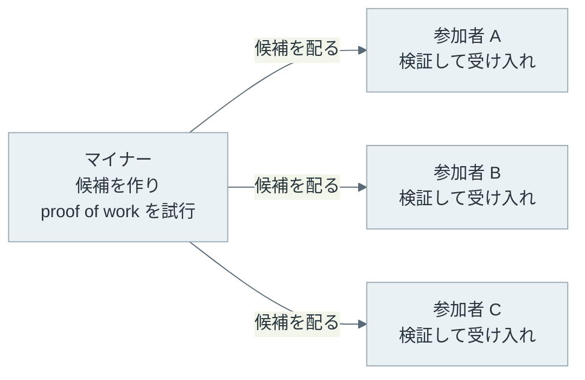
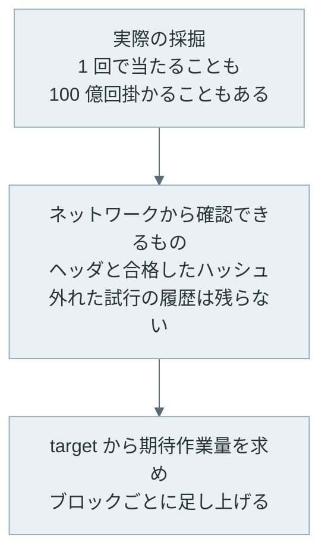
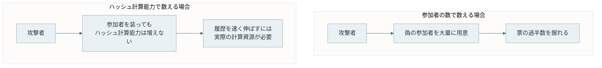
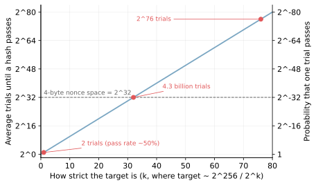
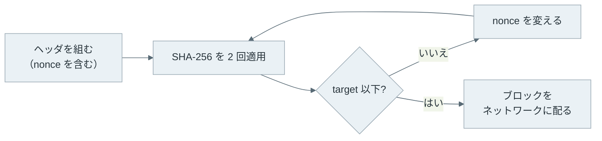
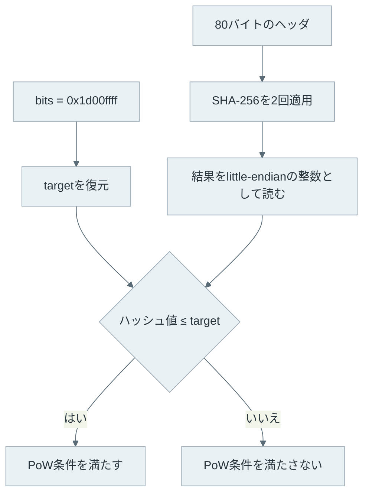
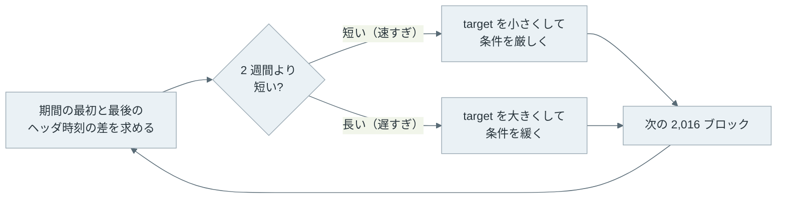
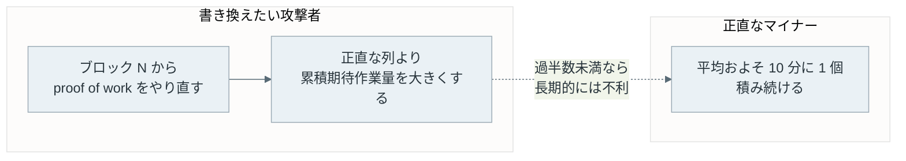

proof of work（作業証明）は、条件を満たすハッシュ値の提示を参加者に課す仕組みで、その値を見付けるには平均すると大量のハッシュ計算が必要です。作る側は合格が出るまで試行を繰り返す一方、入力とハッシュ値の組を受け取った側は、同じ入力に同じハッシュ計算を 1 度やり直すだけで、条件の成立を確かめられます。

Bitcoin のブロックは、取引の並びを全参加者で共有するための単位でした。誰かがその並びの末尾に追加する役を担う必要があるものの、Bitcoin には登録も許可も無く、役を任せる相手を選ぶ名簿が存在しません。

Bitcoin は proof of work を使い、計算作業を競わせてブロックの追加を決めます。Bitcoin の設計を述べた[白書](https://bitcoin.org/bitcoin.pdf)は、この仕組みを Adam Back の Hashcash（電子メールの送信に少量の計算を課して大量送信を防ぐ提案）に似たものとして導入しています。

Bitcoin では、ブロックが有効な候補として受け入れられるには proof of work を満たす必要があります。ブロックの候補を作り、合格のハッシュを探す参加者をマイナー（miner）、この探索を採掘（マイニング）と呼びます。マイナーと他の参加者の関係を以下に示します。



上記の図のとおり、マイナーは候補をネットワークに配るだけで、受け取った各参加者が proof of work と他の規則を検証し、有効な候補として扱います。どの候補を自分の履歴に採用するかは、チェーンの累積した作業量も比較して決めます。権利を配る主体は居ません。

<br>

本記事では、Bitcoin の proof of work が、計算作業をブロック追加の条件にする仕組みを説明します。計算作業が票になる理由から始めて、次の疑問を取り上げます。

- 名簿の無いネットワークで、なぜ計算作業が多数決の票になるのか。
- 合格の条件を数で表した時、試行回数はどれだけばらつくのか。
- 合格のハッシュは、なぜ総当たりで探すしかないのか。
- ハッシュ計算能力が変わっても、なぜブロックの平均の間隔が保たれるのか。
- 過去の取引の書き換えは、なぜ難しくなるのか。

ブロックとヘッダの構造は [Bitcoin Block](../bitcoin-block/) の内容を前提にします。採掘用ハードウェアの詳細や報酬の経済性は本記事では扱いません。

---

### 計算作業が票になる理由

合格を得るために平均して必要な作業量は「期待作業量」、単位時間あたりに実行できるハッシュ計算の量は「ハッシュ計算能力」と、以下では呼び分けます。合格の条件は target という基準値で表し、target が小さいほど合格は難しくなります（次の節で説明します）。

2 人のマイナーがほぼ同時に合格すると、チェーンの末尾が分岐します。その時、各参加者は累積した期待作業量が最も大きい列を正しい履歴として採用します（[Bitcoin Block](../bitcoin-block/)）。どの列が正しいかを決める多数決では、累積した期待作業量が票になります。

注意点として、提示されたハッシュ値は、実際に行われた計算の回数を証明しません。運が良ければ 1 回目の試行で合格することもあり、受け取った側から実際の回数は分かりません。proof of work を支えるのは、合格を得るには平均で大量の試行が必要で、検証は 1 回の計算で済むという非対称性です。

以下は、実際の回数と、ネットワークが評価する量の関係です。



上記の図のとおり、各参加者は、各ブロックの target から期待作業量を求めて足し上げ、その累積で列を比較します。Bitcoin Core が列の比較に使う chainwork も、この累積で、実行された [SHA-256](/notes/security/sha-256/) の回数の記録ではありません。

名簿の無いネットワークでは、この票を参加者の数で数えられません。白書は、この問題を「多数決の基準を 1 IP アドレス 1 票にすると、多数の IP アドレスを確保できる者に乗っ取られ得る。proof of work は本質的に 1 CPU 1 票である」と説明しています。1 人が多数の参加者を装う攻撃はシビル攻撃（Sybil attack）と呼ばれ、安く量産できるものを票に使う限り避けられません。

なお、白書の CPU は、採掘の主力が ASIC（Application-Specific Integrated Circuit、SHA-256 の計算だけを高速に行う採掘専用チップ）に移った現在では、ハッシュ計算能力と読み替えられます。

例えば、票の数え方を変えると、次のような違いが生じます。



上記の図の右側では、ブロックを見付ける機会がハッシュ計算能力に紐付いています。偽の参加者を増やしてもハッシュ計算能力は増えないため、履歴を伸ばす力は増えません。ハッシュ計算能力を増やすには現実の計算資源とそれを動かすコストが必要なため、票の偽造に実費が掛かります。Bitcoin は、参加者の身元ではなく物理的な資源の消費に安全の根拠を置いています。

---

### target - 数で表した合格の条件

ヘッダに SHA-256（Secure Hash Algorithm 256、出力が 32 バイト = 256 ビットのハッシュ関数）を 2 回適用したハッシュ値を 256 ビットの数として読み、その値が target と呼ぶ基準値を超えなければ合格です。ハッシュを 2 回重ねる理由は白書に書かれていないため、本記事では規則としてそのまま扱います。

target はヘッダの bits 項目に圧縮して収められており、[Bitcoin Block](../bitcoin-block/) のヘッダの表で「合格条件（target）の圧縮表現」と書いた項目が、この target です。

<br>

SHA-256 の出力に既知の偏りは見付かっておらず、確率の計算では、2^256 通りある 256 ビットの値のどれも同じ確からしさで出るとみなします。この見方に立つと、1 回の試行が合格する確率は「target 以下の値の個数 ÷ 2^256」で決まります。

target を半分にすれば合格の確率もほぼ半分に、必要な試行回数の平均はほぼ 2 倍になります。

0 も合格するので、正確な合格確率は `(target + 1) / 2^256` です。target をおよそ `2^(256-k)` とすると、合格確率（pass rate）は約 `2^-k`、平均試行回数（average trials）は約 `2^k` になります。以下の図は、この近似を使った期待作業量です。k を大きくした時の 2 つの値は以下の通りです。



上記の図のとおり、合格までの平均試行回数は k に対して指数的に増えます。一方で、検証はハッシュを 1 回実行するだけで済みます。

図の値は平均で、1 回ごとの試行回数は大きくばらつきます。k = 16（平均 65,536 回）として、探索を 1,000 回繰り返しました。ヘッダに見立てた乱数の 76 バイトと 4 バイトの nonce に SHA-256 を 2 回適用し、計算には Python 3.14 の hashlib を使っています。合格までの試行回数は次の通りです。

```text
k=16 runs=1000 expected=65536
min=41 median=43446 mean=61197 max=501305
```

最短は 41 回、最長は 50 万回を超え、平均の 7 倍以上掛かりました。合格したハッシュ値からは、41 回で当たったのか 50 万回掛かったのかを区別できず、最初の節で述べたとおり、ネットワークが数えるのは target から求めた期待作業量だけです。

---

### nonce の探索と総当たり

マイナーは、ヘッダの中の nonce という値を変えながらハッシュを計算し、target 以下の値が出るまで繰り返します。以下は、作業の全体です。



上記の図の試行の繰り返しが採掘で、合格のハッシュが出た時点で、ブロックを有効な候補としてネットワークに配れます。

近道として考えられるのは、target 以下のハッシュ値から入力を逆算する方法と、入力を少し変えた時の出力を予測して、当たりを絞る方法です。SHA-256 にはそのどちらも知られておらず、入力を少しずつ変えては出力を確かめる総当たりより、必要な試行回数を減らせる方法も見付かっていません。

近道が見付かればこの前提は崩れます。逆算の難しさは [Hash Function](../hash-function/) の「3 つの耐性」で、近道が見付かった関数の扱いは同じノートの欠点で説明しています。

総当たりの骨格をコードにすると、以下のようになります。header はヘッダを規約どおりに直列化した 80 バイトで、nonce は末尾の 4 バイトに入ります。

```go
// mine は、2 回の SHA-256 が target 以下になる nonce を探します。
func mine(header []byte, target *big.Int) (uint32, bool) {
	buf := make([]byte, len(header))
	copy(buf, header)
	for nonce := uint32(0); ; nonce++ {
		binary.LittleEndian.PutUint32(buf[76:], nonce)
		first := sha256.Sum256(buf)
		second := sha256.Sum256(first[:])
		// Go の SHA-256 が返すバイト列を、Bitcoin の proof of work 判定で
		// 使う整数の表現に合わせて反転する
		slices.Reverse(second[:])
		if new(big.Int).SetBytes(second[:]).Cmp(target) <= 0 {
			return nonce, true
		}
		if nonce == math.MaxUint32 {
			// nonce を使い切った。ヘッダの別の項目を変えて再挑戦する
			return 0, false
		}
	}
}
```

上記のコードの反転は、ハッシュ値の整数としての読み方を Bitcoin の判定に合わせる処理です。外れたハッシュは捨てるだけで、次の試行には引き継がれません。

nonce は 4 バイトなので、全て試しても約 43 億通り（2^32 通り）です。target の節の図で引いた破線がこの上限で、例えば合格の確率が 1/2^76 ほどの水準では、43 億回を全て試しても合格する確率は 2^-44 ほどしかありません。しかも現在の採掘装置は毎秒それを超える回数を計算します。nonce を使い切ったら、ヘッダの別の場所を変えて続けるしかありません。

ヘッダには、ブロック内の全取引から計算した[ルートハッシュ](../bitcoin-merkle-tree/)が入っており、取引が 1 つ変わればヘッダも変わります。先頭の取引は、ブロックを作ったマイナーが報酬を自分宛に受け取るコインベース取引です。nonce が一巡するたびに、コインベース取引の中の extraNonce という領域を増やしてルートハッシュを作り直せば、nonce の全パターンをもう一度試せます（[Bitcoin Wiki](https://en.bitcoin.it/wiki/Block_hashing_algorithm)）。

<br>

合格した nonce は、横取りしても自分のブロックには使えません。nonce が合格するのはそのヘッダ全体のハッシュに対してだけなので、報酬の宛先を自分に変えるとコインベース取引が変わり、ルートハッシュ経由でヘッダも変わり、それまでの合格は引き継がれません。新しいハッシュ値で条件を満たすか、改めて確かめる必要があります。作業の成果は、作業を始める前に固定したブロックの中身（報酬の宛先を含む）にしか使えません。

---

### 実際のヘッダによる合格判定

採掘で合格する値を探す代わりに、すでに見つかっている値を検証してみます。対象は Bitcoin メインネットの最初のブロック（genesis block）です。[Bitcoin Core の chainparams.cpp](https://github.com/bitcoin/bitcoin/blob/v30.0/src/kernel/chainparams.cpp) に、ヘッダを作る値と期待されるハッシュ値が記載されています。

ヘッダの材料は次の通りです。ルートハッシュの全桁は、後述のコードに記載しています。

| 項目 | 値 |
| --- | --- |
| version | 1 |
| 直前のブロックのハッシュ | 32 バイトすべて 0 |
| Merkle root | `4a5e1e4b…fdeda33b`（表示順） |
| 時刻 | 1231006505（Unix 時刻） |
| bits | `0x1d00ffff` |
| nonce | 2083236893 |

この bits は、係数 `0x00ffff` と指数 `0x1d` に分けて読めます。この値に対する target は `0x00ffff × 256^(0x1d - 3)` です。一般の bits の検証では、負の値や範囲外の値なども拒否する必要がありますが、ここでは既知の正しい値を展開します。



[verify_genesis.py](lab/verify_genesis.py) は、80 バイトのヘッダを組み立て、上記の比較を行う Python 標準ライブラリだけのスクリプトです。ネットワークには接続しません。リポジトリのルートから実行できます。

以下が `verify_genesis.py` の全体です。

```python
"""Verify the mainnet genesis header, then change its nonce. No network access.
Reference: Bitcoin Core v30.0 src/kernel/chainparams.cpp (genesis constants).
This checks only the hash/target comparison, not full block validity.
"""

from hashlib import sha256
from pathlib import Path
import struct

merkle_root = '4a5e1e4baab89f3a32518a88c31bc87f618f76673e2cc77ab2127b7afdeda33b'
bits = 0x1D00FFFF
nonce = 2083236893
header = (
    struct.pack('<I', 1)
    + bytes(32)
    + bytes.fromhex(merkle_root)[::-1]
    + struct.pack('<III', 1231006505, bits, nonce)
)
assert len(header) == 80
# For this known positive compact target (exponent >= 3).
# This is not a general-purpose decoder for untrusted nBits values.
exponent = bits >> 24
coefficient = bits & 0x007FFFFF
target = coefficient << (8 * (exponent - 3))


def block_hash(data):
    return sha256(sha256(data).digest()).digest()


original = block_hash(header)
assert original[::-1].hex() == '000000000019d6689c085ae165831e934ff763ae46a2a6c172b3f1b60a8ce26f'
changed = block_hash(header[:76] + struct.pack('<I', nonce + 1))
assert int.from_bytes(original, 'little') <= target
assert int.from_bytes(changed, 'little') > target
lines = [
    f'header_bytes={len(header)}',
    f'bits={bits:08x}',
    f'target={target:064x}',
    f'nonce={nonce}',
    f'hash={original[::-1].hex()}',
    'hash <= target: PASS',
    f'changed_nonce={nonce + 1}',
    f'changed_hash={changed[::-1].hex()}',
    'changed_hash <= target: FAIL',
    'Assertions: PASS',
]
summary = '\n'.join(lines) + '\n'
Path(__file__).with_name('output.txt').write_text(summary)
print(summary, end='')
```

```bash
python3 content/notes/blockchain-systems/proof-of-work/lab/verify_genesis.py
```

以下は、実際の[出力](lab/output.txt)です。ハッシュ値は、ブロックの識別子として通常使われる表示順で示しています。

```text
header_bytes=80
bits=1d00ffff
target=00000000ffff0000000000000000000000000000000000000000000000000000
nonce=2083236893
hash=000000000019d6689c085ae165831e934ff763ae46a2a6c172b3f1b60a8ce26f
hash <= target: PASS
changed_nonce=2083236894
changed_hash=9b227a4a5daa0cbae6874144bc5d7797d0513e320aceadeb3b06304971a41b1c
changed_hash <= target: FAIL
Assertions: PASS
```

最初のハッシュ値は target 以下なので合格しました。nonce を 1 増やした場合は、大きく異なるハッシュ値になり、この例では不合格です。元の値に近い nonce が、条件を満たすハッシュ値に近づくわけではありません。

検証に必要なのは、このヘッダのハッシュを再計算することだけでした。2083236893 という nonce の値は、採掘者がその回数だけ試した証拠ではありません。また、このスクリプトはハッシュ値と target の比較だけを行います。取引の正しさや、その高さで要求される bits かどうかまで確認するブロック全体の検証とは範囲が異なります。

---

### 難易度の調整と平均 10 分

難易度は合格の厳しさを表す値で、target が小さいほど高くなります。ネットワーク全体のハッシュ計算能力は、装置の追加や撤退で常に変わります。target が固定なら、ハッシュ計算能力が増えるほどブロックの平均の間隔は縮み、[Bitcoin Block](../bitcoin-block/) で前提にした「およそ 10 分に 1 個」は保てません。

このずれを補正する規則は次のとおりです。[Bitcoin Developer Guide](https://developer.bitcoin.org/devguide/block_chain.html) によると、2,016 ブロックごとに、期間の最初と最後のブロックのヘッダ時刻の差を求め、理想値の 1,209,600 秒（2 週間、10 分 × 2,016 ブロック）と比べて target を比例配分で調整します。1 回の調整幅には上限があり、難易度を上げる方向は 4 倍（+300%）、下げる方向は 4 分の 1（−75%）までです。

[Bitcoin Core の実装](https://github.com/bitcoin/bitcoin/blob/v30.0/src/pow.cpp)で時刻を比較するのは、2,016 個のブロックの両端です。実際の差は 2,015 区間分ですが、比較する基準は 2,016 区間分の 2 週間です。ここでは Bitcoin メインネットの規則を扱っています。

この調整が目指すのは、長期的な平均がおよそ 10 分に戻ることだけです。個々のブロックの間隔は試行の運でばらつき、参加するハッシュ計算能力が急に変わっても、次の調整までは前の target のまま進みます。

以下が調整の繰り返しです。



上記の図の実測に使う時刻は、マイナーが申告するヘッダの時刻です。全参加者が同じヘッダの列から同じ規則で次の target を計算できるため、難易度の調整に管理者は必要ありません。申告された時刻をどこまで信用するか、偽装にどう耐えるかの検証規則は、本記事では扱いません。[Bitcoin Block](../bitcoin-block/) のノートで「条件の厳しさは自動で調整される」と書いた仕組みの中身が、この 2,016 ブロックごとの再計算です。

---

### 書き換えのコスト

[Bitcoin Block](../bitcoin-block/) では、過去の取引を書き換えると後続の全ヘッダの作り直しが必要だと説明しました。その作り直し 1 回ごとにコストを課しているのが proof of work です。白書には「過去のブロックを書き換えるには、そのブロックと後続の全ブロックの proof of work をやり直し、さらに正直なノードの作業に追い付いて追い越す必要がある」と書かれています。

正直なマイナーは、規則どおりにブロックを作り、見つけたらすぐ公開する参加者です。追い付く必要があるのは、書き換えの間もその列が伸び続けるからです。白書は「CPU 能力の過半数を正直なノードが握っていれば、正直なチェーンが最も速く伸び、競合するどのチェーンも引き離す」とも述べています。逆に言えば、書き換えの難しさはハッシュ計算能力の過半数を正直なマイナーが持つことを前提にしており、そこが崩れた場合の保証はありません。

以下は、攻撃者が強いられる競争です。



上記の図の競争では、攻撃者のハッシュ計算能力が過半数未満でも、一時的に追い付くことはあり得ます。ただし、取引の後に続くブロックが増えるほど、追い付く確率は下がります。白書も、追い付くべきブロック数が増えるほど攻撃者の成功確率は指数的に下がると分析しています。この確率と[確認数](../bitcoin-block/)の関係から、取引がブロックに入った直後には支払い完了と判断せず、後続のブロックを待ちます。

---

### 利点

- 参加に許可も名簿も必要なく、誰でも採掘と検証に加われる
- 生成には平均して大きな作業量が必要な一方、検証は 1 度の計算し直しで済む
- 偽の参加者を量産しても、ブロック追加の多数決の票は増えない
- 難易度の調整によって、参加するハッシュ計算能力が増減してもブロック間隔の長期的な平均がおよそ 10 分に戻る

---

### 欠点

proof of work は、票の偽造を防ぐために電力と装置を使い続けます。その代わりに、次の欠点を抱えます。

- 採掘の計算は合格のハッシュを探すことだけに使われ、大きなハッシュ計算能力の維持には装置と電力のコストが必要
- ブロック間隔の平均を保つ設計のため、取引が取り込まれるまでの待ち時間は縮まらない
- ハッシュ計算能力の過半数を握る主体が現れると、書き換えを防ぐ前提が崩れる
- 採掘が装置の性能競争になり、ハッシュ計算能力が専用ハードウェアを持つ参加者に集中しやすい

1 番目の電力は、proof of work への批判で最も多く挙がる点です。計算そのものは合格探し以外の意味を持ちません。しかし、この消費こそが票の偽造を高価にしているので、消費を削れば安全の根拠も一緒に弱まります。

---

### 適さないケース

- 参加者の名簿がある許可制のネットワーク。参加者が既知なら、[Leader and Followers](../../distributed-systems/leader-and-followers/) のような構成や[クォーラム](../../distributed-systems/quorum/)を使う合意方式など、参加者を前提にした方法を選べる
- 秒単位で確定してほしい決済や更新（ここで扱った Bitcoin の作りでは、ブロックの間隔と確認の積み上げを待つ）
- 電力と装置のコストを正当化できない規模のシステム

参加者を特定できるネットワークでは、計算作業で票を与える必要があるかを検討します。参加者を選べる場合の合意方式と比べて、装置と電力に掛かるコストを判断します。
