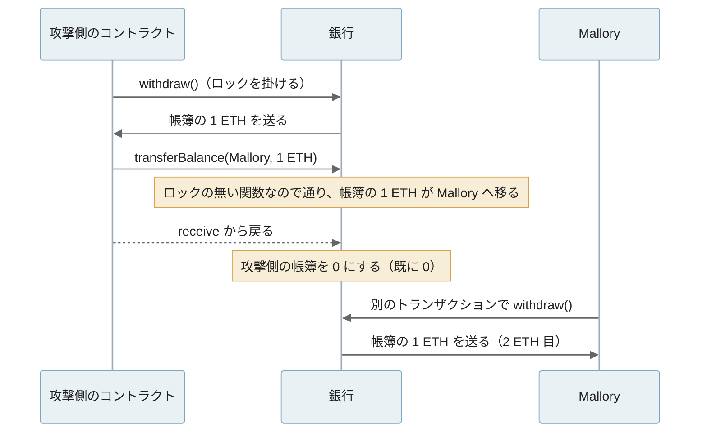

リエントランシー（reentrancy）は、[スマートコントラクト](../smart-contract/)が外部のアドレスへ ETH を送ったり、別のコントラクトを呼んだりしている途中に、呼ばれた側から元のコントラクトの関数を呼び直されることです。残高を減らす前に送金する実装では、呼び直された関数がまだ減っていない残高を読み、同じ預け金を何度も払い出します。この穴を突く攻撃をリエントランシー攻撃と呼びます。

リエントランシーが起きる場所は、ETH の送金に限りません。[Solidity のドキュメント](https://docs.soliditylang.org/en/v0.8.28/security-considerations.html#reentrancy)が書く通り、他のコントラクトの関数を呼ぶ処理はすべて、相手にコードを実行させる機会になります。[NFT の規格の ERC-721](../erc-721/) のように、トークンの受け渡しの途中で受け手の関数を呼ぶ規格もあります。

<br>

以下、預け金を引き出せる「銀行」のコントラクトを例にします。銀行には他の人の預け金と攻撃者の 1 ETH を合わせて 11 ETH があり、攻撃者は引き出しの関数 `withdraw` を 1 回だけ呼びます。以下は、送金を受け取った攻撃側が `withdraw` を呼び直し、呼び出しが入れ子に積み重なる様子を描いた図です。



上記の図の帯の幅は、それぞれの関数が動いている時間を表しています。残高を 0 にする処理（`balances[msg.sender] = 0`）は、各帯の右端、つまり内側の呼び出しがすべて戻った後にしか実行されません。

<br>

本記事では、手元のローカルチェーンでリエントランシー攻撃を再現し、銀行の残高の推移から対策の効き方を説明します。扱う疑問は次の通りです。

- 送金の途中で、なぜ相手のコードが動くのか。
- 2016 年の The DAO では、何が起きたのか。
- 状態を先に更新する書き方とロックは、それぞれ何を防ぐのか。
- ロックを付けても防げない、関数をまたぐリエントランシーと読み取り専用のリエントランシーはどう起きるのか。
- 送金の gas を 2300 に絞る対策は、なぜ今は勧められないのか。

署名の使い回しや[オラクルの価格操作](../oracle/)のような、リエントランシーとは別の攻撃は扱いません。

---

### 外部呼び出しで制御が移る

[EVM](../evm/) は 1 本のトランザクションを 1 本の流れで実行します。コントラクト A が B を呼ぶと、A の実行は B が終わるまで止まり、その間は B のコードが動きます。B がコントラクトなら、ETH を受け取っただけでも `receive` または `fallback` という関数が動きます。B はその中で、止まっている A の関数を含め、どの関数でも呼べます。並列に動くスレッドはありません。同期的な呼び出しが入れ子になるだけで起きる問題です。

例えば、預かった ETH を引き出す次の銀行は、送金の後に残高を 0 にしています。

```solidity
function withdraw() external {
    uint256 amount = balances[msg.sender];
    require(amount > 0, "no balance");
    (bool ok, ) = msg.sender.call{value: amount}(""); // ここで制御が相手に移る
    require(ok, "send failed");
    balances[msg.sender] = 0; // 相手が戻ってくるまで、残高は減っていない
}
```

`msg.sender`（呼び出し元のアドレス）への `call{value: amount}("")` は、相手に ETH と、残りの [gas](../gas-eip-1559/)（命令の実行に掛かる計算量の単位）のほぼすべて（[EIP-150](https://eips.ethereum.org/EIPS/eip-150) の規則で 63/64）を渡して相手のコードを動かします。相手の `receive` がもう一度 `withdraw` を呼ぶと、2 回目の `withdraw` は 1 回目と同じ `balances[msg.sender]` を読みます。1 回目の `= 0` はまだ実行されていないからです。

---

### 手元で再現した攻撃

実験には、[Foundry](https://github.com/foundry-rs/foundry) のローカルノード [Anvil](https://getfoundry.sh/anvil/overview) 1.7.1 と Solidity コンパイラ 0.8.28 を使いました。実行は 2026 年 11 月 11 日で、EVM の規則は 2024 年 3 月のハードフォーク Cancun のものに固定しています（実行環境は [lab/output/environment.txt](https://github.com/nao1215/debimate/blob/main/content/notes/blockchain-systems/reentrancy/lab/output/environment.txt)）。

ローカルの Anvil だけを使い、公開のネットワークや実際の資産には接続していません。アカウントは Anvil が既定で作るテスト用のもので、秘密鍵が広く公開されている説明用の無価値な鍵です。

<br>

Alice と Bob が 5 ETH ずつ銀行に預けた後、攻撃者の Mallory が自分のコントラクトから 1 ETH を預け、`withdraw` を 1 回だけ呼びます。攻撃側のコントラクトの要所は次の通りです（`receive` の中の、関数をまたぐ実験の分岐は省略しています）。

```solidity
function attack(bool crossFunction_) external payable {
    crossFunction = crossFunction_;
    bank.deposit{value: msg.value}();
    bank.withdraw();
}

receive() external payable {
    calls++;
    emit Received(calls, address(bank).balance); // 届くたびに銀行の残高を記録する
    if (address(bank).balance >= msg.value) {
        try bank.withdraw() {} catch (bytes memory r) { emit Rejected(calls, r); }
    }
}
```

ETH が届くたびに、銀行にまだ 1 ETH 以上あれば `withdraw` を呼び直します。呼び直しが拒否された時は、`try` で受け止めて理由をログに残し、トランザクション全体は成功させます。`crossFunction_` は後の節で使う切り替えです。銀行と攻撃側のコントラクトの全体は [lab/Bank.sol](https://github.com/nao1215/debimate/blob/main/content/notes/blockchain-systems/reentrancy/lab/Bank.sol)、トランザクションを送るスクリプトは [lab/run.py](https://github.com/nao1215/debimate/blob/main/content/notes/blockchain-systems/reentrancy/lab/run.py) にあります。説明用の実装で、監査は受けていません。

最初の節の脆弱な銀行を攻撃した結果は次の通りです。

```text
  VulnerableBank: tx ok, gas used 172,961
    bank balance after each ETH arrival: 10 -> 9 -> 8 -> 7 -> 6 -> 5 -> 4 -> 3 -> 2 -> 1 -> 0 ETH
    bank 0 ETH (was 11 ETH), attacker contract 11 ETH, alice ledger 5 ETH
    alice withdraw() -> reverted
```

1 回のトランザクションで ETH が 11 回届き、銀行の 11 ETH はすべて攻撃側のコントラクトに移りました。帳簿の上では Alice の預け金は 5 ETH のままですが、銀行に ETH が無いので、Alice の `withdraw` は失敗（revert。トランザクションを取り消して状態を元に戻す）します。後で説明する 3 つの対策（状態を先に更新する CEI 版と、2 種類のロック版）を入れた銀行に、同じ攻撃をした結果と並べたのが次の図です。



対策を入れた 3 つの銀行では、2 回目の `withdraw` が拒否され、攻撃者は自分の 1 ETH を取り戻しただけで終わりました。出力の全体は [lab/output/output.txt](https://github.com/nao1215/debimate/blob/main/content/notes/blockchain-systems/reentrancy/lab/output/output.txt) にあります。

---

### The DAO の事件

The DAO は、Slock.it が公開した [DAO（Decentralized Autonomous Organization）のフレームワーク](https://github.com/slockit/DAO/tree/v1.0)で作られ、集めた ETH の使い道をトークンを持つ人の投票で決めるコントラクトでした。

2016 年 6 月 17 日、Ethereum Foundation のブログは、攻撃者が The DAO の ETH を子 DAO（The DAO から分かれた別のコントラクト）へ流し出している最中だと[警告しました](https://blog.ethereum.org/2016/06/17/critical-update-re-dao-vulnerability)。原因は「再帰的な呼び出し（recursive calling）」の脆弱性で、攻撃者は、出資者が自分の取り分の ETH を持って新しい子 DAO へ抜けるための分割の関数（ソースでは `splitDAO`）をその実行の中から繰り返し呼んでいました。[ethereum.org の歴史のページ](https://ethereum.org/en/history/#dao-fork)によると、流出したのは 360 万 ETH 以上です。

当時のソース（[slockit/DAO の v1.0](https://github.com/slockit/DAO/blob/v1.0/DAO.sol#L667-L669)）の `splitDAO` は、末尾で次の順に処理しています。

```solidity
withdrawRewardFor(msg.sender); // be nice, and get his rewards
totalSupply -= balances[msg.sender];
balances[msg.sender] = 0;
```

`withdrawRewardFor` は報酬を送るために、[`payOut`](https://github.com/slockit/DAO/blob/v1.0/ManagedAccount.sol#L57-L66) の中で `_recipient.call.value(_amount)()` を呼びます。実験の脆弱な銀行と同じく、送金で受け手のコードが動いた時点では、`balances[msg.sender] = 0` がまだ実行されていません。Cornell 大学の Phil Daian の[分析](https://web.archive.org/web/20160622021345/http://hackingdistributed.com:80/2016/06/18/analysis-of-the-dao-exploit/)は、受け手から `splitDAO` を呼び直すと、同じ残高を元にした分割が何度も通ることを示しています。

<br>

子 DAO に移った ETH は、作成の期間として約 27 日間は引き出せない仕組みでした。その間に Ethereum のコミュニティは[ハードフォーク](../ethereum-hard-forks/)を選び、[ブロック 1,920,000](https://eips.ethereum.org/EIPS/eip-779) で、The DAO と攻撃者のものを含む子 DAO の ETH、[約 1,200 万 ETH](https://blog.ethereum.org/2016/07/20/hard-fork-completed) を回収用のコントラクト WithdrawDAO に移しました。

EVM の命令などの規則は変えず、特定のアカウントの残高を 1 回だけ書き換える変更です。この変更を受け入れなかった参加者の列は Ethereum Classic として続いています。規則の切り替えで履歴が 2 本に分かれる仕組みは [Blockchain Basics](../blockchain-basics/) で、ハードフォークという更新の進め方は [Ethereum のハードフォーク](../ethereum-hard-forks/)のノートで扱っています。

---

### 状態を先に更新する

最も基本の対策は、外部を呼ぶ前に自分の状態を更新し終えることです。関数の中を検査（checks）、状態の更新（effects）、外部とのやり取り（interactions）の順に並べるので、checks-effects-interactions（CEI）と呼ばれます。Solidity のドキュメントも、[外部とのやり取りを関数の最後に置く](https://docs.soliditylang.org/en/v0.8.28/security-considerations.html#use-the-checks-effects-interactions-pattern)よう勧めています。

```solidity
function withdraw() external {
    uint256 amount = balances[msg.sender];   // checks
    require(amount > 0, "no balance");
    balances[msg.sender] = 0;                // effects
    (bool ok, ) = msg.sender.call{value: amount}(""); // interactions
    require(ok, "send failed");
}
```

脆弱な銀行と違うのは、`balances[msg.sender] = 0` の位置だけです。呼び直された 2 回目の `withdraw` は残高 0 を読み、`no balance` で止まります。

```text
  CeiBank: tx ok, gas used 74,080
    bank balance after each ETH arrival: 10 ETH
    reentry #1 rejected: no balance
```

<br>

#### pull 型の支払い

CEI をさらに進めて、送金そのものを別の関数に切り出す形もあります。例えば、オークションで高い入札が来た時に前の入札者へすぐ返金する（push 型）代わりに、返金額を帳簿に記録しておき、本人に `withdraw` で引き出してもらいます（pull 型）。Solidity のドキュメントは、[Withdrawal from Contracts](https://docs.soliditylang.org/en/v0.8.28/common-patterns.html#withdrawal-from-contracts) としてこの形を勧めています。

pull 型にすると、外部を呼ぶ場所が、残高を 0 にしてから送るだけの小さな関数 1 つにまとまります。受け取りを常に失敗させる相手がいても、失敗するのはその相手の引き出しだけで、入札の処理は止まりません。

---

### ロックで呼び直しを拒む

CEI は関数ごとの並び順の約束なので、関数が長くなると守れているかを確かめにくくなります。そこで、関数の入口で旗を立て、旗が立っている間の呼び出しを拒むロックを併用します。[OpenZeppelin Contracts](https://github.com/OpenZeppelin/openzeppelin-contracts) の [ReentrancyGuard](https://github.com/OpenZeppelin/openzeppelin-contracts/blob/v5.7.0/contracts/utils/ReentrancyGuard.sol#L69-L106) は、`nonReentrant` という modifier（関数の前後に処理を挟む Solidity の記法）でこれを提供しています。v5.7.0 の要所は次の通りです（コメントは要約に差し替えています）。

```solidity
modifier nonReentrant() {
    _nonReentrantBefore();
    _;
    _nonReentrantAfter();
}

function _nonReentrantBefore() private {
    _nonReentrantBeforeView(); // 旗が ENTERED なら ReentrancyGuardReentrantCall() で revert
    _reentrancyGuardStorageSlot().getUint256Slot().value = ENTERED;
}
```

関数の本体を実行する前に旗を `ENTERED`（2）にし、終わったら `NOT_ENTERED`（1）に戻します。実験では、脆弱な銀行の `withdraw` の並び順を変えずに `nonReentrant` を付けただけで、呼び直しが `ReentrancyGuardReentrantCall()` で拒否されました（攻撃の節の図の青い線）。

<br>

#### transient storage の旗

旗を storage（コントラクトがチェーン上に持ち続ける領域）に置くと、呼び出しのたびに storage を書き換える gas が掛かります。2024 年 3 月の Cancun で入った [EIP-1153](https://eips.ethereum.org/EIPS/eip-1153) の transient storage は、トランザクションが終わると消えるストレージで、ロックの旗のようにトランザクションの間だけ要る値に向いています。

OpenZeppelin は v5.1 から、旗を transient storage に置く [ReentrancyGuardTransient](https://github.com/OpenZeppelin/openzeppelin-contracts/blob/v5.7.0/contracts/utils/ReentrancyGuardTransient.sol) を加えました。v5.7.0 のソースは、storage 版を非推奨とし、v6.0 で transient 版に置き換えると注記しています。

同じ銀行に Alice が 1 ETH を預けて引き出す、攻撃の無いトランザクションの gas を比べると、次の通りでした。

| 銀行 | deposit（gas） | withdraw（gas） |
|---|---|---|
| ロック無し（脆弱な版・CEI 版とも） | 43,623 | 28,729 |
| ReentrancyGuard（storage） | 46,341 | 31,447 |
| ReentrancyGuardTransient | 44,443 | 29,549 |

1 回の呼び出しあたり、storage の旗は約 2,700、transient の旗は 820 の gas が増えました。transient storage は Cancun 以降の EVM でしか使えないので、他のチェーンに置く時は、そのチェーンが EIP-1153 に対応しているかを確かめる必要があります。

---

### 関数をまたぐリエントランシー

ロックは、付けた関数にしか効きません。呼び直されるのが同じ関数とは限らず、同じ状態を触る別の関数を呼ばれることもあります。これを関数をまたぐリエントランシー（cross-function reentrancy）と呼びます。

実験では、`withdraw` にだけ `nonReentrant` を付け、帳簿の残高を他人へ移す `transferBalance` にはロックを付けない銀行を用意しました。攻撃側は、ETH を受け取った時に `withdraw` ではなく `transferBalance` を呼び、まだ減っていない 1 ETH を Mallory 本人のアカウントへ移します。



```text
  GuardedBank: attacker contract got 1 ETH, mallory ledger 1 ETH, mallory withdraws it -> ok
    bank 9 ETH (victims deposited 10 ETH)
  TransientGuardedBank: transferBalance rejected: ReentrancyGuardReentrantCall()
```

1 ETH の預け金から 2 ETH が引き出され、被害者の預け金が 1 ETH 減りました。3 行目は、旗を transient storage（後述）に置き、`transferBalance` にも `nonReentrant` を付けた銀行です。OpenZeppelin のロックは 1 つのコントラクトで旗を 1 つだけ持つので、どちらの関数に入っても、もう一方の呼び直しを拒否できます。CEI 版の銀行でも、送金の前に残高が 0 になっているので、`transferBalance` は `no balance` で失敗しました。

The DAO でも、関数の組み合わせが穴になっていました。Daian の分析によると、攻撃者は `splitDAO` の最後で残高が 0 にされる前にトークンを別のアカウントへ移し、後で元のアカウントへ戻して、同じ攻撃を繰り返していました。

分析はさらに、修正版の DAO 1.1 では `withdrawRewardFor` も `splitDAO` も単独では穴が無いのに、2 つを組み合わせると同じ攻撃が成り立つことを示し、査読が関数を 1 つずつ確かめる形だったことが見落としの理由だろうと書いています。

<br>

#### 読み取り専用のリエントランシー

ロックは、状態を変える関数に付けるのが普通です。値を返すだけの `view` 関数にはロックが無く、呼び出しの途中の、まだ更新し終わっていない状態をそのまま返します。これを他のコントラクトが価格として読むと、自分にはリエントランシーの穴が無くても誤った値で動きます。この攻撃を読み取り専用のリエントランシー（read-only reentrancy）と呼びます。

2022 年に公開された [ChainSecurity の事後分析](https://web.archive.org/web/20221011152148/https://chainsecurity.com/curve-lp-oracle-manipulation-post-mortem/)によると、ETH を含む [Curve](https://curve.fi/)（トークンを交換する [AMM](../amm/)）のプールの `remove_liquidity` は、[LP トークン（プールの持ち分を表すトークン）](../amm/)を焼いて総量を減らした後、ETH を先に送ってから、もう一方のトークンを送っていました。ETH を受け取った攻撃側のコードが動く間は、プールの残高と LP トークンの総量が合っておらず、`get_virtual_price`（LP トークン 1 枚あたりの価値を返す `view` 関数）が通常より高い値を返します。



この値を価格の計算に使っていた MakerDAO（ETH などを担保にトークンを貸し出すプロジェクト）など複数のプロジェクトが操作を受け得る状態で、ChainSecurity は詳細の公開より前に Curve と各プロジェクトへ知らせていました。担保の評価がずれると何が起きるかは、[Lending](../lending/) のノートで扱っています。

OpenZeppelin は v5.5.0 で、`view` 関数に付ける `nonReentrantView` を加えました。旗が立っている間に呼ばれると revert するだけで、旗は変えません。ただし、これで守れるのは自分の `view` 関数だけです。他のプロジェクトの値を読む側は、相手が呼び出しの途中ではないかを自分で確かめる必要があります。

---

### 2300 gas に頼る対策

Solidity の `transfer` と `send` は、受け手のコードに 2,300 gas だけを渡します。2,300 gas では storage を書き換えられないので、受け手は呼び直しても何もできず、リエントランシーの対策になると考えられていた時期がありました。

この前提は、命令の gas の値段が変わらないことに依存していました。2019 年のハードフォーク Istanbul で入った [EIP-1884](https://eips.ethereum.org/EIPS/eip-1884) は、storage を読む SLOAD を 200 から 800 gas に上げ、storage を読む受け取り用の関数が 2,300 gas を超える場合があると互換性の節で警告しています。

実験の Cancun の規則では、2021 年のハードフォーク Berlin の [EIP-2929](https://eips.ethereum.org/EIPS/eip-2929) でトランザクションの中で初めて読む SLOAD が 2,100 gas になっており、storage の値を 1 つ読んでログに出すだけの `receive` は、`transfer` では失敗しました。

```text
  payWithTransfer -> reverted; gas given to receiver 2,300, used 2,300, error: out of gas
  payWithCall     -> ok; gas given to receiver 2,922,297, used 3,342
```

`call` で送ると、受け手は 3,342 gas を使って成功しています。Solidity 0.8.31 は `send` と `transfer` に非推奨の警告を出すようになり、[リリースのお知らせ](https://www.soliditylang.org/blog/2025/12/03/solidity-0.8.31-release-announcement/)は代わりに空のデータの `call` を勧めています。

ただし、`call` は gas を絞らないので、リエントランシーは自分で防ぐ必要があります。お知らせも、transient storage のロックか CEI を挙げています。gas の値段の変更がデプロイ済みのコードに与えた影響は、[Ethereum のハードフォーク](../ethereum-hard-forks/)のノートで扱っています。

---

### 対策の利点

- CEI は追加の gas が要らず、送金の前に状態が確定しているので、呼び直しても同じ残高を二重に使えない
- pull 型にすると、外部を呼ぶ場所が 1 つの小さな関数に集まり、確かめる範囲が狭くなる
- ロックは関数の並び順を変えずに付けられ、同じ旗を持つ関数どうしの呼び直しをまとめて拒否できる
- transient storage のロックは、storage のロックより gas が少ない

### 対策の欠点

どの対策も、外部を呼ぶ間に自分の状態を他人に触らせないことでリエントランシーを防ぎます。その代わりに、次の制約があります。

- CEI は関数ごとの約束で、外部を呼ぶ処理が深い所に隠れていると守れているかを見落としやすい
- ロックは付けた関数にしか効かず、付け忘れた関数から関数をまたぐリエントランシーを受ける
- `nonReentrant` の関数どうしは互いに呼べず、内部の処理を private な関数に分ける必要がある
- pull 型では、受け取る人が自分で引き出すトランザクションを送る手間と手数料が増える

### 対策が効かないケース

- 相手が呼び出しの途中かどうかを確かめずに、別のコントラクトの `view` 関数の値を価格として使う場合
- 同じ状態を複数のコントラクトで分け持ち、ロックの旗がコントラクトごとに別になっている場合
- transient storage の無いチェーンに、ReentrancyGuardTransient を使ったコントラクトを置く場合（transient storage に書く命令の TSTORE を実行できず、関数が失敗する）

リエントランシーの対策は、自分のコントラクトの中の約束です。外部の値を信じて動く部分は、相手のコントラクトが更新の途中ではないかという別の問いとして残ります。
