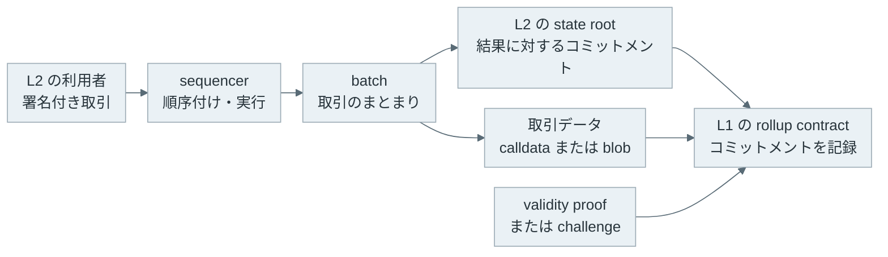
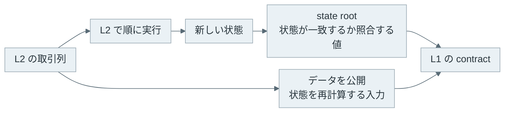

[Rollup](https://ethereum.org/en/developers/docs/scaling/rollups/) は、取引の実行と状態の更新を Layer 2（L2）でまとめ、Layer 1（L1）に検証に必要なデータまたは証明を送るスケーリング手法です。Ethereum を L1 とする rollup では、L2 の利用者が送った取引を sequencer（シーケンサー）が順に実行し、まとまりごとの結果を Ethereum に提出します。

例えば、Alice が 1 ETH を Ethereum から L2 の一つである OP Mainnet に預け、L2 上で Bob に 0.3 ETH を送ったとします。L2 の送金は数秒で残高に反映され、手数料も L1 より安くなります。しかし、Bob が受け取った ETH を Ethereum に戻す時は、[OP Mainnet の出金手順](https://docs.optimism.io/stack/transactions/withdrawal-flow) に従い、L1 で出金を証明してから 7 日間の challenge 期間を待ちます。L2 では数秒で済んだ送金が、L1 に戻す時は 1 週間かかります。



この待ち時間は、L2 の運営者を無条件に信用しないための仕組みから生まれます。L1 は公開された取引データを元に、challenge または証明で L2 の結果を確かめ、不正な更新を拒否します。

<br>

本記事では、L1 と L2 の役割、state root（状態ルート）と data availability（データ可用性）の違い、Optimistic Rollup と ZK Rollup が更新を検証する方法を説明します。

- L2 はどの処理を L1 の外へ出し、L1 には何を残すのか。
- state root だけでは、なぜ利用者が L2 の状態を再計算できないのか。
- 異議申し立てとゼロ知識証明では、いつ出金を確定できるのか。
- [EIP-4844](https://eips.ethereum.org/EIPS/eip-4844) の blob は、どのコストを下げ、どの問題を解決しないのか。

L1 に取引を入れるまでの流れは [Ethereum Transaction](../ethereum-transaction/)、L1 自体の取引確定の考え方は [Finality](../finality/) で説明しています。本記事でいう確定は、L2 の batch が各 rollup の規則を満たして L1 のコントラクトに受け入れられた状態を指します。L1 のブロックがどの程度巻き戻りにくいかという finality とは分けて扱います。

---

### L1 と L2 の分担

Ethereum では、取引をブロックに入れる時に全ての検証ノードが同じ順序で実行し、状態更新を確かめます。この性質は誰でも結果を検証できる根拠になりますが、計算とデータを各ノードが処理するため、取引の処理量には限りがあります。

rollup は、利用者の取引を L2 で実行してから、複数の結果を batch にまとめます。L1 は L2 の各取引を通常は一件ずつ再実行せず、batch に対応する状態へのコミットメントと、rollup が採用する検証材料を [Smart Contract](../smart-contract/) で受け取ります。取引を L2 内でまとめることで、L1 に載せる処理を減らせます。

ただし、L2 に順序を決める主体がいることと、その主体が状態を自由に改竄できることは同じではありません。利用者は sequencer が表示する残高だけを信用するのではなく、公開された取引データから計算した状態と L1 に記録されたコミットメントを照合できます。


- title: L2
  body: 利用者の取引を受け取り、順序を決めて実行し、batch と新しい状態を作ります。sequencer がこの役割を担う構成が多くあります。
- title: L1
  body: L2 のコミットメントと、取引データ、proof または challenge を受け取り、rollup の規則に従って更新を受け入れます。
- title: 利用者・検証者
  body: 公開されたデータから L2 の状態を復元・検証します。不正を発見した時に誰が challenge を提出できるかは実装ごとに確認が必要です。


冒頭の Bob の例のように、L2 が取引を受け付けた時点、batch を L1 に提出した時点、L1 の規則で出金を認める時点は一致しません。ウォレットに表示された「完了」だけから、L1 に戻す資産が既に引き出せるとは判断できません。

---

### state root と取引データ

L2 の state root は、アカウント残高やコントラクトの保存状態を Merkle tree（マークル木）などで要約した識別子です。状態の一部と Merkle proof があれば、その一部が特定の state root に含まれることを検証できます。[Merkle Tree](../merkle-tree/) で扱ったように、root が変われば対応する木の内容も変わります。

しかし、root は状態の要約であり、全ての取引や状態そのものではありません。新しい root と古い root だけが L1 にあっても、検証者はどの送金をどの順序で実行してその root になったかを再計算できません。

以下は、sequencer が自分の残高に 50 を足した状態の root を提出した場合に、検証者が公開された取引から root を再計算して照合する例です。説明を短くするため、Merkle tree ではなく残高の表全体の SHA-256 を root にしています。

```python
import hashlib
import json


def state_root(state):
    # 説明用に、残高の表全体の SHA-256 を root とする（実際の rollup は Merkle 木などを使う）
    data = json.dumps(state, sort_keys=True).encode()
    return hashlib.sha256(data).hexdigest()[:16]


def apply(state, txs):
    state = dict(state)
    for sender, to, amount in txs:
        if state.get(sender, 0) < amount:
            continue  # 残高不足の取引は無視する
        state[sender] -= amount
        state[to] = state.get(to, 0) + amount
    return state


before = {"alice": 100, "bob": 0, "sequencer": 0}
txs = [("alice", "bob", 30), ("bob", "alice", 5)]

honest = apply(before, txs)
forged = dict(honest, sequencer=honest["sequencer"] + 50)  # 自分に 50 を足した状態

print("提出された root:", state_root(forged))
print("再計算した root:", state_root(apply(before, txs)))
print("一致するか:", state_root(forged) == state_root(apply(before, txs)))
```

```text
提出された root: c3ce5aa78617464f
再計算した root: 8a5804b9396dccb7
一致するか: False
```

検証者が不正に気付けたのは、`before` と `txs` を入手できたからです。`txs` が無ければ、`c3ce5aa78617464f` が正しい root かどうかを確かめる手段はありません。

data availability は、検証者が必要な取引データを取得できる性質です。rollup が取引データを L1 に公開する場合、L2 の運営者がデータ配布を止めても、L1 のデータから別の参加者が状態を再計算できます。一方で、L2 の運営者や別の委員会だけが取引データを持ち、root だけを L1 に送る構成は validium などと呼ばれ、rollup とは区別されます。

例えば、[L2BEAT（2026 年に ETHBEAT へ改称）](https://ethbeat.org/scaling/summary) は、取引データを Ethereum に公開するものを Rollups とし、Validiums & Optimiums とは別の一覧に載せています。



L1 にデータがあっても、状態を復元するには、データを取得・実行するソフトウェア、実装された exit（退出・出金）の手順、L1 の手数料が別に必要です。data availability は、その前提の一つです。

---

### Optimistic Rollup の challenge

Optimistic Rollup は、L1 に提出された状態更新を直ちに全て再実行して検証するのではなく、challenge 期間中に異議がなければ受け入れる設計を取ります。不正な state root を提出したと考える参加者は、取引実行に関する fault proof（不正を示す証明）を提出して争えます。OP Mainnet の [fault proof の仕様](https://specs.optimism.io/fault-proof/index.html) では、この争いを L1 上の dispute game として定めています。

challenge では、「誰かが不正だと主張した」だけで状態を巻き戻さず、L1 の規則が proof を検証してどちらの主張が正しいかを決めます。前節の例でいえば、検証者が `txs` を再実行して得た root と提出された root の食い違いを L1 が判定できる形で示す処理です。

この設計では、通常の batch は proof を伴わずに先へ進められますが、L1 に戻す出金は challenge 期間を待ちます。2026 年 11 月時点の公式ドキュメントでは、OP Mainnet は 7 日、[Arbitrum One](https://docs.arbitrum.io/arbitrum-bridge/troubleshooting) は 45818 ブロック（約 6.4 日）で、どちらも出金には約 1 週間かかります。

出金の待ち条件は、rollup のアップグレードでも変わります。OP Mainnet では、2024 年 6 月まで許可された 1 つのアカウントだけが root を提出していました。[誰でも root を提出・challenge できる fault proof へ移行](https://gov.optimism.io/t/final-protocol-upgrade-7-fault-proofs/8161) した時は、証明済みで未確定の出金が全て無効になり、利用者は新しい仕組みで出金を証明し直す必要がありました。

---

### ZK Rollup の validity proof

[Zero-Knowledge Proof](../zero-knowledge-proof/) を使う ZK Rollup は、batch の実行が規則に従ったことを示す validity proof（有効性証明）を L1 の verifier contract（検証コントラクト）に提出します。L1 は proof を検証し、受け入れた batch の state root を更新します。名称に ZK とありますが、rollup で使う証明が常に取引内容を隠すためのものとは限りません。ここで重要なのは、L1 が短い証明から状態遷移の正しさを検証できる点です。

proof が検証されてから L1 上の出金を受け付ける構成では、Optimistic Rollup のように不正を待ち受ける challenge 期間は必要ありません。ただし、proof を作る時間、batch の提出間隔、L1 のブロックへの取り込み、L1 の finality は残ります。「ZK Rollup なら即時に出金できる」とは限りません。

証明の soundness（健全性）に加え、circuit（回路）と verifier の実装、prover を運用する主体、取引データの公開方法も安全性に関わります。proof が正しい遷移を示しても、利用者が必要なデータを得られなければ、自分の資産を扱う手順を実行できません。

| 検証方法 | L1 が受け取る主な材料 | L1 に戻す出金で主に待つ条件 |
| --- | --- | --- |
| Optimistic Rollup | 状態へのコミットメント、取引データ、challenge 時の fault proof | challenge 期間（OP Mainnet は 7 日）と L1 側の処理 |
| ZK Rollup | 状態へのコミットメント、取引データ、validity proof | proof の生成・検証と L1 側の処理 |

この表は検証の違いを示したものです。手数料、sequencer の停止時の挙動、bridge の管理者権限は個別の L2 と bridge の仕様で確認する必要があります。

---

### blob と EIP-4844

EIP-4844 は、blob-carrying transaction（blob を運ぶ取引）を Ethereum に追加しました。blob は 1 個 128 KiB（32 バイト × 4096 要素）のバイト列で、EVM からは中身を読めず、コミットメントの versioned hash（バージョン付きハッシュ）だけを参照できます。rollup は batch の取引データを blob に置き、L1 上の検証コントラクトには versioned hash を渡します。

この仕組みは、rollup が L1 に公開するデータのために使うブロックスペースを通常の calldata と分けます。EIP-4844 は blob 用の手数料市場を定め、1 ブロックあたり target 3 個・最大 6 個の blob を割り当てました。この上限は後の [EIP-7691](https://eips.ethereum.org/EIPS/eip-7691) で target 6 個・最大 9 個に引き上げられています。

blob を保存するのは実行層ではなく consensus 層（beacon ノード）で、仕様上の保持期間は少なくとも 4096 epoch です。1 epoch は 32 slot、1 slot は 12 秒なので、4096 × 32 × 12 秒で約 18 日です。過去の blob を 18 日より後に取得する用途では、アーカイブや別の保存手段が必要になります。OP Mainnet の 7 日の challenge 期間は、この 18 日の内側に収まります。

blob が下げるのは、L1 にデータを公開するコストです。sequencer による取引の検閲、rollup のコードの欠陥、利用者が出金できる時点は、blob を使っても変わりません。L1 にデータを出す方法が calldata から blob に変わっても、Optimistic Rollup では challenge の条件、ZK Rollup では proof の条件を満たす必要があります。

rollup を比較する時は「L2 の手数料が安いか」だけでなく、取引データをどこで得るか、状態遷移をどう検証するか、sequencer が停止した時と L1 に資産を戻す時にどの経路を使うかを分けて確認する必要があります。
