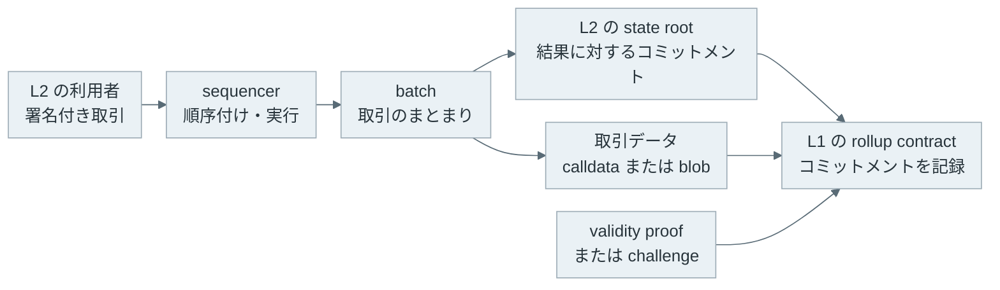
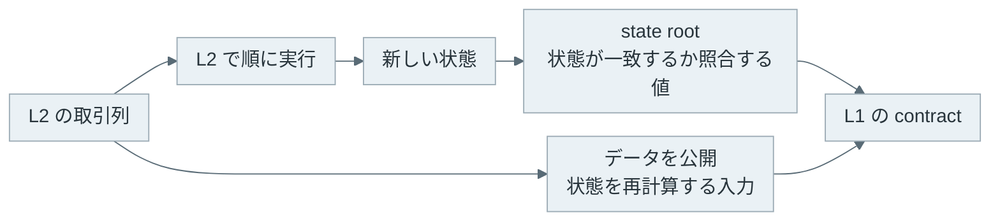

[Rollup](https://ethereum.org/en/developers/docs/scaling/rollups/) は、取引の実行と状態の更新を Layer 2（L2）でまとめ、Layer 1（L1）に検証に必要なデータまたは証明を送るスケーリング手法です。Ethereum を L1 とする rollup では、L2 の利用者が送った取引を sequencer（シーケンサー）が順に実行し、まとまりごとの結果を Ethereum に提出します。

L2 が取引を実行しても、利用者が L2 の運営者を無条件に信用する仕組みではありません。L1 に残すコミットメント、取引データ、証明のどれを検証できるかが、L2 の状態を復元できる条件と不正な更新を拒否できる条件を決めます。

 

本記事では、L1 と L2 の役割、state root（状態ルート）と data availability（データ可用性）の違い、Optimistic Rollup と ZK Rollup が更新を検証する方法を説明します。

- L2 はどの処理を L1 の外に出し、L1 には何を残すのか。
- state root だけでは、なぜ利用者が L2 の状態を再計算できないのか。
- 異議申し立てとゼロ知識証明では、いつ出金を確定できるのか。
- [EIP-4844](https://eips.ethereum.org/EIPS/eip-4844) の blob は、どのコストを下げ、どの問題を解決しないのか。

L1 に取引を入れるまでの流れは [Ethereum Transaction](../ethereum-transaction/)、L1 自体の取引確定の考え方は [Finality](../finality/) で説明しています。本記事でいう確定は、L2 の batch が各 rollup の規則を満たして L1 のコントラクトに受け入れられた状態を指します。L1 のブロックがどの程度巻き戻りにくいかという finality とは分けて扱います。

---

### L1 と L2 の分担

Ethereum では、取引をブロックに入れる時に全ての検証ノードが同じ順序で実行し、状態更新を確かめます。この性質は誰でも結果を検証できる根拠になりますが、計算とデータを各ノードが処理するため、取引の処理量には限りがあります。

rollup は、利用者の取引を L2 で実行してから、複数の結果を batch にまとめます。L1 は L2 の各取引を通常は一件ずつ再実行せず、batch に対応する状態へのコミットメントと、rollup が採用する検証材料を受け取ります。取引を L2 内でまとめることで、L1 に載せる処理を減らせます。

ただし、L2 に順序を決める主体がいることと、その主体が状態を自由に改竄できることは同じではありません。例えば利用者は、sequencer が表示する残高だけを信用するのではなく、公開された取引データから計算した状態と L1 に記録されたコミットメントを照合できます。どの利用者が直接 L1 に取引を提出できるか、sequencer が停止した時にどうするかは、rollup ごとに異なります。


- title: L2
  body: 利用者の取引を受け取り、順序を決めて実行し、batch と新しい状態を作ります。sequencer がこの役割を担う構成が多くあります。
- title: L1
  body: L2 のコミットメントと、取引データ、proof または challenge を受け取り、rollup の規則に従って更新を受け入れます。
- title: 利用者・検証者
  body: 公開されたデータから L2 の状態を復元・検証します。不正を発見した時に誰が challenge を提出できるかは実装ごとに確認が必要です。


L2 の実行結果が正しいことと、L1 の資産を引き出せることにも段階があります。L2 が取引を受け付けた時点、batch を L1 に提出した時点、L1 の規則で出金を認める時点は一致しません。ウォレットに表示された「完了」だけから、L1 に戻す資産が既に引き出せるとは判断できません。

---

### state root と取引データ

L2 の state root は、アカウント残高やコントラクトの保存状態を Merkle tree（マークル木）などで要約した識別子です。状態の一部と Merkle proof があれば、その一部が特定の state root に含まれることを検証できます。[Merkle Tree](../merkle-tree/) で扱ったように、root が変われば対応する木の内容も変わります。

しかし、root は状態の要約であり、全ての取引や状態そのものではありません。例えば、新しい root と古い root だけが L1 にあっても、検証者はどの送金をどの順序で実行してその root になったかを再計算できません。state root の提出だけでは、L2 の状態を自力で復元する材料が足りません。

data availability は、検証者が必要な取引データを取得できる性質です。rollup が取引データを L1 に公開する場合、L2 の運営者がデータ配布を止めても、L1 のデータから別の参加者が状態を再計算できます。一方で、L2 の運営者だけが取引データを持ち、root だけを L1 に送る構成では、root を検証する参加者が入力を入手できません。この構成は一般に validium などと区別され、rollup と呼ぶ範囲は資料によって異なります。

L1 にデータがあることは、すぐに全員が L2 の状態を計算することや、L2 の API が常に応答することを保証しません。利用者がデータを取得・実行するソフトウェア、実装された exit（退出・出金）の手順、L1 の手数料も必要です。data availability は、その前提の一つです。

---

### Optimistic Rollup の challenge

[Optimism の仕様](https://specs.optimism.io/fault-proof/index.html) のような Optimistic Rollup は、L1 に提出された状態更新を直ちに全て再実行して検証するのではなく、challenge 期間中に異議がなければ受け入れる設計を取ります。不正な state root を提出したと考える参加者は、取引実行に関する fault proof（不正を示す証明）を提出して争えます。

challenge は「誰かが不正だと主張した」だけで状態を巻き戻す処理ではありません。L1 の規則が proof を検証し、どちらの主張が正しいかを決めます。実際の proof の分割方法、異議を申し立てられる主体、bond（担保）、争いが長引く場合の手順は実装に依存します。

この設計では、通常の batch は proof を伴わずに先へ進められますが、L1 に戻す出金には challenge 期間を待つ場合があります。これは L2 上で取引を受け付ける速さとは別の待ち時間です。第三者が L1 に送ったデータを取得して検証できなければ、不正な更新に challenge することもできないため、data availability はこの方式でも必要です。

---

### ZK Rollup の validity proof

[Zero-Knowledge Proof](../zero-knowledge-proof/) を使う ZK Rollup は、batch の実行が規則に従ったことを示す validity proof（有効性証明）を L1 の verifier contract（検証コントラクト）に提出します。L1 は proof を検証し、受け入れた batch の state root を更新します。名称に ZK とありますが、rollup で使う証明が常に取引内容を隠すためのものとは限りません。ここで重要なのは、L1 が短い証明から状態遷移の正しさを検証できる点です。

proof が検証されてから L1 上の出金を受け付ける構成では、Optimistic Rollup のように不正を待ち受ける challenge 期間は必要ありません。ただし、proof を作る時間、batch の提出間隔、L1 のブロックへの取り込み、L1 の finality は残ります。「ZK Rollup なら即時に出金できる」とは限りません。

証明の soundness（健全性）に加え、circuit（回路）と verifier の実装、prover を運用する主体、取引データの公開方法も安全性に関わります。proof が正しい遷移を示しても、利用者が必要なデータを得られず、自分の資産を扱う手順を実行できなければ別の問題が残ります。

| 検証方法 | L1 が受け取る主な材料 | L1 に戻す出金で主に待つ条件 |
| --- | --- | --- |
| Optimistic Rollup | 状態へのコミットメント、取引データ、challenge 時の fault proof | challenge 期間と L1 側の処理 |
| ZK Rollup | 状態へのコミットメント、取引データ、validity proof | proof の生成・検証と L1 側の処理 |

この表は検証の違いを示したものです。手数料、sequencer の停止時の挙動、bridge の管理者権限、withdrawal の API は個別の L2 と bridge の仕様で確認する必要があります。

---

### blob と EIP-4844

[EIP-4844](https://eips.ethereum.org/EIPS/eip-4844) は、blob-carrying transaction（blob を運ぶ取引）を Ethereum に追加しました。blob は大きなバイト列を短期間公開するためのデータで、EVM の opcode から直接読める calldata とは異なります。rollup は batch の取引データを blob に置き、L1 上の検証コントラクトには blob の versioned hash（バージョン付きハッシュ）を渡せます。

この仕組みは、rollup が L1 に公開するデータのために使うブロックスペースを通常の calldata と分けます。EIP-4844 は blob 用の手数料市場を定め、rollup のデータ公開コストを下げることを目的にしています。blob を長期間全ての実行ノードが保存し続けるための仕様ではなく、仕様上の保持期間は少なくとも 4096 epoch です。過去の blob を後から取得する用途では、アーカイブや別の保存手段が必要になります。

EIP-4844 は L2 の全ての問題を解決する変更ではありません。blob は sequencer が取引を検閲しないこと、rollup のコードに欠陥がないこと、利用者が任意の時点で出金できることを保証しません。また、L1 にデータを出す方法が calldata から blob に変わっても、Optimistic Rollup では challenge の条件、ZK Rollup では proof の条件を満たす必要があります。

rollup を比較する時は「L2 の手数料が安いか」だけでなく、取引データをどこで得るか、状態遷移をどう検証するか、sequencer が停止した時と L1 に資産を戻す時にどの経路を使うかを分けて確認する必要があります。
